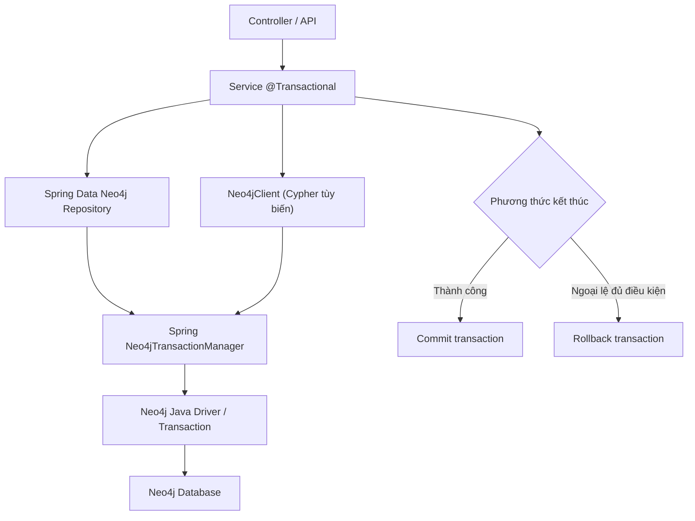
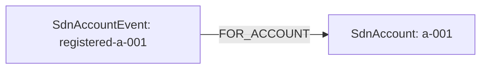
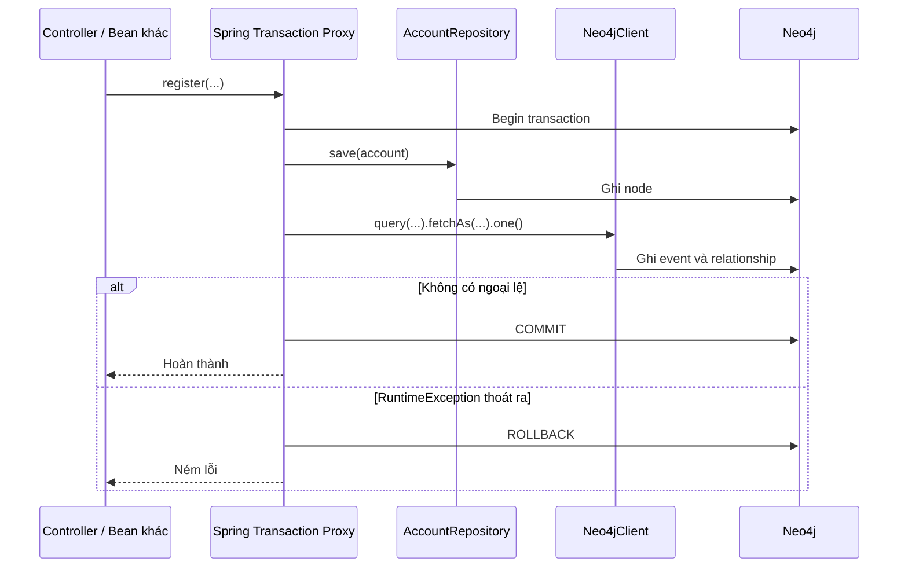

# Ranh giới @Transactional và phối hợp với Neo4jClient trong Spring Data Neo4j

Trong ứng dụng **Spring Data Neo4j (SDN)**, một nghiệp vụ có thể vừa dùng **repository** để lưu entity, vừa dùng **`Neo4jClient`** để chạy Cypher tùy biến. Ví dụ: khi đăng ký một tài khoản, ứng dụng tạo node `:SdnAccount` rồi tạo node sự kiện `:SdnAccountEvent` và relationship `:FOR_ACCOUNT`. Nếu bước thứ hai thất bại, nghiệp vụ muốn **rollback cả hai thay đổi**.

**`@Transactional`** giúp xác định phạm vi commit/rollback ở tầng Spring. Để annotation thực sự có tác dụng, cần hiểu nó được xử lý bằng **transaction manager nào**, lời gọi có đi qua cơ chế quản lý transaction của Spring hay không, và repository với `Neo4jClient` có đang dùng **cùng cơ sở dữ liệu, cùng cơ chế transaction** hay không.

Bài thuộc chương **Spring Data Neo4j** trong module **DATABASE_ENGINE_GRAPH_NEO4J**. Nội dung kết nối mô hình **property graph**, truy vấn **Cypher**, **Neo4j Java Driver** và transaction của Spring để thiết kế thao tác dữ liệu liên kết nhất quán.

## 1. Transaction nằm ở đâu khi dùng Spring Data Neo4j?

Neo4j hỗ trợ transaction trên database. Spring Data Neo4j đặt một lớp tích hợp phía trên, để nhiều thao tác repository hoặc `Neo4jClient` được thực hiện trong transaction phù hợp với ngữ cảnh Spring.



Sơ đồ thể hiện **trường hợp cấu hình đúng một transaction manager Neo4j và một lời gọi được Spring quản lý**. Một lời gọi trực tiếp vào Java Driver với `driver.session()` riêng hoặc một giao dịch JDBC/JPA khác **không tự trở thành thành viên của transaction Neo4j** chỉ vì chúng xuất hiện trong cùng service.

Các thành phần có vai trò khác nhau:

| Thành phần | Chức năng |
| --- | --- |
| `@Transactional` | Khai báo ranh giới và quy tắc transaction cho phương thức/lớp |
| `Neo4jTransactionManager` | Tích hợp transaction Neo4j với hạ tầng transaction của Spring (imperative) |
| `Neo4jRepository` | API làm việc với entity graph được mapping bởi SDN |
| `Neo4jClient` | API chạy Cypher tùy biến, binding tham số và mapping kết quả |
| Neo4j Java Driver | Gửi Cypher và transaction đến Neo4j qua kết nối phù hợp |
| Database Neo4j | Thực thi, commit hoặc rollback thay đổi node, relationship và property |

**Ranh giới nghiệp vụ** thường thuộc về **service method**, bởi một thao tác có thể gồm nhiều lời gọi repository và Cypher chứ không chỉ một lệnh lưu.

## 2. Khi nào nên có `@Transactional`?

Xét nghiệp vụ đăng ký tài khoản:

1. Lưu node `:SdnAccount` bằng repository.
2. Ghi sự kiện `:SdnAccountEvent`.
3. Tạo quan hệ `(event)-[:FOR_ACCOUNT]->(account)`.
4. Xác nhận thành công khi **cả ba** thao tác đã thực hiện hợp lệ.

Nếu ba thao tác ở **cùng transaction Neo4j**, chúng được xác nhận cùng nhau. Nếu mỗi thao tác tự chạy trong transaction riêng, bước lưu account đã commit có thể vẫn còn khi việc tạo event lỗi.

| Kiểu tác vụ | Có nên đặt cùng một transaction? | Lý do |
| --- | --- | --- |
| Lưu account và gắn event cho chính account đó | **Có**, nếu thuộc một đơn vị nghiệp vụ | Tránh trạng thái chỉ có một nửa dữ liệu |
| Đọc vài repository để tính kết quả nhất quán theo nghiệp vụ | **Thường nên cân nhắc** read transaction | Có phạm vi đọc xác định |
| Đọc báo cáo rất dài rồi gọi dịch vụ HTTP | **Tránh giữ transaction mở suốt cả lời gọi bên ngoài** | Giao dịch dài giữ tài nguyên, tăng độ trễ |
| Ghi Neo4j rồi gửi email | Chỉ email **không** thuộc transaction Neo4j | Rollback database không thu hồi được email |
| Ghi Neo4j và đồng thời ghi một database khác | Không mặc định atomic | Cần thiết kế nhất quán liên hệ thống riêng |

`@Transactional` không phải cơ chế “bao toàn bộ mọi tác động của Java”. Nó quy định transaction của **những tài nguyên được transaction manager phù hợp tham gia quản lý**.

## 3. Chuẩn bị graph minh họa

Ta dùng node tài khoản và sự kiện để quan sát commit/rollback:



Khi triển khai thực tế, có thể đặt constraint cho khóa nghiệp vụ:

```cypher
CREATE CONSTRAINT sdn_account_id_unique IF NOT EXISTS
FOR (a:SdnAccount)
REQUIRE a.accountId IS UNIQUE;
```

```cypher
CREATE CONSTRAINT sdn_account_event_id_unique IF NOT EXISTS
FOR (e:SdnAccountEvent)
REQUIRE e.eventId IS UNIQUE;
```

Dùng những lệnh này trên **database thực hành** trước khi chạy service. Chúng là thao tác schema và yêu cầu quyền thích hợp, không nên được tạo lại mỗi request. Constraint hỗ trợ tính duy nhất và truy cập bằng khóa; chúng **không thay thế** ranh giới transaction của nghiệp vụ.

### 3.1. Entity được mapping bởi SDN

Ví dụ một entity Java cho node `SdnAccount`:

```java
import org.springframework.data.annotation.Id;
import org.springframework.data.neo4j.core.schema.Node;

@Node("SdnAccount")
public class Account {
    @Id
    private String accountId;
    private String displayName;

    public Account() {
        // Dành cho cơ chế mapping của Spring Data.
    }

    public Account(String accountId, String displayName) {
        this.accountId = accountId;
        this.displayName = displayName;
    }

    public String getAccountId() {
        return accountId;
    }

    public String getDisplayName() {
        return displayName;
    }

    public void setAccountId(String accountId) {
        this.accountId = accountId;
    }

    public void setDisplayName(String displayName) {
        this.displayName = displayName;
    }
}
```

`@Node("SdnAccount")` ánh xạ entity sang nhãn node. `@Id` dùng trường `accountId` làm định danh nghiệp vụ trong SDN. Không nhầm `@Id` trong entity với việc Neo4j tự tạo **uniqueness constraint**; constraint đã được tạo tường minh ở trên.

### 3.2. Repository

```java
import org.springframework.data.neo4j.repository.Neo4jRepository;

public interface AccountRepository
        extends Neo4jRepository<Account, String> {
}
```

Repository cung cấp các thao tác như `save(...)`, `findById(...)`. Khi được gọi trong transaction do Spring quản lý đúng, các thao tác này tham gia transaction đó.

## 4. Kết hợp repository và `Neo4jClient` trong cùng service

`Neo4jClient` là API của Spring Data Neo4j để thực thi **Cypher tự viết**, binding tham số và ánh xạ dữ liệu. Nó hữu ích khi cần truy vấn quan hệ đặc biệt hoặc cập nhật graph khó biểu diễn bằng một phương thức repository.

Ví dụ service thực hiện cả hai thao tác dưới một transaction:

```java
import org.springframework.data.neo4j.core.Neo4jClient;
import org.springframework.stereotype.Service;
import org.springframework.transaction.annotation.Transactional;

import java.util.Objects;

@Service
public class AccountRegistrationService {

    private final AccountRepository repository;
    private final Neo4jClient neo4jClient;

    public AccountRegistrationService(
            AccountRepository repository,
            Neo4jClient neo4jClient) {
        this.repository = repository;
        this.neo4jClient = neo4jClient;
    }

    @Transactional
    public void register(
            String accountId,
            String displayName,
            boolean simulateFailure) {

        Objects.requireNonNull(accountId, "accountId");
        Objects.requireNonNull(displayName, "displayName");

        // Bước 1: SDN Repository ghi node SdnAccount.
        repository.save(new Account(accountId, displayName));

        // Bước 2: Neo4jClient tạo event và relationship.
        long linked = neo4jClient.query("""
                MATCH (a:SdnAccount {accountId: $accountId})
                MERGE (e:SdnAccountEvent {eventId: $eventId})
                ON CREATE SET e.kind = 'REGISTERED',
                              e.createdAt = datetime()
                MERGE (e)-[:FOR_ACCOUNT]->(a)
                RETURN count(e) AS linked
                """)
            .bind(accountId).to("accountId")
            .bind("registered-" + accountId).to("eventId")
            .fetchAs(Long.class)
            .mappedBy((typeSystem, record) ->
                record.get("linked").asLong()
            )
            .one()
            .orElseThrow();

        if (linked != 1) {
            throw new IllegalStateException("Cannot link audit event");
        }

        // Dùng để kiểm chứng rollback trên database thực hành.
        if (simulateFailure) {
            throw new IllegalStateException("Demo rollback");
        }
    }
}
```

Giả thiết để ví dụ có ý nghĩa:

- `AccountRepository` và `Neo4jClient` do **cùng ngữ cảnh SDN** cung cấp.
- Spring đã cấu hình **Neo4jTransactionManager** (imperative), và `@Transactional` chọn đúng manager đó.
- Phương thức `register(...)` được **bean khác gọi qua proxy Spring**, không phải một lời gọi nội bộ bỏ qua interceptor.
- Hai thành phần làm việc trên **cùng database Neo4j** trong ngữ cảnh transaction đang có.

Trong trường hợp này, service không gọi `commit()` trực tiếp. Spring mở transaction trước khi chạy phương thức và commit khi phương thức kết thúc bình thường. Nếu `IllegalStateException` thoát ra khỏi phương thức, Spring sẽ rollback transaction theo quy tắc mặc định.

### 4.1. Hai lượt gọi để kiểm chứng

Lượt thành công:

```java
accountRegistrationService.register("a-001", "An", false);
```

Kiểm tra database:

```cypher
MATCH (a:SdnAccount {accountId: 'a-001'})
OPTIONAL MATCH (e:SdnAccountEvent)-[:FOR_ACCOUNT]->(a)
RETURN a.accountId AS accountId,
       a.displayName AS name,
       collect(e.eventId) AS eventIds;
```

Mong đợi có node account và event `registered-a-001`.

Lượt lỗi có chủ đích trên một ID **mới**:

```java
accountRegistrationService.register("a-rollback", "Test", true);
```

Nếu transaction được quản lý đúng, phương thức ném ngoại lệ và **không commit** thay đổi nào của lượt này. Đối chiếu:

```cypher
OPTIONAL MATCH (a:SdnAccount {accountId: 'a-rollback'})
OPTIONAL MATCH (e:SdnAccountEvent {eventId: 'registered-a-rollback'})
RETURN a IS NOT NULL AS accountExists,
       e IS NOT NULL AS eventExists;
```

Kết quả mong đợi: `accountExists = false` và `eventExists = false`. Nếu một trong hai vẫn còn, cần kiểm tra liệu repository hoặc `Neo4jClient` có chạy ngoài transaction, trên database khác, hay có thao tác đã commit từ trước.

**Phân biệt:** rollback chỉ hoàn tác thay đổi thuộc **transaction vừa thất bại**. Nó không xóa những node/event đã commit từ lượt chạy khác.

## 5. Cơ chế mặc định của `@Transactional`

Trong mô hình Spring imperative thông thường, annotation dùng các thuộc tính để xác định propagation, isolation, read-only và điều kiện rollback.

| Thuộc tính | Mặc định hoặc ý nghĩa | Khi cần thay đổi |
| --- | --- | --- |
| `propagation` | `REQUIRED`: tham gia transaction có sẵn hoặc tạo mới | Khi nghiệp vụ yêu cầu một transaction độc lập có chủ đích |
| `readOnly` | `false` | Truy vấn đọc có thể khai báo `true` để thể hiện ý định |
| `rollbackFor` | Mặc định rollback với `RuntimeException` và `Error` | Khi muốn rollback với checked exception |
| `noRollbackFor` | Bỏ rollback cho các ngoại lệ được chọn | Cần quyết định nhất quán nghiệp vụ, tránh lạm dụng |
| `transactionManager` / `value` | Chỉ định transaction manager theo tên/qualifier | Hệ thống có nhiều transaction manager |
| `timeout` | Giới hạn thời gian ở tầng transaction nếu được hỗ trợ | Tránh nghiệp vụ giữ transaction quá lâu |

Không phải mọi thuộc tính, đặc biệt **isolation** hoặc **timeout**, đều có hành vi giống nhau trên tất cả transaction manager. Cần kiểm tra khả năng hỗ trợ của Neo4j và phiên bản Spring Data Neo4j thay vì áp quy tắc của JDBC/JPA một cách máy móc.

### 5.1. Ngoại lệ runtime gây rollback

```java
@Transactional
public void updateAndReject() {
    repository.save(new Account("a-002", "Binh"));
    throw new IllegalStateException("Business validation failed");
}
```

`IllegalStateException` là `RuntimeException`. Nếu nó **thoát khỏi ranh giới phương thức được Spring intercept**, transaction được đánh dấu rollback và không commit node `a-002`.

### 5.2. Checked exception không rollback mặc định

```java
@Transactional(rollbackFor = Exception.class)
public void updateAndValidate() throws Exception {
    repository.save(new Account("a-003", "Chi"));
    throw new Exception("External validation failed");
}
```

`rollbackFor = Exception.class` được khai báo để yêu cầu rollback cả khi ngoại lệ checked thoát ra. Nếu bỏ cấu hình này, quy tắc rollback mặc định thường **không rollback** với checked `Exception`, trừ khi có cấu hình toàn cục khác.

### 5.3. Bắt và nuốt exception có thể làm giao dịch commit

```java
@Transactional
public void incorrectFlow() {
    repository.save(new Account("a-004", "Dung"));

    try {
        validateExternalCondition();
    } catch (IllegalStateException ex) {
        // Sai nếu nghiệp vụ cần rollback:
        // chỉ log rồi kết thúc phương thức như thể đã thành công.
        logValidationFailure(ex);
    }
}
```

Nếu ngoại lệ được xử lý bên trong mà **không đi qua transaction interceptor**, phương thức có thể kết thúc bình thường và Spring có thể commit. Cần **ném lại ngoại lệ**, hoặc chủ động đánh dấu rollback-only theo cách phù hợp khi không thể ném. Lưu ý ngoại lệ phát sinh từ một thành phần transactional khác có thể đã đánh dấu rollback-only, khiến commit cuối báo `UnexpectedRollbackException`; vì vậy không nên chỉ dựa vào việc `try/catch` có tồn tại để dự đoán kết quả.

## 6. `Neo4jClient`: truy vấn có tham số và ánh xạ dữ liệu

Cú pháp `Neo4jClient` khác với `Neo4j Java Driver` cấp thấp, dù cuối cùng cùng thực thi Cypher tại Neo4j. Các thao tác điển hình gồm:

- `query(cypher)`: xác định câu Cypher.
- `bind(value).to("name")` hoặc `bindAll(map)`: truyền dữ liệu vào `$name`.
- `fetch().all()/one()`: lấy dữ liệu dạng map khi phù hợp.
- `fetchAs(Type.class).mappedBy(...)`: tùy biến cách biến bản ghi thành DTO/giá trị Java.
- `run()`: thực thi câu lệnh khi không cần nhận các hàng kết quả.

Ví dụ đọc một DTO:

```java
public record AccountView(
    String accountId,
    String displayName
) {}
```

```java
import org.springframework.data.neo4j.core.Neo4jClient;
import java.util.Optional;

public class AccountLookup {
    private final Neo4jClient neo4jClient;

    public AccountLookup(Neo4jClient neo4jClient) {
        this.neo4jClient = neo4jClient;
    }

    public Optional<AccountView> find(String accountId) {
        return neo4jClient.query("""
                MATCH (a:SdnAccount {accountId: $id})
                RETURN a.accountId AS id,
                       a.displayName AS name
                """)
            .bind(accountId).to("id")
            .fetchAs(AccountView.class)
            .mappedBy((typeSystem, record) ->
                new AccountView(
                    record.get("id").asString(),
                    record.get("name").asString()
                )
            )
            .one();
    }
}
```

`fetchAs(...).mappedBy(...)` ánh xạ các cột đã đặt alias thành `AccountView`. Hai giá trị `id` và `name` trong `record.get(...)` là **alias trả về**, khác với tên tham số `$id` dù có thể trùng ký tự.

Nếu query trả nhiều hàng, dùng `all()` và giới hạn kết quả phù hợp. Nếu query không tìm thấy account, `one()` trả `Optional.empty()`, còn nếu query logic trả quá một hàng trong trường hợp mong một hàng, nên điều tra dữ liệu hoặc điều kiện lọc.

### 6.1. Truy vấn cập nhật không cần trả bản ghi

```java
neo4jClient.query("""
        MATCH (a:SdnAccount {accountId: $id})
        SET a.displayName = $name
        """)
    .bind(accountId).to("id")
    .bind(displayName).to("name")
    .run();
```

Lệnh này chạy Cypher. Nếu `MATCH` không tìm thấy account, truy vấn có thể hoàn tất mà **không cập nhật node nào**. Khi nghiệp vụ bắt buộc entity tồn tại, nên `RETURN` khóa hoặc đếm kết quả đã xác nhận để phân biệt “thành công” với “không có đối tượng cần sửa”.

### 6.2. Trả về dữ liệu nhỏ, rõ schema

```cypher
MATCH (a:SdnAccount {accountId: $id})
RETURN a.accountId AS id,
       a.displayName AS name;
```

Dùng projection các thuộc tính cần thiết và alias ổn định giúp mapper dễ bảo trì hơn việc trả cả `node` rồi xử lý mọi property trong controller.

### 6.3. Tại sao binding tham số quan trọng?

Sai:

```java
String unsafe = "MATCH (a:SdnAccount {accountId:'"
        + accountId + "'}) RETURN a";
```

Đúng:

```java
neo4jClient.query("""
    MATCH (a:SdnAccount {accountId: $id})
    RETURN a.accountId AS id
    """)
    .bind(accountId).to("id")
    .fetchAs(String.class)
    .mappedBy((typeSystem, record) ->
        record.get("id").asString()
    )
    .one();
```

Các tham số ngăn giá trị đầu vào bị biến thành cú pháp Cypher và giúp truyền đúng kiểu. Tuy nhiên, cú pháp động về nhãn, loại quan hệ hoặc tên trường sắp xếp cần thiết kế riêng theo khả năng của phiên bản Neo4j; **không ghép trực tiếp các mảnh Cypher từ đầu vào không tin cậy**.

## 7. Vì sao hai lời gọi có thể không dùng chung transaction?

Cần phân biệt những cách gọi nhìn bề ngoài giống nhau:

### 7.1. Repository và Neo4jClient bên trong service `@Transactional`

```java
@Transactional
public void updateTogether() {
    repository.save(account);
    neo4jClient.query("MATCH ... SET ...").run();
}
```

Khi **cùng Spring transaction manager và cùng database**, hai thao tác có thể thuộc **cùng transaction**. Đây là mô hình mà bài học khuyến nghị khi xử lý một đơn vị nghiệp vụ.

### 7.2. Hai lời gọi độc lập ngoài một ranh giới chung

```java
repository.save(account);
neo4jClient.query("MATCH ... SET ...").run();
```

Nếu không có transaction bao quanh từ caller, hai lời gọi **không mặc nhiên là một transaction chung**. Một lời gọi có thể commit trước khi lời gọi khác thất bại.

### 7.3. Tạo Java Driver session riêng

```java
try (var session = driver.session()) {
    session.run("CREATE (:SdnDiagnostic {message:'ok'})")
           .consume();
}
```

Một `Session` tự tạo bằng Java Driver **không tự tham gia transaction Spring của SDN**. Nếu đặt lệnh này trong phương thức có `@Transactional`, không được mặc định việc rollback repository sẽ hoàn tác node `SdnDiagnostic` đã được commit trong session khác.

**Không trộn các con đường truy cập dữ liệu trong cùng nghiệp vụ nếu chưa hiểu ranh giới transaction.** Khi cần câu Cypher tùy biến, ưu tiên `Neo4jClient` đã tích hợp với SDN, hoặc thiết kế rõ một cơ chế transaction duy nhất được quản lý.

## 8. Các tình huống `@Transactional` không được áp dụng như mong đợi

### 8.1. Self-invocation: gọi phương thức từ cùng đối tượng

```java
@Service
public class WrongRegistrationService {

    public void handleRequest() {
        saveWithTransaction(); // Lời gọi this.saveWithTransaction().
    }

    @Transactional
    public void saveWithTransaction() {
        // repository.save(...);
        // neo4jClient.query(...).run();
    }
}
```

Ở chế độ **proxy transaction mặc định của Spring**, lời gọi nội bộ trong cùng bean có thể **không đi qua proxy**, nên annotation trên `saveWithTransaction()` không kích hoạt transaction như dự kiến. Cách đơn giản và rõ là đặt `@Transactional` trên phương thức service thực sự được bean khác gọi qua proxy, hoặc tách sang một service bean khác.

Các tình huống tương tự có thể xảy ra khi annotation đặt trên phương thức không được cơ chế proxy intercept (chẳng hạn một số phương thức private/final, phụ thuộc cấu hình proxy).

### 8.2. Hệ thống có nhiều transaction manager

Giả sử ứng dụng có cả **JPA/JDBC** và **Neo4j**. Nếu có nhiều bean transaction manager mà không có lựa chọn rõ ràng, `@Transactional` có thể chọn manager không đúng hoặc không xác định được manager.

Khi tổ chức đã đăng ký transaction manager Neo4j với tên rõ ràng, có thể khai báo:

```java
@Transactional(transactionManager = "neo4jTransactionManager")
public void updateGraph() {
    // Các thao tác SDN cần dùng đúng Neo4j transaction manager.
}
```

**`"neo4jTransactionManager"` ở đây là ví dụ tên bean**: chỉ dùng khi ứng dụng thực sự có bean/qualifier tương ứng. Không suy đoán mọi dự án Spring Boot đều tự tạo cùng tên. Ghi rõ transaction manager cho phương thức và kiểm tra cấu hình khi có nhiều nguồn dữ liệu.

Một transaction JPA và một transaction Neo4j không mặc định atomic chỉ vì được gọi trong một phương thức Java. Cần outbox, saga, các bước bù hoặc kiến trúc đồng bộ dữ liệu phù hợp nếu doanh nghiệp yêu cầu tính nhất quán liên hệ thống.

### 8.3. Thay đổi propagation một cách thiếu chủ đích

`@Transactional` mặc định là `Propagation.REQUIRED`: tham gia transaction hiện có nếu có. Với `REQUIRES_NEW`, phương thức con có thể dùng **transaction mới độc lập** (khi được interceptor và manager hỗ trợ đúng).

```java
@Transactional(propagation = Propagation.REQUIRES_NEW)
public void auditSeparately() {
    // Có thể commit độc lập với transaction gọi bên ngoài.
}
```

Nếu `auditSeparately()` đã commit, rollback của transaction ngoài **không tự hoàn tác** transaction độc lập này. Đừng dùng `REQUIRES_NEW` chỉ để “khỏi bị rollback”; nó thay đổi ý nghĩa nghiệp vụ và có thể tăng nhu cầu kết nối/lock.

### 8.4. Lẫn reactive và imperative

Bài này dùng **imperative** `Neo4jClient` và `Neo4jTransactionManager`. Ứng dụng reactive sử dụng **`ReactiveNeo4jClient`**, **`ReactiveNeo4jTransactionManager`** và transaction gắn với **Reactor context**, không dựa vào cùng mô hình thread-bound của imperative code.

Trả `Mono`/`Flux` từ phương thức và tự `subscribe()` ngoài chuỗi transaction có thể làm thay đổi ranh giới thực thi và xử lý lỗi. Nếu ứng dụng dùng reactive SDN, phải áp dụng cách quản lý transaction reactive phù hợp, không chuyển nguyên ví dụ imperative sang reactive bằng cách thay kiểu trả về.

## 9. Đọc dữ liệu và `readOnly = true`

Một phương thức chỉ đọc có thể khai báo:

```java
@Transactional(readOnly = true)
public Optional<AccountView> findForDisplay(String id) {
    return neo4jClient.query("""
            MATCH (a:SdnAccount {accountId: $id})
            RETURN a.accountId AS id,
                   a.displayName AS name
            """)
        .bind(id).to("id")
        .fetchAs(AccountView.class)
        .mappedBy((typeSystem, record) ->
            new AccountView(
                record.get("id").asString(),
                record.get("name").asString()
            )
        )
        .one();
}
```

`readOnly = true` diễn đạt ý định chỉ đọc và có thể được transaction infrastructure/driver sử dụng để chọn cách truy cập phù hợp. **Không coi đây là cơ chế cấp quyền bảo mật**: quyền ghi thực tế phải được hạn chế bằng role/privilege trong Neo4j.

Nếu service vừa đọc vừa ghi theo một đơn vị nghiệp vụ, đừng chỉ dựa vào annotation `readOnly = true` đặt trên class mà quên phương thức ghi cần đặc tả phù hợp.

**Materialize kết quả trong transaction:** `Neo4jClient.fetchAs(...).one()/all()` ánh xạ kết quả thành object Java. Nếu dùng các kiểu lazy/streaming khác, phải hiểu phạm vi session/transaction và không đọc một luồng kết quả chưa hoàn tất sau khi tài nguyên đã đóng.

## 10. Repository `save()` và Cypher tùy biến: tránh cập nhật graph sai ý nghĩa

SDN mapping graph không giống một lệnh SQL `UPDATE` chỉ sửa một cột. Tùy entity và các relationship được mapping, thao tác `save()` có thể đồng bộ phần quan hệ mà entity đang quản lý. Nếu trước đó một câu Cypher riêng đã tạo quan hệ nhưng object entity trong Java chưa phản ánh phần đó, cần hiểu chiến lược mapping trước khi tiếp tục `save(entity)`.

Ví dụ:

- Entity `Account` chỉ ánh xạ `accountId` và `displayName`: repository dùng để lưu thuộc tính account.
- Cypher qua `Neo4jClient` tạo node sự kiện và quan hệ `FOR_ACCOUNT` không được mapping trong entity.
- Nếu sau này mở rộng entity để mapping tập `events` hoặc quan hệ khác, cách lưu aggregate có thể ảnh hưởng đến những relationship do entity quản lý.

Vì vậy:

1. **Chọn rõ phần graph do repository sở hữu** và phần cần Cypher tùy biến.
2. Không giả định `save()` luôn là “partial patch” không đụng relationship.
3. Dùng truy vấn `MATCH ... SET property` tường minh nếu chỉ cần thay một thuộc tính trên graph lớn.
4. Khi ghi nhiều quan hệ có cùng đầu mối, kiểm thử việc lưu entity sau khi thay đổi mapping, đặc biệt với collection relationship.
5. Duy trì **business key** và constraint nhất quán giữa repository và Cypher.

Tính đúng của mapping quyết định **dữ liệu nào được ghi**; transaction quyết định **toàn bộ những thay đổi đó commit hay rollback cùng nhau**. Cần cả hai.

## 11. Hành vi ngoại lệ, retry và tác động ngoài Neo4j

### 11.1. `@Transactional` không mặc định tự retry mọi lỗi

Spring xử lý commit/rollback theo quy tắc transaction; annotation `@Transactional` **không tự chạy lại phương thức nhiều lần** chỉ vì Neo4j gặp lỗi tạm thời. Nếu cần retry, phải xác định chính sách và thành phần thực hiện retry một cách chủ đích.

Trong khi đó, **managed transaction của Neo4j Java Driver** qua `session.executeWrite(...)` có cơ chế retry đối với một số lỗi retryable. Đây là một API và phạm vi khác; không đồng nhất hành vi của driver với mọi lời gọi repository/`Neo4jClient` qua Spring.

### 11.2. Lời gọi HTTP/email không được rollback cùng graph

Ví dụ nên tránh:

```java
@Transactional
public void registerAndEmail(String id) {
    repository.save(new Account(id, "User"));
    emailService.sendWelcome(id);  // Email gửi rồi không thu hồi được.
    throw new IllegalStateException("Fail after sending email");
}
```

Dữ liệu Neo4j có thể rollback, nhưng email đã gửi vẫn tồn tại. Hướng tiếp cận phổ biến:

- Ghi một **outbox/event node** trong Neo4j cùng transaction với dữ liệu nghiệp vụ.
- Có tác vụ riêng đọc event đã commit và gửi email/message.
- Lưu trạng thái đã gửi, retry và idempotency để tránh gửi trùng.

Spring còn có `@TransactionalEventListener(phase = TransactionPhase.AFTER_COMMIT)` để xử lý sự kiện **sau commit** trong những trường hợp phù hợp. Tuy vậy, callback nội bộ sau commit không tự tạo hệ thống giao hàng bền vững nếu ứng dụng crash; với tác vụ quan trọng nên cân nhắc **outbox** hoặc cơ chế tương đương.

### 11.3. Commit có thể thành công dù phía client không nhận xác nhận

Với sự cố mạng ngay lúc commit, có trường hợp ứng dụng không biết chắc database đã commit hay chưa. Không được đơn giản retry một thao tác `CREATE` không có business key vì có thể tạo bản ghi trùng.

Dùng khóa nghiệp vụ ổn định, unique constraint và thao tác idempotent thích hợp. Với ví dụ, `eventId = 'registered-' + accountId` cho phép xác định sự kiện đã tồn tại khi phát lại. Nếu cần xử lý nhiều lần đăng ký hợp lệ cho cùng account, định nghĩa định danh sự kiện khác cho từng **lần nghiệp vụ**, thay vì phụ thuộc vào chuỗi minh họa này.

## 12. Các lỗi thường gặp khi phối hợp repository và Neo4jClient

| Triệu chứng | Nguyên nhân có thể | Cách kiểm tra |
| --- | --- | --- |
| Repository đã lưu, Neo4jClient lỗi nhưng node vẫn còn | Hai lời gọi không cùng transaction hoặc phần đầu đã commit | Kiểm tra service `@Transactional`, transaction manager và database |
| `@Transactional` đặt trên phương thức nhưng không có rollback | Self-invocation hoặc lời gọi không qua proxy | Xem luồng gọi thực tế giữa các Spring bean |
| Ném checked exception nhưng dữ liệu vẫn commit | Thiếu cấu hình `rollbackFor` | Đối chiếu loại ngoại lệ và quy tắc rollback |
| Bắt lỗi rồi kết thúc phương thức, dữ liệu vẫn commit | Ngoại lệ bị xử lý và không báo tới transaction interceptor | Ném lại hoặc đánh dấu rollback-only nếu hợp lệ |
| Phương thức ghi chạy dưới manager JPA | Có nhiều transaction manager, chọn sai | Chỉ định manager Neo4j đúng bean |
| Dùng `driver.session()` riêng và không rollback cùng repository | Session/transaction độc lập | Dùng `Neo4jClient` hoặc cùng transaction được quản lý đúng |
| `Neo4jClient` trả `Optional.empty()` | `MATCH` không tìm node hoặc query không trả hàng | Kiểm tra khóa, tham số, alias, dữ liệu |
| Entity `save()` làm quan hệ không như mong đợi | Phạm vi mapping relationship không khớp graph hiện tại | Kiểm tra relationship mapping và logic lưu aggregate |
| API chậm vì transaction dài | Đọc rất nhiều node, gọi mạng ngoài, giữ lock | Rút ngắn transaction, tách thao tác ngoài database |
| Retry gây trùng node/event | Không có business key, constraint hoặc idempotency | Kiểm tra định danh và số bản ghi sau phát lại |

Mục tiêu điều tra là xác định **điểm commit** và **phạm vi tài nguyên**, không chỉ tìm xem annotation có xuất hiện trong file Java hay không.

## 13. Quy trình kiểm chứng ranh giới transaction

Trên database thực hành:

1. **Cấu hình đúng nguồn dữ liệu:** repository và `Neo4jClient` phải thuộc cùng Neo4j database, cùng transaction manager imperative.
2. **Tạo constraint** cho `SdnAccount.accountId` và `SdnAccountEvent.eventId` trước khi chạy service.
3. **Thử trường hợp thành công:** gọi `register("a-001", "An", false)` và xác nhận node account, event, relationship đều có.
4. **Thử rollback:** gọi `register("a-rollback", "Test", true)` từ một bean khác và xác nhận **không** có dữ liệu từ lần gọi thất bại.
5. **Thử thiếu node:** sửa câu Cypher theo hướng `MATCH` không khớp, kiểm tra phương thức có phát hiện zero-row và báo lỗi theo hợp đồng nghiệp vụ hay không.
6. **Thử ngoại lệ checked:** xem cấu hình `rollbackFor` để hiểu vì sao transaction commit hoặc rollback.
7. **Thử self-invocation có kiểm soát:** so sánh khi gọi qua proxy và gọi trong cùng bean.
8. **Kiểm tra môi trường có nhiều manager:** xác định bean transaction manager thực tế được annotation sử dụng.

Đừng chạy bước kiểm chứng lỗi có chủ đích trên dữ liệu production. Kết quả test phụ thuộc việc lớp service được tạo **bởi Spring**, lời gọi đi **qua proxy** và các thao tác sử dụng **cùng transaction Neo4j**.

### Luồng commit thành công so với rollback



Sơ đồ mô tả logic transaction, không mô tả chính xác số lượng lời gọi network hoặc cơ chế batching của driver.

## 14. Câu hỏi tự kiểm tra

**Câu 1.** Một service có `@Transactional` gọi `accountRepository.save(...)` rồi `neo4jClient.query(...).run()`. Điều kiện nào giúp hai thao tác rollback cùng nhau?

<details>
<summary>Gợi ý đáp án</summary>

Phải được gọi trong transaction Neo4j do Spring quản lý thực sự: phương thức đi qua transaction interceptor, annotation chọn đúng Neo4j transaction manager, repository và Neo4jClient cùng dùng ngữ cảnh transaction và database phù hợp. Khi lỗi đủ điều kiện rollback thoát ra, cả hai thay đổi chưa commit được hoàn tác.

</details>

**Câu 2.** Vì sao `@Transactional` trên phương thức `saveWithTransaction()` có thể không hoạt động khi `handleRequest()` trong cùng bean gọi nó?

<details>
<summary>Gợi ý đáp án</summary>

Ở chế độ Spring proxy thông thường, self-invocation không đi qua proxy transaction. Annotation ở phương thức được gọi nội bộ có thể không được intercept. Hãy đặt ranh giới transaction ở phương thức service được gọi qua proxy hoặc tách phương thức sang một bean khác.

</details>

**Câu 3.** Nếu phương thức `@Transactional` ném checked `Exception`, có chắc rollback không?

<details>
<summary>Gợi ý đáp án</summary>

Không. Theo quy tắc mặc định thông thường, Spring rollback khi `RuntimeException` hoặc `Error` thoát ra; checked exception có thể không rollback nếu chưa cấu hình `rollbackFor` hoặc chính sách toàn cục tương ứng.

</details>

**Câu 4.** Có thể thay `Neo4jClient` bằng `driver.session()` tự tạo bên trong service rồi vẫn tin rằng Spring rollback toàn bộ không?

<details>
<summary>Gợi ý đáp án</summary>

Không được mặc định như vậy. Session tự tạo từ Java Driver không tự tham gia transaction Neo4j do Spring Data quản lý. Cần dùng cơ chế được tích hợp hoặc quản lý ranh giới rõ ràng, không dựa vào vị trí dòng lệnh nằm trong cùng phương thức Java.

</details>

**Câu 5.** `Neo4jClient.query(...).run()` hoàn tất nhưng `MATCH` không tìm thấy node. Có thể báo cập nhật thành công không?

<details>
<summary>Gợi ý đáp án</summary>

Không tự động. Một query cập nhật 0 hàng có thể hoàn tất về mặt kỹ thuật. Nếu nghiệp vụ yêu cầu node tồn tại, hãy trả số bản ghi hoặc thuộc tính xác nhận, kiểm tra kết quả và phát sinh lỗi hợp lệ trước khi transaction commit.

</details>

**Câu 6.** Vì sao ghi account trong Neo4j rồi gửi email trong cùng `@Transactional` không bảo đảm email rollback nếu phía sau ném lỗi?

<details>
<summary>Gợi ý đáp án</summary>

Transaction manager Neo4j chỉ kiểm soát thay đổi Neo4j; email đã gửi là tác dụng phụ của hệ thống ngoài. Dùng sự kiện sau commit cho tác vụ phù hợp hoặc outbox/idempotency khi cần độ tin cậy cao.

</details>

**Câu 7.** Một bean dùng `@Transactional(readOnly = true)` để đọc account. Điều này có bảo đảm tài khoản Neo4j không có quyền ghi dữ liệu không?

<details>
<summary>Gợi ý đáp án</summary>

Không. `readOnly` là thuộc tính của transaction ở tầng Spring, có thể ảnh hưởng cách truy cập hoặc tối ưu, nhưng không thay thế hệ thống role/privilege trong Neo4j. Muốn ngăn ghi, cần quyền database phù hợp.

</details>

## Ghi nhớ

- **Đặt `@Transactional` ở service** để bao phủ đúng đơn vị nghiệp vụ gồm repository và `Neo4jClient`.
- **Cùng transaction manager Neo4j, cùng database và lời gọi qua Spring interceptor** là điều kiện trọng tâm để các thao tác commit/rollback cùng nhau.
- **Runtime exception mặc định gây rollback; checked exception thường cần `rollbackFor`**; nuốt exception có thể khiến phương thức commit ngoài dự định.
- **`Neo4jClient`** cung cấp `query`, `bind`, `fetchAs`, `mappedBy`, `run` để thực thi Cypher và ánh xạ DTO trong ngữ cảnh SDN.
- **Một Java Driver Session tự tạo, transaction JPA hoặc email** không tự tham gia transaction Neo4j do Spring quản lý.
- **`@Transactional` không tự retry mọi lỗi**, không bảo đảm distributed atomicity và không thay thế constraint/idempotency.
- Khi cần kết quả đúng và có thể kiểm chứng, hãy thử cả **commit thành công lẫn rollback chủ đích** trên database thực hành.

### Tài liệu tham khảo

- [Spring Data Neo4j — Reference documentation](https://docs.spring.io/spring-data/neo4j/reference/)
- [Spring Framework — Declarative transaction management](https://docs.spring.io/spring-framework/reference/data-access/transaction/declarative.html)
- [Spring Framework — Using @Transactional](https://docs.spring.io/spring-framework/reference/data-access/transaction/declarative/annotations.html)
- [Spring Framework — Rolling back a declarative transaction](https://docs.spring.io/spring-framework/reference/data-access/transaction/declarative/rolling-back.html)
- [Neo4j Java Driver — Transactions](https://neo4j.com/docs/java-manual/current/transactions/)
- [Neo4j Cypher — MERGE](https://neo4j.com/docs/cypher-manual/current/clauses/merge/)
