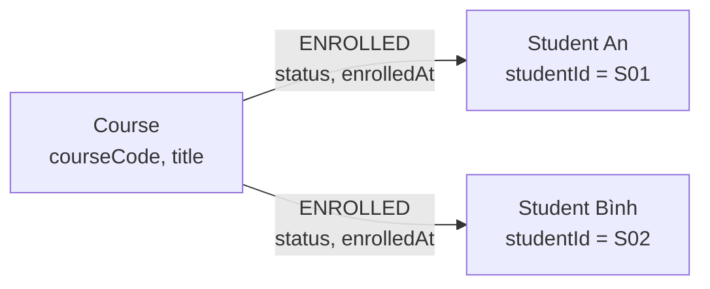

# Lưu đồ thị đối tượng, cập nhật quan hệ và tránh ghi ngoài ý muốn với Spring Data Neo4j

Khi dùng Spring Data Neo4j (SDN), thao tác `repository.save(entity)` trông giống việc lưu một Java object. Tuy nhiên, một object trong ứng dụng có thể đại diện cho **nhiều node và relationship** trong Neo4j. Vì vậy, `save()` có thể tác động tới **cả đồ thị đối tượng được ánh xạ**, chứ không đơn thuần sửa một property trên một node.

Điểm dễ gây lỗi nhất: ứng dụng đọc một entity **chỉ có một phần quan hệ**, chỉnh một trường nhỏ như `title`, rồi gọi `save()`. Nếu collection quan hệ đang thiếu dữ liệu, SDN có thể đồng bộ tập quan hệ trong database theo tập quan hệ hiện diện trong Java object và **xóa những cạnh không còn được biểu diễn**. Đây là hành vi quan trọng cần hiểu trước khi triển khai hệ thống.

Bài thuộc chương **Spring Data Neo4j** của module `DATABASE_ENGINE_GRAPH_NEO4J`: sử dụng property graph, Cypher, node, relationship, index, constraint và Java Driver để xây dựng ứng dụng với Neo4j. Trọng tâm là **ranh giới ghi**, **cập nhật quan hệ có chủ đích** và **bảo vệ graph khỏi thay đổi ngoài ý muốn** khi sử dụng repository, entity mapping hoặc Cypher.

> **Nguyên tắc:** chỉ dùng `save()` để đồng bộ một đồ thị đối tượng khi ứng dụng thực sự **sở hữu và hiểu đầy đủ phần graph đó**. Nếu chỉ cần cập nhật một thuộc tính hoặc một cạnh, thường nên dùng một câu Cypher **có phạm vi ghi chính xác** và transaction rõ ràng.

## 1. Mô hình object graph khác một hàng trong bảng

Trong Spring Data JPA, người học thường hình dung một object biểu diễn một hàng dữ liệu. Với Neo4j, entity được gắn `@Node` đại diện cho node, nhưng có thể chứa các field `@Relationship` kết nối tới **những entity khác**. Một lời gọi lưu có thể đi qua các quan hệ được ánh xạ.

Ví dụ về hệ thống đào tạo:



Một object `CourseNode` có collection `enrollments` gồm hai object `EnrollmentRel`. Mỗi `EnrollmentRel` lại chứa `StudentNode`. Đó là **object graph** ở JVM; trong Neo4j, chúng tương ứng với một node khóa học, hai node sinh viên và hai relationship.

Khi sửa tiêu đề khóa học, nghiệp vụ mong muốn:

```text
Trước: C101.title = "Cypher nhập môn"
       C101 ─ENROLLED→ S01
       C101 ─ENROLLED→ S02

Sau:   C101.title = "Cypher cơ bản"
       C101 ─ENROLLED→ S01
       C101 ─ENROLLED→ S02
```

Nhưng nếu dữ liệu Java chỉ còn `enrollments = [S01]` và được lưu lại như toàn bộ graph sở hữu, cạnh tới S02 có thể bị loại. Vì vậy phải biết **object đang đại diện cho graph đầy đủ hay một bản chiếu từng phần**.

## 2. Phân biệt các đường ghi trong SDN

| Cách ghi | Phạm vi thao tác thường thấy | Khi nào phù hợp | Rủi ro chính |
| --- | --- | --- | --- |
| `Neo4jRepository.save(entity)` | Lưu node gốc và graph liên quan theo metadata mapping | Tạo/lưu aggregate khi tập quan hệ do ứng dụng sở hữu là đầy đủ | Ghi lại/xóa relationship không còn trong model |
| `Neo4jTemplate.save(entity)` / `Neo4jOperations.save(entity)` | Cùng nhóm object-mapping persistence | Điều khiển thao tác lưu ở tầng service | Tương tự `save()` repository |
| `Neo4jOperations.saveAs(...)` khi phiên bản hỗ trợ | Lưu theo projection/predicate được lựa chọn | Có nhu cầu ghi một phần graph và hiểu rõ API | Entity được trả về có thể chỉ được hydrate một phần; dùng tiếp để `save` toàn phần dễ mất dữ liệu |
| `Neo4jClient.query(...).run()` | Cypher viết tường minh, chỉ ghi phần câu lệnh nhắm tới | Cập nhật một property, thêm/xóa một relationship | Người viết phải tự đảm bảo quy tắc nghiệp vụ, version và phạm vi truy vấn |
| Neo4j Java Driver với Cypher | Cypher tường minh qua driver | Batch, tích hợp thấp tầng hoặc thao tác đặc biệt | Phải quản lý transaction và tích hợp đúng với Spring |

Tài liệu Spring Data Neo4j mô tả `save()` có thể phát sinh **nhiều câu lệnh** để làm graph trong database khớp với object graph. Với relationship đã được ánh xạ, SDN có thể xóa và tạo lại những cạnh cần đồng bộ; vì vậy không nên xem `save()` là một câu `SET n.title = ...` đơn lẻ.

Lưu ý: hành vi chi tiết của câu Cypher sinh ra phụ thuộc **phiên bản SDN, metadata và cách tải entity**. Không nên dựa vào một thứ tự câu lệnh nội bộ cụ thể như một API ổn định.

## 3. Khai báo @Node, @Id và @Relationship

Ví dụ sau minh họa API ánh xạ phổ biến ở Spring Data Neo4j hiện đại (dòng 7.x/8.x). Chọn phiên bản Spring Boot/SDN/JDK tương thích theo BOM và tài liệu đang dùng; **không** trộn annotation của Neo4j-OGM cũ với SDN hiện đại.

### 3.1. Entity StudentNode

```java
import org.springframework.data.neo4j.core.schema.Id;
import org.springframework.data.neo4j.core.schema.Node;
import org.springframework.data.annotation.Version;

@Node("SdnDemoStudent")
public class StudentNode {

    @Id
    private String studentId;

    @Version
    private Long version;

    private String name;

    protected StudentNode() {}

    public StudentNode(String studentId, String name) {
        this.studentId = studentId;
        this.name = name;
    }

    public String getStudentId() {
        return studentId;
    }

    public String getName() {
        return name;
    }
}
```

`@Node("SdnDemoStudent")` chọn label trong Neo4j. `@Id` chọn khóa nghiệp vụ `studentId`; `@Version` hỗ trợ optimistic locking và giúp SDN phân biệt entity mới với entity đã tồn tại khi dùng business-assigned ID. **Không sửa `version` thủ công trong đường lưu bằng repository.**

### 3.2. Properties của relationship

Relationship `ENROLLED` mang trạng thái đăng ký và thời gian:

```java
import java.time.LocalDate;
import org.springframework.data.neo4j.core.schema.RelationshipId;
import org.springframework.data.neo4j.core.schema.RelationshipProperties;
import org.springframework.data.neo4j.core.schema.TargetNode;

@RelationshipProperties
public class EnrollmentRel {

    @RelationshipId
    private Long id;

    @TargetNode
    private StudentNode student;

    private String status;
    private LocalDate enrolledAt;

    protected EnrollmentRel() {}

    public EnrollmentRel(
            StudentNode student, String status, LocalDate enrolledAt) {
        this.student = student;
        this.status = status;
        this.enrolledAt = enrolledAt;
    }

    public StudentNode getStudent() {
        return student;
    }

    public String getStatus() {
        return status;
    }
}
```

`@TargetNode` chỉ node ở đầu kia của relationship; `@RelationshipId` lưu ID nội bộ của relationship để SDN theo dõi nó trong quá trình ánh xạ/lưu. **Không coi ID này là khóa nghiệp vụ bền vững hoặc tự gán một giá trị ID nội bộ tùy ý.** Nếu đăng ký có ID riêng từ hệ thống nguồn, cần thiết kế property khóa phù hợp và ràng buộc tương ứng.

### 3.3. Entity CourseNode

```java
import java.util.ArrayList;
import java.util.List;
import org.springframework.data.annotation.Version;
import org.springframework.data.neo4j.core.schema.Id;
import org.springframework.data.neo4j.core.schema.Node;
import org.springframework.data.neo4j.core.schema.Relationship;

@Node("SdnDemoCourse")
public class CourseNode {

    @Id
    private String courseCode;

    @Version
    private Long version;

    private String title;

    @Relationship(
        type = "SDN_DEMO_ENROLLED",
        direction = Relationship.Direction.OUTGOING
    )
    private List<EnrollmentRel> enrollments = new ArrayList<>();

    protected CourseNode() {}

    public CourseNode(String courseCode, String title) {
        this.courseCode = courseCode;
        this.title = title;
    }

    public void rename(String title) {
        this.title = title;
    }

    public List<EnrollmentRel> getEnrollments() {
        return enrollments;
    }

    public String getCourseCode() {
        return courseCode;
    }

    public String getTitle() {
        return title;
    }
}
```

Trong ví dụ, relationship được định nghĩa **một chiều** từ `CourseNode` tới `StudentNode`. Một chiều giúp giảm nguy cơ nạp cả graph rộng hoặc lặp khi cả hai lớp khai báo nhiều quan hệ quay lại nhau. Không nên thêm mapping hai chiều chỉ vì muốn truy cập tiện ở mọi nơi.

Các class trong ba đoạn mã là **ba tệp Java riêng khi đưa vào project**; trình bày tách ra để dễ đọc. Ví dụ chỉ bao gồm field/constructor/getter cần dùng cho bài, chưa phải đầy đủ kiến trúc domain của một ứng dụng.

## 4. Cấu hình dependency và schema tối thiểu

Với Spring Boot, sử dụng starter đã được BOM/parent quản lý:

```xml
<dependency>
    <groupId>org.springframework.boot</groupId>
    <artifactId>spring-boot-starter-data-neo4j</artifactId>
</dependency>
```

Cấu hình kết nối ví dụ cho môi trường phát triển:

```yaml
spring:
  neo4j:
    uri: ${NEO4J_URI:bolt://localhost:7687}
    authentication:
      username: ${NEO4J_USERNAME:neo4j}
      password: ${NEO4J_PASSWORD}
  data:
    neo4j:
      database: ${NEO4J_DATABASE:neo4j}
```

Tên property và phiên bản phụ thuộc Spring Boot đang triển khai; cấu hình production phải lấy mật khẩu từ secret store và chọn URI/TLS phù hợp.

Tạo constraint cho hai khóa nghiệp vụ trên **database thử nghiệm** trước khi dùng `save()`:

```cypher
CREATE CONSTRAINT sdn_demo_course_key IF NOT EXISTS
FOR (c:SdnDemoCourse)
REQUIRE c.courseCode IS UNIQUE;
```

```cypher
CREATE CONSTRAINT sdn_demo_student_key IF NOT EXISTS
FOR (s:SdnDemoStudent)
REQUIRE s.studentId IS UNIQUE;
```

Uniqueness constraint giúp tránh hai node có cùng khóa, nhưng không tự bảo đảm **một Course chỉ có một relationship ENROLLED tới một Student**. Nếu nghiệp vụ cần uniqueness ở cấp quan hệ, phải định nghĩa cách nhận diện cạnh và kiểm soát đồng thời một cách riêng.

## 5. Thử nghiệm graph có hai quan hệ

Trên database thử nghiệm, chạy dữ liệu minh họa sau một lần:

```cypher
MERGE (c:SdnDemoCourse {courseCode: 'C101'})
ON CREATE SET c.title = 'Cypher nhập môn', c.version = 0
MERGE (a:SdnDemoStudent {studentId: 'S01'})
ON CREATE SET a.name = 'An', a.version = 0
MERGE (b:SdnDemoStudent {studentId: 'S02'})
ON CREATE SET b.name = 'Bình', b.version = 0
MERGE (c)-[r1:SDN_DEMO_ENROLLED]->(a)
ON CREATE SET r1.status = 'ACTIVE', r1.enrolledAt = date('2026-01-10')
MERGE (c)-[r2:SDN_DEMO_ENROLLED]->(b)
ON CREATE SET r2.status = 'ACTIVE', r2.enrolledAt = date('2026-01-11');
```

Vì đã tạo `@Version` kiểu `Long` trong Java, ví dụ Cypher seed trực tiếp sử dụng `version = 0` để mô phỏng entity được SDN lưu lần đầu. Trong dự án thực, giá trị version nên do SDN quản lý và không đặt thủ công trong những thao tác update bình thường.

Truy vấn kiểm tra:

```cypher
MATCH (c:SdnDemoCourse {courseCode: 'C101'})
OPTIONAL MATCH (c)-[r:SDN_DEMO_ENROLLED]->(s:SdnDemoStudent)
RETURN c.courseCode AS courseCode,
       c.title AS title,
       count(r) AS relationshipCount,
       collect(s.studentId) AS studentIds;
```

Kỳ vọng có `relationshipCount = 2`, `studentIds` chứa `S01` và `S02` (thứ tự không được bảo đảm nếu không sắp trước aggregation). Đây sẽ là điều kiện bất biến khi **chỉ đổi title**.

## 6. Repository.save(): lưu graph chứ không chỉ lưu một field

Khai báo repository:

```java
import org.springframework.data.neo4j.repository.Neo4jRepository;

public interface CourseRepository
        extends Neo4jRepository<CourseNode, String> {
}
```

Trường hợp muốn **thay cả tập quan hệ** một cách có chủ đích, có thể tải một Course đầy đủ, chỉnh collection và lưu:

```java
import java.util.List;
import org.springframework.stereotype.Service;
import org.springframework.transaction.annotation.Transactional;

@Service
public class CourseGraphService {

    private final CourseRepository courses;

    public CourseGraphService(CourseRepository courses) {
        this.courses = courses;
    }

    @Transactional
    public void removeAllEnrollments(String courseCode) {
        CourseNode course = courses.findById(courseCode)
            .orElseThrow();

        // Yêu cầu nghiệp vụ thực sự là xóa mọi ENROLLED từ course.
        course.getEnrollments().clear();

        courses.save(course);
    }
}
```

Thao tác này **có ý nghĩa nghiệp vụ rất mạnh**: collection rỗng được lưu như trạng thái graph không còn đăng ký, nên có thể xóa các relationship `SDN_DEMO_ENROLLED` đang tồn tại. Nó không phải API đúng nếu yêu cầu chỉ cập nhật tên khóa học.

Bản thân xóa relationship không nhất thiết xóa node `Student` ở đầu kia. Muốn xóa node hoặc xử lý vòng đời đăng ký phải có thiết kế riêng.

**Cảnh báo:** cách SDN tạo Cypher dưới `save()` phụ thuộc mapping và bản phát hành. Tài liệu SDN mô tả việc đồng bộ quan hệ theo Java model và cảnh báo tránh load–save các *subgraph* chưa đầy đủ vì có thể làm mất cạnh. Không mặc định SDN có một “dirty checking” giống JPA chỉ cập nhật đúng những field vừa thay đổi.

## 7. Anti-pattern: partial entity được biến thành entity đầy đủ

Giả sử endpoint API chỉ yêu cầu trả tên khóa học. Một truy vấn tùy chỉnh có thể chỉ trả node gốc:

```java
import java.util.Optional;
import org.springframework.data.neo4j.repository.Neo4jRepository;
import org.springframework.data.neo4j.repository.query.Query;
import org.springframework.data.repository.query.Param;

public interface CourseRepository
        extends Neo4jRepository<CourseNode, String> {

    @Query("""
        MATCH (c:SdnDemoCourse {courseCode: $code})
        RETURN c
        """)
    Optional<CourseNode> findOnlyRoot(@Param("code") String code);
}
```

Nếu SDN ánh xạ `CourseNode` từ kết quả chỉ có `c`, quan hệ `enrollments` có thể **không được hydrate đầy đủ**. Đoạn sau nguy hiểm:

```java
CourseNode partial = courses.findOnlyRoot("C101").orElseThrow();
partial.rename("Cypher cơ bản");

// KHÔNG NÊN: partial là object chưa biết đủ các quan hệ.
courses.save(partial);
```

Không thể kết luận an toàn chỉ vì code Java chưa hề gọi `clear()`. Một object thiếu các quan hệ không giống một entity đã được tải đầy đủ rồi giữ nguyên quan hệ. Khi SDN coi quan hệ không có trong model là trạng thái cần đồng bộ, việc lưu có thể xóa relationship có sẵn trong Neo4j.

### 7.1. Chỉ cần đọc vài field? Trả DTO

Nếu mục đích của truy vấn là đọc nhẹ, hãy trả projection/DTO, **không** biến nó thành aggregate có thể `save()`:

```java
public interface CourseSummary {
    String getCourseCode();
    String getTitle();
}
```

Một repository projection hoặc service `Neo4jClient` chỉ nên cấp dữ liệu cho API đọc. **Không đưa DTO đọc quay lại `repository.save(...)`**. DTO dùng cho API update phải được diễn giải thành **lệnh thay đổi có giới hạn**, không phải đối tượng graph thay thế.

### 7.2. Dữ liệu request không nói “không đổi quan hệ” bằng collection rỗng

Giả sử HTTP PATCH chỉ gửi:

```json
{
  "title": "Cypher cơ bản"
}
```

Nếu mapper tự tạo `CourseNode` mới với `enrollments = []` rồi dùng `save()`, một collection không được client gửi có thể bị hiểu thành **tập quan hệ rỗng**. Trong nhiều thiết kế còn có rủi ro entity bị coi là mới khi `@Version` vắng, gây lỗi uniqueness hoặc tạo node khác thay vì cập nhật. **Không dùng cách “gán DTO vào entity mới rồi save” như một PATCH tổng quát.**

Cần phân biệt ba trạng thái của yêu cầu:

| Dữ liệu request | Ngữ nghĩa nên quy định |
| --- | --- |
| Không có trường `enrollments` | Không thay đổi quan hệ |
| Có `enrollments: []` | Có thể là yêu cầu xóa tất cả quan hệ, nhưng chỉ nếu endpoint cho phép |
| Có danh sách student IDs | Có thể là yêu cầu thay thế danh sách hoặc thêm từng phần; phải có hợp đồng API rõ |

Không để framework JSON binding quyết định ngầm việc xóa relationship. Thiết kế command rõ như `renameCourse`, `enrollStudent`, `withdrawStudent` hoặc `replaceEnrollments` có chủ đích.

## 8. Cập nhật riêng một thuộc tính: dùng Cypher có phạm vi ghi hẹp

Khi chỉ cần đổi tiêu đề, câu Cypher sau **không đề cập relationship**, nên không thực hiện việc đồng bộ tập cạnh:

```cypher
MATCH (c:SdnDemoCourse {courseCode: $code})
SET c.title = $title
RETURN count(c) AS changed;
```

Có thể dùng `Neo4jClient` trong service Spring:

```java
import java.util.Map;
import org.springframework.data.neo4j.core.Neo4jClient;
import org.springframework.stereotype.Service;
import org.springframework.transaction.annotation.Transactional;

@Service
public class CourseCommands {

    private final Neo4jClient client;

    public CourseCommands(Neo4jClient client) {
        this.client = client;
    }

    @Transactional
    public void renameOnly(String code, String title) {
        Map<String, Object> row = client.query("""
            MATCH (c:SdnDemoCourse {courseCode: $code})
            SET c.title = $title
            RETURN count(c) AS changed
            """)
            .bind(code).to("code")
            .bind(title).to("title")
            .fetch().one().orElseThrow();

        long changed = ((Number) row.get("changed")).longValue();
        if (changed != 1) {
            throw new IllegalArgumentException("Unknown course: " + code);
        }
    }
}
```

Ở đây không có `MATCH`/`DELETE`/`MERGE` đối với `SDN_DEMO_ENROLLED`, do đó cập nhật tiêu đề **không yêu cầu tải hoặc viết lại danh sách đăng ký**. Các transaction nên đặt ở tầng service với `@Transactional` cho một thao tác nghiệp vụ.

**Nhưng:** câu Cypher trên **không tự tăng/kiểm tra `@Version`** của SDN. Nếu ứng dụng trộn cách cập nhật này với `repository.save()` trong những luồng cùng sửa Course, có thể xảy ra cập nhật ghi đè hoặc optimistic-lock semantics không đồng bộ. Phải thống nhất chiến lược concurrency cho aggregate.

### 8.1. Cập nhật có điều kiện theo version

Nếu lớp ứng dụng dùng `@Version` ở property `version`, một phương án Cypher là kiểm tra phiên bản mong đợi rồi tự tăng nó:

```cypher
MATCH (c:SdnDemoCourse {courseCode: $code})
WHERE c.version = $expectedVersion
SET c.title = $title,
    c.version = c.version + 1
RETURN count(c) AS updated;
```

`updated = 0` có thể là không tìm được node hoặc version đã đổi; ứng dụng cần phân biệt khi cần, rồi **tải lại** entity trước khi quyết định retry. Không lấy version từ giá trị tùy ý do người dùng tự chọn: version phải dựa trên dữ liệu đã đọc và chính sách kiểm soát đồng thời.

Phương án thủ công này yêu cầu hiểu chính xác cách bản SDN hiện hành ánh xạ version; không nên trộn tùy tiện nhiều quy ước version cho cùng một node.

## 9. Thêm một relationship mà không ghi lại cả object graph

Nếu nghiệp vụ là “đăng ký sinh viên S02 vào khóa C101”, câu Cypher có thể nhắm đúng hai node và một kiểu quan hệ:

```cypher
MATCH (c:SdnDemoCourse {courseCode: $courseCode})
MATCH (s:SdnDemoStudent {studentId: $studentId})
MERGE (c)-[r:SDN_DEMO_ENROLLED]->(s)
ON CREATE SET r.status = 'ACTIVE',
              r.enrolledAt = date()
RETURN count(r) AS matched;
```

Các điểm cần quan tâm:

- `MATCH` tìm node bằng khóa nghiệp vụ **trước khi** tạo cạnh. Nếu thiếu Course hoặc Student, không tạo relationship; `count(r)` có thể bằng 0.
- `MERGE (c)-[r:TYPE]->(s)` cố gắng khớp quan hệ cùng type giữa **hai node đã bind** rồi mới tạo nếu chưa có.
- `ON CREATE SET` không thay đổi trạng thái đăng ký có sẵn. Nếu yêu cầu nghiệp vụ là tái kích hoạt đăng ký bị hủy, cần command khác có quy tắc trạng thái.
- `MERGE` không phải một constraint bảo đảm tuyệt đối rằng không thể có hai relationship song song trong mọi tình huống cạnh tranh. Nếu mỗi cặp Course–Student chỉ được có một đăng ký, cần cân nhắc khóa đăng ký nghiệp vụ, ràng buộc relationship phù hợp hoặc cơ chế đồng thời khác.

Ví dụ service dùng `Neo4jClient` và kiểm tra kết quả:

```java
import java.util.Map;
import org.springframework.data.neo4j.core.Neo4jClient;
import org.springframework.stereotype.Service;
import org.springframework.transaction.annotation.Transactional;

@Service
public class EnrollmentCommands {

    private final Neo4jClient client;

    public EnrollmentCommands(Neo4jClient client) {
        this.client = client;
    }

    @Transactional
    public void enroll(String courseCode, String studentId) {
        Map<String, Object> row = client.query("""
            MATCH (c:SdnDemoCourse {courseCode: $courseCode})
            MATCH (s:SdnDemoStudent {studentId: $studentId})
            MERGE (c)-[r:SDN_DEMO_ENROLLED]->(s)
            ON CREATE SET r.status = 'ACTIVE',
                          r.enrolledAt = date()
            RETURN count(r) AS matched
            """)
            .bind(courseCode).to("courseCode")
            .bind(studentId).to("studentId")
            .fetch().one().orElseThrow();

        long matched = ((Number) row.get("matched")).longValue();
        if (matched != 1) {
            throw new IllegalStateException(
                "Missing endpoint or duplicate enrollment");
        }
    }
}
```

Nếu đã tồn tại hai cạnh trùng cùng cặp node, `matched` có thể lớn hơn 1; ví dụ ném lỗi để transaction rollback, **không tự xóa hay tự chọn một cạnh**. Trong hệ thống nhiều tenant, điều kiện `MATCH` phải có cả `tenantId`/khóa phạm vi tương ứng, nếu không có thể nối nhầm dữ liệu giữa tenant.

Nếu đồng thời muốn bảo vệ `@Version` của Course, cần định nghĩa cách tăng version hoặc cơ chế bảo vệ liên kết phù hợp. **Transaction** bảo đảm các thao tác trong nó cùng commit/rollback, nhưng **không** tự giải quyết mọi điều kiện tranh chấp hoặc duplicate relationship.

## 10. Xóa hoặc đổi quan hệ đúng phạm vi

Khi nghiệp vụ rút đăng ký S02 khỏi C101, **xóa relationship**, không xóa node Student:

```cypher
MATCH (c:SdnDemoCourse {courseCode: $courseCode})
      -[r:SDN_DEMO_ENROLLED]->
      (s:SdnDemoStudent {studentId: $studentId})
DELETE r;
```

So sánh phạm vi:

| Câu lệnh | Kết quả |
| --- | --- |
| `DELETE r` | Xóa relationship đã khớp; vẫn giữ node Course và Student |
| `DETACH DELETE s` | Xóa node Student và mọi relationship liên quan: **không phù hợp** để chỉ rút đăng ký |
| `MATCH (c)-[r:SDN_DEMO_ENROLLED]->() DELETE r` | Xóa **tất cả** đăng ký của Course; chỉ thực hiện khi đó là chủ đích |
| `course.getEnrollments().clear(); save(course)` | Đồng bộ graph từ collection rỗng; có thể gây mất nhiều relationship nếu dùng nhầm |

Nếu đăng ký có dữ liệu lịch sử như điểm, thời gian kết thúc hoặc chứng chỉ, xóa cạnh có thể làm mất thông tin nghiệp vụ. Một thiết kế khác là **đổi `status = 'WITHDRAWN'`** mà vẫn giữ relationship, hoặc mô hình `Enrollment` như node có vòng đời riêng. Phải chọn trước khi thiết kế API.

Đổi relationship từ Student A sang Student B không chỉ là thêm cạnh B. Nếu quy tắc là “một Course có một người hướng dẫn”, phải **loại cạnh cũ rồi tạo cạnh mới** trong cùng transaction. Nếu quy tắc là “Course có nhiều sinh viên”, thêm cạnh không đồng nghĩa cần xóa những cạnh cũ.

## 11. Cập nhật graph bằng repository khi thực sự muốn thay tập quan hệ

Repository save vẫn rất hữu ích khi phần graph thuộc một aggregate nhỏ, được tải đầy đủ và caller có quyền kiểm soát danh sách quan hệ.

Một phương thức thêm đăng ký trong Java object:

```java
import java.time.LocalDate;
import org.springframework.stereotype.Service;
import org.springframework.transaction.annotation.Transactional;

@Service
public class EnrollmentGraphService {

    private final CourseRepository courses;
    private final StudentRepository students;

    public EnrollmentGraphService(
            CourseRepository courses, StudentRepository students) {
        this.courses = courses;
        this.students = students;
    }

    @Transactional
    public void enrollViaGraph(String courseCode, String studentId) {
        CourseNode course = courses.findById(courseCode).orElseThrow();
        StudentNode student = students.findById(studentId).orElseThrow();

        boolean exists = course.getEnrollments().stream()
            .anyMatch(r -> r.getStudent().getStudentId().equals(studentId));

        if (!exists) {
            course.getEnrollments().add(new EnrollmentRel(
                student, "ACTIVE", LocalDate.now()));
            courses.save(course);
        }
    }
}
```

Với repository của Student:

```java
import org.springframework.data.neo4j.repository.Neo4jRepository;

public interface StudentRepository
        extends Neo4jRepository<StudentNode, String> {
}
```

**Điều kiện để cách này an toàn:** `courses.findById` phải tải **đúng tập relationship mà service có quyền quản lý**; không áp dụng phép lưu lên một graph được lấy từ partial custom query, projection thiếu cạnh hoặc mối quan hệ quá rộng. Khi `save(course)`, SDN có thể còn lưu những related entity được ánh xạ, không chỉ cạnh mới.

Vì thế:

- **Graph nhỏ, thuộc cùng aggregate, đã load đầy đủ:** cập nhật object rồi save có thể dễ diễn đạt.
- **Một cạnh trong graph lớn hoặc có nhiều writer:** Cypher tường minh thường kiểm soát phạm vi tốt hơn.
- **Cần đổi trạng thái với quy tắc phức tạp:** thiết kế service command riêng và kiểm tra trước/sau transaction.
- **Không nên pha trộn cả hai phương pháp mà không thống nhất version/locking:** một thao tác save toàn graph có thể ghi đè tác động của câu Cypher hẹp nếu nó dùng dữ liệu cũ.

## 12. @ReadOnlyProperty giúp đặt ranh giới không ghi quan hệ

Spring Data Neo4j hỗ trợ `@ReadOnlyProperty` cho property hoặc relationship được hydrate khi đọc nhưng **không được lưu** qua cơ chế object mapping. Nếu màn hình chỉ cần đọc danh sách sinh viên, nhưng nghiệp vụ ghi quan hệ qua `Neo4jClient`, có thể thiết kế mapping:

```java
import java.util.ArrayList;
import java.util.List;
import org.springframework.data.annotation.ReadOnlyProperty;
import org.springframework.data.neo4j.core.schema.Relationship;

// Đặt trong CourseNode, thay cho field enrollments ghi được:
@ReadOnlyProperty
@Relationship(
    type = "SDN_DEMO_ENROLLED",
    direction = Relationship.Direction.OUTGOING
)
private List<EnrollmentRel> enrollments = new ArrayList<>();
```

Đây là **đoạn thay thế cho field**, không phải khai báo thêm một field cùng type vào class ở mục 3. Với cấu hình này, `save(course)` **không được dùng để thêm/xóa `SDN_DEMO_ENROLLED`**; service phải quản lý cạnh bằng cách khác như Cypher cụ thể.

`@ReadOnlyProperty` không phải lớp bảo mật của Neo4j: nó chỉ điều khiển hành vi persistence của mapping. Một câu Cypher tùy chỉnh vẫn có thể sửa dữ liệu nếu tài khoản được quyền. Cần kiểm soát quyền truy cập database, validation và lệnh nghiệp vụ độc lập.

Tài liệu SDN còn lưu ý: khi đánh dấu relationship read-only, các related entity **không tự được persist qua collection đó**, trừ khi chúng được tham chiếu/lưu từ nơi khác.

## 13. saveAs và projection ghi: có ích nhưng phải biết giới hạn

Các phiên bản Spring Data Neo4j hiện đại có API `Neo4jOperations.saveAs(...)` hoặc những biến thể lưu theo projection/predicate. Chúng cho phép mô tả **phần graph được phép ghi**, thay vì luôn lưu toàn bộ mapped graph:

```text
save(fullEntity)            → toàn bộ phần graph thuộc save mapping
saveAs(entity, projection)  → phần được định nghĩa bởi projection
Neo4jClient.query(...)      → chính các clause Cypher được viết
```

Tuy vậy, đừng coi `saveAs(...)` là “an toàn tuyệt đối”:

- Muốn lưu property của related entity, phải đưa association thích hợp vào phạm vi projection.
- Entity được trả về có thể **không được hydrate đầy đủ**; nếu sau đó đưa nó vào `save(...)` toàn phần có thể phát sinh mất quan hệ/property.
- API và các overload khác nhau giữa các phiên bản; cần đọc Javadoc đúng phiên bản Spring Data Neo4j đang chạy.
- Với nghiệp vụ chỉ ghi một field/cạnh, câu Cypher ngắn thường dễ kiểm toán hơn một projection ghi phức tạp.

Không dùng `saveAs` nếu team chưa có test chứng minh chính xác những node/relationship được phép tác động.

## 14. Optimistic locking và tính đồng thời khi chỉnh graph

Khi hai người cùng sửa Course C101:

```text
T1 đọc Course version = 3
T2 đọc Course version = 3
T1 đổi title, save → version = 4
T2 sửa danh sách ENROLLED và save version = 3 → xung đột
```

Với `@Version`, Spring Data Neo4j có thể phát hiện bản ghi đã bị sửa bằng optimistic locking và ném `OptimisticLockingFailureException` (hoặc ngoại lệ cụ thể được Spring chuyển đổi). Điều này bảo vệ khỏi nhiều tình huống **lost update**.

Nhưng cần hiểu phạm vi:

- `@Version` bảo vệ đường cập nhật tuân thủ cơ chế version của SDN; **câu Cypher tự viết không tự động tăng version**.
- Nếu update relationship bằng Cypher mà không đụng version của Course, một transaction khác đang giữ entity Course cũ có thể không nhận ra thay đổi quan hệ.
- Constraint uniqueness cho node ID giúp chống **duplicate node**, không thay thế optimistic lock cho cả aggregate.
- Locking hoặc một key constraint trên relationship có thể cần thiết nếu nhiều worker đồng thời cập nhật cùng một loại cạnh.

Khi xảy ra conflict, **tải lại graph mới nhất**, áp lại thao tác nghiệp vụ nếu còn hợp lệ, rồi thử lại có giới hạn. Không vô hiệu hóa kiểm tra version bằng cách gán lại version trong DTO cho “khớp cho qua”.

## 15. Một graph lớn cần boundary rõ ràng

Một node có thể liên kết tới hàng nghìn node khác, và các node đó lại có quan hệ mới. Nếu ánh xạ hai chiều tràn lan, truy vấn SDN có nguy cơ phải đọc nhiều node/relationship hơn dự kiến; khi lưu, vùng graph mà mapper cân nhắc cũng lớn.

```text
Course ─ENROLLED→ Student ─FRIEND_OF→ Student ─ENROLLED_IN→ Course...
          ↑                   ↑                   ↑
        nhiều nhánh        nhiều nhánh         chu trình
```

Để giữ object graph dễ kiểm soát:

1. **Chọn aggregate root:** Course có thực sự sở hữu toàn bộ Enrollment hay chỉ liên kết tới một thực thể được quản lý độc lập?
2. **Giới hạn mapping có thể ghi:** đừng khai báo đủ mọi relationship của Neo4j trong cùng class Java chỉ vì quan hệ tồn tại.
3. **Tách read model khỏi write model:** API search/report dùng DTO/projection, command ghi dùng entity được load đầy đủ hoặc Cypher hẹp.
4. **Không giả định cơ chế lazy loading giống JPA:** SDN có cách tạo query riêng cho phần graph được mapping; cần quan sát số query, kích thước graph và thời gian hydrate.
5. **Tách tác vụ cập nhật property và cập nhật topology:** rename Course không nên tải và ghi lại hàng nghìn enrollment.
6. **Chọn rõ ai sở hữu relationship:** nếu nhiều service có quyền sửa cùng type cạnh, cần chính sách transaction/locking/concurrency và audit.

Một entity có 100.000 quan hệ không phải là collection Java phù hợp để load–modify–save mỗi khi đổi một chuỗi `title`. Dùng Cypher có phạm vi hẹp hoặc mô hình tổng hợp lại.

## 16. Đối soát trước và sau cập nhật

Đừng chỉ kiểm tra HTTP 200 hoặc `repository.save` không ném lỗi. Cần đo **điều phải thay đổi và điều không được phép thay đổi**.

Trước thao tác rename:

```cypher
MATCH (c:SdnDemoCourse {courseCode: 'C101'})
OPTIONAL MATCH (c)-[r:SDN_DEMO_ENROLLED]->(s:SdnDemoStudent)
RETURN c.title AS title,
       c.version AS version,
       count(r) AS relationshipCount,
       collect(s.studentId) AS studentIds;
```

Sau thao tác rename:

- `title` phải thành giá trị mới.
- `relationshipCount` vẫn là **2**.
- Tập `studentIds` vẫn là **{S01, S02}**.
- Nếu thao tác dùng cơ chế versioning, version phải tăng theo quy tắc đã chọn; nếu dùng Cypher riêng không tự tăng version, phải kiểm tra điều đó và sửa thiết kế nếu cần.

Nếu tác vụ có chủ đích rút S02 khỏi khóa học, số cạnh phải từ **2 xuống 1**, nhưng node `SdnDemoStudent {studentId:'S02'}` vẫn tồn tại. Kiểm tra riêng:

```cypher
MATCH (s:SdnDemoStudent {studentId: 'S02'})
RETURN count(s) AS stillExists;
```

Kết quả mong đợi là **1** (trên dữ liệu mẫu). Nếu áp dụng `DETACH DELETE s` thay vì `DELETE r`, phép kiểm tra này sẽ chỉ ra sai lệch.

Khi test trên production-like graph, thêm kiểm tra không có cạnh bị thay đổi ngoài phạm vi Course/Student đang thao tác, đặc biệt với các relationship mapped cùng type và nhiều tenant.

## 17. Ma trận kiểm thử tránh ghi ngoài ý muốn

| Kịch bản | Thao tác | Kỳ vọng an toàn |
| --- | --- | --- |
| Đổi tiêu đề | Chỉ cập nhật `title` | Không thay đổi số/tập `ENROLLED` |
| Form PATCH thiếu `enrollments` | Đổi một field scalar | Không tự hiểu thành xóa toàn bộ quan hệ |
| Form yêu cầu xóa mọi enrollment | Command chuyên biệt có xác nhận quyền | Xóa đúng relationship trong scope, giữ Student node |
| Thêm S03 đã có | Command enroll lặp lại | Không nhân đôi relationship theo chính sách |
| Xóa đăng ký S02 | `DELETE r` với Course+Student khóa cụ thể | Không xóa Course/Student |
| Partial custom query | Tải root không đủ quan hệ, sửa title | Không được lưu graph thiếu thông tin bằng `save()` |
| Hai transaction cùng sửa | Optimistic version/concurrency | Một thao tác xung đột được phát hiện và xử lý |
| Cùng mã ở hai tenant | Match khóa có tenant | Không nối hay xóa nhầm quan hệ tenant khác |
| Student bị xóa ở source | Chính sách lịch sử/retention | Không tự `DETACH DELETE` nếu còn cần lịch sử |
| Relationship có property | Thay `status`/`enrolledAt` | Không làm rơi property do tạo lại cạnh sai cách |

**Kiểm thử tích hợp** cần dùng Neo4j thực hoặc Testcontainers tương ứng với server/SDN đang chạy. Các unit test chỉ mock repository không kiểm chứng chính xác những query SDN sinh ra.

Với các bài test dùng database thật, nên thực hiện bước chuẩn bị, kiểm tra và dọn dẹp trong môi trường riêng. Không chạy ví dụ xóa quan hệ trên dữ liệu production.

## 18. Checklist khi thiết kế API ghi graph

Trước khi merge thay đổi liên quan đến `save()` hoặc relationship, tự hỏi:

1. **Đối tượng đang save được load bằng cách nào?** Repository load đầy đủ hay query chỉ trả vài property?
2. **Trường quan hệ vắng là “không thay đổi” hay “xóa”?** API/DTO có phân biệt được hai ý nghĩa?
3. **Ai sở hữu tập relationship này?** Root aggregate có quyền thay cả danh sách hay chỉ thêm/xóa từng cạnh?
4. **Có @Version chưa?** Nếu dùng business `@Id`, có tuân theo cách xác định entity mới/cũ và optimistic locking của SDN không?
5. **Có khóa nghiệp vụ và constraint?** Nếu không, tải/sửa/lưu có thể tạo bản sao hoặc nối sai node.
6. **Có dữ liệu quan hệ trên cạnh không?** `@RelationshipProperties`, `@TargetNode`, `@RelationshipId` đã đúng chưa?
7. **Có truy vấn Cypher hẹp hơn không?** Nếu chỉ đổi một property/cạnh, có cần lưu cả graph không?
8. **Có test chứng minh không ghi ngoài ý muốn?** So sánh số cạnh, tập node đích, version và property trước–sau.
9. **Có luồng song song nào khác sửa cùng graph?** Phải thống nhất transaction, version, locking và retry.
10. **Có nạp graph quá rộng không?** Kiểm tra kích thước collection, số query và chi phí database/Driver.

### Câu hỏi tự kiểm tra

**Câu 1.** Vì sao `repository.save(course)` có thể thay đổi relationship dù code chỉ gọi `course.rename(...)`?

**Câu 2.** Nếu một endpoint PATCH không gửi trường `enrollments`, tại sao không nên ánh xạ request vào `new CourseNode(...)` rồi `save` như một bản ghi đầy đủ?

**Câu 3.** Khi nào nên dùng `@ReadOnlyProperty` trên một `@Relationship`? Việc đó ảnh hưởng gì đến khả năng lưu quan hệ qua repository?

**Câu 4.** Khác biệt giữa `DELETE r` và `DETACH DELETE student` trong bài toán rút đăng ký là gì?

**Câu 5.** Tại sao câu Cypher `MATCH ... SET c.title = ...` có thể tránh tác động tới `ENROLLED` nhưng vẫn có một điểm cần lưu ý với `@Version`?

**Câu 6.** Nếu hai worker đồng thời `MERGE` relationship cùng cặp Course–Student, vì sao vẫn cần xem xét ràng buộc/locking khi nghiệp vụ cấm quan hệ song song?

**Đáp án gợi ý:** (1) `save()` có thể đồng bộ graph mapped theo Java object, không chỉ một field. (2) Request thiếu field không được tự xem là collection rỗng. (3) Khi quan hệ chỉ dùng để đọc và được ghi bằng command khác; repository save sẽ không persist cạnh qua field đó. (4) Một bên chỉ xóa cạnh; bên còn lại xóa cả node và mọi cạnh kề. (5) Cypher tự viết không tự quản lý `@Version` của SDN. (6) `MERGE` không thay thế hoàn toàn ràng buộc nghiệp vụ và chiến lược đồng thời trong mọi tình huống.

## Tài liệu tham khảo

- [Spring Data Neo4j — Metadata-based Mapping](https://docs.spring.io/spring-data/neo4j/reference/object-mapping/metadata-based-mapping.html): `@Node`, `@Id`, `@Version`, `@Relationship`, `@RelationshipProperties` và `@ReadOnlyProperty`.
- [Spring Data Neo4j — Query creation](https://docs.spring.io/spring-data/neo4j/reference/appendix/query-creation.html): mô tả các bước SDN tạo query khi load và save graph; cảnh báo về việc lưu subgraph chưa đầy đủ.
- [Spring Data Neo4j — Neo4jClient](https://docs.spring.io/spring-data/neo4j/reference/appendix/neo4j-client.html): viết Cypher tường minh và bind parameter trong Spring.
- [Spring Data Neo4j — Neo4jOperations API](https://docs.spring.io/spring-data/neo4j/reference/api/java/org/springframework/data/neo4j/core/Neo4jOperations.html): `save()`, `saveAs()` và lựa chọn phạm vi persist.
- [Neo4j Cypher Manual — MERGE](https://neo4j.com/docs/cypher-manual/current/clauses/merge/): cách tạo/tìm relationship bằng khóa đã bind.
- [Neo4j Cypher Manual — Constraints](https://neo4j.com/docs/cypher-manual/current/constraints/): thiết kế uniqueness và yêu cầu dữ liệu hợp lệ.

**Ghi nhớ:** `save(entity)` trong Spring Data Neo4j là **thao tác lưu một object graph theo mapping**, không đồng nghĩa với cập nhật một property. Với entity tải thiếu quan hệ, việc save có thể **xóa cạnh ngoài ý muốn**. Hãy chọn ranh giới graph có quyền ghi, bảo vệ relationship bằng mapping và transaction thích hợp, dùng Cypher hẹp cho thay đổi nhỏ, rồi **đối soát những cạnh phải được giữ nguyên**.
