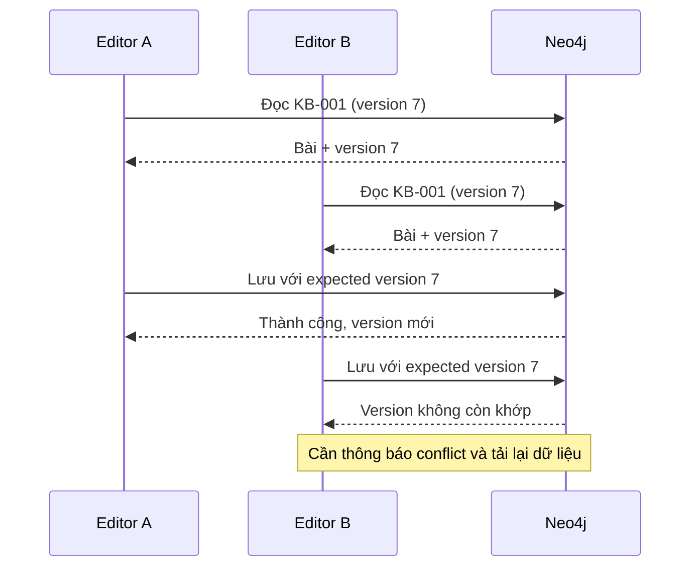
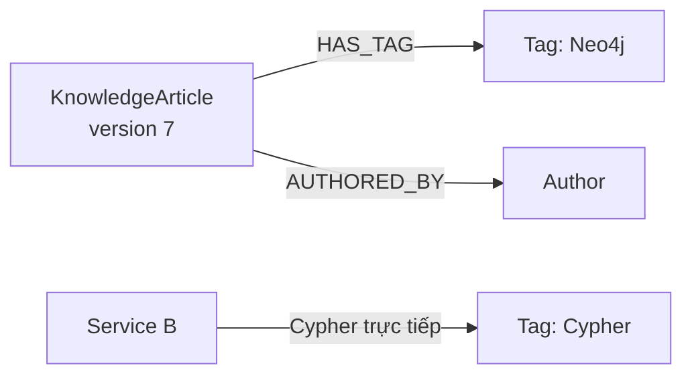

# Khóa lạc quan và xử lý cập nhật đồng thời khi sử dụng

Trong ứng dụng **Spring Data Neo4j (SDN)**, nhiều người dùng hoặc nhiều worker có thể đọc và sửa cùng một nút trong **property graph**. Nếu không kiểm soát, yêu cầu đến sau có thể **ghi đè thay đổi của yêu cầu đến trước** mà ứng dụng không nhận ra. Cơ chế **khóa lạc quan** (*optimistic locking*) dùng một thuộc tính phiên bản — thường được khai báo bằng `@Version` — để phát hiện trường hợp bản ghi đã thay đổi kể từ lúc ứng dụng đọc nó.

Bài thuộc chương **Spring Data Neo4j** của module **DATABASE_ENGINE_GRAPH_NEO4J**, tập trung vào cách sử dụng khóa lạc quan với node entity, Spring Data repository, transaction, API cập nhật và xử lý cạnh tranh giữa các phiên ghi. Nội dung cũng giải thích giới hạn của `@Version` khi dữ liệu còn có **relationship**, khi sử dụng **Cypher/Java Driver** trực tiếp và khi cần retry. Các ví dụ minh họa trên Spring Data Neo4j hiện đại (Spring Boot 3 / Spring Data Neo4j tương ứng); cần kiểm tra phiên bản thư viện thực tế trước khi áp dụng.

> **Nguyên tắc cốt lõi:** `@Version` giúp **phát hiện** bản ghi đã bị cập nhật giữa lúc đọc và lúc lưu; nó **không tự động hợp nhất** hai thay đổi, cũng không bảo vệ mọi đường ghi nếu một đường ghi bỏ qua quy tắc kiểm tra phiên bản.

## 1. Vì sao cần khóa lạc quan?

Giả sử hệ thống học liệu lưu một nút:

```cypher
(:KnowledgeArticle {
  articleId: 'KB-001',
  title: 'Tối ưu Cypher',
  body: 'Nội dung hiện tại...',
  version: 7
})
```

Hai biên tập viên cùng mở trang sửa bài:

| Thời điểm | Biên tập viên A | Biên tập viên B | Trạng thái ở Neo4j |
| --- | --- | --- | --- |
| T1 | Đọc bài ở version `7` | | `title = Tối ưu Cypher`, `version = 7` |
| T2 | | Đọc cùng bài ở version `7` | Chưa thay đổi |
| T3 | Sửa title, lưu thành công | | `version` tiến lên phiên bản mới |
| T4 | | Gửi nội dung dựa trên version `7` | Bản ghi đã đổi |
| T5 | | Nếu ghi đè không kiểm soát, có thể mất sửa đổi của A | Nguy cơ *lost update* |

**Lost update** là lỗi ghi đè mất cập nhật: hai tác nhân đều bắt đầu từ trạng thái cũ, nhưng kết quả ghi của một người làm mất thay đổi của người kia. Trong property graph, điều này không chỉ liên quan tới `title` hoặc `body` mà còn có thể xảy ra khi cập nhật quan hệ như `:HAS_TAG`, `:ASSIGNED_TO` hoặc `:PLACED`.

### 1.1. Minh họa chuỗi sự kiện



**Khóa lạc quan** cho phép các tiến trình đọc mà không giữ khóa độc quyền trong suốt thời gian người dùng chỉnh sửa. Khi lưu, hệ thống kiểm tra phiên bản đã quan sát. Nếu phiên bản hiện tại khác phiên bản kỳ vọng, bản cập nhật bị từ chối để người dùng hoặc logic ứng dụng tự giải quyết xung đột.

### 1.2. So với khóa bi quan

| Đặc điểm | Optimistic locking | Pessimistic locking |
| --- | --- | --- |
| Ý tưởng | Không giữ khóa độc quyền trong suốt thời gian đọc; kiểm tra phiên bản khi ghi | Khóa tài nguyên khi thao tác để ngăn ghi cạnh tranh |
| Phù hợp | Nhiều lượt đọc, tỷ lệ xung đột thấp | Những thao tác cần tuần tự hóa nghiêm ngặt |
| Khi có tranh chấp | Phát hiện conflict; thông báo, tải lại hoặc retry | Có thể chờ khóa, timeout, deadlock |
| Chi phí | Quản lý và so khớp version | Giữ/quản lý khóa trong phạm vi transaction |
| Trải nghiệm sửa form dài | Phù hợp vì không giữ khóa qua thời gian người dùng nhập | Không nên giữ transaction khóa mở qua thời gian người dùng suy nghĩ |

**Neo4j vẫn có cơ chế khóa ghi nội bộ của database.** `@Version` ở Spring Data Neo4j là một tầng **kiểm tra phiên bản ở mô hình ứng dụng**, không có nghĩa database ngừng dùng khóa vật lý hay transaction.

## 2. Ý nghĩa của thuộc tính @Version trong Spring Data Neo4j

Trong Spring Data, `@Version` đánh dấu một thuộc tính dùng cho **optimistic concurrency control**. Khi một entity được lưu qua cơ chế quản lý của Spring Data Neo4j, framework sử dụng giá trị phiên bản để phát hiện việc trạng thái đang lưu không còn tương ứng với trạng thái đã đọc; phiên bản được quản lý/cập nhật trong quá trình lưu thành công.

Ví dụ entity:

```java
import org.springframework.data.annotation.Id;
import org.springframework.data.annotation.Version;
import org.springframework.data.neo4j.core.schema.Node;

@Node("KnowledgeArticle")
public class KnowledgeArticle {

    @Id
    private String articleId;

    private String title;
    private String body;

    @Version
    private Long version;

    protected KnowledgeArticle() {
        // Dành cho ánh xạ dữ liệu.
    }

    public KnowledgeArticle(String articleId, String title, String body) {
        this.articleId = articleId;
        this.title = title;
        this.body = body;
    }

    public String getArticleId() {
        return articleId;
    }

    public String getTitle() {
        return title;
    }

    public String getBody() {
        return body;
    }

    public Long getVersion() {
        return version;
    }

    public void setTitle(String title) {
        this.title = title;
    }

    public void setBody(String body) {
        this.body = body;
    }
}
```

Trong mẫu này:

- `@Node("KnowledgeArticle")` ánh xạ class vào node mang nhãn `KnowledgeArticle`.
- `@Id` chỉ định **khóa định danh nghiệp vụ** `articleId`; không dùng `elementId()` làm khóa ứng dụng dài hạn.
- `@Version` gắn với `version` để Spring Data Neo4j kiểm tra cập nhật đồng thời.
- `Long` là kiểu bao (*boxed type*), có thể để `null` khi tạo **entity mới**; sau khi lưu, framework quản lý giá trị phiên bản.
- Ứng dụng **không tự tăng hoặc đặt giá trị `version`** khi gọi `repository.save(...)`. Giá trị phiên bản phải phản ánh trạng thái mà entity thực sự đã đọc.

Dùng `Long` giúp phân biệt một entity mới chưa có version và entity đã được lưu; việc xác định “new entity” với khóa `@Id` do ứng dụng cấp là một chi tiết cần chú ý. Nếu thay thành primitive `long`, quy tắc nhận diện trạng thái mới có thể khác. Đối với ví dụ này, **để `version = null` ở object mới** là một cách biểu diễn rõ ràng.

### 2.1. Version không phải timestamp

| Trường | Mục đích |
| --- | --- |
| `version` | Phát hiện cập nhật đồng thời của một entity theo cơ chế quản lý phiên bản |
| `updatedAt` | Ghi nhận thời điểm nghiệp vụ hoặc thời điểm thay đổi |
| `createdAt` | Ghi thời điểm tạo |
| `sourceVersion` | Phiên bản từ hệ thống nguồn/CDC, có thể có quy tắc riêng |

Không dùng `updatedAt` do các máy khác nhau ghi làm phiên bản xung đột một cách tùy tiện: độ phân giải thời gian, clock skew và thao tác chỉnh sửa dữ liệu có thể gây hiểu nhầm. `@Version` có ý nghĩa riêng trong vòng đời lưu entity của Spring Data Neo4j; nó không tự thay thế version cho luồng CDC hoặc đồng bộ từ hệ thống khác.

### 2.2. Khóa nghiệp vụ vẫn cần constraint

`@Id` khai báo định danh trong mô hình Java. Để database bảo vệ tính duy nhất ở mức lưu trữ, cân nhắc ràng buộc Cypher phù hợp:

```cypher
CREATE CONSTRAINT knowledge_article_id_unique IF NOT EXISTS
FOR (a:KnowledgeArticle)
REQUIRE a.articleId IS UNIQUE;
```

**Unique constraint** ngăn nhiều node có cùng `articleId`; **optimistic locking** ngăn ghi đè một entity đã thay đổi. Hai cơ chế giải quyết **hai vấn đề khác nhau**. Trước khi tạo constraint trong database đang có dữ liệu, kiểm tra bản ghi trùng và quyền thay đổi schema.

## 3. Chuẩn bị Repository và service

Với Spring Boot quản lý dependency, một ứng dụng có thể sử dụng starter:

```xml
<dependency>
    <groupId>org.springframework.boot</groupId>
    <artifactId>spring-boot-starter-data-neo4j</artifactId>
</dependency>
```

Phiên bản Spring Boot nên được quản lý qua parent POM/BOM phù hợp. Cấu hình cơ bản của ứng dụng có thể được cấp bằng biến môi trường:

```yaml
spring:
  neo4j:
    uri: ${NEO4J_URI}
    authentication:
      username: ${NEO4J_USER}
      password: ${NEO4J_PASSWORD}
```

Đây là cấu hình ứng dụng Spring Boot, không phải cấu hình server Neo4j. Database đích và cấu hình pool cần kiểm tra theo phiên bản Spring Boot/Spring Data đang sử dụng. Trong production, không để password thực vào source control.

Tạo repository:

```java
import org.springframework.data.neo4j.repository.Neo4jRepository;

public interface KnowledgeArticleRepository
        extends Neo4jRepository<KnowledgeArticle, String> {
}
```

Các thao tác `findById` và `save` được Spring Data Neo4j triển khai. Để bài học rõ ràng, ta dùng entity chỉ gồm các thuộc tính scalar; khi có quan hệ với các entity khác, lưu cả aggregate có thêm quy tắc riêng (xem phần 9).

### 3.1. Khởi tạo bài viết mới

```java
KnowledgeArticle article = new KnowledgeArticle(
    "KB-001", "Tối ưu Cypher", "Nội dung ban đầu..."
);
KnowledgeArticle stored = repository.save(article);
System.out.println(stored.getVersion());
```

Đây là **bước tạo dữ liệu một lần** trong test/staging. Không chạy lại mã tạo mới trên một `articleId` đã tồn tại rồi coi nó là phép cập nhật hợp lệ; ứng dụng nên phân biệt rõ **create** và **update**.

Giá trị ban đầu chính xác của `version` do framework quản lý theo quy ước phiên bản và cơ chế lưu; **không hard-code giả định** rằng nó luôn bắt đầu bằng một con số cố định khi viết logic nghiệp vụ.

## 4. Cơ chế optimistic locking khi gọi save

Giả sử tại một thời điểm entity được đọc từ Neo4j có `version = 7`. Khi một tiến trình lưu entity đó:

1. Spring Data Neo4j xác định node theo định danh đã ánh xạ.
2. Cơ chế optimistic locking kiểm tra **giá trị version kỳ vọng** của object so với trạng thái lưu trữ.
3. Nếu hợp lệ, thay đổi được ghi và version được cập nhật theo quy ước framework.
4. Nếu không còn khớp, việc lưu bị từ chối bằng lỗi optimistic locking thay vì âm thầm ghi đè.

Trong ứng dụng Spring, lỗi này thường được biểu diễn bởi `org.springframework.dao.OptimisticLockingFailureException` hoặc một lớp con phù hợp. Khi transaction thất bại, phải **rollback** toàn bộ thao tác cùng transaction theo chính sách quản lý transaction.

> Không giả định mã Cypher cụ thể do SDN sinh ra sẽ giống hệt nhau ở mọi phiên bản. `@Version` là **hợp đồng mapping/concurrency**; hãy sử dụng `EXPLAIN`/`PROFILE` trong môi trường kiểm thử để hiểu truy vấn thực tế khi cần, nhưng không xây business logic phụ thuộc vào một chuỗi Cypher nội bộ không được cam kết ổn định.

### 4.1. Mô phỏng hai bản sao cũ

Giả định bài `KB-001` đã tồn tại. Ta chủ ý tạo hai object được đọc từ **cùng một trạng thái**:

```java
KnowledgeArticle copyA = repository.findById("KB-001")
    .orElseThrow();

KnowledgeArticle copyB = repository.findById("KB-001")
    .orElseThrow();

// A lưu thành công trước.
copyA.setTitle("Tối ưu Cypher với index");
repository.save(copyA);

// B vẫn mang version đã đọc trước thay đổi của A.
copyB.setTitle("Cách đọc kế hoạch Cypher");
repository.save(copyB);  // Dự kiến bị từ chối vì version cũ.
```

Trong ví dụ, **lệnh `save(copyB)` cuối cùng phải được xử lý như xung đột**, không nên trả HTTP 200 và lặng lẽ ghi đè sửa đổi của A. Đây là một kịch bản kiểm tra bản sao stale theo thứ tự; một bài test đồng thời thực sự có thể chạy hai transaction tách biệt với barrier để tạo cùng tình huống.

### 4.2. Lỗi có thể xuất hiện ở save hoặc commit

Tùy cách transaction được quản lý, lỗi có thể phát sinh trong khi `save` hoặc khi thao tác transaction được hoàn tất/commit. Vì thế:

- Đặt transaction boundary tại **service layer**.
- Để ngoại lệ đi ra khỏi transaction để Spring rollback.
- Xử lý thông báo conflict ở **tầng API bên ngoài** transaction.
- Không bắt lỗi rồi tiếp tục dùng entity stale trong cùng transaction.

## 5. Thiết kế API cập nhật an toàn

Đối với ứng dụng có frontend, chỉ bật `@Version` ở server **chưa đủ** để bảo vệ thao tác sửa theo form dài nếu server luôn đọc trạng thái mới nhất trước khi lưu mà không biết client đang dựa trên phiên bản nào.

Ví dụ:

1. Frontend mở bài ở version `7`.
2. Người khác sửa bài, server lưu thành version mới.
3. Frontend cũ gửi tiêu đề mới.
4. Backend đọc lại bản mới nhất, gán title theo request và gọi save.

Nếu backend không kiểm tra version mà frontend đã thấy, nó có thể **hợp thức hóa một thay đổi dựa trên dữ liệu stale** vì object backend vừa đọc đang có version hiện hành.

### 5.1. Yêu cầu cập nhật phải mang expectedVersion

Ví dụ payload:

```json
{
  "title": "Tối ưu Cypher với index",
  "body": "Nội dung cập nhật...",
  "expectedVersion": 7
}
```

Service đọc entity, **kiểm tra version người dùng đã đọc**, sau đó sửa và lưu trong transaction. Nếu một giao dịch khác ghi xen vào sau bước kiểm tra đó, `@Version` tiếp tục phát hiện conflict lúc persist.

Định nghĩa DTO đơn giản:

```java
public record EditArticleRequest(
    String title,
    String body,
    Long expectedVersion
) {}

public record ArticleView(
    String articleId,
    String title,
    String body,
    Long version
) {}
```

Service:

```java
import java.util.Objects;

import org.springframework.stereotype.Service;
import org.springframework.transaction.annotation.Transactional;

@Service
public class KnowledgeArticleService {

    private final KnowledgeArticleRepository repository;

    public KnowledgeArticleService(
            KnowledgeArticleRepository repository) {
        this.repository = repository;
    }

    @Transactional
    public ArticleView edit(String articleId,
                            EditArticleRequest request) {

        if (request.expectedVersion() == null) {
            throw new IllegalArgumentException(
                "expectedVersion is required");
        }

        KnowledgeArticle article = repository.findById(articleId)
            .orElseThrow(() ->
                new ArticleNotFoundException(articleId));

        // Phát hiện form ở client đã dựa trên dữ liệu cũ.
        if (!Objects.equals(
                article.getVersion(), request.expectedVersion())) {
            throw new ArticleVersionConflictException(articleId);
        }

        article.setTitle(request.title());
        article.setBody(request.body());

        // @Version bảo vệ nếu có giao dịch khác ghi xen vào.
        KnowledgeArticle saved = repository.save(article);

        return new ArticleView(
            saved.getArticleId(),
            saved.getTitle(),
            saved.getBody(),
            saved.getVersion()
        );
    }
}
```

`ArticleNotFoundException` và `ArticleVersionConflictException` là hai exception nghiệp vụ do dự án định nghĩa, ví dụ kế thừa `RuntimeException`. Chúng được tách khỏi lỗi `OptimisticLockingFailureException` do framework phát hiện.

**Điểm quan trọng:** Thao tác gồm **đọc → so expectedVersion → sửa → save** được đặt trong **một transaction**. Việc kiểm tra clientVersion giúp phát hiện thao tác từ form cũ; `@Version` bảo vệ khoảng cạnh tranh còn lại giữa lúc backend đọc và lúc ghi. Không dùng `@Transactional(readOnly = true)` cho đường cập nhật này.

### 5.2. Trả lỗi phù hợp cho HTTP client

Với REST API sử dụng request body chứa `expectedVersion`, có thể phản hồi:

| Tình huống | HTTP thường dùng | Hành vi |
| --- | --- | --- |
| Article không tồn tại | `404 Not Found` | Không tạo mới ngầm |
| Expected version thiếu/sai kiểu | `400 Bad Request` | Yêu cầu client gửi giá trị hợp lệ |
| Expected version đã cũ | `409 Conflict` | Trả thông báo, client tải lại và xử lý |
| `@Version` phát hiện update cạnh tranh | `409 Conflict` | Không trả thành công giả |
| Cập nhật hợp lệ | `200 OK` hoặc `204 No Content` | Nếu có body, nên trả version mới |

Nếu ứng dụng dùng HTTP `ETag` và `If-Match` đúng chuẩn **conditional request**, việc precondition không thỏa có thể được biểu diễn bằng **`412 Precondition Failed`**; không trộn ngẫu nhiên quy ước `409` của trường `expectedVersion` với `412` của cơ chế HTTP precondition.

Một cách ánh xạ ngoại lệ khi dùng Spring MVC:

```java
import org.springframework.dao.OptimisticLockingFailureException;
import org.springframework.http.HttpStatus;
import org.springframework.http.ResponseEntity;
import org.springframework.web.bind.annotation.ExceptionHandler;
import org.springframework.web.bind.annotation.RestControllerAdvice;

@RestControllerAdvice
public class ArticleConflictAdvice {

    @ExceptionHandler({
        ArticleVersionConflictException.class,
        OptimisticLockingFailureException.class
    })
    public ResponseEntity<String> onConflict(RuntimeException ex) {
        return ResponseEntity.status(HttpStatus.CONFLICT)
            .body("Article was modified; reload before saving.");
    }
}
```

Các exception nghiệp vụ có thể được định nghĩa như:

```java
public class ArticleVersionConflictException extends RuntimeException {
    public ArticleVersionConflictException(String id) {
        super("Stale article version: " + id);
    }
}

public class ArticleNotFoundException extends RuntimeException {
    public ArticleNotFoundException(String id) {
        super("Article not found: " + id);
    }
}
```

Trong ứng dụng thật cần thêm ánh xạ `404` cho `ArticleNotFoundException`, kiểm tra field đầu vào, response DTO có mã lỗi ổn định và cơ chế ghi log không lộ dữ liệu nhạy cảm. Không trả toàn bộ stack trace của Neo4j ra client.

### 5.3. Trải nghiệm người dùng khi conflict

Khi trả `409`, frontend có thể:

1. Giữ bản nháp người dùng vừa sửa.
2. Tải bản hiện tại từ server cùng `version` mới.
3. Hiển thị chênh lệch giữa bản người dùng sửa và bản đã được lưu.
4. Cho người dùng chọn **hợp nhất thủ công**, bỏ bản nháp hoặc áp dụng lại thay đổi phù hợp.
5. Gửi request mới với expectedVersion đã cập nhật.

**Không tự động ghi đè bản hiện tại** chỉ vì request có conflict. Ở màn hình chỉnh sửa tài liệu, một retry mù quáng có thể biến optimistic locking thành lost update theo cách khác.

## 6. Transaction và ranh giới xử lý xung đột

Spring Data Neo4j có thể hoạt động trong transaction do Spring quản lý. Với service ở phần 5:

```text
Bắt đầu transaction
  -> findById
  -> so client expectedVersion
  -> thay đổi entity
  -> repository.save
  -> commit
Nếu bất kỳ bước nào thất bại
  -> rollback
```

Tính nguyên tử của transaction giúp tránh trạng thái “ghi một nửa” khi một bước trong cùng transaction thất bại. Nhưng nó **không có nghĩa** một transaction có thể bao trọn thời gian người dùng mở form trong nhiều phút: backend chỉ giữ transaction trong **một request cập nhật ngắn**.

### 6.1. Vì sao không catch rồi lưu lại trong cùng transaction?

Không nên:

```java
// Chỉ minh họa anti-pattern, không dùng trong production.
@Transactional
public void unsafeRetry(String id) {
    try {
        repository.save(repository.findById(id).orElseThrow());
    } catch (OptimisticLockingFailureException ex) {
        // Không mặc định cùng transaction có thể dùng lại sau lỗi.
        repository.save(repository.findById(id).orElseThrow());
    }
}
```

Khi optimistic locking thất bại, transaction có thể đã được đánh dấu **rollback-only** hoặc trạng thái persistence/driver không còn thích hợp để tiếp tục. Retry cần thực hiện **toàn bộ thao tác trong một transaction mới**, đọc lại dữ liệu mới nhất, kiểm tra điều kiện nghiệp vụ và tính lại cập nhật.

### 6.2. Khi nào nên retry, khi nào phải trả conflict?

| Nghiệp vụ | Có nên tự retry? | Lý do |
| --- | --- | --- |
| Người dùng sửa tiêu đề hoặc nội dung dựa trên bản cũ | Thường **không** | Cần người dùng quyết định cách hợp nhất |
| Một job gắn trạng thái idempotent đã xác định | Có thể, giới hạn số lần | Có thể đọc lại version và áp dụng thao tác như yêu cầu |
| Giảm số lượng hàng tồn kho | Có thể nếu kiểm tra lại số dư mỗi lần | Phải giữ bất biến số dư và chống trùng request |
| Chuyển tiền hoặc thao tác ngoại vi không idempotent | Không retry mù quáng | Có nguy cơ tác động kép ngoài transaction Neo4j |
| Sự kiện đồng bộ có `eventId` | Có thể khi có dedup/idempotency | Lần xử lý lại không được tạo bản ghi/quan hệ trùng |

Điều kiện để retry an toàn: thao tác có **ý nghĩa rõ ràng trên trạng thái mới nhất**, có **giới hạn số lần**, và mọi **side effect ngoài Neo4j** được kiểm soát.

## 7. Ví dụ retry có giới hạn và transaction mới

Với nghiệp vụ đặt giữ chỗ tồn kho, ta cần kiểm tra số lượng còn lại trước mỗi lần cập nhật. Entity có thể được khai báo:

```java
import org.springframework.data.annotation.Id;
import org.springframework.data.annotation.Version;
import org.springframework.data.neo4j.core.schema.Node;

@Node("InventoryItem")
public class InventoryItem {
    @Id
    private String sku;

    @Version
    private Long version;

    private long available;

    protected InventoryItem() {}

    public InventoryItem(String sku, long available) {
        this.sku = sku;
        this.available = available;
    }

    public long getAvailable() {
        return available;
    }

    public void decreaseOne() {
        if (available <= 0) {
            throw new IllegalStateException("Out of stock");
        }
        available--;
    }
}
```

Repository:

```java
import org.springframework.data.neo4j.repository.Neo4jRepository;

public interface InventoryRepository
        extends Neo4jRepository<InventoryItem, String> {
}
```

Dùng `TransactionTemplate` để **mỗi vòng thử tạo transaction riêng**, và bắt ngoại lệ **ở bên ngoài** lời gọi transaction:

```java
import org.springframework.dao.OptimisticLockingFailureException;
import org.springframework.stereotype.Service;
import org.springframework.transaction.support.TransactionTemplate;

@Service
public class InventoryReservationService {

    private final InventoryRepository repository;
    private final TransactionTemplate transactionTemplate;

    public InventoryReservationService(
            InventoryRepository repository,
            TransactionTemplate transactionTemplate) {
        this.repository = repository;
        this.transactionTemplate = transactionTemplate;
    }

    public boolean reserveOne(String sku) {
        final int maxAttempts = 3;

        for (int attempt = 1; attempt <= maxAttempts; attempt++) {
            try {
                return Boolean.TRUE.equals(
                    transactionTemplate.execute(status -> {
                        InventoryItem item = repository.findById(sku)
                            .orElseThrow();

                        if (item.getAvailable() <= 0) {
                            return false;
                        }

                        item.decreaseOne();
                        repository.save(item);
                        return true;
                    })
                );
            } catch (OptimisticLockingFailureException ex) {
                if (attempt == maxAttempts) {
                    throw ex;
                }
                // Lần thử tiếp theo đọc lại entity trong transaction mới.
                // Production nên thêm backoff/jitter có giới hạn.
            }
        }

        throw new IllegalStateException("Unreachable");
    }
}
```

**Điều kiện của ví dụ:**

- `TransactionTemplate` phải được cấu hình với transaction manager đúng của Neo4j trong ứng dụng. Mỗi `execute` phía ngoài transaction hiện hữu theo thiết kế này tạo một transaction mới; nếu được gọi từ một transaction bao ngoài, cần kiểm tra **propagation** để không vô tình tham gia vào transaction cũ.
- Xử lý conflict ở ngoài lời gọi `transactionTemplate.execute(...)` giúp lần thử mới có thể đọc version mới sau khi transaction trước rollback.
- Số lượng `available` không âm là **bất biến** được kiểm tra lại trong từng lần retry.
- Đây là ví dụ về **tranh chấp giữa các update**, chưa phải thiết kế chống xử lý lặp cho cùng một **business request**. Nếu client gửi lại yêu cầu giữ chỗ sau khi server đã commit nhưng response bị mất, cần `reservationId`/idempotency key riêng để không trừ tồn kho hai lần.

Khi contention cao, ba lần retry vẫn có thể thất bại. Đừng tăng vô hạn: sử dụng backoff/jitter, quan sát tỷ lệ conflict và cân nhắc mô hình cập nhật khác nếu nhiều worker cùng tranh một nút.

## 8. So sánh hai loại lỗi: version conflict và lỗi giao dịch

Không phải mọi lỗi ghi đồng thời đều là optimistic locking conflict.

| Lỗi hoặc hiện tượng | Ý nghĩa khả dĩ | Cách xử lý |
| --- | --- | --- |
| `OptimisticLockingFailureException` | Entity được lưu dựa trên version không còn hợp lệ | Đưa ra `409` hoặc retry có điều kiện |
| Lỗi transaction tạm thời/deadlock | Nhiều transaction tranh chấp khóa hoặc hạ tầng gặp lỗi có thể retry | Dùng retry policy thích hợp, không tái dùng transaction đã lỗi |
| Unique constraint violation | Hai thao tác cùng tạo khóa đã có, hoặc dữ liệu không đáp ứng ràng buộc | Kiểm tra nghiệp vụ tạo/khớp và idempotency |
| `NotFound` / entity đã bị xóa | Target không còn trong database | `404`, conflict hoặc quy tắc xử lý xóa tùy hợp đồng API |
| Validation error | Dữ liệu đầu vào không hợp lệ | `400`, không tự retry |
| Timeout | Giao dịch lâu, lock wait, mạng hoặc tải hệ thống | Điều tra nguyên nhân; không tự mặc định ghi chưa commit |

**Quan trọng:** Thông báo timeout hoặc lỗi mạng **không chứng minh** transaction đã rollback. Có trường hợp server đã commit nhưng client chưa nhận phản hồi. Đối với nghiệp vụ có side effect, cần thiết kế **idempotency** theo mã yêu cầu và cơ chế đối soát kết quả, không chỉ dựa vào `@Version`.

## 9. Giới hạn của @Version trong property graph

Một entity Spring Data Neo4j thường gắn với nhiều node/relationship. Khóa lạc quan trên **một node root** không tự động biến toàn bộ đồ thị thành một đối tượng được khóa chung trong mọi đường ghi.

### 9.1. Thay đổi relationship qua đường ghi khác

Giả sử:



Nếu service A lưu root `KnowledgeArticle` qua repository có `@Version` nhưng service B thêm quan hệ `HAS_TAG` bằng **Cypher trực tiếp**, service B không tự động kiểm tra/tăng `KnowledgeArticle.version`. Service A có thể không biết một quan hệ đã đổi ngoài mô hình của nó.

Do đó:

- Xác định **aggregate boundary**: node và những relationship nào cùng thuộc một đơn vị nhất quán nghiệp vụ.
- Các cập nhật thuộc cùng aggregate nên đi qua **một chiến lược concurrency nhất quán**.
- Nếu repository save aggregate chứa tập quan hệ, **đừng tạo entity rỗng/không đầy đủ quan hệ rồi gọi save** mà chưa hiểu quy tắc đồng bộ quan hệ của SDN; có nguy cơ thay thế/xóa liên kết không nằm trong object đầu vào.
- Nếu cần cập nhật một cạnh bằng Cypher chuyên biệt, thiết kế rõ cách kiểm tra version và ranh giới transaction thay vì mặc định `@Version` trên root sẽ tự bảo vệ.

### 9.2. Truy vấn Cypher trực tiếp không tự tôn trọng @Version

Ví dụ:

```cypher
MATCH (a:KnowledgeArticle {articleId: $articleId})
SET a.title = $title
RETURN a.articleId AS articleId;
```

Nếu một Java Driver khác, một job ETL hoặc `@Query` tùy biến thực thi câu trên, lệnh **không có phép so version** và cũng **không tăng version**. Nó có thể ghi đè nội dung mà entity SDN đang giữ trong bộ nhớ, trong khi cơ chế `@Version` ở lần lưu tiếp theo không nhìn thấy một phiên bản mới tương ứng với thay đổi ngoài luồng.

Để đồng bộ nhiều đường ghi:

1. **Ưu tiên quy tụ cập nhật qua service/repository** có cùng quy tắc version nếu khả thi.
2. Nếu buộc dùng Cypher trực tiếp, xác định rõ **expectedVersion**, cơ chế cập nhật version có kiểm soát và hành vi khi không khớp.
3. Phải kiểm tra tính **nguyên tử/serialization** của bước so version và ghi dữ liệu dưới cạnh tranh thực; một mẫu `MATCH WHERE version = ... SET ...` viết hời hợt không tự chứng minh là compare-and-swap an toàn trong mọi kế hoạch thực thi.
4. Kiểm tra concurrency test với các transaction độc lập, không chỉ test tuần tự.
5. Với external writer không tuân thủ, không thể tuyên bố `@Version` một mình bảo vệ toàn bộ dữ liệu.

### 9.3. @Version không tạo ràng buộc nghiệp vụ trên nhiều node

Ví dụ mỗi đơn hàng chỉ được gắn một khách hàng đặt đơn:

```cypher
(c:Customer)-[:PLACED]->(o:Order)
```

Việc `@Version` trên `Customer` và `Order` **không tự bảo đảm** không có hai cạnh `PLACED` từ hai khách hàng khác nhau vào cùng một đơn, nếu các service cập nhật quan hệ độc lập. Cần thiết kế thao tác cập nhật theo nghiệp vụ, kiểm tra các quan hệ hiện có, transaction và chiến lược khóa/đồng thời phù hợp.

Khóa lạc quan là một **thành phần**, không thay thế constraint, transaction, identity hay validation trên toàn đồ thị.

## 10. Khi dùng @Version với CRUD và repository

### 10.1. Create

Một `KnowledgeArticle` mới có `articleId` do ứng dụng cấp và `version` chưa được thiết lập; `repository.save` tạo entity. Khóa nghiệp vụ nên có unique constraint ở Neo4j để ngăn hai tiến trình tạo trùng ID.

Nếu hai request cùng tạo `KB-001`, kết quả có thể là lỗi constraint hoặc lỗi nhận diện trạng thái entity, tùy tình huống. **Optimistic locking không thay thế unique constraint cho thao tác create.**

### 10.2. Read

`repository.findById(id)` đọc entity cùng version hiện có. API trả về `version` để client gửi lại khi cập nhật. Không nên cache entity có thể thay đổi trong thời gian dài mà bỏ qua khả năng nó đã stale.

### 10.3. Update

Đọc entity đã có → kiểm tra expectedVersion của client → thay đổi thuộc tính/quan hệ được phép → `save` → trả version mới. Nếu save lỗi vì version cũ, transaction phải rollback và client cần một luồng giải quyết xung đột rõ ràng.

### 10.4. Delete

Xóa cũng là thao tác cạnh tranh: một người có thể đang sửa trong khi người khác xóa. Cần xác định yêu cầu API:

- Nếu xóa có điều kiện theo version của client, phải kiểm tra version tương ứng trong transaction.
- Không giả định mọi dạng `deleteById` hoặc Cypher `DETACH DELETE` đều phát hiện optimistic conflict theo cùng cơ chế `save`.
- Nếu cần giữ lịch sử, cân nhắc **soft delete** bằng thuộc tính trạng thái trong entity có version thay vì xóa vật lý.
- Xóa node bằng `DETACH DELETE` có thể xóa các relationship liên quan; phải hiểu sở hữu dữ liệu và nghĩa vụ giữ lịch sử.

## 11. Kiểm thử optimistic locking

Kiểm thử cần chứng minh **tính đúng đắn của kết quả**, không chỉ rằng một exception xuất hiện.

### 11.1. Test cơ bản: entity stale

Sau khi tạo `KB-001`, đọc hai lần để lấy hai object riêng biệt:

```java
KnowledgeArticle first = repository.findById("KB-001")
    .orElseThrow();
KnowledgeArticle stale = repository.findById("KB-001")
    .orElseThrow();

first.setTitle("Phiên bản A");
repository.save(first);

stale.setTitle("Phiên bản B");

// Mong đợi OptimisticLockingFailureException hoặc lớp con tương ứng.
repository.save(stale);
```

Nên thực hiện hai lần đọc và hai lần lưu trong **những transaction độc lập** hoặc thông qua các thao tác repository được quản lý để tránh một persistence context chung che khuất tình huống stale. Test cũng phải kiểm tra:

- Giá trị `title` cuối cùng là `Phiên bản A`.
- `version` đã thay đổi sau khi lưu A.
- Không có việc lưu B thành công ngoài mong đợi.

### 11.2. Test thực sự có hai worker

Để chứng minh tác động dưới cạnh tranh:

1. Hai luồng/transaction độc lập đọc `KB-001` ở cùng version.
2. Dùng barrier đồng bộ sau bước đọc để cả hai bắt đầu ghi từ snapshot cũ.
3. Cho hai giao dịch lưu hai giá trị khác nhau.
4. Kỳ vọng chỉ một bản cập nhật hợp lệ hoặc một giao dịch phải nhận conflict và được xử lý đúng.
5. Kiểm tra trạng thái cuối cùng và số version sau khi các transaction kết thúc.

Không giữ transaction mở lâu trong môi trường production chỉ để tái hiện race. Dùng **database test** và kiểm soát tài nguyên trong test.

### 11.3. Test API end-to-end

| Kịch bản | Kết quả cần kiểm tra |
| --- | --- |
| Client gửi đúng version, không ai sửa xen vào | Thành công, trả version mới |
| Client gửi version đã cũ | `409 Conflict`, nội dung hiện hành giữ nguyên |
| Hai request update cùng version | Không âm thầm ghi đè; có một conflict hoặc xử lý cạnh tranh được kiểm soát |
| Client thiếu expectedVersion | `400` theo hợp đồng API |
| Entity đã xóa | `404` hoặc conflict theo nghiệp vụ, không tạo lại ngoài ý muốn |
| Direct Cypher writer thay đổi entity | Bài test phải phát hiện đường ghi bypass nếu có |
| Retry inventory khi hết hàng | Không cho `available` xuống âm |
| Replayed reservation request | Không trừ kho lần hai nếu đã có idempotency key |

### 11.4. Không dùng test chỉ dựa vào sleep

`Thread.sleep` có thể tạo race không ổn định: test đôi lúc pass vì thứ tự scheduler chứ không phải vì cơ chế version hoạt động. Đối với concurrency test, dùng barrier/latch để điều phối thời điểm đọc/lưu, cô lập transaction, và dọn dữ liệu sau test.

## 12. Tối ưu hiệu năng và quan sát conflict

Khóa lạc quan giúp tránh lost update, nhưng trong workload có rất nhiều writer cùng cập nhật **một node nóng**, tỷ lệ conflict có thể cao.

Các chỉ số hữu ích:

| Chỉ số | Điều cần quan sát |
| --- | --- |
| Optimistic conflicts / giây | Có bao nhiêu save bị từ chối vì version cũ? |
| Conflict rate trên tổng số update | Workload có đang quá nhiều tranh chấp? |
| Số lần retry mỗi operation | Có request cần nhiều lần đọc lại mới hoàn tất? |
| Retry exhausted | Bao nhiêu yêu cầu vẫn thất bại sau giới hạn? |
| Transaction latency p50/p95/p99 | Thời gian đọc–ghi–commit có tăng khi tải cao? |
| DB Hits, index usage | Việc tìm node theo khóa có đang quét quá nhiều? |
| Lock wait/deadlocks | Có tranh chấp tài nguyên Neo4j ngoài conflict logic? |
| User-facing 409 | Người dùng có thường phải tải lại/merge không? |

Một số biện pháp:

- **Giữ transaction ngắn**, không gọi API mạng chậm bên trong transaction nếu có thể tránh.
- **Tách aggregate theo ranh giới nghiệp vụ** khi một node quá nóng và các thao tác thực sự độc lập; không chia tách tùy tiện làm hỏng invariant.
- **Sử dụng index/constraint theo khóa nghiệp vụ** để tìm node nhanh và nhất quán.
- **Không retry mù quáng** mọi xung đột; phân biệt chỉnh sửa người dùng với cập nhật tự động có thể tính lại.
- **Giới hạn retry và thêm backoff/jitter** để giảm việc nhiều worker cùng thử lại tức thời.
- **Đo trước/sau** bằng log/metric và transaction tracing phù hợp, không tự suy rằng `@Version` luôn rẻ hay luôn đắt.

### 12.1. Kế hoạch thực thi không thay thế kiểm tra đồng thời

`EXPLAIN` và `PROFILE` giúp hiểu plan Cypher, `Rows` và `DB Hits`, nhưng **không thể chứng minh một luồng cập nhật là an toàn trước race chỉ nhờ một lần PROFILE**. Cần chạy concurrency test với nhiều transaction và phân tích kết quả commit/rollback.

**Lưu ý an toàn:** `PROFILE` thực thi cả truy vấn ghi, nên không chạy để “xem trước” một lệnh `SET`/`MERGE` trong production nếu chưa có kế hoạch kiểm soát thay đổi. Dùng `EXPLAIN` khi chỉ muốn xem plan.

## 13. Những nhầm lẫn thường gặp

| Nhận định | Thực tế |
| --- | --- |
| “Có `@Transactional` thì không có lost update.” | Transaction giúp nguyên tử, nhưng không tự bảo vệ một form đã mở từ trước hoặc mọi bản ghi stale. |
| “`@Version` làm mọi cập nhật tự động thành công.” | Không; nó **phát hiện xung đột và từ chối** cập nhật stale. |
| “Conflict nghĩa là database bị lỗi.” | Không nhất thiết; đó có thể là kết quả đúng của quy tắc bảo vệ dữ liệu. |
| “Retry là đọc lại rồi ghi đè y nguyên payload cũ.” | Có thể làm mất thay đổi mới; chỉ retry khi có quy tắc hợp nhất/tính lại an toàn. |
| “Có `@Version` không cần unique constraint.” | Sai; tạo trùng ID và cập nhật stale là hai vấn đề khác nhau. |
| “Cập nhật bằng Cypher trực tiếp vẫn tự tăng `@Version`.” | Sai; annotation của Java không tự chạy trong Cypher bypass mapping. |
| “Version trên root tự bảo vệ tất cả relationship.” | Không bảo đảm nếu có writer khác sửa quan hệ ngoài cơ chế kiểm tra chung. |
| “Mỗi exception optimistic locking đều nên trả 500.” | Thường là conflict nghiệp vụ có thể ánh xạ `409`/`412` theo hợp đồng API. |
| “Một transaction thất bại có thể retry bên trong cùng transaction.” | Không nên; retry cần ranh giới giao dịch mới và đọc lại trạng thái. |
| “Retry có nghĩa side effect ngoài Neo4j được chạy đúng một lần.” | Không; cần idempotency key/outbox hoặc thiết kế phù hợp. |

## 14. Bài tập thực hành

### Bài tập 1 — Nhận diện lost update

Bài `KB-001` có `version = 7`. A và B cùng đọc. A lưu trước, B cố lưu từ bản cũ. Nếu không có version check, trạng thái nào có thể bị mất? Với `@Version`, B nên nhận kết quả nào và frontend cần xử lý ra sao?

*Đối chiếu:* sửa đổi A có thể bị B ghi đè khi thiếu kiểm tra. Với optimistic locking, B bị từ chối và cần tải lại/merge; không trả thành công giả.

### Bài tập 2 — Viết entity có version

Khai báo `@Node("KnowledgeArticle")` với `articleId`, `title`, `body` và `@Version Long version`. Giải thích vì sao không tự gán `version = 0` trong constructor tạo mới và vì sao không tự tăng version trước mỗi `repository.save(...)`.

### Bài tập 3 — Tạo API sửa nội dung

Thiết kế DTO có `expectedVersion`, service `@Transactional` và kiểm tra:

- Article không tồn tại → `404`.
- Expected version thiếu → `400`.
- Expected version không khớp → `409`.
- Update hợp lệ → lưu bằng repository và trả version mới.

Giải thích vì sao cần **cả kiểm tra expectedVersion của client lẫn `@Version`** ở bước save.

### Bài tập 4 — Retry có điều kiện

Hai worker cùng muốn giữ chỗ tồn kho của một SKU có `available = 1`. Mỗi worker đọc số dư và cố giảm một. Hãy thiết kế retry ở **transaction mới**, đọc lại số dư trước mỗi lần và bảo đảm kết quả cuối không âm. Nếu client gửi trùng cùng request sau khi server commit, cần thêm thông tin nào để tránh trừ kho hai lần?

### Bài tập 5 — Bypass bằng Cypher

Một batch job thực thi:

```cypher
MATCH (a:KnowledgeArticle {articleId: $id})
SET a.title = $title;
```

Trong khi web service dùng Spring Data `@Version`. Hãy chỉ ra vì sao batch job có thể vượt qua kiểm tra optimistic locking và đề xuất một quy tắc kiến trúc để các writer tuân thủ cùng chính sách version.

### Bài tập 6 — Graph relationship conflict

A thêm `(:KnowledgeArticle)-[:HAS_TAG]->(:Tag)` qua repository, B sửa quan hệ đó bằng một `@Query` Cypher riêng. Version chỉ được đặt trên node Article. Những trường hợp cập nhật nào có thể không được cơ chế version của repository phát hiện? Nêu cách xác định aggregate và transaction boundary hợp lý.

### Bài tập 7 — Test cạnh tranh

Viết kế hoạch test với hai transaction độc lập, barrier sau khi đọc cùng version, hai cập nhật title khác nhau và kiểm tra một xung đột được phát hiện. Vì sao test chỉ thêm `Thread.sleep` có thể không đáng tin?

### Bài tập 8 — Phân biệt lỗi

Phân loại và gợi ý xử lý cho: `OptimisticLockingFailureException`, unique constraint violation, entity not found, timeout mạng, transaction deadlock và validation error. Trường hợp nào không nên tự động retry?

## Ghi nhớ

**Khóa lạc quan trong Spring Data Neo4j** dùng `@Version` để phát hiện thay đổi xen vào giữa lúc một entity được đọc và được lưu. Với API chỉnh sửa của người dùng, cần mang **expectedVersion** từ client, kiểm tra tại service, dùng `repository.save` trong transaction và trả **conflict** thay vì âm thầm ghi đè.

Khi retry, hãy **bắt ngoại lệ bên ngoài transaction**, tạo transaction mới, đọc lại dữ liệu và kiểm tra lại điều kiện nghiệp vụ; không retry vô hạn và không bỏ qua idempotency. Khi mô hình có nhiều node/relationship hoặc nhiều đường ghi qua Java Driver/Cypher trực tiếp, cần một **quy tắc cập nhật nhất quán cho toàn aggregate**: annotation `@Version` trên một entity không thể tự bảo vệ tất cả thay đổi ngoài đường lưu mà nó quản lý.
