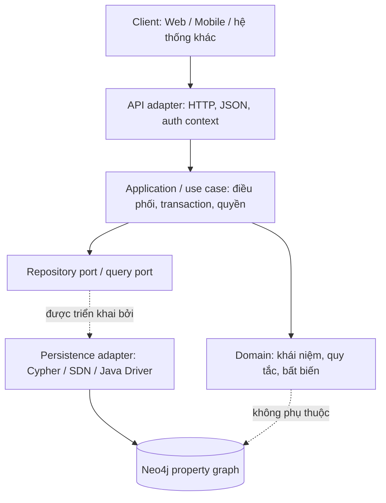
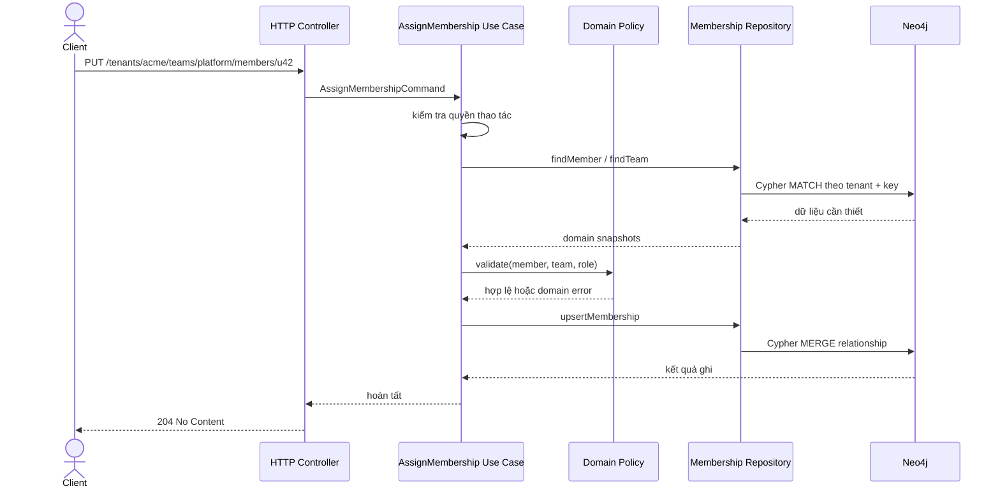

# Phân chia trách nhiệm giữa mô hình miền, lớp truy cập dữ liệu và API trong ứng dụng Neo4j

## 1. Vì sao ứng dụng đồ thị cần ranh giới kiến trúc rõ ràng?

Trong Neo4j, **property graph** biểu diễn các thực thể bằng *node*, các quan hệ bằng *relationship*, và thông tin của chúng bằng *property*. Cypher cho phép truy vấn quan hệ và đường đi, còn **Neo4j Java Driver** hoặc **Spring Data Neo4j** giúp ứng dụng Java tương tác với cơ sở dữ liệu. Các năng lực này rất mạnh, nhưng cũng khiến lập trình viên dễ dồn mọi xử lý vào một lớp: HTTP controller trực tiếp gọi Cypher, tự quyết định quy tắc nghiệp vụ rồi trả node và relationship ra bên ngoài.

Cách làm đó thường tạo ra ba vấn đề:

1. **Nghiệp vụ bị khóa vào hạ tầng**: đổi tên nhãn Neo4j, thay cách lưu relationship hay đổi Driver có thể buộc sửa logic kinh doanh.
2. **Khó bảo vệ các bất biến**: quy tắc một người được tham gia nhóm nào, vai trò nào hợp lệ hoặc dữ liệu nào được phép nhìn thấy bị phân tán trong controller và query.
3. **API vô tình công khai cấu trúc graph**: response phụ thuộc nhãn, property, internal ID hoặc số hop, vừa khó versioning vừa dễ lộ dữ liệu không nên trả.

Bài học thuộc chương **Thiết kế ứng dụng** của module `DATABASE_ENGINE_GRAPH_NEO4J`, tập trung vào **phân chia trách nhiệm giữa mô hình miền, tầng ứng dụng, lớp truy cập dữ liệu và API**. Nội dung áp dụng khi xây dựng dịch vụ dùng Neo4j để mô hình hóa dữ liệu liên kết, truy vấn Cypher, bảo đảm constraint/index, xử lý transaction và tối ưu đường đi.

### Sau bài học, bạn có thể

- Phân biệt **quy tắc miền** với **cách lưu property graph** và **hợp đồng HTTP**.
- Thiết kế *use case*, repository port và persistence adapter có ranh giới rõ ràng.
- Tổ chức transaction, kiểm tra quyền và xử lý lỗi cho một lệnh cập nhật relationship.
- Thiết kế DTO truy vấn đọc mà không trả thẳng đối tượng Driver hoặc entity nội bộ.
- Chọn giữa **Java Driver**, **Spring Data Neo4j** và Cypher tùy biến mà vẫn giữ kiến trúc ổn định.
- Tránh N+1 query, fan-out không kiểm soát, nhầm lẫn định danh và lỗi đồng thời.

## 2. Bốn trách nhiệm chính của một ứng dụng



| Phần | Trả lời câu hỏi | Nên chứa | Không nên chứa |
| --- | --- | --- | --- |
| **Domain model** | «Nghiệp vụ cho phép điều gì?» | Entity, value object, hành vi, invariant, domain error | HTTP status, Cypher, `Record` của Driver |
| **Application service / use case** | «Một yêu cầu nghiệp vụ được thực hiện theo trình tự nào?» | Điều phối policy, authorization, transaction boundary, gọi port | Serialization JSON, label/type/index cụ thể nếu không cần |
| **Persistence adapter** | «Đọc/ghi những dữ liệu cần thiết từ Neo4j thế nào?» | Cypher, mapping, label, relationship direction, index-aware query, xử lý kỹ thuật DB | Quyết định quyền của người dùng chỉ dựa trên controller; quy tắc nghiệp vụ bị giấu hoàn toàn trong query |
| **API adapter** | «Client trao đổi với hệ thống ra sao?» | HTTP route, request validation, xác thực danh tính, DTO, mã HTTP, error response | Mở Session rồi tự thực hiện quy tắc kinh doanh |

Đây là một cách tổ chức gần với **hexagonal architecture / ports and adapters** hoặc **clean architecture**. Không nhất thiết phải chia thành bốn Maven module độc lập; điều quan trọng là **hướng phụ thuộc và người sở hữu quyết định**.

### Quy tắc phụ thuộc quan trọng

- Domain **không biết** controller, Spring MVC, Spring Data Neo4j hoặc Neo4j Driver.
- API biết hợp đồng của use case, nhưng không trực tiếp suy diễn logic từ node/relationship.
- Application biết interface đọc/ghi (*port*), không buộc biết code Cypher của adapter.
- Adapter triển khai port bằng công nghệ cụ thể; thay cách truy cập dữ liệu không đòi viết lại chính sách miền.

**Không phải mọi logic đều đặt trong domain.** Phân trang, chọn trường để hiển thị, orchestration, retry và xử lý kết quả nhiều page có thể là trách nhiệm application hoặc adapter. Domain chỉ nên chứa tri thức nghiệp vụ cần giữ ổn định khi thay giao diện hoặc hạ tầng.

## 3. Ví dụ xuyên suốt: thành viên thuộc nhóm dự án

Giả sử một nền tảng nội bộ quản lý thành viên và nhóm, có phân tách theo tổ chức (*tenant*):

```text
(:AppMember {
  tenantId,
  memberId,
  displayName,
  active
})
   -[:MEMBER_OF {
       membershipKey,
       role
     }]->
(:AppTeam {
  tenantId,
  teamId,
  title,
  active
})
```

Quy tắc nghiệp vụ của ví dụ:

1. Một thành viên chỉ được gán vào nhóm **cùng tenant**.
2. Chỉ **thành viên đang hoạt động** được thêm vào nhóm **đang hoạt động**.
3. Vai trò hiện hành chỉ là `MEMBER` hoặc `LEAD`.
4. Với mỗi bộ `(tenantId, memberId, teamId)`, có tối đa một membership hiện hành.
5. Gửi lại cùng yêu cầu thiết lập vai trò phải có kết quả **idempotent**: không nhân relationship.
6. Người gọi phải được **ủy quyền** để sửa thành viên của tenant và nhóm tương ứng.

Đây là các quy tắc do nghiệp vụ đặt ra, **không phải tính chất tự nhiên của Neo4j**. Một graph khác có thể cần nhiều lần gia nhập nhóm theo lịch sử; khi ấy khóa và mô hình relationship phải đổi.

### 3.1. Định danh nghiệp vụ khác định danh nội bộ

Ứng dụng định danh thành viên bằng `tenantId` và `memberId`, nhóm bằng `tenantId` và `teamId`. Đừng dùng internal node ID trong API để làm khóa bền vững giữa các môi trường hoặc sau khi nhập dữ liệu lại.

Ví dụ:

- API: `/v1/tenants/acme/teams/platform/members/u42`.
- Miền: `MemberId("u42")`, `TeamId("platform")` và `TenantId("acme")`.
- Graph: node `(:AppMember {tenantId: 'acme', memberId: 'u42'})`.

Cần tránh nhầm rằng một `memberId` luôn duy nhất **toàn hệ thống** nếu thực tế chỉ duy nhất **trong từng tenant**.

### 3.2. Sơ đồ trách nhiệm cho một yêu cầu



**Transaction** phải bao phủ những bước cần nhất quán. Tuy nhiên, vì Neo4j mặc định có mức cô lập *read committed*, chỉ đặt nhiều câu query trong cùng một transaction **không tự bảo đảm mọi quy tắc đa-node đều được tuần tự hóa**; phần 10 sẽ giải thích thêm.

## 4. Mô hình miền: hành vi và bất biến, không phải bản sao của graph

### 4.1. Value object và các trường hợp hợp lệ

Một value object dùng để bảo vệ ý nghĩa định danh:

```java
package example.membership.domain;

public record TenantId(String value) {
    public TenantId {
        if (value == null || !value.matches("[a-z0-9-]{1,48}")) {
            throw new IllegalArgumentException("Invalid tenantId");
        }
    }
}

public record MemberId(String value) {
    public MemberId {
        if (value == null || !value.matches("[a-zA-Z0-9_-]{1,64}")) {
            throw new IllegalArgumentException("Invalid memberId");
        }
    }
}

public record TeamId(String value) {
    public TeamId {
        if (value == null || !value.matches("[a-zA-Z0-9_-]{1,64}")) {
            throw new IllegalArgumentException("Invalid teamId");
        }
    }
}

public enum MembershipRole {
    MEMBER, LEAD
}
```

*Các type được tách thành file Java riêng tương ứng tên public type khi dùng thực tế.* Việc giới hạn ký tự ở ví dụ giúp xác định rõ hợp đồng ID và tránh nhập nhằng khi ghép khóa; ứng dụng thật cần chọn quy tắc theo dữ liệu doanh nghiệp.

Value object **không chứa** `@Node`, `@Relationship`, `@JsonProperty` hay `org.neo4j.driver.Value`. Chúng bảo vệ ngữ nghĩa của miền, không mô tả cách công nghệ lưu trữ.

### 4.2. Snapshot miền và domain policy

Không nhất thiết phải load toàn bộ graph vào bộ nhớ để kiểm tra hai điều kiện `active`:

```java
package example.membership.domain;

public record MemberSnapshot(
    TenantId tenantId,
    MemberId memberId,
    boolean active
) {}

public record TeamSnapshot(
    TenantId tenantId,
    TeamId teamId,
    boolean active
) {}

public final class MembershipPolicy {
    public void ensureAssignable(
            MemberSnapshot member,
            TeamSnapshot team,
            MembershipRole role) {
        if (!member.tenantId().equals(team.tenantId())) {
            throw new DomainConflict("Cross-tenant membership");
        }
        if (!member.active()) {
            throw new DomainConflict("Member is inactive");
        }
        if (!team.active()) {
            throw new DomainConflict("Team is inactive");
        }
        if (role == null) {
            throw new IllegalArgumentException("Role is required");
        }
    }
}
```

`DomainConflict` là exception miền do ứng dụng định nghĩa; không phải type có sẵn trong JDK. Domain policy trả lời **có được gán hay không**, không mở connection và cũng không trả HTTP 409.

Lưu ý: hai snapshot chỉ là dữ liệu đủ dùng cho use case hiện tại. Ở bài toán phức tạp hơn, domain có thể dùng aggregate, entity mang hành vi hoặc domain service. **Không phải mọi node Neo4j đều phải tương ứng một domain entity Java**, và không phải mọi relationship đều phải xuất hiện dưới dạng một danh sách trong entity.

### 4.3. Ai sở hữu quy tắc «cùng tenant»?

Phân biệt:

- **Domain** quyết định «membership không được nối khác tenant».
- **Application** bảo đảm người gọi có quyền trên tenant mục tiêu trước khi làm việc.
- **Persistence** ràng buộc cả hai node theo `tenantId` trong Cypher để tránh chọn nhầm node.
- **API** nhận tenant từ route, nhưng không coi route đó là bằng chứng người gọi được phép truy cập tenant.

Một điều kiện quan trọng có thể xuất hiện ở **nhiều tầng với vai trò khác nhau**. Kiểm tra lại tenant trong query không phải «lặp logic thừa» nếu nó giúp truy vấn chính xác và giới hạn dữ liệu; chỉ cần giữ **định nghĩa nghiệp vụ nhất quán**.

## 5. Tầng ứng dụng: điều phối một use case

Một lệnh (*command*) thể hiện ý định, không phải JSON request:

```java
package example.membership.application;

import example.membership.domain.*;

public record AssignMembershipCommand(
    TenantId tenantId,
    TeamId teamId,
    MemberId memberId,
    MembershipRole role,
    String actorId
) {}
```

Port kết nối application với khả năng lưu trữ:

```java
package example.membership.application;

import java.util.Optional;
import example.membership.domain.*;

public interface MembershipStore {
    Optional<MemberSnapshot> findMember(
        TenantId tenantId, MemberId memberId);

    Optional<TeamSnapshot> findTeam(
        TenantId tenantId, TeamId teamId);

    void upsertMembership(
        TenantId tenantId,
        MemberId memberId,
        TeamId teamId,
        MembershipRole role);
}
```

Ứng dụng có thể dùng thêm interface `TenantAuthorization` để truy cập cơ chế ủy quyền hiện tại (token, ACL, policy server), thay vì đặt quyết định quyền vào controller hoặc hardcode nó trong repository.

### 5.1. Service điều phối

```java
package example.membership.application;

import org.springframework.stereotype.Service;
import org.springframework.transaction.annotation.Transactional;
import example.membership.domain.*;

@Service
public final class AssignMembershipService {
    private final MembershipStore store;
    private final TenantAuthorization authorization;
    private final MembershipPolicy policy;

    public AssignMembershipService(
            MembershipStore store,
            TenantAuthorization authorization,
            MembershipPolicy policy) {
        this.store = store;
        this.authorization = authorization;
        this.policy = policy;
    }

    @Transactional
    public void assign(AssignMembershipCommand command) {
        authorization.requireManageTeam(
            command.actorId(),
            command.tenantId(),
            command.teamId()
        );

        MemberSnapshot member = store.findMember(
            command.tenantId(), command.memberId()
        ).orElseThrow(() -> new NotFound("Member not found"));

        TeamSnapshot team = store.findTeam(
            command.tenantId(), command.teamId()
        ).orElseThrow(() -> new NotFound("Team not found"));

        policy.ensureAssignable(member, team, command.role());

        store.upsertMembership(
            command.tenantId(), command.memberId(),
            command.teamId(), command.role()
        );
    }
}
```

Trong ví dụ này, `TenantAuthorization`, `NotFound` và `DomainConflict` là các abstraction/exception của ứng dụng; phải định nghĩa riêng. `MembershipPolicy` cần được đăng ký thành bean hoặc tạo bằng cấu hình DI. Các đoạn code được tách theo vai trò để thể hiện kiến trúc, không phải một file Java duy nhất dán vào IDE là biên dịch ngay.

**Ý nghĩa của `@Transactional`:** Khi service được gọi qua Spring proxy và hệ thống có Neo4j transaction manager phù hợp, các lệnh repository tham gia cùng transaction. Đừng dựa vào annotation nếu đang gọi method nội bộ qua `this.assign(...)`, khởi tạo service bằng `new` ngoài Spring hoặc cấu hình transaction manager sai.

### 5.2. Ranh giới transaction ở đâu?

Đối với yêu cầu «gán thành viên vào nhóm», phạm vi nghiệp vụ là:

```text
begin transaction
  -> tải member và team
  -> kiểm tra quy tắc
  -> MERGE membership
commit hoặc rollback
```

Không để controller mở một transaction rồi gọi nhiều service tùy ý. Không bao bọc transaction quanh công việc như gửi email, đợi upload file hoặc chờ request mạng của hệ thống khác.

Nếu chỉ dùng **Java Driver** không có Spring transaction manager, có thể tổ chức use case thông qua một adapter cung cấp **đơn vị công việc giao dịch** và chạy bằng `session.executeWrite(...)`. Điều quan trọng là **toàn bộ các bước cần chung transaction phải dùng cùng transaction context**, không phải mỗi lời gọi port tự mở một session/transaction độc lập.

### 5.3. Tách command và query khi có lợi

Use case **ghi** quyết định có được thay đổi graph hay không. Use case **đọc** có thể chỉ trả một projection/DTO phục vụ giao diện. Không bắt buộc dựng domain aggregate đầy đủ cho mọi trang danh sách.

Ví dụ:

- `AssignMembershipCommand`: dùng policy và transaction, cập nhật relationship.
- `ListTeamMembersQuery`: lấy thành viên trong nhóm theo giới hạn và thứ tự, trả `TeamMemberView`.

Đây là tư duy **CQRS nhẹ**: tách trách nhiệm đọc/ghi theo nhu cầu, **không nhất thiết** triển khai event sourcing hay hai database riêng.

## 6. Lớp truy cập dữ liệu: biến port thành Cypher chính xác

### 6.1. Schema và constraint tương ứng với khóa miền

Tạo các ràng buộc phù hợp với ví dụ trên Neo4j 5.x:

```cypher
CREATE CONSTRAINT app_member_unique IF NOT EXISTS
FOR (m:AppMember)
REQUIRE (m.tenantId, m.memberId) IS UNIQUE;

CREATE CONSTRAINT app_team_unique IF NOT EXISTS
FOR (t:AppTeam)
REQUIRE (t.tenantId, t.teamId) IS UNIQUE;

CREATE CONSTRAINT membership_key_unique IF NOT EXISTS
FOR ()-[r:MEMBER_OF]-()
REQUIRE r.membershipKey IS UNIQUE;
```

**Giải thích:**

- Unique constraint trên node giúp bảo vệ cặp định danh tenant + thành viên/nhóm.
- Constraint trên `MEMBER_OF.membershipKey` hỗ trợ chống tạo nhiều relationship có cùng khóa khi hai writer đồng thời tranh chấp.
- Neo4j lưu relationship **có hướng**; query phải thống nhất `(member)-[:MEMBER_OF]->(team)`.
- Constraint **không tự tạo đầy đủ bất biến đa-node**. Nó không chứng minh hai node cùng tenant, không kiểm tra `active`, và unique property không ngăn mọi relationship thiếu property.

Nếu ứng dụng sử dụng phiên bản/edition không hỗ trợ cú pháp hoặc loại constraint này, cần đối chiếu tài liệu và thiết kế bảo vệ dữ liệu tương ứng. Đừng chỉ bỏ constraint để ứng dụng chạy mà không xem xét race condition.

### 6.2. Dữ liệu mẫu để thử

```cypher
MERGE (m:AppMember {tenantId: 'acme', memberId: 'u42'})
SET m.displayName = 'An',
    m.active = true;

MERGE (t:AppTeam {tenantId: 'acme', teamId: 'platform'})
SET t.title = 'Platform',
    t.active = true;
```

Thử thao tác upsert bằng parameter:

```cypher
MATCH (m:AppMember {
  tenantId: $tenantId,
  memberId: $memberId
})
MATCH (t:AppTeam {
  tenantId: $tenantId,
  teamId: $teamId
})
MERGE (m)-[r:MEMBER_OF {
  membershipKey: $membershipKey
}]->(t)
SET r.role = $role
RETURN count(r) AS updatedCount;
```

Giá trị `$membershipKey` được tạo ổn định cho cùng bộ tenant–member–team, chẳng hạn `"acme|u42|platform"`. Ở ví dụ này, quy tắc ký tự của ID **không cho phép ký tự phân cách `|`**, tránh đụng khóa khi ghép. Với identifier tùy ý, cần mã hóa chiều dài/escape hoặc dùng khóa sự kiện chuẩn tắc.

Khi transaction khác đã tạo relationship mang cùng key nhưng gắn **sai đầu mút**, uniqueness constraint có thể làm `MERGE` thất bại. Đó là tín hiệu lỗi toàn vẹn, **không nên xử lý bằng cách ghi đè hoặc tự xóa relationship**.

### 6.3. Repository port không trả `Node` hay `Record`

Adapter Neo4j có thể đọc những trường cần thiết:

```cypher
MATCH (m:AppMember {
  tenantId: $tenantId,
  memberId: $memberId
})
RETURN m.tenantId AS tenantId,
       m.memberId AS memberId,
       m.active AS active;
```

```cypher
MATCH (t:AppTeam {
  tenantId: $tenantId,
  teamId: $teamId
})
RETURN t.tenantId AS tenantId,
       t.teamId AS teamId,
       t.active AS active;
```

Adapter ánh xạ các cột thành `MemberSnapshot` và `TeamSnapshot`. Application không cần biết Cypher dùng `MATCH`, composite index seek hay Java Driver `Record.get("active")` để lấy dữ liệu.

**Không trả `org.neo4j.driver.Record` hoặc `Node` từ port**: đó là đối tượng phụ thuộc Driver, có thể làm domain biết cấu trúc graph, kéo theo lỗi mapping và khó viết test mà không có database.

### 6.4. Ví dụ adapter bằng Spring Data Neo4j `Neo4jClient`

`Neo4jClient` hữu ích khi cần câu Cypher tùy biến mà vẫn tham gia cơ chế transaction của Spring Data Neo4j:

```java
package example.membership.persistence;

import java.util.Map;
import java.util.Optional;
import org.springframework.data.neo4j.core.Neo4jClient;
import org.springframework.stereotype.Repository;
import example.membership.application.MembershipStore;
import example.membership.domain.*;

@Repository
public final class CypherMembershipStore implements MembershipStore {
    private final Neo4jClient client;

    public CypherMembershipStore(Neo4jClient client) {
        this.client = client;
    }

    @Override
    public Optional<MemberSnapshot> findMember(
            TenantId tenantId, MemberId memberId) {
        return client.query("""
            MATCH (m:AppMember {
              tenantId: $tenantId, memberId: $memberId
            })
            RETURN m.tenantId AS tenantId,
                   m.memberId AS memberId,
                   m.active AS active
            """)
            .bindAll(Map.of(
                "tenantId", tenantId.value(),
                "memberId", memberId.value()))
            .fetchAs(MemberSnapshot.class)
            .mappedBy((typeSystem, record) ->
                new MemberSnapshot(
                    new TenantId(record.get("tenantId").asString()),
                    new MemberId(record.get("memberId").asString()),
                    record.get("active").asBoolean()))
            .one();
    }

    @Override
    public Optional<TeamSnapshot> findTeam(
            TenantId tenantId, TeamId teamId) {
        return client.query("""
            MATCH (t:AppTeam {
              tenantId: $tenantId, teamId: $teamId
            })
            RETURN t.tenantId AS tenantId,
                   t.teamId AS teamId,
                   t.active AS active
            """)
            .bindAll(Map.of(
                "tenantId", tenantId.value(),
                "teamId", teamId.value()))
            .fetchAs(TeamSnapshot.class)
            .mappedBy((typeSystem, record) ->
                new TeamSnapshot(
                    new TenantId(record.get("tenantId").asString()),
                    new TeamId(record.get("teamId").asString()),
                    record.get("active").asBoolean()))
            .one();
    }

    @Override
    public void upsertMembership(
            TenantId tenantId, MemberId memberId,
            TeamId teamId, MembershipRole role) {
        String key = tenantId.value() + "|"
                   + memberId.value() + "|"
                   + teamId.value();

        long matches = client.query("""
            MATCH (m:AppMember {
              tenantId: $tenantId, memberId: $memberId
            })
            MATCH (t:AppTeam {
              tenantId: $tenantId, teamId: $teamId
            })
            MERGE (m)-[r:MEMBER_OF {membershipKey: $key}]->(t)
            SET r.role = $role
            RETURN count(r) AS affected
            """)
            .bindAll(Map.of(
                "tenantId", tenantId.value(),
                "memberId", memberId.value(),
                "teamId", teamId.value(),
                "key", key,
                "role", role.name()))
            .fetchAs(Long.class)
            .mappedBy((typeSystem, record) ->
                record.get("affected").asLong())
            .one()
            .orElse(0L);

        if (matches != 1L) {
            throw new IllegalStateException(
                "Membership endpoints changed or are missing");
        }
    }
}
```

Ở đây:

- Câu Cypher luôn lọc node theo **tenant + định danh**, tránh ghép sai dữ liệu giữa tổ chức.
- Input được truyền qua `bindAll` thành **parameter**; không ghép ID hay role thành câu Cypher.
- `MERGE` dùng một khóa relationship ổn định để hỗ trợ retry/idempotency.
- Adapter kiểm tra số dòng tác động để không âm thầm báo thành công khi đầu mút biến mất.
- `@Transactional` tại service đảm bảo các thao tác `Neo4jClient` cùng tham gia transaction do Spring quản lý, **khi** cấu hình và lời gọi proxy đúng.

Ví dụ giả định `active` có mặt và là Boolean. Nếu dữ liệu legacy có thể thiếu property, cần quy tắc mapping/validation rõ ràng thay vì gọi `asBoolean()` trên `null`.

**Phạm vi của adapter:** `IllegalStateException` bên trên chỉ báo một trạng thái bất thường ở persistence; tầng application có thể ánh xạ thành conflict/error phù hợp. Adapter không nên tự trả mã HTTP hoặc log toàn bộ parameter nhạy cảm.

### 6.5. Dùng Java Driver trực tiếp khi nào?

Nếu ứng dụng không sử dụng Spring Data Neo4j, adapter có thể triển khai `MembershipStore` bằng `org.neo4j.driver.Driver`. Khi ấy hãy sử dụng managed transaction đúng cách:

```java
try (var session = driver.session(
        org.neo4j.driver.SessionConfig.forDatabase("neo4j"))) {
    var outcome = session.executeWrite(tx -> {
        // Đọc member, đọc team, kiểm tra domain policy và ghi quan hệ
        // trong cùng tx.run(...), không tạo Session mới giữa chừng.
        return resultOfUseCase;
    });
}
```

Đây là **sơ đồ vòng đời**, không phải một method biên dịch độc lập (các biến và policy phải được định nghĩa). Nó nhấn mạnh rằng callback có thể được thử lại khi gặp lỗi tạm thời đủ điều kiện. Tránh gọi payment gateway/gửi email trong callback nếu chưa có cơ chế **idempotency** cho side effect.

Không nên vừa dùng `@Transactional` của Spring Data Neo4j vừa tùy tiện tạo Session/managed transaction riêng qua Driver trong cùng use case rồi giả định chúng cùng một transaction. Cần chọn cơ chế transaction nhất quán hoặc cấu hình tích hợp phù hợp.

## 7. Lớp API: hợp đồng ổn định, không lộ cấu trúc Neo4j

### 7.1. Endpoint theo resource và idempotency

Với thao tác thiết lập vai trò hiện hành của một thành viên trong nhóm:

```http
PUT /v1/tenants/acme/teams/platform/members/u42
Content-Type: application/json

{"role":"LEAD"}
```

Một response thành công có thể là **`204 No Content`**. Dùng `PUT` thay vì một `POST` tạo mới ngẫu nhiên phản ánh ý định **thiết lập trạng thái** của một resource có URI ổn định. Gửi cùng yêu cầu nhiều lần không nên tạo thêm relationship `MEMBER_OF`.

Ví dụ DTO và controller:

```java
package example.membership.api;

import jakarta.validation.Valid;
import jakarta.validation.constraints.NotNull;
import java.security.Principal;
import org.springframework.http.HttpStatus;
import org.springframework.web.bind.annotation.*;
import example.membership.application.*;
import example.membership.domain.*;

public record AssignMembershipRequest(
    @NotNull MembershipRole role
) {}

@RestController
@RequestMapping("/v1/tenants/{tenantId}/teams/{teamId}/members")
public final class MembershipController {
    private final AssignMembershipService useCase;

    public MembershipController(AssignMembershipService useCase) {
        this.useCase = useCase;
    }

    @PutMapping("/{memberId}")
    @ResponseStatus(HttpStatus.NO_CONTENT)
    public void assign(
            @PathVariable String tenantId,
            @PathVariable String teamId,
            @PathVariable String memberId,
            @Valid @RequestBody AssignMembershipRequest body,
            Principal principal) {

        useCase.assign(new AssignMembershipCommand(
            new TenantId(tenantId),
            new TeamId(teamId),
            new MemberId(memberId),
            body.role(),
            principal.getName()
        ));
    }
}
```

*Hai public type trong ví dụ cần được đặt trong các file Java riêng.* `Principal` chỉ chứa danh tính đã được cơ chế xác thực cấp; ứng dụng còn phải kiểm tra **quyền của actor đối với tenant/nhóm** ở tầng use case. Không được tin việc client truyền `tenantId = 'acme'` là đủ để được sửa tenant đó.

### 7.2. API trả dữ liệu nào?

Response chỉ nên chứa hợp đồng client cần:

```json
{
  "teamId": "platform",
  "members": [
    {"memberId": "u42", "displayName": "An", "role": "LEAD"}
  ],
  "nextCursor": null
}
```

Không trả trực tiếp:

- Internal Neo4j node/relationship ID.
- Danh sách nhãn và toàn bộ property nội bộ, đặc biệt thông tin nhạy cảm.
- `org.neo4j.driver.Record`, `Node`, `Relationship` hoặc graph entity do framework tự serialization.
- Một cây object đệ quy `member -> teams -> members -> teams` có nguy cơ vòng lặp hoặc payload cực lớn.

DTO được định nghĩa bởi **nhu cầu API**, không phải «serialize nguyên mọi thứ trong database». Trường mới ở Neo4j không tự trở thành public API field.

### 7.3. Error mapping có chủ đích

| Tình huống | Miền/application xác định | HTTP thường dùng |
| --- | --- | --- |
| `role` không hợp lệ hoặc ID sai cú pháp | Validation error | `400 Bad Request` |
| Không có member/team trong phạm vi tenant được phép nhìn thấy | Not found | `404 Not Found` |
| Member/team không active, xung đột quy tắc | Domain conflict | `409 Conflict`, hoặc mã nghiệp vụ được định nghĩa |
| Người gọi chưa xác thực | Authentication layer | `401 Unauthorized` |
| Đã xác thực nhưng không có quyền thao tác | Authorization | `403 Forbidden`; với dữ liệu nhạy cảm có thể chủ ý trả `404` để tránh dò tồn tại |
| Database không khả dụng, hết timeout | Infrastructure failure | `503 Service Unavailable` hoặc mã 5xx phù hợp hợp đồng |

Controller hoặc `@RestControllerAdvice` chịu trách nhiệm **dịch exception thành response**. Domain không ném `ResponseStatusException` và persistence không tự trả HTTP body. Với API công khai, có thể dùng JSON Problem Details theo chuẩn HTTP hiện hành, kèm `code` ổn định và `traceId` nhưng không lộ Cypher nội bộ.

## 8. Đọc dữ liệu: query model khác aggregate ghi

### 8.1. Một truy vấn cho danh sách thành viên

Endpoint `GET /v1/tenants/acme/teams/platform/members?limit=50` cần danh sách người và vai trò, không cần load toàn bộ graph team.

```cypher
MATCH (t:AppTeam {tenantId: $tenantId, teamId: $teamId})
MATCH (m:AppMember)-[r:MEMBER_OF]->(t)
WHERE m.tenantId = $tenantId
  AND ($afterId IS NULL OR m.memberId > $afterId)
RETURN m.memberId AS memberId,
       m.displayName AS displayName,
       r.role AS role
ORDER BY memberId
LIMIT $limit;
```

Đặc điểm:

- Tìm `AppTeam` theo cặp khóa được index/constraint hỗ trợ.
- Chỉ duyệt relationship `MEMBER_OF` đúng hướng.
- Không trả về node đầy đủ nếu API chỉ cần ba cột.
- `limit` được validate có cận trên ở API/application.
- `memberId` là khóa ổn định trong tenant; dùng `afterId` làm cursor minh họa.

**Lưu ý:** Cú pháp `$afterId IS NULL OR ...` linh hoạt, nhưng biểu thức `OR` có thể khiến kế hoạch index khác trường hợp chỉ dùng predicate đơn. Với truy vấn nhiều dữ liệu, cân nhắc tạo hai biến thể query (có/không cursor) và dùng `PROFILE`. Phân trang qua nhiều transaction **không bảo đảm snapshot nhất quán** nếu thành viên hoặc relationship thay đổi đồng thời.

### 8.2. Tránh N+1 query

Anti-pattern:

```text
GET /teams
  1 query lấy 100 team
  100 query lần lượt lấy thành viên từng team
  => 101 round trips tới Neo4j
```

Nếu màn hình chỉ cần `memberCount` của mỗi team, hãy tổng hợp trực tiếp:

```cypher
MATCH (t:AppTeam {tenantId: $tenantId})
OPTIONAL MATCH (m:AppMember)-[:MEMBER_OF]->(t)
WHERE m.tenantId = $tenantId
RETURN t.teamId AS teamId,
       t.title AS title,
       count(m) AS memberCount
ORDER BY teamId
LIMIT $limit;
```

`OPTIONAL MATCH` giúp giữ nhóm chưa có thành viên, `count(m)` bỏ qua `null` nên có thể trả `0`. Nếu có nhiều relationship trùng hoặc pattern tạo bản ghi trùng, cân nhắc `count(DISTINCT m)` theo ngữ nghĩa cần đếm.

Trường hợp cần nhiều nhánh quan hệ một-nhiều (thành viên, tác vụ, tài liệu) trên cùng team, **nối tất cả trong một query không phải lúc nào cũng tối ưu** vì các nhánh có thể nhân số dòng. Có thể dùng subquery riêng theo nhánh hoặc CQRS read model để tránh tích lũy tích Descartes.

### 8.3. Truy vấn đường đi là một API khác

Nếu client hỏi «hai thành viên kết nối qua các nhóm trong tối đa bốn bước không?», ứng dụng phải định nghĩa rõ:

- Quan hệ nào được phép tham gia traversal?
- Có thể đi ngược hướng relationship không?
- Có giới hạn hop tối đa bao nhiêu?
- Chỉ cần Boolean, một path hay nhiều path?
- Có được đi qua tenant khác không?

Không nên đưa endpoint `GET /members/{id}` vào một truy vấn `MATCH p = (m)-[*]-(n) RETURN p` rồi serialize toàn bộ graph. Pattern không cận độ sâu có thể tạo cực nhiều đường đi và lộ dữ liệu ngoài phạm vi quyền.

Ví dụ kiểm tra quan hệ người–nhóm trực tiếp:

```cypher
MATCH (m:AppMember {tenantId: $tenantId, memberId: $memberId})
MATCH (t:AppTeam {tenantId: $tenantId, teamId: $teamId})
RETURN EXISTS {
  MATCH (m)-[:MEMBER_OF]->(t)
} AS isMember;
```

Đây là read model trả Boolean, không cần dựng aggregate đầy đủ hay trả đường đi.

## 9. Có nên ánh xạ mọi relationship thành collection trong entity Java?

**Spring Data Neo4j** hỗ trợ ánh xạ node và relationship vào object Java. Ví dụ `@Node("AppMember")` và `@Relationship(type = "MEMBER_OF", direction = OUTGOING)` có thể phù hợp với ứng dụng cần thao tác một **aggregate nhỏ**:

```java
@Node("AppMember")
public class MemberNode {
    @Id
    private String id;

    @Property("displayName")
    private String displayName;

    @Relationship(
        type = "MEMBER_OF",
        direction = Relationship.Direction.OUTGOING)
    private Set<TeamNode> teams = new HashSet<>();
}
```

Đây là ví dụ **cấu trúc mapping**, không phải entity hoàn chỉnh có đầy đủ constructor, import và ánh xạ khóa composite của bài. Với khóa thực tế `(tenantId, memberId)`, không thể mặc định một `@Id String id` là tương đương composite constraint; cần thiết kế mapping định danh nhất quán.

### Khi mapping trực tiếp có ích

- Aggregate nhỏ, phạm vi relationship được quản lý rõ ràng.
- Số node/relationship cần load trong một use case bị giới hạn.
- Code CRUD vừa phải, không cần query nhiều nhánh hoặc graph traversal sâu.

### Khi nên ưu tiên Cypher/projection riêng

- Một người có hàng chục nghìn relationship.
- API cần danh sách phân trang, chỉ lấy vài property.
- Query có nhiều bộ lọc, tổng hợp, đường đi hoặc multi-hop.
- Không muốn mỗi thao tác `save()` có nguy cơ tác động đến relationship của aggregate theo cơ chế lưu của framework.
- Cần kiểm soát rõ từng clause và đọc kế hoạch `EXPLAIN`/`PROFILE`.

**Đặc biệt thận trọng với aggregate chưa được load đầy đủ.** Hành vi ghi relationship của Spring Data Neo4j phụ thuộc mapping, phiên bản và phạm vi entity được lưu. Không tự suy ra rằng gọi `save(member)` chỉ thay đổi một property khi object chứa collection quan hệ chưa đầy đủ. Với thao tác cập nhật một cạnh cụ thể, Cypher có thể làm ý định rõ ràng hơn.

## 10. Transaction, race condition và tính nhất quán

### 10.1. Transaction chung là cần thiết nhưng chưa đủ

Trong ví dụ `assign()`, application đọc `member.active` và `team.active` trước khi tạo relationship. Một transaction khác có thể đồng thời **vô hiệu hóa team** sau thời điểm đọc nhưng trước khi transaction đầu commit.

Neo4j mặc định dùng mức cô lập **read committed**; ta không được giả định chỉ vì có `@Transactional` mà điều kiện kiểm tra lúc đọc sẽ mãi đúng cho đến lúc commit.

Để bảo vệ **bất biến cạnh tranh** quan trọng, cần:

1. Xác định quy tắc chính xác và các node/relationship liên quan.
2. Bảo đảm các đường ghi liên quan tuân thủ cùng giao thức cập nhật, ví dụ khóa một tài nguyên chung trước khi kiểm tra và ghi.
3. Tận dụng unique constraint cho định danh và membership key.
4. Xử lý lỗi constraint/lock/deadlock bằng retry có giới hạn hoặc trả conflict đúng nghĩa.
5. Kiểm thử với hai session độc lập, không chỉ test tuần tự một thread.

Ví dụ có thể **khóa node bảo vệ** bằng cách cập nhật một property theo một giao thức nhất quán trong mọi use case có khả năng thay đổi trạng thái team hoặc membership, rồi đọc lại điều kiện và thực hiện ghi. Cách lấy khóa phải dựa trên cơ chế Neo4j theo phiên bản và không được giữ khóa khi chờ I/O ngoài database.

### 10.2. `MERGE` không thay thế constraint

`MERGE (m)-[:MEMBER_OF]->(t)` giúp diễn đạt «nếu chưa có thì tạo», nhưng khi có các writer đồng thời, không nên coi riêng `MERGE` là giải pháp tổng quát cho mọi tình huống đua tranh. Unique constraint trên khóa nghiệp vụ mới giúp bảo vệ thêm tính duy nhất ở database; kết hợp với retry có kiểm soát và cách giải quyết xung đột.

Với yêu cầu nhập lịch sử thành viên nhiều lần, relationship key hiện hành `tenant|member|team` không còn đủ. Cần mô hình event/interval hoặc entity Membership riêng với ID sự kiện ổn định, thay vì vô tình gộp mất lịch sử.

### 10.3. Transaction và side effect ngoài Neo4j

Ví dụ lệnh ghi thành công rồi gửi email thất bại: transaction database và hệ thống email **không phải một transaction phân tán tự động**.

Một phương án là **transactional outbox**: trong cùng transaction Neo4j, ghi một sự kiện outbox có ID duy nhất; worker đọc sự kiện và gửi email theo cơ chế idempotent. Thiết kế chi tiết phụ thuộc hạ tầng và yêu cầu bảo đảm phát sự kiện. Không gửi email trực tiếp bên trong callback `session.executeWrite(...)` nếu callback có thể bị retry.

## 11. Hiệu năng và bảo mật là trách nhiệm xuyên tầng

### 11.1. Ai quyết định index và query?

- **Domain** định nghĩa khóa duy nhất và bất biến, ví dụ tenant + member ID.
- **Persistence** chuyển yêu cầu đó thành constraint/index và Cypher sử dụng đúng nhãn/type/property.
- **Application** xác định giới hạn use case, chẳng hạn tối đa 100 thành viên mỗi trang.
- **API** không cho client gửi `limit` vô hạn hoặc một đoạn Cypher tùy ý.

Khi query chậm, dùng `EXPLAIN`/`PROFILE` để kiểm tra index seek, cardinality, relationship fan-out, `Sort`, `Distinct` và số hàng trung gian. Không tối ưu bằng cách di chuyển logic nghiệp vụ xuống một query khó kiểm thử mà không kiểm chứng cả **tính đúng lẫn hiệu năng**.

### 11.2. Kiểm tra quyền không chỉ là kiểm tra cú pháp

Validation như `memberId` không rỗng là điều kiện cú pháp. Authorization hỏi **actor này có quyền sửa nhóm hay đọc thông tin tenant không?** Hai vấn đề khác nhau.

Trong mô hình multi-tenant:

- Xác định tenant từ **ngữ cảnh xác thực và quyền đã được kiểm chứng**.
- Giữ predicate `tenantId` trong mọi query liên quan để tránh truy cập chéo.
- Cẩn thận với query traversal vì path có thể đi qua node/relationship ngoài phạm vi tenant nếu không ràng buộc.
- Không trả lỗi kèm Cypher, token, thông tin kết nối hoặc property không được phép.
- Phân tách quyền đọc và ghi của tài khoản ứng dụng khi khả thi, theo kiến trúc triển khai.

Thêm `WHERE tenantId = ...` trong repository là một lớp bảo vệ quan trọng, nhưng **không thay thế** chính sách phân quyền rõ ràng và kiểm thử security.

### 11.3. Không để kỹ thuật leak vào hợp đồng API

Nếu database chuyển từ `MEMBER_OF` sang node `Membership` để lưu lịch sử, API `PUT .../members/u42` và use case `assign` có thể vẫn giữ nguyên nếu ý nghĩa nghiệp vụ không đổi. Đây là lợi ích thực tế của việc không công khai mô hình graph làm API contract.

## 12. Chiến lược kiểm thử theo từng ranh giới

| Mức test | Cần kiểm chứng | Cách thực hiện |
| --- | --- | --- |
| **Domain unit test** | Không cho gán khác tenant, thành viên/nhóm inactive, role null | Tạo snapshot/value object, gọi policy, **không cần Neo4j** |
| **Application test** | Thứ tự authorize → load → validate → save; mapping lỗi | Fake/mock port; kiểm chứng không ghi khi thiếu quyền |
| **Persistence integration test** | Cypher, constraint, direction, parameter binding, mapping `null`, uniqueness | Neo4j test database/Testcontainers với phiên bản phù hợp |
| **HTTP test** | Request body, 204/400/404/409/403, JSON contract | Spring MVC test, fake use case |
| **Concurrency test** | Hai request cùng tạo/gỡ membership hoặc vô hiệu hóa team | Hai transaction/session thực, barrier để tạo race |
| **Performance test** | Trang dữ liệu lớn, N+1, traversal nhiều hop | Dữ liệu đại diện, `PROFILE`, P95/P99, giới hạn tài nguyên |

### 12.1. Unit test miền

```java
@Test
void rejectsCrossTenantMembership() {
    MembershipPolicy policy = new MembershipPolicy();
    var member = new MemberSnapshot(
        new TenantId("acme"), new MemberId("u42"), true);
    var team = new TeamSnapshot(
        new TenantId("other"), new TeamId("platform"), true);

    assertThrows(DomainConflict.class, () ->
        policy.ensureAssignable(
            member, team, MembershipRole.MEMBER));
}
```

Test domain không cần `@SpringBootTest` hay kết nối database. Các import JUnit/exception được lược bớt để tập trung vào ý nghĩa của test.

### 12.2. Integration test repository

Cần kiểm chứng ít nhất:

- Hai tenant có cùng `memberId` vẫn là hai người khác nhau.
- Query `findMember` không trả dữ liệu của tenant khác.
- `upsertMembership` hai lần với cùng key chỉ tạo một relationship.
- Relationship đúng hướng `AppMember -> AppTeam`.
- Constraint gây lỗi khi cố tạo relationship khác mang cùng `membershipKey`.
- Trong giao dịch gặp lỗi, không commit nửa vời các thay đổi.
- Nếu actor không có quyền, application **không thực hiện ghi**.

Đối với Spring Data Neo4j, Testcontainers Neo4j là lựa chọn phổ biến để thử Cypher và mapping thật; tránh thay bằng mock cho mọi test vì mock không kiểm chứng query, index/constraint hoặc transaction behavior.

## 13. Anti-pattern và cách sửa

| Anti-pattern | Vì sao có vấn đề | Cách tổ chức hợp lý |
| --- | --- | --- |
| Controller chứa `MATCH`/`MERGE` và tự kiểm tra role | HTTP và nghiệp vụ/hạ tầng dính nhau | Controller chỉ chuyển request thành command và gọi use case |
| Domain entity chứa `org.neo4j.driver.Record` | Domain phụ thuộc Driver | Adapter ánh xạ sang model miền hoặc read DTO |
| API trả toàn bộ `@Node` và relationship collection | Lộ schema, vòng lặp serialization, payload lớn | DTO riêng, chọn field cần thiết |
| Repository tự quyết định actor có quyền | Quyền khó kiểm toán, phụ thuộc token bị giấu | Application/auth policy quyết định, adapter bổ sung predicate bảo vệ |
| `@Transactional` đặt ở mọi method không rõ ranh giới | Mở transaction dài hoặc rời rạc | Đặt tại use case ghi; bảo đảm participation thực tế |
| Mỗi phương thức repository tạo session độc lập | Các bước không còn atomic | Một transaction context cho use case; thống nhất công nghệ transaction |
| Load toàn bộ relationship cho trang danh sách | Tốn RAM và fan-out lớn | Cypher read model có `ORDER BY`/`LIMIT` |
| Vòng lặp Java gọi query riêng cho từng node | N+1 round-trip | Query tổng hợp, `UNWIND`, batching hoặc subquery phù hợp |
| Chỉ dựa `MERGE`, không có constraint | Rủi ro nhân bản khi ghi đồng thời | Unique constraint + retry/conflict handling |
| Dùng internal node ID làm ID public | Không bền vững và lộ chi tiết DB | Khóa nghiệp vụ ổn định |
| Mọi sửa đổi graph đều đi qua `save(aggregate)` | Có thể khó kiểm soát quan hệ khi aggregate tải chưa đủ | Dùng query cập nhật cạnh cụ thể khi cần |
| Cho client truyền Cypher hoặc nhãn/type tùy ý | Rủi ro bảo mật và khó giới hạn query | API kiểu hóa use case, tham số và allowlist |
| Trả lỗi 500 cho mọi lỗi miền | Client không biết cách xử lý | Map lỗi miền → HTTP code và error code ổn định |

## 14. Bài tập thực hành có hướng dẫn

### Bài 1. Phân lớp trách nhiệm

Cho các việc sau: kiểm tra `role` là `LEAD` hoặc `MEMBER`; đọc `AppMember.active`; ánh xạ body JSON; kiểm tra actor có quyền gán nhóm; `MERGE` quan hệ; trả `409` nếu nhóm inactive.

**Gợi ý:** Domain xác định role hợp lệ và quy tắc active; persistence đọc property và `MERGE`; application điều phối policy/authorization; API nhận JSON và dịch domain conflict thành 409. Việc kiểm tra role hợp lệ có thể thêm ở API để báo lỗi sớm, nhưng quy tắc miền không nên chỉ phụ thuộc validation ở API.

### Bài 2. Sửa controller ôm hết logic

Một controller thực thi trực tiếp:

```java
@PutMapping("/{memberId}")
void assign(@PathVariable String memberId) {
    // driver.session(), MATCH member/team, kiểm tra active,
    // MERGE relationship, tự bắt exception và trả 409...
}
```

**Yêu cầu:** Đề xuất ba interface/class tối thiểu để tách trách nhiệm.

**Đáp án gợi ý:** `MembershipController` nhận/validate request; `AssignMembershipService` thực thi use case, transaction, quyền; `MembershipStore` là port và `CypherMembershipStore` làm adapter. Domain có `MembershipPolicy` để kiểm tra bất biến.

### Bài 3. Thiết kế truy vấn đọc tránh N+1

Trang quản lý cần tên 50 nhóm và số thành viên từng nhóm. Vì sao việc gọi `findMembers(teamId)` 50 lần có thể chậm dù mỗi câu đều dùng index?

**Đáp án gợi ý:** 50 round-trip, 50 lần lấy connection/query/deserialize, có thể tăng latency. Tạo read model truy vấn tổng hợp một lượt có lọc tenant và giới hạn số nhóm, hoặc batching/subquery, rồi đo `PROFILE`.

### Bài 4. Bất biến giữa hai node dưới tải đồng thời

Transaction A đọc thấy team active rồi chuẩn bị tạo membership. Transaction B vô hiệu hóa team và commit. `@Transactional` của A có tự bảo đảm membership không được tạo sau khi team inactive không?

**Đáp án gợi ý:** Không mặc nhiên. Cần thiết kế khóa/giao thức đồng bộ chung, xác minh cùng phạm vi tenant, constraint thích hợp và concurrency test. Read committed không tương đương serializable.

### Bài 5. Dữ liệu API và domain model

Client yêu cầu danh sách thành viên và vai trò, không cần `membershipKey`, `active`, label, node ID. Nên trả `AppMember` entity nguyên vẹn hay DTO?

**Đáp án gợi ý:** DTO chứa `memberId`, `displayName` và `role`. API contract có thể giữ nguyên khi đổi cách lưu relationship; tránh lộ dữ liệu nội bộ hoặc payload quá lớn.

### Bài 6. Thiết kế cho lịch sử nhiều lần gia nhập nhóm

Nếu thành viên được rời nhóm rồi gia nhập lại ba lần, `membershipKey = tenantId|memberId|teamId` có còn thể hiện đầy đủ lịch sử không? Cần thay đổi phần nào?

**Đáp án gợi ý:** Không. Domain cần định nghĩa *membership episode* hoặc event với identity riêng và thời gian hiệu lực. Persistence chọn mô hình node `Membership` hoặc relationship có khóa sự kiện; API có thể bổ sung endpoint lịch sử nhưng không buộc thay đổi toàn bộ các API chỉ xem membership hiện hành.

## 15. Checklist thiết kế trước khi đưa vào production

- [ ] Domain dùng **khóa nghiệp vụ** và có unit test bất biến; không phụ thuộc API/Neo4j.
- [ ] Application service thể hiện rõ một **use case** và ranh giới transaction.
- [ ] Authorization dựa trên actor đã xác thực, tenant và resource thật.
- [ ] Repository port không trả object của Driver hoặc HTTP DTO.
- [ ] Persistence adapter dùng parameter Cypher, nhãn/type/hướng quan hệ nhất quán.
- [ ] Có unique constraint/index phù hợp với khóa nghiệp vụ, kể cả multi-tenant.
- [ ] Có chiến lược xử lý concurrent writes, constraint violation, deadlock và retry.
- [ ] API chỉ trả field cần thiết, không serialize cả graph hoặc internal ID.
- [ ] Read model giới hạn kết quả, có thứ tự ổn định và tránh N+1.
- [ ] Truy vấn đường đi có type/hướng/hop limit và bảo vệ tenant scope.
- [ ] `@Transactional`/Driver managed transaction thật sự bao phủ toàn bộ các bước cần atomic.
- [ ] Có integration test trên Neo4j thật, kể cả null, relationship và concurrency.
- [ ] Có observability: request ID, latency, lỗi, thông tin transaction không nhạy cảm.
- [ ] Khi đổi SDN/Driver/Neo4j version, đã đối chiếu API, mapping và transaction behavior.

## 16. Tổng kết

Khi xây dựng ứng dụng Neo4j, **domain model** phải chịu trách nhiệm cho *ý nghĩa và bất biến nghiệp vụ*; **application service** điều phối use case, quyền và transaction; **persistence adapter** chuyển nhu cầu dữ liệu thành Cypher, index/constraint và ánh xạ kết quả; **API adapter** duy trì hợp đồng giao tiếp ổn định, dễ kiểm soát quyền và version.

Không đồng nhất **mỗi node với một entity Java**, **mỗi relationship với một collection phải load đầy đủ**, hay **mỗi truy vấn với một endpoint REST**. Lợi thế của Neo4j nằm ở khả năng mô hình hóa và truy vấn liên kết; kiến trúc tốt là kiến trúc tận dụng lợi thế đó mà vẫn giữ ranh giới trách nhiệm, tính đúng đắn khi ghi đồng thời, hiệu năng khi duyệt graph và khả năng thay đổi API theo nhu cầu sản phẩm.

### Tài liệu tham khảo

- [Neo4j Cypher Manual – MATCH](https://neo4j.com/docs/cypher-manual/current/clauses/match/)
- [Neo4j Cypher Manual – MERGE](https://neo4j.com/docs/cypher-manual/current/clauses/merge/)
- [Neo4j Cypher Manual – Constraints](https://neo4j.com/docs/cypher-manual/current/constraints/)
- [Neo4j Spring Data Neo4j Reference](https://docs.spring.io/spring-data/neo4j/reference/)
- [Neo4j Java Driver Manual – Transactions](https://neo4j.com/docs/java-manual/current/transactions/)
- [Neo4j Cypher Manual – Query tuning](https://neo4j.com/docs/cypher-manual/current/planning-and-tuning/)
