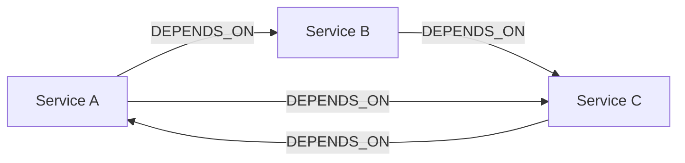

# Chuyển kết quả đồ thị thành DTO mà không tạo tham chiếu vòng trong Neo4j

## 1. Mục tiêu học tập

Trong **property graph** của Neo4j, node có thể kết nối với nhiều node khác bằng relationship; một node có thể xuất hiện trong nhiều đường đi và graph có thể chứa chu trình. Đây là khả năng cần thiết để mô hình hóa hệ thống phụ thuộc, mạng xã hội, gợi ý hoặc chuỗi cung ứng. Tuy nhiên, nếu đưa nguyên object graph của ứng dụng vào bộ tuần tự hóa JSON, các quan hệ hai chiều có thể khiến quá trình chuyển đổi **đệ quy vô hạn**, sinh payload khổng lồ hoặc làm lộ dữ liệu không được phép trả về.

Bài thuộc chương **Thiết kế ứng dụng** của mô-đun `DATABASE_ENGINE_GRAPH_NEO4J`. Trọng tâm không phải cách tạo entity Spring Data Neo4j (SDN), mà là **thiết kế ranh giới dữ liệu đọc/ghi giữa Neo4j và API**: lấy đủ thông tin cần thiết bằng Cypher, ánh xạ thành DTO có cấu trúc hữu hạn, bảo vệ định danh và quyền truy cập, rồi kiểm tra kết quả JSON.

Sau bài này, bạn có thể:

1. Phân biệt **chu trình graph**, **tham chiếu vòng trong object Java** và **trùng thực thể do nhiều đường đi**.
2. Lựa chọn DTO một tầng, DTO tham chiếu bằng ID hoặc dạng `nodes + edges` cho một màn hình cụ thể.
3. Viết `RETURN` và **map projection** trong Cypher để chỉ đọc các property cần thiết.
4. Chuyển kết quả từ **Neo4j Java Driver** và **Spring Data Neo4j / Neo4jClient** thành DTO mà không serialize trực tiếp entity graph.
5. Kiểm soát độ sâu, fan-out, số dòng, dữ liệu trùng, quyền tenant và kích thước response.
6. Viết test chứng minh response hữu hạn, đúng chu trình, không bỏ sót relationship quan trọng.

> **Phạm vi phiên bản:** Ví dụ Cypher dùng cú pháp Neo4j 5 thông dụng. Ví dụ Java dựa trên Java 17+, Neo4j Java Driver 5.x và API `Neo4jClient` của các bản Spring Data Neo4j tương ứng Spring Boot 3.x. Hành vi mapping có thể khác theo phiên bản: kiểm tra tài liệu và chạy integration test trên bộ thư viện thực tế.

## 2. Ba vấn đề thường bị gọi chung là “tham chiếu vòng”

### 2.1. Chu trình trong graph là dữ liệu hợp lệ

Giả sử ba dịch vụ có quan hệ **phụ thuộc**:



Đường đi `A → B → C → A` là một **chu trình**. Neo4j có thể lưu và truy vấn nó bình thường. Nó chỉ trở thành vấn đề ở tầng ứng dụng khi ta cố chuyển mỗi dịch vụ thành một object chứa toàn bộ danh sách object dịch vụ mà nó phụ thuộc, rồi tiếp tục lặp lại không có giới hạn.

### 2.2. Tham chiếu vòng trong object Java là vấn đề khi serialize

Ví dụ mô tả object, **không phải** mã entity hoàn chỉnh:

```java
class ServiceEntity {
    String id;
    List<ServiceEntity> dependencies;
}

// Minh họa sau khi các object đã được liên kết:
// a.dependencies = [b, c]
// b.dependencies = [c]
// c.dependencies = [a]
```

Nếu Jackson hoặc một bộ serializer khác duyệt `dependencies` bằng cách chuyển **toàn bộ object con**, nó sẽ đi `a → b → c → a → ...` mà không tự có điểm dừng ở cấp nghiệp vụ. Kết quả tùy cấu hình: lỗi đệ quy/stack overflow, lỗi phát hiện self-reference hoặc payload lớn bất thường.

**Không phải mọi liên kết lặp đều là chu trình:** graph hình kim cương `A → B → D` và `A → C → D` dùng chung node `D` nhưng không có chu trình. Nếu DTO lồng object `D` hai lần, JSON có thể lặp dữ liệu dù không đệ quy vô hạn. Vì vậy cần quản lý **cả cycle và duplicate**.

### 2.3. Cypher cũng có thể nhân dòng vì nhiều đường đi

`MATCH (a)-[:DEPENDS_ON*1..3]->(b)` trả các **đường khớp**, không mặc định là danh sách node `b` duy nhất. Cùng một đích có thể đạt được qua nhiều tuyến và xuất hiện nhiều dòng. Nếu mỗi dòng được biến thành một DTO node riêng, client sẽ thấy trùng ID.

**Ba việc cần giải quyết riêng:**

| Vấn đề | Biểu hiện | Cách giải quyết |
| --- | --- | --- |
| Object reference cycle | Serializer đi vòng mãi | Không serialize entity graph trực tiếp; dùng DTO hữu hạn |
| Trùng node/edge qua nhiều path | Response có nhiều object cùng ID | Gom theo khóa nghiệp vụ, `DISTINCT` hoặc map/set theo ID |
| Graph traversal nở rộng | Quá nhiều node/relationship hoặc path | Giới hạn độ sâu, fan-out, tập ứng viên và kích thước response |

## 3. Lựa chọn hình dạng DTO theo trường hợp sử dụng

DTO (*Data Transfer Object*) là **hợp đồng dữ liệu của API**, không bắt buộc giống cấu trúc entity của database. Có ba hình dạng phổ biến.

### 3.1. DTO phẳng cho màn hình danh sách

```json
{
  "id": "A",
  "name": "API Gateway",
  "dependencyCount": 2
}
```

Ưu điểm: nhỏ, dễ cache, dễ phân trang, không chứa đối tượng tham chiếu đến node khác. Phù hợp danh sách service và trang tìm kiếm. `dependencyCount` là số đo đã tính trong truy vấn, không bắt buộc nạp toàn bộ relationship vào Java.

### 3.2. DTO một tầng cho trang chi tiết

```json
{
  "id": "A",
  "name": "API Gateway",
  "dependencies": [
    {"id": "B", "name": "Authentication"},
    {"id": "C", "name": "Database"}
  ]
}
```

Mỗi phần tử `dependencies` chỉ là **bản tóm tắt** chứa `id` và `name`. Nó **không có thuộc tính `dependencies` riêng**, nên không thể quay về `A` bằng cách mở rộng object tiếp. Client có thể gọi endpoint chi tiết cho `B` nếu người dùng thật sự yêu cầu.

### 3.3. DTO graph chuẩn hóa cho giao diện sơ đồ

Khi ứng dụng cần **giữ cả chu trình và các cạnh**, không nên cố ép graph thành cây:

```json
{
  "rootId": "A",
  "nodes": [
    {"id": "A", "name": "API Gateway"},
    {"id": "B", "name": "Authentication"},
    {"id": "C", "name": "Database"}
  ],
  "edges": [
    {"fromId": "A", "toId": "B"},
    {"fromId": "B", "toId": "C"},
    {"fromId": "C", "toId": "A"},
    {"fromId": "A", "toId": "C"}
  ],
  "truncated": false
}
```

Đây là cấu trúc **hai mảng hữu hạn**, không phải cây object lồng đệ quy. Chu trình vẫn còn trong dữ liệu: client dựng mũi tên từ `C` về `A` bằng ID. Node `A` chỉ xuất hiện một lần trong `nodes`; relationship được biểu diễn trong `edges`.

| Giao diện | Hình dạng khuyến nghị | Lý do |
| --- | --- | --- |
| Danh sách có phân trang | DTO phẳng | Ít property, không mở rộng graph khi chưa cần |
| Trang chi tiết một service | DTO một tầng | Đủ dữ liệu láng giềng, không có đệ quy |
| Canvas trực quan hóa dependency | `nodes + edges` | Giữ được chu trình và node dùng chung |
| Báo cáo đường đi | Path DTO gồm danh sách ID và cạnh | Giữ đúng thứ tự của path, có thể kèm cost/hops |
| Tree view bắt buộc | DTO có giới hạn độ sâu và tham chiếu ID | Trình bày như cây nhưng phải nêu rõ cạnh/cycle bị rút gọn |

**Không có một DTO tốt nhất cho mọi API.** Quyết định dựa trên màn hình và nghiệp vụ: phía client có cần thuộc tính node đầy đủ, relationship property, thứ tự của path hay chỉ cần gợi ý danh sách?

## 4. Chuẩn bị graph thực hành với chu trình

Bài dùng nhãn `:DtoService` và relationship `:DTO_DEPENDS_ON` để không lẫn với graph ứng dụng. Chỉ chạy các câu lệnh ghi dưới đây trong database thực hành.

Tạo constraint theo định danh nghiệp vụ **trong phạm vi tenant**:

```cypher
CREATE CONSTRAINT dto_service_tenant_id_unique IF NOT EXISTS
FOR (s:DtoService)
REQUIRE (s.tenantId, s.id) IS UNIQUE;
```

Tạo node:

```cypher
UNWIND [
  {id: 'A', name: 'API Gateway'},
  {id: 'B', name: 'Authentication'},
  {id: 'C', name: 'Database'}
] AS row
MERGE (s:DtoService {tenantId: 'T1', id: row.id})
SET s.name = row.name;
```

Tạo bốn relationship có hướng:

```cypher
UNWIND [
  {from: 'A', to: 'B'},
  {from: 'B', to: 'C'},
  {from: 'C', to: 'A'},
  {from: 'A', to: 'C'}
] AS link
MATCH (source:DtoService {tenantId: 'T1', id: link.from})
MATCH (target:DtoService {tenantId: 'T1', id: link.to})
MERGE (source)-[:DTO_DEPENDS_ON]->(target);
```

Xác minh đồ thị:

```cypher
MATCH (source:DtoService {tenantId: 'T1'})
      -[:DTO_DEPENDS_ON]->
      (target:DtoService {tenantId: 'T1'})
WHERE source.id IN ['A', 'B', 'C']
  AND target.id IN ['A', 'B', 'C']
RETURN source.id AS fromId, target.id AS toId
ORDER BY fromId, toId;
```

Trên đồ thị demo sạch, bốn cặp đầu mút là `A → B`, `A → C`, `B → C`, `C → A`. `MERGE` giúp chạy lại ví dụ mà không chủ động tạo thêm mẫu relationship đã tồn tại; nó không tự áp đặt quy tắc **chỉ một relationship giữa mỗi cặp** nếu có quy trình ghi khác dùng `CREATE`. Muốn phân biệt nhiều quan hệ song song, API phải có ID nghiệp vụ cho từng relationship.

## 5. Đừng trả trực tiếp entity hoặc Path của Neo4j

Một entity SDN có thể chứa:

```text
ServiceEntity A
  ├── dependencies: [ServiceEntity B, ServiceEntity C]
  └── ...
ServiceEntity B
  └── dependencies: [ServiceEntity C]
ServiceEntity C
  └── dependencies: [ServiceEntity A]
```

Việc viết controller theo kiểu ý tưởng:

```java
// Không phải ví dụ API nên sao chép:
// @GetMapping("/services/{id}")
// public ServiceEntity get(String id) {
//     return repository.findById(id).orElseThrow();
// }
```

có thể dẫn đến ba nhóm rủi ro:

1. **Cấu trúc vòng hoặc dữ liệu trùng:** bộ serializer có thể duyệt quan hệ lặp; có thể tạo JSON khổng lồ.
2. **Lộ trường ngoài hợp đồng API:** entity chứa property kỹ thuật, thông tin nội bộ, trạng thái vận hành hoặc dữ liệu chỉ dành cho backend.
3. **Phụ thuộc vào trạng thái ánh xạ graph:** repository có thể trả một phần cấu trúc theo cách nạp dữ liệu, trong khi client tưởng nhận được toàn graph.

Các annotation của Jackson như `@JsonIgnore`, `@JsonManagedReference`/`@JsonBackReference` hoặc `@JsonIdentityInfo` có thể giải quyết **một kiểu tuần tự hóa cụ thể**. Tuy nhiên:

- `@JsonManagedReference`/`@JsonBackReference` phù hợp hơn với quan hệ cha–con rõ ràng, không phải mô hình graph tùy ý có nhiều chiều.
- `@JsonIdentityInfo` thay object lặp bằng tham chiếu theo ID theo cấu hình; client phải hiểu hợp đồng này và vẫn cần xử lý giới hạn dữ liệu/quyền.
- `@JsonIgnore` có thể chặn chu trình bằng cách **bỏ mất cạnh cần hiển thị**.

**Mặc định nên chọn:** entity phục vụ lưu/truy vấn, DTO phục vụ API; chuyển đổi qua mapper/assembler có kiểm soát ở tầng service.

## 6. Cách 1 — Cypher map projection cho DTO một tầng

### 6.1. Chỉ lấy các property cần thiết

Truy vấn lấy các dependency trực tiếp của `A`, giữ nguyên dòng nguồn khi service không có dependency:

```cypher
MATCH (s:DtoService {tenantId: $tenantId, id: $serviceId})
OPTIONAL MATCH (s)-[:DTO_DEPENDS_ON]->
               (d:DtoService {tenantId: $tenantId})
WITH s, collect(DISTINCT d{.id, .name}) AS dependencies
RETURN s.id AS id,
       s.name AS name,
       dependencies AS dependencies;
```

Với `tenantId = 'T1'` và `serviceId = 'A'`, dữ liệu có cấu trúc tương đương:

```json
{
  "id": "A",
  "name": "API Gateway",
  "dependencies": [
    {"id": "B", "name": "Authentication"},
    {"id": "C", "name": "Database"}
  ]
}
```

Giải thích:

- `MATCH` định vị service gốc theo khóa nghiệp vụ thuộc tenant.
- `OPTIONAL MATCH` giữ service dù không tìm thấy dependency; khi `d` là `null`, map projection `d{...}` cũng là `null` và `collect` bỏ qua giá trị ấy, cho danh sách rỗng.
- `d{.id, .name}` là **map projection**: chỉ chứa hai trường được yêu cầu, không mang toàn bộ entity hay quan hệ của `d`.
- `collect(DISTINCT ...)` giảm trùng **map cùng nội dung**. Nếu có hai node khác nhau trùng dữ liệu do mô hình/constraint sai, cần kiểm tra khóa; không dùng `DISTINCT` như một cách che dữ liệu lỗi.
- Truy vấn vẫn có thể trả nhiều dependency. Để phân trang fan-out lớn, hãy dùng một endpoint danh sách riêng với `ORDER BY`/`LIMIT` và cursor, thay vì gọi `collect` không giới hạn.

**Lưu ý thứ tự:** không dựa vào thứ tự tình cờ trong một tập được gom bằng `collect`. Nếu UI cần sắp xếp dependency theo ID hoặc tên, cần sắp xếp các dòng phù hợp trước khi gom hoặc sắp xếp DTO trong backend và kiểm tra kế hoạch truy vấn.

### 6.2. Cách đọc từ Neo4jClient của Spring Data Neo4j

Hai record DTO (Java 17+). Khi đưa vào dự án Java, mỗi `public record` phải nằm trong **một tệp `.java` riêng** tương ứng với tên lớp; chúng được trình bày cùng khối dưới đây để dễ so sánh cấu trúc:

```java
import java.util.List;

public record DependencySummaryDto(String id, String name) {}

public record ServiceDetailsDto(
    String id,
    String name,
    List<DependencySummaryDto> dependencies
) {}
```

Một service dùng `Neo4jClient` và mapper tường minh:

```java
import java.util.List;
import java.util.Map;
import java.util.Optional;
import org.springframework.data.neo4j.core.Neo4jClient;
import org.springframework.stereotype.Service;

@Service
public class ServiceDetailsReader {
    private final Neo4jClient client;

    public ServiceDetailsReader(Neo4jClient client) {
        this.client = client;
    }

    public Optional<ServiceDetailsDto> find(
        String tenantId, String serviceId
    ) {
        String cypher = """
            MATCH (s:DtoService {
              tenantId: $tenantId, id: $serviceId
            })
            OPTIONAL MATCH (s)-[:DTO_DEPENDS_ON]->
                           (d:DtoService {tenantId: $tenantId})
            WITH s, collect(DISTINCT d{.id, .name}) AS deps
            RETURN s.id AS id, s.name AS name, deps
            """;

        return client.query(cypher)
            .bind(tenantId).to("tenantId")
            .bind(serviceId).to("serviceId")
            .fetchAs(ServiceDetailsDto.class)
            .mappedBy((typeSystem, record) -> {
                List<DependencySummaryDto> dependencies =
                    record.get("deps").asList(value -> {
                        Map<String, Object> item = value.asMap();
                        return new DependencySummaryDto(
                            (String) item.get("id"),
                            (String) item.get("name")
                        );
                    });

                return new ServiceDetailsDto(
                    record.get("id").asString(),
                    record.get("name").asString(),
                    List.copyOf(dependencies)
                );
            })
            .one();
    }
}
```

Đây là **read model tường minh**: DTO không giữ `ServiceEntity`, `Node`, `Relationship` hoặc con trỏ đến kết quả driver. Kết quả trống khi không có service gốc giúp service/controller chuyển thành HTTP 404 theo hợp đồng API, thay vì trả object rỗng ngụ ý thành công.

Các trường `name` trong ví dụ được giả định có giá trị. Với dữ liệu thật, xác định cách xử lý property thiếu: áp dụng constraint phù hợp khi edition/phiên bản hỗ trợ, kiểm tra khi nhập hoặc cho phép `null` trong DTO theo hợp đồng. Đừng gọi `asString()` trên giá trị có thể `null` mà không kiểm soát.

### 6.3. Đừng để graph tự quyết định hợp đồng trả về

Một entity có thể có thêm property `internalAccessToken`, `adminNotes` hoặc relationship `HAS_CREDENTIAL`. Query `RETURN s` rồi serialize tùy tiện có thể đưa dữ liệu ngoài mục tiêu ra ngoài. Dùng danh sách property được phép trong `RETURN`/map projection và chỉ trả DTO đã định nghĩa.

Lọc `tenantId` trong truy vấn là **một lớp bảo vệ**, không thay thế kiểm tra quyền truy cập ở service. Backend phải xác nhận tenant từ danh tính đã được xác thực, không lấy thẳng `tenantId` mà client có thể tùy ý đổi.

## 7. Cách 2 — Graph DTO với danh sách node và edge

Khi vẽ sơ đồ quan hệ, một DTO một tầng không đủ vì người dùng muốn thấy cả cạnh `B → C` và `C → A`. Trả data graph **chuẩn hóa** gồm node duy nhất và edge tham chiếu ID sẽ giữ được chu trình mà không tạo object reference cycle.

### 7.1. Chuẩn hóa theo định danh nghiệp vụ

Định nghĩa trong Java (mỗi `public record` đặt trong tệp `.java` riêng khi triển khai):

```java
import java.util.List;

public record ServiceNodeDto(String id, String name) {}
public record DependencyEdgeDto(String fromId, String toId) {}
public record ServiceGraphDto(
    String rootId,
    List<ServiceNodeDto> nodes,
    List<DependencyEdgeDto> edges,
    boolean truncated
) {}
```

**Bất biến của response:**

1. Mỗi `node.id` xuất hiện **tối đa một lần** trong `nodes`.
2. Mọi `edge.fromId` và `edge.toId` tham chiếu node hiện diện trong `nodes`.
3. Với dữ liệu demo, mỗi cặp `(fromId, toId)` biểu diễn một relationship theo mô hình nghiệp vụ. Nếu hệ thống cho phép nhiều cạnh song song, DTO cần thêm khóa `dependencyId` hoặc ID quan hệ nghiệp vụ.
4. `truncated = true` khi kết quả chỉ là **một phần** do giới hạn đọc; client không được hiểu đây là toàn bộ graph.
5. API không serializes bất kỳ object entity nào bên trong `nodes` hoặc `edges`.

### 7.2. Truy vấn đường đi có giới hạn rồi lấy node và edge

Ví dụ sau chỉ dùng cho graph nhỏ/kiểm thử. Nó truy vấn những path dài **0–2 hop** xuất phát từ `A`, rồi chiếu chúng thành map:

```cypher
MATCH (root:DtoService {tenantId: $tenantId, id: $rootId})
MATCH p = (root)-[:DTO_DEPENDS_ON*0..2]->(last:DtoService)
WHERE all(n IN nodes(p) WHERE n.tenantId = $tenantId)
WITH p, [n IN nodes(p) | n.id] AS pathIds
ORDER BY length(p), pathIds
RETURN
  [n IN nodes(p) | {id: n.id, name: n.name}] AS nodeDtos,
  [r IN relationships(p) |
    {fromId: startNode(r).id, toId: endNode(r).id}
  ] AS edgeDtos
LIMIT $fetchSize;
```

Các điểm cần hiểu:

- `*0..2` giới hạn độ sâu và bao gồm **zero-length path** tại node gốc. Nhờ đó, nếu service tồn tại nhưng không có dependency, vẫn có một dòng path gồm node gốc và danh sách edge rỗng.
- `all(n IN nodes(p) WHERE ...)` loại đường đi chứa node khác tenant khỏi kết quả. Tuy vậy, truy vấn có thể vẫn phải duyệt ứng viên trước khi lọc; môi trường đa tenant cần thiết kế quyền và cách duyệt phù hợp, không coi riêng `WHERE` là ranh giới an ninh hoàn chỉnh.
- `nodeDtos` chứa map rời rạc; `edgeDtos` chứa ID của hai đầu mút theo **hướng thực của relationship** bằng `startNode`/`endNode`.
- **Một node có thể lặp trong nhiều dòng path**. Backend phải gom theo `id`; edge phải gom theo định danh/ngữ nghĩa quan hệ phù hợp.
- `LIMIT $fetchSize` giới hạn **số dòng path được trả**, không bảo đảm chỉ duyệt từng ấy path hoặc không chạm nhiều node trong quá trình khớp mẫu. Trên graph có fan-out lớn, cần thêm bộ lọc và giới hạn vận hành.

Nếu muốn nhìn toàn bộ chu trình `A → B → C → A` bằng **một đường đi đi trọn ba cạnh**, phải cho phép ít nhất ba hop. Tuy nhiên DTO nodes+edges có thể biểu diễn các cạnh của chu trình ngay cả khi chúng đến từ **những path khác nhau**; không nên suy ra từ `maxDepth` rằng mọi cạnh của graph đều đã được thu thập.

### 7.3. Java Driver: gom ID và giữ edge như reference

Ví dụ sau dùng kết quả Cypher ở mục 7.2. Để tiện kiểm soát giới hạn, backend chỉ trả tối đa `maxPaths` dòng path và lấy thêm một dòng để xác định có bị cắt không:

```java
import java.util.Comparator;
import java.util.LinkedHashMap;
import java.util.LinkedHashSet;
import java.util.List;
import java.util.Map;
import java.util.Optional;
import java.util.Set;
import org.neo4j.driver.Driver;
import org.neo4j.driver.Record;
import org.neo4j.driver.Session;
import org.neo4j.driver.SessionConfig;

public final class ServiceGraphReader {
    private static final String CYPHER = """
        MATCH (root:DtoService {
          tenantId: $tenantId, id: $rootId
        })
        MATCH p = (root)-[:DTO_DEPENDS_ON*0..2]->(last:DtoService)
        WHERE all(n IN nodes(p) WHERE n.tenantId = $tenantId)
        WITH p, [n IN nodes(p) | n.id] AS pathIds
        ORDER BY length(p), pathIds
        RETURN
          [n IN nodes(p) |
            {id: n.id, name: n.name}] AS nodeDtos,
          [r IN relationships(p) |
            {fromId: startNode(r).id, toId: endNode(r).id}
          ] AS edgeDtos
        LIMIT $fetchSize
        """;

    public static Optional<ServiceGraphDto> load(
        Driver driver, String tenantId, String rootId, int maxPaths
    ) {
        if (tenantId == null || tenantId.isBlank()
            || rootId == null || rootId.isBlank()
            || maxPaths < 1 || maxPaths > 1000) {
            throw new IllegalArgumentException("Invalid request");
        }

        Map<String, Object> params = Map.of(
            "tenantId", tenantId,
            "rootId", rootId,
            "fetchSize", maxPaths + 1
        );

        try (Session session =
                 driver.session(SessionConfig.forDatabase("neo4j"))) {
            return session.executeRead(tx -> {
                List<Record> rows = tx.run(CYPHER, params).list();
                if (rows.isEmpty()) {
                    return Optional.empty();
                }

                boolean truncated = rows.size() > maxPaths;
                List<Record> accepted = rows.subList(
                    0, Math.min(rows.size(), maxPaths)
                );
                Map<String, ServiceNodeDto> nodes =
                    new LinkedHashMap<>();
                Set<DependencyEdgeDto> edges =
                    new LinkedHashSet<>();

                for (Record row : accepted) {
                    for (Map<String, Object> node :
                         row.get("nodeDtos").asList(v -> v.asMap())) {
                        String id = (String) node.get("id");
                        nodes.putIfAbsent(id, new ServiceNodeDto(
                            id, (String) node.get("name")
                        ));
                    }
                    for (Map<String, Object> edge :
                         row.get("edgeDtos").asList(v -> v.asMap())) {
                        edges.add(new DependencyEdgeDto(
                            (String) edge.get("fromId"),
                            (String) edge.get("toId")
                        ));
                    }
                }

                List<ServiceNodeDto> sortedNodes =
                    nodes.values().stream()
                        .sorted(Comparator.comparing(
                            ServiceNodeDto::id))
                        .toList();
                List<DependencyEdgeDto> sortedEdges =
                    edges.stream()
                        .sorted(Comparator
                            .comparing(DependencyEdgeDto::fromId)
                            .thenComparing(DependencyEdgeDto::toId))
                        .toList();

                return Optional.of(new ServiceGraphDto(
                    rootId, sortedNodes, sortedEdges, truncated
                ));
            });
        }
    }
}
```

Ví dụ này minh họa **cơ chế chống trùng** và **reference by ID**, không phải API đọc toàn bộ graph production. `LinkedHashMap` ngăn thêm node có cùng ID lần nữa; `Set` ngăn thêm edge có cùng cặp đầu mút lần nữa. Mọi `Record`, `Value` và kết nối chỉ tồn tại trong phạm vi đọc dữ liệu, DTO chứa giá trị Java độc lập.

Điểm cần điều chỉnh cho sản phẩm thật:

- Không lấy `tenantId` từ một tham số client chưa được xác thực.
- Nếu các relationship có property như `dependencyKind`, `validFrom` hoặc có nhiều cạnh cùng hai node, mở rộng `DependencyEdgeDto` với **khóa nghiệp vụ của edge**. `Set<(fromId,toId)>` sẽ cố ý gộp cạnh song song; không phù hợp mọi mô hình.
- `maxPaths + 1` chỉ xác định còn path theo truy vấn này hay không; **không** chứng minh đã bao phủ toàn graph trong phạm vi độ sâu khác hoặc những cạnh chưa được truy vấn.
- Khi `truncated = true`, DTO có thể chỉ biểu diễn một phần cấu trúc; UI cần hiển thị “chưa tải hết” và cơ chế mở rộng theo tương tác.
- Trên graph lớn, hạn chế số node/edge và fan-out từ từng node, chọn một endpoint **láng giềng có phân trang** thay vì phụ thuộc việc liệt kê mọi path độ dài cố định.

## 8. Giữ nguyên path khi nghiệp vụ cần thứ tự

DTO chuẩn hóa `nodes + edges` phù hợp vẽ graph tổng thể, nhưng đôi khi API trả **một đường đi được chọn** — ví dụ chuỗi phụ thuộc từ API tới database. Khi đó thứ tự là một phần nghiệp vụ:

```json
{
  "startId": "A",
  "endId": "C",
  "nodeIds": ["A", "B", "C"],
  "hops": 2
}
```

Cypher:

```cypher
MATCH p = (start:DtoService {tenantId: $tenantId, id: $startId})
          -[:DTO_DEPENDS_ON*1..3]->
          (target:DtoService {tenantId: $tenantId, id: $targetId})
WHERE all(n IN nodes(p) WHERE n.tenantId = $tenantId)
RETURN
  [n IN nodes(p) | n.id] AS nodeIds,
  length(p) AS hops
ORDER BY hops ASC, nodeIds ASC
LIMIT 1;
```

Đây là **một trong các path có số hop nhỏ nhất** trong độ dài 1–3 phù hợp mẫu đã nêu, với phân xử theo `nodeIds`. Không tự coi đây là đường đi tối ưu độ trễ hoặc chi phí kinh doanh nếu chưa có trọng số và thuật toán thích hợp. Truy vấn đường đi độ dài biến thiên có thể tốn chi phí đáng kể; với graph lớn phải thiết kế giới hạn và đánh giá giải pháp shortest-path/GDS theo nhu cầu.

**Khác biệt:** JSON `nodeIds` mô tả một đường đi và có thể lặp ID nếu kiểu traversal cho phép; DTO `nodes + edges` là một **tập con đồ thị** mà mỗi node chỉ cần xuất hiện một lần. Hai kiểu không thay thế hoàn toàn cho nhau.

## 9. Nếu bắt buộc tạo cây: giới hạn độ sâu và theo dõi đã thăm

Nhiều giao diện dùng tree view vì dễ duyệt. Với graph có chu trình, cây chỉ là **một cách biểu diễn có mất thông tin**.

### 9.1. Không thể dùng đệ quy vô điều kiện

Hàm ý tưởng sau không an toàn:

```java
TreeDto toTree(ServiceEntity entity) {
    return new TreeDto(
        entity.getId(),
        entity.getDependencies().stream()
            .map(this::toTree) // Không có điểm dừng
            .toList()
    );
}
```

Với `A → B → C → A`, lời gọi `toTree(A)` tiếp tục mãi nếu dữ liệu đã được nạp thành object liên kết. Trên graph rất rộng, thậm chí **không có cycle** vẫn có thể tạo JSON quá lớn.

### 9.2. Thiết kế node tham chiếu khi gặp lại ID

Một phương án DTO:

```json
{
  "id": "A",
  "children": [
    {
      "id": "B",
      "children": [
        {
          "id": "C",
          "children": [
            {"refId": "A", "reason": "cycle"}
          ]
        }
      ]
    },
    {"refId": "C", "reason": "already-included"}
  ],
  "truncated": false
}
```

Lúc này `refId` là tham chiếu **dưới dạng giá trị chuỗi**, không phải Java object trỏ trở lại tổ tiên. Client có thể hiển thị nhãn “đã xuất hiện” thay vì đệ quy.

Để xây cấu trúc kiểu này, cần phân biệt:

1. `ancestors` theo **đường hiện tại** để nhận diện **cycle** khi quay về tổ tiên.
2. `alreadyIncluded` theo **toàn response** nếu muốn tránh nhân bản một node xuất hiện ở nhiều nhánh.
3. `remainingDepth` và `maxChildren` để chặn mở rộng vô hạn hoặc fan-out lớn.

Nếu dùng **một** `visited` toàn cục rồi bỏ qua mọi cạnh đến node đã thấy, có thể làm mất cạnh trong graph hình kim cương. Nếu muốn bảo toàn mọi cạnh, tốt hơn là xuất **`nodes + edges`** và chỉ làm tree ở tầng trình bày.

## 10. Giới hạn mở rộng và hiệu năng trên tập graph lớn

Đổi entity sang DTO không tự giải quyết chi phí truy vấn. Một graph có độ phân nhánh trung bình `b`, đi đến độ sâu `d` có thể có số path tăng rất nhanh, gần quy mô `b^d` trong trường hợp phân nhánh rộng và chưa xét trùng.

| Biện pháp | Điều nó kiểm soát | Giới hạn cần nhớ |
| --- | --- | --- |
| Chỉ trả property cần thiết | Kích thước mỗi node trong JSON | Không hạn chế số node khớp |
| `LIMIT` ở query láng giềng | Số dòng kết quả một lần gọi | Tùy plan vẫn có thể đọc nhiều ứng viên |
| Giới hạn số hop | Độ sâu traversal | Fan-out có thể vẫn rất lớn |
| Giới hạn `maxNodes`/`maxEdges` ở service | Kích thước DTO cuối cùng | Truy vấn phải cũng được thiết kế để không lấy quá nhiều |
| Phân trang keyset/cursor trên danh sách node | Tránh tải quá nhiều hàng và hỗ trợ tiếp tục | Cần thứ tự xác định và tie-breaker |
| `DISTINCT` / map theo ID | Trùng node/edge trong output | Có chi phí và không sửa dữ liệu nguồn bị lỗi |
| Đọc từng nhánh khi người dùng mở rộng | Phân bổ tải theo nhu cầu | Cần chính sách quyền, cache và trạng thái UI |

### 10.1. Lưu ý về N+1

Một cách dễ mắc lỗi:

```text
1 query: lấy 100 service
100 query: mỗi service lại lấy dependencies riêng
Nhiều query nữa: lấy dependencies của mỗi dependency
```

Đây là biến thể vấn đề **N+1 query**. Với màn hình danh sách, hãy trả DTO phẳng; khi cần thông tin liên quan, cân nhắc truy vấn gom theo tập ID đã được giới hạn, nhưng đừng `collect` toàn bộ graph không có giới hạn.

### 10.2. Chia trang trước khi mở rộng relationship

Ví dụ chọn **20 service** trước, sau đó mới tính số dependency cho những service đó:

```cypher
MATCH (s:DtoService {tenantId: $tenantId})
WHERE s.id IS NOT NULL
WITH s
ORDER BY s.id ASC
LIMIT $pageSize
OPTIONAL MATCH (s)-[r:DTO_DEPENDS_ON]->
               (d:DtoService {tenantId: $tenantId})
WITH s, count(r) AS dependencyCount
RETURN s.id AS id,
       s.name AS name,
       dependencyCount
ORDER BY id ASC;
```

Tập node được giới hạn **trước** khi mở rộng relationship. Nếu cần trang sau, dùng keyset theo `s.id` hoặc `SKIP` theo yêu cầu, nhưng luôn có thứ tự xác định. Truy vấn này vẫn có thể đi qua nhiều relationship của 20 node được chọn; hãy đo fan-out và dùng `EXPLAIN`/`PROFILE` trên dữ liệu thử nghiệm.

### 10.3. Độ ổn định khi dữ liệu thay đổi

Giữa hai request mở rộng graph, một relationship có thể bị thêm, xóa hoặc thay thuộc tính. DTO không mặc định là **snapshot nguyên tử của toàn bộ phiên người dùng**. Nếu yêu cầu xuất báo cáo nhất quán, phải có kế hoạch snapshot/version hoặc thu thập dữ liệu trong phạm vi transaction phù hợp; một response chứa `rootId` và `truncated` không đủ bảo đảm tính bất biến theo thời gian.

## 11. Định danh, an ninh và quyền tenant

### 11.1. Dùng khóa nghiệp vụ thay vì ID kỹ thuật

`id` trong ví dụ là property nghiệp vụ, duy nhất **trong phạm vi tenant** nhờ constraint `(tenantId, id)`. Không nên dùng `id(node)` hoặc `elementId(node)` làm định danh API lâu dài: đó là định danh kỹ thuật của Neo4j với những ràng buộc vòng đời không tương đương khóa nghiệp vụ ổn định của sản phẩm.

Trong graph đa tenant, nếu xuất dữ liệu cho nhiều tenant trong một response được phép, chỉ dùng chuỗi `id` có thể trùng. Khi ấy định danh DTO cần phân biệt tenant, chẳng hạn `{tenantId, id}` hoặc một ID public toàn hệ thống có ràng buộc phù hợp. Không gộp hai node khác tenant chỉ vì chúng đều có `id = 'A'`.

### 11.2. Kiểm soát cả node, edge và đường đi

- Lọc node gốc theo tenant/quyền và kiểm tra tenant của node được mở rộng.
- Không trả edge dẫn tới node mà client không được phép nhìn thấy. Nếu edge bị lọc, bảo đảm DTO không chứa tham chiếu tới node bị ẩn.
- Không trả property bí mật hay node nội bộ qua `RETURN n` hoặc `RETURN p` rồi serialize tùy ý.
- Dùng parameter như `$tenantId`, `$rootId`, `$pageSize`; không ghép ID người dùng trực tiếp vào chuỗi Cypher.
- Cân nhắc quyền ở database/role và ở tầng ứng dụng; tenant filter trong Cypher không thay thế toàn bộ cơ chế phân quyền.

Không coi việc ẩn tên node nhưng vẫn lộ số lượng cạnh, ID hoặc đường đi là luôn an toàn. Đối với mô hình nhạy cảm, ngay cả topology cũng là dữ liệu cần được phân quyền.

## 12. Test: JSON có kết thúc và vẫn đúng graph

Nên kiểm tra ít nhất các trường hợp sau:

| Tình huống | Kết quả mong đợi |
| --- | --- |
| `A → B → C → A` | Serialize thành công, không lồng vô hạn; edge `C → A` vẫn có trong response khi phạm vi truy vấn bao phủ nó |
| `A → B → D` và `A → C → D` | Node `D` xuất hiện một lần trong `nodes`, các edge vẫn đủ |
| Node không có dependency | DTO một tầng chứa `dependencies: []`, không phải một object trống giả định |
| Một node có 10.000 dependency | Endpoint áp dụng giới hạn và thông tin còn trang, không tạo JSON khổng lồ |
| Node không tìm thấy | HTTP 404 hoặc kết quả thiếu theo hợp đồng, không trả một graph giả |
| Edge sang tenant khác | Không lộ node/edge bị cấm; test cả node trung gian |
| Thuộc tính `name` bị thiếu | Mapping tuân thủ nullable contract hoặc báo lỗi có kiểm soát |
| Relationship song song giữa hai node | Không làm mất cạnh nếu nghiệp vụ cần phân biệt theo ID |
| Kết quả có nhiều path chung node | Không nhân đôi node trong DTO; có `truncated` nếu cắt |
| Nhiều request khi graph thay đổi | Không giả định hai lần tải là cùng snapshot |

### 12.1. Kiểm tra cấu trúc JSON bằng Java

Ví dụ dùng Jackson sau khi đã có `ServiceGraphDto dto` từ service và mapper trong bài test:

```java
ObjectMapper mapper = new ObjectMapper();
String json = mapper.writeValueAsString(dto);
JsonNode document = mapper.readTree(json);

assert document.get("nodes").isArray();
assert document.get("edges").isArray();
assert document.get("rootId").asText().equals("A");
assert document.get("nodes").size() <= 100;
```

Trong kiểm thử tự động nên dùng assertion của JUnit/AssertJ thay vì phụ thuộc từ khóa `assert` của JVM (có thể bị tắt nếu không bật `-ea`). Quan trọng hơn, kiểm tra **tập ID node**, **tập edge**, số mục trùng và thời gian serialize; chỉ kiểm tra “không ném lỗi” chưa đủ chứng minh đã bảo toàn thông tin nghiệp vụ.

### 12.2. Kiểm tra cùng một graph ở ba mức

1. **Cypher:** kiểm tra số node, relationship, hướng và đường đi khớp.
2. **DTO:** kiểm tra danh sách node không trùng ID, edge tham chiếu đúng node và không chứa object entity.
3. **JSON/API:** kiểm tra payload hữu hạn, schema ổn định, không lộ dữ liệu khác tenant, response size và behavior khi cắt.

Nếu Cypher đúng nhưng DTO sai, lỗi thường nằm ở mapper hoặc quy tắc gộp. Nếu DTO đúng nhưng JSON sai, kiểm tra Jackson annotation, cách chuyển record/list hoặc quy tắc serialization. Nếu Cypher vốn trả sai graph, thêm `@JsonIgnore` sẽ không sửa vấn đề truy vấn.

## 13. Sai lầm thường gặp

| Sai lầm | Hậu quả | Giải pháp |
| --- | --- | --- |
| Trả thẳng entity SDN từ controller | Reference cycle, lộ property, payload phụ thuộc mapping | DTO chuyên cho API |
| Lồng mọi dependency vào dependency con | Tạo graph object đệ quy | DTO một tầng hoặc `nodes + edges` |
| Dùng `@JsonIgnore` để “cắt vòng” trên mọi quan hệ | Mất relationship cần hiển thị | Thiết kế reference bằng ID |
| Thấy `DISTINCT` nên nghĩ không còn rủi ro cycle | Chỉ khử dòng/map trùng, không đổi cấu trúc object | Tách DTO khỏi entity |
| Dùng `visited` và bỏ hẳn node đã gặp | Mất cạnh trong graph hình kim cương | Giữ edge riêng, hoặc trả ref node |
| Không giới hạn variable-length traversal | Bùng nổ đường đi hoặc timeout | Giới hạn hop, fan-out, payload và quyền |
| Dùng `LIMIT 20` sau một phép mở rộng nhiều cạnh | 20 dòng có thể chỉ đại diện vài node | Chọn node trước khi mở rộng |
| Dùng ID kỹ thuật làm ID API lâu dài | Phụ thuộc vòng đời trong database | Khóa nghiệp vụ ổn định |
| Gộp node chỉ theo ID trong môi trường đa tenant | Lẫn dữ liệu hai tenant | Khóa ghép có tenant hoặc ID toàn cục |
| Gộp relationship theo cặp đầu mút khi có nhiều edge | Mất relationship song song | Dùng relationship business ID |
| Đọc hết data rồi mới cắt response | Tốn bộ nhớ và tài nguyên Neo4j | Giới hạn truy vấn và đọc có phân trang |
| Bỏ qua `truncated` | Client tưởng graph đã đầy đủ | Nêu rõ giới hạn và cơ chế tải tiếp |

## 14. Bài luyện tập

### Bài 1 — Dự đoán lỗi vòng

Có các entity Java `A.dependsOn = [B]`, `B.dependsOn = [C]` và `C.dependsOn = [A]`. Nếu controller trả `A` và serializer mở rộng toàn bộ `dependsOn`, vấn đề là gì?

**Gợi ý đáp án:** đường tham chiếu `A → B → C → A` không có điểm dừng khi serialize object lồng nhau. Không cần xóa cycle khỏi Neo4j; đổi DTO theo khóa tham chiếu hoặc chỉ trả một tầng.

### Bài 2 — Thiết kế schema cho canvas

Với graph `A → B`, `A → C`, `B → C`, `C → A`, hãy tạo JSON gồm ba node và bốn edge, không lồng node trong edge.

**Gợi ý:** dùng `nodes: [{id:'A'}, {id:'B'}, {id:'C'}]` và `edges: [{fromId:'A',toId:'B'}, ...]`. Mỗi cạnh tham chiếu ID; chu trình vẫn hiển thị bằng mũi tên `C → A`.

### Bài 3 — Sửa Cypher

Truy vấn:

```cypher
MATCH (s:DtoService {tenantId: $tenantId, id: $serviceId})
MATCH (s)-[:DTO_DEPENDS_ON]->(d:DtoService)
RETURN s, d;
```

Hãy sửa để trả **ID, tên** của service cùng các dependency một tầng mà không trả node thô, đồng thời giữ service không có dependency.

**Gợi ý đáp án:** dùng `OPTIONAL MATCH`, lọc tenant của `d`, rồi `collect(DISTINCT d{.id, .name})` và `RETURN s.id, s.name, dependencies` như mục 6.

### Bài 4 — Quan hệ song song

Graph có hai relationship từ `A` tới `B`: một là phụ thuộc lúc runtime, một là phụ thuộc lúc triển khai. DTO chỉ có `fromId` và `toId` và backend dùng `Set`. Mất gì?

**Gợi ý:** hai relationship bị gộp thành một vì cặp đầu mút giống nhau. DTO cần trường phân loại/ID nghiệp vụ cho relationship; query và mapper phải giữ đúng tiêu chí phân biệt.

### Bài 5 — Đối chiếu giới hạn

API đặt `maxDepth = 2` và `LIMIT 100` trên câu truy vấn path. Có thể khẳng định response chứa đủ mọi dependency đến hai hop không?

**Gợi ý:** không. `LIMIT` có thể cắt các path, còn graph fan-out có thể lớn. Cần `truncated`, nguồn dữ liệu phù hợp, giới hạn thực thể và cách mở rộng/paginate có kiểm soát.

### Bài 6 — Lập kế hoạch test nghiệp vụ

Thiết kế bộ test cho endpoint trả graph của một tenant, bao gồm graph có cycle, hình kim cương, không có cạnh, cạnh khác tenant, một node thiếu `name` và nhiều relationship song song.

**Gợi ý:** đối chiếu ở cả Cypher, DTO và JSON; kiểm tra response size, không lặp node, edge không lạc đầu mút, không lộ dữ liệu khác tenant, quy tắc null và hành vi `truncated`.

## 15. Checklist đưa DTO graph vào API

- [ ] DTO được định nghĩa theo use case, không serialize trực tiếp entity/driver object.
- [ ] Đã chọn rõ DTO phẳng, DTO một tầng, path DTO hay `nodes + edges`.
- [ ] Chu trình graph được giữ bằng ID/edge, không tạo object reference cycle.
- [ ] Khóa node là ID nghiệp vụ ổn định, có tenant khi cần.
- [ ] Edge có khóa thích hợp nếu relationship song song có ý nghĩa.
- [ ] Cypher chỉ trả các trường API được phép công bố.
- [ ] Node/relationship được lọc theo quyền, không chỉ theo tham số client.
- [ ] Có xử lý `null`, node không tồn tại và list rỗng rõ ràng.
- [ ] Có giới hạn độ sâu, số dòng, số node, số edge và kích thước payload.
- [ ] Dữ liệu bị cắt có cờ `truncated` và cơ chế truy vấn tiếp.
- [ ] Mapper khử trùng theo đúng định danh mà không làm mất cạnh.
- [ ] Đã cân nhắc fan-out, N+1 và bước phân trang trước mở rộng.
- [ ] Đã test graph có cycle, shared node, parallel edges và cross-tenant edge.
- [ ] Đã đo bằng `EXPLAIN`/`PROFILE` và kiểm tra JSON thực tế ở tầng API.

## Kết luận

Một **graph có chu trình** là dữ liệu bình thường trong Neo4j; vấn đề xuất hiện khi tầng API cố biểu diễn graph ấy bằng **object lồng nhau không có điểm dừng**. Cách thiết kế bền vững là xác định ranh giới DTO theo mục tiêu sử dụng, chỉ chọn property cần thiết bằng Cypher và trả **tham chiếu ID** thay vì tham chiếu object đệ quy. Với màn hình chi tiết có thể dùng DTO một tầng; với sơ đồ quan hệ nên dùng **danh sách node và edge chuẩn hóa** để giữ cả chu trình và node dùng chung. Kết hợp giới hạn traversal, phân trang, khóa nghiệp vụ, phân quyền tenant và test JSON giúp API vừa đúng dữ liệu, vừa ổn định về hiệu năng và bảo mật khi graph phát triển.

### Tài liệu tham khảo

- [Neo4j Cypher Manual — Map expressions](https://neo4j.com/docs/cypher-manual/current/expressions/map-expressions/)
- [Neo4j Cypher Manual — Variable-length patterns](https://neo4j.com/docs/cypher-manual/current/patterns/variable-length-patterns/)
- [Neo4j Cypher Manual — Execution plans](https://neo4j.com/docs/cypher-manual/current/planning-and-tuning/execution-plans/)
- [Neo4j Java Driver Manual](https://neo4j.com/docs/java-manual/current/)
- [Spring Data Neo4j Reference](https://docs.spring.io/spring-data/neo4j/reference/)
