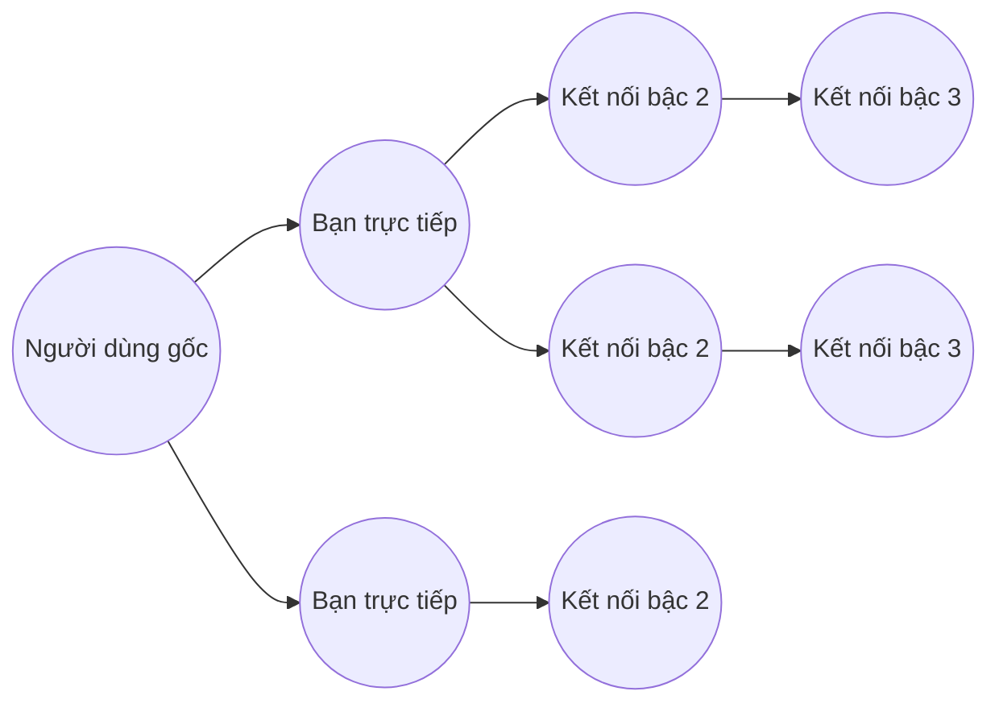
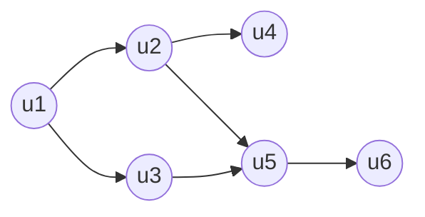

# Giới hạn độ sâu, số hàng và thời gian xử lý từ đầu vào người dùng trong Neo4j

Một API cho phép người dùng khám phá quan hệ trong Neo4j thường nhận các tham số như “xem bạn bè cách tối đa bao nhiêu bước”, “hiển thị bao nhiêu kết quả” và “chờ truy vấn trong bao lâu”. Nếu ứng dụng chuyển nguyên những con số này vào Cypher mà không kiểm soát, một yêu cầu tưởng nhỏ có thể duyệt hàng triệu đường đi, tạo tập kết quả trung gian rất lớn hoặc giữ transaction quá lâu.

Bài học thuộc chương **Thiết kế ứng dụng** của module **DATABASE_ENGINE_GRAPH_NEO4J**. Trong ứng dụng property graph dùng Cypher, **Neo4j Java Driver** hoặc **Spring Data Neo4j**, cần thiết kế **ngân sách tài nguyên cho mỗi yêu cầu**: độ sâu traversal, số hàng trả về, thời gian thực thi và các giới hạn đi kèm như concurrency, phạm vi dữ liệu của người dùng.

Mục tiêu sau bài học:

- Phân biệt **độ sâu quan hệ**, **số hàng kết quả** và **thời gian transaction**.
- Hiểu vì sao `LIMIT` không tự hạn chế toàn bộ lượng công việc duyệt graph.
- Chọn **mức độ sâu theo allowlist**, tham số hóa dữ liệu, validate `limit` và xác thực phạm vi tenant.
- Đặt **transaction timeout** trong Neo4j Java Driver và hiểu ranh giới với timeout của API/Spring.
- Đọc `EXPLAIN`/`PROFILE` để phát hiện bước `Expand`, `Sort` hoặc `Distinct` gây nổ số hàng.
- Thiết kế API có thể kiểm thử với các giá trị đầu vào cực đoan và node nhiều relationship (hub).

## 1. Tại sao traversal từ đầu vào người dùng có thể nguy hiểm?

Giả sử tính năng “gợi ý những người có kết nối gián tiếp” truy vấn graph:



Độ sâu tăng thêm một bước có thể mở rộng số đường đi **rất nhanh**. Với mô hình minh họa mỗi node có khoảng 10 cạnh dẫn tới các nhánh mới, số đường đi ứng viên ở các mức có thể là:

| Độ sâu tối đa | Số đường đi ứng viên theo mô hình cây phân nhánh 10 |
| --- | ---: |
| 1 | 10 |
| 2 | 10 + 100 = 110 |
| 3 | 10 + 100 + 1.000 = 1.110 |
| 4 | 10 + 100 + 1.000 + 10.000 = 11.110 |

Đây chỉ là **phép tính trực giác về bùng nổ tổ hợp**, không phải dự báo chính xác chi phí Neo4j. Graph thật có chu trình, nhiều đường tới cùng node, phân bố bậc lệch và quy tắc không lặp relationship trong một path. Tuy vậy, xu hướng cho thấy vì sao `depth = 4` có thể khác xa `depth = 2` về lượng công việc.

**Không được coi `depth`, `limit` và `timeout` là ba tên gọi cho cùng một giới hạn.**

| Giới hạn | Kiểm soát trực tiếp | Không bảo đảm |
| --- | --- | --- |
| **Độ sâu** | Số relationship tối đa trên đường đi được khớp | Không bảo đảm ít đường đi/hàng; hub có thể sinh rất nhiều đường trong 2 bước |
| **Số hàng** (`LIMIT`) | Số hàng được trả về tại vị trí áp dụng `LIMIT` | Không bảo đảm engine chỉ phải mở rộng, lọc hoặc sắp xếp bấy nhiêu hàng |
| **Transaction timeout** | Thời gian một transaction được phép chạy theo cơ chế timeout đã cấu hình | Không thay thế validation, rate limit, bảo vệ bộ nhớ hoặc timeout đầu-cuối của API |
| **Giới hạn request/concurrency** | Số yêu cầu có thể chạy đồng thời | Không khiến một truy vấn đơn lẻ tự trở nên rẻ |

Một API an toàn áp dụng **nhiều lớp**, không chỉ bổ sung `LIMIT 10` vào cuối câu Cypher.

## 2. Hợp đồng đầu vào: mặc định hợp lý và trần cứng

Ví dụ ứng dụng cung cấp endpoint dạng khái niệm:

```text
GET /network/members/{memberId}/connections?depth=2&limit=20
```

Thiết kế minh họa của backend:

| Trường đầu vào | Mặc định | Giá trị được chấp nhận | Chính sách |
| --- | ---: | --- | --- |
| `depth` | 2 | 1, 2 hoặc 3 | **Từ chối** giá trị ngoài allowlist; không cho truy vấn độ sâu tùy ý |
| `limit` | 20 | Số nguyên 1–50 | Từ chối 0, số âm, số quá lớn và kiểu không hợp lệ |
| `memberId` | Không có | Chuỗi ID hợp lệ, thuộc phạm vi người dùng được phép | Validate và truyền thành tham số `$memberId` |
| `tenantId` | Từ danh tính xác thực | Một tenant được cấp quyền | **Không tin** tenant do client tự gửi nếu chưa được xác thực/ủy quyền |
| Thời gian transaction | Do server ứng dụng quyết định | Ví dụ 2 giây | Không cho client tự yêu cầu “không giới hạn” |

Các con số **1–3**, **1–50** và **2 giây** là một **chính sách mẫu để minh họa**, không phải giới hạn tối ưu cho mọi graph. Hãy xác định chúng từ yêu cầu độ trễ, dữ liệu thật và kiểm thử tải.

Có hai chiến lược xử lý khi client yêu cầu quá giới hạn:

1. **Từ chối rõ ràng** (ví dụ HTTP 400) và trả phạm vi hợp lệ, tránh việc client hiểu nhầm đã nhận đủ kết quả.
2. **Cắt về mức tối đa** rồi ghi rõ `effectiveLimit` trong response nếu hợp đồng API cho phép.

Trong bài này ta chọn **từ chối**, để quy tắc trở nên minh bạch và dễ kiểm thử.

## 3. Tạo dữ liệu property graph mẫu

Ta xây dựng đồ thị nhỏ với nhãn `:SafeMember`, khóa `tenantId + memberId` và relationship `:FOLLOWS` có hướng:



Từ `u1`:

- Trong **1 bước**: `u2`, `u3`.
- Trong **2 bước** (tính cả bước 1): thêm `u4`, `u5`.
- Trong **3 bước**: thêm `u6`.

Chạy các câu sau trong **database thử nghiệm**.

### 3.1. Constraint theo khóa nghiệp vụ

```cypher
CREATE CONSTRAINT safe_member_tenant_id_unique IF NOT EXISTS
FOR (m:SafeMember)
REQUIRE (m.tenantId, m.memberId) IS UNIQUE;
```

Composite uniqueness constraint giúp bảo vệ cặp khóa và hỗ trợ truy vấn tìm node gốc. Lưu ý: constraint không thay thế kiểm tra quyền truy cập tenant ở tầng ứng dụng, cũng không mặc định bảo đảm mọi node `SafeMember` đều có đầy đủ thuộc tính cần thiết nếu không đặt quy tắc dữ liệu phù hợp.

### 3.2. Node mẫu

```cypher
UNWIND [
  {id: 'u1', name: 'An'},
  {id: 'u2', name: 'Binh'},
  {id: 'u3', name: 'Chi'},
  {id: 'u4', name: 'Dung'},
  {id: 'u5', name: 'Em'},
  {id: 'u6', name: 'Giang'}
] AS row
MERGE (m:SafeMember {tenantId: 'acme', memberId: row.id})
SET m.displayName = row.name;
```

### 3.3. Relationship mẫu

```cypher
UNWIND [
  ['u1', 'u2'],
  ['u1', 'u3'],
  ['u2', 'u4'],
  ['u2', 'u5'],
  ['u3', 'u5'],
  ['u5', 'u6']
] AS pair
MATCH (a:SafeMember {tenantId: 'acme', memberId: pair[0]})
MATCH (b:SafeMember {tenantId: 'acme', memberId: pair[1]})
MERGE (a)-[:FOLLOWS]->(b);
```

Kiểm tra dữ liệu:

```cypher
MATCH (a:SafeMember {tenantId: 'acme'})-[:FOLLOWS]->
      (b:SafeMember {tenantId: 'acme'})
RETURN a.memberId AS fromMember, b.memberId AS toMember
ORDER BY fromMember, toMember;
```

Dữ liệu chuẩn có **6 node** và **6 relationship**. Tập đầu ra của traversal có thể chứa cùng một node theo **nhiều đường đi khác nhau**: chẳng hạn `u5` đến được từ `u1` qua `u2` hoặc `u3`.

## 4. Giới hạn độ sâu ngay trong mẫu truy vấn

Truy vấn tìm những người được kết nối qua tối đa **2 relationship**:

```cypher
MATCH p = (root:SafeMember {
    tenantId: $tenantId,
    memberId: $memberId
})-[:FOLLOWS*1..2]->(other:SafeMember)
WHERE all(n IN nodes(p) WHERE n.tenantId = $tenantId)
  AND other.memberId <> root.memberId
RETURN DISTINCT other.memberId AS memberId,
                other.displayName AS displayName
ORDER BY memberId ASC
LIMIT $limit;
```

Đọc từng phần:

- `*1..2` giới hạn đường đi chứa **từ 1 đến 2 relationship**; không chỉ định độ sâu tùy ý.
- Mũi tên `->` giữ hướng `FOLLOWS` từ người gốc đến người được theo dõi.
- `all(n IN nodes(p) WHERE n.tenantId = $tenantId)` kiểm tra **cả node trung gian** thuộc tenant yêu cầu; chỉ lọc node cuối sẽ chưa đủ cho quy tắc này.
- `RETURN DISTINCT` hợp nhất các dòng trùng cùng `memberId` và `displayName` trong đầu ra, vì `u5` có hai đường đi.
- `ORDER BY` giúp kết quả có thứ tự dự đoán được; `LIMIT` giới hạn số hàng **được trả về**.

Với `tenantId = 'acme'`, `memberId = 'u1'` và `limit = 50`, kết quả logic là `u2`, `u3`, `u4`, `u5`. Khi cho phép `*1..3`, ta sẽ có thêm `u6`.

### Tại sao không dùng độ sâu từ client trực tiếp vào cú pháp?

Đừng xây câu Cypher từ nguyên một chuỗi chưa kiểm soát:

```java
// Không nên: rawDepth là dữ liệu client cung cấp.
String unsafe = "MATCH p = (a:SafeMember)-[:FOLLOWS*1.."
    + rawDepth + "]->(b:SafeMember) RETURN p";
```

Độ sâu là một phần của **cú pháp pattern** và không nên giả định có thể truyền tham số `$depth` vào mọi phiên bản/cú pháp cho phần `*1..N`. Cách phổ biến và dễ kiểm toán là **allowlist** các mẫu truy vấn có giới hạn tĩnh:

```text
depth = 1  →  *1..1
depth = 2  →  *1..2
depth = 3  →  *1..3
ngoài 1–3  →  từ chối
```

Nếu phiên bản Cypher hoặc một procedure mở rộng hỗ trợ cấu hình độ sâu động, **vẫn phải validate và áp trần phía server** trước khi truyền tham số. Có thể chọn tính năng như APOC path expander nếu môi trường thực sự cài và cho phép sử dụng, nhưng không mặc định một plugin có sẵn trong mọi deployment Neo4j.

### Độ sâu không đồng nghĩa số node duy nhất

Một truy vấn `MATCH p` có thể tạo nhiều **path** cùng tới một node:

```cypher
MATCH p = (:SafeMember {tenantId: 'acme', memberId: 'u1'})
          -[:FOLLOWS*1..3]->(target:SafeMember)
RETURN target.memberId AS target,
       length(p) AS hops,
       [n IN nodes(p) | n.memberId] AS route
ORDER BY target, hops;
```

Nếu chỉ cần danh sách người dùng, dùng `DISTINCT` hợp lý. Nếu cần **liệt kê tất cả đường đi**, chi phí có thể rất lớn, nên cần cân nhắc chức năng sản phẩm, giới hạn sâu hơn và xử lý bất đồng nhất trên graph có nhiều vòng lặp.

## 5. `LIMIT` không phải “phanh” duyệt đồ thị

Xét:

```cypher
MATCH p = (root:SafeMember {tenantId: $tenantId, memberId: $memberId})
          -[:FOLLOWS*1..3]->(target:SafeMember)
RETURN DISTINCT target.memberId AS memberId
ORDER BY memberId
LIMIT 10;
```

Mặc dù chỉ trả tối đa 10 hàng, engine vẫn có thể phải:

1. Duyệt rất nhiều đường đi tới độ sâu 3.
2. Sinh nhiều hàng trung gian cho các đường khác nhau.
3. Loại trùng bằng `DISTINCT`.
4. Sắp xếp tập kết quả theo `memberId`.
5. Cuối cùng trả 10 hàng.

Neo4j có optimizer và các runtime khác nhau; đôi khi `LIMIT` được đẩy xuống hoặc giúp dừng sớm trong **một số plan**. Nhưng **không có bảo đảm phổ quát** rằng `LIMIT 10` làm traversal chỉ tốn công cho 10 node.

| Hình dạng query | Giới hạn thực sự kiểm soát | Rủi ro còn lại |
| --- | --- | --- |
| `MATCH ... RETURN ... LIMIT 10` | Hàng cuối trả về | Có thể duyệt nhiều path trước khi có kết quả |
| `MATCH ... RETURN DISTINCT ... LIMIT 10` | Hàng khác biệt trả về | Có thể phải khử trùng lặp một tập lớn |
| `MATCH ... ORDER BY ... LIMIT 10` | Top 10 sau sort | Có thể phải xem nhiều ứng viên |
| `MATCH ... WITH ... LIMIT 10 MATCH ...` | Số **hàng trung gian trước phép MATCH sau** | Phép mở rộng ở vế sau vẫn có thể sinh nhiều hàng |
| `MATCH p = ...*1..2` | Độ sâu đến 2 | Hub hai bước vẫn có thể tạo rất nhiều path |

Vì vậy, **ba cơ chế** `*1..N`, `LIMIT`, transaction timeout phải được dùng **kết hợp**, và khi cần còn phải thêm budget cho số seed, số relationship/đích hoặc concurrency.

### Cẩn thận khi đặt `LIMIT` trước phép mở rộng

Ví dụ:

```cypher
MATCH (seed:SafeMember {tenantId: $tenantId})
WITH seed ORDER BY seed.memberId LIMIT 10
MATCH (seed)-[:FOLLOWS]->(other:SafeMember)
RETURN seed.memberId, other.memberId;
```

Câu này chỉ chọn **10 seed đầu tiên** để mở rộng, không bảo đảm trả tối đa 10 relationship ở kết quả. Nếu seed nào có 10.000 cạnh, kết quả vẫn có thể rất lớn. Ngoài ra, nó **thay đổi ý nghĩa nghiệp vụ**: không còn duyệt từ mọi seed, mà chỉ từ 10 seed được chọn theo thứ tự.

Chỉ áp dụng giới hạn ở một bước trung gian khi việc loại bỏ các seed khác phù hợp với yêu cầu sản phẩm.

## 6. Thiết kế phân trang có thứ tự ổn định

Với những danh sách có thể lớn, phân trang phù hợp hơn việc cho client yêu cầu hàng chục nghìn kết quả trong một lần.

### 6.1. Phân trang theo con trỏ trên tập node

Ví dụ truy vấn danh sách `SafeMember` trong một tenant, dùng `memberId` ổn định và có thứ tự:

```cypher
MATCH (m:SafeMember {tenantId: $tenantId})
WHERE m.memberId > $afterId
RETURN m.memberId AS memberId,
       m.displayName AS displayName
ORDER BY memberId ASC
LIMIT $pageSize;
```

Giả sử `afterId = 'u3'`, `pageSize = 2` thì kết quả từ bộ dữ liệu mẫu là `u4`, `u5`. Với trang đầu, ứng dụng có thể dùng mẫu query không có điều kiện con trỏ hoặc chọn giá trị bắt đầu có ý nghĩa theo định dạng ID.

**Những điểm cần nhớ:**

- `ORDER BY` nên dựa trên **khóa ổn định, có tính duy nhất** trong phạm vi truy vấn.
- Một unique constraint/index phù hợp với `tenantId` và `memberId` có thể giúp truy cập hiệu quả; xác minh bằng `EXPLAIN`/`PROFILE`.
- `SKIP` với offset lớn có thể phải bỏ qua rất nhiều hàng trước khi trả kết quả; keyset/cursor pagination thường đáng cân nhắc hơn trên tập lớn.
- Tạo con trỏ ở server hoặc xác thực nội dung con trỏ; không cho người dùng lợi dụng con trỏ để chuyển sang tenant khác.
- Dữ liệu thay đổi giữa các lần gọi có thể làm trang tiếp theo khác trạng thái ban đầu. Cursor **không tự tạo snapshot đa request**.

**Phân trang node** không tự biến **liệt kê toàn bộ path** thành công việc rẻ. Với traversal, phải cân nhắc ngân sách xử lý graph và thiết kế kết quả thành danh sách node đích, neighborhood hoặc đường đi theo quy tắc rõ.

### 6.2. Vì sao `COUNT(*)` có thể tốn kém?

API thường muốn cả `items` và `totalCount`. Nếu tính total bằng cách duyệt mọi path rồi `DISTINCT`, câu đếm có thể tốn nhiều công dù trang chỉ lấy 20 người.

Không nên mặc định mọi API graph cần totalCount chính xác. Có thể trả `hasNextPage` (lấy thử thêm một hàng ở một truy vấn đã được bảo vệ), dùng tổng ước lượng hoặc tác vụ thống kê khác khi yêu cầu sản phẩm cho phép.

## 7. Transaction timeout: giới hạn thời gian ở server

Kể cả với `depth <= 3` và `limit <= 50`, một node có hàng triệu relationship vẫn có thể khiến query chậm. **Transaction timeout** là lớp bảo vệ tiếp theo.

Trong **Neo4j Java Driver**, có thể cung cấp `TransactionConfig` cho managed transaction:

```java
import java.time.Duration;

import org.neo4j.driver.TransactionConfig;

TransactionConfig txConfig = TransactionConfig.builder()
    .withTimeout(Duration.ofSeconds(2))
    .build();
```

Khi thực hiện:

```java
try (Session session =
         driver.session(SessionConfig.forDatabase("neo4j"))) {

    List<String> ids = session.executeRead(
        tx -> tx.run("""
                MATCH (m:SafeMember {tenantId: $tenantId})
                RETURN m.memberId AS memberId
                ORDER BY memberId
                LIMIT $limit
                """, Map.of(
                    "tenantId", "acme",
                    "limit", 20
                ))
            .list(record ->
                record.get("memberId").asString()
            ),
        txConfig
    );
}
```

`withTimeout(Duration.ofSeconds(2))` là **giới hạn thời gian transaction** được yêu cầu từ server, không phải cam kết API chắc chắn trả lời trước đúng 2 giây theo đồng hồ client. Thời gian thiết lập kết nối, chờ pool, retry managed transaction và các bước ngoài database vẫn có thể làm request dài hơn.

Khi transaction vượt giới hạn, Neo4j có thể đánh dấu transaction để **terminate** và làm các thao tác tiếp theo thất bại/rollback. Thời điểm phát hiện và hoàn tất việc chấm dứt phụ thuộc cơ chế server; không coi timeout là bảo đảm dừng CPU tức thì tại mili giây giới hạn.

### Timeout toàn cục và timeout từng transaction

Trong một số bản Neo4j hiện hành, thiết lập `db.transaction.timeout` quy định timeout mặc định cho transaction ở tầng server. Nếu có quyền phù hợp, có thể xem:

```cypher
SHOW SETTINGS
YIELD name, value
WHERE name = 'db.transaction.timeout'
RETURN name, value;
```

Lưu ý:

- Việc có thể xem/chỉnh setting phụ thuộc phiên bản, edition và quyền quản trị.
- Không thay cấu hình timeout **toàn server** chỉ để khắc phục một endpoint; nó có thể ảnh hưởng các job ETL, thao tác dài hoặc truy vấn quản trị hợp lệ.
- Timeout từng transaction phù hợp hơn cho chính sách riêng của endpoint khi driver và deployment hỗ trợ.
- Cần đối chiếu precedence giữa cấu hình server và timeout gửi từ driver theo **phiên bản đang sử dụng**.

### Phân biệt ba loại timeout

| Cấp timeout | Ví dụ | Có tác dụng lên đâu? |
| --- | --- | --- |
| **Neo4j transaction timeout** | `TransactionConfig.withTimeout(...)` | Server đánh dấu transaction quá hạn để dừng/rollback |
| **Timeout của tầng HTTP/API** | Giới hạn xử lý request trong gateway/service | Chặn request treo kéo dài đối với client; không đảm bảo tự rollback query đã gửi |
| **Timeout mạng/driver** | Connection acquisition, retry deadline hoặc network read timeout tùy cấu hình | Bảo vệ kết nối/call; không đồng nhất với thời gian chạy Cypher trong server |

Nếu gateway hết thời gian chờ và ngắt request, không được **giả định** transaction Neo4j đã dừng tức khắc. Bảo vệ đúng cần cấu hình timeout tại **tầng transaction** và xử lý lỗi/cancel có chủ đích trong ứng dụng.

## 8. Ví dụ Java Driver end-to-end: depth, rows, timeout

Đoạn service sau áp dụng ba lớp giới hạn. `tenantId` phải đến từ **ngữ cảnh xác thực đã kiểm tra quyền**, không tin giá trị tenant do người dùng tự chọn. Phần code dùng **Java 17+** (text block, switch expression, record).

```java
import java.time.Duration;
import java.util.List;
import java.util.Map;
import java.util.Objects;

import org.neo4j.driver.Driver;
import org.neo4j.driver.Session;
import org.neo4j.driver.SessionConfig;
import org.neo4j.driver.TransactionConfig;

public final class SafeGraphQueryService {

    private static final int MAX_DEPTH = 3;
    private static final int MAX_ROWS = 50;

    private static final TransactionConfig QUERY_BUDGET =
        TransactionConfig.builder()
            .withTimeout(Duration.ofSeconds(2))
            .build();

    private final Driver driver;
    private final String database;

    public SafeGraphQueryService(Driver driver, String database) {
        this.driver = Objects.requireNonNull(driver);
        this.database = Objects.requireNonNull(database);
    }

    public record MemberView(String memberId, String displayName) {}

    public List<MemberView> connections(
            String authorizedTenantId,
            String startMemberId,
            int depth,
            int limit) {

        if (authorizedTenantId == null || authorizedTenantId.isBlank()
                || startMemberId == null || startMemberId.isBlank()) {
            throw new IllegalArgumentException("Missing identity");
        }
        if (depth < 1 || depth > MAX_DEPTH) {
            throw new IllegalArgumentException("Depth must be 1..3");
        }
        if (limit < 1 || limit > MAX_ROWS) {
            throw new IllegalArgumentException("Limit must be 1..50");
        }

        // Chỉ ghép những token cố định do SERVER chọn.
        // Không nối trực tiếp chuỗi depth do client gửi.
        String boundedPattern = switch (depth) {
            case 1 -> "*1..1";
            case 2 -> "*1..2";
            case 3 -> "*1..3";
            default -> throw new IllegalArgumentException("Invalid depth");
        };

        String cypher = """
            MATCH p = (root:SafeMember {
                tenantId: $tenantId,
                memberId: $memberId
            })-[:FOLLOWS%s]->(other:SafeMember)
            WHERE all(n IN nodes(p) WHERE n.tenantId = $tenantId)
              AND other.memberId <> root.memberId
            RETURN DISTINCT other.memberId AS memberId,
                            other.displayName AS displayName
            ORDER BY memberId ASC
            LIMIT $limit
            """.formatted(boundedPattern);

        Map<String, Object> params = Map.of(
            "tenantId", authorizedTenantId,
            "memberId", startMemberId,
            "limit", limit
        );

        try (Session session = driver.session(
                SessionConfig.forDatabase(database))) {

            return session.executeRead(tx ->
                tx.run(cypher, params).list(record ->
                    new MemberView(
                        record.get("memberId").asString(),
                        record.get("displayName").asString()
                    )
                ),
                QUERY_BUDGET
            );
        }
    }
}
```

**Diễn giải lớp bảo vệ:**

1. **Validation:** từ chối `depth > 3`, `limit > 50` và ID trống trước khi truy vấn.
2. **Allowlist cú pháp:** chỉ có 3 chuỗi `*1..N` do server định nghĩa; không thể truyền fragment Cypher tùy ý.
3. **Tham số dữ liệu:** `tenantId`, `memberId`, `limit` được bind vào Cypher, không ghép thành literal.
4. **Phạm vi tenant:** root và mọi node trên path được kiểm tra cùng tenant; dù vậy, **ủy quyền phải được bảo vệ ở tầng ứng dụng và quyền database**, không chỉ bằng điều kiện query.
5. **Trần hàng:** `LIMIT $limit` giới hạn số DTO trả về.
6. **Transaction timeout:** `executeRead(..., QUERY_BUDGET)` yêu cầu Neo4j áp giới hạn thời gian cho một transaction.
7. **Vòng đời Result:** `list(mapper)` chuyển kết quả thành DTO **trong callback**, trước khi session đóng.

**Điều chưa được bảo đảm bởi ví dụ:** Cypher vẫn có thể tạo nhiều path trước khi `DISTINCT`/`LIMIT`, và một hub lớn vẫn có thể rất tốn kém trước lúc bị timeout. Production cần thêm kiểm thử tải, rate limit, concurrency limit và các ràng buộc model phù hợp.

### Vì sao không dùng một mẫu Cypher có độ sâu thật lớn rồi lọc `length(p) <= $depth`?

Ví dụ không nên áp dụng cho user-controlled bound:

```cypher
MATCH p = (root:SafeMember)-[:FOLLOWS*1..10]->(other:SafeMember)
WHERE length(p) <= $depth
RETURN other.memberId;
```

Dù client gửi `depth = 2`, mẫu query vẫn có phạm vi mở rộng **tối đa 10** trước khi xét điều kiện lọc (mức độ đẩy predicate phụ thuộc planner). Cách này có thể tạo lượng công việc dư thừa rất lớn. Hãy **ràng buộc độ sâu ngay trong traversal pattern** hoặc dùng một API traversal có khả năng limit độ sâu nội tại và được cấu hình/validate đúng.

## 9. Với Spring Data Neo4j: transaction và timeout đặt ở đâu?

Trong ứng dụng **Spring Data Neo4j**, có thể định nghĩa giao diện repository/`Neo4jClient` và một service ở lớp nghiệp vụ. Ví dụ:

```java
import org.springframework.data.neo4j.core.Neo4jClient;
import org.springframework.stereotype.Service;
import org.springframework.transaction.annotation.Transactional;

import java.util.List;

@Service
public class GraphConnectionReadService {

    private final Neo4jClient neo4jClient;

    public GraphConnectionReadService(Neo4jClient neo4jClient) {
        this.neo4jClient = neo4jClient;
    }

    @Transactional(readOnly = true, timeout = 3)
    public List<String> directConnections(
            String authorizedTenantId,
            String memberId,
            int limit) {

        if (limit < 1 || limit > 50) {
            throw new IllegalArgumentException("Invalid limit");
        }

        return neo4jClient.query("""
                MATCH (root:SafeMember {
                    tenantId: $tenantId, memberId: $memberId
                })-[:FOLLOWS]->(other:SafeMember {
                    tenantId: $tenantId
                })
                RETURN DISTINCT other.memberId AS memberId
                ORDER BY memberId
                LIMIT $limit
                """)
            .bind(authorizedTenantId).to("tenantId")
            .bind(memberId).to("memberId")
            .bind(limit).to("limit")
            .fetchAs(String.class)
            .mappedBy((typeSystem, record) ->
                record.get("memberId").asString()
            )
            .all()
            .stream()
            .toList();
    }
}
```

Điểm cần cân nhắc:

- `@Transactional(readOnly = true, timeout = 3)` thể hiện ranh giới transaction ở Spring; **khả năng áp timeout thực tế** cần được xác nhận với `Neo4jTransactionManager`, cấu hình và phiên bản SDN đang chạy.
- Nếu phương thức được gọi **bên trong cùng bean** (self-invocation) và bỏ qua Spring proxy, annotation có thể không được áp dụng.
- Nếu method **tham gia transaction đã tồn tại**, timeout riêng của method không mặc nhiên khởi tạo một timeout mới. Phải hiểu propagation và manager.
- `readOnly = true` không thay thế quyền bảo mật; tài khoản Neo4j vẫn cần được cấp quyền đúng.
- `all()` materialize kết quả; chỉ dùng khi số hàng đã được giới hạn và chi phí truy vấn chấp nhận được.
- Endpoint chỉ xem **một bước** ở ví dụ này; nếu cần nhiều bước, chọn query bounded theo depth như phần Java Driver, không biến đầu vào thành chuỗi Cypher tự do.

**Phân biệt:** transaction do Spring quản lý không mặc nhiên bao gồm một `Driver Session` tự tạo riêng. Nếu trộn hai API, phải có thiết kế transaction rõ ràng.

## 10. Chiến lược tốt hơn khi graph có hub rất lớn

Chỉ giới hạn `depth = 2` vẫn có thể nặng nếu node gốc có 500.000 relationship. Có thể cân nhắc thay đổi **hợp đồng sản phẩm** và **mô hình truy vấn**, không chỉ tăng timeout.

### 10.1. Bắt đầu từ truy vấn cụ thể và bộ lọc chọn lọc

Một câu truy vấn dùng label và relationship type rõ ràng:

```cypher
MATCH (root:SafeMember {
    tenantId: $tenantId,
    memberId: $memberId
})-[:FOLLOWS]->(other:SafeMember)
WHERE other.tenantId = $tenantId
  AND other.active = true
RETURN other.memberId AS memberId
ORDER BY memberId
LIMIT $limit;
```

Nếu ứng dụng chỉ cần hàng xóm trực tiếp, **đừng dùng `*1..3`** rồi lọc lại kết quả về một bước. Lọc theo `active`, tenant và key phù hợp có thể giảm hàng xuất ra; tuy vậy, nếu graph có hub khổng lồ, vẫn phải xem plan để biết engine có duyệt nhiều relationship trước khi lọc hay không.

### 10.2. Tránh trả mọi đường đi khi chỉ cần node đích

`RETURN p` có thể gửi danh sách node/relationship trên nhiều đường khác nhau, làm dữ liệu response lớn và trùng lặp. Nếu nghiệp vụ chỉ muốn “những người có kết nối”, trả ID và thuộc tính cần thiết:

```cypher
RETURN DISTINCT other.memberId AS memberId
ORDER BY memberId
LIMIT $limit;
```

Nếu sản phẩm cần **một đường đại diện** để giải thích lý do gợi ý, phải định nghĩa tiêu chí chọn đường (ví dụ ít hop nhất) và thuật toán thích hợp; đừng trả toàn bộ tập path theo mặc định.

### 10.3. Giới hạn tài nguyên ở cấp service

Khi có nhiều request chạy đồng thời, tổng tải có thể tăng dù từng request tuân thủ trần:

- **Rate limit** theo người dùng/tenant và theo endpoint.
- **Concurrency limit** cho thao tác traversal nặng.
- **Request timeout** ở tầng API kết hợp **Neo4j transaction timeout**.
- **Giới hạn response bytes** hoặc kích thước serialization, không chỉ số record.
- **Giới hạn số seed** trong truy vấn fan-out từ danh sách nhiều user.
- **Circuit breaker / load shedding** khi database chậm hoặc quá tải.
- Với bài toán phân tích nặng, đưa sang job async **có quản lý** và trả trạng thái thay vì giữ một HTTP request mở; cơ chế này là thiết kế ứng dụng, không phải khả năng mặc định của Cypher.

Những biện pháp này phối hợp với nhau. Ví dụ API còn 10 slot concurrency có thể từ chối yêu cầu thứ 11 thay vì tạo thêm transaction.

## 11. Kiểm chứng kế hoạch thực thi thay vì đoán từ cú pháp

### `EXPLAIN`: xem kế hoạch không thực thi

```cypher
EXPLAIN
MATCH p = (root:SafeMember {
    tenantId: 'acme',
    memberId: 'u1'
})-[:FOLLOWS*1..3]->(other:SafeMember)
WHERE all(n IN nodes(p) WHERE n.tenantId = 'acme')
RETURN DISTINCT other.memberId AS memberId
ORDER BY memberId
LIMIT 20;
```

### `PROFILE`: chạy và đo

```cypher
PROFILE
MATCH p = (root:SafeMember {
    tenantId: 'acme',
    memberId: 'u1'
})-[:FOLLOWS*1..3]->(other:SafeMember)
WHERE all(n IN nodes(p) WHERE n.tenantId = 'acme')
RETURN DISTINCT other.memberId AS memberId
ORDER BY memberId
LIMIT 20;
```

Các điểm cần quan sát trong plan:

| Operator hoặc chỉ số | Ý nghĩa cần kiểm tra |
| --- | --- |
| `NodeIndexSeek` / `NodeUniqueIndexSeek` | Tìm root bằng khóa đủ chọn lọc chưa? |
| `VarLengthExpand` / toán tử duyệt relationship tương đương | Đã tạo bao nhiêu hàng trước khi áp giới hạn cuối? |
| `Filter` | Có loại bỏ nhiều path sau khi đã duyệt không? |
| `Distinct` / `EagerAggregation` | Khử trùng lặp có tốn bộ nhớ và xử lý nhiều hàng không? |
| `Sort` / `Top` | Sắp xếp có cần xem toàn bộ nhiều ứng viên không? |
| `Estimated Rows` so với `Rows` | Dự đoán của planner có lệch mạnh trên node hub không? |
| `DB Hits` | Mức truy cập dữ liệu trong engine; không đồng nhất với số lượt đọc đĩa |
| `Memory` và thời gian | Tùy runtime/version, có thể phản ánh áp lực bộ nhớ của các bước |

**`PROFILE` thực thi truy vấn**. Khi thử câu ghi dữ liệu, nó có thể thực sự tạo/sửa graph; với bài này nên dùng query đọc trên cơ sở dữ liệu thực hành. Với bộ mẫu rất nhỏ, kế hoạch có thể dùng quét nhãn thay vì index; không nên rút kết luận hiệu năng từ sáu node.

### Bộ dữ liệu đối kháng cần thử

Một graph test có số node trung bình nhỏ nhưng có một **hub** bậc rất cao (chẳng hạn 100.000 relationship) mới bộc lộ rủi ro traversal rõ ràng. Trên môi trường kiểm thử có thể tạo dữ liệu đại diện và quan sát mức tăng `Rows` theo `depth`, nhưng **không tạo graph gây quá tải trên production**.

## 12. Phân biệt hạn chế độ sâu với shortest path và GDS

Một số API cho phép tìm đường nối giữa hai tài khoản. Cần phân biệt:

- **Traversal có giới hạn sâu** `*1..3`: xét những path khớp mẫu trong phạm vi 1–3 bước; khi dùng để trả mọi path có thể tạo rất nhiều kết quả.
- **Đường đi ngắn nhất theo số hop**: bài toán khác, có cú pháp shortest path trong Cypher và cơ chế tìm kiếm riêng.
- **Đường đi có tổng trọng số nhỏ nhất**: cần xét property như `cost` hoặc `duration`, có thể dùng thuật toán phù hợp của **Neo4j Graph Data Science** trong môi trường được hỗ trợ.

Việc dùng shortest-path operator **không miễn** yêu cầu kiểm soát input, phạm vi dữ liệu, độ trễ và tính đúng của graph. Với GDS, projection có vòng đời và ngân sách bộ nhớ riêng; không nên tạo một projection mới cho mỗi request tùy tiện.

Nếu sản phẩm chỉ hỏi “hai người có kết nối trong tối đa 3 bước không?”, hợp đồng kết quả **boolean hoặc một đường đại diện** có thể phù hợp hơn là trả toàn bộ path. Việc chọn truy vấn phải được kiểm chứng trên workload thực, thay vì thay bằng `RETURN p LIMIT 1` rồi ngầm hiểu đó là “đường tốt nhất”.

## 13. Bảo mật: giới hạn tài nguyên không thay thế authorization

Một client có thể cố thay `memberId` để truy vấn tài khoản của người khác hoặc tenant khác. Mặc dù có `LIMIT 20` và timeout 2 giây, một câu query vẫn có thể tiết lộ dữ liệu nếu kiểm tra quyền sai.

Các nguyên tắc:

1. **Nguồn `tenantId` từ danh tính đã xác thực**, không tự tin vào query parameter từ client.
2. **Kiểm tra quyền truy cập root node** và phạm vi các node/cạnh người dùng có thể xem.
3. Với graph đa tenant, cân nhắc **mô hình quan hệ và nhãn** tránh kết nối xuyên tenant không được phép; điều kiện `all(n IN nodes(p)...)` là lớp kiểm tra thêm, không phải hệ thống phân quyền hoàn chỉnh.
4. Sử dụng **parameter binding** cho giá trị; nếu cần chọn label, relationship type, sort field, dùng **allowlist** và khả năng Cypher được hỗ trợ chính thức.
5. **Không trả chi tiết internal ID** của Neo4j nếu không cần; dùng business key và DTO được thiết kế.
6. Hạn chế việc in query chứa dữ liệu cá nhân, tham số nhạy cảm và toàn bộ path vào log.
7. Quyền database của ứng dụng nên tuân thủ **least privilege**, tránh cấp quyền sửa graph cho API chỉ đọc.

Một API graph phải an toàn cả về **dữ liệu được phép xem** lẫn **tài nguyên được phép tiêu thụ**. Hai mục tiêu này bổ sung nhau, không thay thế nhau.

## 14. Thiết kế phản hồi API khi bị giới hạn hoặc hết thời gian

Không nên trả dữ liệu một phần rồi im lặng gọi đó là kết quả đầy đủ.

| Tình huống | Cách phản hồi nên thiết kế | Lý do |
| --- | --- | --- |
| `depth` ngoài 1–3 | HTTP 400 với mã `INVALID_DEPTH` và giá trị hợp lệ | Yêu cầu không hợp lệ theo contract |
| `limit` = 0 hoặc vượt 50 | HTTP 400 với `INVALID_LIMIT` | Tránh request không giới hạn hoặc quá lớn |
| Thiếu quyền xem member | HTTP 403 hoặc 404 theo chính sách công bố tài nguyên | Không làm lộ tài nguyên không được phép |
| Neo4j transaction hết thời gian | Mã lỗi dịch vụ nhất quán (ví dụ 503/504 theo nguồn lỗi và gateway), có thể retry theo chính sách | Phân biệt timeout với kết quả rỗng |
| Tìm không thấy kết nối hợp lệ | HTTP 200 với `items: []` nếu truy vấn thành công | Đây là kết quả nghiệp vụ, không phải lỗi timeout |
| Có trang tiếp theo | Trả `nextCursor`, `effectiveLimit` nếu hợp đồng hỗ trợ | Cho phép lấy tiếp có kiểm soát |

Đừng gửi raw stack trace Neo4j cho client. Log nội bộ nên giữ correlation ID, thời gian, loại truy vấn, depth/limit hiệu lực và trạng thái lỗi, nhưng cần tránh ghi thông tin nhạy cảm.

Nếu timeout xảy ra giữa thao tác ghi, ứng dụng còn phải phân biệt trường hợp **commit đã thành công nhưng phản hồi bị mất**. Idempotency và business key là trách nhiệm bổ sung; một HTTP retry không được giả định luôn an toàn.

## 15. Ma trận kiểm thử trước khi mở API cho người dùng

Với graph mẫu, bảng dưới cho biết hành vi **logic dự kiến**:

| `memberId` | `depth` | `limit` | Kết quả mong đợi |
| --- | ---: | ---: | --- |
| `u1` | 1 | 50 | `u2`, `u3` |
| `u1` | 2 | 50 | `u2`, `u3`, `u4`, `u5` |
| `u1` | 3 | 50 | `u2`, `u3`, `u4`, `u5`, `u6` |
| `u1` | 3 | 2 | Tối đa 2 bản ghi theo `ORDER BY memberId`: `u2`, `u3` |
| `u1` | 0 | 20 | Bị từ chối trước khi truy vấn |
| `u1` | 99 | 20 | Bị từ chối trước khi truy vấn |
| `u1` | 2 | 0 | Bị từ chối trước khi truy vấn |
| `u1` | 2 | 1000 | Bị từ chối trước khi truy vấn |
| ID không thuộc tenant hợp lệ | 2 | 20 | Không trả dữ liệu trái quyền; xử lý theo hợp đồng authorization |

Kiểm thử tải thêm với đồ thị lớn:

- **Node bậc rất cao** và nhiều đường hội tụ ở một node.
- **Mẫu vòng lặp** để quan sát số path tăng nhanh.
- **Concurrent requests** của một user/tenant và nhiều tenant.
- **Timeout chủ động** với query chậm trong môi trường thử nghiệm; xác minh HTTP error, log và giải phóng tài nguyên.
- **Kết quả rất lớn** để phát hiện serialization/memory pressure.
- **Data skew**: trung bình nhanh nhưng một nhóm user rất chậm.
- **Tham số không hợp lệ**: chuỗi thay vì số, số âm, số thập phân, `null`, tenant không được phép.

Kết quả đo nên bao gồm độ trễ p95/p99, số transaction quá hạn, DB Hits, memory, số hàng trung gian, connection pool wait và tỷ lệ từ chối do chính sách. Không chỉ đo **số hàng cuối cùng**.

## 16. Câu hỏi tự kiểm tra

**Câu 1.** Một query có `MATCH p = ...*1..5` và `RETURN p LIMIT 10`. Có thể khẳng định Neo4j chỉ duyệt tối đa 10 path không?

<details>
<summary>Gợi ý đáp án</summary>

Không. `LIMIT 10` giới hạn số hàng trả về ở vị trí nó được áp dụng. Planner có thể phải tạo và xử lý nhiều path trước đó, đặc biệt khi có `DISTINCT`, `ORDER BY` hoặc các phép lọc. Cần giới hạn sâu, timeout và kiểm tra `PROFILE`.

</details>

**Câu 2.** Đầu vào client cho `depth = 500`. Backend nên thay `*1..500` vào Cypher và tin vào timeout 2 giây không?

<details>
<summary>Gợi ý đáp án</summary>

Không. Giá trị ngoài chính sách phải bị từ chối hoặc được chuẩn hóa theo hợp đồng API. Trong ví dụ này chỉ cho phép 1, 2, 3; chuỗi cú pháp traversal được chọn từ allowlist phía server. Timeout chỉ là lớp bảo vệ bổ sung.

</details>

**Câu 3.** `depth = 2` có chắc nhanh với mọi root node không?

<details>
<summary>Gợi ý đáp án</summary>

Không. Một hub có thể có hàng trăm nghìn relationship ngay ở bước đầu. Hai bước có thể tạo rất nhiều đường đi. Cần đo trên dữ liệu lệch và cân nhắc bộ lọc, giới hạn concurrency, thay đổi query/mô hình sản phẩm khi cần.

</details>

**Câu 4.** Trong Java Driver, đặt `TransactionConfig.withTimeout(Duration.ofSeconds(2))` đã bảo đảm request HTTP xong trong 2 giây chưa?

<details>
<summary>Gợi ý đáp án</summary>

Chưa. Transaction timeout là giới hạn cho việc thực thi transaction theo server. Thời gian chờ connection pool, network, retry, mapping và response còn có thể làm request lâu hơn. Cần thêm request timeout và chính sách lỗi phù hợp.

</details>

**Câu 5.** Vì sao `RETURN DISTINCT other.memberId ORDER BY memberId LIMIT 20` vẫn có thể cần nhiều bộ nhớ?

<details>
<summary>Gợi ý đáp án</summary>

Engine có thể cần duyệt nhiều đường đi, khử trùng lặp các ID rồi sắp xếp nhiều ứng viên trước khi lấy 20 hàng. Chỉ có 20 hàng cuối không có nghĩa đã xử lý 20 hàng trung gian.

</details>

**Câu 6.** `@Transactional(timeout = 3)` trên Spring service có luôn áp timeout nếu phương thức được gọi từ một phương thức khác trong cùng bean không?

<details>
<summary>Gợi ý đáp án</summary>

Không chắc. Với proxy mode thông thường, self-invocation có thể bỏ qua transaction interceptor. Ngoài ra còn cần transaction manager hỗ trợ timeout và hiểu propagation/transaction có sẵn. Phải kiểm chứng thực tế.

</details>

**Câu 7.** Nếu client gửi `tenantId = 'other-company'` và `limit = 5`, giới hạn 5 hàng có đủ bảo vệ dữ liệu người khác không?

<details>
<summary>Gợi ý đáp án</summary>

Không. `LIMIT` chỉ bảo vệ lượng hàng trả về, không phải authorization. Tenant phải được suy ra hoặc kiểm tra từ danh tính người dùng và quyền truy cập node/path. Một hàng dữ liệu trái quyền vẫn là vi phạm bảo mật.

</details>

**Câu 8.** Tại sao cần `ORDER BY` dựa trên khóa ổn định khi phân trang graph?

<details>
<summary>Gợi ý đáp án</summary>

Không có thứ tự xác định, các trang có thể lặp hoặc bỏ sót bản ghi giữa các lần gọi. `ORDER BY` theo khóa ổn định, duy nhất và cursor được xác thực giúp kết quả phân trang nhất quán hơn, dù không tự tạo snapshot xuyên nhiều request.

</details>

## Ghi nhớ

- **Độ sâu, số hàng và thời gian xử lý là ba ngân sách khác nhau**: dùng cùng nhau thay vì kỳ vọng một giới hạn bảo vệ toàn bộ query.
- **Giới hạn traversal ngay trong pattern** bằng độ sâu cho phép; không nối trực tiếp input vào cú pháp Cypher.
- **`LIMIT` kiểm soát hàng trả về, không bảo đảm giới hạn traversal, sort hoặc distinct phía trước**.
- **Neo4j Java Driver** hỗ trợ `TransactionConfig.withTimeout(...)`; ứng dụng còn cần request/network timeout và chính sách xử lý lỗi.
- **Spring Data Neo4j** có `@Transactional(timeout=...)` nhưng phải kiểm chứng đúng transaction manager, proxy và propagation.
- **Phạm vi tenant và quyền truy cập** phải được bảo vệ riêng, không chỉ giới hạn tài nguyên.
- **Dùng `EXPLAIN`/`PROFILE` trên dữ liệu thực tế và nhóm hub**, đánh giá `Rows`, `DB Hits`, bộ nhớ và độ trễ.
- **Thiết kế hợp đồng API rõ ràng** cho input sai, timeout, kết quả rỗng, phân trang và retry.

### Tài liệu tham khảo

- [Neo4j Cypher Manual — Variable-length patterns](https://neo4j.com/docs/cypher-manual/current/patterns/variable-length-patterns/)
- [Neo4j Cypher Manual — LIMIT](https://neo4j.com/docs/cypher-manual/current/clauses/limit/)
- [Neo4j Cypher Manual — Execution plans and query tuning](https://neo4j.com/docs/cypher-manual/current/planning-and-tuning/query-tuning/)
- [Neo4j Java Driver Manual — Transactions](https://neo4j.com/docs/java-manual/current/transactions/)
- [Neo4j Operations Manual — Configuration settings](https://neo4j.com/docs/operations-manual/current/configuration/configuration-settings/)
- [Spring Data Neo4j — Reference](https://docs.spring.io/spring-data/neo4j/reference/)
- [Spring Framework — Declarative transaction management](https://docs.spring.io/spring-framework/reference/data-access/transaction/declarative.html)
