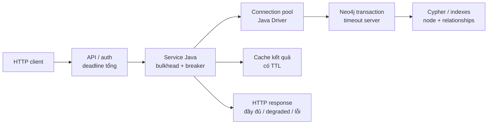
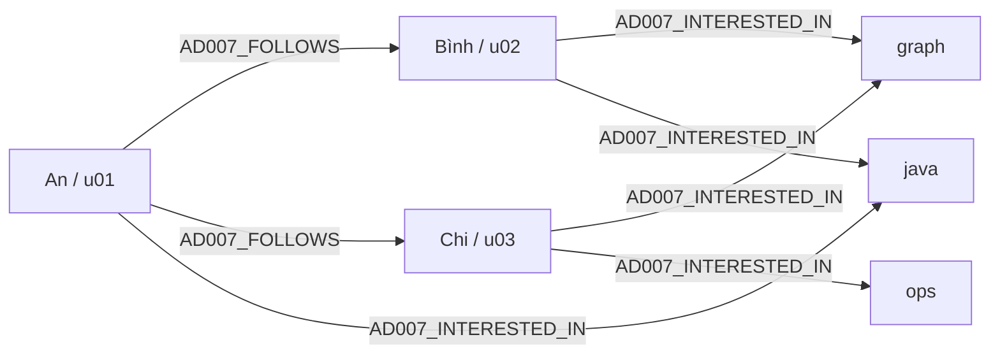

# Xử lý lỗi, timeout, hủy yêu cầu và suy giảm dịch vụ

## 1. Tư duy thiết kế: truy vấn đúng vẫn có thể làm ứng dụng không sẵn sàng

Trong ứng dụng Neo4j, một yêu cầu API có thể đi qua bước xác thực, kết nối **Java Driver**, truy vấn Cypher trên **property graph**, ánh xạ node/relationship thành DTO và trả HTTP. Chỉ cần một chặng gặp lỗi — mất kết nối Bolt, tranh chấp tài nguyên, truy vấn quá lâu hoặc client đóng kết nối — toàn bộ trải nghiệm người dùng có thể suy giảm.

Ví dụ chức năng **gợi ý chủ đề từ mạng lưới bạn bè**: truy vấn đi từ người dùng qua relationship `FOLLOWS` đến người khác, rồi đến node `Topic`. Khi Neo4j đáp ứng chậm, ứng dụng cần quyết định **chờ, thử lại, hủy, trả kết quả cache có cảnh báo, hay báo lỗi**. Câu trả lời khác nhau giữa màn hình gợi ý *không thiết yếu* và thao tác ghi quyền truy cập/thanh toán *thiết yếu*.

Chủ đề thuộc chương **Thiết kế ứng dụng** của module `DATABASE_ENGINE_GRAPH_NEO4J`. Các kỹ thuật dưới đây nối việc mô hình hóa graph, index, `EXPLAIN`/`PROFILE`, Java Driver và Spring Data Neo4j với quản lý lỗi và tài nguyên trong sản xuất.

### Kết quả học tập

Sau bài này, bạn có thể:

1. Phân loại lỗi Neo4j/Java Driver thành lỗi đầu vào, lỗi cần sửa, lỗi tạm thời và lỗi chưa rõ trạng thái commit.
2. Thiết kế **ngân sách thời gian** từ HTTP tới connection pool, transaction và retry; không nhầm timeout với hủy yêu cầu.
3. Quản lý vòng đời `Driver`, `Session`, `Result` và transaction khi yêu cầu bị hủy hoặc hết hạn.
4. Dùng retry có giới hạn, idempotency, circuit breaker, bulkhead và load shedding đúng ngữ cảnh.
5. Thiết kế **graceful degradation** có kiểm soát độ tươi, quyền truy cập và tính đúng đắn.
6. Kiểm thử tình huống Neo4j chậm/mất kết nối mà không phát sinh cập nhật trùng hoặc rò rỉ tài nguyên.

## 2. Bản đồ phụ thuộc và ranh giới lỗi



Một số lỗi có thể xuất hiện **trước** khi Neo4j thực thi bất kỳ câu Cypher nào (ví dụ hết thời gian chờ connection pool). Một số khác xảy ra **sau** khi transaction đã commit nhưng trước khi ứng dụng nhận được phản hồi xác nhận. Vì thế không nên có một khối `catch (Exception e)` rồi retry toàn bộ công việc.

### 2.1. Phân loại lỗi trước khi quyết định xử lý

| Nhóm | Ví dụ | Nên làm | Không nên làm |
|---|---|---|---|
| **Đầu vào/nghiệp vụ** | User ID rỗng, `limit` quá lớn, không có quyền truy cập | Trả lỗi yêu cầu phù hợp; không gửi Cypher | Retry cùng input hoặc thay bằng dữ liệu cache của người khác |
| **Cấu hình/query không hợp lệ** | Cypher sai, thiếu procedure, schema/constraint không phù hợp | Ghi nhận lỗi, sửa ứng dụng/deployment | Fallback âm thầm che lỗi code hoặc retry vô hạn |
| **Lỗi tạm thời** | Neo4j không sẵn sàng, routing/session hết hiệu lực, tranh chấp tạm thời | Driver retry có giới hạn; có thể fallback với tính năng đọc không thiết yếu | Retry nhiều tầng không giới hạn |
| **Quá thời gian** | Chờ connection, transaction chạy lâu, deadline HTTP đã hết | Dừng phát công việc mới, giải phóng tài nguyên, phân loại timeout | Cho phép request đã hết hạn tiếp tục giữ pool lâu |
| **Trạng thái ghi chưa chắc chắn** | Mất kết nối sau khi gửi commit nhưng trước ACK | Tra cứu bằng operation ID, thiết kế idempotency/reconcile | Gửi lại thao tác tăng tiền, trừ điểm hay tạo bản ghi không có khóa |
| **Quá tải có hệ thống** | Pool cạn, p99 tăng, CPU/heap bão hòa | Giới hạn concurrency/queue, load shedding, breaker | Tăng timeout và retry để tạo thêm tải |

Trong Java Driver, có các ngoại lệ như `ClientException`, `TransientException`, `ServiceUnavailableException`, `SessionExpiredException`. Ở các phiên bản hiện hành, các ngoại lệ có thể retry thường triển khai marker interface `RetryableException`; thông tin lỗi có thể gồm code Neo4j và GQLSTATUS. **Không phân loại chỉ bằng cách so một chuỗi thông báo lỗi**, vì thông điệp và mã cụ thể có thể thay đổi theo phiên bản.

Lưu ý: một lỗi "timeout" không luôn có cùng class ngoại lệ ở mọi tầng. Timeout ở HTTP gateway, connection pool và trong Neo4j là **những lỗi khác nhau**. Cần gắn nguồn phát sinh lỗi vào log/metric trước khi chọn fallback hoặc retry.

## 3. Chuẩn bị đồ thị mẫu để tái hiện kịch bản

Ta dùng một chức năng gợi ý chủ đề: từ một user, tìm những người được họ theo dõi, rồi đếm những chủ đề được những người đó quan tâm.



Các nhãn và relationship đều có tiền tố `AD007`; **chỉ chạy các lệnh tạo/xóa trên database thực hành**.

### 3.1. Constraint định danh

```cypher
CREATE CONSTRAINT ad007_user_id IF NOT EXISTS
FOR (u:AD007User)
REQUIRE u.id IS UNIQUE;
```

```cypher
CREATE CONSTRAINT ad007_topic_slug IF NOT EXISTS
FOR (t:AD007Topic)
REQUIRE t.slug IS UNIQUE;
```

Constraint giúp truy cập theo khóa ổn định và giảm nguy cơ trùng node khi nhiều phiên nhập dữ liệu. Tuy vậy, `UNIQUE` không thay thế xác thực giá trị ID từ ứng dụng.

### 3.2. Node và relationship

```cypher
UNWIND [
  {id: 'u01', name: 'An'},
  {id: 'u02', name: 'Bình'},
  {id: 'u03', name: 'Chi'},
  {id: 'u04', name: 'Dũng'}
] AS item
MERGE (u:AD007User {id: item.id})
SET u.name = item.name;
```

```cypher
UNWIND ['graph', 'java', 'ops'] AS slug
MERGE (:AD007Topic {slug: slug});
```

```cypher
UNWIND [
  {source: 'u01', target: 'u02'},
  {source: 'u01', target: 'u03'}
] AS item
MATCH (a:AD007User {id: item.source})
MATCH (b:AD007User {id: item.target})
MERGE (a)-[:AD007_FOLLOWS]->(b);
```

```cypher
UNWIND [
  {userId: 'u01', slug: 'java'},
  {userId: 'u02', slug: 'graph'},
  {userId: 'u02', slug: 'java'},
  {userId: 'u03', slug: 'graph'},
  {userId: 'u03', slug: 'ops'}
] AS item
MATCH (u:AD007User {id: item.userId})
MATCH (t:AD007Topic {slug: item.slug})
MERGE (u)-[:AD007_INTERESTED_IN]->(t);
```

### 3.3. Truy vấn "đầy đủ" và truy vấn đơn giản hơn

Truy vấn gợi ý từ bạn bè:

```cypher
MATCH (me:AD007User {id: $userId})
      -[:AD007_FOLLOWS]->(friend:AD007User)
      -[:AD007_INTERESTED_IN]->(topic:AD007Topic)
WITH topic, count(DISTINCT friend) AS interestedFriends
RETURN topic.slug AS slug, interestedFriends
ORDER BY interestedFriends DESC, slug
LIMIT $limit;
```

Với `$userId = 'u01'` và `$limit = 3`, kết quả:

| slug | interestedFriends |
|---|---:|
| `graph` | 2 |
| `java` | 1 |
| `ops` | 1 |

Với `u04`, truy vấn trả **0 dòng** dù user tồn tại vì chưa có quan hệ phù hợp: đây là kết quả hợp lệ, không phải lỗi backend. ID không tồn tại cũng có thể cho 0 dòng ở pattern này; nếu hợp đồng API phải phân biệt `404 Not Found` với danh sách gợi ý rỗng, hãy kiểm tra sự tồn tại **sau khi xác thực/phân quyền**, thay vì suy từ số kết quả gợi ý.

Một truy vấn đọc ít quan hệ hơn (khi Neo4j **còn hoạt động** nhưng truy vấn cá nhân hóa quá đắt):

```cypher
MATCH (me:AD007User {id: $userId})
      -[:AD007_INTERESTED_IN]->(topic:AD007Topic)
RETURN topic.slug AS slug
ORDER BY slug
LIMIT $limit;
```

Với `u01`, truy vấn đơn giản trả `java`. **Đây là loại gợi ý khác**, không phải tập kết quả tương đương của truy vấn đầu; API phải phân biệt `recommendationMode`. Nếu Neo4j **đã mất kết nối hoàn toàn**, truy vấn đơn giản vẫn không dùng được: lúc đó fallback phải dựa vào dữ liệu cache/dịch vụ khác đã chuẩn bị từ trước hoặc trả lỗi.

Kiểm chứng fixture:

```cypher
MATCH (u:AD007User)
WITH count(u) AS users
MATCH (t:AD007Topic)
WITH users, count(t) AS topics
MATCH (:AD007User)-[f:AD007_FOLLOWS]->(:AD007User)
WITH users, topics, count(f) AS follows
MATCH (:AD007User)-[i:AD007_INTERESTED_IN]->(:AD007Topic)
RETURN users = 4 AND topics = 3
       AND follows = 2 AND count(i) = 5 AS passed;
```

Trên fixture cô lập, `passed = true`. Đây là kiểm tra dữ liệu, **không phải** benchmark độ trễ hoặc mô phỏng lỗi.

## 4. Thiết kế timeout theo deadline chung

Một API có thể có nhiều timeout. Chúng xử lý các loại chờ khác nhau, không phải các giá trị thay thế cho nhau.

| Lớp | Mục đích | Ví dụ nơi cấu hình |
|---|---|---|
| **HTTP/request deadline** | Giới hạn thời gian tối đa mà client/API chờ kết quả | Gateway, web framework, request context |
| **Concurrency/queue timeout** | Không giữ request đang chờ slot/bulkhead quá lâu | Semaphore, bounded queue |
| **Connection timeout** | Giới hạn thiết lập kết nối TCP/TLS/Bolt | `Config.withConnectionTimeout` của Driver |
| **Connection acquisition timeout** | Giới hạn chờ lấy kết nối thích hợp từ pool/routing | `Config.withConnectionAcquisitionTimeout` |
| **Transaction timeout** | Yêu cầu Neo4j chấm dứt transaction vượt giới hạn thực thi | `TransactionConfig.withTimeout` |
| **Retry budget** | Giới hạn thời gian driver thử lại lỗi tạm thời | `Config.withMaxTransactionRetryTime` |
| **Fallback/cache deadline** | Không để cache/dịch vụ dự phòng giữ request tới sát deadline | Timeout của cache/client riêng |

### 4.1. Ví dụ ngân sách 1.200 ms

Giả sử chức năng gợi ý có **deadline tổng 1.200 ms** tại API. Một chính sách giả định:

- Phải qua kiểm tra input, quyền và bulkhead trước khi gọi DB.
- Chờ lấy kết nối **tối đa khoảng 200 ms**.
- Mỗi transaction đọc đặt timeout **450 ms**.
- Driver retry trong ngân sách hữu hạn (ví dụ tối đa **300 ms** do cấu hình quản trị; giá trị này không tự bằng deadline của request).
- Dành phần thời gian còn lại cho ánh xạ DTO, cache fallback và phản hồi HTTP.

**Không cộng ngây thơ các timeout để bảo đảm deadline.** Connection setup, retry và transaction có thể xảy ra nhiều lần hoặc nằm trong các pha khác nhau; một transaction timeout 450 ms không tự cắt tổng thời gian nhiều lần retry xuống 450 ms. Tầng API phải theo dõi **thời gian còn lại** và từ chối bắt đầu công việc mới nếu không đủ ngân sách. Trong blocking Java Driver, không giả định một deadline trên web framework sẽ tức thì ngắt mọi lệnh chặn đang chạy.

Một nguyên tắc tính budget:

```text
remaining = requestDeadline - monotonicNow
dbBudget  = min(configuredDbBudget, remaining - safetyMargin)

Nếu dbBudget <= 0:
    không phát truy vấn mới
    chọn fallback hợp lệ hoặc trả lỗi deadline
```

Đo thời gian bằng đồng hồ đơn điệu (ví dụ `System.nanoTime()`) thay vì sử dụng giờ hệ thống để so duration. Đồng hồ hệ thống và timestamp được dùng để ghi nhận `asOf`/audit, còn `nanoTime()` thích hợp đo khoảng thời gian.

### 4.2. Cấu hình Driver và transaction

Ví dụ Java Driver dùng API đồng bộ:

```java
import java.time.Duration;
import java.util.Map;
import java.util.concurrent.TimeUnit;
import org.neo4j.driver.AccessMode;
import org.neo4j.driver.Config;
import org.neo4j.driver.Driver;
import org.neo4j.driver.GraphDatabase;
import org.neo4j.driver.SessionConfig;
import org.neo4j.driver.TransactionConfig;

Config config = Config.builder()
    .withConnectionTimeout(150, TimeUnit.MILLISECONDS)
    .withConnectionAcquisitionTimeout(200, TimeUnit.MILLISECONDS)
    .withMaxTransactionRetryTime(300, TimeUnit.MILLISECONDS)
    .build();

// uri và authToken được lấy từ cấu hình an toàn của ứng dụng.
Driver driver = GraphDatabase.driver(uri, authToken, config);

SessionConfig sessionConfig = SessionConfig.builder()
    .withDatabase("neo4j")
    .withDefaultAccessMode(AccessMode.READ)
    .build();

TransactionConfig txConfig = TransactionConfig.builder()
    .withTimeout(Duration.ofMillis(450))
    .withMetadata(Map.of("feature", "topic-recommendations"))
    .build();
```

Ví dụ thể hiện **các nút cấu hình**, không phải giá trị khuyến nghị chung cho mọi mạng. `Driver` nên được tái sử dụng trong vòng đời ứng dụng; `Session` mở theo mỗi đơn vị công việc và đóng bằng `try-with-resources`. Không đưa username, token, truy vấn chứa PII hay giá trị từ người dùng vào transaction metadata.

**Chi tiết quan trọng:** `TransactionConfig.withTimeout` giới hạn transaction phía server; nó không tự giới hạn thời gian chờ connection pool, network, ánh xạ kết quả hay một vòng retry phía client. `withMaxTransactionRetryTime` hạn chế retry của managed transaction, nhưng ứng dụng vẫn phải quản deadline tổng.

## 5. Xử lý lỗi Java Driver có phân loại

### 5.1. Lỗi có khả năng retry và lỗi phải báo ngay

Tài liệu Java Driver phân biệt các ngoại lệ có thể retry bằng `RetryableException`. Những class thường gặp gồm `TransientException`, `ServiceUnavailableException` và `SessionExpiredException`. Tuy vậy, **"có thể retry" không đồng nghĩa "luôn nên retry"**:

- Nếu client đã hủy hoặc deadline gần hết, không retry.
- Nếu query là ghi và outcome của commit không rõ, phải có idempotency trước khi phát lại.
- Nếu service đã quá tải, retry có thể làm cạn pool nhanh hơn.
- Nếu lỗi là `ClientException` do Cypher sai, schema thiếu hoặc thao tác không hợp lệ, retry cùng query thường không giúp.

Managed transactions qua `Session.executeRead` / `executeWrite` có thể **tự retry** với lỗi tạm thời trong ngân sách cấu hình. Không bọc thêm ba tầng retry của controller + service + driver mà không tính tổng số lần thử và jitter. Callback được retry có thể chạy lại, nên **không gửi email, ack queue, cập nhật bộ đếm bên ngoài hoặc phát request HTTP không-idempotent trong callback**.

### 5.2. Ví dụ đọc có fallback cache rõ ràng

Đoạn Java sau là một **mẫu service đồng bộ**: query từ đồ thị là phương án chính, khi gặp một lỗi driver *retryable* sau khi driver đã thử theo cấu hình thì lấy một snapshot cache **có kiểm tra độ tươi**. Các kiểu được khai báo bên trong lớp để ví dụ tự chứa; tầng controller sẽ ánh xạ ngoại lệ ứng dụng thành HTTP tương ứng.

```java
import java.time.Duration;
import java.time.Instant;
import java.util.List;
import java.util.Map;
import java.util.Optional;
import org.neo4j.driver.AccessMode;
import org.neo4j.driver.Driver;
import org.neo4j.driver.SessionConfig;
import org.neo4j.driver.TransactionConfig;
import org.neo4j.driver.exceptions.Neo4jException;
import org.neo4j.driver.exceptions.RetryableException;

public final class TopicRecommendationService {
    public record TopicScore(String slug, long interestedFriends) {}
    public record Snapshot(List<TopicScore> items, Instant asOf) {}
    public record Reply(
        List<TopicScore> items, boolean degraded,
        String source, Instant asOf
    ) {}

    public interface SnapshotCache {
        Optional<Snapshot> findRecent(String userId, Duration maxAge);
    }

    public static final class RecommendationUnavailableException
            extends RuntimeException {
        public RecommendationUnavailableException(Throwable cause) {
            super("Recommendation dependency unavailable", cause);
        }
    }

    private static final String CYPHER = """
        MATCH (me:AD007User {id: $userId})
              -[:AD007_FOLLOWS]->(friend:AD007User)
              -[:AD007_INTERESTED_IN]->(topic:AD007Topic)
        WITH topic, count(DISTINCT friend) AS interestedFriends
        RETURN topic.slug AS slug, interestedFriends
        ORDER BY interestedFriends DESC, slug
        LIMIT $limit
        """;

    private final Driver driver;
    private final SnapshotCache cache;

    public TopicRecommendationService(
            Driver driver, SnapshotCache cache) {
        this.driver = driver;
        this.cache = cache;
    }

    public Reply recommend(String userId, int limit) {
        if (userId == null || userId.isBlank()
                || limit < 1 || limit > 20) {
            throw new IllegalArgumentException("Invalid request");
        }

        var sessionConfig = SessionConfig.builder()
            .withDatabase("neo4j")
            .withDefaultAccessMode(AccessMode.READ)
            .build();
        var txConfig = TransactionConfig.builder()
            .withTimeout(Duration.ofMillis(450))
            .withMetadata(Map.of("feature", "topic-recommendations"))
            .build();

        try (var session = driver.session(sessionConfig)) {
            List<TopicScore> items = session.executeRead(tx ->
                tx.run(CYPHER, Map.of("userId", userId, "limit", limit))
                  .list(row -> new TopicScore(
                      row.get("slug").asString(),
                      row.get("interestedFriends").asLong()
                  )),
                txConfig
            );
            return new Reply(items, false, "neo4j", Instant.now());
        } catch (Neo4jException failure) {
            if (!(failure instanceof RetryableException)) {
                throw failure; // Không che lỗi Cypher/permission/schema.
            }
            return cache.findRecent(userId, Duration.ofMinutes(2))
                .map(s -> new Reply(
                    List.copyOf(s.items()), true, "cache", s.asOf()
                ))
                .orElseThrow(
                    () -> new RecommendationUnavailableException(failure)
                );
        }
    }
}
```

Ví dụ này **không thực thi việc kiểm tra deadline HTTP**, circuit breaker hay cache authorization; các chức năng đó cần được thực hiện ở tầng gọi và triển khai cache. Trong hệ thống thật, khóa cache phải bao gồm **tenant, phạm vi phân quyền và phiên bản chính sách** nếu kết quả tùy theo những yếu tố đó; phải giới hạn kích thước snapshot và thời gian giữ. Không lấy dữ liệu đã cache của user A cho user B.

Đối với lỗi timeout không được đánh dấu `RetryableException` ở phiên bản driver/server cụ thể, chính sách phân loại phải xem **loại lỗi, mã, tầng phát sinh và tính an toàn của yêu cầu**. Không mở rộng `catch` thành bắt mọi lỗi chỉ để trả cache. Tương tự, **danh sách rỗng do user chưa có dữ liệu là kết quả hợp lệ**, không phải tín hiệu Neo4j bị lỗi để tự động fallback.

### 5.3. Lỗi nên xuất hiện thế nào trên HTTP?

| Trường hợp | HTTP gợi ý | Ghi chú |
|---|---|---|
| Input không hợp lệ | `400 Bad Request` | Không mở transaction |
| Không xác thực / không có quyền | `401` / `403` | Không trả cache để vượt quyền |
| Vượt quota do service chủ động giới hạn | `429 Too Many Requests` | Có thể đưa `Retry-After` hợp lý |
| DB không sẵn sàng, không có fallback an toàn | `503 Service Unavailable` | Tùy ứng dụng có thể gửi `Retry-After` |
| Gateway/đầu gọi chờ backend quá lâu | `504 Gateway Timeout` khi vai trò gateway phù hợp | Không dùng 504 cho mọi loại lỗi nội bộ |
| Tính năng tùy chọn bị giảm chất lượng có kiểm soát | `200 OK` + metadata `degraded` | Dữ liệu cache phải còn đủ mới và được phép truy cập |

Không ép mọi lỗi Neo4j thành `500`; đồng thời cũng không chuyển lỗi cấu hình/cú pháp thành `200` giả tạo. Với endpoint ghi quan trọng, status HTTP không thể thay thế **tra cứu trạng thái commit** bằng khóa thao tác.

## 6. Hủy yêu cầu: hủy ở client không đồng nghĩa dừng query trên server

Tình huống: người dùng chuyển màn hình hoặc đóng kết nối HTTP khi Neo4j đang duyệt nhiều hop. Hệ thống cần phân biệt:

1. **Client không chờ nữa**: HTTP request bị hủy.
2. **Ứng dụng ngừng tạo công việc mới**: không tiếp tục retry hoặc chạy truy vấn phụ.
3. **Driver ngừng phát record về consumer**: một reactive subscription/stream có thể bị hủy.
4. **Neo4j chấm dứt transaction**: hành động tại server, thường được bảo vệ bằng transaction timeout hoặc cơ chế kết thúc transaction được hỗ trợ.

Các cấp này **không tự đồng nhất**. Theo Java Driver Reactive API, việc hủy truyền record có thể lập tức ngừng đưa record mới tới subscriber **nhưng không nhất thiết hủy truy vấn đang thực thi ở server**. Vì vậy **`cancel()` của stream không thay cho `TransactionConfig.withTimeout`**.

### 6.1. Cách thiết kế vòng đời an toàn

```text
Yêu cầu bắt đầu
  ├─ kiểm tra request còn thời gian và đã được xác thực
  ├─ giành slot concurrency (có timeout)
  ├─ mở Session riêng, chạy read transaction có timeout
  ├─ tiêu thụ Result khi transaction/session còn mở
  ├─ nếu client hủy: ngừng tác vụ còn lại, không retry
  └─ finally / resource cleanup: đóng Session, giải phóng slot
```

Với **blocking driver**, dùng `try-with-resources` để chắc chắn đóng `Session` khi luồng điều khiển thoát scope. Không nên giả định chỉ gọi `Thread.interrupt()` từ web framework sẽ **ngắt ngay** mọi chờ socket, Bolt hay đoạn tính toán tại server. Nếu lựa chọn thiết kế là gắn query với một `Future` hoặc virtual thread, phải kiểm thử **cơ chế cancellation cụ thể** của driver và framework đang chạy, không chỉ kiểm thử rằng HTTP response đã dừng.

Với **reactive workflow**, tạo và đóng session theo vòng đời subscription (ví dụ mẫu `Flux.usingWhen` của Java Driver); không mở sẵn session trước khi có subscriber. Không giữ các publisher dùng chung một session cho nhiều request. Khi subscriber hủy, cần quản lý signal cleanup, transaction timeout và theo dõi tài nguyên ở server.

### 6.2. Ghi dữ liệu và trạng thái commit chưa rõ

Giả sử một yêu cầu `POST /follow` chạy transaction:

```text
Ứng dụng                  Neo4j
   | -- COMMIT ----------> |
   |                       | commit thành công
   X  (đứt kết nối)        |
   |                       |
   | Không nhận được ACK   |
```

Ứng dụng **không thể suy ra chắc chắn transaction rollback** chỉ vì chưa nhận ACK. Nếu endpoint ghi lại cùng thao tác không có khóa ổn định, có thể tạo relationship trùng hoặc tăng chỉ số hai lần. Cần **idempotency key** do client hoặc workflow cung cấp, ràng buộc duy nhất, và cách tra cứu/reconcile sau retry.

Ví dụ quản lý ID của một yêu cầu theo dõi:

```cypher
CREATE CONSTRAINT ad007_follow_operation_id IF NOT EXISTS
FOR (op:AD007FollowOperation)
REQUIRE op.id IS UNIQUE;
```

```cypher
MATCH (source:AD007User {id: $sourceId})
MATCH (target:AD007User {id: $targetId})
WHERE source <> target
MERGE (op:AD007FollowOperation {id: $operationId})
ON CREATE SET op.sourceId = $sourceId,
              op.targetId = $targetId
WITH source, target, op
WHERE op.sourceId = $sourceId
  AND op.targetId = $targetId
MERGE (source)-[:AD007_FOLLOWS]->(target)
RETURN op.id AS operationId;
```

**Điều kiện áp dụng:** xử lý lặp cùng `operationId` phải có cùng `sourceId` và `targetId`; nếu cùng key nhưng payload khác thì **báo conflict**, không trả thành công. `MERGE` và uniqueness constraint trên **operation ID** tránh tạo hai operation node; chúng **không tự chứng minh relationship duy nhất dưới hai transaction đồng thời cùng cặp endpoint**. Với tải ghi song song, cần serialize theo khóa cặp hoặc bổ sung cơ chế/ràng buộc phù hợp, rồi stress test trường hợp đua ghi.

Để truy vấn tình trạng sau lỗi xác nhận:

```cypher
MATCH (op:AD007FollowOperation {id: $operationId})
RETURN op.sourceId AS sourceId,
       op.targetId AS targetId;
```

Kết quả trả về cho biết một operation đã được commit nếu nó có mặt; khi không thấy, vẫn cần tính đến causal visibility, routing, độ trễ và chính sách đọc nhất quán. Không triển khai logic "không tìm thấy ngay lập tức = chắc chắn chưa commit" trong môi trường phân tán mà chưa thiết kế kiểm chứng. Bookmark/causal consistency của Driver có thể hữu ích để đọc sau ghi trên cluster.

## 7. Retry phải có giới hạn và không tạo bão truy vấn

### 7.1. Retry đúng chỗ

`executeRead` và `executeWrite` là nơi Driver có thể retry transaction khi gặp lỗi tạm thời. Ở tầng service, chỉ bổ sung retry nếu có lý do rõ và còn **deadline**, ví dụ khôi phục sau một lần failover. Không nên tự retry query bên trong callback bằng vòng lặp vô hạn.

Một quy tắc vận hành:

- Chỉ retry khi **lỗi có thể retry và thao tác an toàn khi lặp**.
- Giới hạn **tổng thời gian** và **số lần thử**; ưu tiên backoff có jitter nếu tự quản vòng retry.
- Không retry một lỗi constraint/validation/cú pháp hay vi phạm quyền.
- Không retry sau khi caller hủy, không có đủ budget hoặc circuit breaker đang mở.
- Theo dõi số lần thử thực tế; retry có thể tăng tải lên Neo4j đang quá tải.

### 7.2. Chống retry nhiều tầng

```text
HTTP gateway retry: 3 lần
  × API service retry: 3 lần
  × Java Driver retry: nhiều lần trong budget
  = lượng truy vấn backend có thể tăng rất mạnh
```

Nếu từng tầng retry độc lập, một request ở ngoài có thể tạo nhiều lần thử ở trong. Hãy chọn **một tầng điều phối retry có ý thức về deadline**, đồng thời cấu hình retry nội bộ của Driver phù hợp. Với request ghi không-idempotent, tránh gateway tự retry khi chưa có operation ID.

## 8. Suy giảm dịch vụ có kiểm soát

**Graceful degradation** là giữ lại một phần tính năng có ích khi phụ thuộc không khỏe, **không** phải bí mật thay dữ liệu đúng bằng dữ liệu sai.

### 8.1. Bảng quyết định fallback

| Yêu cầu | Fallback hợp lệ | Điều không được làm |
|---|---|---|
| Gợi ý chủ đề không thiết yếu | Dữ liệu cache ngắn hạn kèm `asOf`/`degraded=true`; hoặc ẩn mục gợi ý | Hiển thị cache sai user/tenant/quyền |
| Tìm kiếm nâng cao đang quá chậm nhưng DB vẫn khỏe | Truy vấn giới hạn độ sâu, ít quan hệ hơn; ghi rõ mode | Gọi cùng query nặng lặp lại khi đã quá tải |
| Trang chi tiết đơn hàng cần số liệu đúng thời điểm | Trả lỗi phụ thuộc hoặc dữ liệu rõ ràng là snapshot nếu nghiệp vụ cho phép | Hiển thị trạng thái thanh toán cũ như mới nhất |
| Thay đổi quyền truy cập hoặc xác thực | **Fail closed**, không dựa trên cache không đáng tin cậy | Bỏ qua chính sách phân quyền vì Neo4j chậm |
| Ghi giao dịch tài chính/điều chỉnh số dư | Bảo toàn idempotency và tra cứu trạng thái giao dịch | Trả thành công giả hoặc tự tăng/trừ tiền lần hai |

Một phản hồi cho tính năng gợi ý tùy chọn:

```json
{
  "topics": [
    {"slug": "graph", "interestedFriends": 2},
    {"slug": "java", "interestedFriends": 1}
  ],
  "degraded": true,
  "source": "cache",
  "asOf": "2026-10-10T09:30:00Z"
}
```

Đây là cấu trúc phản hồi **minh họa**, không phải snapshot được tạo thực tế từ fixture. Khai báo rõ `source`, `asOf` và `degraded` giúp UI biết đang hiển thị dữ liệu có thể cũ. Nếu cache hết TTL hoặc không chứng minh được quyền truy cập, không dùng nó làm fallback.

### 8.2. Circuit breaker, bulkhead và load shedding

| Cơ chế | Mục tiêu | Ví dụ chính sách |
|---|---|---|
| **Circuit breaker** | Ngừng thử gọi backend khi lỗi cao kéo dài | Mở khi tỷ lệ lỗi vượt ngưỡng sau đủ mẫu; sau thời gian phục hồi cho một ít request thử (*half-open*) |
| **Bulkhead** | Chặn một nhóm truy vấn dùng hết connection/thread | Chỉ cho tối đa N yêu cầu gợi ý đồng thời; tách ngân sách khỏi nghiệp vụ quan trọng |
| **Bounded queue** | Không tích tụ việc chờ vô hạn | Hàng đợi nhỏ, timeout ngắn |
| **Load shedding** | Từ chối sớm khi đã hết năng lực | Trả `429`/`503` tùy nguyên nhân; không mở transaction |
| **Cache ngắn hạn** | Giữ giao diện hoạt động khi read path chậm | TTL theo nghiệp vụ, namespace tenant và phân quyền |
| **Giảm độ sâu query** | Giảm số hop và số dòng trung gian | 1-hop thay cho nhiều hop, `LIMIT` nhỏ, thông báo giảm chất lượng |

Cần đo p95/p99, error rate, saturation, pool wait time và số lần breaker mở. Nếu tăng số worker để "chữa" pool hết kết nối, có thể chỉ làm Neo4j nhận thêm truy vấn và chậm hơn. Cách hiệu quả hơn thường là **giới hạn tải trước khi cấp connection** và giảm chi phí mỗi request.

## 9. Đừng làm mất hiệu năng ở lớp Cypher

Ứng dụng có timeout hợp lý vẫn có thể liên tục gặp lỗi nếu Cypher sinh quá nhiều dòng. Đặc biệt với dữ liệu graph:

- Bắt đầu ở node chọn lọc với index/constraint, tránh `AllNodesScan` khi có khóa.
- Giới hạn số hop và độ rộng truy vấn đường đi; tránh duyệt không giới hạn ở endpoint HTTP.
- Dùng `RETURN` đúng các cột cần thiết, `LIMIT` kết hợp `ORDER BY` ổn định, thay vì trả toàn bộ node/relationship.
- Tránh nhân dòng qua nhiều `OPTIONAL MATCH` trước khi aggregate; kiểm tra `PROFILE` và cardinality.
- Đọc theo dòng khi xuất dữ liệu lớn, nhưng không giữ transaction vô hạn khi client chậm.
- Với Spring Data Neo4j, cân nhắc DTO và `Neo4jClient` cho truy vấn đọc nhẹ, thay vì nạp aggregate có nhiều relationship rồi serialize toàn bộ.

Ví dụ `EXPLAIN` (không thực thi) để xem planner bắt đầu từ `AD007User(id)` và mở rộng các cạnh:

```cypher
EXPLAIN
MATCH (me:AD007User {id: 'u01'})
      -[:AD007_FOLLOWS]->(friend:AD007User)
      -[:AD007_INTERESTED_IN]->(topic:AD007Topic)
WITH topic, count(DISTINCT friend) AS interestedFriends
RETURN topic.slug AS slug, interestedFriends
ORDER BY interestedFriends DESC, slug
LIMIT 3;
```

Với `PROFILE` trên database **đọc thực hành**, xem `Rows`, `DB Hits` và chi phí mở rộng/sắp xếp. Không mặc định có index là toàn bộ query đã tối ưu, vì node có bậc quan hệ rất lớn vẫn có thể phát hàng nghìn dòng. Một `LIMIT 3` ở cuối cũng **không** bảo đảm chỉ xử lý ba đường đi trước khi aggregate.

## 10. Quan sát và chẩn đoán lỗi trong sản xuất

### 10.1. Tối thiểu phải đo được các lớp thời gian

| Metric / log | Vì sao cần |
|---|---|
| `http.request.duration` p50/p95/p99, status | Người dùng chờ bao lâu, API trả kết quả gì |
| `neo4j.query.duration` và số record | Chi phí truy vấn và trả dữ liệu |
| `neo4j.pool.acquire.duration`, số connection đang dùng/chờ | Phát hiện cạn pool hoặc queue |
| `neo4j.transaction.timeout.count`, retry count | Biết lỗi timeout thật hay bão retry |
| `degraded_response.count` theo source/mode | Đếm số phản hồi fallback, tránh che lỗi vận hành |
| `circuit_breaker.state`, rejected requests | Biết giới hạn tải đang bảo vệ hay chặn quá mạnh |
| CPU, heap/GC, page cache, disk I/O | Tìm nghẽn ở Neo4j và máy ứng dụng |
| **Commit uncertainty** và reconciliation result | Phát hiện thao tác ghi cần tra cứu sau lỗi ACK |

Tên metric chỉ mang tính **gợi ý thiết kế dashboard**, không phải toàn bộ metric được Neo4j/Driver xuất mặc định. Phải nối OpenTelemetry/Micrometer hoặc công cụ theo dõi phù hợp với deployment và xác nhận metric thực tế được instrument.

### 10.2. Log và trace an toàn

Có thể gắn metadata tĩnh vào transaction để hỗ trợ quan sát:

```java
TransactionConfig config = TransactionConfig.builder()
    .withTimeout(Duration.ofMillis(450))
    .withMetadata(Map.of(
        "service", "learning-api",
        "feature", "recommendations"
    ))
    .build();
```

Trong log, ghi tối thiểu: mã operation/request, feature, trạng thái thành công/lỗi, phân loại lỗi, thời lượng, số lần retry, fallback mode và một trace ID không chứa dữ liệu cá nhân. **Không log mật khẩu, token Bolt, toàn bộ Cypher có tham số nhạy cảm hoặc tên người dùng dạng plaintext** khi không cần thiết. Query log phía server, HTTP log và application log phải cùng tuân thủ retention/access policy.

Neo4j có công cụ vận hành để xem transaction/query đang chạy; khi một yêu cầu bị hủy mà tài nguyên DB vẫn bận, người vận hành cần đối chiếu transaction metadata và log. Việc chủ động terminate transaction trên server là hành động quản trị có ảnh hưởng đến công việc đang chạy, không nên là bước mặc định của mỗi HTTP disconnect.

## 11. Kịch bản kiểm thử resilience

Không thể kiểm chứng khả năng chịu lỗi chỉ bằng unit test gọi mock `Neo4jRepository`. Cần test tích hợp với Neo4j thật và **mô phỏng lỗi tại đúng lớp** (network, pool, server, HTTP). Bảng gợi ý:

| Kịch bản | Cách mô phỏng có kiểm soát | Kỳ vọng |
|---|---|---|
| Query hợp lệ, dữ liệu đúng | Neo4j test container với fixture `AD007` | `u01` nhận `graph=2, java=1, ops=1` |
| Input sai | `limit = 0` hoặc ID rỗng | Chặn trước DB, trả lỗi validation |
| Neo4j tạm mất kết nối | Network proxy cô lập Bolt trong test | Retry hữu hạn, cache hợp lệ hoặc `503`, session được đóng |
| Query chậm hơn transaction timeout | Tập dữ liệu/tải test tạo đủ độ trễ, timeout thấp | Kết thúc thất bại trong phạm vi chính sách; không tạo retry không giới hạn |
| Pool cạn | Giới hạn pool và giữ nhiều transaction kiểm soát | Từ chối/timeout có đo được, không treo request vô hạn |
| Client hủy HTTP request | Hủy phía client trong lúc đọc nhiều record | Không tiếp tục phát công việc mới; tài nguyên driver được dọn theo cơ chế đã thiết kế |
| Cache hết TTL | Đặt snapshot quá cũ hoặc sai tenant | Không trả cache; báo lỗi/fail closed |
| Lỗi syntax/schema | Thay query test thành Cypher không hợp lệ | Không đổi thành thành công giả, không retry vô hạn |
| Mất ACK commit | Cắt kết nối tại thời điểm xác nhận trong môi trường chaos test | Tra cứu operation ID, phát lại an toàn |
| Lỗi đồng thời trên nhiều tenant | Chạy tải hỗn hợp và kích hoạt breaker | Tenant/tính năng quan trọng không bị đói tài nguyên |

**Cách đánh giá kết quả test** phải bao gồm dữ liệu graph sau lỗi, không chỉ mã HTTP. Với thao tác ghi, xác nhận số node/relationship, uniqueness, version/idempotency key, và rằng retry không tạo tác dụng phụ ngoài hệ thống. Với truy vấn đọc, kiểm tra phản hồi fallback không làm lộ dữ liệu ngoài quyền.

### 11.1. Kịch bản budget và phép kiểm định nhanh

Giả sử request deadline là 1.200 ms, khi chuẩn bị gọi Neo4j chỉ còn 90 ms và safety margin là 100 ms:

```text
dbBudget = min(450 ms, 90 ms - 100 ms)
         = -10 ms
```

**Quyết định đúng:** không bắt đầu transaction mới; nếu cache còn hợp lệ thì trả response có `degraded=true`, nếu không thì trả lỗi deadline/phụ thuộc. Không mở transaction 450 ms rồi hy vọng gateway sẽ "tự hủy hết mọi thứ".

## 12. Checklist thiết kế trước khi triển khai

1. **Hợp đồng API:** endpoint là đọc không thiết yếu hay ghi bắt buộc chính xác; cho phép stale bao lâu?
2. **Timeout/budget:** deadline tổng, pool acquire, transaction, retry, fallback và safety margin đã được thiết kế?
3. **Phân loại lỗi:** validation/auth/syntax không retry; lỗi tạm thời được retry giới hạn; commit uncertain có reconciliation?
4. **Cancellation:** session/transaction/result có scope rõ; client disconnect không để lại vô hạn tài nguyên server?
5. **Giới hạn tải:** bulkhead, queue nhỏ, breaker và load shedding đã kiểm thử ở tải thực?
6. **Fallback:** có TTL, nguồn, thời điểm dữ liệu, tenant/quyền và chỉ dùng với tính năng được phép giảm chất lượng?
7. **Tính đúng đắn:** uniqueness constraint, idempotency key, số node/relationship trước-sau lỗi được kiểm chứng?
8. **Quan sát:** có p95/p99, pool wait, retry, timeout, fallback count và trace từ HTTP tới DB?
9. **Triển khai:** có rollback/cấu hình tắt fallback hoặc giảm concurrency khi chỉ số xấu đi?

### Bài tập tự luyện

1. **Phân loại lỗi.** Với năm tình huống: Cypher sai, sai quyền truy cập, Neo4j tạm mất mạng, query timeout, không nhận ACK commit — chọn retry/fallback/báo lỗi và nêu lý do.
2. **Timeout budget.** Tự thiết kế deadline 800 ms gồm pool, transaction, retry, serialize và margin. Khi chỉ còn 60 ms, viết điều kiện chặn truy vấn mới.
3. **Fixture graph.** Tạo `AD007User`/`AD007Topic`, chạy truy vấn gợi ý cho `u01`. Giải thích vì sao `graph` có `interestedFriends=2`, còn `u04` có thể nhận danh sách rỗng hợp lệ.
4. **Kiểm tra fallback.** Giả lập cache có hai snapshot của `u01`: mới 30 giây và cũ 10 phút; TTL 2 phút. Snapshot nào được phép trả, và response cần metadata gì?
5. **Vòng đời hủy.** Vẽ timeline client HTTP đóng kết nối trong khi một transaction đang duyệt graph. Phân biệt stop receiving records, cleanup Java và server transaction termination.
6. **Retry và ghi.** Thiết kế `POST /follow` có `operationId`, tạo constraint và chứng minh hai lần gọi cùng operation ID không tạo hai operation node. Kiểm tra riêng race condition khi nhiều transaction cùng tạo cạnh.
7. **Load shedding.** API tối đa 20 request gợi ý đồng thời; client thứ 21 đến khi pool đang bận. Chọn chiến lược queue/bulkhead từ chối sớm và status HTTP phù hợp.
8. **Đo thực nghiệm.** Với Neo4j test container và network proxy, đo p50/p95/p99, error rate, số lần retry và degraded responses khi thêm 100–500 ms network latency.
9. **Đọc kế hoạch.** Chạy `EXPLAIN`/`PROFILE` truy vấn gợi ý; kiểm tra index seek và nơi dòng nhân sau các relationship. Chứng minh `LIMIT` cuối không luôn làm query nhẹ đi.

### Dọn dữ liệu thực hành

**Chỉ chạy trong database thử nghiệm**. Xóa các node của bài trước, rồi xóa constraint; `DETACH DELETE` cũng loại các relationship gắn với node.

```cypher
MATCH (op:AD007FollowOperation)
DETACH DELETE op;
```

```cypher
MATCH (u:AD007User)
DETACH DELETE u;
```

```cypher
MATCH (t:AD007Topic)
DETACH DELETE t;
```

```cypher
DROP CONSTRAINT ad007_follow_operation_id IF EXISTS;
```

```cypher
DROP CONSTRAINT ad007_user_id IF EXISTS;
```

```cypher
DROP CONSTRAINT ad007_topic_slug IF EXISTS;
```

## 13. Tài liệu đối chiếu

- [Neo4j Java Driver Manual — Transactions](https://neo4j.com/docs/java-manual/current/transactions/): managed transaction, retry, `TransactionConfig.withTimeout` và transaction metadata.
- [Neo4j Java Driver API — RetryableException](https://neo4j.com/docs/api/java-driver/current/org.neo4j.driver/org/neo4j/driver/exceptions/RetryableException.html): phân loại lỗi có khả năng thử lại.
- [Neo4j Java Driver API — Neo4jException](https://neo4j.com/docs/api/java-driver/current/org.neo4j.driver/org/neo4j/driver/exceptions/Neo4jException.html): mã và thông tin lỗi.
- [Neo4j Java Driver API — Config.ConfigBuilder](https://neo4j.com/docs/api/java-driver/current/org.neo4j.driver/org/neo4j/driver/Config.ConfigBuilder.html): connection/pool timeout và retry budget.
- [Neo4j Java Driver Manual — Reactive streams](https://neo4j.com/docs/java-manual/current/reactive/): demand, quản lý subscription và vòng đời session.
- [Neo4j Java Driver API — ReactiveResult](https://neo4j.com/docs/api/java-driver/current/org.neo4j.driver/org/neo4j/driver/reactive/ReactiveResult.html): tác động và giới hạn của việc hủy truyền record.
- [Neo4j Cypher Manual — Execution plans](https://neo4j.com/docs/cypher-manual/current/planning-and-tuning/execution-plans/): `EXPLAIN`, `PROFILE`, `Rows` và `DB Hits`.
