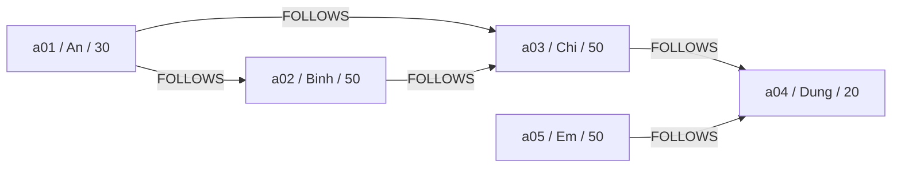

# Kiểm thử Cypher với kết quả mong đợi và thứ tự xác định trong Neo4j

## 1. Vì sao một câu Cypher “chạy đúng” vẫn có thể sai khi kiểm thử?

Neo4j lưu dữ liệu theo mô hình **property graph**: node có label và property, relationship có type, hướng và property. Cypher diễn tả **mẫu đồ thị cần truy vấn** và cách trả kết quả; engine quyết định kế hoạch thực thi tùy index, statistics, phiên bản và dữ liệu hiện tại.

Trong ứng dụng Java dùng Neo4j Java Driver hoặc Spring Data Neo4j (SDN), có ba cấp độ cần kiểm tra:

1. **Truy vấn thực thi được:** cú pháp hợp lệ, không có exception, transaction hoàn tất.
2. **Kết quả đúng nghiệp vụ:** số dòng, các ID, property, kiểu dữ liệu, số cạnh, chiều quan hệ và tính duy nhất đều đúng.
3. **Thứ tự xác định:** nếu thứ tự quan trọng, truy vấn phải có `ORDER BY` đầy đủ, thường cần một khóa phụ **duy nhất** để phá hòa (*tie-breaker*).

Ví dụ một endpoint “Top user theo điểm” trả đúng bốn user nhưng đổi thứ tự hai user bằng điểm nhau giữa hai lần chạy. Một test so sánh list theo thứ tự sẽ lúc đạt lúc thất bại (*flaky test*). Ngược lại, đổi assertion thành set có thể che một lỗi thật nếu API **hứa hẹn trả danh sách có thứ tự**.

**Nguyên tắc nền tảng:** Neo4j chỉ bảo đảm thứ tự dòng khi câu Cypher dùng `ORDER BY`. Không suy luận thứ tự từ thứ tự `CREATE`, `UNWIND`, `MATCH`, `collect()`, node ID, thứ tự index hay kết quả tình cờ trong Neo4j Browser.

## 2. Thiết kế một test case có thể lặp lại

Một test Cypher tốt cần xác định trước:

| Thành phần | Câu hỏi bắt buộc | Ví dụ |
| --- | --- | --- |
| Dữ liệu đầu vào (*fixture*) | Graph nào tồn tại trước lúc chạy? | 5 node `:CypherTestAccount`, 5 quan hệ `:FOLLOWS` |
| Query | Cypher nào, tham số cụ thể ra sao? | `WHERE u.active = true` |
| Dữ liệu mong đợi | ID, giá trị, loại và số lượng dòng nào? | `a02, a05, a01, a04` |
| Thứ tự | Kết quả là **list có thứ tự** hay **tập không quan tâm thứ tự**? | `score DESC, accountId ASC` |
| Biên giao dịch | Test đọc trước hay sau commit? Có rollback không? | Đọc trong transaction mới |
| Cô lập | Test có bị test khác làm thay đổi dữ liệu không? | Database/container riêng |
| Kiểm tra lỗi | Nếu input sai hoặc dữ liệu không tồn tại thì kỳ vọng gì? | List rỗng, `null`, hoặc exception |

Nên ưu tiên **khóa nghiệp vụ** như `accountId` thay cho `id(n)`, `elementId(n)` để so kết quả. Internal ID có thể thay đổi khi database được dựng lại, import hoặc cấp phát lại; một test dùng nó dễ bị ràng buộc vào chi tiết hạ tầng.

Khi so sánh record, kiểm tra cả **giá trị và kiểu**: `42` (INTEGER), `42.0` (FLOAT) và `'42'` (STRING) không phải cùng giá trị ở tầng ứng dụng.

## 3. Tạo dữ liệu cố định cho các ví dụ

Tất cả các câu lệnh trong mục này **chỉ dành cho database thử nghiệm**; không dùng câu xóa fixture trên database chung đang có dữ liệu thực. Tên label `CypherTestAccount` được chọn riêng để tránh va chạm với domain thật.

### 3.1. Ràng buộc tính duy nhất

```cypher
CREATE CONSTRAINT cypher_test_account_id IF NOT EXISTS
FOR (u:CypherTestAccount)
REQUIRE u.accountId IS UNIQUE;
```

Constraint bảo đảm không có hai node cùng label `CypherTestAccount` trùng `accountId` và hỗ trợ tra cứu. Nó không thay thế việc test chuẩn bị dữ liệu đúng số dòng hoặc đủ quan hệ.

### 3.2. Dọn dữ liệu cũ trong database chỉ dùng cho test

```cypher
MATCH (u:CypherTestAccount)
DETACH DELETE u;
```

`DETACH DELETE` xóa cả relationship gắn với node. Chỉ dùng thao tác này trong **database/container do test sở hữu**. Trong test chạy song song, nên cấp mỗi test một database độc lập hoặc một namespace riêng thay vì để một test xóa dữ liệu của test khác.

### 3.3. Fixture node

```cypher
UNWIND [
  {id: 'a01', name: 'An',   score: 30, active: true},
  {id: 'a02', name: 'Binh', score: 50, active: true},
  {id: 'a03', name: 'Chi',  score: 50, active: false},
  {id: 'a04', name: 'Dung', score: 20, active: true},
  {id: 'a05', name: 'Em',   score: 50, active: true}
] AS row
CREATE (u:CypherTestAccount {
  accountId: row.id,
  name: row.name,
  score: row.score,
  active: row.active
});
```

Sau khi commit, fixture chuẩn có:

| accountId | name | score | active |
| --- | --- | ---: | --- |
| `a01` | An | 30 | true |
| `a02` | Binh | 50 | true |
| `a03` | Chi | 50 | false |
| `a04` | Dung | 20 | true |
| `a05` | Em | 50 | true |

### 3.4. Fixture relationship

```cypher
UNWIND [
  {from: 'a01', to: 'a02'},
  {from: 'a01', to: 'a03'},
  {from: 'a02', to: 'a03'},
  {from: 'a03', to: 'a04'},
  {from: 'a05', to: 'a04'}
] AS link
MATCH (source:CypherTestAccount {accountId: link.from})
MATCH (target:CypherTestAccount {accountId: link.to})
CREATE (source)-[:FOLLOWS]->(target);
```

Sơ đồ graph:



Truy vấn kiểm tra bước chuẩn bị:

```cypher
MATCH (u:CypherTestAccount)
RETURN count(u) AS accounts;
```

Kỳ vọng `accounts = 5`.

```cypher
MATCH (:CypherTestAccount)-[r:FOLLOWS]->(:CypherTestAccount)
RETURN count(r) AS relationships;
```

Kỳ vọng `relationships = 5`. Hai lần kiểm tra này cần chạy **sau khi các câu tạo fixture đã commit**. Nếu có lỗi thiết lập dữ liệu, test nên **fail ngay ở bước setup** thay vì tiếp tục với trạng thái không xác định.

## 4. Quy tắc quan trọng nhất: `ORDER BY`

### 4.1. Truy vấn không có `ORDER BY` không có cam kết về thứ tự

```cypher
MATCH (u:CypherTestAccount)
RETURN u.accountId AS id;
```

Truy vấn có thể trả năm ID đúng nhưng thứ tự tùy query plan, index, runtime và trạng thái dữ liệu. Dù trong lần chạy đầu nó là `a01, a02, a03, a04, a05`, đó **không phải hợp đồng** của Cypher.

Một assertion dạng list:

```java
assertEquals(
    List.of("a01", "a02", "a03", "a04", "a05"),
    actualIds
);
```

không phù hợp với query không định nghĩa thứ tự. Nếu nghiệp vụ chỉ quan tâm các ID tồn tại, có thể so tập **kèm điều kiện không trùng**; nếu nghiệp vụ yêu cầu danh sách sắp xếp, phải sửa **truy vấn**, không chỉ sửa assertion.

### 4.2. Thêm `ORDER BY` đầy đủ

```cypher
MATCH (u:CypherTestAccount)
WHERE u.active = true
RETURN u.accountId AS id, u.score AS score
ORDER BY score DESC, id ASC;
```

Kết quả **theo đúng thứ tự**:

| Vị trí | id | score |
| ---: | --- | ---: |
| 1 | `a02` | 50 |
| 2 | `a05` | 50 |
| 3 | `a01` | 30 |
| 4 | `a04` | 20 |

Ở đây `a02` và `a05` cùng `score = 50`. `id ASC` là khóa phụ độc nhất, nên hai dòng đó **không thể đảo vị trí** vì hòa điểm.

### 4.3. `ORDER BY score DESC` vẫn có thể không xác định

```cypher
MATCH (u:CypherTestAccount)
WHERE u.active = true
RETURN u.accountId AS id, u.score AS score
ORDER BY score DESC;
```

Truy vấn này bảo đảm nhóm 50 điểm xuất hiện trước nhóm 30 và 20, nhưng **không** bảo đảm `a02` luôn đứng trước `a05`. Hai dòng có giá trị sort key bằng nhau có thể đổi chỗ.

Đặc biệt, đây là lỗi nghiêm trọng khi phân trang: page có thể thiếu hoặc trùng dòng giữa các lần lấy nếu cùng điểm nhưng thứ tự không ổn định.

Quy tắc thực hành:

> Nếu caller quan tâm thứ tự chính xác hoặc dùng `SKIP`/`LIMIT`, sắp xếp theo các trường nghiệp vụ cần thiết và thêm một **khóa duy nhất cuối cùng**, ví dụ `ORDER BY u.score DESC, u.accountId ASC`.

Khi một khóa có thể là `null`, cần có quy tắc rõ ràng về vị trí null và khóa phụ; đừng để tính đúng phụ thuộc vào xử lý null ngầm định nếu yêu cầu nghiệp vụ khác.

### 4.4. `ORDER BY` theo `WITH` và `RETURN`

Để trả danh sách cuối cùng theo thứ tự, đặt `ORDER BY` vào phần tương ứng với kết quả cuối:

```cypher
MATCH (u:CypherTestAccount)
WITH u
WHERE u.active
RETURN u.accountId AS id
ORDER BY id ASC;
```

Với phép `collect()`, `ORDER BY` ở `WITH` có vai trò riêng: nó bảo đảm thứ tự dòng được đưa vào **mệnh đề ngay sau đó**, cho phép kiểm soát thứ tự phần tử được gom:

```cypher
MATCH (u:CypherTestAccount)
WHERE u.active
WITH u
ORDER BY u.score DESC, u.accountId ASC
RETURN collect(u.accountId) AS orderedIds;
```

Kỳ vọng list `['a02', 'a05', 'a01', 'a04']`. Không suy luận `collect(u.accountId)` sẽ theo thứ tự ID chỉ vì có index hoặc node được tạo theo thứ tự đó.

### 4.5. `UNWIND` không bảo đảm thứ tự dòng

```cypher
UNWIND [3, 1, 2] AS value
RETURN value;
```

Không có lời hứa rằng kết quả sẽ mãi theo thứ tự `3, 1, 2`. Muốn tăng dần:

```cypher
UNWIND [3, 1, 2] AS value
RETURN value
ORDER BY value ASC;
```

Kỳ vọng `1, 2, 3`. Nếu cần giữ thứ tự **gốc** của các phần tử kể cả khi trùng giá trị, hãy mang theo **chỉ số vị trí** và dùng `ORDER BY index`; `ORDER BY value` không phân biệt được các giá trị trùng.

## 5. Kiểm thử phân trang `SKIP` và `LIMIT`

### 5.1. Kiểm tra đúng ranh giới trang

```cypher
MATCH (u:CypherTestAccount)
WHERE u.active
RETURN u.accountId AS id, u.score AS score
ORDER BY score DESC, id ASC
SKIP 1
LIMIT 2;
```

Từ list có thứ tự `['a02', 'a05', 'a01', 'a04']`, bỏ một phần tử đầu rồi lấy hai phần tử tiếp theo, nên kết quả:

```text
['a05', 'a01']
```

Test cần khẳng định **đúng 2 dòng**, đúng ID và đúng thứ tự; không chỉ khẳng định có chứa `a05`. Với `SKIP 4 LIMIT 2`, kết quả rỗng; với `SKIP 3 LIMIT 2`, chỉ còn một dòng `a04`.

### 5.2. Thứ tự ổn định chưa giải quyết dữ liệu thay đổi giữa các trang

`ORDER BY score DESC, accountId ASC` giúp xác định thứ tự cho **cùng một snapshot dữ liệu**. Nhưng nếu một user đổi score giữa hai yêu cầu HTTP, việc dùng `SKIP` vẫn có thể thấy dòng lặp hoặc bỏ sót, dù câu Cypher đều đúng.

Trong hệ thống có thay đổi liên tục, cần:

- Cân nhắc **keyset/cursor pagination** bằng bộ khóa sort đã chọn, ví dụ (`score`, `accountId`).
- Truyền bộ khóa cuối trang trước vào trang sau và dùng so sánh tương ứng với hướng sort.
- Xác định yêu cầu về snapshot/độ mới; cursor không tự bảo đảm snapshot bất biến nếu dữ liệu đang được sửa.

Ví dụ trang kế tiếp sau bộ khóa (`50`, `'a02'`):

```cypher
MATCH (u:CypherTestAccount)
WHERE u.active
  AND (
    u.score < $lastScore
    OR (u.score = $lastScore AND u.accountId > $lastId)
  )
RETURN u.accountId AS id, u.score AS score
ORDER BY score DESC, id ASC
LIMIT $pageSize;
```

Với `lastScore = 50`, `lastId = 'a02'`, `pageSize = 2` trên fixture, kết quả là `a05` rồi `a01`. Đây là trường hợp khóa sort **không null** và có ID duy nhất; nếu bổ sung sort field hoặc thứ tự khác thì điều kiện cursor phải sửa tương ứng.

## 6. Kiểm thử cardinality: tập, list và multiset không giống nhau

### 6.1. Cypher có thể trả nhiều dòng trùng nhau

```cypher
MATCH (u:CypherTestAccount)-[:FOLLOWS]->(v:CypherTestAccount)
RETURN v.accountId AS followedId
ORDER BY followedId;
```

Fixture có năm relationship. Node `a03` nhận quan hệ từ `a01` và `a02`, còn `a04` nhận từ `a03` và `a05`. Kết quả có thể được biểu diễn:

```text
['a02', 'a03', 'a03', 'a04', 'a04']
```

Số dòng **5**, nhưng số user đích khác nhau chỉ **3**. Nếu test chuyển list thành set:

```java
Set<String> followedIds = new HashSet<>(actualIds);
```

nó làm mất thông tin hai ID xuất hiện nhiều lần. Vì thế:

| Yêu cầu nghiệp vụ | Assertion phù hợp |
| --- | --- |
| Danh sách Top N có thứ tự | So `List` với `List`, cả giá trị và thứ tự |
| Tập ID, không có trùng | So `Set` **và** assert số dòng bằng số phần tử set |
| Đếm số đường đi/quan hệ đến mỗi node | So bảng `id -> count` hoặc multiset |
| Tổng số relationship | So `count(r)` và loại/hướng relationship |
| Kết quả đọc một entity theo khóa unique | Assert đúng một record, đúng property/kiểu |

### 6.2. `DISTINCT` thay đổi ngữ nghĩa

```cypher
MATCH (:CypherTestAccount)-[:FOLLOWS]->(v:CypherTestAccount)
RETURN DISTINCT v.accountId AS followedId
ORDER BY followedId ASC;
```

Kết quả mong đợi: `['a02', 'a03', 'a04']`, **3 dòng**. Không được thay truy vấn đếm relationship bằng `DISTINCT` chỉ để làm test dễ so: việc bỏ trùng có thể che lỗi hoặc làm sai nghiệp vụ.

### 6.3. `count(*)` và `count(value)` khi có null

```cypher
MATCH (u:CypherTestAccount {accountId: 'a04'})
OPTIONAL MATCH (u)-[:FOLLOWS]->(v)
RETURN count(*) AS rows,
       count(v) AS followedAccounts;
```

Vì `a04` không có quan hệ `FOLLOWS` đi ra:

- `OPTIONAL MATCH` vẫn giữ **một dòng** với `v = null`.
- `count(*) = 1` đếm mọi dòng.
- `count(v) = 0` vì `count(expression)` bỏ qua null.

Test chỉ kiểm tra `count(*)` sẽ kết luận sai rằng `a04` theo dõi một người. Luôn chọn phép đếm đúng với ý nghĩa muốn xác minh.

## 7. Kiểm thử quan hệ, hướng cạnh và đường đi

### 7.1. Hướng relationship là một phần của expected result

```cypher
MATCH (u:CypherTestAccount {accountId: 'a01'})
      -[:FOLLOWS]->(friend:CypherTestAccount)
RETURN friend.accountId AS id
ORDER BY id ASC;
```

Kỳ vọng list `['a02', 'a03']`. Đổi hướng thành `(u)<-[:FOLLOWS]-(friend)` sẽ cho kết quả **khác** vì `a01` không có cạnh đi vào trong fixture. Nếu bỏ mũi tên bằng `-[:FOLLOWS]-` thì kết quả cũng khác ở các node có cả cạnh vào và ra.

Vì vậy test kiểm tra:

1. Đúng type relationship.
2. Đúng hướng.
3. Đúng ID hai đầu.
4. Đúng số quan hệ (đặc biệt graph cho phép nhiều cạnh cùng type giữa hai node).

### 7.2. Đường đi có thể trùng node đích nhưng khác lộ trình

Từ `a01`, ta có hai đường đi `FOLLOWS` dài 2:

- `a01 -> a02 -> a03`.
- `a01 -> a03 -> a04`.

Test không nên chỉ so node cuối cùng khi yêu cầu là “tất cả path có độ dài 2”:

```cypher
MATCH p = (start:CypherTestAccount {accountId: 'a01'})
          -[:FOLLOWS*2]->(finish:CypherTestAccount)
WITH [n IN nodes(p) | n.accountId] AS route
RETURN route
ORDER BY route[1] ASC, route[2] ASC;
```

Kỳ vọng list:

```text
[
  ['a01', 'a02', 'a03'],
  ['a01', 'a03', 'a04']
]
```

Nếu cần so các lộ trình không phân biệt thứ tự, hãy chọn chuẩn hóa theo **chuỗi các business ID** thay vì so object `Path`/`Node` từ driver bằng internal ID. Khi nhiều path có cùng khóa sort, bổ sung khóa riêng cho mỗi route hoặc biểu thức đại diện ổn định của route.

### 7.3. Đường đi ngắn nhất có nhiều nghiệm

Một graph có thể có nhiều shortest path cùng độ dài. Nếu nghiệp vụ chỉ yêu cầu **độ dài ngắn nhất**, test chỉ nên assert độ dài và đầu-cuối hợp lệ, thay vì cố đoán Neo4j sẽ chọn path nào khi không có quy tắc lựa chọn duy nhất.

Nếu nghiệp vụ bắt buộc trả một path đại diện có thứ tự ổn định, cần thiết kế truy vấn liệt kê các ứng viên hợp lệ, đặt **tiêu chí phá hòa rõ ràng** và lựa chọn bằng `ORDER BY ... LIMIT 1`. Không kỳ vọng `shortestPath`, plan hoặc thứ tự relationship tạo trước là tie-breaker của domain.

## 8. Expected result phải xét cả null, kiểu và giá trị biên

### 8.1. Property vắng mặt và `null`

```cypher
MATCH (u:CypherTestAccount {accountId: 'a01'})
RETURN u.alias AS alias;
```

Fixture không có property `alias`, nên `alias = null`; `RETURN` vẫn trả **một record** vì node `a01` tồn tại.

Khác với:

```cypher
MATCH (u:CypherTestAccount {accountId: 'missing-id'})
RETURN u.alias AS alias;
```

Không match được node, nên kết quả là **không có record nào**. Đây là hai trường hợp khác nhau:

| Trường hợp | Số record | Giá trị |
| --- | ---: | --- |
| Node tồn tại nhưng thiếu property | 1 | `null` |
| Không có node phù hợp `MATCH` | 0 | Không có giá trị để đọc |
| `OPTIONAL MATCH` không khớp | Thường giữ dòng phía trước | Cột của nhánh tùy chọn là `null` |

Ở Java Driver, `single()` yêu cầu đúng một record, còn `list()` có thể trả list rỗng. Dùng `record.get("alias").isNull()` để kiểm tra null. Đừng gọi `asString()` lên null rồi xem exception là kết quả mong đợi.

### 8.2. So sánh số và kiểu

```cypher
MATCH (u:CypherTestAccount)
WHERE u.accountId = 'a01'
RETURN u.score AS score, u.active AS active;
```

Kỳ vọng `score` là Cypher `INTEGER` với giá trị `30`, `active` là `BOOLEAN true`. Java Driver đọc:

```java
Record row = result.single();
assertEquals(30L, row.get("score").asLong());
assertTrue(row.get("active").asBoolean());
```

Trong ví dụ này, `Record` là `org.neo4j.driver.Record`; `assertEquals`/`assertTrue` là assertion của JUnit. Lưu ý `30L` có kiểu `long`, phù hợp API `asLong()`.

### 8.3. Số thực, ngày giờ và dữ liệu sinh ngẫu nhiên

- Với floating-point tính toán, cân nhắc sai số cho phép (*tolerance*) thay vì so bit-for-bit. Ví dụ `assertEquals(expected, actual, 1e-9)`.
- Với `date('2026-11-25')` có giá trị cố định, so kiểu `LocalDate`; tránh tạo ngày mới bằng `date()` trong test đòi kết quả bất biến.
- Với `datetime()`, `randomUUID()` hoặc giá trị random, không nên assert **giá trị chính xác** nếu bản thân query cố ý sinh động. Thay bằng kiểm tra format, khoảng thời gian, tính khác rỗng hoặc truyền giá trị giả lập/cố định qua tham số.
- Đối với chuỗi, Neo4j so thứ tự theo quy tắc của Cypher; không tự giả định collation tiếng Việt theo cách ứng dụng muốn. Nếu cần thứ tự domain (ví dụ ưu tiên tiếng Việt có dấu), chuẩn hóa **sort key** được định nghĩa rõ trong ứng dụng.

## 9. Bộ kiểm thử Java với JUnit 5, Neo4j Java Driver và Testcontainers

Đối với integration test Cypher, **cơ sở dữ liệu Neo4j thật trong container** phản ánh parser, transaction, index và semantics graph chính xác hơn mock repository hoặc mock `Record`.

Ví dụ dùng API của Testcontainers **1.x** (package `org.testcontainers.containers.Neo4jContainer`) với JUnit 5 và Java Driver. Ở Testcontainers 2.x, module/package của Neo4jContainer có thể khác, vì vậy chọn import theo phiên bản dependency đã cài. Image `neo4j:5.26` chỉ là **ví dụ phiên bản được pin**, không phải yêu cầu phải dùng phiên bản này; CI phải chọn bản Neo4j tương thích với ứng dụng thật.

Các dependency test cần có: JUnit Jupiter, Testcontainers Neo4j, Testcontainers JUnit Jupiter và Neo4j Java Driver. Với ứng dụng Spring Boot, nhiều phiên bản có thể được BOM/starter quản lý; không ghép dependency của các major không tương thích.

### 9.1. Test đầy đủ kiểm tra sort, phân trang, relationship và rollback

```java
import static org.junit.jupiter.api.Assertions.*;

import java.util.List;
import java.util.Map;

import org.junit.jupiter.api.AfterAll;
import org.junit.jupiter.api.BeforeAll;
import org.junit.jupiter.api.BeforeEach;
import org.junit.jupiter.api.Test;
import org.neo4j.driver.AuthTokens;
import org.neo4j.driver.Driver;
import org.neo4j.driver.GraphDatabase;
import org.neo4j.driver.Record;
import org.neo4j.driver.Session;
import org.neo4j.driver.SessionConfig;
import org.neo4j.driver.Transaction;
import org.testcontainers.containers.Neo4jContainer;
import org.testcontainers.junit.jupiter.Container;
import org.testcontainers.junit.jupiter.Testcontainers;

@Testcontainers
class CypherDeterministicQueryTest {

    @Container
    static final Neo4jContainer<?> neo4j =
        new Neo4jContainer<>("neo4j:5.26")
            .withAdminPassword("integration-test-password");

    static Driver driver;

    private Session session() {
        return driver.session(SessionConfig.forDatabase("neo4j"));
    }

    @BeforeAll
    static void connectAndCreateSchema() {
        driver = GraphDatabase.driver(
            neo4j.getBoltUrl(),
            AuthTokens.basic("neo4j", "integration-test-password")
        );
        try (Session s = driver.session()) {
            s.run("""
                CREATE CONSTRAINT cypher_test_account_id IF NOT EXISTS
                FOR (u:CypherTestAccount)
                REQUIRE u.accountId IS UNIQUE
                """).consume();
        }
    }

    @AfterAll
    static void closeDriver() {
        if (driver != null) driver.close();
        // @Testcontainers tự quản lý vòng đời container.
    }

    @BeforeEach
    void seedGraph() {
        try (Session s = session()) {
            // Chỉ an toàn vì container chỉ dành cho test này.
            s.run("""
                MATCH (u:CypherTestAccount)
                DETACH DELETE u
                """).consume();

            s.run("""
                UNWIND $rows AS row
                CREATE (:CypherTestAccount {
                  accountId: row.id,
                  name: row.name,
                  score: row.score,
                  active: row.active
                })
                """, Map.of("rows", List.of(
                    Map.of("id", "a01", "name", "An",
                           "score", 30, "active", true),
                    Map.of("id", "a02", "name", "Binh",
                           "score", 50, "active", true),
                    Map.of("id", "a03", "name", "Chi",
                           "score", 50, "active", false),
                    Map.of("id", "a04", "name", "Dung",
                           "score", 20, "active", true),
                    Map.of("id", "a05", "name", "Em",
                           "score", 50, "active", true)
                ))).consume();

            s.run("""
                UNWIND $links AS link
                MATCH (a:CypherTestAccount {accountId: link.fromId})
                MATCH (b:CypherTestAccount {accountId: link.toId})
                CREATE (a)-[:FOLLOWS]->(b)
                """, Map.of("links", List.of(
                    Map.of("fromId", "a01", "toId", "a02"),
                    Map.of("fromId", "a01", "toId", "a03"),
                    Map.of("fromId", "a02", "toId", "a03"),
                    Map.of("fromId", "a03", "toId", "a04"),
                    Map.of("fromId", "a05", "toId", "a04")
                ))).consume();
        }
    }

    @Test
    void shouldSortByScoreThenUniqueId() {
        try (Session s = session()) {
            List<Record> records = s.run("""
                MATCH (u:CypherTestAccount)
                WHERE u.active = true
                RETURN u.accountId AS id, u.score AS score
                ORDER BY score DESC, id ASC
                """).list();

            List<String> actualIds = records.stream()
                .map(row -> row.get("id").asString())
                .toList();
            List<Long> actualScores = records.stream()
                .map(row -> row.get("score").asLong())
                .toList();

            assertEquals(
                List.of("a02", "a05", "a01", "a04"),
                actualIds
            );
            assertEquals(List.of(50L, 50L, 30L, 20L),
                         actualScores);
        }
    }

    @Test
    void shouldReturnDeterministicPage() {
        try (Session s = session()) {
            List<String> ids = s.run("""
                MATCH (u:CypherTestAccount)
                WHERE u.active
                RETURN u.accountId AS id, u.score AS score
                ORDER BY score DESC, id ASC
                SKIP 1 LIMIT 2
                """)
                .list(row -> row.get("id").asString());

            assertEquals(List.of("a05", "a01"), ids);
        }
    }

    @Test
    void shouldReadOutgoingRelationshipsInOrder() {
        try (Session s = session()) {
            List<String> ids = s.run("""
                MATCH (:CypherTestAccount {accountId: $id})
                      -[:FOLLOWS]->(friend:CypherTestAccount)
                RETURN friend.accountId AS id
                ORDER BY id
                """, Map.of("id", "a01"))
                .list(row -> row.get("id").asString());

            assertEquals(List.of("a02", "a03"), ids);
        }
    }

    @Test
    void shouldDistinguishOptionalRowFromMatchedNodes() {
        try (Session s = session()) {
            Record r = s.run("""
                MATCH (u:CypherTestAccount {accountId: 'a04'})
                OPTIONAL MATCH (u)-[:FOLLOWS]->(friend)
                RETURN count(*) AS totalRows,
                       count(friend) AS matches
                """).single();

            assertEquals(1L, r.get("totalRows").asLong());
            assertEquals(0L, r.get("matches").asLong());
        }
    }

    @Test
    void shouldNotPersistRolledBackChanges() {
        try (Session s = session()) {
            try (Transaction tx = s.beginTransaction()) {
                tx.run("""
                    CREATE (:CypherTestAccount {
                      accountId: 'rollback-only',
                      name: 'Temporary',
                      score: 0,
                      active: false
                    })
                    """).consume();

                tx.rollback();
            }

            long remaining = s.run("""
                MATCH (u:CypherTestAccount {
                  accountId: 'rollback-only'
                })
                RETURN count(u) AS total
                """).single().get("total").asLong();

            assertEquals(0L, remaining);
        }
    }
}
```

**Vì sao cách viết này xác định được expected result?**

- Mỗi test bắt đầu từ **fixture do nó chuẩn bị**, không phụ thuộc dữ liệu cũ của developer.
- Các query có yêu cầu thứ tự đều có `ORDER BY` với ID phá hòa.
- Test dùng `List<Record>` và `List<String>` để giữ nguyên thứ tự thực tế, không chuyển sang set trước khi so.
- Setup dùng `consume()` để bảo đảm các implicit transaction đã hoàn tất trước khi test đọc.
- Test rollback chủ động đọc lại bằng một giao dịch riêng sau khi transaction bị hủy.

**Giới hạn của ví dụ:** dùng một container dùng chung giữa các test và reset dữ liệu ở `@BeforeEach`. Đừng bật thực thi song song các method này nếu chưa thay đổi chiến lược cô lập. Trong CI, cân nhắc mỗi class có container riêng, mỗi test có database riêng (nếu edition hỗ trợ), hoặc dữ liệu được đánh namespace. Việc dùng Docker/Testcontainers đòi máy chạy test có môi trường container sẵn sàng.

### 9.2. Vì sao không nên mock Neo4j khi kiểm thử Cypher?

Mock `Neo4jRepository` có ích khi unit test **logic nghiệp vụ không phụ thuộc database**, nhưng nó không phát hiện:

- Lỗi cú pháp Cypher, alias, label/type/property sai.
- Planner hoặc engine trả nhiều record từ graph khác dự tính.
- Tác động của `OPTIONAL MATCH`, `count(*)`, `DISTINCT` và `ORDER BY`.
- Constraint uniqueness, rollback, direction của relationship.

Do đó, kiểm thử Cypher nên là **integration test trên Neo4j thật**, còn mock được dùng ở lớp service để tách biệt những nhánh logic không cần truy cập graph.

## 10. Kiểm thử truy vấn ghi, commit, rollback và idempotency

### 10.1. Một write query thành công phải kiểm tra trạng thái sau commit

Ví dụ cập nhật điểm của user:

```cypher
MATCH (u:CypherTestAccount {accountId: $id})
SET u.score = $score
RETURN u.accountId AS id, u.score AS newScore;
```

Trong Java Driver, đặt thao tác ghi trong transaction có quản lý:

```java
try (Session s = driver.session(
        SessionConfig.forDatabase("neo4j"))) {
    s.executeWrite(tx -> {
        tx.run("""
            MATCH (u:CypherTestAccount {accountId: $id})
            SET u.score = $score
            """, Map.of("id", "a01", "score", 99)
        ).consume();
        return null;
    });

    long storedScore = s.executeRead(tx ->
        tx.run("""
            MATCH (u:CypherTestAccount {accountId: $id})
            RETURN u.score AS score
            """, Map.of("id", "a01"))
        .single()
        .get("score")
        .asLong()
    );

    assertEquals(99L, storedScore);
}
```

Lưu ý câu `MATCH ... SET ...` **có thể thành công nhưng không sửa node nào** nếu `id` không tồn tại. Vì vậy khi kiểm thử nên xác minh record trước/sau, kiểm tra số node match hoặc sử dụng `RETURN`/summary counters cùng với truy vấn đọc lại sau commit.

### 10.2. `MERGE` và tính idempotent phải được kiểm thử

```cypher
MERGE (u:CypherTestAccount {accountId: 'a06'})
ON CREATE SET u.name = 'NewUser', u.score = 0, u.active = true
RETURN u.accountId AS id;
```

Chạy hai lần rồi kiểm tra:

```cypher
MATCH (u:CypherTestAccount {accountId: 'a06'})
RETURN count(u) AS matches;
```

Kỳ vọng `matches = 1`, không phải 2. Tuy nhiên, `MERGE` chỉ bảo đảm ý nghĩa theo mẫu đang match; khi có nhiều transaction cạnh tranh, cần **uniqueness constraint** trên `accountId`. Với relationship, `MERGE (a)-[:FOLLOWS]->(b)` có thể tránh tạo lại cùng mẫu cạnh trong bối cảnh test, nhưng nếu nghiệp vụ có nhiều sự kiện FOLLOWS độc lập phải có khóa riêng.

### 10.3. Counters không thay thế assertion dữ liệu

Java Driver có `ResultSummary.counters()` để xem số node/relationship tạo/xóa, số property được gán. Có thể dùng để tăng độ bao phủ cho test, nhưng:

- `propertiesSet()` đếm thao tác gán property theo engine, không tương đương số entity nghiệp vụ thực sự thay đổi.
- Cùng một query chạy lại có thể có counters khác, dù **trạng thái cuối** vẫn đúng (ví dụ `MERGE` lần hai không tạo node).
- Counter của một câu lệnh đang ở trong explicit transaction **không bảo đảm transaction ngoài đã commit**.

Hãy kiểm tra dữ liệu bằng query đọc **sau khi giao dịch ghi đã commit**, rồi mới khẳng định test thành công.

### 10.4. Rollback và retry

Giao dịch tường minh `beginTransaction()` cho phép rollback toàn bộ các lệnh chưa commit trong đó. Managed transaction `executeWrite(...)` có thể retry callback khi gặp lỗi tạm thời, nên code trong callback phải **idempotent** và không thực hiện side effect ngoài database không thể rollback (ví dụ gửi email, gọi hệ thống thanh toán).

Test rollback cần đặt một thay đổi dễ nhận diện trong transaction, gọi `rollback()` rồi đọc lại sau khi transaction đã đóng. Đừng chạy truy vấn đọc trong chính transaction chưa commit và xem dữ liệu nhìn thấy là bằng chứng nó đã tồn tại bền vững.

## 11. Tích hợp Spring Data Neo4j: test mapping và custom query

Trong Spring Boot, `@DataNeo4jTest` dùng để tạo **slice test** cho các thành phần liên quan Spring Data Neo4j; cách cấu hình datasource/Driver cho container phụ thuộc Spring Boot và test setup. Mục tiêu là kiểm tra repository thật với database thử nghiệm, không chỉ mock.

Ví dụ repository:

```java
import java.util.List;
import org.springframework.data.neo4j.repository.Neo4jRepository;
import org.springframework.data.neo4j.repository.query.Query;
import org.springframework.data.repository.query.Param;

public interface TestAccountRepository
        extends Neo4jRepository<TestAccount, String> {

    @Query("""
        MATCH (u:CypherTestAccount)
        WHERE u.active = true
        RETURN u
        ORDER BY u.score DESC, u.accountId ASC
        """)
    List<TestAccount> findActiveSorted();

    @Query("""
        MATCH (u:CypherTestAccount {accountId: $id})
        RETURN u
        """)
    TestAccount findSingle(@Param("id") String id);
}
```

Entity ví dụ:

```java
import org.springframework.data.annotation.Version;
import org.springframework.data.neo4j.core.schema.Id;
import org.springframework.data.neo4j.core.schema.Node;

@Node("CypherTestAccount")
public class TestAccount {
    @Id
    private String accountId;

    @Version
    private Long version;

    private String name;
    private Integer score;
    private Boolean active;

    public String getAccountId() { return accountId; }
    public String getName() { return name; }
    public Integer getScore() { return score; }
    public Boolean getActive() { return active; }
}
```

Tại một bài test repository sử dụng container/Driver cấu hình đúng:

```java
List<TestAccount> users = repository.findActiveSorted();
List<String> ids = users.stream()
    .map(TestAccount::getAccountId)
    .toList();
assertEquals(List.of("a02", "a05", "a01", "a04"), ids);
```

**Cẩn trọng:** khi mapping entity qua SDN, query `RETURN u` trả node để converter dựng entity. Nếu entity có `@Relationship`, custom query cần trả các thành phần cần thiết cho quan hệ theo quy tắc SDN; đừng cho rằng `RETURN u` tự tải mọi relationship. Ở ví dụ này class chỉ có property đơn giản, nên không cần trả graph quan hệ.

Nếu test cần kiểm tra **các record của Cypher** hơn là mapping entity, dùng `Neo4jClient` hoặc Java Driver trực tiếp để tránh nhập nhằng giữa lỗi query và lỗi mapping. Với `@DataNeo4jTest`, đừng mặc định test sẽ tự rollback mọi thay đổi trên mọi cấu hình hoặc mọi phiên bản; cần kiểm tra transaction manager và cách test/container được thiết lập, đồng thời dùng database test cô lập.

## 12. Các trường hợp dễ tạo flaky test

| Hiện tượng | Nguyên nhân | Hướng khắc phục |
| --- | --- | --- |
| Test sắp xếp lúc đạt lúc sai | Truy vấn thiếu `ORDER BY` | Thêm `ORDER BY` theo yêu cầu |
| User cùng điểm đổi chỗ | Sort key chưa duy nhất | Thêm `accountId` hoặc khóa duy nhất để phá hòa |
| Trang 2 có ID xuất hiện ở trang 1 | Dữ liệu thay đổi giữa request hoặc sort chưa đủ khóa | Dùng sort tổng, xem xét cursor/snapshot |
| So `Set` vẫn đạt dù trả trùng | Mất thông tin multiplicity | Assert count, list hoặc multiset |
| `count(*)` bằng 1 nhưng không có neighbor | `OPTIONAL MATCH` giữ một dòng null | Dùng `count(neighbor)` |
| Test phụ thuộc thứ tự tạo node | Engine không bảo đảm thứ tự scan | Dùng `ORDER BY` và business ID |
| `collect()` có thứ tự lạ | Đầu vào chưa được sắp ngay trước aggregation | `WITH ... ORDER BY ... RETURN collect(...)` |
| Test dùng `id(n)` khác giữa máy | Internal ID được cấp khác | So `accountId` |
| Test đọc được bản ghi mà thực tế rollback | Đọc trong transaction đang ghi | Đọc lại sau commit, ở transaction mới |
| Test lỗi ngẫu nhiên khi chạy song song | Test khác xóa/sửa cùng fixture | Container/database độc lập, namespace mỗi test |
| Assert DateTime thất bại theo timezone | Dùng giờ hệ thống hoặc parse timezone khác | Dùng timestamp cố định, kiểm tra timezone |
| So số thực bằng `==` | Sai số tính toán floating point | Dùng tolerance |
| Test chạy tốt với dữ liệu ít, lỗi với dữ liệu lớn | Chỉ test happy path | Thêm case rỗng, nhiều nhánh, duplicate, pagination boundary |
| Test chỉ mock repository, query thật sai | Không thực thi Cypher trên Neo4j | Có ít nhất một integration test trên DB thật |
| Assert đúng kế hoạch `PROFILE` cụ thể | Query planner đổi theo phiên bản/statistics | Test ngữ nghĩa; benchmark/plan checks riêng khi cần |

## 13. Chiến lược tổ chức bộ test trong dự án

### 13.1. Chia thành ba lớp

**Lớp 1 — Unit test logic thuần Java.** Test điều kiện lọc của service, chuyển đổi input/output DTO, kiểm tra tham số và logic phân trang. Có thể mock repository ở lớp này.

**Lớp 2 — Integration test Cypher/SDN.** Chạy Neo4j thật, fixture cố định, xác minh node/relationship, query result, sort, null, aggregation, transaction/constraint. Đây là trọng tâm của bài.

**Lớp 3 — Performance/regression test.** Chạy trên dữ liệu có quy mô đại diện, dùng `EXPLAIN`/`PROFILE`, so thời gian, DB Hits, peak memory với ngưỡng phù hợp. Không trộn assertion thời gian cứng vào mọi integration test vốn cần ổn định trên các máy CI khác nhau.

### 13.2. Test đọc: bảng trường hợp cơ bản

| Tình huống | Kỳ vọng |
| --- | --- |
| Tìm `accountId = a01` | Một node, `name = An`, `score = 30`, `active = true` |
| Tìm `accountId = missing` | Không có record |
| Tìm tất cả active | Đúng 4 account |
| Sort active theo score/ID | `a02, a05, a01, a04` |
| `SKIP 1 LIMIT 2` | `a05, a01` |
| `a01` theo dõi ai? | `a02, a03` đúng hướng |
| `a04` theo dõi ai? | Không có neighbor; `count(friend)=0` |
| Đếm distinct node được theo dõi | 3 |
| Đếm tất cả cạnh `FOLLOWS` | 5 |
| Đường đi 2 hop từ `a01` | Hai route đã liệt kê ở mục 7 |

### 13.3. Test ghi: bảng trường hợp cơ bản

| Tình huống | Kỳ vọng |
| --- | --- |
| `CREATE` node ID mới | Tăng số node sau commit |
| `MERGE` cùng ID hai lần | Không tạo trùng node nếu constraint và query đúng |
| Cố tạo trùng ID bằng `CREATE` | Constraint từ chối transaction vi phạm |
| `SET` một property | Property đúng sau commit |
| `SET` theo ID không tồn tại | Không update node; xác minh qua count/record |
| `DELETE` relationship | Đếm type/hướng giảm tương ứng |
| Rollback transaction có `CREATE` | Không còn node mới |
| Managed transaction được retry | Không phát sinh side effect ngoài DB ngoài ý muốn |

### 13.4. Những gì không nên phụ thuộc vào

- Thứ tự trả về không có `ORDER BY`.
- Thứ tự giữa các dòng có cùng sort key.
- Internal ID, thời điểm tạo record, auto-generated node position.
- Thời gian thực thi tuyệt đối trên môi trường CI chia sẻ tài nguyên.
- Operator cụ thể trong kế hoạch query nếu test chỉ nhằm kiểm tra tính đúng.
- Kiến trúc transaction/rollback do framework **ngầm suy đoán** mà chưa xác minh.

## 14. Bài thực hành

Trên một database/container dành riêng cho test, thực hiện các nhiệm vụ:

1. Tạo fixture 5 `CypherTestAccount` và 5 quan hệ `FOLLOWS` theo mục 3. Kiểm tra uniqueness constraint và tổng số node/cạnh.
2. Viết test cho truy vấn `MATCH ... RETURN` **không có `ORDER BY`**; giải thích vì sao không nên so với một list cố định.
3. Thêm `ORDER BY score DESC, accountId ASC`. Assert chính xác `a02, a05, a01, a04`. Bỏ `accountId ASC` rồi giải thích nguy cơ flaky.
4. Kiểm tra trang `SKIP 1 LIMIT 2` và các biên `SKIP 3`, `SKIP 4`.
5. Kiểm tra cả tổng relationship `FOLLOWS` (5), số destination khác nhau (3) và lộ trình hai hop từ `a01` (2 route).
6. Thử `OPTIONAL MATCH` ở `a04`, so sánh `count(*)` với `count(friend)`; so tiếp trường hợp `MATCH` không tìm thấy node.
7. Dùng JUnit 5 + Java Driver để test một `SET` đã commit và một `CREATE` bị rollback; đọc lại bằng transaction khác.
8. Tạo hai transaction cố ghi cùng `accountId` khi uniqueness constraint đã có; kiểm tra database ngăn tạo hai node trùng ID và xử lý exception đúng.
9. Tách truy vấn top user vào custom repository SDN; kiểm tra mapping ID, score, active và thứ tự list.
10. Chạy lại toàn bộ suite nhiều lần và (nếu có cơ chế isolation riêng) ở chế độ song song; tìm và loại bỏ phụ thuộc dữ liệu dùng chung.

**Tiêu chí hoàn thành:** người học có thể viết fixture nhỏ nhưng đại diện, xác định expected rows và expected ordering, sử dụng `ORDER BY` cùng khóa phụ duy nhất, phân biệt null/0 record/duplicate, viết integration test đọc–ghi bằng Neo4j thực và xác minh dữ liệu sau commit hoặc rollback.

## Tài liệu tham khảo chính thức

- [Neo4j Cypher Manual — ORDER BY](https://neo4j.com/docs/cypher-manual/current/clauses/order-by/): cam kết thứ tự, nhiều sort key và vị trí sử dụng `ORDER BY`.
- [Neo4j Cypher Manual — SKIP](https://neo4j.com/docs/cypher-manual/current/clauses/skip/): bỏ qua các dòng đầu trong kết quả.
- [Neo4j Cypher Manual — LIMIT](https://neo4j.com/docs/cypher-manual/current/clauses/limit/): giới hạn số dòng và những lưu ý về thứ tự.
- [Neo4j Cypher Manual — UNWIND](https://neo4j.com/docs/cypher-manual/current/clauses/unwind/): chuyển list thành dòng và quy tắc không bảo đảm thứ tự.
- [Neo4j Cypher Manual — Aggregating functions](https://neo4j.com/docs/cypher-manual/current/functions/aggregating/): `count(*)`, `count(value)`, `collect()` và null.
- [Neo4j Cypher Manual — OPTIONAL MATCH](https://neo4j.com/docs/cypher-manual/current/clauses/optional-match/): dòng kết quả và null khi pattern không khớp.
- [Neo4j Java Driver Manual — Run your own transactions](https://neo4j.com/docs/java-manual/current/transactions/): `session.run`, `executeRead`/`executeWrite`, commit và rollback.
- [Testcontainers — Neo4j module](https://java.testcontainers.org/modules/databases/neo4j/): khởi tạo Neo4j container trong integration test.
- [Spring Data Neo4j Reference — Testing](https://docs.spring.io/spring-data/neo4j/reference/testing.html): kiểm thử repository và mapping với Neo4j.
