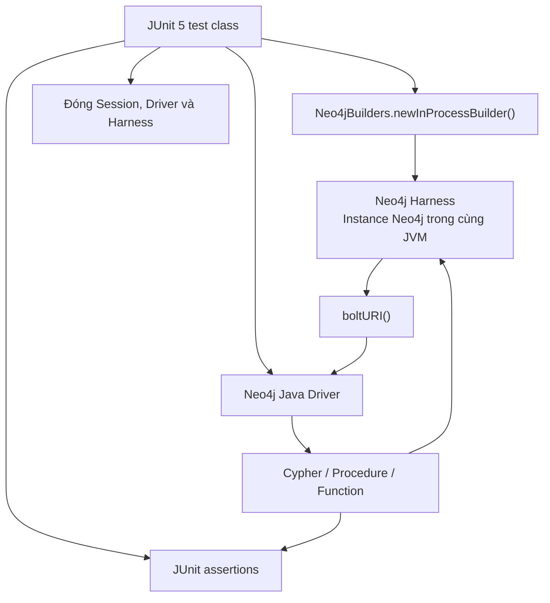

# Neo4j Harness và phạm vi phù hợp cho kiểm thử trong tiến trình

Khi một ứng dụng Java làm việc với Neo4j, nhiều lỗi chỉ xuất hiện lúc Cypher được chạy trên database thật: sai chiều relationship, `MERGE` không khớp đúng khóa, `OPTIONAL MATCH` làm mất dữ liệu, constraint không được áp dụng, hoặc procedure tùy biến có hành vi khác dự kiến. Mock Java Driver có thể kiểm tra code gọi phương thức nhưng **không thực sự chạy Cypher trên bộ máy Neo4j**.

**Neo4j Test Harness** (thường gọi ngắn là **Neo4j Harness**) là bộ công cụ cho phép khởi chạy một Neo4j **ngay bên trong tiến trình JVM của bài kiểm thử**, cấu hình một database dành cho test, nạp dữ liệu mẫu và gửi truy vấn qua Neo4j Java Driver. Nó đặc biệt hữu ích khi kiểm tra **Cypher, procedure, user-defined function, relationship và schema** với một bộ máy Neo4j thực sự mà không cần chuẩn bị một server riêng cho mỗi lần chạy test.

Bài thuộc chương **Kiểm thử** của module **DATABASE_ENGINE_GRAPH_NEO4J**, nơi Neo4j được dùng để mô hình hóa property graph, truy vấn node, relationship và đường đi bằng Cypher, quản lý index/constraint, nhập dữ liệu, tối ưu truy vấn và tích hợp Java Driver/Spring Data Neo4j. Trọng tâm là hiểu **Harness làm được gì, nên dùng khi nào và không thể thay thế loại kiểm thử nào**.

Sau bài này, bạn có thể:

- Phân biệt unit test, integration test trong tiến trình, integration test qua Testcontainers và kiểm thử môi trường gần production.
- Khởi chạy/đóng Neo4j Harness với JUnit 5; kết nối qua Bolt URI do Harness cung cấp.
- Viết test kiểm chứng node, chiều relationship, transaction rollback và constraint bằng Cypher thật.
- Đăng ký procedure/function tùy biến để test bằng `withProcedure()` hoặc `withFunction()`.
- Dùng Harness với Spring Data Neo4j `@DataNeo4jTest` khi phù hợp.
- Thiết kế fixture, cô lập bài test, kiểm soát phiên bản và biết các giới hạn về cluster, plugin, mạng, thời gian và tải.

> **Phiên bản:** Ví dụ nhắm đến API Neo4j Harness hiện đại trong các dòng Neo4j 5.x/2025.x/2026.x, Java 17+ và JUnit Jupiter. Phiên bản `neo4j-harness` phải được lựa chọn tương thích với Neo4j server/Java Driver của dự án. Cú pháp `Neo4jBuilders.newInProcessBuilder()` là API hiện đại; các API `Neo4jRule` hoặc `TestServerBuilders` trong tài liệu Neo4j rất cũ không nên được sao chép nguyên vẹn vào dự án mới.

## 1. Harness nằm ở tầng kiểm thử nào?

Hãy phân biệt các lớp kiểm thử dựa trên **điều đang được kiểm chứng**.

| Loại kiểm thử | Database thực? | Phù hợp để kiểm tra | Giới hạn chính |
| --- | --- | --- | --- |
| **Unit test thuần Java** | Không | Quy tắc nghiệp vụ, kiểm tra dữ liệu đầu vào, hàm độc lập | Không xác nhận Cypher chạy đúng |
| **Unit test với mock Driver/repository** | Không | Lời gọi phương thức, nhánh xử lý lỗi và hợp đồng đối tượng | Mock có thể trả dữ liệu không giống Neo4j thật |
| **Neo4j Harness in-process** | Có, chạy trong cùng JVM | Cypher, constraint, transaction, procedure/function, mapping cơ bản | Môi trường khác cluster/server production |
| **Neo4j qua Testcontainers** | Có, trong container tách biệt | Driver, cấu hình, giao tiếp mạng, tính tương thích server gần triển khai | Cần runtime container, khởi động và tải nặng hơn trong nhiều trường hợp |
| **Integration/E2E ở môi trường staging** | Có, hệ thống triển khai thực | Security, TLS, cluster, routing, dịch vụ phụ trợ, vận hành | Đắt hơn, cần điều phối và dữ liệu test phù hợp |
| **Load/performance test** | Có, hệ thống đủ đại diện | Throughput, latency, bộ nhớ, lock contention | Harness không cung cấp điều kiện đại diện production |

Khác biệt quan trọng: **“in-process” không có nghĩa là giả lập Neo4j bằng một vài collection Java**. Harness khởi chạy **một instance Neo4j thực** trong cùng JVM. Bộ máy này thực thi Cypher và transaction như một database, nhưng bối cảnh vận hành bị đơn giản hóa.

### Vì sao kiểm thử Cypher bằng mock là chưa đủ?

Ví dụ service có code sau:

```java
String cypher = """
    MATCH (c:Customer {customerId: $id})-[:PLACED]->(o:Order)
    RETURN count(o) AS orderCount
    """;
```

Một mock `Session.run()` trả về `orderCount=2` dù Cypher sai chiều `:PLACED` vẫn có thể làm unit test xanh. **Harness sẽ thực thi câu Cypher thật**, do đó nếu dữ liệu mẫu ghi `Customer -[:PLACED]-> Order` nhưng query vô tình đảo chiều, kết quả khác kỳ vọng và test thất bại.

## 2. Kiến trúc của bài test với Harness



Harness cung cấp đối tượng `org.neo4j.harness.Neo4j` để quản lý vòng đời instance; `boltURI()` trả URI kết nối. Java Driver kết nối tới URI này rồi thực thi lệnh như khi nói chuyện với Neo4j server thông thường.

Ví dụ khởi tạo:

```java
Neo4j neo4j = Neo4jBuilders.newInProcessBuilder()
    .withDisabledServer()
    .build();

Driver driver = GraphDatabase.driver(neo4j.boltURI());
```

`withDisabledServer()` **tắt phần HTTP server không cần thiết trong test**, không đồng nghĩa tắt mọi giao tiếp hoặc tắt Bolt: ví dụ vẫn kết nối được thông qua `boltURI()`. Tên method có thể dễ gây hiểu nhầm; hãy nhớ nó giúp giảm thành phần server phục vụ HTTP trong bài kiểm thử.

### Dữ liệu nằm ở đâu?

Instance do Harness quản lý dành cho kiểm thử và có vòng đời riêng. Không nên xem đó là database production hay nơi lưu dữ liệu lâu dài. Một số cấu hình dùng thư mục làm việc/dữ liệu tạm thời; **in-process không đồng nghĩa mọi byte đều nằm trong RAM hoặc không dùng disk**.

Vì chạy cùng JVM, thư viện Neo4j và bài test cùng chịu các giới hạn classpath, bộ nhớ, phiên bản Java, tài nguyên CPU và quá trình tải lớp. Đây là điểm thuận tiện cho kiểm thử logic nhưng cũng là lý do Harness **không phản ánh đầy đủ hiệu năng của một server Neo4j tách biệt**.

## 3. Cấu hình phụ thuộc kiểm thử

Ví dụ cấu hình Gradle:

```gradle
dependencies {
    implementation 'org.neo4j.driver:neo4j-java-driver:DRIVER_VERSION'

    testImplementation 'org.neo4j.test:neo4j-harness:NEO4J_VERSION'
    testImplementation 'org.junit.jupiter:junit-jupiter:JUNIT_VERSION'
}

test {
    useJUnitPlatform()
}
```

Các chuỗi `NEO4J_VERSION`, `DRIVER_VERSION` và `JUNIT_VERSION` là **ký hiệu thay bằng phiên bản thực tế**, không phải version hợp lệ để sao chép trực tiếp. Với ứng dụng Spring Boot, thường dùng dependency management/BOM phù hợp để tránh xung đột.

Ví dụ Maven tương ứng cho Harness:

```xml
<dependency>
    <groupId>org.neo4j.test</groupId>
    <artifactId>neo4j-harness</artifactId>
    <version>NEO4J_VERSION</version>
    <scope>test</scope>
</dependency>
```

**Không chọn bừa phiên bản Harness theo phiên bản Java Driver.** Hai artifact có lịch phát hành và tương thích riêng. Tham chiếu phiên bản Neo4j được ứng dụng dùng, đối chiếu changelog và thực thi thử trên môi trường CI đã chọn.

Trong một số dự án, Spring Boot starter đã cung cấp driver cho runtime và starter-test cung cấp JUnit. Lúc đó tránh khai báo trùng hoặc ép một version khác gây xung đột classpath. Nếu khởi động Harness báo `NoSuchMethodError`, lỗi dependency hoặc class loader, kiểm tra cây phụ thuộc trước khi sửa các test Cypher.

## 4. Ví dụ hoàn chỉnh: JUnit 5 + Harness + Neo4j Driver

Đây là ví dụ **integration test trong tiến trình** với ba mục tiêu: tạo dữ liệu, xác minh quan hệ có hướng, và kiểm tra transaction rollback. Bài test khởi chạy **một Harness mới cho mỗi phương thức test**, ưu tiên cô lập dữ liệu để dễ hiểu.

```java
import static org.junit.jupiter.api.Assertions.assertEquals;

import java.util.Map;

import org.junit.jupiter.api.AfterEach;
import org.junit.jupiter.api.BeforeEach;
import org.junit.jupiter.api.Test;

import org.neo4j.driver.Driver;
import org.neo4j.driver.GraphDatabase;
import org.neo4j.driver.Session;
import org.neo4j.driver.Transaction;

import org.neo4j.harness.Neo4j;
import org.neo4j.harness.Neo4jBuilders;

class CustomerOrderHarnessTest {

    private Neo4j neo4j;
    private Driver driver;

    @BeforeEach
    void startDatabase() {
        neo4j = Neo4jBuilders.newInProcessBuilder()
                .withDisabledServer()
                .build();

        driver = GraphDatabase.driver(neo4j.boltURI());
    }

    @AfterEach
    void stopDatabase() {
        if (driver != null) {
            driver.close();
        }
        if (neo4j != null) {
            neo4j.close();
        }
    }

    @Test
    void createsRelationshipInExpectedDirection() {
        try (Session session = driver.session()) {
            session.run("""
                CREATE (:Customer {customerId: 'C-101'})
                       -[:PLACED]->
                       (:Order {orderId: 'O-901'})
                """).consume();

            long forward = session.run("""
                MATCH (:Customer {customerId: $customerId})
                      -[:PLACED]->
                      (:Order {orderId: $orderId})
                RETURN count(*) AS n
                """, Map.of(
                    "customerId", "C-101",
                    "orderId", "O-901"
                )).single().get("n").asLong();

            long reverse = session.run("""
                MATCH (:Order {orderId: $orderId})
                      -[:PLACED]->
                      (:Customer {customerId: $customerId})
                RETURN count(*) AS n
                """, Map.of(
                    "customerId", "C-101",
                    "orderId", "O-901"
                )).single().get("n").asLong();

            assertEquals(1L, forward);
            assertEquals(0L, reverse);
        }
    }

    @Test
    void rollbackDoesNotPersistNewNode() {
        try (Session session = driver.session()) {
            try (Transaction tx = session.beginTransaction()) {
                tx.run("""
                    CREATE (:Customer {customerId: 'C-ROLLBACK'})
                    """).consume();
                tx.rollback();
            }

            long afterRollback = session.run("""
                MATCH (c:Customer {customerId: 'C-ROLLBACK'})
                RETURN count(c) AS n
                """).single().get("n").asLong();

            assertEquals(0L, afterRollback);
        }
    }
}
```

### Bài test thực sự xác minh điều gì?

- **Harness thực thi database thật:** lệnh `CREATE` tạo node/cạnh theo cú pháp Cypher, và `MATCH` tìm chúng.
- **Hướng relationship được kiểm tra:** `Customer -[:PLACED]-> Order` cho kết quả 1, chiều ngược của cùng relationship type cho 0.
- **Rollback được kiểm tra:** transaction tạo node rồi `rollback()`, nên sau đó không còn node `C-ROLLBACK`.
- **Dùng tham số:** đầu vào `customerId` và `orderId` không được ghép trực tiếp vào chuỗi Cypher.
- **Đóng tài nguyên:** `Session`, `Driver` và Harness được giải phóng để không gây rò rỉ tài nguyên.

Test trên chưa chứng minh API REST hoặc toàn bộ Spring service hoạt động. Nó chỉ xác nhận các **hành vi Neo4j cụ thể** được chạy qua Driver. Đây chính là phạm vi mạnh của Harness.

## 5. Kiểm thử index, constraint và ngữ nghĩa `MERGE`

Neo4j schema là một phần quan trọng của bài toán: nếu khóa nghiệp vụ không duy nhất, một query tạo node có thể âm thầm tạo dữ liệu trùng. Harness cho phép kiểm tra các ràng buộc bằng Cypher, không chỉ bằng mock.

### 5.1. Kiểm thử `MERGE` chạy lại

Mô hình có khóa khách hàng `customerId`. Tạo uniqueness constraint:

```cypher
CREATE CONSTRAINT customer_id_unique IF NOT EXISTS
FOR (c:Customer)
REQUIRE c.customerId IS UNIQUE;
```

Thử nhập cùng khóa hai lần:

```cypher
UNWIND ['C-101', 'C-101'] AS key
MERGE (c:Customer {customerId: key})
SET c.name = 'Mai';
```

Xác minh:

```cypher
MATCH (c:Customer {customerId: 'C-101'})
RETURN count(c) AS customerCount;
```

Kết quả kỳ vọng là `customerCount = 1`. Điều này kiểm tra việc cùng khóa nghiệp vụ không làm tạo hai node.

Lưu ý: `MERGE` không tự làm **mọi** nghiệp vụ idempotent. Một câu `SET c.count = c.count + 1` hoặc tạo quan hệ sự kiện không có khóa có thể thay đổi dữ liệu mỗi lần chạy. Bài test phải nêu chính xác hành vi mong đợi.

### 5.2. Kiểm thử constraint chặn khóa trùng

Giả sử đã tạo constraint ở trên, sau đó chạy:

```cypher
CREATE (:Customer {customerId: 'C-101'});
```

trong khi node `C-101` đã tồn tại. Neo4j cần từ chối thao tác tạo trùng. Trong test Java, có thể dùng JUnit `assertThrows` để xác minh lệnh báo lỗi, thay vì chỉ kiểm tra rằng một mock đã được gọi.

Ví dụ logic:

```java
import static org.junit.jupiter.api.Assertions.assertThrows;
import org.neo4j.driver.exceptions.Neo4jException;

assertThrows(Neo4jException.class, () -> {
    try (Session session = driver.session()) {
        session.run("""
            CREATE (:Customer {customerId: 'C-101'})
            """).consume();
    }
});
```

Đoạn này giả định test đã tạo **constraint** và **node cùng khóa trước đó**. Nên khẳng định thêm trạng thái dữ liệu sau lỗi: số node có khóa `C-101` vẫn là 1, và transaction thất bại đã không tạo thêm dữ liệu.

**Không tự giả định index/constraint có sẵn trong Harness.** Nếu production có migration schema, test nên áp migration hoặc dựng schema đúng với trường hợp đang được kiểm chứng.

## 6. Cô lập test: một instance cho mỗi test hay dùng chung?

Có hai chiến lược phổ biến.

### 6.1. Mỗi test một Harness

Giống ví dụ mục 4: dùng `@BeforeEach` khởi động, `@AfterEach` đóng.

**Ưu điểm:** test dễ độc lập; node, relationship, index và constraint từ bài test khác không tồn tại trong cùng instance mới. Nếu một test thất bại giữa chừng, test tiếp theo vẫn có dữ liệu khởi tạo mới.

**Nhược điểm:** khởi động Neo4j cho từng phương thức có chi phí. Với hàng trăm test, tổng thời gian có thể tăng đáng kể.

### 6.2. Dùng chung Harness theo test class

Có thể dùng `@BeforeAll` tạo một Harness và `@AfterAll` đóng; mỗi `@BeforeEach` tạo fixture, `@AfterEach` dọn dữ liệu theo quy tắc.

Ví dụ ý tưởng:

```java
@BeforeAll
static void setUpHarness() {
    neo4j = Neo4jBuilders.newInProcessBuilder()
        .withDisabledServer()
        .build();
    driver = GraphDatabase.driver(neo4j.boltURI());
}

@AfterEach
void cleanGraph() {
    try (Session session = driver.session()) {
        session.run("MATCH (n) DETACH DELETE n").consume();
    }
}

@AfterAll
static void closeHarness() {
    driver.close();
    neo4j.close();
}
```

Đoạn thứ hai là **mẫu vòng đời**, giả định `neo4j` và `driver` là static field đã khai báo; không phải một class độc lập hoàn chỉnh.

Điểm cần kiểm soát:

- `MATCH (n) DETACH DELETE n` xóa **dữ liệu graph trong database test**, nhưng **không xóa index và constraint**. Nếu test thay đổi schema, cần dọn schema tương ứng hoặc dựng instance mới.
- Test chạy song song trên **cùng database** có thể xóa dữ liệu của nhau. Với JUnit parallel execution, cần cô lập instance/database hoặc vô hiệu hóa chạy song song cho nhóm test dùng chung.
- Fixture nên độc lập và có khóa/label test riêng; không đọc hoặc ghi vào database production.
- Nên tránh phụ thuộc thứ tự chạy method. Thứ tự `@Test` không phải hợp đồng truyền dữ liệu từ test này sang test khác.

### Có thể dựa vào `@Transactional` của Spring để rollback mọi test không?

Không hoàn toàn. Với Spring `@DataNeo4jTest`, các test imperative thường được chạy trong transaction để rollback khi test kết thúc, **nhưng** những truy vấn được gửi qua **một Driver/session khác không tham gia Spring transaction** sẽ không tự bị rollback cùng transaction của test. Các thao tác schema, tác vụ bất đồng bộ hoặc reactive transaction cũng cần cách kiểm tra riêng.

Cần xác định mọi lệnh dùng **cùng transaction** hay không, thay vì suy ra “được gọi trong cùng JUnit method thì sẽ rollback cùng nhau”.

## 7. Fixture: dữ liệu nhỏ nhưng có chủ đích

Một fixture là đồ thị được thiết lập trước khi chạy test. Thay vì tạo hàng nghìn node ngẫu nhiên, dùng đồ thị nhỏ giúp phát hiện được sai lầm cụ thể.

Ví dụ để kiểm thử tính **đếm node duy nhất**:

```cypher
CREATE (c:Customer {customerId: 'C-101'})
CREATE (o1:Order {orderId: 'O-901', amountMinor: 100})
CREATE (o2:Order {orderId: 'O-902', amountMinor: 100})
CREATE (t1:Ticket {ticketId: 'T-1'})
CREATE (t2:Ticket {ticketId: 'T-2'})
CREATE (c)-[:PLACED]->(o1)
CREATE (c)-[:PLACED]->(o2)
CREATE (c)-[:OPENED]->(t1)
CREATE (c)-[:OPENED]->(t2);
```

Fixture này cố tình có **hai đơn hàng cùng số tiền** để bắt lỗi `sum(DISTINCT o.amountMinor)`. Một truy vấn ghép đơn và ticket trên cùng customer có thể tạo 2 × 2 = 4 hàng, rồi cộng sai giá trị tiền.

Test nên kiểm tra kết quả nghiệp vụ:

| Điều kiện | Kết quả đúng |
| --- | --- |
| Số đơn duy nhất | 2 |
| Tổng tiền | 200 |
| Số ticket duy nhất | 2 |
| Khi không có ticket | Tổng tiền vẫn 200 |
| Khi có một Order khác cùng amount | Tổng tiền tăng theo **đơn**, không theo số giá trị tiền phân biệt |

Tốt hơn một test chỉ khẳng định “query không ném exception” vì query có thể chạy thành công nhưng tổng hợp sai.

### Khai báo fixture bằng cách nào?

Có thể tạo fixture bằng các câu `session.run(...).consume()` trước mỗi test. Harness cũng hỗ trợ cấu hình fixture trong quá trình xây dựng instance ở một số API/phiên bản, ví dụ `withFixture(...)`. Khi dùng, xác nhận thứ tự nạp dữ liệu và API chính xác của phiên bản Harness.

**Nguyên tắc quan trọng hơn cú pháp:** test phải khai báo rõ dữ liệu đầu vào, không phụ thuộc vào dữ liệu còn sót lại từ bài test khác.

## 8. Kiểm thử procedure và function tự viết

Một trường hợp Harness đặc biệt phù hợp là kiểm thử **Neo4j custom procedure hoặc user-defined function** được triển khai bên trong database. Không cần đóng gói plugin và khởi chạy server external cho mỗi lần test; Harness có thể đăng ký class trực tiếp.

Một custom function tối giản:

```java
import java.util.Locale;
import org.neo4j.procedure.Name;
import org.neo4j.procedure.UserFunction;

public class NormalizeCodeFunction {

    @UserFunction(name = "example.normalizeCode")
    public String normalize(@Name("input") String input) {
        if (input == null) {
            return null;
        }
        return input.trim().toUpperCase(Locale.ROOT);
    }
}
```

Khởi tạo Harness đã đăng ký function:

```java
Neo4j neo4j = Neo4jBuilders.newInProcessBuilder()
    .withDisabledServer()
    .withFunction(NormalizeCodeFunction.class)
    .build();

try (Driver driver = GraphDatabase.driver(neo4j.boltURI());
     Session session = driver.session()) {
    String value = session.run("""
        RETURN example.normalizeCode(' ab-12 ') AS normalized
        """).single().get("normalized").asString();

    assertEquals("AB-12", value);
} finally {
    neo4j.close();
}
```

Ví dụ dùng `@UserFunction` và `@Name` thuộc Java API của Neo4j. Cần đưa class function vào test classpath đúng phiên bản và đăng ký trước lúc build Harness.

Với procedure (trả stream bản ghi), builder có phương thức:

```java
Neo4j neo4j = Neo4jBuilders.newInProcessBuilder()
    .withDisabledServer()
    .withProcedure(MyProcedure.class)
    .build();
```

`MyProcedure` đại diện cho class procedure thật của dự án đã khai báo annotation `@Procedure` phù hợp, **không phải tên class có sẵn trong Neo4j**. Sau đó test gọi `CALL example.myProcedure(...) YIELD ...` bằng Cypher và khẳng định output.

### Nên kiểm tra gì ở procedure/function?

- Tham số hợp lệ/không hợp lệ và null.
- Đúng tên, namespace, kiểu input/output được đăng ký.
- Kết quả khi graph rỗng, có một node, có nhiều relationship.
- Đúng chiều và loại relationship nếu procedure duyệt graph.
- Transaction mode: READ/WRITE/SCHEMA đúng với thao tác được phép.
- Có hành vi như mong đợi khi thiếu node hoặc gặp giá trị sai kiểu.

Harness test function trong database thật, vì vậy tốt hơn chỉ gọi phương thức Java `normalize()` trực tiếp khi muốn kiểm chứng **đăng ký, Cypher function invocation và chuyển kiểu dữ liệu**.

## 9. Kết hợp Spring Data Neo4j với `@DataNeo4jTest`

Nếu ứng dụng dùng Spring Data Neo4j, bạn có thể kiểm tra repository và mapping thông qua `@DataNeo4jTest`. Annotation này cung cấp **test slice** cho tầng Neo4j repository, template/client và transaction infrastructure, nhưng **không tự khởi động Neo4j database**. Harness là một trong các cách cung cấp database cho slice test.

Ví dụ minh họa:

```java
import static org.junit.jupiter.api.Assertions.assertEquals;

import org.junit.jupiter.api.AfterAll;
import org.junit.jupiter.api.BeforeAll;
import org.junit.jupiter.api.Test;
import org.neo4j.harness.Neo4j;
import org.neo4j.harness.Neo4jBuilders;

import org.springframework.beans.factory.annotation.Autowired;
import org.springframework.boot.test.autoconfigure.data.neo4j.DataNeo4jTest;
import org.springframework.data.neo4j.core.Neo4jClient;
import org.springframework.test.context.DynamicPropertyRegistry;
import org.springframework.test.context.DynamicPropertySource;

@DataNeo4jTest
class Neo4jRepositorySliceHarnessTest {

    private static Neo4j embeddedNeo4j;

    @BeforeAll
    static void startNeo4j() {
        embeddedNeo4j = Neo4jBuilders.newInProcessBuilder()
            .withDisabledServer()
            .build();
    }

    @DynamicPropertySource
    static void neo4jProperties(DynamicPropertyRegistry registry) {
        registry.add("spring.neo4j.uri", embeddedNeo4j::boltURI);
        registry.add(
            "spring.neo4j.authentication.username", () -> "neo4j"
        );
        registry.add(
            "spring.neo4j.authentication.password", () -> null
        );
    }

    @AfterAll
    static void stopNeo4j() {
        embeddedNeo4j.close();
    }

    @Test
    void readsEmptyGraph(@Autowired Neo4jClient client) {
        Long count = client.query("""
                MATCH (n) RETURN count(n) AS n
                """)
            .fetchAs(Long.class)
            .one()
            .orElseThrow();

        assertEquals(0L, count);
    }
}
```

Ví dụ này dựa trên cách tích hợp do Spring Data Neo4j mô tả. Với dự án Spring Boot phiên bản khác, vị trí package annotation `@DataNeo4jTest` hoặc cấu hình dependency có thể thay đổi; cần đối chiếu tài liệu tương ứng.

### Điểm cần hiểu

- `@DataNeo4jTest` **không phải bản thân Harness**. Nó khởi tạo phần Spring context phục vụ kiểm thử Neo4j.
- `@DynamicPropertySource` trỏ driver Spring tới **Bolt URI động** của Harness.
- Test slice không phải full `@SpringBootTest`: những service hoặc bean ngoài phạm vi slice có thể không được nạp.
- Nếu muốn kiểm thử repository với entity mapping, dùng entity/repository thật và assert graph bằng Cypher sau thao tác.
- Với **reactive repository**, cách tham gia transaction và rollback khác imperative; cần `TransactionalOperator` hoặc test theo mô hình reactive, không dựa vào rollback mặc định của imperative `@Transactional`.

**Tránh kiểm thử SDN chỉ bằng `@MockBean` hoặc mock repository** khi điều cần xác nhận là ánh xạ relationship, vì mock không tạo node/cạnh thật.

## 10. Harness không đại diện đầy đủ cho môi trường production

Đây là phần quan trọng nhất của quyết định chọn công cụ. Harness rất hữu ích nhưng **không thay thế được mọi integration test**.

| Khía cạnh | Harness trong cùng JVM | Testcontainers / môi trường tách biệt |
| --- | --- | --- |
| Database engine | Neo4j thực | Neo4j thực |
| Vòng đời | Nhúng vào JVM chạy test | Container/process khác |
| Cài Docker | Không cần cho test Harness thông thường | Thường cần runtime container |
| Test Cypher/constraint/transaction | Phù hợp | Phù hợp |
| Test procedure/function | Rất thuận tiện khi đăng ký class trực tiếp | Cần cấu hình/đóng gói plugin tương ứng |
| Test network/TLS/auth thực tế | Không phản ánh đầy đủ cấu hình triển khai | Có thể cấu hình gần production hơn |
| Test cluster/leader failover/routing | Không nên dựa vào Harness đơn instance | Cần cluster thật hoặc môi trường mô phỏng phù hợp |
| Test backup/restore, disk và tài nguyên OS | Không đại diện hoàn toàn | Môi trường tách biệt phù hợp hơn |
| Test APOC/GDS/plugin thật | Chỉ khi đã thêm và đăng ký đúng; không tự động có | Có thể dựng image/plugin giống môi trường thật |
| Benchmark latency/throughput | **Không đáng tin làm benchmark production** | Vẫn cần dữ liệu/tải/hạ tầng đủ đại diện |
| Test container orchestration | Không | Có thể kiểm tra Docker/container, nhưng chưa phải full staging |
| Độ cô lập tiến trình | Chung JVM | Tách process/container |

### Những bài kiểm thử nên chuyển sang Testcontainers/staging

- TLS, chứng chỉ, authentication và phân quyền theo cấu hình production.
- Routing `neo4j://`, cluster members, failover và causal consistency trên nhiều instance.
- Kịch bản mạng chập chờn, connection pool khi server restart, DNS và timeout thực.
- Cấu hình server đặc thù, plugin triển khai từ JAR, GDS/APOC và version/edition giống thực tế.
- Backup/restore, nâng cấp phiên bản, phân vùng dữ liệu, dung lượng và độ bền sau restart.
- Kiểm tra hiệu năng với dataset lớn, độ đồng thời, lock contention và áp lực memory.
- Toàn bộ flow REST/API, hàng đợi, CDC, dịch vụ thanh toán hoặc email.

Harness chạy cùng JVM nên tránh **đồng nhất kết quả tốc độ của Harness với tốc độ của server Neo4j trên máy khác**, hoặc suy ra hành vi cluster từ một instance embedded.

## 11. Thực hành về rollback và ranh giới transaction

Một ngữ nghĩa thường cần test là: nếu transaction gồm nhiều thao tác ghi và gặp lỗi trước commit, các thay đổi trong transaction đó phải không được xác nhận.

Ví dụ:

```java
try (Session session = driver.session()) {
    try (Transaction tx = session.beginTransaction()) {
        tx.run("""
            CREATE (:Customer {customerId: 'C-101'})
            """).consume();

        tx.run("""
            CREATE (:Order {orderId: 'O-901'})
            """).consume();

        tx.rollback();
    }

    long count = session.run("""
        MATCH (n)
        RETURN count(n) AS n
        """).single().get("n").asLong();

    assertEquals(0L, count);
}
```

Ví dụ giả định database test **rỗng trước khi chạy**. Nếu test khác đã tạo dữ liệu, assert `count(n)=0` không còn có ý nghĩa. Hãy khẳng định bằng khóa node mà bài test tự tạo hoặc tạo một Harness riêng.

**Khác biệt quan trọng:**

- Nếu transaction chưa commit và rollback thì các thao tác chưa commit của transaction đó không còn.
- Nếu một thao tác chạy trong transaction khác **đã commit**, rollback của transaction hiện tại không hủy thao tác ấy.
- Nếu client mất kết nối khi server đang commit, client có thể chưa biết kết quả: bài test này **không tái hiện đầy đủ** sự cố commit không rõ do network/cluster.

Những câu hỏi về hủy request HTTP, failover hoặc retry xuyên process cần môi trường tích hợp tách biệt hơn.

## 12. Test dữ liệu sai và trường hợp biên

Một test chỉ có một node A và một relationship thường chưa đủ để bắt lỗi thực tế. Nên có các ca đại diện cho tình huống:

| Tình huống | Test có thể thực hiện bằng Harness | Lỗi được phát hiện |
| --- | --- | --- |
| Không tìm thấy nguồn/đích | `MATCH` trả rỗng khi khóa không tồn tại | Tự tạo nhầm node hoặc không xử lý missing |
| Hai node cùng mã | Constraint từ chối duplicate | Thiếu/ràng buộc sai khóa |
| Relationship sai chiều | Query đúng chiều ra 0 thay vì 1 | Khai báo Cypher/SDN direction sai |
| Hai relationship song song | `count(*)` và `count(DISTINCT n)` khác nhau | Đếm sai thực thể |
| `OPTIONAL MATCH` không có node đích | Node gốc vẫn được giữ và biến đích null | Mất dòng do điều kiện đặt sai |
| Hai đơn bằng tiền | Tổng đúng theo order, không theo `DISTINCT amount` | Tổng hợp sai |
| Giá trị property thiếu/null | `coalesce()`, `CASE` và phép so sánh xử lý đúng | Sai mặc định và ngữ nghĩa null |
| Path có nhiều tuyến đến cùng đích | `count(path)` khác `count(DISTINCT destination)` | Nhầm path với node |
| Event nhập lại | `MERGE` không nhân bản theo khóa | Thiếu idempotency |
| Transaction rollback | Node mới không tồn tại sau rollback | Transaction boundary sai |
| Procedure nhập sai tham số | Neo4j báo lỗi thực | Type/registration không đúng |

Với các ca nhạy cảm như dữ liệu cá nhân, dùng ID và tên **giả lập**, không xuất dữ liệu production thật ra test fixture hoặc log CI.

## 13. Test procedure và kiểm soát classpath

Khác với một ứng dụng chỉ gọi Cypher, procedure/function chạy **bên trong tiến trình Neo4j**, nên vấn đề có thể nằm ở API kernel, annotation hoặc classpath. Harness là lựa chọn rất phù hợp để phát hiện sớm:

- Class có được đăng ký khi khởi động không?
- Namespace của procedure có đúng không?
- Neo4j chuyển tham số Cypher sang kiểu Java đúng không?
- Kết quả public field có kiểu được procedure API hỗ trợ không?
- Có gọi thao tác ghi trong procedure chỉ khai báo READ không?
- Có đóng stream, transaction resource đúng không?
- Exception được chuyển thành lỗi Cypher phù hợp không?

Để kiểm thử cơ chế đóng gói plugin **JAR thật**, tải plugin trong một instance Neo4j độc lập với cùng thư mục plugins và cấu hình bảo mật production có thể là bước bổ sung cần thiết. Harness đăng ký class trực tiếp **không kiểm chứng trọn vẹn** các bước phân phối JAR và cấu hình server.

### Không nhầm procedure test với Java unit test

Test trực tiếp `NormalizeCodeFunction.normalize("ab")` kiểm chứng logic Java của hàm. Nhưng chỉ khi chạy:

```cypher
RETURN example.normalizeCode(' ab ') AS normalized;
```

trên Harness sau `withFunction(...)` mới kiểm chứng phần **đăng ký function, tên Cypher và chuyển kiểu tham số/kết quả**. Đây là lý do Harness mang giá trị riêng.

## 14. Quản lý chi phí, CI và test song song

### 14.1. Thời gian khởi động

Neo4j Harness cần khởi tạo một database engine, nên dù không phải mở Docker, nó vẫn có chi phí khởi động và bộ nhớ. Khởi động một instance cho mỗi `@Test` cho isolation tốt; dùng chung một instance cho nhiều test có thể nhanh hơn nhưng cần cơ chế dọn dữ liệu/schema.

Có thể chia test thành hai nhóm:

- **Harness integration tests:** chạy thường xuyên, dataset nhỏ, độc lập, xác nhận Cypher/schema/procedure.
- **Container/staging integration tests:** chạy theo pipeline hoặc trước phát hành, xác nhận môi trường triển khai và tương tác dịch vụ.

Đừng ép tất cả thành một nhóm nếu chi phí làm CI quá lâu hoặc làm mất độ bao phủ cần thiết.

### 14.2. Parallel execution

Khi JUnit chạy nhiều test đồng thời:

- Không dùng một database chung rồi `DETACH DELETE` trong `@AfterEach`, vì test A có thể xóa node của test B.
- Dùng instance riêng, hoặc cơ chế phân biệt và cô lập dữ liệu thật chắc chắn.
- Theo dõi RAM của JVM/CI: nhiều Neo4j embedded cùng lúc có thể gây thiếu bộ nhớ.
- Tránh dùng chung thư mục làm việc chứa store cho nhiều instance.

### 14.3. Phát hiện test không ổn định

Các dấu hiệu *flaky test*:

- Test chỉ xanh khi chạy một mình.
- Thứ tự chạy thay đổi kết quả.
- Kết quả phụ thuộc `ORDER BY` chưa được khai báo.
- Dùng thời gian hiện tại rồi assert chính xác từng millisecond.
- Vừa ghi dữ liệu bằng một kết nối khác vừa đọc trước commit.
- Có tiến trình khác đồng thời sửa graph/fixture.

Cách khắc phục ưu tiên là **cô lập state và ràng buộc thứ tự/kết quả theo điều kiện xác định**, không chỉ thêm `Thread.sleep()` để che lỗi.

## 15. Những hiểu lầm phổ biến

| Hiểu lầm | Điều đúng hơn |
| --- | --- |
| “Harness chỉ giả lập Neo4j bằng mock.” | Nó khởi chạy Neo4j thật trong JVM |
| “In-process nghĩa là không có I/O hoặc không dùng disk.” | JVM có thể sử dụng file/tài nguyên theo cấu hình và vòng đời test |
| “`withDisabledServer()` làm tắt Bolt.” | Tắt thành phần HTTP server không cần thiết; ví dụ vẫn dùng `boltURI()` |
| “`@DataNeo4jTest` tự sinh Neo4j instance.” | Test slice cần database được cung cấp riêng, có thể là Harness/Testcontainers |
| “Có `@Transactional` thì mọi query trong test tự rollback.” | Chỉ những thao tác tham gia transaction phù hợp mới được rollback theo đó |
| “Dùng chung Harness và xóa node là sạch hoàn toàn.” | Constraint/index có thể vẫn tồn tại; state khác phải được quản lý |
| “Harness không cần kiểm tra schema.” | Schema là một phần logic thật và nên được kiểm tra |
| “Test query không lỗi là đủ.” | Query có thể trả sai chiều, sai số lượng, sai tổng |
| “Harness thay thế được cluster/chaos test.” | Cần môi trường tách biệt/cluster thật |
| “Harness nhanh thì production cũng nhanh.” | Timing, memory và mạng khác biệt |
| “Đăng ký function bằng `withFunction` kiểm tra được JAR deployment.” | Nó kiểm tra đăng ký class và hành vi function, không phải toàn bộ quá trình đóng gói |
| “Test fixture càng lớn càng đáng tin.” | Fixture nhỏ và có chủ đích thường bắt lỗi logic dễ hơn; test tải lớn là bài toán riêng |

## 16. Quy trình chọn mức kiểm thử

Trước khi viết test, hãy đặt câu hỏi:

1. **Điều kiện thành công là gì?** Số node, chiều relationship, tính duy nhất, rollback hay throughput?
2. **Có cần Neo4j thật không?** Nếu chỉ kiểm tra quy tắc Java độc lập, unit test thường đủ.
3. **Có cần server như production không?** Nếu kiểm tra Cypher/procedure/mapping cơ bản, Harness phù hợp; nếu kiểm tra mạng/TLS/cluster, dùng Testcontainers/staging.
4. **Cần phiên bản và plugin nào?** Neo4j engine, driver, SDN, APOC/GDS cần được đồng bộ theo matrix tương thích.
5. **Fixture nhỏ nhất phát hiện được lỗi là gì?** Tạo dữ liệu bao phủ chiều cạnh, duplicate, null, orphan và negative case.
6. **State được dọn bằng cách nào?** Instance mới, transaction rollback hoặc cleanup có kiểm soát.
7. **Kết quả nào được assert?** Không chỉ “không ném exception”; kiểm tra thuộc tính, hướng, count và trạng thái database.
8. **Sau Harness còn cần kiểm thử nào?** Migrations, plugin JAR, security, cluster, network, load và kết nối nguồn ngoài.

### Ma trận lựa chọn nhanh

| Câu hỏi kiểm thử | Mức phù hợp đầu tiên |
| --- | --- |
| Hàm Java chuẩn hóa mã hoạt động đúng? | Unit test |
| Câu Cypher tìm đúng `:FOLLOWS` theo chiều? | **Harness** |
| `MERGE` giữ uniqueness khi import lại? | **Harness**, sau đó concurrency test nếu có nhiều writer |
| Procedure `example.normalizeCode` được Cypher gọi đúng? | **Harness** |
| Spring Data Neo4j map `@RelationshipProperties` đúng? | `@DataNeo4jTest` + **Harness** |
| Neo4j có chạy với cấu hình auth/TLS như deployment? | Testcontainers/staging |
| Driver có xử lý restart, routing, failover cluster? | Môi trường đa instance phù hợp |
| Truy vấn nhanh khi có 100 triệu relationship? | Performance test với dữ liệu/hạ tầng đại diện |
| Khi Kafka mất kết nối, CDC có replay idempotent? | Integration/E2E nhiều dịch vụ |

## 17. Bài tập áp dụng

**Bài 1 — Cấu hình Harness.** Viết lớp JUnit 5 có `@BeforeEach` tạo `Neo4jBuilders.newInProcessBuilder()`, `@AfterEach` đóng Driver và Harness. Giải thích lý do phải đóng cả hai.

**Bài 2 — Kiểm tra chiều relationship.** Tạo `(A:User)-[:FOLLOWS]->(B:User)`. Viết hai truy vấn kiểm tra chiều thuận và ngược; assert lần lượt 1 và 0.

**Bài 3 — Constraint và nhập lại.** Tạo uniqueness constraint cho `User.userId`, chạy `MERGE` cùng ID hai lần và kiểm tra số node. Sau đó thử `CREATE` trùng và assert exception.

**Bài 4 — Transaction rollback.** Trong transaction tạo một node `:Order` và một cạnh liên kết, gọi `rollback()`; xác minh cả node và cạnh không xuất hiện sau transaction.

**Bài 5 — Procedure/function.** Tạo `@UserFunction(name="example.upperTrim")` nhận chuỗi và trả chuỗi viết hoa sau khi trim. Đăng ký bằng `withFunction` và gọi từ Cypher qua Harness.

**Bài 6 — Test fixture tổng hợp.** Một Customer có hai Order cùng `amountMinor=100` và hai Ticket. Chứng minh `sum(DISTINCT o.amountMinor)` không trả tổng nghiệp vụ đúng, rồi viết truy vấn tổng hợp theo đơn trước.

**Bài 7 — Spring Data Neo4j.** Viết test `@DataNeo4jTest` có `@DynamicPropertySource` kết nối tới `boltURI()` của Harness; lưu một entity có relationship và xác minh bằng Cypher.

**Bài 8 — Phạm vi kiểm thử.** Hệ thống cần kiểm tra Neo4j cluster failover, TLS và độ trễ `p99` ở 1.000 request/s. Vì sao Harness không phải công cụ đủ để kết luận? Đề xuất các tầng kiểm thử bổ sung.

### Checklist cho test dùng Harness

- [ ] Chọn phiên bản Harness tương thích với Neo4j/driver và Java của dự án.
- [ ] Không trỏ Harness test tới database thật của production.
- [ ] Mỗi test có fixture rõ ràng, không phụ thuộc thứ tự chạy.
- [ ] Đã kiểm tra schema/index/constraint cần thiết.
- [ ] Assert **giá trị và ngữ nghĩa graph**, không chỉ “query chạy thành công”.
- [ ] Kiểm tra các ca thiếu node, sai chiều, duplicate, null và rollback.
- [ ] Session/Driver/Harness được đóng sau khi dùng.
- [ ] Không chạy song song những test cùng xóa dữ liệu chung.
- [ ] Với Spring test, hiểu transaction/rollback và kết nối nào thực sự tham gia.
- [ ] Không dùng số đo latency trong Harness làm SLO production.
- [ ] Có Testcontainers/staging cho các vấn đề network, cluster, plugin và cấu hình thật.
- [ ] CI theo dõi bộ nhớ, thời gian test và các test không ổn định.

## 18. Tài liệu đối chiếu

Các tài liệu chính thức giúp kiểm tra cú pháp và giới hạn trên **phiên bản dự án đang dùng**:

- [Neo4j Java Reference — User-defined procedures and functions](https://neo4j.com/docs/java-reference/current/extending-neo4j/user-defined-procedures-functions/): ví dụ JUnit 5 với Harness, `withProcedure()` và `withFunction()`.
- [Neo4j Java Reference — Setting up a plugin project](https://neo4j.com/docs/java-reference/current/extending-neo4j/project-setup/): khai báo dependency `org.neo4j.test:neo4j-harness`.
- [Spring Data Neo4j — Testing with Spring Boot](https://docs.spring.io/spring-data/neo4j/reference/testing/testing-with-spring-boot.html): `@DataNeo4jTest`, Harness, Testcontainers, `@DynamicPropertySource`.
- [Neo4j Java Driver Manual — Transactions](https://neo4j.com/docs/java-manual/current/transactions/): Session, transaction, commit, rollback và retry.
- [Neo4j Cypher Manual](https://neo4j.com/docs/cypher-manual/current/): Cypher, `MATCH`, `MERGE`, `OPTIONAL MATCH` và constraint.

**Ghi nhớ:** Neo4j Harness cho phép kiểm thử **Neo4j thật trong cùng tiến trình Java**, là lựa chọn mạnh để xác nhận Cypher, node/relationship, constraint, transaction và extension/procedure. Hãy dùng nó như **một tầng integration test gọn và có kiểm soát**, không phải mô hình thay thế toàn bộ mạng, cluster, security, plugin deployment hay hiệu năng production.
