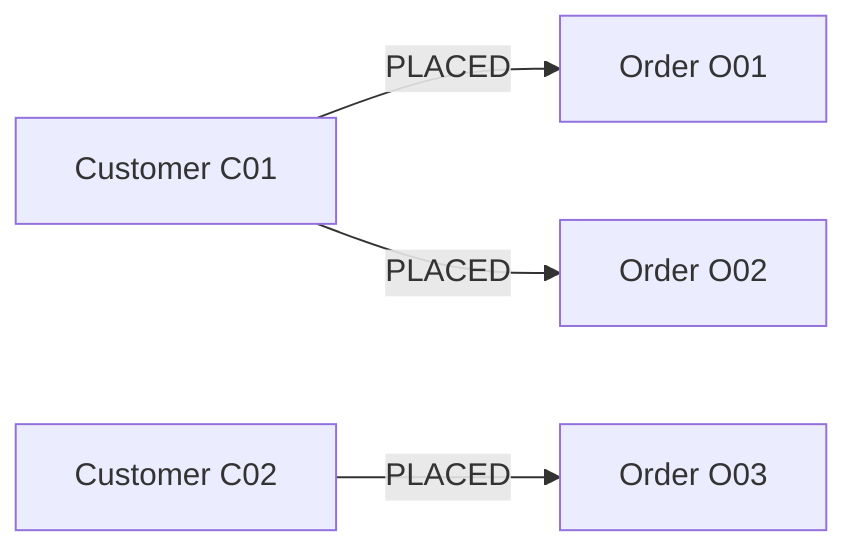
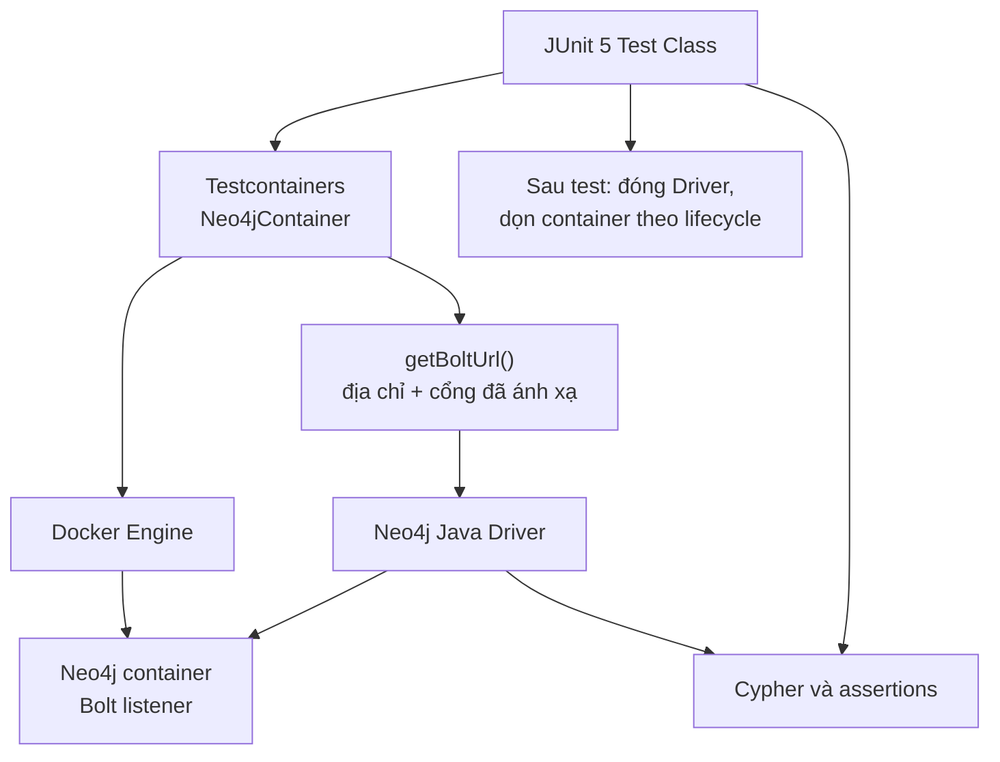
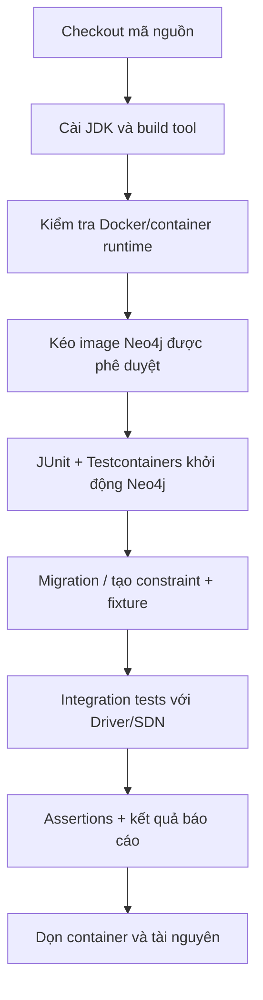

# Testcontainers cho kiểm thử tích hợp với máy chủ Neo4j

Một phương thức Java có thể tạo đúng chuỗi **Cypher** nhưng vẫn thất bại khi chạy trên Neo4j: tên nhãn không đúng, chỉ mục hoặc ràng buộc thiếu, quan hệ đi ngược chiều, kiểu thuộc tính sai, transaction không rollback như mong đợi hoặc ánh xạ của **Spring Data Neo4j** không khớp dữ liệu thật. Mock repository hay mock Java Driver không thể phát hiện đầy đủ những vấn đề này.

**Testcontainers** cho phép bài kiểm thử Java khởi động một **Neo4j server thật trong Docker container** với vòng đời được điều phối bởi JUnit. Ứng dụng kết nối tới server thử nghiệm qua Bolt giống cách kết nối Neo4j ở môi trường triển khai. Nhờ đó, ta có thể kiểm tra logic **property graph**, **node**, **relationship**, **constraint**, **index**, **transaction** và hành vi của **Neo4j Java Driver** hoặc **Spring Data Neo4j** trên một database tách biệt.

Bài thuộc chương **Kiểm thử** của module **DATABASE_ENGINE_GRAPH_NEO4J**, tập trung vào việc thiết lập và sử dụng Testcontainers để viết **integration test có thể chạy lặp lại**, chứ không chỉ kiểm tra đối tượng Java trong bộ nhớ.

## 1. Vì sao cần integration test với Neo4j thật?

Giả sử ứng dụng quản lý khách hàng và đơn hàng lưu đồ thị:



Truy vấn ứng dụng:

```cypher
MATCH (c:Customer {customerId: $customerId})
      -[:PLACED]->(o:Order)
RETURN o.orderId AS orderId
ORDER BY orderId;
```

Một unit test chỉ kiểm tra mock `Neo4jRepository` trả về `O01` và `O02` không chứng minh Cypher trên thực tế có thể chạy. Integration test với server thật có thể kiểm chứng:

- Node mang nhãn `Customer`, `Order` và quan hệ đúng loại `PLACED`.
- Hướng `(Customer)-[:PLACED]->(Order)` trùng mô hình thực tế.
- `$customerId` được truyền và ánh xạ đúng kiểu.
- Ràng buộc duy nhất trên `customerId` được database thực thi.
- Lệnh `MERGE` có thể chạy lại mà không sinh thêm quan hệ ngoài ý muốn.
- Các transaction tạo, cập nhật, rollback/commit đúng phạm vi.
- Repository Spring Data Neo4j lưu và đọc entity thật.

### 1.1. So sánh các mức kiểm thử

| Mức kiểm thử | Dùng dữ liệu nào? | Có Neo4j server thật? | Thường dùng để kiểm chứng |
| --- | --- | --- | --- |
| **Unit test** | Mock/stub và đối tượng Java | Không | Rẽ nhánh nghiệp vụ, validate, tính toán, mapping thuần Java |
| **Integration test với Testcontainers** | Database Neo4j trong container | **Có** | Cypher, schema, Driver, repository, transaction, graph topology |
| **End-to-end test** | Nhiều thành phần chạy cùng nhau | Có thể có | Luồng API → service → database và hệ thống tích hợp |
| **Performance/load test** | Dữ liệu lớn và tải đại diện | Có | Độ trễ, throughput, contention, query plan và khả năng mở rộng |

**Testcontainers không thay thế load test.** Một Neo4j container nhỏ khởi động trong CI không đại diện cho cluster nhiều máy, bộ nhớ/cache production hoặc cơ sở dữ liệu có hàng trăm triệu quan hệ.

## 2. Kiến trúc bài test

Khi JUnit chạy, extension Testcontainers có thể khởi động Neo4j từ Docker image. Container công bố cổng Bolt để Java Driver kết nối qua một **mapped port động**.



Điểm khác biệt quan trọng so với cấu hình development:

- Không tự hard-code `bolt://localhost:7687` trong bài test.
- Lấy endpoint do Testcontainers công bố qua `getBoltUrl()`; cổng trên máy chạy test có thể **khác 7687**.
- Dùng mật khẩu test tách biệt; không lấy credentials production.
- Sau test, container có thể được dọn, giúp hạn chế dữ liệu rác tồn tại giữa các lần CI.

### 2.1. Điều kiện để chạy được

Máy phát triển hoặc CI runner cần:

1. JDK và build tool của dự án (Maven/Gradle).
2. **Docker Engine hoặc container runtime tương thích được Testcontainers hỗ trợ**, đã khởi động và tài khoản chạy test có quyền tương tác.
3. Khả năng lấy Docker image Neo4j đã được phê duyệt hoặc image có sẵn trong registry/cache.
4. Tài nguyên đủ cho JVM ứng dụng và JVM của Neo4j trong container.
5. Đường mạng hợp lệ từ JVM chạy test đến port được ánh xạ của container.
6. Các chính sách security/CI cho phép vòng đời container và cơ chế cleanup cần thiết.

Nếu CI sử dụng runner không được phép chạy container, ví dụ một số môi trường sandbox, **không thể coi integration test với Testcontainers là một unit test có thể chạy ở mọi nơi**. Khi đó phải cấp runner phù hợp hoặc sử dụng một môi trường kiểm thử Neo4j riêng, có cô lập và dọn dữ liệu.

## 3. Dependency và phiên bản

Ví dụ bên dưới nhắm tới **Testcontainers 1.20.x**, **JUnit Jupiter 5** và **Neo4j Java Driver 5.x**, với image Neo4j `neo4j:5.26`. Đây là **một tổ hợp minh họa** để giải thích API, không phải yêu cầu tất cả dự án phải sử dụng chính xác các phiên bản đó.

Trong Maven, có thể dùng Testcontainers BOM để đồng bộ phiên bản các module:

```xml
<dependencyManagement>
    <dependencies>
        <dependency>
            <groupId>org.testcontainers</groupId>
            <artifactId>testcontainers-bom</artifactId>
            <version>${testcontainers.version}</version>
            <type>pom</type>
            <scope>import</scope>
        </dependency>
    </dependencies>
</dependencyManagement>

<dependencies>
    <!-- Neo4j Java Driver dùng trong ứng dụng và test -->
    <dependency>
        <groupId>org.neo4j.driver</groupId>
        <artifactId>neo4j-java-driver</artifactId>
        <version>${neo4j.driver.version}</version>
    </dependency>

    <!-- Module container Neo4j -->
    <dependency>
        <groupId>org.testcontainers</groupId>
        <artifactId>neo4j</artifactId>
        <scope>test</scope>
    </dependency>

    <!-- JUnit 5 extension của Testcontainers -->
    <dependency>
        <groupId>org.testcontainers</groupId>
        <artifactId>junit-jupiter</artifactId>
        <scope>test</scope>
    </dependency>

    <!-- Nếu dự án chưa có JUnit Jupiter từ framework/BOM -->
    <dependency>
        <groupId>org.junit.jupiter</groupId>
        <artifactId>junit-jupiter</artifactId>
        <scope>test</scope>
    </dependency>
</dependencies>
```

Hai property `testcontainers.version` và `neo4j.driver.version` cần được đặt thành **phiên bản thực, tương thích** trong POM hoặc hệ thống quản lý dependency của dự án. Nếu Spring Boot đã quản lý một hoặc nhiều dependency, cần kiểm tra BOM để tránh version conflict.

> **Thận trọng khi nâng cấp:** Ở các dòng Testcontainers mới hơn, group/module hoặc package chứa `Neo4jContainer` có thể thay đổi. Ví dụ `org.testcontainers.containers.Neo4jContainer` trong bài áp dụng cho dòng API 1.x được mô tả; khi chuyển sang dòng major khác, hãy tra tài liệu API của version đang dùng, không copy import một cách máy móc.

### 3.1. Chọn Docker image có chủ đích

Khai báo:

```java
new Neo4jContainer<>("neo4j:5.26")
```

giúp môi trường thử nghiệm gắn với một dòng version Neo4j cụ thể hơn là tag `latest`. Tuy nhiên, tag dạng `5.26` không nhất thiết khóa từng bản vá hoặc digest. Với yêu cầu tái lập nghiêm ngặt, có thể pin **patch tag/digest** của image đã được nhóm kiểm thử phê duyệt.

Nên kiểm thử với bản Neo4j gần với production về **major/minor, phiên bản Cypher, schema và các plugin**. Nếu ứng dụng dùng APOC hoặc procedure khác, phải chuẩn bị chúng riêng theo quy trình kiểm thử; mặc định không giả định mọi plugin production đều có trong image.

## 4. Khởi động Neo4jContainer bằng JUnit 5

Hai annotation quan trọng:

- `@Testcontainers`: bật extension Testcontainers cho lớp JUnit Jupiter.
- `@Container`: đánh dấu field container mà extension quản lý.

Ví dụ tối giản:

```java
import org.junit.jupiter.api.Test;
import org.testcontainers.containers.Neo4jContainer;
import org.testcontainers.junit.jupiter.Container;
import org.testcontainers.junit.jupiter.Testcontainers;

import static org.junit.jupiter.api.Assertions.assertTrue;

@Testcontainers
class Neo4jContainerSmokeTest {

    @Container
    static final Neo4jContainer<?> neo4j =
        new Neo4jContainer<>("neo4j:5.26")
            .withAdminPassword("test-only-password");

    @Test
    void containerStarts() {
        assertTrue(neo4j.isRunning());
        assertTrue(neo4j.getBoltUrl().startsWith("bolt://"));
    }
}
```

`static` giúp container này được khởi động **một lần cho toàn lớp test**, rồi dừng theo vòng đời lớp. Với container không static được quản lý ở mức từng test, chi phí khởi động thường lớn hơn nhưng có mức cô lập khác. Chiến lược chia sẻ cần dựa trên yêu cầu test và chi phí startup.

**Mật khẩu trên chỉ là giá trị dùng trong container thử nghiệm cô lập**, không phải khuyến nghị tạo mật khẩu production. Không kết nối nhầm đến database thật bằng mật khẩu test.

### 4.1. Vì sao dùng getBoltUrl() thay cho localhost?

Trong quá trình chạy:

```java
String boltUrl = neo4j.getBoltUrl();
String password = neo4j.getAdminPassword();
```

`boltUrl` là endpoint từ góc nhìn JVM chạy bài test, bao gồm host và port Docker đã ánh xạ. Hard-code cổng `7687` trên host khiến test có thể thất bại hoặc vô tình kết nối sang Neo4j local khác. Testcontainers đã giải quyết phần ánh xạ port này; hãy dùng thông tin chính nó cung cấp.

## 5. Integration test hoàn chỉnh với Neo4j Java Driver

Ví dụ sau mô tả test có thể chạy trên Neo4j thật:

1. Testcontainers khởi động Neo4j.
2. `@BeforeAll` tạo Java Driver và constraint.
3. `@BeforeEach` dọn **dữ liệu thử nghiệm trong container riêng**.
4. Test dùng Cypher để tạo khách hàng, đơn hàng và quan hệ.
5. Đọc lại dữ liệu bằng truy vấn thật và kiểm tra `assertEquals`.
6. Test khác kiểm tra unique constraint và rollback.
7. `@AfterAll` đóng Java Driver.

```java
import java.util.Map;

import org.junit.jupiter.api.AfterAll;
import org.junit.jupiter.api.BeforeAll;
import org.junit.jupiter.api.BeforeEach;
import org.junit.jupiter.api.Test;

import org.neo4j.driver.AuthTokens;
import org.neo4j.driver.Driver;
import org.neo4j.driver.GraphDatabase;
import org.neo4j.driver.Session;
import org.neo4j.driver.exceptions.ClientException;

import org.testcontainers.containers.Neo4jContainer;
import org.testcontainers.junit.jupiter.Container;
import org.testcontainers.junit.jupiter.Testcontainers;

import static org.junit.jupiter.api.Assertions.assertEquals;
import static org.junit.jupiter.api.Assertions.assertThrows;

@Testcontainers
class Neo4jDriverIntegrationTest {

    @Container
    static final Neo4jContainer<?> neo4j =
        new Neo4jContainer<>("neo4j:5.26")
            .withAdminPassword("test-only-password");

    private static Driver driver;

    @BeforeAll
    static void connectAndCreateSchema() {
        driver = GraphDatabase.driver(
            neo4j.getBoltUrl(),
            AuthTokens.basic("neo4j", neo4j.getAdminPassword())
        );
        driver.verifyConnectivity();

        try (Session session = driver.session()) {
            session.executeWrite(tx -> {
                tx.run("""
                    CREATE CONSTRAINT customer_id_unique IF NOT EXISTS
                    FOR (c:Customer)
                    REQUIRE c.customerId IS UNIQUE
                    """).consume();
                return null;
            });
        }
    }

    @BeforeEach
    void resetTestData() {
        try (Session session = driver.session()) {
            session.executeWrite(tx -> {
                // Chỉ dùng trên DB thử nghiệm cô lập.
                tx.run("MATCH (n) DETACH DELETE n").consume();
                return null;
            });
        }
    }

    @Test
    void writesAndReadsRelationship() {
        try (Session session = driver.session()) {
            session.executeWrite(tx -> {
                tx.run("""
                    MERGE (c:Customer {customerId: $cid})
                    SET c.name = $name
                    MERGE (o:Order {orderId: $oid})
                    MERGE (c)-[:PLACED]->(o)
                    """, Map.of(
                        "cid", "C01", "name", "An", "oid", "O01"
                    )).consume();
                return null;
            });

            long count = session.executeRead(tx ->
                tx.run("""
                    MATCH (c:Customer {customerId: $id})
                          -[:PLACED]->(o:Order)
                    RETURN count(o) AS total
                    """, Map.of("id", "C01"))
                    .single()
                    .get("total")
                    .asLong()
            );

            assertEquals(1L, count);
        }
    }

    @Test
    void enforcesUniqueConstraintAndRollsBack() {
        try (Session session = driver.session()) {
            assertThrows(ClientException.class, () ->
                session.executeWrite(tx -> {
                    tx.run("""
                        CREATE (:Customer {customerId: 'C01'})
                        """).consume();
                    tx.run("""
                        CREATE (:Customer {customerId: 'C01'})
                        """).consume();
                    return null;
                })
            );

            long count = session.executeRead(tx ->
                tx.run("""
                    MATCH (c:Customer {customerId: 'C01'})
                    RETURN count(c) AS total
                    """).single().get("total").asLong()
            );

            // Cả transaction bị rollback; không còn bản ghi dở dang.
            assertEquals(0L, count);
        }
    }

    @AfterAll
    static void closeDriver() {
        if (driver != null) {
            driver.close();
        }
    }
}
```

### 5.1. Những gì hai test thật sự chứng minh

**`writesAndReadsRelationship`** kiểm tra đồng thời nhiều lớp:

- Driver có thể kết nối Bolt với Neo4j container.
- Cypher `MERGE` tạo được node và quan hệ.
- Mẫu `(:Customer)-[:PLACED]->(:Order)` có hướng đúng.
- Tham số `$cid`/`$oid`/`$name` hoạt động.
- Một lần đọc tiếp theo nhìn thấy dữ liệu đã commit.

**`enforcesUniqueConstraintAndRollsBack`** kiểm tra database thực sự từ chối hai node có cùng mã và transaction chứa lỗi được rollback, nên không để lại một node C01 “nửa vời”.

Đây là **integration test**, không phải kiểm thử đơn vị của `Map.of` hay các phương thức `assertEquals`.

### 5.2. Vì sao xóa dữ liệu ở BeforeEach?

Static container được dùng chung cho **các test trong một lớp**, nên dữ liệu do test A tạo có thể ảnh hưởng test B nếu không dọn. `@BeforeEach` xóa node trước mỗi test nhằm tạo điểm xuất phát ổn định.

Tuy nhiên:

- `MATCH (n) DETACH DELETE n` **xóa tất cả node và quan hệ** trong database đích; chỉ hợp lệ trong container kiểm thử do bài test sở hữu.
- Việc dọn node **không xóa schema constraint/index**; đây là chủ đích của ví dụ, vì các test cần constraint được tạo ở `@BeforeAll`.
- Nếu các test dùng **cùng container và chạy song song**, `@BeforeEach` của một test có thể xóa dữ liệu của test khác. Không dùng chiến lược này khi bật parallel execution cho những test dùng chung database.
- Với test quy mô lớn, có thể chọn database riêng, container riêng, namespace khóa dữ liệu riêng hoặc fixture/setup cô lập theo lớp — tùy yêu cầu và khả năng multi-database của phiên bản Neo4j.

### 5.3. Vì sao không nên thay mọi test bằng @Transactional rollback?

Ở Spring hoặc ứng dụng có Java Driver, một số test có thể dùng transaction rollback để không lưu dữ liệu. Nhưng điều này chỉ bảo vệ **những thao tác thật sự chạy trong transaction đó**. Nếu test gọi một dịch vụ mở transaction riêng, dùng Driver khác hoặc dùng các thủ tục tự commit, rollback ở test method **không tự động thu hồi** mọi thay đổi bên ngoài ranh giới transaction.

Vì vậy, hãy chọn chiến lược cô lập có thể kiểm tra được:

- Rollback trong cùng transaction khi muốn test hành vi transaction.
- Dọn fixture rõ ràng khi nhiều truy vấn commit độc lập.
- Container/database riêng khi cần cô lập mạnh giữa các lớp.
- Không dùng một Neo4j database dùng chung cho test và production.

## 6. Kiểm tra tính idempotent của MERGE

Một phép đồng bộ dữ liệu hoặc API nhập lặp có thể chạy cùng Cypher nhiều lần. Nếu mô hình chỉ cho phép **một quan hệ PLACED giữa một cặp Customer–Order**, test nên xác nhận số node và edge không tăng ngoài ý muốn.

```cypher
MERGE (c:Customer {customerId: $customerId})
MERGE (o:Order {orderId: $orderId})
MERGE (c)-[:PLACED]->(o);
```

Bài test có thể gọi lệnh trên **hai lần**, sau đó đọc:

```cypher
MATCH (c:Customer {customerId: 'C01'})
      -[r:PLACED]->(o:Order {orderId: 'O01'})
RETURN count(r) AS placedCount;
```

Kỳ vọng `placedCount = 1` với luồng ghi tuần tự và không có dữ liệu cạnh trùng ban đầu. Nếu các worker có thể đồng thời nhập cùng khóa, cần thêm test cạnh tranh và constraint phù hợp: `MERGE` một mình không tự chứng minh mọi đường ghi đồng thời đều an toàn trước tạo trùng.

## 7. Kiểm thử transaction commit và rollback

Integration test nên phân biệt:

- **Commit:** sau khi transaction hoàn tất, một session mới có thể đọc dữ liệu đã ghi.
- **Rollback:** thay đổi chưa commit trong transaction bị hủy, không thấy ở lần đọc tiếp theo.
- **Thất bại giữa nhiều thao tác:** các thao tác trong cùng transaction không được lưu một phần.

Ví dụ explicit transaction với Java Driver:

```java
import org.neo4j.driver.Session;
import org.neo4j.driver.Transaction;

try (Session session = driver.session()) {
    try (Transaction tx = session.beginTransaction()) {
        tx.run("""
            CREATE (:Customer {customerId: 'TEMP-01'})
            """).consume();

        tx.rollback();
    }

    long count = session.executeRead(tx ->
        tx.run("""
            MATCH (c:Customer {customerId: 'TEMP-01'})
            RETURN count(c) AS n
            """).single().get("n").asLong()
    );

    assertEquals(0L, count);
}
```

Đoạn code minh họa transaction rollback trên **database thử nghiệm**. Nó không dùng để kiểm tra dữ liệu production vì dữ liệu giả có thể bị commit nhầm nếu cấu hình transaction sai hoặc dùng một nguồn dữ liệu không đúng.

**Truy vấn ghi được đặt trước `PROFILE` vẫn thực thi thật.** Nếu phân tích kế hoạch ghi trong test, cần hiểu rõ transaction được rollback/commit ở đâu. Với `EXPLAIN`, server chỉ dựng kế hoạch mà không thực hiện lệnh ghi, nên phù hợp hơn khi chỉ cần xem plan.

## 8. Kiểm thử Spring Data Neo4j với Testcontainers

Khi ứng dụng sử dụng **Spring Boot + Spring Data Neo4j**, ta không chỉ muốn biết Driver có thể chạy Cypher; còn cần kiểm tra **entity mapping**, repository, transaction và cấu hình Spring thực sự trỏ đến container.

Hai cách phổ biến:

- `@DynamicPropertySource` để truyền URI/username/password của container vào Spring Environment.
- `@ServiceConnection` nếu phiên bản Spring Boot có tích hợp Testcontainers phù hợp và ứng dụng khai báo dependency tương ứng.

Để tránh giả định về auto-detection của một phiên bản Spring cụ thể, ví dụ chính dùng **`@DynamicPropertySource`**.

### 8.1. Entity và repository mẫu

Entity `Customer` có khóa nghiệp vụ `customerId` và thuộc tính `name`. Trong ví dụ này, dùng `@Version` để Spring Data Neo4j nhận biết vòng đời object có `@Id` do ứng dụng gán và hỗ trợ optimistic locking.

```java
import org.springframework.data.annotation.Id;
import org.springframework.data.annotation.Version;
import org.springframework.data.neo4j.core.schema.Node;

@Node("Customer")
public class Customer {

    @Id
    private String customerId;

    @Version
    private Long version;

    private String name;

    protected Customer() {}

    public Customer(String customerId, String name) {
        this.customerId = customerId;
        this.name = name;
    }

    public String getCustomerId() {
        return customerId;
    }

    public String getName() {
        return name;
    }

    public Long getVersion() {
        return version;
    }
}
```

Repository:

```java
import org.springframework.data.neo4j.repository.Neo4jRepository;

public interface CustomerRepository
        extends Neo4jRepository<Customer, String> {
}
```

Với Spring Boot, dự án thường có dependencies `spring-boot-starter-data-neo4j`, `spring-boot-starter-test` cùng Testcontainers Neo4j/JUnit Jupiter. Dự án phải cấu hình component/entity/repository scanning sao cho những kiểu trên được Spring phát hiện.

### 8.2. Test slice bằng @DataNeo4jTest

```java
import org.junit.jupiter.api.BeforeEach;
import org.junit.jupiter.api.Test;

import org.springframework.beans.factory.annotation.Autowired;
import org.springframework.boot.test.autoconfigure.data.neo4j.DataNeo4jTest;
import org.springframework.test.context.DynamicPropertyRegistry;
import org.springframework.test.context.DynamicPropertySource;

import org.testcontainers.containers.Neo4jContainer;
import org.testcontainers.junit.jupiter.Container;
import org.testcontainers.junit.jupiter.Testcontainers;

import static org.junit.jupiter.api.Assertions.assertEquals;
import static org.junit.jupiter.api.Assertions.assertTrue;

@DataNeo4jTest
@Testcontainers
class CustomerRepositoryIntegrationTest {

    @Container
    static final Neo4jContainer<?> neo4j =
        new Neo4jContainer<>("neo4j:5.26")
            .withAdminPassword("test-only-password");

    @DynamicPropertySource
    static void registerNeo4jProperties(
            DynamicPropertyRegistry registry) {

        registry.add("spring.neo4j.uri", neo4j::getBoltUrl);
        registry.add(
            "spring.neo4j.authentication.username", () -> "neo4j");
        registry.add(
            "spring.neo4j.authentication.password",
            neo4j::getAdminPassword);
    }

    @Autowired
    CustomerRepository repository;

    @BeforeEach
    void clearCustomers() {
        // Chỉ xóa dữ liệu trong database test cô lập.
        repository.deleteAll();
    }

    @Test
    void savesAndReadsCustomer() {
        repository.save(new Customer("C01", "An"));

        var customer = repository.findById("C01");

        assertTrue(customer.isPresent());
        assertEquals("An", customer.orElseThrow().getName());
    }
}
```

Test trên thực hiện **lưu và tải lại node thông qua repository thực**, với Driver kết nối vào Neo4j container. `@DataNeo4jTest` tập trung vào những thành phần liên quan Spring Data Neo4j thay vì khởi tạo toàn bộ ứng dụng web; nếu cần kiểm thử service/controller và các bean khác, sử dụng `@SpringBootTest` theo nhu cầu.

### 8.3. Vì sao phải dùng DynamicPropertySource?

Port Bolt được Testcontainers ánh xạ ngẫu nhiên. Vì vậy, đoạn cấu hình tĩnh như:

```yaml
spring:
  neo4j:
    uri: bolt://localhost:7687
```

có thể khiến bài test kết nối nhầm Neo4j dev hoặc thất bại khi CI cấp port khác. `@DynamicPropertySource` giải quyết bằng cách **đăng ký supplier lấy URI và credentials từ container** cho Spring khi tạo ApplicationContext.

Nếu dự án dùng nhiều database hoặc yêu cầu tên database riêng, cũng cần xác định database đích tương ứng theo **phiên bản Spring Boot/Spring Data Neo4j**. Không mặc định database home luôn trùng production.

### 8.4. Tùy chọn @ServiceConnection

Một số phiên bản Spring Boot 3.1+ có tính năng kết nối Testcontainers qua `@ServiceConnection` (cần dependency `spring-boot-testcontainers` và phiên bản có hỗ trợ container tương ứng). Trong môi trường đó, một biến thể khai báo có thể có dạng:

```java
@Container
@ServiceConnection
static final Neo4jContainer<?> neo4j =
    new Neo4jContainer<>("neo4j:5.26")
        .withAdminPassword("test-only-password");
```

Đây là **phương án thay thế** cho cách đăng ký các thuộc tính kết nối thủ công, không phải yêu cầu đặt cả hai trong mọi test. Cần kiểm tra import `org.springframework.boot.testcontainers.service.connection.ServiceConnection`, dependencies và khả năng sinh connection details của Spring Boot đang sử dụng. Nếu không chắc, `@DynamicPropertySource` là cách diễn đạt tường minh hơn.

## 9. Quản lý lifecycle và tốc độ chạy test

Khởi động một JVM Neo4j riêng cho từng test có thể tốn thời gian. Testcontainers cho phép lựa chọn vòng đời khác nhau:

| Chiến lược | Ưu điểm | Rủi ro/cái giá |
| --- | --- | --- |
| Static `@Container` mỗi lớp | Dễ viết, startup một lần cho cả lớp | Các test trong lớp phải tự cô lập dữ liệu |
| Container riêng cho từng test | Cô lập mạnh | Thời gian và tài nguyên startup lớn hơn |
| Một container chung cho nhiều lớp | Có thể giảm startup | Khó đồng bộ lifecycle, state và parallel tests |
| Database/namespace riêng trên container chung | Tách dữ liệu mà không cần container mới | Phụ thuộc tính năng và quyền quản trị của phiên bản Neo4j |
| Môi trường test từ xa có sẵn | Không cần Docker trên runner | Khó bảo đảm sạch dữ liệu, phiên bản, quyền và cô lập |

### 9.1. Dọn dữ liệu và schema

Có hai loại trạng thái:

- **Dữ liệu:** node, relationship, thuộc tính, bản ghi test.
- **Schema:** index, constraint, các cấu hình schema khác.

Nếu `@BeforeEach` chỉ `DETACH DELETE` tất cả node, **constraint/index vẫn tồn tại**. Đó là một ưu điểm khi mọi test trong lớp cùng dùng schema. Nhưng khi test cần kiểm tra **tạo/xóa schema**, phải chuẩn bị chiến lược dọn/reset schema riêng hoặc chạy trong container/database độc lập.

Không xóa mọi node ở một database dùng chung nếu test chạy song song. Đồng thời, không giả định `@Transactional` tự cô lập các thao tác chạy ngoài transaction của Spring (ví dụ Java Driver tự tạo session/transaction).

### 9.2. Tránh reuse trong CI khi cần tính quyết định

Testcontainers có các khả năng liên quan đến tái sử dụng container trong một số môi trường phát triển. Tuy nhiên, **không nên mặc định bật reuse cho CI** nếu cần đảm bảo test bắt đầu từ trạng thái sạch và được dọn sau khi chạy. Việc giữ container cũ có thể làm test phụ thuộc dữ liệu hoặc schema còn sót từ lần trước.

Một test tích hợp tốt nên chạy được **theo thứ tự bất kỳ**, không phụ thuộc vào việc test khác đã tạo fixture trước đó.

### 9.3. Đừng chạy kiểm thử song song trên cùng một database không cách ly

Nếu JUnit chạy hai test cùng sửa `C01` trong một Neo4j container, kết quả có thể thất bại do race không liên quan đến logic cần kiểm thử. Khi bật parallel test execution:

1. Dùng container/database riêng cho mỗi test hoặc nhóm test độc lập.
2. Hoặc dùng các khóa/namespace dữ liệu khác nhau không giao nhau.
3. Hoặc tắt song song với nhóm test cần dùng chung state.
4. Với concurrency test cố ý, kiểm soát thứ tự bằng barrier/latch và transaction riêng.

**Parallel tests vô tình cạnh tranh nhau** là một lỗi của bộ test, không nhất thiết là lỗi của Neo4j.

## 10. Viết fixture có ý nghĩa nghiệp vụ

Fixture nên **nhỏ, rõ ràng, đủ đại diện**. Nếu đang kiểm tra quan hệ Customer–Order, hãy tạo chính xác những node/edge mà test cần.

```cypher
CREATE (c1:Customer {customerId: 'C01', name: 'An'})
CREATE (c2:Customer {customerId: 'C02', name: 'Bình'})
CREATE (o1:Order {orderId: 'O01'})
CREATE (o2:Order {orderId: 'O02'})
CREATE (c1)-[:PLACED]->(o1)
CREATE (c1)-[:PLACED]->(o2);
```

Trên dữ liệu đó:

```cypher
MATCH (c:Customer {customerId: 'C01'})-[:PLACED]->(o:Order)
RETURN o.orderId AS orderId
ORDER BY orderId;
```

trả **O01, O02**; truy vấn cùng mẫu với `customerId = 'C02'` trả **không có đơn nào**.

Test cũng nên kiểm tra các trường hợp biên:

- Không tìm thấy node.
- Node tồn tại nhưng chưa có quan hệ.
- Hai node không liên kết dù tên/mã có vẻ giống.
- Một node có nhiều quan hệ cùng loại.
- Thuộc tính bắt buộc thiếu hoặc `null`.
- Constraint bị vi phạm.
- Dữ liệu có ký tự Unicode/tiếng Việt, ngày và số.
- Thử lại `MERGE` để xác định có phát sinh node/edge trùng hay không.

**Không chỉ assert số lượng tổng** nếu bài toán cần kiểm tra hướng hoặc loại quan hệ. Ví dụ count mọi cạnh `PLACED` có thể bằng 2 nhưng cả hai đều nối sai khách hàng; phải assert đúng cặp đầu–cuối theo yêu cầu nghiệp vụ.

## 11. Kiểm thử schema: constraint và index

Một trong những lợi ích lớn của integration test là kiểm chứng **Neo4j schema thực thi thật**, không chỉ xem migration file.

Ví dụ ràng buộc:

```cypher
CREATE CONSTRAINT customer_id_unique IF NOT EXISTS
FOR (c:Customer)
REQUIRE c.customerId IS UNIQUE;
```

Sau đó, tạo hai node cùng mã bằng `CREATE` trong cùng transaction sẽ bị từ chối. Đây là một test hữu ích vì mô hình Java `@Id` không tự thay thế việc database bảo vệ **unique constraint**.

Có thể kiểm tra trạng thái schema bằng Cypher:

```cypher
SHOW CONSTRAINTS
YIELD name, type
RETURN name, type
ORDER BY name;
```

Với index:

```cypher
SHOW INDEXES
YIELD name, type, state
RETURN name, type, state
ORDER BY name;
```

Cần đợi index ở trạng thái `ONLINE` khi bài test cần dùng index để đánh giá plan. **Đừng chỉ kiểm tra tên index đã tồn tại**, rồi lập tức suy rằng mọi truy vấn đều dùng nó.

### 11.1. Kiểm tra EXPLAIN hoặc PROFILE

Với dataset lớn hơn và index trên `Customer.customerId`, có thể dùng:

```cypher
EXPLAIN
MATCH (c:Customer {customerId: $id})
RETURN c.name AS name;
```

`EXPLAIN` dựng kế hoạch mà không thực hiện truy vấn đọc/ghi dữ liệu. `PROFILE` chạy truy vấn và đo `Rows`, `DB Hits` khi runtime hỗ trợ, nên có thể giúp phân tích hiệu năng.

**Không viết test cứng rằng mọi phiên bản Neo4j bắt buộc dùng đúng một tên toán tử**, vì planner có thể đổi chiến lược theo số lượng dữ liệu, chỉ mục, thống kê và phiên bản. Kiểm thử schema/đầu ra nghiệp vụ thường ổn định hơn; performance-plan test phải có dữ liệu đại diện và cách kiểm chứng được kiểm soát.

## 12. Kiểm thử đồng thời và optimistic locking

Spring Data Neo4j có thể dùng `@Version` để phát hiện cập nhật **stale entity**. Một test có Neo4j thật phù hợp để tái hiện hai giao dịch cùng đọc một phiên bản rồi cố ghi cập nhật khác nhau.

Quy trình kiểm thử khuyến nghị:

1. Tạo một node `KnowledgeArticle` với khóa nghiệp vụ cố định.
2. Mở hai transaction/session độc lập, cùng đọc node và version hiện tại.
3. Dùng **barrier** (như `CountDownLatch`/`CyclicBarrier`) để điều phối hai luồng sau bước đọc.
4. Cho một transaction commit cập nhật.
5. Cho transaction còn lại lưu bản sao stale.
6. Kiểm tra xung đột được phát hiện, một update không ghi đè âm thầm và dữ liệu cuối đúng theo chính sách.

Không dựa vào `Thread.sleep` để tạo race: thời điểm scheduling thay đổi theo CI. Với test transaction có nhiều luồng, cần giới hạn thời gian chờ và luôn đóng session/driver ngay cả khi assertion thất bại.

**Lưu ý:** Nếu một đường ghi dùng Cypher trực tiếp mà không kiểm tra/tăng version, `@Version` của repository không tự bảo vệ đường ghi đó. Integration test nên bao gồm các luồng thực sự tồn tại trong kiến trúc, không chỉ test phương thức `repository.save` riêng lẻ.

## 13. Testcontainers và CI/CD

Đối với CI, mục tiêu là tự động chạy test trên Neo4j thật với **version được kiểm soát và môi trường có thể tái lập**.

Một luồng CI điển hình:



Lệnh thường gặp trong dự án Maven cấu hình JUnit 5 phù hợp:

```bash
mvn test
```

Nếu project tách integration test ra pha riêng, lệnh và plugin có thể khác, ví dụ Maven Failsafe với `integration-test`/`verify`. Đừng coi một file tên `*IT.java` sẽ tự được Maven Surefire chạy nếu chưa kiểm tra cấu hình test inclusion và test engine của dự án.

### 13.1. Các rủi ro vận hành CI cần xử lý

| Vấn đề | Biểu hiện | Cách xử lý |
| --- | --- | --- |
| Không có Docker runtime | Testcontainers không tìm thấy môi trường Docker | Dùng runner được cấp Docker/container backend tương thích |
| Không kéo được image | Timeout, denied, DNS hoặc registry limit | Kiểm tra mạng/registry credentials, pin image được phê duyệt |
| Thiếu RAM/CPU | Neo4j startup rất chậm hoặc container bị kill | Cấp tài nguyên phù hợp, giảm parallelism |
| Image Neo4j khác production | Cypher/procedure/schema không tương thích | Pin và kiểm thử các version dự kiến triển khai |
| Test kết nối nhầm Neo4j local | Kết quả phụ thuộc máy phát triển | Luôn dùng `getBoltUrl()`, không hard-code URI |
| Container giữ state cũ | Test chỉ pass khi chạy sau test khác | Fixture rõ ràng, cleanup, tránh reuse không kiểm soát |
| Parallel test can thiệp nhau | Lỗi không ổn định, thiếu node/edge | Database/container riêng hoặc tắt parallel |
| Startup thỉnh thoảng timeout | CI chậm, tài nguyên bị tranh | Kiểm tra Docker/Neo4j logs, chờ readiness đúng cách |
| Thiếu migration trong test | Production có index/constraint mà test không có | Chạy migration/schema setup cùng quy trình ứng dụng |
| Bỏ qua integration test trong pipeline | Lỗi Cypher chỉ xuất hiện sau deploy | Thiết kế CI stage rõ ràng và giám sát kết quả |

Không nên tắt các cơ chế dọn container hoặc hạ chính sách an toàn của CI chỉ để làm một bài test vượt qua lỗi môi trường. Hãy giải quyết quyền container runtime và tài nguyên đúng cách.

## 14. Debug khi bài test thất bại

Khi thất bại, xác định nó thuộc tầng nào:

1. **Container khởi động:** Docker chạy chưa, image có kéo được, Neo4j có đủ tài nguyên?
2. **Driver kết nối:** lấy URI từ `getBoltUrl()` chưa, password có khớp `getAdminPassword()`, có dùng đúng scheme Bolt?
3. **Cấu hình Spring:** `@DynamicPropertySource` có được áp dụng, có config nào ghi đè URI hay database name?
4. **Schema:** constraint/index có được tạo trong container, migration có chạy đủ?
5. **Fixture:** test có tạo đúng node/relationship, có bị test khác dọn?
6. **Transaction:** `commit` đã xảy ra trước khi đọc kiểm chứng? `rollback` có làm mất thay đổi như kỳ vọng?
7. **Assertions:** test kiểm tra hướng, loại cạnh và giá trị cụ thể, không chỉ tổng count?

Khi cần, xem log container và exception từ Driver bằng chức năng logging của Testcontainers/JUnit theo phiên bản. **Không đưa mật khẩu production hoặc dữ liệu nhạy cảm thật vào logs test.**

Một số hiện tượng dễ hiểu sai:

- `verifyConnectivity()` thành công nhưng Cypher thất bại: có thể do syntax, quyền, database hoặc schema — không nhất thiết do mạng.
- `MATCH` trả rỗng dù `CREATE` vừa chạy: dữ liệu có thể nằm trong transaction chưa commit, database khác hoặc pattern có sai hướng.
- Test đếm được node nhưng thiếu cạnh: việc tạo relationship có thể bị bỏ qua khi `MATCH` một đầu mút không tìm thấy.
- Test bị lỗi unique constraint dù chạy riêng pass: các test khác có thể để lại dữ liệu trùng.
- Test nhanh trên laptop nhưng chậm ở CI: Docker, image cache, page cache và tài nguyên khác nhau.

## 15. Thiết kế một bộ integration test có thể duy trì lâu dài

Một cấu trúc thực hành hiệu quả nên chia test theo **rủi ro nghiệp vụ**, không phải theo từng method tiện có sẵn:

| Nhóm | Ví dụ test cần có |
| --- | --- |
| **Kết nối** | Driver nhận URI/credentials Testcontainers; `RETURN 1` chạy được |
| **Mapping** | `@Node`, `@Id`, `@Relationship` lưu và đọc lại đúng |
| **Cypher** | Tham số, hướng quan hệ, truy vấn đường đi và aggregation |
| **Schema** | Unique constraint từ chối mã trùng; index/constraint có mặt |
| **CRUD và transaction** | Commit và rollback; cập nhật không tạo trùng |
| **Concurrency** | `@Version` hoặc điều kiện version từ chối bản stale |
| **Tích hợp dữ liệu** | `MERGE` idempotent, xử lý thiếu đầu mút, soft delete |
| **Regression** | Case từng gây lỗi được lưu thành fixture và assertion |

Các nguyên tắc khi viết:

- **Mỗi test có dữ liệu đầu vào rõ ràng** và expected result rõ ràng.
- **Không phụ thuộc test order**, tên máy, port cố định hoặc dữ liệu dev.
- **Không mock phần cần kiểm chứng với Neo4j**; chỉ mock những dịch vụ ngoài phạm vi như email/payment khi phù hợp.
- **Cố định phiên bản image** đủ chặt để kết quả dễ tái lập.
- **Giữ fixture nhỏ**, tạo dữ liệu lớn chỉ cho nhóm performance test riêng.
- **Đóng Session và Driver** đúng lifecycle; container do Testcontainers quản lý.
- **Kiểm soát parallel tests** và xác định rõ chiến lược cleanup.
- **Tách unit test nhanh khỏi integration test tốn tài nguyên**, nhưng bảo đảm CI vẫn chạy integration tests tại giai đoạn phù hợp.

## 16. Bài tập thực hành

### Bài tập 1 — Khởi động Neo4j trong JUnit

Viết một lớp `@Testcontainers` dùng static `@Container Neo4jContainer<?>` với image Neo4j đã pin và password chỉ dành cho test. Trong một method `@Test`, kiểm tra container đang chạy và `getBoltUrl()` trả endpoint Bolt. Vì sao không viết cứng `localhost:7687`?

### Bài tập 2 — Test quan hệ Customer–Order

Tạo `Customer C01` và `Order O01` bằng Java Driver, nối `PLACED`, sau đó chạy `MATCH (c:Customer)-[:PLACED]->(o:Order)`. Assert đúng cặp `C01/O01`; sửa thử hướng cạnh để chắc chắn test phát hiện lỗi.

### Bài tập 3 — Constraint thực sự có hiệu lực

Tạo unique constraint trên `Customer.customerId`. Trong một transaction, thử `CREATE` hai Customer cùng mã `C01`. Kỳ vọng database báo lỗi và transaction không để lại bản ghi dở dang. Vì sao unit test mock repository không chứng minh được điều này?

### Bài tập 4 — Idempotency

Chạy hai lần `MERGE` tạo cùng khách hàng, đơn hàng và cạnh `PLACED`. Đếm node và relationship sau mỗi lần. Khi nào `MERGE` trên cặp node không còn đủ để phân biệt nhiều sự kiện quan hệ có cùng đầu–cuối?

### Bài tập 5 — Spring Data Neo4j

Tạo một `@Node Customer` với `@Id` và `@Version`, cùng `CustomerRepository`. Dùng `@DataNeo4jTest` và `@DynamicPropertySource` để repo kết nối tới Neo4jContainer. Test `save` rồi `findById` trả đúng `name`.

### Bài tập 6 — Transaction rollback

Chạy một lệnh `CREATE` bên trong `session.beginTransaction()`, sau đó `rollback()` và dùng một transaction đọc mới đếm node. Vì sao không nên coi rollback của test method là đủ nếu code cần kiểm tra mở một transaction khác?

### Bài tập 7 — Isolation khi chạy song song

Hai test dùng chung static container. Test A tạo C01, test B chạy `MATCH (n) DETACH DELETE n` ở `@BeforeEach`. Điều gì có thể xảy ra nếu JUnit chạy hai test song song? Đề xuất hai cách cô lập có thể đo được.

### Bài tập 8 — CI không có Docker

Pipeline báo lỗi “không tìm thấy Docker environment” trước khi chạy bất kỳ Cypher nào. Hãy phân biệt lỗi hạ tầng với lỗi ứng dụng, đề xuất runner/container backend thích hợp và những thông tin cần đưa vào báo cáo để nhóm vận hành xử lý.

### Bài tập 9 — Kế hoạch kiểm thử trước release

Liệt kê những integration test quan trọng cho một service Neo4j dùng **Java Driver, Spring Data Neo4j, unique constraint, @Version và import bằng MERGE**. Chọn ít nhất một test lỗi và một test thành công cho mỗi nhóm nghiệp vụ.

## Ghi nhớ

**Testcontainers giúp kiểm thử mã Java với một Neo4j server thật**, thay vì chỉ tin vào mock hay kiểm tra chuỗi Cypher. Cặp `@Testcontainers`/`@Container` quản lý lifecycle của container; `getBoltUrl()` và `getAdminPassword()` cung cấp thông tin kết nối thử nghiệm. Kết hợp chúng với **Neo4j Java Driver** hoặc `@DynamicPropertySource` của **Spring Data Neo4j** để kiểm tra truy vấn, mapping, constraint, transaction và relationship.

Một integration test tốt cần **phiên bản image rõ ràng, Docker runtime sẵn có, dữ liệu và schema được quản lý, không phụ thuộc thứ tự chạy và assertions đúng nghiệp vụ**. Giữ môi trường test tách biệt, không chạy lệnh dọn toàn bộ node trên database dùng chung, và nhớ rằng kiểm thử tính đúng đắn khác với benchmark hiệu năng trên dữ liệu production.
