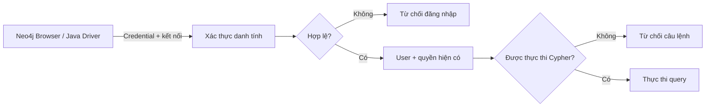
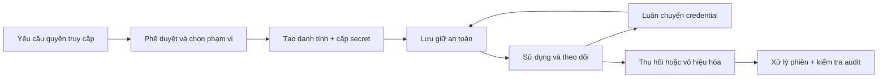

# Xác thực, quản lý tài khoản và vòng đời thông tin đăng nhập trong Neo4j

Đối với hệ thống sử dụng **Neo4j** để lưu property graph, một câu Cypher có đúng cú pháp vẫn có thể bị từ chối nếu tài khoản kết nối không hợp lệ hoặc không có quyền thực thi. Ngược lại, một dịch vụ được cấp tài khoản quản trị quá rộng có thể xóa dữ liệu, thay schema hoặc đọc thông tin nhạy cảm vượt nhu cầu. Vì vậy, thiết kế bảo mật bắt đầu từ ba câu hỏi: **ai đang truy cập**, **được phép làm gì** và **thông tin đăng nhập được cấp phát, sử dụng, thay thế, thu hồi như thế nào**.

Bài thuộc chương **Bảo mật** của module **DATABASE_ENGINE_GRAPH_NEO4J**, liên hệ tới truy vấn **Cypher**, mô hình **node/relationship**, **Neo4j Java Driver** và **Spring Data Neo4j**. Trọng tâm là xác thực (**authentication**), quản lý tài khoản native và vòng đời credential. Kiểm soát quyền (**authorization**) được giới thiệu ở mức cần thiết để tránh nhầm với xác thực.

Sau bài học, bạn có thể:

- Phân biệt lỗi đăng nhập với lỗi thiếu quyền.
- Mô tả native authentication, các lựa chọn tích hợp LDAP/OIDC/SSO và sự khác nhau giữa Community, Enterprise, Aura.
- Nhận diện vai trò của `system` database trong quản lý tài khoản.
- Dùng những lệnh `SHOW CURRENT USER`, `SHOW USERS`, `CREATE USER`, `ALTER USER` và `DROP USER` theo quy trình an toàn.
- Thiết kế vòng đời mật khẩu/secret cho người dùng tương tác và tài khoản ứng dụng.
- Kết nối từ Java/SDN không hard-code mật khẩu, có TLS và quy trình rotation.
- Lập kế hoạch khôi phục khi mất quyền admin hoặc nghi ngờ credential bị lộ.

> **Điều kiện thực hành:** Lệnh tạo, sửa, xóa user cần quyền quản trị phù hợp và có thể ảnh hưởng khả năng đăng nhập. Chỉ chạy trên hệ thống thử nghiệm hoặc môi trường được cho phép. Cú pháp/tính năng còn phụ thuộc phiên bản Neo4j, edition và gói dịch vụ; không chạy nguyên ví dụ trên production.

## 1. Authentication khác authorization như thế nào?

| Khái niệm | Câu hỏi | Ví dụ |
| --- | --- | --- |
| **Authentication** | Danh tính kết nối là ai? | `report_reader` cung cấp credential hợp lệ khi mở kết nối Bolt |
| **Authorization** | Danh tính đó có thể làm gì? | `report_reader` có quyền `MATCH` nhưng không được `DELETE` |
| **Credential management** | Bí mật nhận diện được cấp, lưu, thay và thu hồi ra sao? | Mật khẩu native, credential IdP, secret manager |
| **Audit** | Có ai đăng nhập thất bại hoặc đổi quyền bất thường không? | Giám sát login failures và thay đổi role |



Một user có thể **đăng nhập thành công** nhưng vẫn không có quyền tạo node, xóa relationship hoặc chạy `SHOW USERS`. Đó là vấn đề authorization, không phải sai mật khẩu. Tương tự, việc ứng dụng thêm `WHERE tenantId = $tenantId` vào query không thay thế xác thực user và kiểm tra tenant đã được cấp phép.

## 2. Những lựa chọn xác thực trong Neo4j

### 2.1. Native authentication

Với **native authentication**, Neo4j quản lý tài khoản và thông tin xác thực trong dữ liệu hệ thống thuộc **`system` database**. Quản trị viên có thẩm quyền có thể tạo, sửa hoặc xóa user bằng Cypher administration commands. User native cũng có thể thay mật khẩu của chính mình theo quy trình cho phép.

Các bước nhận diện:

1. Client kết nối qua Bolt/driver, gửi cơ chế auth đã cấu hình.
2. Neo4j xác minh danh tính.
3. Khi thành công, DBMS áp dụng các quyền phù hợp với user và database.
4. Query được thực thi nếu được phép; ngược lại trả lỗi authorization.

**Không tự tạo node `(:User {password: ...})` để thay thế việc quản trị user native của Neo4j.** Node ứng dụng và danh tính của DBMS có mục đích riêng; đặt plaintext password trong property graph tạo thêm rủi ro.

### 2.2. LDAP, OIDC và SSO

Trong các edition/gói dịch vụ phù hợp, Neo4j có thể tích hợp **LDAP**, **OpenID Connect (OIDC)** hoặc hệ thống đăng nhập tập trung. Khi đó:

- **Identity provider (IdP)** có thể quản lý password, MFA, trạng thái nhân sự và chính sách đăng nhập.
- Neo4j áp dụng cơ chế xác thực và ánh xạ quyền theo cấu hình tương ứng.
- Mật khẩu người dùng LDAP/OIDC thường không được đổi bằng lệnh thay password **native**.
- Cần thu hồi danh tính tại **IdP** khi nhân viên nghỉ việc, không chỉ xóa một bản ghi native trong Neo4j.

Không mặc định tất cả môi trường đều có cùng khả năng SSO/MFA. Cần kiểm tra phiên bản, edition, nhà cung cấp danh tính và gói dịch vụ đang dùng.

### 2.3. Khác biệt giữa Community, Enterprise và Aura

| Môi trường | Điểm phải xác minh |
| --- | --- |
| **Community Edition** | Có quản lý native users nhưng **không có cơ chế role/privilege chi tiết như Enterprise**. Các user có đặc quyền quản trị theo mô hình Community; tên `readonly` không tạo quyền chỉ đọc. |
| **Enterprise Edition** | Hỗ trợ role-based access control và các lựa chọn auth provider/trạng thái tài khoản theo phiên bản. |
| **Neo4j Aura** | Dịch vụ quản lý; khả năng tạo user, tích hợp SSO và khôi phục tài khoản tùy gói. Không tự cho rằng có quyền sửa `neo4j.conf` hoặc chạy `neo4j-admin` trên máy chủ. |

**Sai lầm thường gặp:** Trên Community tạo user tên `only_read` rồi truyền credential đó cho ứng dụng báo cáo và tin rằng nó không thể ghi graph. **Tên tài khoản không phải một chính sách phân quyền**.

## 3. Thiết lập xác thực ban đầu và bảo vệ mạng

Với Neo4j **self-managed**, một setting thường gặp là:

```properties
# neo4j.conf, minh họa trạng thái bật authentication:
dbms.security.auth_enabled=true
```

Authentication thường được bật mặc định trong các bản Neo4j hiện hành. **Không đặt `false` trên hệ thống còn được truy cập từ xa** chỉ vì một ứng dụng bị lỗi đăng nhập.

### 3.1. Mật khẩu ban đầu của tài khoản `neo4j`

Một cài đặt self-managed mới thường có native user `neo4j`. Nếu chưa thiết lập password trước đó, mật khẩu mặc định có thể là `neo4j` và phải thay tại lần login đầu. Trong hệ thống thật, nên thiết lập credential mạnh, riêng cho môi trường, ngay trong bước khởi tạo.

Trước **lần khởi động database đầu tiên**, có thể dùng công cụ:

```text
neo4j-admin dbms set-initial-password <NEW_SECRET>
```

Đây là **minh họa cú pháp**, không phải secret để copy vào thực tế. Option `--require-password-change` có thể buộc người dùng thay password tạm ở lần đầu, tùy cú pháp phiên bản.

**Quan trọng:** `set-initial-password` dùng cho **khởi tạo lần đầu**, không phải lệnh cứu hộ tổng quát để reset admin trên DBMS đã hoạt động. Truyền mật khẩu thật trên command line có thể để lại lịch sử hoặc bị công cụ giám sát thu thập; hãy dùng phương thức nhập secret an toàn theo quy trình vận hành.

### 3.2. TLS không được thay bằng mật khẩu mạnh

Authentication và mã hóa kết nối là hai lớp riêng. Khi kết nối từ ứng dụng qua mạng, ưu tiên TLS và xác minh chứng chỉ server; Java Driver thường dùng URI dạng:

```text
neo4j+s://graph.example.internal
```

Kết nối `bolt://localhost` có thể phù hợp cho bài tập trên máy cục bộ được cô lập, nhưng không phải lựa chọn mặc định cho mạng công cộng. Khi TLS lỗi, hãy sửa hostname, chứng chỉ, trust chain hoặc endpoint, **không hạ cấp bảo mật để bỏ qua cảnh báo**.

## 4. Xem danh tính hiện tại và danh sách user

Các lệnh quản trị user chạy trong ngữ cảnh **`system` database**. Khi kết nối qua Bolt, các administration commands phù hợp thường được Neo4j định tuyến tới `system`. Trên một số công cụ, người quản trị cần chọn database tương ứng; tham khảo giao diện đang dùng.

### 4.1. Xem user đang đăng nhập

```cypher
SHOW CURRENT USER;
```

Lệnh này giúp biết ứng dụng hoặc người dùng thực sự đang kết nối dưới tài khoản nào. Các metadata trả về có thể gồm role, cờ yêu cầu thay password hoặc trạng thái; một số trường không áp dụng trên Community/external auth.

### 4.2. Xem danh sách user

```cypher
SHOW USERS;
```

Ví dụ chọn các cột liên quan tới vòng đời tài khoản:

```cypher
SHOW USERS
YIELD user, roles, passwordChangeRequired, suspended
RETURN user, roles, passwordChangeRequired, suspended
ORDER BY user;
```

| Cột | Ý nghĩa |
| --- | --- |
| `user` | Tên user, có phân biệt hoa/thường |
| `roles` | Role native đã gán; có thể `null` ở Community |
| `passwordChangeRequired` | User native có bị buộc đổi mật khẩu trong lần đăng nhập tiếp theo không |
| `suspended` | Trạng thái tạm ngừng, phụ thuộc edition và provider |

Không hiển thị danh sách user/role trên API công khai. Đây là metadata cần quyền quản trị/xem phù hợp; việc biết username và role cũng có giá trị đối với kẻ tấn công.

## 5. Cấp native user với password tạm

Người quản trị đã cung cấp mật khẩu mạnh qua tham số `$temporaryPassword` từ client bảo mật:

```cypher
CREATE USER training_reader IF NOT EXISTS
SET PASSWORD $temporaryPassword
CHANGE REQUIRED;
```

Các điểm cần hiểu:

1. `$temporaryPassword` là một **tham số Cypher**. Không viết password thật trực tiếp vào tài liệu, query log hoặc source code.
2. `IF NOT EXISTS` giúp tránh lỗi khi tên user đã tồn tại, nhưng **không reset mật khẩu** của user cũ.
3. `CHANGE REQUIRED` phù hợp cho **người dùng tương tác** cần đổi mật khẩu được cấp tạm.
4. User mới không mặc nhiên được cấp “quyền đọc” vì tên có chữ `reader`.
5. Quản trị quyền và tạo tài khoản phải tách khỏi API nghiệp vụ chạy hằng ngày.

Không lạm dụng `CREATE OR REPLACE USER`: replace có thể xóa tài khoản cũ rồi tạo mới, tác động tới trạng thái và các quyền có liên quan.

### 5.1. Phân quyền theo role trên Enterprise

Ở Neo4j Enterprise, quản trị viên có quyền có thể cấp role `reader`:

```cypher
GRANT ROLE reader TO training_reader;
```

Kiểm tra:

```cypher
SHOW USER training_reader PRIVILEGES;
```

Role `reader` là role dựng sẵn với phạm vi đọc theo cấu hình Neo4j. Nếu chỉ được truy cập một phần graph/tenant, có thể cần các role/privilege chuyên biệt hơn. **Community không có RBAC tương đương**, vì vậy không giả định cùng câu lệnh quản lý role áp dụng được ở đó.

## 6. Người dùng tự đổi mật khẩu native

Một native user đang đăng nhập có thể đổi password khi biết giá trị cũ:

```cypher
ALTER CURRENT USER
SET PASSWORD FROM $oldPassword TO $newPassword;
```

Khác với reset bởi admin, lệnh này yêu cầu user biết mật khẩu cũ. Quy trình hợp lý:

1. Kết nối qua kênh được bảo vệ.
2. Nhận password cũ/mới mà không ghi log.
3. Kiểm tra chính sách password của tổ chức.
4. Thực thi lệnh đổi mật khẩu.
5. Kiểm tra credential mới đăng nhập thành công.
6. Với tài khoản được dùng trong ứng dụng, cập nhật kho secret và các instance liên quan.

Lệnh này **không đổi password LDAP/OIDC** nếu danh tính được quản lý bởi IdP bên ngoài.

### 6.1. Chính sách độ dài tối thiểu

Trong một số bản Neo4j self-managed có setting như:

```properties
# Minh họa chính sách do tổ chức lựa chọn:
dbms.security.auth_minimum_password_length=12
```

Con số **12** chỉ là chính sách mẫu, không phải mặc định áp dụng mọi môi trường. Mật khẩu service nên ngẫu nhiên, đủ mạnh và **duy nhất theo môi trường**. Độ dài tối thiểu không thay thế secret manager, TLS, quyền tối thiểu và giám sát.

## 7. Admin reset và cờ buộc đổi password

Nếu user native quên mật khẩu, admin có thẩm quyền có thể đặt một password tạm mới:

```cypher
ALTER USER training_reader
SET PASSWORD $newTemporaryPassword
CHANGE REQUIRED;
```

Nếu chỉ muốn buộc đổi password trong kỳ tiếp theo:

```cypher
ALTER USER training_reader
SET PASSWORD CHANGE REQUIRED;
```

Với **service account không tương tác**, cờ `CHANGE REQUIRED` có thể khiến ứng dụng không thể đăng nhập bình thường. Trong quy trình rotation service, quản trị viên có thể sử dụng:

```cypher
ALTER USER app_ingest
SET PASSWORD $newServicePassword
CHANGE NOT REQUIRED;
```

Lệnh trên giả định `app_ingest` đã tồn tại. `CHANGE NOT REQUIRED` chỉ nói rằng không cần đổi tương tác ở lần login tiếp theo; **không** có nghĩa secret được miễn luân chuyển hay có thể dùng vô thời hạn.

Nếu `ALTER USER` bị từ chối, kiểm tra quyền quản lý user của tài khoản đang thao tác. Không tự cấp admin cho ứng dụng chỉ để vượt lỗi quản trị.

## 8. Tạm ngừng và xóa tài khoản

Trong **Neo4j Enterprise**, native user có thể được đặt trạng thái tạm ngừng:

```cypher
ALTER USER training_reader
SET STATUS SUSPENDED;
```

Khi khôi phục theo quy trình được phê duyệt:

```cypher
ALTER USER training_reader
SET STATUS ACTIVE;
```

Lưu ý:

- Đây là tính năng trạng thái phụ thuộc edition.
- Với external auth provider, khả năng login và tác động của suspend còn phụ thuộc IdP và cấu hình.
- Không giả định thao tác này **tự terminate tất cả session/transaction đã mở**.
- Cần quản lý quyền và trạng thái tại IdP khi thu hồi nhân viên hoặc hệ thống ngoài.

Xóa user:

```cypher
DROP USER training_reader IF EXISTS;
```

**Tài liệu Neo4j nêu rằng xóa user không tự động chấm dứt những connection, session, transaction hoặc query đang hoạt động.** Nếu cần ngăn truy cập khẩn cấp, phải phối hợp kiểm tra/terminate phiên đang mở và cô lập nguồn truy cập theo khả năng của DBMS.

`DROP USER` không xóa node nghiệp vụ, không xóa bản sao password trong CI/CD, và không thu hồi token hoặc credential ở hệ thống danh tính khác.

## 9. Vòng đời thông tin đăng nhập

Credential không nên là chuỗi mật khẩu được tạo một lần rồi bỏ quên. Mỗi user cần có **chủ sở hữu**, phạm vi quyền, thời hạn sử dụng và quy trình thu hồi.



| Giai đoạn | Người dùng tương tác | Service account |
| --- | --- | --- |
| **Yêu cầu** | Vai trò công việc, bộ dữ liệu cần truy cập | Chủ sở hữu service, môi trường, endpoint |
| **Cấp phát** | Native user hoặc SSO; password tạm có thể yêu cầu đổi | Tài khoản riêng, secret tự động, quyền tối thiểu |
| **Lưu giữ** | Password manager/IdP được tổ chức cho phép | Secret manager/vault, tránh hard-code hoặc Git |
| **Sử dụng** | Neo4j Browser, Cypher Shell, công cụ quản trị | Java Driver, Spring Data Neo4j, ETL hoặc connector |
| **Rotation** | Đổi mật khẩu hoặc cập nhật tại IdP | Đồng bộ password DBMS, secret store, Driver/pool |
| **Thu hồi** | Nghỉ việc, chuyển vai trò, yêu cầu bảo mật | Dừng job cũ, thu hồi secret, xử lý session |
| **Audit** | Kiểm tra lịch sử, quyền còn lại | Xem lỗi auth, chủ sở hữu và tác vụ còn dùng |

### Phân biệt user con người và service account

- **Người dùng tương tác** có thể được yêu cầu đổi mật khẩu ngay sau lần đăng nhập đầu; SSO/MFA là lựa chọn đáng cân nhắc khi nền tảng/edition hỗ trợ.
- **Service account** chạy không có người ngồi trước màn hình nên phải có quy trình secret injection và rotation tự động. Cờ buộc đổi password tương tác có thể khiến service mất kết nối.
- **Admin hoặc break-glass account** chỉ dùng cho quản trị/phục hồi, với quy trình phê duyệt, lưu secret và giám sát nghiêm ngặt. Không dùng chúng cho API bình thường.

Một user `neo4j` được chia sẻ giữa API chỉ đọc, job import và quản trị sẽ làm tăng hậu quả khi secret bị lộ, làm khó điều tra và khiến mọi thành phần phải đổi password cùng lúc. Nên **tách identity theo chức năng** và dùng quyền tối thiểu ở edition hỗ trợ.

## 10. Rotation secret trong ứng dụng chạy liên tục

Đổi password ở Neo4j mà không cập nhật cấu hình ứng dụng có thể làm các kết nối mới bị từ chối. **Rotation** cần phối hợp cả database, hệ thống lưu giữ credential, ứng dụng và kết nối đang hoạt động.

### 10.1. Các bước với một user service

1. **Xác định phụ thuộc:** user nào, service nào, bao nhiêu instance, job và connector đang dùng.
2. **Tạo secret mới** trong kho bí mật an toàn, gắn version/quyền truy cập phù hợp.
3. **Lên lịch đổi** theo khả năng làm mới authentication của driver và thời gian gián đoạn chấp nhận được.
4. **Thực hiện `ALTER USER ... SET PASSWORD`** bằng kênh quản trị được bảo vệ.
5. **Cập nhật ứng dụng/Driver** để kết nối mới sử dụng secret mới.
6. **Xác minh truy cập** bằng một truy vấn tối thiểu, sau đó kiểm tra các thao tác nghiệp vụ cần thiết.
7. **Kiểm tra phiên cũ**, lỗi xác thực và trạng thái các instance chưa được cập nhật.
8. **Thu hồi secret cũ** trong vault, CI/CD, cấu hình deployment và các bản sao không còn cần thiết; lưu nhật ký thay đổi không chứa plaintext.

Một native user thường chỉ có một mật khẩu hiện hành. Nếu đổi ngay trên DBMS trước khi mọi instance dùng secret mới, có thể tồn tại **cửa sổ lỗi ngắn**. Đừng hứa không gián đoạn chỉ vì ứng dụng có retry.

### 10.2. Phương án chuyển sang user mới

Khi cần chuyển đổi có kiểm soát, có thể tạo tài khoản service thay thế:

```text
app_ingest_v1  -> đang xử lý
      |
      +-----> tạo app_ingest_v2
                   |
                   +-----> cấp quyền tối thiểu
                   +-----> thử kết nối và query
                   +-----> chuyển từng instance sang v2
                   +-----> xác minh hoạt động / audit
                   +-----> chấm dứt phụ thuộc v1
                   +-----> thu hồi v1 + các phiên cũ
```

Cần quản lý chặt chẽ giai đoạn hai user cùng tồn tại; xác minh quyền mới không rộng hơn quyền cần thiết. Phương án này giảm sự phụ thuộc vào việc đổi password của cùng một user, nhưng không tự thay thế việc xử lý các kết nối cũ.

### 10.3. Driver và connection pool không tự đổi credential

**Neo4j Java Driver** thường sống suốt vòng đời ứng dụng và giữ connection pool. Thay đổi secret trong vault **không mặc nhiên** làm Driver đã khởi tạo nhận secret mới.

Tùy phiên bản driver và cách cấu hình, ứng dụng có thể dùng cơ chế **authentication manager/credential rotation** được hỗ trợ hoặc tạo **Driver mới** với credential mới, xác minh kết nối, chuyển traffic rồi đóng Driver cũ sau khi các yêu cầu đang chạy được xử lý.

Không tạo Driver mới cho từng HTTP request để “luôn đọc password mới”; thiết kế đó làm giảm hiệu quả pool và tăng overhead. Không chia sẻ một `Session` giữa nhiều luồng đồng thời.

**Đổi password hoặc suspend user không đồng nghĩa tức khắc chấm dứt mọi transaction đang hoạt động.** Cần kế hoạch xem xét/terminate session, query hoặc connection khi thực sự muốn thu hồi khẩn cấp.

## 11. Neo4j Java Driver: tránh hard-code credential

Ví dụ Java sau nhận cấu hình từ môi trường, phù hợp minh họa một chương trình kết nối đơn giản. Trong hệ thống thật, nên dùng secret manager và cơ chế cung cấp bí mật an toàn; biến môi trường cũng có thể bị lộ trong debugger, crash dump hoặc giao diện quản trị sai cấu hình.

```java
import java.util.Objects;

import org.neo4j.driver.AuthTokens;
import org.neo4j.driver.Driver;
import org.neo4j.driver.GraphDatabase;
import org.neo4j.driver.Session;
import org.neo4j.driver.SessionConfig;

public final class Neo4jConnectivityCheck {

    public static void main(String[] args) {
        String uri = Objects.requireNonNull(
            System.getenv("NEO4J_URI"), "Missing NEO4J_URI");
        String username = Objects.requireNonNull(
            System.getenv("NEO4J_USERNAME"), "Missing NEO4J_USERNAME");
        String password = Objects.requireNonNull(
            System.getenv("NEO4J_PASSWORD"), "Missing NEO4J_PASSWORD");

        try (Driver driver = GraphDatabase.driver(
                uri, AuthTokens.basic(username, password))) {

            driver.verifyConnectivity();

            try (Session session =
                     driver.session(SessionConfig.forDatabase("neo4j"))) {
                long ok = session.executeRead(tx ->
                    tx.run("RETURN 1 AS ok")
                      .single()
                      .get("ok")
                      .asLong()
                );

                System.out.println("Connected: " + (ok == 1));
            }
        }
    }
}
```

**Giải thích:**

- `AuthTokens.basic(username, password)` cung cấp thông tin cho **basic native authentication**.
- `driver.verifyConnectivity()` phát hiện sớm vấn đề kết nối hoặc xác thực.
- `RETURN 1 AS ok` kiểm tra truy vấn cơ bản, **không chứng minh** user đủ quyền chạy mọi query nghiệp vụ.
- `"neo4j"` là tên database minh họa; triển khai nhiều database phải chỉ định đúng database đã được cấp quyền.
- `Driver` trong ví dụ được đóng sau khi chương trình `main` hoàn tất. Trong web application, quản lý Driver như thành phần dùng lại và đóng khi ứng dụng dừng.
- Không log `password`, auth token hoặc toàn bộ map cấu hình có secret khi exception phát sinh.

Khi dùng URI kết nối từ xa, ưu tiên TLS/certificate verification phù hợp, ví dụ `neo4j+s://` với chứng chỉ hợp lệ. Quyền ghi hay đọc graph của user là một lớp riêng so với sự thành công của `verifyConnectivity()`.

## 12. Spring Data Neo4j và cấu hình secret

Với **Spring Boot và Spring Data Neo4j**, thông tin kết nối thường được cấu hình qua những property như `spring.neo4j.uri`, `spring.neo4j.authentication.username` và `spring.neo4j.authentication.password`.

Một mẫu `application.yml` dùng placeholder môi trường (không chứa secret thật):

```yaml
spring:
  neo4j:
    uri: ${NEO4J_URI}
    authentication:
      username: ${NEO4J_USERNAME}
      password: ${NEO4J_PASSWORD}
```

Đây là cú pháp **Spring property placeholder**: các giá trị cần được inject từ biến môi trường hoặc secret manager phù hợp. Không thay placeholder bằng mật khẩu thật rồi commit tệp cấu hình vào Git; cần kiểm tra các biến đã được cung cấp lúc ứng dụng khởi động.

Cần nhớ:

- `@Transactional` xác định ranh giới giao dịch; **không tự cấp quyền đăng nhập hoặc làm mới credential**.
- `Neo4jClient` và repository dùng cấu hình Driver/transaction manager phù hợp.
- Khi secret thay đổi, phải kiểm tra **lifecycle của Driver bean và connection pool**, không chỉ sửa secret ở bên ngoài process rồi giả định đã cập nhật.
- Với nhiều profile, tách URI, username, password và database theo môi trường.
- Tài khoản chạy migration/schema không nhất thiết phải là tài khoản phục vụ request thông thường.

## 13. Phân loại lỗi thay vì reset mật khẩu theo thói quen

| Triệu chứng | Nguyên nhân khả dĩ | Bước kiểm tra đúng |
| --- | --- | --- |
| `Unauthorized` / authentication failure | Sai user/password, auth provider, secret cũ | Xác minh user, phiên bản secret và provider; không log plaintext |
| Cảnh báo phải đổi password | `passwordChangeRequired` đang bật | Hoàn tất bước đổi mật khẩu hoặc reset đúng luồng |
| Đăng nhập được nhưng `CREATE` bị từ chối | Thiếu quyền ghi hoặc edition không hỗ trợ quyền yêu cầu | Kiểm tra role/privilege, không tự đổi mật khẩu |
| Không chạy được `SHOW USERS` | Không có quyền xem/quản lý user | Dùng admin được ủy quyền |
| Đổi password xong app vẫn lỗi | Driver/pool còn auth token cũ | Xem refresh secret, AuthManager hoặc Driver mới |
| Lỗi certificate/TLS | Hostname, CA chain, chứng chỉ hết hạn | Sửa endpoint/trust chain, không tắt kiểm tra TLS |
| User SSO không vào được | IdP, mapping hoặc trạng thái tài khoản ngoài | Kiểm tra IdP và cấu hình auth provider |
| Suspend/drop xong còn query cũ | Session/transaction đã tồn tại | Kiểm tra phiên đang mở và công cụ terminate phù hợp |
| Login thất bại lặp lại | Service cũ dùng password cũ hoặc dò quét | Xác minh nguồn kết nối, rate limit và cảnh báo |

### Theo dõi nhưng không lộ bí mật

Các tín hiệu nên có gồm: số login thất bại, thay đổi user/role, service chưa chuyển secret mới, tài khoản ít sử dụng, user không còn chủ sở hữu, địa chỉ kết nối bất thường và trạng thái truy cập của account đặc quyền.

**Không ghi plaintext password, private key, token hoặc bản sao credential** vào log để phục vụ giám sát. Quyền truy cập audit log cũng phải được giới hạn.

## 14. Mất quyền admin: quy trình recovery phải được cô lập

Có hai trường hợp:

1. **Vẫn còn một admin hợp lệ:** dùng user đó để thực hiện `ALTER USER ... SET PASSWORD` và kiểm tra quyền.
2. **Không còn đường admin:** phải dùng **quy trình khôi phục chính thức** theo phiên bản Neo4j, edition, cấu hình và topology.

Với **self-managed**, hướng dẫn recovery có thể cần dừng Neo4j, cô lập kết nối mạng và **tạm tắt authentication trong giai đoạn khôi phục được kiểm soát**, sau đó phục hồi tài khoản và bật lại auth.

Đây là thao tác **khẩn cấp có rủi ro cao**:

- Không đặt `dbms.security.auth_enabled=false` trên database vẫn có thể được truy cập từ Internet hoặc mạng không tin cậy.
- Nếu phải khôi phục ở trạng thái auth disabled, giới hạn kết nối vào loopback hoặc cô lập tương đương theo tài liệu.
- Không dùng cùng một chuỗi thao tác máy đơn cho cluster mà không đọc hướng dẫn topology tương ứng.
- Bật lại xác thực, kiểm tra admin, thay credential tạm và xác minh bảo mật **trước** khi khôi phục traffic.
- Với **Aura**, dùng cơ chế phục hồi do dịch vụ cung cấp; không tự giả định có thể sửa file hoặc chạy `neo4j-admin`.

`neo4j-admin dbms set-initial-password` **không phải** lệnh reset admin chung cho database đã chạy. Phân biệt rõ giai đoạn khởi tạo ban đầu với recovery.

## 15. Xử lý sự cố credential bị lộ

Nếu nghi ngờ secret của user service đã bị lộ, cần phối hợp cả user, ứng dụng và phiên hoạt động:

1. Xác định tài khoản, quyền và hệ thống đang sử dụng credential.
2. Hạn chế truy cập theo cơ chế được hỗ trợ; với native user Enterprise có thể dùng suspend theo chính sách.
3. Tạo secret hoặc identity thay thế và cập nhật các instance ứng dụng.
4. Xem xét và terminate session/transaction/connection hiện có khi cần thu hồi khẩn.
5. Đối chiếu audit và kiểm tra các thay đổi graph hoặc schema có khả năng bị ảnh hưởng.
6. Thu hồi bản secret cũ trong vault, CI/CD, cấu hình, job, bản copy không còn cần thiết.
7. Theo dõi auth failures sau rotation và cải thiện kiểm soát least privilege.

Neo4j native có một số setting hỗ trợ xử lý login thất bại lặp lại, ví dụ `dbms.security.auth_lock_time`, nhưng cấu hình/giá trị cần tuân thủ tài liệu phiên bản và chính sách tổ chức. **Chống brute force không thể chỉ dựa vào lockout**; còn cần TLS, mạng được phân đoạn, rate limiting và giám sát.

## 16. Checklist trước khi đưa ứng dụng vào production

| Hạng mục | Câu hỏi cần trả lời |
| --- | --- |
| **User riêng** | Mỗi service có một danh tính và chủ sở hữu rõ ràng không? |
| **Edition/gói** | Edition có hỗ trợ mức RBAC cần thiết không? |
| **Least privilege** | API chỉ đọc có vô tình dùng admin account không? |
| **Secret storage** | Credential có nằm trong Git, image hoặc build artifact không? |
| **TLS** | URI, certificate và hostname đã được xác minh chưa? |
| **Rotation** | Có runbook đổi mật khẩu và làm mới Driver/pool không? |
| **Onboarding** | User mới được cấp quyền đúng và thay password tạm khi cần chưa? |
| **Offboarding** | Có thu hồi tại Neo4j/IdP và xử lý phiên đang tồn tại không? |
| **Recovery** | Có cách khôi phục admin mà không để hệ thống mở truy cập ẩn danh không? |
| **Audit** | Có phát hiện login thất bại, user quyền cao và thay đổi role không? |
| **Kiểm thử** | Đã thử sai password, sai role, mất TLS và credential rotation chưa? |

Đối với hệ thống đa tenant, người dùng đã xác thực vẫn cần được kiểm tra **quyền trên dữ liệu cụ thể**. Một user đăng nhập thành công không tự động được xem tất cả node và relationship của mọi khách hàng.

## 17. Bài tập tự kiểm tra

**Câu 1.** Trên Neo4j Community, tạo tài khoản `analytics_readonly` có đủ bảo đảm tài khoản đó không được xóa node không?

<details>
<summary>Đáp án gợi ý</summary>

Không. Community không có role/privilege chi tiết như Enterprise. Tên user không quyết định quyền. Cần chọn edition/kiến trúc phù hợp với yêu cầu hạn chế truy cập database.

</details>

**Câu 2.** Tài khoản Java đăng nhập được nhưng truy vấn `CREATE (o:Order)` bị từ chối. Nên điều tra authentication hay authorization?

<details>
<summary>Đáp án gợi ý</summary>

Ưu tiên authorization vì danh tính đã được xác thực. Kiểm tra quyền ghi graph, role, database và edition. Đổi mật khẩu không tự cấp quyền.

</details>

**Câu 3.** Khi cấp native user cho một nhân viên dùng Browser, tại sao nên cân nhắc `CHANGE REQUIRED`?

<details>
<summary>Đáp án gợi ý</summary>

Nó buộc người nhận thay mật khẩu tạm khi đăng nhập, giảm thời gian dùng một bí mật do người cấp phát biết. Service account không tương tác cần chiến lược khác vì cờ này có thể cản trở kết nối tự động.

</details>

**Câu 4.** Vì sao đổi mật khẩu `app_ingest` trong Neo4j chưa đủ khiến các instance Java Driver dùng secret mới?

<details>
<summary>Đáp án gợi ý</summary>

Driver và connection pool có thể giữ token cũ. Phải cập nhật nguồn secret và refresh AuthManager hoặc tạo Driver mới theo cơ chế phiên bản hỗ trợ, kiểm tra kết nối rồi chuyển traffic.

</details>

**Câu 5.** `DROP USER training_reader` có chắc chấm dứt mọi session/transaction đang hoạt động không?

<details>
<summary>Đáp án gợi ý</summary>

Không. Tài liệu Neo4j chỉ rõ việc xóa user không tự terminate toàn bộ connection, session, transaction và query liên quan. Quy trình thu hồi khẩn phải xử lý các phiên đó riêng.

</details>

**Câu 6.** Khi không còn admin của Neo4j Aura, có nên dùng `neo4j-admin dbms set-initial-password` và sửa `neo4j.conf`?

<details>
<summary>Đáp án gợi ý</summary>

Không. Aura là dịch vụ được quản lý, không mặc định có quyền chỉnh host. Dùng quy trình recovery chính thức của dịch vụ. Với self-managed, việc khôi phục phải cô lập mạng nếu cần tạm tắt authentication.

</details>

**Câu 7.** Sử dụng user `neo4j` có quyền admin cho cả API, ETL và người quản trị gây ra vấn đề gì?

<details>
<summary>Đáp án gợi ý</summary>

Quyền quá rộng, khó audit, khó rotation, và một secret bị lộ có thể ảnh hưởng toàn hệ thống. Nên tách user theo service, cấp quyền tối thiểu và quản lý secret độc lập.

</details>

**Câu 8.** `@Transactional` của Spring Data Neo4j có tự cung cấp TLS, MFA hoặc vòng đời credential không?

<details>
<summary>Đáp án gợi ý</summary>

Không. `@Transactional` quản lý transaction dữ liệu. TLS, authentication provider, RBAC, MFA và secret rotation là các cơ chế bảo mật khác.

</details>

## Ghi nhớ

- **Authentication** xác nhận danh tính; **authorization** kiểm soát quyền thao tác graph và DBMS.
- Native user được quản lý qua Cypher administration commands trong ngữ cảnh **`system`**; LDAP/OIDC/SSO có vòng đời credential riêng qua IdP.
- **Community khác Enterprise về RBAC**; tên tài khoản không phải chính sách quyền.
- Tách quy trình **initial password**, **self-service password change**, **admin reset** và **admin recovery**.
- **Credential lifecycle** gồm cấp phát, lưu giữ, sử dụng, rotation, thu hồi và audit. User tương tác khác service account.
- **Thay secret trong vault không tự làm Driver dùng secret mới**; bảo vệ kết nối từ xa bằng TLS.
- **Suspend/drop user không nên được coi là bước duy nhất để ngăn mọi phiên đã mở**.
- Không tắt authentication trên hệ thống còn mở truy cập từ xa để xử lý sự cố mất quyền admin.

### Tài liệu tham khảo

- [Neo4j Operations Manual — Manage users](https://neo4j.com/docs/operations-manual/current/authentication-authorization/manage-users/)
- [Neo4j Operations Manual — Authentication and authorization](https://neo4j.com/docs/operations-manual/current/authentication-authorization/)
- [Neo4j Operations Manual — Built-in roles and privileges](https://neo4j.com/docs/operations-manual/current/authentication-authorization/built-in-roles/)
- [Neo4j Operations Manual — Manage roles](https://neo4j.com/docs/operations-manual/current/authentication-authorization/manage-roles/)
- [Neo4j Operations Manual — Set an initial password](https://neo4j.com/docs/operations-manual/current/configuration/set-initial-password/)
- [Neo4j Operations Manual — Recover admin user and password](https://neo4j.com/docs/operations-manual/current/authentication-authorization/password-and-user-recovery/)
- [Neo4j Java Driver Manual — Connect](https://neo4j.com/docs/java-manual/current/connect/)
- [Spring Data Neo4j Reference](https://docs.spring.io/spring-data/neo4j/reference/)

