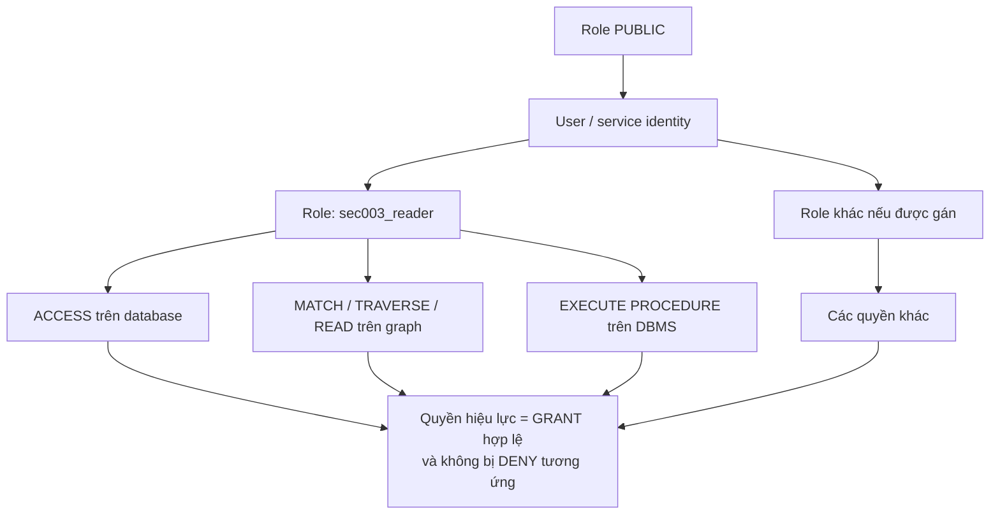
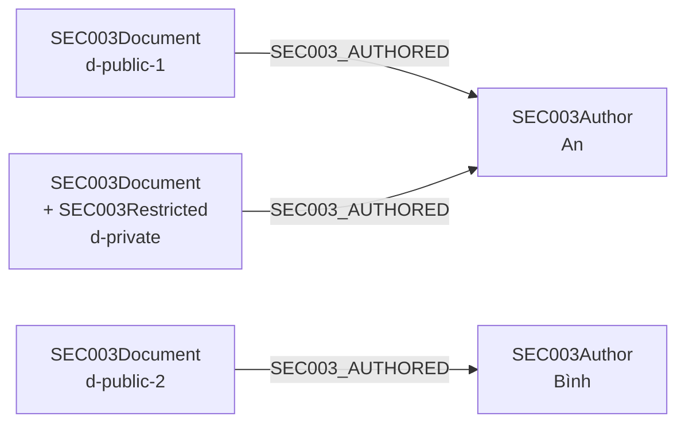

# Giới hạn quyền đọc, ghi, quản trị và thực thi thủ tục

## 1. Bài toán bảo mật trong ứng dụng Neo4j

Neo4j lưu dữ liệu theo mô hình **property graph**: node có nhãn và thuộc tính, relationship có loại, hướng và thuộc tính. Khi ứng dụng dùng Cypher, Java Driver hoặc Spring Data Neo4j, một câu `MATCH` có thể duyệt qua nhiều thực thể, đọc các thuộc tính nhạy cảm và tìm ra liên kết giữa những đối tượng vốn không nên được phép thấy.

Ví dụ cổng tài liệu kỹ thuật có ba nhóm:

- **Người xem:** được xem tài liệu công khai, tiêu đề và tác giả; không xem ghi chú nội bộ.
- **Biên tập viên:** được chỉnh sửa tiêu đề tài liệu thuộc phạm vi được giao nhưng không được tạo/xóa node, sửa thuộc tính bí mật hoặc quản trị database.
- **Nhân sự vận hành:** cần kiểm tra index/constraint, tình trạng hệ thống; không vì thế mà cần đọc toàn bộ nội dung tài liệu.

Neo4j cung cấp **role-based access control (RBAC)** ở các edition/dịch vụ hỗ trợ, cho phép gán quyền theo **vai trò**, trên database, graph, node theo nhãn, relationship theo loại, thuộc tính và các thao tác quản trị. Đặc biệt, quyền *thực thi procedure* không đồng nghĩa quyền *đọc/ghi graph*, và nâng quyền (*boosted execution*) là một khả năng rất nhạy cảm.

Đây là bài học thuộc chương **Bảo mật** của module `DATABASE_ENGINE_GRAPH_NEO4J`. Nội dung liên kết trực tiếp với node/relationship, index/constraint, các truy vấn Cypher, Java Driver, Spring Data Neo4j, APOC và vận hành hệ thống đồ thị.

**Sau bài học, bạn có thể:**

1. Giải thích khác nhau giữa **authentication** (xác thực) và **authorization** (phân quyền).
2. Thiết kế role theo nguyên tắc **ít quyền nhất** (*least privilege*), phân biệt `GRANT`, `DENY` và `REVOKE`.
3. Cấp quyền đọc chính xác bằng `TRAVERSE`, `READ`, `MATCH` theo node, relationship và thuộc tính.
4. Giới hạn cập nhật bằng `SET PROPERTY`, tạo/xóa bằng `CREATE`/`DELETE`, phân biệt với `WRITE` toàn graph.
5. Tách quyền quản trị database/DBMS khỏi quyền dữ liệu ứng dụng.
6. Kiểm soát `EXECUTE PROCEDURE`, `EXECUTE BOOSTED PROCEDURE`, UDF và tác động của role `PUBLIC`.
7. Xây test quyền thực tế bằng tài khoản không phải admin và có kế hoạch thu hồi quyền.

> **Phạm vi phiên bản:** Cú pháp RBAC chi tiết áp dụng cho **Neo4j Enterprise Edition** và những gói Neo4j Aura hỗ trợ khả năng tương ứng; không được mặc định Neo4j Community Edition có cùng hệ thống quản trị role. Một số khả năng mở rộng (như chính sách dựa trên thuộc tính, xác thực ngoài hoặc các dạng rule mới) phụ thuộc phiên bản và edition. Các lệnh hành chính dưới đây là ví dụ cho phiên bản hỗ trợ; cần kiểm tra `SHOW SUPPORTED PRIVILEGES` và tài liệu đúng phiên bản trước khi triển khai.

## 2. Mô hình ủy quyền: user, role, privilege và phạm vi



| Phạm vi | Ví dụ | Ý nghĩa |
|---|---|---|
| **DBMS** | `EXECUTE PROCEDURE`, quản lý user/role/database | Quyền ở cấp hệ quản trị, không gắn với một graph đơn lẻ |
| **Database** | `ACCESS`, `SHOW INDEX`, `INDEX MANAGEMENT` | Truy cập database và các tác vụ quản trị schema/database |
| **Graph** | `TRAVERSE`, `READ`, `MATCH`, `WRITE` | Tìm, đọc hoặc thay đổi phần tử graph trong database |
| **Node/relationship** | `NODES SEC003Document`, `RELATIONSHIPS SEC003_AUTHORED` | Giới hạn theo nhãn node hoặc loại relationship |
| **Property** | `READ {title}`, `SET PROPERTY {title}` | Giới hạn trường được xem/sửa trên phần tử phù hợp |

Trong các lệnh `ON GRAPH neo4j`, tên `neo4j` xác định graph tương ứng database `neo4j` ở cách triển khai thông dụng. Nếu cơ sở dữ liệu thực tế có tên khác, thay nó ở **cả lệnh trên database và lệnh trên graph**.

### 2.1. GRANT, DENY và REVOKE không đồng nghĩa

- `GRANT`: bổ sung một quyền cho role.
- `DENY`: thiết lập một **lệnh cấm**; khi trùng phạm vi với một quyền được cấp, `DENY` có hiệu lực ưu tiên. Đây là điểm đặc biệt quan trọng khi user có **nhiều role**.
- `REVOKE GRANT ...`: bỏ phần **đã cấp**; không xóa các `DENY`.
- `REVOKE DENY ...`: bỏ phần **đã cấm**; không tự bổ sung `GRANT`.
- `REVOKE ...` không có `GRANT/DENY`: có thể bỏ cả hai loại liên quan; nên sử dụng biến thể tường minh để dễ audit.

Ví dụ:

```cypher
GRANT MATCH {title} ON GRAPH neo4j NODES SEC003Document
TO sec003_reader;
```

```cypher
DENY READ {internalNote} ON GRAPH neo4j NODES SEC003Document
TO sec003_reader;
```

```cypher
REVOKE DENY READ {internalNote} ON GRAPH neo4j
NODES SEC003Document FROM sec003_reader;
```

Ba câu là ví dụ **cú pháp**, không phải chuỗi cấp quyền đề nghị chạy tất cả ngay lúc này; trong phần thực hành ta sẽ thiết lập một bộ quyền nhất quán. Nếu chạy lệnh `REVOKE DENY`, chỉ gỡ lệnh cấm; nó không có nghĩa người dùng tự được quyền đọc `internalNote`.

**Rất quan trọng:** Khi không có quyền đọc thích hợp, graph có thể **trông nhỏ đi** vì node/relationship không được phép duyệt không xuất hiện. Khi cố ghi vào phần dữ liệu không được phép, Neo4j thường **báo lỗi quyền**. Vì vậy kết quả truy vấn `0 rows` không luôn khẳng định dữ liệu không tồn tại; có thể dữ liệu bị ẩn do RBAC.

### 2.2. Quy tắc cho role PUBLIC

Mọi user đều có role `PUBLIC`; không thể thu hồi membership này như role thông thường. Theo cấu hình mặc định được mô tả trong tài liệu Neo4j Enterprise, `PUBLIC` có thể được cấp `ACCESS ON HOME DATABASE`, `EXECUTE PROCEDURE *`, quyền gọi function và `LOAD`. **Từng triển khai phải kiểm tra quyền thực tế** thay vì giả định role mới tạo là toàn bộ quyền của user.

```cypher
SHOW ROLE PUBLIC PRIVILEGES AS COMMANDS;
```

Lệnh này đặc biệt quan trọng khi muốn thiết kế **allowlist procedure**. Nếu `PUBLIC` vẫn có `GRANT EXECUTE PROCEDURE *`, việc chỉ cấp `EXECUTE PROCEDURE db.labels` cho `sec003_reader` **không tự làm cho các procedure khác bị cấm**. Có thể cần một `DENY` hẹp áp dụng vào role đó, hoặc thay chính sách `PUBLIC` ở mức tổ chức sau khi đã đánh giá đầy đủ ảnh hưởng tới tất cả tài khoản.

## 3. Chuẩn bị dữ liệu minh họa

Ta dùng ba tài liệu: hai tài liệu công khai và một tài liệu có thêm nhãn `SEC003Restricted`. Tác giả là node riêng, nối qua relationship có hướng.



Tất cả lệnh tạo dữ liệu trong mục này phải chạy **bằng tài khoản quản trị/chuẩn bị fixture** trên database thực hành. Không dùng tài khoản `sec003_reader` để tự cấp quyền hoặc tạo dữ liệu nguồn.

### 3.1. Tạo constraint và node

```cypher
CREATE CONSTRAINT sec003_document_id IF NOT EXISTS
FOR (d:SEC003Document)
REQUIRE d.id IS UNIQUE;
```

```cypher
CREATE CONSTRAINT sec003_author_id IF NOT EXISTS
FOR (a:SEC003Author)
REQUIRE a.id IS UNIQUE;
```

```cypher
UNWIND [
  {id: 'a-an', name: 'An'},
  {id: 'a-binh', name: 'Bình'}
] AS row
MERGE (a:SEC003Author {id: row.id})
SET a.name = row.name;
```

```cypher
UNWIND [
  {
    id: 'd-public-1',
    title: 'Cypher nhập môn',
    classification: 'PUBLIC',
    internalNote: 'chỉ dùng cho biên tập'
  },
  {
    id: 'd-public-2',
    title: 'Java Driver thực hành',
    classification: 'PUBLIC',
    internalNote: 'lịch cập nhật nội bộ'
  },
  {
    id: 'd-private',
    title: 'Kế hoạch nội bộ',
    classification: 'RESTRICTED',
    internalNote: 'không công bố'
  }
] AS row
MERGE (d:SEC003Document {id: row.id})
SET d.title = row.title,
    d.classification = row.classification,
    d.internalNote = row.internalNote;
```

```cypher
MATCH (d:SEC003Document {id: 'd-private'})
SET d:SEC003Restricted;
```

```cypher
UNWIND [
  {docId: 'd-public-1', authorId: 'a-an'},
  {docId: 'd-public-2', authorId: 'a-binh'},
  {docId: 'd-private', authorId: 'a-an'}
] AS row
MATCH (d:SEC003Document {id: row.docId})
MATCH (a:SEC003Author {id: row.authorId})
MERGE (d)-[:SEC003_AUTHORED]->(a);
```

Kiểm chứng bằng **tài khoản admin của môi trường thực hành**:

```cypher
MATCH (d:SEC003Document)-[:SEC003_AUTHORED]->(a:SEC003Author)
RETURN d.id AS documentId,
       d.title AS title,
       d.classification AS classification,
       d.internalNote AS internalNote,
       a.name AS author
ORDER BY documentId;
```

Kỳ vọng thấy **3 dòng**, trong đó `d-private` có nhãn `SEC003Restricted`. Tài khoản chỉ được quyền đọc công khai sẽ **không** nhìn thấy cả ba dòng sau khi áp dụng role ở mục 4.

## 4. Giới hạn quyền đọc: ACCESS, TRAVERSE, READ và MATCH

Trong Neo4j Enterprise, các quyền cơ bản thường được chia như sau:

| Quyền | Cho phép | Không nên suy ra |
|---|---|---|
| `ACCESS ON DATABASE neo4j` | Vào database chỉ định | Không tự cấp quyền duyệt node, đọc property hoặc ghi |
| `TRAVERSE ... NODES/RELATIONSHIPS` | Tìm/duyệt các phần tử phù hợp | Không tự cho phép đọc tất cả thuộc tính |
| `READ {property} ...` | Đọc trường được chỉ định **trên phần tử có thể tìm được** | Không tự giúp tìm node nếu thiếu `TRAVERSE` |
| `MATCH {property} ...` | Kết hợp `TRAVERSE` và `READ` cho phần tử phù hợp | Không cấp quyền sửa node/relationship |

### 4.1. Tạo role tối thiểu

**Chuyển sang database `system`** để chạy lệnh quản trị user/role/privilege. Với kết nối Bolt, một số lệnh quản trị được định tuyến tự động tới `system`; hãy chọn rõ database hành chính theo công cụ của bạn. Chỉ chạy bằng admin hoặc tài khoản có đủ quyền quản trị role.

```cypher
CREATE ROLE sec003_reader IF NOT EXISTS;
```

```cypher
GRANT ACCESS ON DATABASE neo4j TO sec003_reader;
```

Chỉ cho phép tìm tài liệu và đọc ba thuộc tính dùng để hiển thị:

```cypher
GRANT MATCH {id, title, classification}
ON GRAPH neo4j NODES SEC003Document TO sec003_reader;
```

```cypher
GRANT MATCH {name}
ON GRAPH neo4j NODES SEC003Author TO sec003_reader;
```

Cho phép duyệt quan hệ tác giả, nhưng không cấp quyền đọc mọi thuộc tính của relationship:

```cypher
GRANT TRAVERSE
ON GRAPH neo4j RELATIONSHIPS SEC003_AUTHORED
TO sec003_reader;
```

Chặn node bị đánh nhãn hạn chế, kể cả khi chúng cũng có nhãn `SEC003Document`:

```cypher
DENY TRAVERSE
ON GRAPH neo4j NODES SEC003Restricted
TO sec003_reader;
```

Chặn riêng ghi chú nội bộ để phòng một role khác cấp quyền đọc rộng ngoài ý muốn:

```cypher
DENY READ {internalNote}
ON GRAPH neo4j NODES SEC003Document
TO sec003_reader;
```

**Vì sao kết hợp GRANT và DENY?** Lệnh `GRANT MATCH` trên nhãn chung giúp hiển thị hai node công khai; `DENY TRAVERSE` trên nhãn `SEC003Restricted` ngăn user duyệt node nhạy cảm có đồng thời hai nhãn. Lệnh `DENY READ {internalNote}` bảo vệ thuộc tính nhạy cảm; nếu user được gán thêm role cho phép đọc rộng, lệnh cấm phù hợp vẫn có ưu tiên.

### 4.2. Kiểm thử bằng danh tính thật

Sau khi **bộ phận quản trị** tạo user thử nghiệm `sec003_viewer` bằng phương thức xác thực đã phê duyệt (mật khẩu/secrets không ghi vào tài liệu), có thể gán role:

```cypher
GRANT ROLE sec003_reader TO sec003_viewer;
```

Kết nối lại **bằng `sec003_viewer`**, vào database `neo4j`, chạy:

```cypher
MATCH (d:SEC003Document)-[:SEC003_AUTHORED]->(a:SEC003Author)
RETURN d.id AS documentId,
       d.title AS title,
       d.classification AS classification,
       a.name AS author
ORDER BY documentId;
```

Khi tài khoản thử nghiệm **chỉ có** role `sec003_reader` và các quyền mặc định `PUBLIC` đã được kiểm toán, **kỳ vọng**:

| documentId | title | classification | author |
|---|---|---|---|
| `d-public-1` | Cypher nhập môn | PUBLIC | An |
| `d-public-2` | Java Driver thực hành | PUBLIC | Bình |

`d-private` không được hiển thị vì không có quyền `TRAVERSE` hiệu lực trên node này. Với truy vấn đọc `d.internalNote`, giá trị thuộc tính bị giới hạn theo quyền đọc; **không nên suy từ null/thiếu thuộc tính rằng dữ liệu nguồn không tồn tại**.

**Kiểm thử âm** với user `sec003_viewer`:

```cypher
MATCH (d:SEC003Document {id: 'd-private'})
RETURN d.title AS title;
```

Kỳ vọng **0 dòng** vì node bị ẩn, khác với một lỗi query. Cần thử riêng truy vấn trả đường đi, relationship và metadata vì những đường duyệt khác có thể lộ thông tin nếu role được cấp quá rộng.

### 4.3. Các giới hạn của việc phân quyền theo nhãn

Nhóm quyền ở trên kiểm soát bằng **nhãn node, loại relationship và tên property**, không kiểm tra một giá trị `classification = 'PUBLIC'` để quyết định quyền. Nếu người nhập quên gắn `SEC003Restricted` cho một tài liệu cần bảo mật, rule từ chối dựa trên nhãn **có thể không áp dụng**.

Với deployment hỗ trợ **property-based access control**, Neo4j còn có thể cho phép quy tắc `FOR (n:Label) WHERE ...`. Nhưng các quy tắc `DENY` có predicate không khớp vì giá trị null/thiếu trường có thể dẫn tới *fail-open* khi tồn tại một `GRANT` rộng. Đối với dữ liệu nhạy cảm:

- Ưu tiên **chỉ GRANT phạm vi được phép**; không phụ thuộc duy nhất vào một quy tắc `DENY` trên property dễ thiếu.
- Đảm bảo quy trình nhập/cập nhật **bắt buộc áp dụng nhãn/phân loại** trước khi công bố dữ liệu.
- Kiểm tra trường hợp phân loại thiếu, null, sai chính tả và có **nhiều nhãn**.
- Với yêu cầu cô lập cực chặt, cân nhắc **database riêng** hoặc kiến trúc tách vùng dữ liệu; chỉ lọc ở UI không phải cơ chế bảo mật.

## 5. Quyền ghi: không cấp WRITE toàn đồ thị nếu chỉ cần sửa một trường

`GRANT WRITE ON GRAPH neo4j` là quyền ghi rất rộng, áp dụng cho các thao tác ghi trên graph theo quyền hiệu lực. Nó **không được giới hạn trực tiếp theo một nhãn** dưới cùng cú pháp `WRITE`. Khi chỉ cần sửa tiêu đề, hãy cấp `SET PROPERTY` cho thuộc tính và node thích hợp.

| Quyền ghi | Tác động chính | Khi nên cấp |
|---|---|---|
| `SET PROPERTY {title} ... NODES SEC003Document` | Thay đổi thuộc tính `title` | Biên tập viên sửa tiêu đề |
| `CREATE ... NODES Label` | Tạo node có nhãn được phép | Job nạp dữ liệu có khóa/constraint phù hợp |
| `DELETE ... RELATIONSHIPS Type` / `NODES Label` | Xóa cạnh/node theo phạm vi | Tác vụ được phê duyệt có kiểm soát |
| `SET LABEL` / `REMOVE LABEL` | Thay đổi nhãn node | Rất nhạy cảm vì nhãn liên quan tới quyền đọc |
| `MERGE {property}` | Kết hợp hành vi match/create/set trong phạm vi | Ingestion có hợp đồng định danh rõ |
| `WRITE ON GRAPH neo4j` | Cho phép ghi rộng trên graph | Chỉ vai trò thật sự cần quyền ghi tổng quát |

### 5.1. Role biên tập viên chỉ sửa tiêu đề

Chạy trên `system` bằng admin:

```cypher
CREATE ROLE sec003_editor IF NOT EXISTS;
```

```cypher
GRANT ACCESS ON DATABASE neo4j TO sec003_editor;
```

```cypher
GRANT MATCH {id, title, classification}
ON GRAPH neo4j NODES SEC003Document TO sec003_editor;
```

```cypher
DENY TRAVERSE ON GRAPH neo4j NODES SEC003Restricted
TO sec003_editor;
```

```cypher
GRANT SET PROPERTY {title}
ON GRAPH neo4j NODES SEC003Document
TO sec003_editor;
```

Ở bài thực hành, **không** cấp `CREATE`, `DELETE`, `SET LABEL`, `REMOVE LABEL`, `WRITE` hoặc quyền DBMS admin cho role này. Với user thử nghiệm `sec003_editor_user` đã được tạo riêng và chỉ có các role dự kiến:

```cypher
GRANT ROLE sec003_editor TO sec003_editor_user;
```

Kết nối bằng `sec003_editor_user` trên `neo4j`:

```cypher
MATCH (d:SEC003Document {id: 'd-public-1'})
SET d.title = 'Cypher nhập môn – bản sửa'
RETURN d.id AS id, d.title AS title;
```

Kỳ vọng **thành công**. Thử thao tác vượt quyền:

```cypher
MATCH (d:SEC003Document {id: 'd-public-1'})
SET d.internalNote = 'ghi đè'
RETURN d.id;
```

Kỳ vọng **bị từ chối** vì không có quyền `SET PROPERTY {internalNote}`. Ngoài ra, một lệnh `CREATE (:SEC003Document {id: 'd-new'})` cũng không có `CREATE` và phải bị chặn. Thử trên node `d-private` có thể không khớp vì nó **bị ẩn** bởi `DENY TRAVERSE`.

**Lưu ý vận hành:** Câu `SET PROPERTY` trên tên thuộc tính mới chưa có trong database có thể yêu cầu thêm quyền **CREATE NEW PROPERTY NAME**. Dữ liệu fixture đã có `title`, nên ví dụ sửa tiêu đề không cần tự tạo token thuộc tính mới. Việc cấp quyền tạo tên nhãn, tên relationship hoặc tên property mới cần được kiểm soát riêng, không cho mặc định với tài khoản đọc.

### 5.2. DELETE, DETACH DELETE và ranh giới quan hệ

Neo4j có thể không cho `DETACH DELETE` khi tài khoản không nhìn thấy hoặc không có quyền xóa tất cả các relationship nối tới node. Điều đó là **đặc điểm cần xem xét**, không phải lỗi cần sửa bằng cách cấp `WRITE` không giới hạn.

Một lệnh delete hợp pháp phải được xét theo:

1. Node/relationship đích có thể được duyệt không?
2. Tài khoản có quyền xóa phần tử đó không?
3. `DETACH DELETE` có phải xóa cả những relationship mà tài khoản không được phép thấy/sửa không?
4. Dữ liệu có nằm trong phạm vi thuộc quyền sở hữu của service không?

Đối với cleanup/snapshot/ingestion, dùng principal chuyên dụng, cùng transaction và log audit. Không để user đọc bình thường có quyền xóa hàng loạt chỉ để đơn giản hóa API.

## 6. Tách quyền quản trị khỏi quyền ứng dụng

Quyền **quản trị database** và **DBMS** khác quyền đọc/ghi nội dung graph. Một dịch vụ API chỉ cần `MATCH`/`SET` thường **không** cần tạo database, quản lý user, thay đổi role hoặc điều chỉnh schema.

| Phạm vi | Ví dụ quyền | Tác vụ | Tài khoản điển hình |
|---|---|---|---|
| Dữ liệu graph | `MATCH`, `SET PROPERTY`, `CREATE`/`DELETE` | Đọc và sửa node/relationship | Service user |
| Database schema | `SHOW INDEX`, `SHOW CONSTRAINT` | Quan sát index/constraint | Người giám sát schema |
| Database schema nâng cao | `INDEX MANAGEMENT`, `CONSTRAINT MANAGEMENT` | Tạo/xóa/sửa schema | Migration/DBA chuyên trách |
| Database operations | `START`, `STOP`, transaction management | Vận hành database, kết thúc transaction | Operations role được kiểm soát |
| DBMS | Tạo/sửa user, role, quản lý database/privilege | Quản trị danh tính và hệ thống | Security administrator |

### 6.1. Chỉ xem schema, không quản trị schema

Trên `system`, tạo role phục vụ quan sát schema:

```cypher
CREATE ROLE sec003_schema_observer IF NOT EXISTS;
```

```cypher
GRANT ACCESS ON DATABASE neo4j TO sec003_schema_observer;
```

```cypher
GRANT SHOW INDEX ON DATABASE neo4j TO sec003_schema_observer;
```

```cypher
GRANT SHOW CONSTRAINT ON DATABASE neo4j
TO sec003_schema_observer;
```

Sau khi được gán role, một user phù hợp có thể chạy trên database `neo4j`:

```cypher
SHOW INDEXES
YIELD name, type, state, labelsOrTypes, properties
RETURN name, type, state, labelsOrTypes, properties
ORDER BY name;
```

```cypher
SHOW CONSTRAINTS
YIELD name, type, labelsOrTypes, properties
RETURN name, type, labelsOrTypes, properties
ORDER BY name;
```

Chỉ có quyền `SHOW` không tự cấp quyền `CREATE INDEX`, `DROP INDEX`, `CREATE CONSTRAINT`, quản lý user/role hoặc đọc nội dung graph. **Dữ liệu và metadata có thể có yêu cầu bảo mật khác nhau**: nếu schema/tên index mang thông tin nhạy cảm, cũng cần đánh giá quyền `SHOW`.

### 6.2. Khi phải cho phép migration quản lý index

Một pipeline migration chuyên dụng có thể cần:

```cypher
GRANT INDEX MANAGEMENT ON DATABASE neo4j
TO sec003_migration;
```

Câu trên minh họa **quyền rộng trong nhóm index**, không chạy nếu role chưa được tạo hoặc chưa được phê duyệt. Hãy tạo role migration riêng, cấp quyền có thời hạn/quy trình duyệt, sau đó thu hồi. Không cấp quyền này cho role `sec003_reader` hoặc `sec003_editor` chỉ để vượt qua lỗi khi ứng dụng tự động tạo schema.

**Phân biệt quyền schema và quyền dữ liệu:** một tài khoản có `SHOW INDEX` không tự xem được giá trị property trong graph; tài khoản có `MATCH` không tự được tạo uniqueness constraint. Ở sản xuất, schema migration nên chạy trong quy trình triển khai có quản lý thay đổi.

## 7. Giới hạn quyền EXECUTE PROCEDURE và UDF

Neo4j và các extension như **APOC** có procedure/function khác nhau: từ tra cứu metadata, duyệt graph đến nhập/xuất và gọi nguồn ngoài. Quyền đọc graph không thay thế quyền gọi procedure; ngược lại, được phép gọi procedure không tự đồng nghĩa được bỏ qua các ràng buộc graph bên trong.

### 7.1. Phân biệt EXECUTE, BOOSTED và quyền admin procedure

| Quyền | Ý nghĩa | Mức rủi ro |
|---|---|---|
| `EXECUTE PROCEDURE name` | Cho phép gọi procedure khớp tên/glob | Cần đánh giá chức năng procedure và quyền dữ liệu liên quan |
| `EXECUTE BOOSTED PROCEDURE name` | Cho phép chạy procedure với quyền **được nâng** | Cao: có thể vượt giới hạn đọc/ghi thông thường trong procedure |
| `EXECUTE ADMIN PROCEDURES` | Cho phép các thủ tục quản trị được đánh dấu admin | Rất cao, chỉ cho vai trò được phê duyệt |
| `EXECUTE USER DEFINED FUNCTION name` | Cho phép gọi UDF | Đánh giá hàm, thông tin có thể lộ |
| `EXECUTE BOOSTED USER DEFINED FUNCTION name` | Cho phép UDF chạy được nâng quyền | Cao, không cấp đại trà |

**EXECUTE BOOSTED một mình không đủ để gọi procedure**: cần cả quyền `EXECUTE PROCEDURE`. Ngược lại, `EXECUTE PROCEDURE` mà không có `BOOSTED` thường chạy theo quyền hiện có của người gọi, tùy ngữ nghĩa của procedure. Procedure được đánh dấu admin có điều kiện đặc biệt; không nên tự cấp một quyền rộng để giải quyết lỗi của một procedure đơn lẻ.

Ví dụ lệnh cấp quyền, **chỉ dùng sau khi đã xem quyền `PUBLIC`** và kiểm tra procedure tồn tại:

```cypher
GRANT EXECUTE PROCEDURE db.labels ON DBMS TO sec003_reader;
```

Ví dụ chặn một họ procedure có thể truy cập dữ liệu ngoài (nếu môi trường có APOC và tên procedure khớp):

```cypher
DENY EXECUTE PROCEDURE apoc.load.* ON DBMS
TO sec003_reader;
```

Ví dụ kiểm soát nâng quyền:

```cypher
DENY EXECUTE BOOSTED PROCEDURE * ON DBMS
TO sec003_reader;
```

Các lệnh trên không yêu cầu APOC phải đã cài ở thời điểm gán quyền, nhưng quyền có ý nghĩa khi một procedure khớp tên tồn tại. **Không** dùng một `DENY` quá rộng rồi cố `GRANT` lại ngoại lệ cùng phạm vi mà mong `GRANT` vượt `DENY`: lệnh cấm phù hợp vẫn thắng.

### 7.2. Bài toán PUBLIC mặc định cho EXECUTE *

Điểm dễ sai: Neo4j có thể có `GRANT EXECUTE PROCEDURE * ON DBMS TO PUBLIC`. Khi đó:

- Chỉ cấp `GRANT EXECUTE PROCEDURE db.labels` cho role của service **không** biến danh sách procedure khác thành bị từ chối.
- Có thể thêm `DENY EXECUTE PROCEDURE ...` trên role cụ thể để khóa những procedure không nên chạy, nhưng phải rà soát **toàn bộ** procedure mới có thể được cài sau này.
- Muốn áp dụng **allowlist thực sự cho toàn hệ thống**, cần xem xét **thu hồi quyền wildcard trên PUBLIC**, kiểm tra ảnh hưởng tới mọi user/job, và **cấp lại** quyền hẹp cho các role được phép; đây là thay đổi quản trị có phạm vi rất rộng.

Ví dụ cú pháp thu hồi *để phân tích chính sách*, **không chạy trên hệ thống dùng chung nếu chưa có kế hoạch kiểm toán và rollback**:

```cypher
REVOKE GRANT EXECUTE PROCEDURE * ON DBMS FROM PUBLIC;
```

Sau thay đổi này, các tài khoản vốn dựa vào `PUBLIC` để chạy những procedure cần thiết có thể ngừng hoạt động. Trước khi áp dụng, xuất `SHOW ROLE PUBLIC PRIVILEGES AS COMMANDS`, lập ma trận phụ thuộc procedure theo workload, thử trên staging và chuẩn bị quyền thay thế. Kiểm tra cả `EXECUTE FUNCTION`, `LOAD`, `BOOSTED` và quyền của các role khác, không chỉ một dòng wildcard.

### 7.3. Khả dụng khác quyền thực thi

Để xem procedure cài đặt trên server:

```cypher
SHOW PROCEDURES
YIELD name, mode
WHERE name STARTS WITH 'apoc.'
RETURN name, mode
ORDER BY name
LIMIT 50;
```

`SHOW PROCEDURES` cần quyền metadata phù hợp theo cấu hình và phiên bản. **Procedure được liệt kê không đồng nghĩa người dùng được phép gọi hoặc procedure không nguy hiểm**; ngược lại, lỗi "Unknown procedure" có thể do thiếu plugin, phiên bản không tương thích hoặc hạn chế môi trường, không chỉ do RBAC.

Nếu procedure làm việc với URL hoặc file, quyền `EXECUTE` cũng không tự bỏ qua **giới hạn mạng, đường dẫn import/export, cấu hình procedure và chính sách hệ điều hành**. Với APOC Extended hoặc thủ tục do ứng dụng cài thêm, cần kiểm soát nguồn plugin, kiểm tra phiên bản và chỉ mở quyền execute phù hợp.

## 8. Quyền hiệu lực từ nhiều role và cách kiểm toán

Một user có thể thuộc `sec003_reader`, role riêng của nhóm và `PUBLIC` cùng lúc. Quyền thực tế là kết quả kết hợp các lệnh cấp/cấm có liên quan. **Không** chỉ kiểm tra một role rồi kết luận user có hoặc không có quyền.

### 8.1. Xem quyền của role

Chạy trên `system` bởi tài khoản có quyền xem privilege:

```cypher
SHOW ROLE sec003_reader PRIVILEGES AS COMMANDS;
```

```cypher
SHOW ROLE sec003_editor PRIVILEGES AS COMMANDS;
```

```cypher
SHOW ROLE PUBLIC PRIVILEGES AS COMMANDS;
```

Ở phiên bản hỗ trợ, `SHOW SUPPORTED PRIVILEGES` giúp tra các loại quyền có thể cấp/cấm:

```cypher
SHOW SUPPORTED PRIVILEGES;
```

Kiểm tra quyền hiệu lực của **tài khoản đang đăng nhập**:

```cypher
SHOW USER PRIVILEGES;
```

Một số môi trường xác thực ngoài (LDAP/OIDC) có giới hạn đối với `SHOW USER otherUser PRIVILEGES`; lệnh kiểm tra user hiện tại thường phù hợp hơn cho phép thử. Tên, phạm vi quyền và cột hiển thị phụ thuộc phiên bản.

### 8.2. Ma trận kiểm thử với tài khoản thực

Không dùng kết nối admin rồi đánh giá rằng role reader/editor "hoạt động". Phải **đăng nhập bằng từng user riêng**, kiểm tra họ không còn role khác cấp thêm quyền ngoài dự kiến.

| Phép thử | Reader | Editor | Schema observer |
|---|---|---|---|
| Đọc `d-public-1.title` | Cho phép | Cho phép | Không mặc định |
| Đọc `d-private.title` | Ẩn | Ẩn | Không mặc định |
| Đọc `internalNote` | Không được phép | Không được cấp mặc định | Không mặc định |
| `SET d.title` ở tài liệu công khai | Từ chối | Cho phép | Từ chối |
| `SET d.internalNote` | Từ chối | Từ chối | Từ chối |
| `CREATE`/`DELETE` node | Từ chối | Từ chối | Từ chối |
| `SHOW INDEXES` / `SHOW CONSTRAINTS` | Không mặc định | Không mặc định | Cho phép |
| Quản lý user/role, gọi admin procedure | Từ chối | Từ chối | Từ chối |

Ma trận biểu diễn **quyền dự kiến nếu các user chỉ có đúng các role được thiết kế và `PUBLIC` đã được đánh giá**. Nếu một user đồng thời có role `admin`, kết quả khác; phải kiểm tra membership, quyền hiệu lực và từng `DENY`.

### 8.3. Các bài kiểm thử âm bắt buộc

1. Node có cả nhãn được cho phép và nhãn bị cấm (`SEC003Document:SEC003Restricted`).
2. Query chỉ trả ID, query đọc property bị cấm, query trả node và query duyệt relationship sang node cấm.
3. `MATCH` trả 0 dòng vì bị ẩn khác với `SET` bị từ chối; không nhầm hai hiện tượng.
4. User có hai role, một role `GRANT` và một role `DENY` cùng mục tiêu.
5. Function/procedure được `PUBLIC` cho phép, procedure thuộc họ bị role chuyên dụng từ chối.
6. Cố ghi thuộc tính chưa có trong DB hoặc thay nhãn bảo mật mà thiếu quyền name/label.
7. Cố `DETACH DELETE` node còn quan hệ bị hạn chế.
8. Cập nhật code service để chắc chắn không truyền tài khoản admin vô tình qua connection pool.

## 9. Tích hợp với Java Driver và Spring Data Neo4j

**Phân quyền phải được thực thi tại Neo4j bằng danh tính kết nối phù hợp**, không chỉ dùng `WHERE` trong Cypher hay `@PreAuthorize` trong service. Những lớp bảo mật trên ứng dụng vẫn cần thiết cho xác thực API và logic nghiệp vụ, nhưng không thể thay thế hạn chế truy cập tại database.

### 9.1. Java Driver dùng danh tính dịch vụ hẹp quyền

```java
import java.util.Map;
import org.neo4j.driver.AccessMode;
import org.neo4j.driver.AuthTokens;
import org.neo4j.driver.Driver;
import org.neo4j.driver.GraphDatabase;
import org.neo4j.driver.SessionConfig;

String uri = System.getenv("NEO4J_URI");
String user = System.getenv("NEO4J_READER_USER");
String password = System.getenv("NEO4J_READER_PASSWORD");

// Các biến môi trường/secrets phải được cấp hợp lệ ở runtime.
// Driver sử dụng một service identity đã được cấp sec003_reader.
try (Driver driver = GraphDatabase.driver(
         uri, AuthTokens.basic(user, password))) {
    SessionConfig config = SessionConfig.builder()
        .withDatabase("neo4j")
        .withDefaultAccessMode(AccessMode.READ)
        .build();

    try (var session = driver.session(config)) {
        var rows = session.executeRead(tx ->
            tx.run("""
                MATCH (d:SEC003Document)
                      -[:SEC003_AUTHORED]->(a:SEC003Author)
                RETURN d.id AS id, d.title AS title, a.name AS author
                ORDER BY id
                """, Map.of())
              .list(record -> Map.of(
                  "id", record.get("id").asString(),
                  "title", record.get("title").asString(),
                  "author", record.get("author").asString()
              ))
        );
        rows.forEach(System.out::println);
    }
}
```

Trên môi trường test đã cấp role theo mục 4, kết quả mong đợi là hai tài liệu công khai. Ví dụ tạo/đóng Driver trong một đoạn độc lập để dễ hiểu; **trong service thật, nên tái sử dụng Driver** theo vòng đời ứng dụng.

**Lưu ý quan trọng:** `AccessMode.READ` trong `SessionConfig` là gợi ý định tuyến/loại phiên, **không phải biện pháp ủy quyền thay cho RBAC**. Nếu dịch vụ kết nối bằng admin, gọi với mode READ không biến admin thành user chỉ đọc. Quyền hiệu lực vẫn đến từ principal/role được Neo4j xác thực.

### 9.2. Spring Data Neo4j và danh tính DB

Trong Spring Data Neo4j, `@Transactional(readOnly = true)` hỗ trợ ngữ nghĩa transaction đọc ở tầng framework, **không thu hồi quyền ghi** nếu principal Neo4j đang có `WRITE`. Repository `save()`, `@Query` hay `Neo4jClient` đều sử dụng kết nối được cấu hình; nếu kết nối đó có quyền admin, một lỗi application code có thể gây tác động trên graph.

Thiết kế nên:

- Dùng danh tính riêng cho **read service**, **write service**, **migration/operations** theo quyền tối thiểu; không dùng chung admin account.
- Tách secrets qua secret manager, kiểm soát rotation và kết nối mã hóa TLS khi phù hợp với deployment.
- Dùng query parameter, không ghép Cypher từ đầu vào không tin cậy; không dùng quyền database để thay cho authorization của tenant/user ở API.
- Hạn chế dữ liệu trả về qua DTO/projection để giảm rủi ro lộ property ngoài ý muốn.
- Kiểm tra test permission với driver/repository kết nối bằng **tài khoản chỉ có role cần thử**.

Trong ứng dụng **multi-tenant**, một service account đọc nhiều tenant có thể bỏ qua bộ lọc tenant nếu query viết sai. Nếu cô lập tenant là yêu cầu bắt buộc, cân nhắc mô hình tách database, quyền theo graph và chính sách phân tách bổ sung; không giả định chỉ cần `WHERE tenantId = $tenantId` là đủ cho mọi threat model.

## 10. Quy trình quản trị quyền theo vòng đời

### 10.1. Thiết kế trước khi GRANT

| Bước | Thao tác | Bằng chứng cần có |
|---|---|---|
| 1 | Phân nhóm dữ liệu: công khai, nội bộ, nhạy cảm | Mỗi node/property có chủ sở hữu và phân loại |
| 2 | Phân nhóm principal theo chức năng | Không có tài khoản dùng chung cho mọi service |
| 3 | Viết ma trận `đọc / sửa / tạo / xóa / schema / procedure` | Mục tiêu quyền tối thiểu được duyệt |
| 4 | Kiểm tra `PUBLIC` và role có sẵn | Không còn quyền wildcard vô tình cấp rộng |
| 5 | Tạo role và cấp quyền hẹp, ưu tiên allowlist | `SHOW ROLE ... PRIVILEGES AS COMMANDS` |
| 6 | Test dương và âm với user thật | Kết quả node ẩn/thuộc tính bị cấm/thao tác ghi bị từ chối |
| 7 | Triển khai với thay đổi có kiểm soát | Có phiếu thay đổi, môi trường staging, kế hoạch rollback |
| 8 | Theo dõi truy cập, audit và rà soát định kỳ | Không phát sinh quyền admin/procedure ngoài dự kiến |

### 10.2. Thu hồi quyền và dọn role

`REVOKE` phải nhắm đúng loại quyền được cấp/cấm. Ví dụ khi role biên tập không còn được sửa tiêu đề:

```cypher
REVOKE GRANT SET PROPERTY {title}
ON GRAPH neo4j NODES SEC003Document
FROM sec003_editor;
```

Nếu cần xóa lệnh cấm đọc `internalNote` trong một môi trường thử nghiệm:

```cypher
REVOKE DENY READ {internalNote}
ON GRAPH neo4j NODES SEC003Document
FROM sec003_reader;
```

Lệnh sau **không nên dùng để gỡ một lệnh cấm riêng** vì có thể tác động cả `GRANT` lẫn `DENY` cùng loại:

```cypher
// Chỉ để minh họa cú pháp rộng, KHÔNG chạy như cleanup mặc định:
// REVOKE READ {internalNote} ON GRAPH neo4j
// NODES SEC003Document FROM sec003_reader;
```

Để bỏ membership đã cấp riêng cho user thực hành:

```cypher
REVOKE ROLE sec003_reader FROM sec003_viewer;
```

```cypher
REVOKE ROLE sec003_editor FROM sec003_editor_user;
```

Chỉ khi chắc chắn không còn ứng dụng nào phụ thuộc vào role và đã có approval:

```cypher
DROP ROLE sec003_reader IF EXISTS;
```

```cypher
DROP ROLE sec003_editor IF EXISTS;
```

```cypher
DROP ROLE sec003_schema_observer IF EXISTS;
```

Không xóa một role đang được dùng ở ngoài bài thực hành chỉ vì tên giống nhau. Không xóa role `PUBLIC` hoặc role quản trị hệ thống. Nếu đã thay đổi quyền `PUBLIC` trong bài thử, phải khôi phục chính sách theo **bản ghi trước thay đổi**, không đoán cấu hình mặc định.

## 11. Câu hỏi và bài tập tự luyện

1. **Phân quyền đọc:** chỉ cấp `READ {title}` mà không có `TRAVERSE` cho node `SEC003Document` thì truy vấn tìm tài liệu có hoạt động như mong muốn không? Vì sao?
2. **Dữ liệu đa nhãn:** node `d-private` có hai nhãn. Khi role được `GRANT MATCH` trên nhãn chung nhưng `DENY TRAVERSE` trên nhãn nhạy cảm, kết quả `MATCH` là gì?
3. **Giới hạn sửa trường:** tạo role chỉ có `SET PROPERTY {title}`. Thử cập nhật `title`, `internalNote` và tạo node mới; phân loại thành công/thất bại.
4. **Hai role:** user có role `A` cấp quyền đọc rộng và role `B` cấm đọc `internalNote`. Giải thích quyền hiệu lực và tác dụng của `REVOKE DENY`.
5. **Quyền quản trị:** thiết kế một role được `SHOW INDEX` nhưng không `CREATE INDEX` hoặc `CREATE USER`. Tại sao không nên dùng role `admin` cho dashboard?
6. **Procedure và PUBLIC:** kiểm tra `SHOW ROLE PUBLIC PRIVILEGES AS COMMANDS` trong môi trường test. Tại sao `GRANT EXECUTE PROCEDURE db.labels` cho role reader chưa đủ tạo allowlist?
7. **BOOSTED:** phân biệt `EXECUTE PROCEDURE` với `EXECUTE BOOSTED PROCEDURE`. Khi một procedure được gọi với quyền nâng, rủi ro lộ dữ liệu nào xuất hiện?
8. **Hệ thống nhập dữ liệu:** thiết kế role cho job chỉ cần tạo `SEC003Document` và ghi `id/title`. Liệt kê các quyền đọc/ghi, quyền tạo tên property và constraint cần xem xét; không cấp `WRITE` toàn graph theo mặc định.
9. **Ứng dụng Java:** giải thích vì sao `SessionConfig.withDefaultAccessMode(READ)` hoặc `@Transactional(readOnly = true)` không thay thế tài khoản Neo4j có quyền chỉ đọc.
10. **Kiểm thử regression bảo mật:** sau khi thêm loại relationship mới từ `SEC003Document` tới node nhạy cảm, bạn sẽ bổ sung những ca thử đường đi nào để chắc chắn người xem không được suy ra thông tin?

**Checklist đầu ra:** xác nhận user thử nghiệm chỉ có các role phù hợp; kết quả reader chỉ gồm hai tài liệu công khai; editor sửa được title nhưng không sửa internalNote; schema observer chỉ xem metadata; procedure nhạy cảm không được execute; không service nào vô tình dùng admin account.

### 11.1. Dọn dữ liệu graph thực hành

Các lệnh **chỉ chạy trong database học tập** và dùng principal được cấp quyền xóa. Role/privilege phải dọn riêng theo quy trình ở mục 10.

```cypher
MATCH (d:SEC003Document)
DETACH DELETE d;
```

```cypher
MATCH (a:SEC003Author)
DETACH DELETE a;
```

```cypher
DROP CONSTRAINT sec003_document_id IF EXISTS;
```

```cypher
DROP CONSTRAINT sec003_author_id IF EXISTS;
```

## 12. Tài liệu tham khảo

- [Neo4j Operations Manual — Authentication and authorization](https://neo4j.com/docs/operations-manual/current/authentication-authorization/): xác thực, vai trò và phạm vi của RBAC.
- [Neo4j Operations Manual — Role-based access control](https://neo4j.com/docs/operations-manual/current/authentication-authorization/manage-privileges/): `GRANT`, `DENY`, `REVOKE`, `SHOW PRIVILEGES` và quyền hiệu lực.
- [Neo4j Operations Manual — Read privileges](https://neo4j.com/docs/operations-manual/current/authentication-authorization/privileges-reads/): `TRAVERSE`, `READ`, `MATCH` và giới hạn thuộc tính.
- [Neo4j Operations Manual — Write privileges](https://neo4j.com/docs/operations-manual/current/authentication-authorization/privileges-writes/): `CREATE`, `DELETE`, `SET PROPERTY`, `MERGE`, `WRITE`.
- [Neo4j Operations Manual — DBMS EXECUTE privileges](https://neo4j.com/docs/operations-manual/current/authentication-authorization/dbms-administration/dbms-execute-privileges/): procedure/function và boosted execution.
- [Neo4j Operations Manual — Built-in roles](https://neo4j.com/docs/operations-manual/current/authentication-authorization/built-in-roles/): role `PUBLIC`, `reader`, `editor`, `admin`.
- [Neo4j Operations Manual — Property-based access control](https://neo4j.com/docs/operations-manual/current/authentication-authorization/property-based-access-control/): chính sách dựa trên property và giới hạn predicate.
- [Neo4j Operations Manual — Fine-grained access control](https://neo4j.com/docs/operations-manual/current/tutorial/access-control/): bài thực hành phân quyền theo nhãn, quan hệ và thuộc tính.
- [Neo4j Java Driver Manual](https://neo4j.com/docs/java-manual/current/): sử dụng danh tính DB, `SessionConfig` và truy vấn có tham số.
