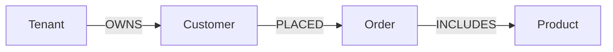

# Ngăn Cypher injection bằng tham số và kiểm soát thành phần động

Khi một ứng dụng nhận mã khách hàng, câu tìm kiếm, danh sách sản phẩm hoặc lựa chọn bộ lọc từ người dùng rồi ghép trực tiếp chúng vào câu **Cypher**, dữ liệu có thể bị hiểu nhầm thành **cú pháp truy vấn**. Một kẻ tấn công có thể tìm cách thay đổi điều kiện lọc, mở rộng phạm vi đọc, gọi thủ tục không được dự kiến hoặc tác động đến dữ liệu. Đây là rủi ro **Cypher injection**.

Trong chương **Bảo mật** của module **DATABASE_ENGINE_GRAPH_NEO4J**, cách phòng vệ cốt lõi là **tách phần cú pháp khỏi giá trị dữ liệu bằng tham số** (`$parameter`), đồng thời **kiểm soát những thành phần buộc phải động** như nhãn node, loại relationship, tên thuộc tính, hướng sắp xếp và phần cấu trúc Cypher. Bài học áp dụng cho truy vấn property graph, Neo4j Java Driver, Spring Data Neo4j, các thủ tục APOC và API ứng dụng.

> **Quy tắc thiết kế:** *Giá trị của người dùng đi vào parameter map; cấu trúc truy vấn đến từ những template hoặc token được ứng dụng kiểm soát*. Tham số hóa là biện pháp rất quan trọng, nhưng **không thay thế xác thực, phân quyền, cô lập tenant và kiểm soát procedure**.

## 1. Cypher injection xảy ra ở ranh giới nào?

Neo4j lưu dữ liệu dưới dạng node, relationship và thuộc tính. Một hệ thống bán hàng có thể dùng mô hình:



Ví dụ truy vấn hợp lệ:

```cypher
MATCH (c:Customer {customerId: $customerId})
      -[:PLACED]->(o:Order)
RETURN o.orderId AS orderId
ORDER BY orderId;
```

Ở đây `$customerId` là **một giá trị**, được gửi riêng với phần văn bản Cypher. Nếu người dùng nhập chuỗi chứa dấu nháy, dấu ngoặc, ký tự xuống dòng hoặc từ khóa giống Cypher, Neo4j vẫn nhận chúng là **dữ liệu của tham số** chứ không phải những mảnh cú pháp mới.

### 1.1. Mẫu thiết kế nguy hiểm: nối chuỗi

Ví dụ Java **không nên dùng**:

```java
// Không an toàn: id được đưa thẳng vào cú pháp Cypher.
String cypher =
    "MATCH (c:Customer {customerId: '" + customerId + "'}) " +
    "RETURN c.name AS name";
```

Nếu `customerId` chứa dấu nháy đơn hoặc chuỗi mang cấu trúc Cypher, câu lệnh cuối cùng có thể bị đổi ý nghĩa. Đây là một dạng **code/data confusion**: input vốn là dữ liệu lại được trình biên dịch xem như một phần chương trình.

**Mẫu đúng:**

```java
String cypher = """
    MATCH (c:Customer {customerId: $customerId})
    RETURN c.name AS name
    """;

Map<String, Object> params =
    Map.of("customerId", customerId);
```

Ứng dụng gửi **hai thành phần riêng** tới Driver: câu Cypher cố định và map giá trị. Không thêm dấu nháy bao `$customerId` trong câu Cypher: Driver chịu trách nhiệm truyền đúng kiểu và giá trị.

### 1.2. Injection không chỉ là câu lệnh xóa dữ liệu

Rủi ro có thể xuất hiện ở nhiều dạng:

| Mục tiêu của thao tác ngoài ý muốn | Hậu quả nghiệp vụ |
| --- | --- |
| Thay đổi điều kiện `WHERE` | Đọc nhiều bản ghi hơn phạm vi người dùng được phép |
| Làm thay đổi nhãn hoặc relationship type | Truy cập loại thực thể khác với API dự kiến |
| Gắn thêm phần truy vấn hoặc procedure | Tác động ngoài luồng xử lý đã được thiết kế |
| Thay đổi `ORDER BY`, `SKIP` hoặc `LIMIT` | Gây trả dữ liệu sai, truy vấn nặng hoặc bỏ qua giới hạn |
| Chuyển input thành thuộc tính được cập nhật | Sửa trường nhạy cảm như vai trò, trạng thái, tenant |
| Dùng tên nguồn URL/tệp không kiểm soát | Dẫn tới rủi ro truy cập dịch vụ nội bộ hoặc tệp ngoài phạm vi |

Cần phân biệt **Cypher injection** với **sử dụng đúng quyền nhưng sai logic truy cập**. Ví dụ một câu Cypher đã tham số hóa đầy đủ vẫn có thể trả đơn hàng của tenant khác nếu ứng dụng quên điều kiện tenant. Injection prevention và authorization là **hai lớp bảo vệ bổ sung**.

## 2. Tham số hóa biến dữ liệu thành giá trị, không thành cú pháp

Một tham số Cypher bắt đầu bằng dấu `$`. Ứng dụng có thể truyền các giá trị kiểu chuỗi, số, boolean, danh sách, map, ngày hoặc thời gian theo API mà Driver hỗ trợ.

Ví dụ truy vấn:

```cypher
MATCH (c:Customer)-[:PLACED]->(o:Order)
WHERE c.customerId = $customerId
  AND o.createdAt >= $startDate
  AND o.createdAt < $endDate
RETURN o.orderId AS orderId,
       o.totalAmount AS totalAmount
ORDER BY o.createdAt DESC, o.orderId
LIMIT $limit;
```

Các tham số:

| Tên | Kiểu phù hợp | Ý nghĩa |
| --- | --- | --- |
| `$customerId` | String | Khóa nghiệp vụ cần tra |
| `$startDate` | Date | Ngày bắt đầu, bao gồm |
| `$endDate` | Date | Ngày kết thúc, không bao gồm |
| `$limit` | Integer | Số dòng tối đa cần trả |

Trong Java, `LocalDate` có thể được Driver mã hóa thành kiểu ngày tương ứng với Neo4j. Không nên tự nối ngày, số hoặc mã vào câu Cypher để “cho đơn giản”.

### 2.1. Không dùng phương pháp tự escape để thay parameter binding

Một số cách xử lý input thường bị hiểu nhầm là đã an toàn:

- Thay mọi dấu nháy đơn bằng hai dấu nháy.
- Loại bỏ những từ giống `MATCH`, `DELETE` hoặc `CALL` khỏi chuỗi.
- Escape vài ký tự rồi nối vào dấu backtick.
- Regex chỉ cho phép chữ và số đối với **mọi** trường đầu vào.

Những cách này **không phải biện pháp thay thế tham số hóa**. Chúng dễ bỏ sót các quy tắc của ngôn ngữ truy vấn hoặc thay đổi theo phiên bản; hơn nữa, dữ liệu hợp lệ có thể có dấu nháy như tên người, nội dung mô tả hoặc mã có dấu gạch nối.

**Validation** vẫn cần thiết, nhưng để kiểm tra **hợp đồng nghiệp vụ**: độ dài mã, khoảng giá trị, định dạng ngày, tập lựa chọn và số lượng phần tử. Validation không nên trở thành công cụ “chữa” câu Cypher được xây bằng cách nối input.

### 2.2. Giá trị null và danh sách rỗng phải có ngữ nghĩa rõ

Truy vấn:

```cypher
MATCH (c:Customer)
WHERE c.customerId = $customerId
RETURN c.customerId AS customerId;
```

Khi `$customerId = null`, so sánh không tự biến thành “lấy tất cả khách hàng”. Trong Cypher, các biểu thức liên quan `null` thường cho kết quả không phải `true` và sẽ bị `WHERE` loại.

Tương tự:

```cypher
MATCH (c:Customer)
WHERE c.customerId IN $customerIds
RETURN c.customerId AS customerId;
```

Với `$customerIds = []`, kết quả rỗng. Đừng tự coi một danh sách rỗng là “bỏ bộ lọc” nếu chưa có yêu cầu nghiệp vụ rõ ràng.

Tại API, hãy quyết định:

1. Trường nào bắt buộc, trường nào có thể bỏ qua.
2. `null` và danh sách rỗng có ý nghĩa gì.
3. Có cần template khác cho chế độ không lọc.
4. Phạm vi tối đa được phép trả về khi bộ lọc không xuất hiện.

## 3. Tách cấu trúc truy vấn ra khỏi đầu vào người dùng

Tham số hoạt động ở **vị trí biểu thức giá trị**, không phải công cụ thay thế tùy ý toàn bộ cú pháp Cypher.

Cần phân biệt:

| Thành phần | Có nên truyền như tham số giá trị? | Cách thiết kế |
| --- | --- | --- |
| Mã khách hàng, tên, câu tìm kiếm | Có | `c.customerId = $customerId` |
| Ngày, số tiền, trạng thái | Có | `o.createdAt >= $startDate` |
| Danh sách mã | Có | `c.customerId IN $ids` hoặc `UNWIND $ids` |
| Giới hạn và vị trí phân trang | Có, khi cú pháp hỗ trợ và validate số | `SKIP $skip LIMIT $limit` |
| Nhãn node động | Tùy phiên bản/cú pháp dynamic labels; không thay trực tiếp nhãn tĩnh | Cú pháp chính thức hoặc template allowlist |
| Loại relationship động | Tùy phiên bản/cú pháp dynamic types | Cú pháp chính thức hoặc template allowlist |
| Tên thuộc tính đọc/ghi | Một số cú pháp hỗ trợ truy cập động, nhưng cần hạn chế | Allowlist field; tránh mass assignment |
| `ASC` / `DESC` hoặc toàn bộ `ORDER BY` | Không thay token cú pháp bằng tham số chuỗi | Chọn template hoặc mệnh đề từ allowlist |
| Mảnh `MATCH` / `WHERE` / `CALL` | Không | Xây các cấu trúc tĩnh được kiểm soát |

**Đầu vào có thể hợp lệ về cú pháp không đồng nghĩa được phép về nghiệp vụ.** Ví dụ một nhãn động như `AdminAccount` có thể là nhãn Neo4j hợp lệ, nhưng API tìm sản phẩm không được phép dùng nó.

## 4. Thành phần động thứ nhất: nhãn node

Một API tổng quát có thể cho người dùng chọn tập thực thể cần tìm: `Customer`, `Order` hoặc `Product`. Mẫu **không đúng** là đưa tên nhãn từ request vào string interpolation:

```java
// Không an toàn: label được chèn trực tiếp vào cấu trúc Cypher.
String cypher = "MATCH (n:" + label + ") RETURN n LIMIT 20";
```

Nếu chưa kiểm soát, input có thể thay đổi ý nghĩa câu lệnh. Trong những trường hợp cần cấu trúc nhãn động, có hai chiến lược.

### 4.1. Chiến lược A: một tập template cố định

Ví dụ với Java:

```java
public enum SearchKind {
    CUSTOMER,
    ORDER,
    PRODUCT
}

public static String findQuery(SearchKind kind) {
    return switch (kind) {
        case CUSTOMER -> """
            MATCH (n:Customer)
            RETURN n LIMIT $limit
            """;
        case ORDER -> """
            MATCH (n:Order)
            RETURN n LIMIT $limit
            """;
        case PRODUCT -> """
            MATCH (n:Product)
            RETURN n LIMIT $limit
            """;
    };
}
```

Ứng dụng **parse và validate** chuỗi đầu vào thành `SearchKind` trước khi chọn template. Người dùng không được tùy ý đưa một label hoặc toàn bộ Cypher vào `findQuery`.

Ưu điểm:

- Query template dễ review, đo `EXPLAIN` và giới hạn quyền đọc.
- Không cần dùng cú pháp dynamic mới của Neo4j.
- Có thể thiết kế các điều kiện riêng cho từng loại node; ví dụ `Customer` cần tenant scope, `Product` cần trạng thái published.

Hạn chế: số template có thể nhiều hơn khi nhiều loại đối tượng. Đó là chi phí chấp nhận được nếu giúp cấu trúc truy vấn và quyền truy cập rõ ràng.

### 4.2. Chiến lược B: cú pháp nhãn động khi phiên bản hỗ trợ

Từ **Neo4j 5.26**, Cypher có cú pháp dynamic node labels và relationship types bằng biểu thức `$(...)`. Ví dụ dạng nhãn động:

```cypher
MATCH (n:$($label))
RETURN n
LIMIT $limit;
```

Tham số có thể là:

```json
{
  "label": "Customer",
  "limit": 20
}
```

Đây là **cú pháp dynamic label có chủ đích**, khác với cách viết không hợp lệ `MATCH (n:$label)` hoặc việc nối chuỗi tùy ý. Giá trị `$label` được dùng như một token label theo quy tắc cú pháp được Neo4j hỗ trợ, không phải là mảnh Cypher được nối trực tiếp vào parser.

**Tuy nhiên:**

1. Phải xác nhận phiên bản Neo4j thực sự hỗ trợ cú pháp này.
2. API vẫn phải **allowlist** các label được phép; không cho người dùng tìm mọi loại node.
3. Cần kết hợp điều kiện phân quyền, tenant và bộ lọc đúng từng nhãn.
4. Kế hoạch thực thi và mức tận dụng token/index lookup cho dynamic label có thể khác theo phiên bản. Phải kiểm tra `EXPLAIN`/`PROFILE` trên hệ thống thật.

**Tham số hóa động giúp kiểm soát cú pháp, không cấp quyền truy cập theo nghiệp vụ.**

## 5. Thành phần động thứ hai: relationship type và hướng duyệt

Trong graph, thay đổi loại cạnh có thể thay đổi hẳn ý nghĩa nghiệp vụ:

- `(:Customer)-[:PLACED]->(:Order)`: khách hàng đặt đơn.
- `(:Employee)-[:APPROVED]->(:Order)`: nhân viên phê duyệt đơn.
- `(:User)-[:ADMIN_OF]->(:Tenant)`: vai trò quản trị.

Để cho phép người dùng chọn một quan hệ từ danh sách hợp lệ, có thể dùng **template allowlist** hoặc cú pháp dynamic relationship type ở phiên bản hỗ trợ:

```cypher
MATCH (a)-[r:$($relationshipType)]->(b)
WHERE a.entityId = $sourceId
RETURN b.entityId AS targetId
LIMIT $limit;
```

Ví dụ này chỉ minh họa cú pháp trong môi trường hỗ trợ dynamic relationship type; chưa phải một endpoint production hoàn chỉnh. Cần giới hạn `$relationshipType` bằng enum/allowlist và **không mở quyền truy cập tuỳ ý vào tất cả node** qua một ID chung không có kiểm tra tenant.

### 5.1. Hướng quan hệ là một phần cấu trúc

Một tham số chuỗi không thể tự biến mẫu `(a)-[:PLACED]->(b)` thành `(a)<-[:PLACED]-(b)`. Hướng duyệt là **quy tắc nghiệp vụ** và cần chọn giữa các truy vấn tĩnh nếu thực sự có hai trường hợp.

Ví dụ:

```cypher
// Template 1: tìm đơn hàng do khách hàng đặt
MATCH (c:Customer {customerId: $customerId})-[:PLACED]->(o:Order)
RETURN o.orderId AS orderId;
```

```cypher
// Template 2: tìm khách hàng đặt một đơn
MATCH (c:Customer)-[:PLACED]->(o:Order {orderId: $orderId})
RETURN c.customerId AS customerId;
```

Không nên tạo một API “truy vấn mọi hướng, mọi loại relationship” chỉ vì nó dễ code. API càng tổng quát thì càng cần kiểm soát quyền và mức độ duyệt sâu.

## 6. Thành phần động thứ ba: tên thuộc tính và sắp xếp

### 6.1. Vì sao ORDER BY $sortKey không có tác dụng như mong đợi?

Ví dụ:

```cypher
MATCH (c:Customer)
RETURN c.customerId AS customerId, c.name AS name
ORDER BY $sortKey;
```

Nếu `$sortKey = 'name'`, đây là **một chuỗi hằng số cho các dòng**, không phải token `c.name`. Nó không tự đổi thành `ORDER BY c.name`.

Cách an toàn: chọn **một trong các template đã phê duyệt**.

```java
public enum CustomerSort {
    NAME_ASC,
    NAME_DESC,
    ID_ASC
}

public static String customerOrderBy(CustomerSort sort) {
    return switch (sort) {
        case NAME_ASC -> "ORDER BY c.name ASC, c.customerId ASC";
        case NAME_DESC -> "ORDER BY c.name DESC, c.customerId ASC";
        case ID_ASC -> "ORDER BY c.customerId ASC";
    };
}
```

Khi xây truy vấn từ một đoạn `ORDER BY` như trên, **chỉ nối kết quả từ enum đã được ứng dụng định nghĩa**, không nối input thô từ URL/query string. Một cách khác là dùng ba query template hoàn chỉnh để có cấu trúc dễ review nhất.

### 6.2. Đọc thuộc tính động khác với gán tên field vào cú pháp

Cypher cho phép truy cập map/node property bằng biểu thức khóa động trong ngữ cảnh thích hợp:

```cypher
MATCH (c:Customer {customerId: $customerId})
RETURN c[$propertyKey] AS value;
```

Ví dụ `$propertyKey = 'name'` cho phép đọc thuộc tính `name`. Tuy nhiên, việc cú pháp **hỗ trợ** một khóa động không có nghĩa API được phép đọc mọi thuộc tính như `email`, `internalNote` hoặc `riskFlag`. Hãy áp dụng allowlist theo **vai trò và trường dữ liệu được công khai**, ví dụ chỉ cho `name` và `segment`.

Một vấn đề hiệu năng: truy cập thuộc tính động và điều kiện lọc động **có thể không tận dụng index giống một điều kiện thuộc tính tĩnh** ở mọi phiên bản. Đối với các truy vấn quan trọng, giữ template với `c.customerId`, `c.email` hoặc `c.segment` xác định rõ thường dễ tối ưu hơn.

### 6.3. Không gán hàng loạt map từ request vào node

Ví dụ nguy hiểm về **mass assignment**:

```cypher
MATCH (c:Customer {customerId: $customerId})
SET c += $requestBody
RETURN c;
```

`SET c += $requestBody` có thể cập nhật **mọi khóa trong map**, kể cả các field mà client không được phép sửa nếu ứng dụng nhận body quá rộng. Ví dụ người dùng chỉ được cập nhật tên hiển thị nhưng body lại chứa `role`, `tenantId` hoặc `approved`.

Cách an toàn hơn:

```cypher
MATCH (c:Customer {
  tenantId: $tenantId,
  customerId: $customerId
})
SET c.displayName = $displayName,
    c.phoneNumber = $phoneNumber
RETURN c.customerId AS customerId,
       c.displayName AS displayName;
```

Tầng API cần validate hai field này theo chính sách nghiệp vụ. **Không sử dụng chuỗi tên thuộc tính do client gửi làm lệnh SET tự do**, kể cả khi cú pháp dynamic property SET được phiên bản Neo4j hỗ trợ.

## 7. Java Driver: một truy vấn an toàn từ đầu đến cuối

Giả sử ứng dụng có endpoint tìm đơn hàng của khách hàng. Chỉ cho phép người dùng đã xác thực đọc dữ liệu của **tenant hiện tại**. Mô hình Neo4j:

```cypher
(:Customer {
  tenantId: 'TENANT-A',
  customerId: 'C01',
  displayName: 'An'
})-[:PLACED]->(:Order {
  tenantId: 'TENANT-A',
  orderId: 'O01',
  createdAt: date('2026-11-01')
})
```

Thiết kế khóa ở database thử nghiệm có thể dùng ràng buộc tổng hợp:

```cypher
CREATE CONSTRAINT customer_tenant_key IF NOT EXISTS
FOR (c:Customer)
REQUIRE (c.tenantId, c.customerId) IS UNIQUE;
```

Điều này giúp phân biệt hai customer có cùng `customerId` ở hai tenant và hỗ trợ truy vấn theo khóa. **Constraint bảo vệ duy nhất**, còn điều kiện tenant và quyền truy cập mới giải quyết việc người dùng được đọc dữ liệu nào.

### 7.1. Service Java dùng map tham số

Ví dụ với API Neo4j Java Driver 5.x:

```java
import java.util.List;
import java.util.Map;
import org.neo4j.driver.Driver;
import org.neo4j.driver.Session;
import org.neo4j.driver.SessionConfig;

public final class OrderSearchService {

    private static final String FIND_ORDERS = """
        MATCH (c:Customer {
          tenantId: $tenantId,
          customerId: $customerId
        })-[:PLACED]->(o:Order)
        WHERE o.tenantId = $tenantId
        RETURN o.orderId AS orderId
        ORDER BY orderId
        LIMIT $limit
        """;

    private final Driver driver;
    private final String databaseName;

    public OrderSearchService(Driver driver, String databaseName) {
        this.driver = driver;
        this.databaseName = databaseName;
    }

    public List<String> findOrderIds(
            String tenantIdFromIdentity,
            String customerId,
            int requestedLimit) {

        if (tenantIdFromIdentity == null ||
                tenantIdFromIdentity.isBlank()) {
            throw new IllegalArgumentException("Missing tenant context");
        }

        if (customerId == null || customerId.isBlank() ||
                customerId.length() > 128) {
            throw new IllegalArgumentException("Invalid customerId");
        }

        if (requestedLimit < 1 || requestedLimit > 100) {
            throw new IllegalArgumentException("Invalid limit");
        }

        Map<String, Object> params = Map.of(
            "tenantId", tenantIdFromIdentity,
            "customerId", customerId,
            "limit", requestedLimit
        );

        try (Session session = driver.session(
                SessionConfig.forDatabase(databaseName))) {
            return session.executeRead(tx ->
                tx.run(FIND_ORDERS, params)
                  .list(row -> row.get("orderId").asString())
            );
        }
    }
}
```

Ở đây:

1. `FIND_ORDERS` là **chuỗi Cypher tĩnh**, không phụ thuộc nội dung `customerId`.
2. `params` chứa các giá trị được bind riêng.
3. `tenantIdFromIdentity` **phải đến từ phiên đăng nhập/token đã được xác minh phía server**, không chấp nhận như một giá trị client tự chọn rồi tin ngay.
4. `requestedLimit` được kiểm tra trong khoảng từ 1 tới 100 để tránh endpoint vô tình trả quá nhiều dữ liệu.
5. Driver được ứng dụng **dùng lại**, còn Session có vòng đời ngắn.
6. `ORDER BY` là cấu trúc cố định, không do client chèn vào.

**Lưu ý authorization:** Ví dụ chỉ cho thấy điều kiện tenant trong Cypher. Hệ thống production cần thêm chính sách quyền trên loại tài nguyên và hành động cụ thể, đồng thời kiểm soát mọi query path khác có thể bypass bộ lọc.

### 7.2. Tham số khác gì nối chuỗi?

| Cách viết | Kết quả |
| --- | --- |
| `"... customerId: '" + input + "' ..."` | Input bị đưa vào cú pháp Cypher; nguy cơ injection |
| `"customerId: $customerId"` cùng `Map.of("customerId", input)` | Input được xử lý là một giá trị |
| `"MATCH (n:" + label + ")"` với label từ request | Cấu trúc động không được kiểm soát |
| Template cố định theo enum hoặc cú pháp dynamic hợp lệ + allowlist | Giữ cấu trúc và phạm vi cho phép rõ ràng |

Một lợi ích phụ là query template ổn định có thể tăng cơ hội **tái sử dụng công việc lập kế hoạch** trên Neo4j. Nhưng **lợi ích bảo mật không phụ thuộc cache hit**: ngay cả khi query cache bị xóa, tham số vẫn phải là dữ liệu.

## 8. Spring Data Neo4j: repository không miễn trừ kiểm soát input

Spring Data Neo4j (SDN) giúp ánh xạ entity và khai báo repository, nhưng truy vấn tùy chỉnh vẫn có thể trở nên không an toàn nếu lập trình viên ghép input vào text Cypher.

### 8.1. @Query tĩnh với @Param

Ví dụ repository:

```java
import java.util.List;
import org.springframework.data.neo4j.repository.Neo4jRepository;
import org.springframework.data.neo4j.repository.query.Query;
import org.springframework.data.repository.query.Param;

public interface OrderRepository
        extends Neo4jRepository<Order, String> {

    @Query("""
        MATCH (c:Customer {
          tenantId: $tenantId,
          customerId: $customerId
        })-[:PLACED]->(o:Order)
        WHERE o.tenantId = $tenantId
        RETURN o
        ORDER BY o.orderId
        """)
    List<Order> findVisibleOrders(
        @Param("tenantId") String tenantId,
        @Param("customerId") String customerId
    );
}
```

Đoạn ví dụ giả định `Order` là một entity `@Node` được ánh xạ đúng với `@Id` phù hợp và kết quả `RETURN o` chứa những trường cần thiết để SDN dựng entity. Trong ứng dụng có quan hệ/aggregate phức tạp, cần kiểm tra thêm mapping và query result.

**Tham số `$tenantId` và `$customerId` được bind**, không phải nối vào `@Query` bằng Java concatenation. Tầng service vẫn phải:

- Xác minh danh tính và quyền truy cập.
- Lấy tenant context từ nguồn tin cậy.
- Validate input và giới hạn khối lượng kết quả.
- Kiểm tra các repository method khác có cùng chính sách.
- Dùng transaction phù hợp khi cập nhật.

### 8.2. @Query không biến mọi truy vấn thành an toàn

Ví dụ “query builder” lấy cả chuỗi `WHERE` từ HTTP body rồi ghép vào Cypher trước khi gọi Neo4jClient vẫn có rủi ro injection. **Tên framework không phải cơ chế bảo vệ**; điều quan trọng là cách câu truy vấn cuối được tạo.

Khi yêu cầu lọc đa dạng, nên thiết kế một số template dựa trên các lựa chọn đã được enum hóa hoặc dùng **Spring Data repository method** với điều kiện xác định, thay vì cho phép truyền một mảnh Cypher thô từ client.

## 9. Truy vấn động: kỹ thuật allowlist thực tế

Một endpoint có yêu cầu sắp xếp theo `name` hoặc `createdAt`, tăng/giảm dần. Một cách rõ ràng là chuyển input thành các enum đã định nghĩa.

```java
public enum OrderSort {
    NEWEST,
    OLDEST,
    ORDER_ID
}

public static String orderByClause(OrderSort sort) {
    return switch (sort) {
        case NEWEST -> "ORDER BY o.createdAt DESC, o.orderId ASC";
        case OLDEST -> "ORDER BY o.createdAt ASC, o.orderId ASC";
        case ORDER_ID -> "ORDER BY o.orderId ASC";
    };
}
```

Khi truy vấn cần mệnh đề tùy chọn:

```java
String cypher = """
    MATCH (c:Customer {
      tenantId: $tenantId,
      customerId: $customerId
    })-[:PLACED]->(o:Order)
    WHERE o.tenantId = $tenantId
    RETURN o.orderId AS orderId, o.createdAt AS createdAt
    """ + orderByClause(sort) + "\nLIMIT $limit";
```

Ở đây chỉ nối **chuỗi do chương trình tự định nghĩa**, không nối input trực tiếp. Tuy nhiên, để tránh code khó đọc và hạn chế rủi ro khi mở rộng, cũng có thể xây **ba query template hoàn chỉnh**. Bất kể cách nào, cần kiểm thử mọi tổ hợp hợp lệ.

### 9.1. Khi nào nên chọn template thay vì dynamic token?

| Nhu cầu | Lựa chọn thường hợp lý |
| --- | --- |
| Chỉ 2–5 kiểu sort | Enum và template cố định |
| Nhiều nhãn nhưng mỗi nhãn có chính sách khác | Query riêng theo loại thực thể |
| Một API nội bộ chỉ đổi relationship trong một allowlist nhỏ | Dynamic syntax nếu version hỗ trợ; vẫn kiểm tra quyền |
| Truy vấn tối ưu rất nhạy với index | Template tĩnh có điều kiện cụ thể |
| Nhiều bộ lọc tùy chọn | Tổ hợp điều kiện được xây theo ruleset, hoặc một số template theo use case |
| Input cung cấp cả câu Cypher | **Không** cho endpoint nghiệp vụ thông thường thực thi trực tiếp |

Không tạo một “Cypher console” tự do trong API của người dùng cuối chỉ vì database đã có authentication. Một công cụ quản trị chuyên biệt cần cơ chế quyền và kiểm toán tách biệt hoàn toàn.

## 10. Parameter binding không thay thế authorization

Một câu truy vấn có tham số hoàn toàn đúng vẫn có thể bị **vượt quyền truy cập** do thiếu điều kiện nghiệp vụ.

Ví dụ:

```cypher
// Có tham số nhưng chưa giới hạn tenant!
MATCH (c:Customer {customerId: $customerId})-[:PLACED]->(o:Order)
RETURN o.orderId AS orderId;
```

Nếu `customerId` chỉ duy nhất **trong từng tenant**, câu truy vấn có thể tìm nhầm bản ghi khác tenant. Giới hạn bằng khóa tổng hợp hoặc điều kiện tenant:

```cypher
MATCH (c:Customer {
  tenantId: $tenantId,
  customerId: $customerId
})-[:PLACED]->(o:Order)
WHERE o.tenantId = $tenantId
RETURN o.orderId AS orderId;
```

Nhưng phải nhớ:

- `$tenantId` lấy từ **identity đã được xác minh**, không từ query param chưa kiểm tra.
- Cơ chế cô lập tenant ở Neo4j có thể cần database riêng, role/privilege hoặc chính sách ứng dụng khác tùy kiến trúc.
- Điều kiện tenant trên một nhánh không tự bảo đảm tất cả quan hệ đã được tạo đúng: cần giữ bất biến rằng Customer/Order thuộc đúng tenant.
- Nếu một thủ tục hoặc service khác có đường truy vấn không lọc tenant, rủi ro vẫn tồn tại.

### 10.1. Nguyên tắc quyền tối thiểu

Dùng tài khoản Neo4j dành riêng cho dịch vụ ứng dụng:

1. Chỉ cấp quyền truy cập database cần dùng.
2. Tách thao tác chỉ đọc, ghi dữ liệu và quản trị schema nếu cần.
3. Không dùng tài khoản admin cho các request tìm kiếm thông thường.
4. Không cấp quyền gọi các procedure nhạy cảm hoặc truy cập tệp/mạng nếu không cần.
5. Theo dõi quyền thực tế theo edition, phiên bản và mô hình phân quyền của Neo4j.

Nếu injection xuất hiện ở một đường code, **quyền tối thiểu** giúp giới hạn hậu quả. Nhưng nó không khiến một query builder không an toàn trở thành an toàn.

## 11. APOC và các truy vấn Cypher động

Một số thủ tục APOC có chức năng chạy truy vấn Cypher được cung cấp dưới dạng **chuỗi** hoặc xử lý dữ liệu từ URL/tệp. Những tính năng này hữu ích cho quản trị/tích hợp nhưng tạo ranh giới bảo mật bổ sung.

Ví dụ cách làm cần tránh là tạo một câu Cypher bằng cách chèn input vào chuỗi, sau đó gửi chuỗi đó vào procedure chạy Cypher động. **Đưa một câu lệnh được xây không an toàn qua APOC không làm nó an toàn hơn**.

Nguyên tắc:

- Hạn chế dùng thủ tục chạy chuỗi Cypher động trong đường request do người dùng điều khiển.
- Nếu phải dùng, giữ query template cố định và truyền tham số theo API chính thức của thủ tục.
- Kiểm soát allowlist đối với tên nhãn, loại quan hệ, trường cập nhật và procedure được phép.
- Cấp quyền gọi procedure theo nguyên tắc **least privilege**.
- Với thủ tục tải JSON/CSV qua URI, kiểm soát URL nguồn, DNS/đích mạng, file path, kích thước payload và bí mật — tránh SSRF hoặc truy cập tệp ngoài phạm vi.
- Không cho client chọn tùy ý procedure name hoặc truyền một block Cypher bất kỳ.

Cấu hình cho phép APOC import/export file là quyết định **phía server**, không phải một validation đơn giản ở frontend. Một API nhận input không đáng tin cậy cần xem cả **quyền DB**, **cấu hình môi trường** và **mã của procedure**.

## 12. Ranh giới bảo vệ khi cập nhật dữ liệu

Bảo mật injection không chỉ dành cho `MATCH`. Các lệnh `CREATE`, `MERGE`, `SET` và `DELETE` cũng phải dùng tham số cho giá trị:

```cypher
MERGE (c:Customer {
  tenantId: $tenantId,
  customerId: $customerId
})
ON CREATE SET c.createdAt = datetime()
SET c.displayName = $displayName,
    c.segment = $segment
RETURN c.customerId AS customerId;
```

Ví dụ:

- `$displayName` chứa dấu nháy vẫn là **một chuỗi**.
- `$segment` phải thuộc danh sách segment hợp lệ nếu ứng dụng giới hạn.
- `$customerId` cần đúng định dạng và độ dài để bảo vệ dữ liệu.
- `$tenantId` phải lấy từ nguồn danh tính đáng tin cậy.

Đối với cập nhật hoặc xóa hàng loạt, không cho người dùng truyền điều kiện thô:

```cypher
// Ví dụ an toàn về phạm vi xóa: khóa nghiệp vụ và tenant đều bind.
MATCH (c:Customer {
  tenantId: $tenantId,
  customerId: $customerId
})
SET c.active = false
RETURN c.customerId AS customerId;
```

Ở hệ thống thật, **xóa mềm** phù hợp hay không tùy nghĩa vụ nghiệp vụ và pháp lý. Ví dụ chỉ nhằm nhấn mạnh scope của truy vấn; nó không thay thế kiểm tra quyền được phép vô hiệu hóa khách hàng.

### 12.1. Đề phòng dynamic SET và thao tác trên role

Ngay cả khi phiên bản Neo4j cho phép syntax `SET n[$key] = $value`, không nên dùng một API “cập nhật bất kỳ thuộc tính nào” mà không có allowlist. Những thuộc tính cần bảo vệ có thể gồm:

- `role`, `isAdmin`, `approved`;
- `tenantId`, `ownerId`;
- `sourceVersion`, `version` hoặc trường khóa lạc quan;
- `createdAt`, `deletedAt` hoặc trạng thái kiểm toán;
- Mã nghiệp vụ làm khóa của node.

Đối với trường nhạy cảm, dùng **use case riêng** có xác thực/quyền được kiểm tra và logic cập nhật rõ ràng. Không dùng `SET n += $requestBody` từ dữ liệu chưa chọn lọc.

## 13. Thực thi truy vấn an toàn còn cần chống lạm dụng tài nguyên

Một query không bị injection vẫn có thể bị lợi dụng gây tải lớn nếu API cho phép tham số vượt mức hoặc truy vấn quá rộng.

Ví dụ:

```cypher
MATCH (c:Customer {tenantId: $tenantId})
      -[:CONNECTED_TO*1..5]->(other)
RETURN other
LIMIT $limit;
```

Mẫu đường đi biến độ dài `*1..5` có thể mở rộng rất nhiều quan hệ trước khi giới hạn đầu ra, tùy số bậc của node và planner. **`LIMIT` ở cuối không phải giới hạn tuyệt đối cho mọi công việc đã thực hiện ở các toán tử trước**.

Các biện pháp:

- Giới hạn phạm vi node bắt đầu theo tenant/khóa.
- Cố định độ sâu duyệt theo nghiệp vụ; không xây số bước/relationship pattern từ input tùy ý.
- Giới hạn `limit`, `skip`, kích thước danh sách và độ dài chuỗi.
- Dùng index/constraint trên các khóa tra cứu và kiểm tra `EXPLAIN`/`PROFILE`.
- Thiết lập giới hạn thời gian request, transaction timeout và rate limit ở tầng phù hợp.
- Quan sát `Rows`, `DB Hits`, latency và tải database, đặc biệt với graph traversal.

**Không dùng `PROFILE` để xem trước một truy vấn ghi ở production**: `PROFILE` thực thi cả phần ghi của câu Cypher. Dùng `EXPLAIN` nếu chỉ cần xem kế hoạch mà không thay đổi dữ liệu.

## 14. Kiểm thử chống Cypher injection

Kiểm thử cần chứng minh **input luôn được giữ như giá trị** và API **không vượt phạm vi quyền**, không chỉ rằng chuỗi truy vấn chứa dấu `$`.

### 14.1. Bộ test đầu vào có ký tự đặc biệt

Với `customerId`, kiểm tra các input như:

| Đầu vào | Điều cần bảo đảm |
| --- | --- |
| `C01` | Trả đúng khách hàng được phép |
| `O'Reilly` | Dấu nháy đơn được coi là dữ liệu, không làm hỏng cú pháp |
| `C01;C02` | Dấu chấm phẩy vẫn là dữ liệu |
| `C01\nC02` | Ký tự xuống dòng không biến thành mệnh đề mới |
| `C01"test` | Dấu nháy kép không làm thay đổi cấu trúc query |
| Chuỗi Unicode/tiếng Việt | Được xử lý theo quy tắc chuẩn hóa/validation của API |
| Chuỗi rất dài | Bị từ chối theo giới hạn độ dài trước khi gây tải |
| `null` hoặc chuỗi rỗng | Được xử lý theo hợp đồng input, không vô tình trả tất cả |

Không cần đưa một chuỗi tấn công có khả năng xóa dữ liệu vào môi trường dùng chung để kiểm chứng. **Test tích hợp nên chạy trên Neo4j Testcontainers hoặc database riêng**, có fixture và quyền được giới hạn.

### 14.2. Test Java Driver với Neo4j thật

Giả sử test đã có Driver nối tới một Neo4jContainer đã được khởi tạo. Thêm fixture:

```cypher
CREATE (:Customer {
  tenantId: 'TENANT-A',
  customerId: 'C01',
  displayName: 'An'
});
```

Một test có thể dùng query cố định:

```java
String query = """
    MATCH (c:Customer {
      tenantId: $tenantId,
      customerId: $customerId
    })
    RETURN count(c) AS total
    """;

try (var session = driver.session()) {
    long count = session.executeRead(tx ->
        tx.run(query, Map.of(
            "tenantId", "TENANT-A",
            "customerId", "O'Reilly"
        )).single().get("total").asLong()
    );

    assertEquals(0L, count);
}
```

Đây là một phép kiểm tra **bình thường**: chuỗi có nháy đơn không làm Cypher lỗi, mà được so sánh như giá trị với `customerId`. Các test khác cần xác minh `TENANT-B` không nhìn thấy dữ liệu TENANT-A và `OrderSort` chỉ chấp nhận lựa chọn hợp lệ.

### 14.3. Test thành phần động và phân quyền

Danh sách test khuyến nghị:

1. `SearchKind.CUSTOMER` chỉ chọn template cho node `Customer`.
2. Giá trị label không nằm trong allowlist bị từ chối **trước khi** truy vấn.
3. `sortKey` không thuộc enum bị trả lỗi validation.
4. `requestedLimit` vượt ngưỡng bị từ chối.
5. User tenant A không thể tự truyền tenant B để xem dữ liệu.
6. API cập nhật profile không chấp nhận map chứa `role`/`tenantId`.
7. Tài khoản database của dịch vụ không có quyền quản trị không cần thiết.
8. Không có endpoint thường cho phép thực thi tùy ý thủ tục APOC hoặc câu Cypher thô.

Đối với đường ghi, dùng database thử nghiệm và kiểm chứng **số node/relationship, thuộc tính bị đổi và transaction rollback**. Không chỉ assert HTTP status nếu việc ghi nhầm có thể đã xảy ra.

## 15. Quan sát, logging và quản lý lỗi

Trong vận hành, có thể theo dõi:

| Dấu hiệu | Ý nghĩa |
| --- | --- |
| Request có cấu trúc query không nằm trong danh mục template | Có thể có đường code tự tạo Cypher chưa được kiểm soát |
| Tăng lỗi cú pháp Cypher ở endpoint dùng input người dùng | Cần xem lại query builder và validation |
| Nhiều request bị từ chối vì field/label không thuộc allowlist | Có thể là lỗi client, thay đổi contract hoặc hành vi dò tìm |
| Tăng `DB Hits` hoặc latency đột biến | Có thể do truy vấn rộng hoặc lạm dụng tài nguyên |
| Truy cập nhãn/relationship bất thường | Kiểm tra quyền và mục đích nghiệp vụ |
| Gọi procedure nhạy cảm ngoài luồng chuẩn | Kiểm tra phân quyền và hoạt động ứng dụng |

**Đừng log toàn bộ đầu vào không kiểm soát** nếu nó có thể chứa dữ liệu cá nhân hoặc thông tin bí mật. Khi cần chẩn đoán, ghi metadata như mã request, tên template, số lượng điều kiện, nhóm lỗi và identity đã được ẩn/giảm thiểu theo chính sách; không phát tán password, token hoặc payload nhạy cảm.

Phân loại lỗi:

- **400 Bad Request:** input sai định dạng, field không thuộc allowlist, `limit` không hợp lệ.
- **401 Unauthorized:** chưa xác thực.
- **403 Forbidden:** danh tính không có quyền thao tác.
- **404 Not Found:** đối tượng không tồn tại hoặc không được tiết lộ theo chính sách.
- **429 Too Many Requests:** vượt ngưỡng rate limit.
- **500 Server Error:** lỗi server ngoài dự kiến; không trả nguyên văn Cypher, query plan hoặc stack trace chứa thông tin nội bộ cho người dùng.

## 16. Checklist bảo mật trước khi đưa truy vấn vào production

1. **Tất cả giá trị bên ngoài** đã được bind qua tham số chưa?
2. Có còn Java string concatenation, template substitution hoặc xây chuỗi Cypher từ input thô không?
3. Những phần **cấu trúc động** đã có allowlist/template hoặc cú pháp dynamic chính thức của phiên bản Neo4j chưa?
4. Nếu dùng dynamic labels/types, API có giới hạn loại dữ liệu người dùng được phép truy cập không?
5. Có dùng `SET n += $body` hoặc dynamic property update mà chưa lọc field nhạy cảm không?
6. Tenant và resource ownership được lấy/kiểm tra từ danh tính đã xác thực chưa?
7. User Neo4j của dịch vụ có **quyền tối thiểu** và database scope đúng chưa?
8. Các procedure APOC, đường dẫn file và URL từ xa đã được kiểm soát chưa?
9. Có giới hạn số dòng, chiều sâu graph traversal, thời gian request và kích thước input không?
10. Có integration test trên **Neo4j thật** cho dấu nháy, Unicode, label/sort không hợp lệ, cross-tenant và đường ghi không?
11. Có giữ bí mật, input nhạy cảm và cấu trúc query khỏi response/log bên ngoài không?
12. Có quan sát và điều tra các request bị từ chối, truy vấn nặng và truy cập bất thường không?

## 17. Bài tập thực hành

### Bài tập 1 — Chuyển nối chuỗi thành tham số

Viết lại:

```java
String cypher =
    "MATCH (c:Customer {customerId: '" + customerId + "'}) RETURN c";
```

thành một query template tĩnh và `Map.of("customerId", customerId)`. Giải thích tại sao input `O'Reilly` không còn làm thay đổi cú pháp.

### Bài tập 2 — Kiểm soát nhãn động

Một API cho chọn `Customer` hoặc `Product`. Thiết kế enum `SearchKind`, chọn truy vấn tĩnh phù hợp và từ chối các nhãn khác. Nếu muốn dùng `MATCH (n:$($label))`, cần kiểm tra điều kiện nào về **phiên bản Neo4j, allowlist và quyền truy cập**?

### Bài tập 3 — Sắp xếp động

Client gửi `sort=name_desc`. Vì sao `ORDER BY $sort` không sắp theo tên? Viết enum chỉ chấp nhận `NAME_ASC`, `NAME_DESC` và `ID_ASC` rồi trả về các mệnh đề `ORDER BY` được định nghĩa sẵn.

### Bài tập 4 — Mass assignment

Một endpoint cập nhật tên khách hàng dùng `SET c += $requestBody`. Nếu request body chứa thêm `tenantId` hoặc `role`, rủi ro là gì? Viết lại chỉ cập nhật `displayName` và `phoneNumber`.

### Bài tập 5 — Cô lập tenant

Cùng mã `C01` tồn tại ở TENANT-A và TENANT-B. Viết truy vấn tìm đơn theo cả `tenantId` và `customerId`, thêm constraint khóa tổng hợp. Giải thích tại sao `tenantId` phải lấy từ identity được xác thực thay vì trường do client tự chọn.

### Bài tập 6 — Kiểm thử đầu vào đặc biệt

Dùng Neo4j Testcontainers tạo một `Customer C01`; gửi các giá trị `O'Reilly`, `C01;C02` và chuỗi nhiều ký tự Unicode dưới dạng tham số. Kết quả mong đợi là truy vấn hoạt động như so sánh dữ liệu, không thay đổi schema hay số bản ghi.

### Bài tập 7 — Dynamic relationship và graph traversal

Một API muốn tìm `PLACED` hoặc `FOLLOWS`. Hãy chọn template allowlist hoặc cú pháp relationship type động nếu phiên bản hỗ trợ. Vì sao giới hạn relationship type **không đủ** nếu truy vấn vẫn có thể bắt đầu từ mọi node hoặc duyệt quá sâu?

### Bài tập 8 — Quyền APOC

Một dịch vụ tìm kiếm văn bản bình thường được cấp quyền gọi procedure chạy Cypher động và đọc URL tùy ý. Hãy nêu rủi ro và đề xuất cách tách quyền, kiểm soát URL và vô hiệu hóa những procedure không cần thiết.

### Bài tập 9 — Review một API

Một API nhận JSON gồm `label`, `whereClause`, `orderBy`, `limit` và `tenantId` rồi nối cả năm trường thành một câu Cypher. Hãy xác định trường nào có thể là parameter, trường nào phải bỏ hoặc biến thành enum/template, và thông tin tenant nào phải đến từ tầng authentication.

## Ghi nhớ

**Cypher injection** xảy ra khi dữ liệu không đáng tin cậy được đưa vào **cú pháp** thay vì được gửi như **giá trị**. Trong Neo4j, hãy truyền mã, ngày, chuỗi, danh sách và giới hạn qua `$parameter` cùng parameter map của Java Driver/Spring Data Neo4j. Với nhãn, loại relationship, tên thuộc tính hoặc `ORDER BY`, dùng **template/allowlist**; chỉ sử dụng cú pháp dynamic token nếu phiên bản hỗ trợ và quyền truy cập được kiểm soát.

Bảo vệ dữ liệu đồ thị còn cần **tenant isolation, authorization, least privilege, giới hạn tài nguyên, kiểm soát APOC và integration tests**. Tham số hóa ngăn dữ liệu bị diễn giải thành mệnh lệnh, nhưng chỉ một thiết kế nhất quán ở tất cả đường đọc/ghi mới ngăn được cả việc vượt quyền và ghi sai dữ liệu.
