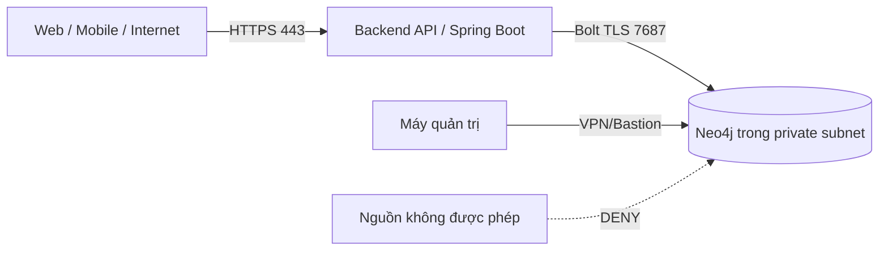
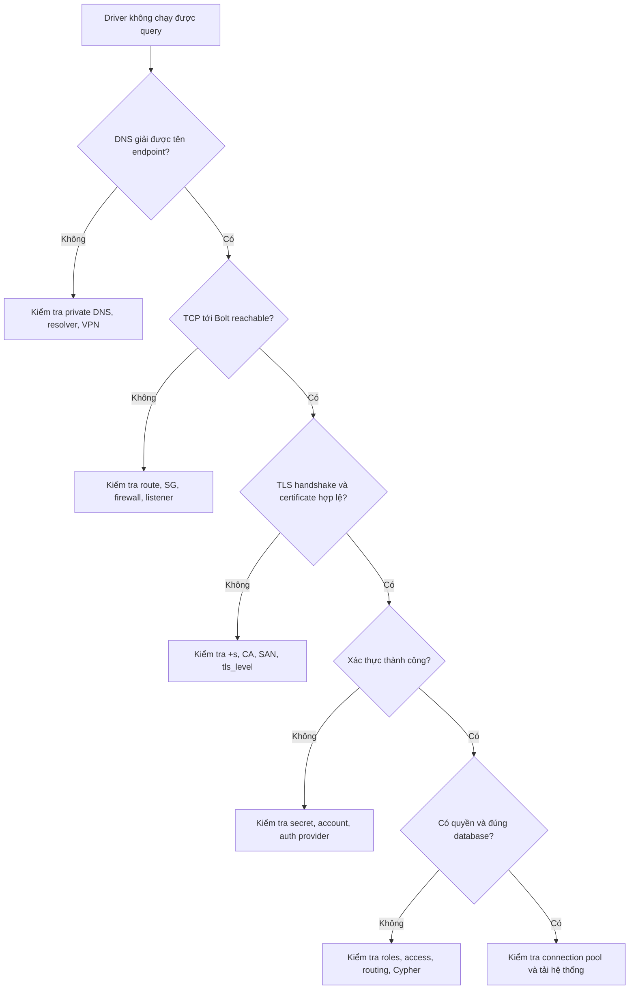

# Giới hạn mạng, cổng công khai và truy cập từ ứng dụng trong Neo4j

## 1. Bài toán: ứng dụng cần kết nối, Internet không cần truy cập database

Neo4j là database lưu **property graph** gồm node, relationship, label và property; ứng dụng Java hoặc Spring Data Neo4j dùng Cypher thông qua Neo4j Driver để đọc/ghi dữ liệu. Tuy nhiên, **đường mạng** tới Neo4j là một ranh giới bảo mật độc lập với quyền đọc/ghi node của tài khoản database.

Trong một dịch vụ quản lý người dùng và dự án, lưu lượng thường đi theo tuyến:



Người dùng cuối gọi backend API với chính sách xác thực/ủy quyền của ứng dụng; **backend mới kết nối Neo4j**, thường trên Bolt. Nếu đưa thẳng credential database vào JavaScript hoặc ứng dụng di động, người dùng có thể trích xuất credential và truy cập database vượt khỏi những API nghiệp vụ được phép.

Mục tiêu bài học:

1. Phân biệt port client, port nội bộ cluster, backup, metrics và những port **không nên public**.
2. Hiểu `listen_address`, `advertised_address` và firewall khác nhau thế nào.
3. Bật Bolt TLS, kết nối bằng URI chính xác từ Java Driver/Spring Data Neo4j.
4. Giới hạn đường đi trong VM, Docker, Kubernetes, cluster hoặc Aura.
5. Phân tích lỗi theo từng lớp **DNS → TCP → TLS → authentication → authorization → Cypher**, không mở rộng quyền quá mức để chữa lỗi.

**Nguyên tắc:** chỉ mở đúng connector, cho đúng nguồn, qua kênh mã hóa và tài khoản có ít quyền nhất. Mạng private, TLS, mật khẩu và RBAC là các lớp bổ sung cho nhau, không thể thay thế cho nhau.

## 2. Phân loại các cổng Neo4j

Các port mặc định dưới đây được Neo4j Operations Manual công bố cho bản hiện hành; khi triển khai, **port thực tế có thể khác** do cấu hình, phiên bản, edition hoặc dịch vụ được bật/tắt.

| Port TCP | Connector hoặc dịch vụ | Dùng bởi | Chính sách gợi ý |
| ---: | --- | --- | --- |
| **7687** | Bolt | Java Driver, Spring Data Neo4j, cypher-shell, Browser khi chạy Cypher | Chỉ backend và client được phép; yêu cầu TLS |
| **7474** | HTTP | Neo4j Browser/HTTP API không mã hóa ở connector | Tắt ở production khi không cần; không public |
| **7473** | HTTPS | Browser và HTTP API qua TLS | Chỉ mạng quản trị/client HTTPS thực sự cần |
| **6000** | Cluster internal | Giao tiếp và đồng bộ giữa các Neo4j member | Chỉ giữa server cluster, không public |
| **7000** | Cluster RAFT | Giao tiếp RAFT | Chỉ giữa các member |
| **7688** | Cluster routing connector | Routing nội bộ khi được sử dụng | Chỉ mạng cluster |
| **6362** | Backup | Online backup | Chỉ máy backup |
| **2004** | Prometheus metrics | Collector giám sát khi bật | Chỉ monitoring |
| **2003** | Graphite metrics | Collector giám sát khi bật | Chỉ monitoring |

Theo cấu hình mặc định hiện hành của Neo4j tự quản lý, Bolt được bật nhưng mức mã hóa `server.bolt.tls_level` mặc định là `DISABLED`; HTTP được bật còn HTTPS thường tắt. Default listen address là `localhost`, **không** vì có port trong bảng mà kết luận nó đang lắng nghe trên Internet.

**Lưu ý phiên bản:** từ Neo4j 2025.01, port cluster `5000` trong một số tài liệu cũ không còn dùng; dùng bảng port đúng phiên bản Neo4j đang chạy.

### Các câu hỏi cần trả lời trước khi mở bất kỳ port nào

- Thành phần nào thực sự **khởi tạo kết nối**? Backend, DBA, monitoring hay member cluster?
- Nguồn IP/subnet/namespace nào được phép; máy nào **không** được phép?
- Dịch vụ có cần TLS, xác thực, quyền gì, và certificate được tin cậy như thế nào?
- Có DNS/NAT/proxy/load balancer nào thay đổi địa chỉ mà ứng dụng nhìn thấy không?
- Có thể **tắt connector** thay vì chỉ chặn nó bằng firewall không?

Trên máy production chỉ có backend đọc/ghi qua Bolt, có thể không cần HTTP/HTTPS Browser connector. Đối với đội DBA, nên quản trị qua VPN, bastion hoặc đường truy cập riêng chứ không mở Browser ra Internet.

## 3. Ba lớp dễ nhầm: bật connector, bind interface và cho phép nguồn truy cập

| Lớp | Ví dụ | Ý nghĩa thực tế |
| --- | --- | --- |
| Enable | `server.bolt.enabled=true` | Neo4j được phép tạo Bolt listener |
| Listen | `server.bolt.listen_address=0.0.0.0:7687` | Tiến trình bind mọi giao diện **IPv4** của máy/container |
| Firewall/allowlist | Chỉ `10.20.10.0/24` tới TCP `7687` | Chỉ backend trong subnet được phép kết nối |

### 3.1. `listen_address`: Neo4j nhận kết nối ở đâu?

Trong `neo4j.conf` của server tự quản lý:

```properties
# Ví dụ khi ứng dụng và Neo4j chạy cùng máy.
server.bolt.enabled=true
server.bolt.listen_address=127.0.0.1:7687
```

`127.0.0.1` là loopback của **máy/container chạy Neo4j**. Với container khác, `localhost` không tự trỏ sang container Neo4j. Nếu backend ở một host khác trong private network, server cần bind interface thích hợp, ví dụ:

```properties
# Chỉ áp dụng khi đã giới hạn mạng inbound bằng firewall/SG.
server.bolt.listen_address=0.0.0.0:7687
```

`0.0.0.0` **không phải** địa chỉ để ứng dụng kết nối đến và **không có nghĩa “chỉ nội bộ”**. Nếu VM/container còn được publish ra Internet, mọi interface có thể nhận yêu cầu. Muốn kiểm soát IPv6 thì cần cấu hình bind và firewall IPv6 tương ứng (cú pháp listen ví dụ `[::]:7687`).

Tránh thay `server.default_listen_address=0.0.0.0` khi chỉ cần mở Bolt: setting mặc định này có thể ảnh hưởng các connector khác. Ưu tiên chỉ định `server.bolt.listen_address` để không vô tình mở HTTP/cluster/backup.

### 3.2. `advertised_address`: Neo4j hướng client đến địa chỉ nào?

`advertised_address` là hostname/IP và port Neo4j quảng bá tới client trong metadata/routing:

```properties
server.bolt.listen_address=0.0.0.0:7687
server.bolt.advertised_address=graph.internal.example:7687
```

Ở đây listener bind mọi interface nội bộ, nhưng Driver dùng DNS `graph.internal.example` để tìm endpoint. DNS đó phải resolve và reachable từ **chính môi trường client**.

Hai lỗi điển hình:

- Trên server Neo4j đặt `advertised_address=localhost:7687` trong khi ứng dụng chạy máy khác: Driver có thể kết nối về **localhost của chính máy ứng dụng**.
- Trong cluster đặt advertised address chỉ reachable giữa các member, còn Java Driver ở subnet ứng dụng không tới được: có thể kết nối seed lúc đầu nhưng lỗi khi routing sang member khác.

**Advertised address không phải firewall**, không cấp phép và không thay thế TLS hostname validation. Nó chỉ mô tả endpoint để client tìm tới.

### 3.3. Một bảng lựa chọn

| Môi trường | Listen address | Advertised address |
| --- | --- | --- |
| Demo local một host | `127.0.0.1:7687` | `localhost:7687` |
| VM database trong subnet riêng | IP private hoặc `0.0.0.0:7687` với SG | DNS nội bộ reachable từ backend |
| Docker/Compose | Interface container reachable trên mạng Docker | Hostname endpoint phù hợp với client thực tế |
| Neo4j cluster | Interface của từng member | Từng hostname member reachable từ client có routing |
| Neo4j Aura | Dịch vụ quản lý | URI do Aura cấp; không chỉnh `neo4j.conf` |

## 4. Cấu hình Bolt TLS cho Neo4j tự quản lý

### 4.1. Mô hình triển khai cần có

Giả sử backend trong private subnet truy cập `graph.internal.example:7687`; firewall **chỉ** cho nguồn backend đi vào. Đội DBA đã phát hành certificate hợp lệ cho DNS đó, cài CA thích hợp trên client và bảo vệ private key trên filesystem.

Mẫu `neo4j.conf` cho một server chỉ cần Bolt:

```properties
server.bolt.enabled=true
server.bolt.listen_address=0.0.0.0:7687
server.bolt.advertised_address=graph.internal.example:7687

# Không cần HTTP/HTTPS API trực tiếp.
server.http.enabled=false
server.https.enabled=false

# Bắt buộc mã hóa mọi kết nối Bolt.
server.bolt.tls_level=REQUIRED
dbms.ssl.policy.bolt.enabled=true
dbms.ssl.policy.bolt.base_directory=certificates/bolt
dbms.ssl.policy.bolt.private_key=private.key
dbms.ssl.policy.bolt.public_certificate=public.crt
dbms.ssl.policy.bolt.client_auth=NONE
```

Đây là **mẫu giải thích**, không phải lệnh để áp dụng trên production chưa chuẩn bị certificate. Neo4j yêu cầu thư mục, file certificate/private key và quyền truy cập phù hợp; certificate phải có hostname chính xác (SAN) và được Java Driver tin cậy. Trên hệ thống nhiều máy, mỗi member cần certificate/advertised address phù hợp.

`dbms.ssl.policy.bolt.client_auth=NONE` nghĩa là không yêu cầu **mTLS client certificate** trong ví dụ này; **không** tắt xác thực username/password của Neo4j. Nếu doanh nghiệp bắt buộc mTLS, phải cấu hình client certificates/trusted CA theo tài liệu và thử nghiệm riêng.

Không để `server.bolt.tls_level=OPTIONAL` làm mặc định production: chế độ đó chấp nhận **cả kết nối mã hóa và không mã hóa**. Với yêu cầu mã hóa bắt buộc, chọn `REQUIRED` và sửa client tương thích, không “nới” thành OPTIONAL khi gặp lỗi.

### 4.2. Nếu cần giao diện Browser qua HTTPS

Neo4j Browser có thể được tải qua HTTP(S) nhưng dùng **Bolt** khi thực thi Cypher. Máy DBA có thể cần đường tới **cả HTTPS port 7473 và Bolt 7687**:

```properties
server.http.enabled=false
server.https.enabled=true
server.https.listen_address=0.0.0.0:7473

dbms.ssl.policy.https.enabled=true
dbms.ssl.policy.https.base_directory=certificates/https
dbms.ssl.policy.https.private_key=private.key
dbms.ssl.policy.https.public_certificate=public.crt
```

Kết hợp cấu hình này với Bolt TLS và chỉ mở `7473` từ mạng quản trị/VPN. Nếu dùng reverse proxy/Ingress cho HTTPS, phải kiểm tra cấu hình forwarding và đường Browser → Bolt; proxy HTTP thông thường không tự truyền được Bolt TCP.

Không đưa `7474` ra mạng không tin cậy: HTTP connector không mã hóa. Nếu không dùng Neo4j Browser/HTTP Query API, **tắt cả HTTP và HTTPS** là lựa chọn giảm bề mặt mạng.

## 5. Firewall, Security Group và mô hình subnet

```text
Internet
   |
   | HTTPS 443
   v
API Gateway / Web LB
   |
   v
Private backend subnet
   | chỉ TCP 7687 qua TLS
   v
Private Neo4j subnet
   | cluster ports -> đúng peer
   | backup port   -> đúng backup host
   | metrics       -> đúng collector
   X Internet direct-to-database
```

Ví dụ các rule **inbound**, với CIDR minh họa (không copy vào hệ thống khác):

| Nguồn | Đích | Quy tắc |
| --- | --- | --- |
| Backend trong `10.20.10.0/24` | Neo4j `7687/TCP` | ALLOW |
| VPN/bastion dành cho DBA | Neo4j `7687/TCP`; `7473` nếu dùng Browser | ALLOW có kiểm soát |
| Các server Neo4j peer | `6000/7000/7688` theo topology | ALLOW nội bộ |
| Backup service | `6362/TCP` | ALLOW nội bộ |
| Monitoring collector | `2004/TCP` nếu bật metrics | ALLOW nội bộ |
| Mọi nguồn khác | Cổng Neo4j | DENY |

Trong cloud, kiểm tra cả route, firewall host, Security Group/NSG, public IP, load balancer và egress policy từ backend. Một VM mang IP private nhưng SG cho toàn VPC đi vào vẫn có thể bị một workload nội bộ bị xâm nhập tấn công.

**Không chỉ kiểm tra cổng:** cần tài khoản Neo4j cho từng service với quyền nhỏ nhất. Backend chỉ đọc node/relationship được phép thì không dùng tài khoản quản trị toàn DBMS. DBA, worker ghi và monitoring nên có identity/role tương ứng. Network allowlist không thay thế RBAC của Neo4j và ngược lại.

### 5.1. Public port và internal port không đồng nghĩa

Một cổng **đang listen** chưa chắc public nếu firewall/routing không cho vào. Một cổng không có public IP bên trong container vẫn **có thể public** nếu Docker host, Kubernetes Service hoặc load balancer chuyển tiếp vào. Kiểm kê đầy đủ:

1. Port Neo4j thật sự bind.
2. Container host-publish và Kubernetes Service/Ingress.
3. Load balancer, public endpoint, DNS và NAT.
4. Ingress rules: nguồn nào tới được port?
5. Egress rules: ứng dụng có ra được DB và DNS không?
6. TLS certificate hợp lệ với hostname client dùng?
7. Routing table trả về hostnames nào trong cluster?

Không xem `advertised_address` là rào chắn mạng. Không dùng `0.0.0.0/0` để “tạm thử” production rồi quên thu hồi.

## 6. Truy cập bằng Neo4j Java Driver: URI, routing và TLS

### 6.1. Bảng URI

| URI scheme | Routing | Mức mã hóa và xác minh |
| --- | --- | --- |
| `neo4j+s://` | Có | TLS và kiểm tra certificate đầy đủ; phù hợp cho cluster/Aura/production |
| `bolt+s://` | Không, kết nối trực tiếp một server | TLS và kiểm tra certificate đầy đủ |
| `neo4j://` | Có | Không mã hóa; chỉ môi trường lab được kiểm soát |
| `bolt://` | Không | Không mã hóa; chỉ trường hợp local/đặc biệt |
| `neo4j+ssc://` | Có | TLS với cơ chế tin cậy self-signed; **không dùng để né lỗi xác minh cert production** |
| `bolt+ssc://` | Không | Tương tự cho kết nối trực tiếp |

Với `neo4j+s://`, Driver lấy **routing table** từ server; trong cluster, nó có thể mở kết nối tới các **advertised addresses** khác. Không chỉ seed URI đầu tiên mà mọi member mà Driver cần dùng cũng phải reachable, resolve DNS và có certificate hợp lệ. Với `bolt+s://`, client nhắm đến một máy, không tự có failover/routing như scheme `neo4j+s`.

Khi server yêu cầu TLS, chọn URI đúng ngay từ đầu. Không thay `+s` bằng `+ssc` để che lỗi CA/SAN; sửa trust store, DNS hoặc certificate.

### 6.2. Ví dụ Java Driver kiểm tra kết nối thực

Biến môi trường:

```text
NEO4J_URI=neo4j+s://graph.internal.example:7687
NEO4J_USERNAME=app_reader
NEO4J_PASSWORD=<được cấp qua secrets manager>
```

Mã Java đồng bộ:

```java
import org.neo4j.driver.AuthTokens;
import org.neo4j.driver.Driver;
import org.neo4j.driver.GraphDatabase;
import org.neo4j.driver.Session;
import org.neo4j.driver.SessionConfig;

public final class Neo4jNetworkCheck {
    public static void main(String[] args) {
        String uri = requireEnv("NEO4J_URI");
        String username = requireEnv("NEO4J_USERNAME");
        String password = requireEnv("NEO4J_PASSWORD");

        try (Driver driver = GraphDatabase.driver(
                uri, AuthTokens.basic(username, password))) {
            // Việc tạo Driver có thể chưa mở kết nối.
            driver.verifyConnectivity();

            try (Session session = driver.session(
                    SessionConfig.forDatabase("neo4j"))) {
                long result = session.executeRead(tx ->
                    tx.run("RETURN 1 AS ok")
                      .single().get("ok").asLong()
                );
                if (result != 1L) {
                    throw new IllegalStateException(
                        "Neo4j health query không đạt"
                    );
                }
                System.out.println("Bolt TLS và Cypher hoạt động");
            }
        }
    }

    private static String requireEnv(String name) {
        String value = System.getenv(name);
        if (value == null || value.isBlank()) {
            throw new IllegalStateException(
                "Thiếu biến cấu hình: " + name
            );
        }
        return value;
    }
}
```

`verifyConnectivity()` xác minh kết nối sớm; trả về object `Driver` không bảo đảm socket/TLS đã hoạt động. Trong backend thực tế, `Driver` thread-safe và chi phí tạo cao: tái sử dụng bean/singleton với **connection pool** thay vì tạo một Driver mới mỗi HTTP request. `Session`/transaction nên có vòng đời ngắn, không chia sẻ cùng một session mutable giữa các thread.

Test `RETURN 1` chỉ chứng minh account có thể chạy Cypher; **không** tự chứng minh account có quyền đọc/ghi đúng label, relationship hoặc database mà nghiệp vụ cần. Không in password hoặc access token vào log.

### 6.3. Spring Boot và Spring Data Neo4j

Với Spring Boot quản lý Driver, lấy URI và credentials từ môi trường:

```yaml
spring:
  neo4j:
    uri: ${NEO4J_URI}
    authentication:
      username: ${NEO4J_USERNAME}
      password: ${NEO4J_PASSWORD}
  data:
    neo4j:
      database: neo4j
```

Trong ví dụ, các placeholder `${NEO4J_URI}`, `${NEO4J_USERNAME}`, `${NEO4J_PASSWORD}` sẽ được thay bằng biểu thức Spring `${NEO4J_URI}`, `${NEO4J_USERNAME}`, `${NEO4J_PASSWORD}` trong tệp thực. Khi dùng CA nội bộ, cấu hình Java trust store phù hợp; không sử dụng `+ssc` để bỏ kiểm tra danh tính server. Spring Data Neo4j truy cập Bolt qua Java Driver, nhưng mapper/repository cũng cần quyền đọc/ghi đúng database.

**Không kết nối Neo4j trực tiếp từ frontend:** credential phía client có thể bị trích xuất. Luồng phù hợp là người dùng → backend API có authz → Driver với tài khoản riêng → Neo4j.

## 7. Cổng Neo4j trong Docker/Compose

### 7.1. Demo local chỉ publish ra loopback host

```bash
# Chỉ dùng để thực hành trên máy local, chưa cấu hình TLS.
docker run --rm --name neo4j-local \
  -p 127.0.0.1:7687:7687 \
  -p 127.0.0.1:7474:7474 \
  -e NEO4J_AUTH=neo4j/local-lab-only-change-this \
  neo4j:5.26
```

Port mapping dạng `127.0.0.1:HOSTPORT:CONTAINERPORT` chỉ bind trên loopback host. Nó khác với:

```bash
# CHỈ minh họa cú pháp không được dùng bừa bãi trên máy có public NIC.
docker run -p 7687:7687 -p 7474:7474 ...
```

Dạng publish thứ hai thường cho phép đến từ các interface host, tùy Docker daemon/firewall; cần kiểm soát ingress nghiêm ngặt. Password trong ví dụ chỉ dành lab và không được sử dụng trên server thật; shell history và Compose file có thể làm lộ secret.

Với Docker Compose, khi **chỉ các container backend cùng Docker network** truy cập Neo4j, có thể bỏ `ports:` và dùng DNS service trên mạng nội bộ. Khi cần DBA truy cập từ ngoài host, ưu tiên VPN/bastion hoặc chỉ bind loopback. Trong container cần listen address tương thích với network, nhưng hạn chế publish **trên host** vẫn là một lớp khác.

Không suy luận port bên trong container là public hay private nếu chưa kiểm tra host NAT/publish và cloud SG. Cũng không dùng `localhost` trong backend container để trỏ đến Neo4j container khác.

## 8. Kubernetes: Service và NetworkPolicy

### 8.1. Service nội bộ trước, public LB khi có lý do đã được duyệt

- Dùng Kubernetes `Service` loại **ClusterIP** cho Neo4j khi ứng dụng chỉ cần truy cập trong cluster.
- Tránh `NodePort` hoặc `LoadBalancer` public cho Bolt nếu không có nhu cầu truy cập ngoài đã được bảo vệ.
- Với Neo4j cluster, advertised hostname của từng member và certificate phải reachable/valid với Driver có routing.
- Ingress HTTP thông thường **không** thay thế TCP forwarding cho Bolt.

Ví dụ NetworkPolicy dành cho Neo4j và backend **cùng namespace** với label pod `app: neo4j` và `app: backend`:

```yaml
apiVersion: networking.k8s.io/v1
kind: NetworkPolicy
metadata:
  name: neo4j-allow-backend-bolt
spec:
  podSelector:
    matchLabels:
      app: neo4j
  policyTypes:
    - Ingress
  ingress:
    - from:
        - podSelector:
            matchLabels:
              app: backend
      ports:
        - protocol: TCP
          port: 7687
```

**Giới hạn mẫu:**

- Chỉ có tác dụng khi CNI thực thi NetworkPolicy.
- Nếu backend ở namespace khác, cần `namespaceSelector` và `podSelector` đúng phạm vi.
- Nếu backend bị chặn egress, phải cấp egress cho đường tới Neo4j và các dịch vụ cần thiết.
- Đây **không phải** NetworkPolicy đầy đủ cho Neo4j cluster: cần thêm các luồng nội bộ giữa peers, DNS, monitoring và backup theo topology.
- Kubernetes Service/NetworkPolicy không thay thế TLS, auth, RBAC, secret và SG cấp cloud.

## 9. Cluster: không công khai cổng replication và routing nội bộ

```text
Java/Spring Boot backend
        |
        | Bolt TLS 7687
        v
  Neo4j member A <--- 6000 / 7000 / 7688 ---> Neo4j member B
        \                                  /
         \------ cluster private --------/

Backup host ---- restricted TCP 6362 ---> members
Monitoring ----- restricted metrics ----> members
```

Giao tiếp client dùng Bolt (thường `7687`). Cổng `6000`, `7000`, `7688` dành cho nội bộ cluster; firewall chỉ cho **các member đã được thiết kế** trao đổi. Đặc biệt, Neo4j Operations Manual cảnh báo cổng `6000` có thể cho phép hoạt động replication không xác thực nếu không có cluster SSL phù hợp, nên **không** expose ra mạng ngoài.

SSL policy cho Bolt **khác** SSL policy cho cluster và backup. Nếu tổ chức yêu cầu mã hóa/authentication kênh giữa các server, cấu hình chính sách `cluster`/`backup` theo tài liệu, không suy luận rằng `server.bolt.tls_level=REQUIRED` bảo vệ mọi cổng còn lại.

Với `neo4j+s://`, một query có thể:

1. Kết nối seed.
2. Nhận routing table từ cluster.
3. Mở kết nối đến member mà driver chọn theo mode đọc/ghi.

Vì vậy **kết nối thành công tới seed chưa bảo đảm mọi transaction sau đó sẽ chạy được**. Từng advertised hostname/port trong routing table phải reachable, resolve DNS và đáp ứng certificate validation từ môi trường ứng dụng. Nếu chỉ mở `7687` tới một server còn member khác bị chặn, routing có thể lỗi dù server seed đang khỏe.

## 10. Neo4j Aura: giới hạn truy cập bằng chính sách dịch vụ

Với **AuraDB**, người dùng không trực tiếp sửa `neo4j.conf`, listener hoặc certificate trên máy chủ. Ứng dụng kết nối tới URI được **Aura console** cấp, ví dụ mẫu hình:

```text
neo4j+s://<instance-id>.databases.neo4j.io
```

Đây chỉ là **mẫu URI**, không phải instance thật. Không hardcode địa chỉ demo hoặc suy đoán DNS của tổ chức; lấy đúng endpoint và cơ chế xác thực từ instance đang dùng.

### 10.1. IP filtering

Trên những tier Aura được hỗ trợ, quản trị viên có thể tạo **IP filter/allowlist** để chỉ nhận kết nối từ IP hoặc dải CIDR được phê duyệt:

- Nếu backend trong VPC ra Internet qua **NAT gateway**, allowlist phải sử dụng **public egress IP** mà Aura nhìn thấy; IP private của pod/VM không phải IP nguồn public trên đường này.
- IP filter có thể gắn ở phạm vi organization, project hoặc instance theo chính sách của sản phẩm; kiểm tra scope và inheritance trước khi thay đổi.
- Giới hạn số dải IP, quyền tạo/sửa filter và tính năng hỗ trợ **khác nhau theo tier**, nên kiểm tra tài liệu/console trước khi thiết kế.
- Không dùng `0.0.0.0/0` hoặc “All” rồi coi là đã chặn nguồn không tin cậy.

**Đặc biệt:** theo tài liệu Aura, khi sửa IP filter, quy tắc được xét cho **kết nối mạng mới**; những kết nối đã mở có thể không lập tức bị đóng. Kiểm thử sau thay đổi nên tạo một kết nối mới từ nguồn được phép và một nguồn không được phép. Connection pool của ứng dụng có thể giữ các socket cũ, nên cần chính sách quản lý vòng đời pool nếu yêu cầu khóa truy cập tức thời.

### 10.2. Private Endpoint

Nếu yêu cầu không đi qua Internet public, những gói và cloud provider tương ứng của Aura có thể hỗ trợ **Private Endpoint**:

- Ứng dụng trong VPC/VNet sử dụng private DNS/endpoint được cấu hình theo hướng dẫn dịch vụ.
- Muốn **private-only**, phải tắt public traffic theo quy trình Aura. Có private endpoint nhưng vẫn bật public traffic **không tự động** loại bỏ đường công khai.
- Một số công cụ Aura dùng đường kết nối **gián tiếp** (indirect access) không đi qua cùng private endpoint như Java Driver. Cần xem phân loại direct/indirect của từng công cụ khi có yêu cầu tuân thủ toàn bộ lưu lượng không qua Internet public.

Không dùng hướng dẫn thay `server.bolt.listen_address` hoặc chỉnh Docker port để giải quyết mạng Aura; đây là các cấu hình cho Neo4j **tự quản lý**.

## 11. Xác minh kết nối theo từng lớp

Khi ứng dụng báo không kết nối được Neo4j, không nên mở thêm mọi cổng ngay. Hãy xác định **lớp nào gây lỗi**:



### 11.1. Kiểm tra từ máy ứng dụng

Những ví dụ sau chỉ dùng để kiểm tra **endpoint được cấp quyền quản trị**; không dò quét địa chỉ ngoài phạm vi vận hành.

Trên Linux:

```bash
# DNS client nhìn thấy.
getent hosts graph.internal.example

# TCP reachability; chưa chứng minh TLS hoặc quyền đăng nhập.
nc -vz graph.internal.example 7687

# Xem certificate TLS trên đúng tên server.
openssl s_client -connect graph.internal.example:7687 \
  -servername graph.internal.example
```

Trên Windows PowerShell:

```powershell
Test-NetConnection graph.internal.example -Port 7687
```

Trên máy Neo4j Linux, kiểm tra socket đang lắng nghe:

```bash
ss -ltn
```

Không dùng `curl http://...:7687` để “test Bolt” vì Bolt **không phải HTTP**. `nc`/`Test-NetConnection` chỉ đo TCP; nó không chứng minh credential đúng, certificate hợp lệ hay query được phép. Cần kết hợp `Driver.verifyConnectivity()` và câu Cypher xác minh trên đúng database.

### 11.2. Xác minh cấu hình Neo4j đang áp dụng

Nếu có quyền xem cấu hình server, chạy Cypher:

```cypher
SHOW SETTINGS YIELD name, value
WHERE name IN [
  'server.bolt.enabled',
  'server.bolt.listen_address',
  'server.bolt.advertised_address',
  'server.bolt.tls_level',
  'server.http.enabled',
  'server.https.enabled'
]
RETURN name, value
ORDER BY name;
```

`SHOW SETTINGS` yêu cầu privilege phù hợp và có khác biệt theo phiên bản Neo4j/Cypher. **Không** nâng quyền admin của backend chỉ để truy vấn setting; có thể nhờ DBA kiểm tra qua công cụ vận hành. Đừng quên cấu hình được nạp ở lúc start có thể khác file đã sửa nhưng chưa reload/restart.

### 11.3. Bảng chẩn đoán các lỗi thường gặp

| Triệu chứng | Nguyên nhân có thể | Hướng kiểm tra |
| --- | --- | --- |
| `Connection refused` | Chưa bật connector, bind sai interface, service không chạy | `server.bolt.enabled`, `listen_address`, socket/listener |
| `Connection timed out` | Firewall/SG, route, LB, VPN, NetworkPolicy | Thử TCP từ **máy ứng dụng** tới endpoint cụ thể |
| `UnknownHostException` | DNS sai hoặc không có private zone | Kiểm tra DNS resolver và tên host |
| TLS handshake failed | URI không tương thích với `tls_level`, thiếu cert, proxy sai | Kiểm tra scheme, SSL policy và endpoint |
| Certificate/hostname verification failed | CA không tin cậy, SAN không khớp, cert hết hạn | Kiểm tra certificate/trust store, **không tắt verify** |
| Authentication failure | Sai username/password, secret quay vòng, auth provider | Kiểm tra credential/rotation mà không in secret |
| Authorization denied | Người dùng không có privilege trên database/graph | Kiểm tra role, query và database đã chọn |
| Kết nối seed được nhưng query cluster lỗi | Member trong routing table không reachable | Kiểm tra advertised DNS, firewall, certificate mọi member |
| Local chạy, Docker/K8s lỗi | `localhost` trỏ sai namespace, Service/publish khác | Dùng endpoint đúng theo network topology |
| Browser tải UI nhưng không chạy Cypher | Cổng HTTPS/HTTP đi được nhưng Bolt bị chặn | Kiểm tra đường **trình duyệt → Bolt** |
| IP filter đã chặn nhưng client cũ vẫn chạy | Connection đang mở trước khi sửa allowlist | Test kết nối mới; xử lý pool/connection cũ |
| Một lúc nhiều request gây timeout | Pool cạn, database quá tải, query quá chậm | Kiểm tra metrics, concurrency, timeout và truy vấn |

### 11.4. Những cách “sửa nhanh” không an toàn

Không chọn các biện pháp sau chỉ để thấy ứng dụng kết nối thành công:

- Mở ingress `0.0.0.0/0:7687` hoặc publish tất cả container ports ra public host.
- Hạ `server.bolt.tls_level=REQUIRED` xuống `DISABLED`/`OPTIONAL` trên đường mạng không tin cậy.
- Đổi production URI từ `neo4j+s` sang `neo4j+ssc` để bỏ kiểm tra CA/hostname.
- Tạo một tài khoản admin dùng chung cho mọi backend và công cụ.
- Công khai cluster/backup/metrics ports để thử kết nối.
- Bỏ xác thực database hoặc bỏ phân quyền chỉ vì driver báo lỗi auth.

Mỗi lỗi có một lớp xử lý thích hợp. Đổi nhiều lớp cùng lúc làm khó truy vết, dễ đưa cấu hình không an toàn vào production.

## 12. Triển khai thay đổi mạng có kế hoạch

Khi áp dụng thay đổi DNS, advertised address, TLS hoặc firewall, nên có **kế hoạch chuyển đổi và rollback**. Một trình tự hợp lý:

1. **Kiểm kê:** xem tất cả port/listener/publish, URI ứng dụng đang dùng, member cluster, traffic của backup và monitoring.
2. **Chốt mục tiêu:** nguồn IP/subnet, đường private, DNS, scheme TLS, CA và quyền ứng dụng cần thiết.
3. **Chuẩn bị:** certificate còn hạn, SAN đúng, secrets đã cấp, client trust store sẵn sàng; kiểm tra trên staging.
4. **Áp dụng có thứ tự:** firewall, config và deployment được phối hợp trong cửa sổ phù hợp. Với cluster cần tuân thủ hướng dẫn rolling change/quorum.
5. **Kiểm thử thành công:** backend được phép kết nối, verifyConnectivity, truy vấn đọc/ghi trên database thử nghiệm hoặc thao tác đã được phê duyệt.
6. **Kiểm thử bị từ chối:** nguồn không allowlist không tạo được **kết nối mới**; client cleartext bị từ chối khi yêu cầu TLS.
7. **Theo dõi:** connection timeout, TLS failure, auth failure, pool saturation, latency và thành viên cluster.
8. **Khả năng phục hồi:** có đường quản trị để khôi phục nếu firewall vô tình chặn DBA/backend, nhưng không giữ cấu hình không bảo mật dài hạn.

Đừng sửa tất cả DNS, SG, password và certificate cùng lúc nếu có thể thay đổi theo từng bước; chia pha giúp xác định đúng nguồn sự cố. Các thiết lập động/khởi động lại phải kiểm tra theo phiên bản Neo4j và cách cài đặt đang sử dụng.

## 13. Thực hành lựa chọn cấu hình và kiểm chứng

### Tình huống A: Neo4j và Java chạy cùng laptop

Neo4j chỉ phục vụ bài tập:

- Bind hoặc publish `127.0.0.1:7687` trên host.
- Cho Browser/HTTP local nếu cần; không đem cách cấu hình thiếu TLS ra mạng ngoài.
- Ghi rõ Java chạy trên host hay trong container, vì `localhost` có nghĩa khác nhau.

**Câu hỏi:** tại sao backend trong Docker Compose không dùng `localhost:7687` để kết nối sang container Neo4j khác?

### Tình huống B: backend và Neo4j ở hai private subnet

Backend Spring Boot đọc và cập nhật graph:

- Neo4j chỉ cần Bolt `7687`; tắt HTTP/HTTPS web connector nếu không dùng.
- Bind interface phù hợp; advertised DNS là tên nội bộ client resolve được.
- Firewall/SG chỉ cho nguồn backend đã phê duyệt; DBA dùng VPN/bastion.
- TLS `REQUIRED`; Java Driver `neo4j+s://...`, certificate đúng và account quyền tối thiểu.

**Câu hỏi:** `listen_address`, `advertised_address` và Security Group lần lượt giải quyết điều gì?

### Tình huống C: Neo4j Enterprise cluster

- Client Bolt đi qua mạng ứng dụng được phép.
- Các port `6000/7000/7688` chỉ giữa member cluster; bảo vệ cluster SSL theo chính sách.
- Backup/metrics có đường riêng; không cho Internet truy cập.
- Từ backend, kiểm tra routing DNS/TLS tới mọi member được quảng bá.

**Câu hỏi:** vì sao `verifyConnectivity()` tới seed thành công nhưng một write/read transaction sau đó vẫn có thể thất bại?

### Tình huống D: AuraDB với backend cloud

- Dùng URI do Aura cấp; không tự chỉnh `neo4j.conf`.
- Xem tier có IP filtering/private endpoint không; nếu qua NAT, allowlist public egress IP thật.
- Nếu yêu cầu private-only, tắt public traffic và kiểm tra thêm các công cụ indirect access theo tài liệu.
- Thử **kết nối mới** từ một nguồn được phép và một nguồn bị từ chối.

**Câu hỏi:** tại sao thay IP filter không nhất thiết cắt ngay các connection đang mở?

### Checklist nghiệm thu bảo mật mạng

| Kiểm tra | Điều kiện đạt |
| --- | --- |
| Public exposure | Không có đường công khai đến port database nếu không được phê duyệt rõ |
| Connector | Chỉ bật Bolt/HTTPS khi thật sự cần; HTTP `7474` không public |
| Firewall | Chỉ app/DBA/backup/metrics/cluster peers được phép theo chức năng |
| TLS | Kết nối ứng dụng dùng `+s`, cert hợp lệ; cleartext bị chặn khi yêu cầu |
| DNS và routing | Hostname advertised resolve được và reachable từ đúng client |
| Identity | Tài khoản runtime riêng, không dùng admin mặc định hoặc secret hardcoded |
| Ứng dụng | `verifyConnectivity()` và Cypher đúng database/privilege đạt |
| Negative test | Client không thuộc allowlist không thể tạo kết nối mới |
| Vận hành | Có kế hoạch rotation secret/cert, log/metrics và rollback cấu hình |

**Tiêu chí hoàn thành:** người học xác định được cổng nào là client, cổng nào là nội bộ; giải thích được `listen_address`/`advertised_address`; xây dựng chính sách mạng chỉ mở Bolt cho backend được phép; kết nối Java/Spring bằng TLS xác minh đầy đủ; và chẩn đoán lỗi theo đúng lớp mà không nới quyền bừa bãi.

## Tài liệu tham khảo chính thức

- [Neo4j Operations Manual — Configure network connectors](https://neo4j.com/docs/operations-manual/current/configuration/connectors/): Bolt, HTTP, HTTPS, listen và advertised.
- [Neo4j Operations Manual — Ports](https://neo4j.com/docs/operations-manual/current/configuration/ports/): cổng client, cluster, backup, monitoring và khuyến nghị bảo vệ.
- [Neo4j Operations Manual — SSL framework](https://neo4j.com/docs/operations-manual/current/security/ssl-framework/): cấu hình TLS, chứng thư Bolt/HTTPS/cluster/backup.
- [Neo4j Operations Manual — Show configuration settings](https://neo4j.com/docs/operations-manual/current/configuration/show-settings/): cách xem setting đang có hiệu lực.
- [Neo4j Java Driver Manual — Connection](https://neo4j.com/docs/java-manual/current/connect/): tạo Driver và `verifyConnectivity()`.
- [Neo4j Java Driver Manual — Advanced connection information](https://neo4j.com/docs/java-manual/current/connect-advanced/): schemes, routing và TLS.
- [Neo4j Operations Manual — Accessing Neo4j on Kubernetes](https://neo4j.com/docs/operations-manual/current/kubernetes/accessing-neo4j/): Kubernetes Services và cấu hình truy cập.
- [Neo4j Aura — Secure connections](https://neo4j.com/docs/aura/security/secure-connections/): public/private networking và private endpoints theo sản phẩm.
- [Neo4j Aura — IP filtering](https://neo4j.com/docs/aura/security/ip-filtering/): allowlist IP/CIDR và áp dụng cho kết nối mới.
- [Neo4j Aura — Private Endpoints](https://neo4j.com/docs/aura/security/private-endpoints/): private-only, direct và indirect access.

