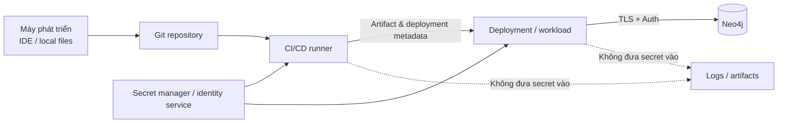
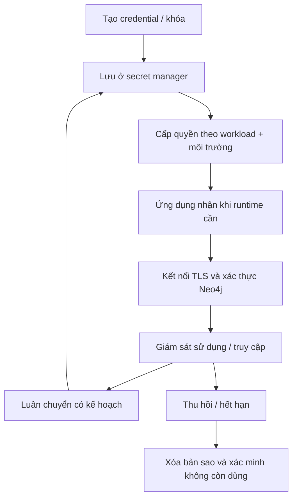

# Quản lý bí mật cho phát triển, CI/CD và môi trường triển khai Neo4j

Một ứng dụng kết nối Neo4j cần biết địa chỉ database, danh tính đăng nhập và thông tin chứng thực. Khi chạy ở máy cá nhân, thông tin có thể được cấp từ biến môi trường; trên CI/CD, nó đến từ kho bí mật của nền tảng; còn trong production, thông tin thường được cấp thông qua hệ thống quản lý bí mật và chính sách danh tính của tổ chức. Nếu xử lý không nhất quán, một mật khẩu thử nghiệm có thể bị commit vào Git, một pipeline có thể nhận nhầm quyền production, hoặc một container có thể vô tình ghi credential ra log.

**Quản lý bí mật (secret management)** là quá trình kiểm soát **vòng đời** của thông tin cần bảo vệ: tạo và phân loại, lưu trữ, cấp quyền, truyền tới ứng dụng, sử dụng, giám sát, luân chuyển, thu hồi và ứng phó khi rò rỉ. Mục tiêu không chỉ là “giấu mật khẩu trong file khác”, mà là **chỉ đúng thành phần và con người được phép mới có thể sử dụng bí mật đúng môi trường, trong thời gian cần thiết**.

Bài thuộc chương **Bảo mật** của module **DATABASE_ENGINE_GRAPH_NEO4J**. Trong phạm vi sử dụng Neo4j để mô hình hóa dữ liệu liên kết bằng property graph, truy vấn node/relationship và đường đi qua Cypher, vận dụng index/constraint, nhập dữ liệu, Java Driver, Spring Data Neo4j và vận hành hệ thống đồ thị, bài này tập trung vào **credential, khóa và bí mật cấu hình** từ máy phát triển đến pipeline và runtime.

Sau bài này, bạn có thể:

- Phân biệt **secret**, thông tin cấu hình thông thường và danh tính/role dùng để truy cập Neo4j.
- Thiết kế cách nhận bí mật an toàn trong **máy phát triển**, **CI/CD** và **môi trường triển khai**.
- Cấu hình **Spring Boot/Spring Data Neo4j** và **Neo4j Java Driver** không hard-code password.
- Hiểu vai trò của **secret manager**, biến môi trường, volume bí mật, TLS và quyền tối thiểu.
- Thiết lập quy trình **rotation, revocation, audit, phát hiện rò rỉ và khôi phục**.
- Nhận diện những cách làm có vẻ an toàn nhưng vẫn có nguy cơ lộ bí mật.

> **Phạm vi phiên bản:** Các ví dụ lấy Neo4j 5 và các dòng hiện đại, Spring Boot 3.x, Java 17+ cùng GitHub Actions/Kubernetes làm bối cảnh minh họa. Tên setting, khả năng quản trị user/role, cơ chế kết nối mã hóa và cách cấp bí mật cần được kiểm tra theo phiên bản, edition, dịch vụ managed và nền tảng triển khai thực tế. Các chuỗi và tài khoản trong ví dụ đều mang tính giả lập; không dùng làm credential production.

## 1. Bí mật là gì, còn điều gì không nhất thiết là bí mật?

Trong cấu hình kết nối Neo4j:

| Thành phần | Ví dụ | Có phải bí mật? | Cách xử lý |
| --- | --- | --- | --- |
| URI kết nối | `neo4j+s://graph.example.org:7687` | Thường không phải secret, nhưng có thể là thông tin nội bộ | Có thể quản lý như cấu hình; không nhúng credential vào URI |
| Tên database | `neo4j` hoặc `commerce` | Thường không | Quản lý theo môi trường |
| Tên người dùng kỹ thuật | `app_reader` | Không nhất thiết là secret; có thể nhạy cảm về vận hành | Hạn chế tiết lộ không cần thiết |
| Mật khẩu Neo4j | Giá trị do hệ thống cấp | **Có** | Secret manager, truyền qua kênh kiểm soát |
| Token/API key của dịch vụ liên quan | Credential gọi cloud/KMS/broker | **Có** | Cấp quyền và luân chuyển riêng |
| Khóa riêng TLS/mTLS | Private key của client/server | **Có** | Lưu trong cơ chế bảo vệ khóa, quản lý vòng đời chứng chỉ |
| Chứng chỉ CA công khai | Root/intermediate CA certificate | Thông thường không | Kiểm soát tính toàn vẹn và nguồn tin cậy |
| Khóa giải mã/khóa ứng dụng | Encryption key, signing key | **Có** | KMS/HSM hoặc hệ thống chuyên dụng |
| Token tạm thời của CI | Workload identity token / access token | **Có** dù sống ngắn | Giới hạn thời gian, audience, scope và nơi cấp |

**Không phải mọi cấu hình đều phải đưa vào secret manager**. Ví dụ `database=commerce` có thể nằm trong cấu hình thông thường. Ngược lại, một **mật khẩu trong biến môi trường vẫn là bí mật**: việc đổi vị trí lưu không khiến nó trở thành thông tin công khai.

Cũng cần phân biệt:

- **Authentication (xác thực):** ứng dụng chứng minh mình là ai với Neo4j.
- **Authorization (phân quyền):** user/role sau khi xác thực được phép đọc, ghi, quản lý schema hoặc quản trị những gì.
- **Transport security:** dữ liệu và credential được bảo vệ khi truyền trên mạng, thường qua TLS.
- **Secret management:** bảo vệ thông tin cấp phép truy cập trong suốt vòng đời, trước và sau khi ứng dụng khởi động.

Một hệ thống giữ mật khẩu rất kín nhưng dùng tài khoản admin cho mọi service vẫn có rủi ro cao.

## 2. Mô hình đe dọa: bí mật có thể lộ ở đâu?

Hãy hình dung một ứng dụng Spring Boot lấy mật khẩu Neo4j từ CI/CD rồi chạy trong Kubernetes.



Những bề mặt rò rỉ thường gặp:

1. **Git và lịch sử commit:** đưa mật khẩu vào `application.yml`, `.env`, test fixture hoặc tài liệu; xóa ở commit mới không xóa khỏi lịch sử cũ.
2. **Log và console:** in nguyên environment, connection string kèm credential, thông số lỗi có dữ liệu nhạy cảm, bật shell trace.
3. **CI artifacts/caches:** lưu file cấu hình chứa mật khẩu vào artifact, cache hoặc báo cáo build.
4. **Quyền CI quá rộng:** mọi branch/PR hoặc mọi job đều nhận credential production.
5. **Biến môi trường của container:** có thể bị đọc bởi process cùng quyền, người có quyền debug/inspect hoặc công cụ thu thập diagnostic.
6. **Command-line arguments:** giá trị truyền trực tiếp vào lệnh có thể xuất hiện trong process listing, history hoặc hệ thống giám sát.
7. **TLS thiếu/không xác minh:** credential và dữ liệu có thể bị lộ khi truyền trên mạng không tin cậy.
8. **Credential dùng chung quá lâu:** một bí mật rò rỉ ảnh hưởng nhiều ứng dụng/môi trường và khó thu hồi riêng lẻ.
9. **Sao lưu và snapshot:** file cấu hình, dump hệ thống hoặc secret volume bị sao chép sang nơi ít được bảo vệ.
10. **Nhầm môi trường:** test hoặc CI sử dụng nhầm database production, dẫn tới sửa/xóa dữ liệu thật.

Hãy thiết kế để một sự cố nhỏ (ví dụ token CI bị lộ) **không tự động trở thành quyền quản trị mọi database**.

## 3. Ma trận cấp bí mật theo môi trường

Một chính sách đơn giản và có thể kiểm tra:

| Môi trường | Nguồn cấp credential nên dùng | Danh tính | Quyền truy cập |
| --- | --- | --- | --- |
| **Development cá nhân** | Secret store của máy/IDE hoặc file local không commit | User dev riêng trên database test | Chỉ tài nguyên test được phép |
| **Unit test** | Không cần Neo4j thật; mock hoặc dữ liệu tổng hợp | Không cần production credential | Không |
| **Neo4j Harness / Testcontainers** | Credential thử nghiệm phát sinh hoặc cấu hình riêng cho instance tạm | User test cô lập | Chỉ database được tạo cho test |
| **CI integration test** | Secret store của CI hoặc workload identity đến dịch vụ test | Service identity của CI | Chỉ database test/staging |
| **Staging** | Secret manager, cấp cho workload staging | Service identity staging | Không truy cập production |
| **Production** | Secret manager + identity của runtime, cấp động/kiểm soát | Mỗi ứng dụng có identity riêng | Least privilege trên database cần dùng |
| **Quản trị/migration** | Workflow đặc quyền riêng, có audit và kiểm soát phê duyệt | Danh tính quản trị/migration | Chỉ được nâng quyền trong phạm vi công việc |

**Không dùng một mật khẩu duy nhất cho dev, CI, staging và production**. Nếu cùng một credential có mặt ở nhiều môi trường, sự cố ở laptop hoặc build runner có thể gây tác động tới dữ liệu thật.

Tách quyền đọc/ghi/nghiệp vụ khỏi quyền quản lý schema và user. Một API chỉ tìm đường đi nên không có đặc quyền `CREATE USER`, `DROP DATABASE` hay thao tác schema không liên quan.

## 4. Nguyên tắc thiết kế vòng đời bí mật



Các yêu cầu quan trọng:

- **Một nguồn quản lý chuẩn cho bí mật:** tránh sao chép qua nhiều hệ thống mà không có owner.
- **Phạm vi nhỏ nhất:** user chỉ có quyền cần để thực hiện use case.
- **Tách môi trường:** production secret không được trao cho laptop dev hoặc PR bất kỳ.
- **Không ghi secret vào source/artifact:** repo chỉ chứa tên biến hay secret reference.
- **Khả năng thay thế:** một credential bị lộ phải có cách luân chuyển/thu hồi mà không phá hủy dữ liệu.
- **Truy vết:** biết ai hoặc workload nào được cấp quyền, sử dụng khi nào, và lần cuối thay đổi credential.
- **Độ tin cậy khi secret manager lỗi:** xác định ứng dụng đang chạy dùng credential cũ trong bao lâu, ứng dụng mới khởi động có được phép chạy không; không dùng mật khẩu mặc định không an toàn để “cứ chạy được”.

Một secret mạnh nhưng chưa bao giờ được thay khi nhân viên rời tổ chức hoặc workload bị xâm nhập **không đáp ứng đủ yêu cầu vận hành**.

## 5. Phát triển cá nhân: giữ secret ngoài Git

### 5.1. Tách file ví dụ và giá trị thực

Trong repository có thể chứa file mẫu `.env.example`, nhưng **không chứa credential thực**:

```dotenv
# .env.example: chỉ tên biến và giá trị mô phỏng
NEO4J_URI=bolt://localhost:7687
NEO4J_DATABASE=neo4j
NEO4J_USERNAME=dev_user
NEO4J_PASSWORD=SET_THIS_LOCALLY
```

File local `.env` hoặc cấu hình IDE chứa giá trị do developer cấp; file này **không được commit**. Ví dụ phần `.gitignore`:

```gitignore
.env
.env.*
!.env.example
*.pem
*.key
secrets/
```

Các pattern là **gợi ý**, phải điều chỉnh cho repository thực tế. Không nên chặn nhầm các file public như `.env.example` hoặc chứng chỉ CA công khai; cũng không nên nghĩ `.gitignore` bảo vệ được một bí mật **đã từng commit**.

**Cảnh báo:** `.gitignore` chỉ ngăn Git tự thêm các file chưa được track theo cách thường gặp. Nếu một file đã được Git theo dõi hoặc secret đã nằm trong lịch sử commit, thêm pattern ignore **không xóa được lịch sử**.

### 5.2. Không dùng account production để phát triển

Trên máy cá nhân nên:

- Dùng Neo4j local, instance test, hoặc database dev được cấp quyền giới hạn.
- Tạo user dev riêng, không dùng chung tài khoản admin của production.
- Đặt mật khẩu đủ mạnh và không lưu trong script demo được commit.
- Không paste credential vào chat, issue, screenshot, terminal recording hoặc tài liệu công khai.
- Chỉ bật debug/tracing khi chắc chắn không in token, URI chứa secret hoặc biến môi trường.
- Xóa file local an toàn và thu hồi credential khi không còn dùng.

**Không lưu password trong `.env.example` bằng mật khẩu dùng được thật** chỉ vì “đây là môi trường dev”.

### 5.3. Secret store tốt hơn “file giấu ở thư mục khác”

Một file ngoài repository có thể vẫn bị backup lên cloud cá nhân, sao chép qua email hoặc bị malware đọc. Trình quản lý credential của hệ điều hành, IDE secret store hoặc secret manager được tổ chức cung cấp thường cho phép kiểm soát quyền và truy vết tốt hơn.

Nếu bắt buộc dùng file local, cần giới hạn quyền đọc bằng cơ chế của hệ điều hành và không chia sẻ thư mục giữa nhiều người dùng không đáng tin.

## 6. Spring Boot và Spring Data Neo4j: nhận credential từ runtime

Ứng dụng Spring Boot không cần biết password được lưu ở hệ thống nào; nó chỉ cần một cách **nhận giá trị tại thời điểm triển khai**.

Ví dụ cấu hình `application.yml`:

```yaml
spring:
  neo4j:
    uri: ${NEO4J_URI}
    authentication:
      username: ${NEO4J_USERNAME}
      password: ${NEO4J_PASSWORD}
  data:
    neo4j:
      database: ${NEO4J_DATABASE:neo4j}
```

Khi viết thành file thật, các ký hiệu trong ví dụ là cú pháp placeholder của Spring:

- `${NEO4J_URI}` tương ứng `${NEO4J_URI}` (được biểu diễn đúng khi lưu bài).
- `${NEO4J_USERNAME}` và `${NEO4J_PASSWORD}` được cấp từ môi trường/nguồn cấu hình an toàn.
- `${NEO4J_DATABASE:neo4j}` là giá trị database có default thông thường, **không phải default cho password**.

Không khai báo:

```yaml
spring:
  neo4j:
    authentication:
      username: neo4j
      password: my-real-production-password
```

trong source control. Một credential bị commit vào file cấu hình không an toàn hơn khi được bọc bằng YAML.

### Tách cấu hình công khai khỏi bí mật

Một triển khai có thể quản lý `NEO4J_URI` và tên database bằng ConfigMap/config service, còn `NEO4J_PASSWORD` bằng Secret Manager. Với username, xem chính sách nội bộ: không nhất thiết phải coi nó là bí mật, nhưng cũng không nên tiết lộ danh sách tài khoản kỹ thuật nếu không cần.

**Đừng dùng giá trị mặc định cho production password**, ví dụ biểu thức “nếu không có secret thì dùng `password123`”. Thiết kế nên **fail fast** khi môi trường quan trọng thiếu bí mật.

### Khi cấu hình bị ghi log

Một số hệ thống cho phép xem configuration properties qua actuator, diagnostic dump hoặc trình quản trị runtime. Cần:

- Vô hiệu hóa hoặc bảo vệ chặt endpoint hiển thị cấu hình.
- Bảo đảm trường mật khẩu được che/không hiển thị theo cơ chế của framework.
- Không giả định mọi công cụ giám sát đều tự động mask các custom variable.
- Không in toàn bộ bean properties hoặc Spring environment vào log.

## 7. Java Driver: xây kết nối mà không hard-code password

Một service dùng Neo4j Java Driver có thể đọc credential do runtime cung cấp:

```java
import org.neo4j.driver.AuthTokens;
import org.neo4j.driver.Driver;
import org.neo4j.driver.GraphDatabase;
import org.neo4j.driver.Session;

public final class Neo4jReadExample {

    private static String requiredEnv(String name) {
        String value = System.getenv(name);
        if (value == null || value.isBlank()) {
            throw new IllegalStateException(
                "Missing required configuration: " + name
            );
        }
        return value;
    }

    public static void main(String[] args) {
        String uri = requiredEnv("NEO4J_URI");
        String user = requiredEnv("NEO4J_USERNAME");
        String password = requiredEnv("NEO4J_PASSWORD");

        try (Driver driver = GraphDatabase.driver(
                uri, AuthTokens.basic(user, password));
             Session session = driver.session()) {

            long total = session.run("""
                MATCH (n)
                RETURN count(n) AS total
                """).single().get("total").asLong();

            System.out.println("Nodes: " + total);
        }
    }
}
```

Ví dụ chỉ để trình bày cách nhận credential. Trong ứng dụng server, `Driver` thường được quản lý theo vòng đời và dùng lại connection pool, **không tạo một Driver mới cho mỗi HTTP request**. Nếu dùng Spring Data Neo4j, thường để Spring quản lý Driver thay vì tạo thêm driver thủ công.

**Không log biến `password`, không thêm password vào exception message, không in toàn bộ environment.** Chuỗi Java bất biến không thể đảm bảo xóa sạch tức thời khỏi mọi vùng bộ nhớ; do đó giảm khả năng lộ qua log, heap dump và quyền debug là quan trọng.

### Tham số Cypher khác với secret

Ứng dụng có thể truyền `$customerId` như tham số để tránh ghép chuỗi vào câu Cypher:

```cypher
MATCH (c:Customer {customerId: $customerId})
RETURN c;
```

Nhưng tham số truy vấn **không phải nơi nên truyền database password** trong từng câu lệnh `MATCH`. Password Neo4j thuộc giai đoạn **xác thực kết nối**, còn tham số Cypher dành cho dữ liệu nghiệp vụ. Hai việc phục vụ các mục tiêu bảo mật khác nhau.

## 8. Bảo vệ credential trên đường truyền bằng TLS

Mật khẩu được giữ an toàn ở secret manager nhưng lại gửi qua mạng không được bảo vệ thì rủi ro vẫn tồn tại. Với Java Driver kết nối Neo4j qua mạng, nên dùng TLS và **xác minh chứng chỉ server** theo hạ tầng thực tế.

Ví dụ URI:

| URI minh họa | Ý nghĩa khái quát | Dùng khi nào |
| --- | --- | --- |
| `bolt://localhost:7687` | Kết nối Bolt trực tiếp, mã hóa phụ thuộc cấu hình driver/server | Chỉ phù hợp bối cảnh đã đánh giá như local/dev |
| `bolt+s://graph.example.org:7687` | Bolt với TLS xác minh chuỗi chứng chỉ được tin cậy | Server trực tiếp có chứng chỉ CA đáng tin |
| `neo4j+s://graph.example.org:7687` | Neo4j routing URI với TLS và xác minh CA | Hệ thống hỗ trợ routing và TLS |
| `bolt+ssc://...` / `neo4j+ssc://...` | TLS cho chứng chỉ tự ký/chấp nhận không theo xác minh CA tiêu chuẩn | Chỉ dùng khi có chính sách trust rõ ràng; tránh như “mẹo sửa TLS” ở production |

Chi tiết TLS, trust store và hỗ trợ scheme tùy phiên bản Driver/Neo4j. **Không tắt xác minh chứng chỉ production** chỉ để tránh lỗi cấu hình; thay vào đó hãy cài đặt CA/trust chain đúng và kiểm tra hostname của chứng chỉ.

Các điểm cần bảo vệ:

- Kết nối từ ứng dụng tới Neo4j.
- Kết nối CI runner tới database test/staging nếu đi qua mạng.
- Kết nối giữa công cụ quản trị/backup và server.
- Private key/chứng chỉ client nếu dùng mTLS hoặc phương thức xác thực bổ sung.
- Kết nối từ workload đến hệ thống secret manager.

**TLS không thay thế quyền Neo4j.** Một kết nối được mã hóa vẫn có thể có quyền quá rộng nếu ứng dụng dùng tài khoản admin.

## 9. CI/CD: cấp bí mật theo job và mức tin cậy

CI cần test và deploy, nhưng không nên được xem là một “máy phát triển đáng tin tuyệt đối”. Pipeline có thể chạy mã từ pull request, package dependency bên ngoài hoặc script do contributor sửa.

### 9.1. Ví dụ GitHub Actions dùng secret store

Đây là **workflow minh họa** cho một job kiểm thử có database **CI riêng**. Các giá trị secret được lưu trong kho bí mật của nền tảng CI, không viết vào YAML trong repository:

```yaml
name: Neo4j integration tests

on:
  push:
    branches: [main]

permissions:
  contents: read

jobs:
  test:
    runs-on: ubuntu-latest
    env:
      NEO4J_URI: ${{ secrets.NEO4J_CI_URI }}
      NEO4J_USERNAME: ${{ secrets.NEO4J_CI_USERNAME }}
      NEO4J_PASSWORD: ${{ secrets.NEO4J_CI_PASSWORD }}
    steps:
      - uses: actions/checkout@v4
      - uses: actions/setup-java@v4
        with:
          distribution: temurin
          java-version: '21'
      - name: Run tests against dedicated CI Neo4j
        run: ./gradlew test
```

Các biểu thức `${{ secrets.NEO4J_CI_URI }}`, `${{ secrets.NEO4J_CI_USERNAME }}`, `${{ secrets.NEO4J_CI_PASSWORD }}` được thay bằng cách tham chiếu **GitHub Actions secrets** tương ứng khi lưu bài. Tên action/version cần được cập nhật và pin theo chính sách supply-chain của tổ chức; workflow trên không có chức năng tự tạo database CI.

Điều kiện bắt buộc để ví dụ an toàn:

- `NEO4J_URI` phải trỏ tới **database test chuyên dụng**, không phải production.
- Danh tính CI chỉ có quyền chạy test cần thiết trên database đó.
- Chỉ cấp secret cho những workflow/job có quyền nhận. Không cung cấp production secret cho workflow chạy mã từ nhánh/PR chưa tin cậy.
- Không chạy `env`, `printenv`, `set -x` hoặc lưu toàn bộ biến môi trường vào artifact.
- Hạn chế ai được sửa workflow, secrets, runners và deployment environments.
- Tài khoản chạy migration/deploy cần quyền và cơ chế phê duyệt **khác** job chạy test.

Tính năng mask của CI giúp giảm rủi ro, nhưng **không phải bảo đảm bí mật không thể lộ**: giá trị bị biến đổi, mã hóa lại hoặc tách thành nhiều mảnh có thể không được che. Vì vậy không được cố ý in secret rồi dựa hoàn toàn vào masking.

### 9.2. Vì sao pull request không nên nhận bí mật production?

Một PR có thể sửa script build để gửi biến môi trường tới endpoint bên ngoài. Nếu CI tự chạy script đó với production credential, kẻ có quyền gửi PR có thể tìm cách lấy credential.

Cần tách:

1. **PR validation:** dùng unit test và database test cô lập, không cấp secret nhạy cảm.
2. **Trusted branch integration:** cấp credential test/staging khi đã qua cơ chế tin cậy.
3. **Production deployment:** dùng môi trường bảo vệ, phê duyệt, danh tính riêng và quyền triển khai tối thiểu.

Không dùng production account để “tiện cho việc kiểm tra pipeline”.

### 9.3. Workload identity thay cho secret tĩnh khi có thể

Một số nền tảng CI/cloud hỗ trợ **OIDC/workload identity federation**: job ngắn hạn xác thực với secret manager hoặc cloud mà không cần lưu một access key cloud dài hạn trong repository settings.

Luồng:

```text
Trusted CI job
    |
    | token ngắn hạn, giới hạn audience / subject
    v
Identity provider / Secret manager
    |
    | cho phép đọc đúng secret hoặc cấp credential ngắn hạn
    v
CI job -> database test/staging
```

**Lưu ý:** OIDC có thể loại bỏ việc giữ **cloud access key dài hạn**, nhưng **không tự động biến Neo4j basic-auth password thành token OIDC**. Nếu Neo4j vẫn dùng username/password, CI thường vẫn phải lấy password từ secret manager tại runtime hoặc dùng cơ chế xác thực được nền tảng Neo4j triển khai hỗ trợ.

## 10. Container và Kubernetes: cấp bí mật cho ứng dụng chạy thật

Một ứng dụng trong Kubernetes có thể nhận username/password từ **Secret object đã được cấp bởi quy trình an toàn**, không ghi password vào Deployment manifest.

Ví dụ phần `containers` của Deployment:

```yaml
apiVersion: apps/v1
kind: Deployment
metadata:
  name: graph-api
spec:
  replicas: 2
  selector:
    matchLabels:
      app: graph-api
  template:
    metadata:
      labels:
        app: graph-api
    spec:
      containers:
        - name: app
          image: example.registry/graph-api:approved-tag
          env:
            - name: NEO4J_URI
              value: "neo4j+s://graph.example.org:7687"
            - name: NEO4J_USERNAME
              valueFrom:
                secretKeyRef:
                  name: neo4j-app-credentials
                  key: username
            - name: NEO4J_PASSWORD
              valueFrom:
                secretKeyRef:
                  name: neo4j-app-credentials
                  key: password
```

**Không commit một `Secret` manifest chứa `stringData` với password thật** rồi cho rằng an toàn vì nó là Kubernetes Secret. Giá trị trong `data` chỉ được **base64 encode**, không tự động trở thành mã hóa bảo mật. Cần sử dụng secret manager/External Secrets/CSI hoặc quy trình tạo Secret được bảo vệ, cùng RBAC cho quyền đọc Secret và mã hóa dữ liệu lưu tại etcd theo chính sách cluster.

### 10.1. Biến môi trường và volume bí mật

Có hai cách giao secret vào workload:

| Cách cấp | Ưu điểm | Giới hạn |
| --- | --- | --- |
| **Environment variable** từ secret reference | Dễ tích hợp Spring Boot/Java Driver | Có thể bị lộ qua debug/process environment; giá trị trong process thường không tự thay khi Secret đổi |
| **Mounted secret file / volume** | Có thể tách bí mật khỏi biến môi trường; một số cơ chế hỗ trợ cập nhật file | Ứng dụng phải đọc file đúng cách, xử lý quyền và refresh; không phải mọi loại mount tự cập nhật như nhau |
| **Secret manager SDK / agent** | Có policy, audit, rotation, có thể cấp giá trị ngắn hạn | Tăng phụ thuộc runtime; cần xử lý lỗi khi manager không sẵn sàng |

Không có lựa chọn nào an toàn tuyệt đối trong mọi bối cảnh. **Một workload đã bị chiếm quyền ở mức đọc bộ nhớ/process có thể truy cập bí mật mà nó đang được phép sử dụng**. Vì thế cần bảo vệ pod, service account, node, runtime, mạng và quyền gọi secret manager.

### 10.2. Khi secret được luân chuyển

Nếu password được đưa vào container bằng environment variable, thay đổi Kubernetes Secret thường **không làm biến môi trường trong process đang chạy tự đổi ngay**. Thường cần rollout/restart workload hoặc cơ chế reload được ứng dụng hỗ trợ.

Với secret mounted file, cập nhật file còn phụ thuộc loại volume/provider và ứng dụng **có đọc lại file hay không**. Một Java Driver đã tạo authentication token từ password cũ sẽ không tự nhận secret mới chỉ vì file trên disk đổi.

Do đó rotation không chỉ là “đổi giá trị trong secret manager”; phải có **kế hoạch cập nhật và xác minh toàn bộ ứng dụng đang sử dụng credential**.

## 11. Neo4j server bootstrap: password ban đầu không phải rotation

Khi triển khai Neo4j bằng container hoặc môi trường mới, có thể gặp cấu hình khởi tạo như:

```text
NEO4J_AUTH=neo4j/<initial-password>
```

Đây là **mô hình cấu hình bootstrap** thường thấy trong image Neo4j: giá trị được dùng khi khởi tạo thông tin xác thực theo cơ chế của image/phiên bản.

Điểm dễ sai:

- Không đặt mật khẩu thật trực tiếp trong `docker-compose.yml` hoặc shell script được commit.
- Không bật chế độ **tắt xác thực** (`NEO4J_AUTH=none`) trên môi trường có dữ liệu hoặc mạng không đáng tin chỉ để dễ kết nối.
- **Đổi biến bootstrap không đồng nghĩa đổi mật khẩu user đã tồn tại** trong database có persistent volume. Credential phải được quản lý qua cơ chế quản trị Neo4j phù hợp.
- Tài khoản được dùng khi bootstrap/quản trị không nhất thiết là tài khoản ứng dụng sử dụng mỗi ngày.
- Khi một password production cần rotation, phải phối hợp **user/role Neo4j thực tế**, secret manager và ứng dụng, không chỉ sửa file cấu hình bên ngoài.

Nếu cần khởi tạo Neo4j local cho demo, có thể dùng một giá trị **chỉ dành cho máy test cô lập** và loại bỏ dữ liệu test sau khi dùng. Không sao chép giá trị đó sang staging/production.

## 12. Principle of Least Privilege: danh tính khác nhau cho công việc khác nhau

Secret manager bảo vệ mật khẩu; **Neo4j privilege** bảo vệ dữ liệu sau khi đăng nhập. Hai lớp đều cần thiết.

Một ma trận quyền nên có:

| Danh tính kỹ thuật | Nhiệm vụ | Quyền nên giới hạn |
| --- | --- | --- |
| `graph_api_reader` | Truy vấn hồ sơ/đường đi phục vụ API | Đọc phạm vi database/tài nguyên được phép |
| `graph_command_writer` | Thực hiện thay đổi nghiệp vụ | Ghi đúng database và kiểu thao tác được cho phép |
| `graph_ingest_worker` | Đồng bộ node/relationship từ nguồn chuẩn | Quyền nhập dữ liệu, không quản lý user |
| `graph_migration_job` | Tạo constraint/index khi triển khai | Quyền schema theo lịch và phê duyệt |
| `graph_admin` | Quản trị account, database, sao lưu | Đặc quyền quản trị, không dùng làm account mặc định cho API |

Khả năng định nghĩa **role tùy biến, quyền chi tiết và quản trị** phụ thuộc edition/version Neo4j hoặc dịch vụ managed. Một số chức năng phân quyền ở mức chi tiết có điều kiện edition, vì vậy phải kiểm tra tài liệu và khả năng instance thực tế.

### 12.1. Bảo vệ dữ liệu nhiều tenant

Ngay cả khi một tài khoản có quyền đọc database, ứng dụng nhiều tenant vẫn phải kiểm tra **phạm vi tenant của truy vấn** hoặc dùng cách phân tách dữ liệu/bảo mật được thiết kế riêng.

Ví dụ truy vấn đồ thị có ràng buộc theo tenant:

```cypher
MATCH (c:Customer {
  tenantId: $tenantId,
  customerId: $customerId
})-[:PLACED]->(o:Order)
WHERE o.tenantId = $tenantId
RETURN o.orderId AS orderId, o.status AS status
ORDER BY orderId;
```

Đây chỉ là **ví dụ lọc nghiệp vụ**, không phải bảo đảm toàn bộ ứng dụng đã có row-level security. `$tenantId` phải lấy từ identity đã được xác thực/ủy quyền, **không chỉ tin chuỗi tenantId tự gửi từ HTTP body**. Cũng cần kiểm soát những query khác và các quan hệ bắc cầu để không lộ dữ liệu ngoài tenant.

### 12.2. Vì sao không dùng admin cho ứng dụng?

Nếu password bị lộ:

- Account chỉ đọc bị giới hạn phạm vi tác động hơn account có quyền xóa database.
- Account riêng cho một service có thể được thu hồi mà không làm ngừng các service khác.
- Audit dễ xác định nguồn thao tác.
- Rotation có thể diễn ra theo từng workload.

**Quyền tối thiểu là biện pháp giảm thiểu thiệt hại sau khi secret bị lộ, không phải lý do để ngừng bảo vệ secret.**

## 13. Luân chuyển bí mật (rotation) không gián đoạn và có kiểm chứng

Một quy trình rotation phải làm rõ **Neo4j chấp nhận credential nào**, **ứng dụng đang dùng cái nào** và **khi nào có thể thu hồi cái cũ**.

### 13.1. Kế hoạch đổi danh tính kỹ thuật theo giai đoạn

Khi có thể quản lý hai danh tính song song:

1. **Kiểm tra quyền:** xác định workload, database, role và hành vi đọc/ghi của user hiện tại.
2. **Tạo danh tính thay thế:** cấp một account/credential mới với quyền **tối thiểu tương đương**, không tăng đặc quyền ngoài ý muốn.
3. **Lưu vào secret manager:** đặt version mới, giới hạn ai/workload nào có quyền lấy.
4. **Triển khai canary:** cấu hình một phần ứng dụng dùng credential mới; kiểm tra xác thực, truy vấn và lỗi.
5. **Rollout phần còn lại:** cập nhật ứng dụng/connection pool theo cơ chế phù hợp.
6. **Xác nhận không còn phụ thuộc credential cũ:** dựa trên audit/telemetry và thời gian chuyển đổi được phê duyệt.
7. **Thu hồi user/credential cũ:** vô hiệu hóa hoặc xóa quyền theo quy trình quản trị.
8. **Kiểm thử phục hồi:** bảo đảm không có job theo lịch, cron hoặc công cụ báo cáo còn dùng password cũ.

Cách này giúp giảm downtime, nhưng **không phải mọi tổ chức đều cho phép thêm user/role giống nhau**. Khi phải đổi password trên cùng user, cần phối hợp kỹ cửa sổ chuyển đổi vì có thể không tồn tại giai đoạn hai password cùng hợp lệ.

### 13.2. Quy trình khi thay password trên cùng user

Nếu hệ thống yêu cầu chỉ dùng một user:

- Chuẩn bị bản password mới trong hệ thống quản lý bí mật và giới hạn người biết.
- Chọn phương pháp thay đổi password được Neo4j/identity provider hỗ trợ.
- Phối hợp đổi password trên phía cấp xác thực và cập nhật tất cả client.
- Giám sát lỗi authentication ở giai đoạn chuyển đổi.
- Chấp nhận khả năng cần reconnect/rollout nếu Driver/connection pool đang giữ credential cũ.
- Xác minh client cũ không còn đăng nhập được, đồng thời dịch vụ dùng credential mới hoạt động đúng.

Không đưa password thật vào command-line argument, terminal history hoặc tài liệu runbook. Nếu dùng một lệnh quản trị có tham số password, kiểm tra cách truyền tham số an toàn của công cụ và ngăn việc ghi secret vào log.

### 13.3. Khác biệt giữa rotation và revoke

- **Rotation:** thay bí mật theo lịch hoặc khi cần, có kế hoạch chuyển đổi.
- **Revoke:** khiến bí mật/account cũ không còn được chấp nhận, thường khẩn cấp khi nghi lộ.
- **Expiration:** credential hết hạn theo chính sách; không tự đảm bảo toàn bộ client chuyển đổi thành công.
- **Delete secret reference:** xóa giá trị khỏi một nơi lưu **không đồng nghĩa** đã thu hồi quyền đăng nhập trong Neo4j.

Đây là lý do cần kiểm tra quyền trong database thực tế sau khi thu hồi, không chỉ kiểm tra file cấu hình đã thay đổi.

## 14. Ứng phó khi credential có dấu hiệu rò rỉ

Ví dụ nhân viên phát hiện mật khẩu Neo4j staging bị push vào Git repository. Một quy trình an toàn:

1. **Xác định phạm vi:** mật khẩu thuộc database nào, account nào, đã xuất hiện trong commit/log/artifact nào?
2. **Hạn chế truy cập và thu hồi/rotation ngay theo mức độ rủi ro:** không đợi “dọn Git trước” rồi mới thay credential.
3. **Đối chiếu audit:** có đăng nhập bất thường, truy vấn dữ liệu nhạy cảm, thay đổi user/role, schema hoặc xóa dữ liệu không?
4. **Kiểm tra các bản sao:** Git history, fork, cache, CI log, build artifact, backup, issue và tài liệu.
5. **Ngăn tái phát:** cập nhật .gitignore, secret scanning, pre-commit policy, quyền CI hoặc cơ chế cấp phát.
6. **Khôi phục/đối soát:** kiểm tra tính toàn vẹn dữ liệu nếu credential có quyền ghi; lưu giữ chứng cứ theo quy trình điều tra.
7. **Thông báo theo quy định:** phối hợp nhóm bảo mật và chính sách sự cố của tổ chức.

**Xóa dòng mật khẩu ở commit mới không đủ.** Dữ liệu có thể đã bị sao chép qua clone/fork, và lịch sử Git vẫn chứa giá trị. Ngay cả khi đã làm sạch lịch sử, cần xem bí mật là **đã bị lộ**, luân chuyển/thu hồi nó và xác định tác động.

Không copy nguyên mật khẩu vào ticket sự cố; hãy dùng **secret identifier**, account bị ảnh hưởng, thời điểm phát hiện và tham chiếu bảo mật được kiểm soát.

## 15. Logging, observability và bảo vệ dữ liệu chẩn đoán

Đội vận hành cần biết một service có kết nối Neo4j được không, nhưng **không cần nhìn thấy mật khẩu**.

Nên log các trường:

```json
{
  "event": "neo4j_connection_failure",
  "service": "graph-api",
  "environment": "staging",
  "database": "commerce",
  "credentialRef": "graph-api/staging/current",
  "errorClass": "AuthenticationException",
  "requestId": "req-042"
}
```

Đây là **ví dụ cấu trúc**, không phải khẳng định Neo4j Driver tự sinh ra log như vậy. `credentialRef` là mã tham chiếu không chứa giá trị bí mật, phải được thiết kế sao cho không tự làm lộ thông tin nhạy cảm.

Không log:

```text
NEO4J_PASSWORD=<actual-secret>
Authorization: Basic <base64-credentials>
Config dump: all environment variables...
Full connection URL with embedded username/password...
```

**Base64 không phải mã hóa bảo mật.** Một header Basic Auth được encode base64 vẫn tiết lộ credential nếu bị ghi vào log không được bảo vệ.

Các metric hữu ích:

| Metric / kiểm tra | Ý nghĩa |
| --- | --- |
| Lỗi xác thực theo service và môi trường | Phát hiện password cũ, cấu hình nhầm hoặc truy cập bất thường |
| Số lần đọc secret manager thất bại | Đánh giá khả năng ứng dụng không khởi động/không gia hạn được |
| Tuổi credential, ngày hết hạn | Chủ động rotation |
| Số workload còn dùng identity cũ | Xác minh tiến độ chuyển đổi |
| Audit thay đổi user/role/privilege | Phát hiện nâng quyền và sai cấu hình |
| Số lần fail kết nối TLS | Chứng chỉ hết hạn, trust chain sai hoặc lỗi mạng |
| Secret scanning alerts | Phát hiện sớm chuỗi credential trong repo/artifact |

Metric không nên chứa password, token, private key hoặc toàn bộ câu lệnh cấu hình có giá trị nhạy cảm dưới dạng label/tag.

## 16. Kiểm thử quản lý bí mật

Một hệ thống đạt tiêu chuẩn không chỉ nhờ có file `.gitignore`; cần kiểm thử cả **đường cấp phát và sử dụng credential**.

### 16.1. Unit test

Kiểm tra rằng ứng dụng:

- Báo lỗi khi thiếu `NEO4J_PASSWORD` ở môi trường cần xác thực.
- Không dùng fallback kiểu `password123` trong production.
- Không log giá trị secret khi cấu hình sai.
- Không để exception message chứa credential.
- Không coi user-supplied tenantId là quyết định phân quyền cuối cùng.

Có thể mock **nguồn lấy secret**, không cần secret thật trong test.

### 16.2. Integration test

Với Neo4j Harness/Testcontainers:

- Dùng **credential thử nghiệm** hoặc cơ chế xác thực riêng của instance test.
- Không trỏ test vào Neo4j production.
- Xác minh kết nối, đọc/ghi theo user/role được cấp, trong phạm vi edition hỗ trợ.
- Xác minh tài khoản chỉ đọc không thể ghi nếu chính sách được thiết kế như vậy.
- Khi test TLS, dùng server/certificate có cấu hình phù hợp; Harness không thay thế đầy đủ môi trường network/TLS production.

### 16.3. CI policy test

- Secret scanner kiểm tra repository và commit mới.
- Kiểm tra file mẫu không chứa giá trị có thể đăng nhập được.
- Kiểm tra pipeline chỉ tham chiếu secret theo name/ref, không có password literal.
- Kiểm tra deployment manifest không chứa `stringData` bí mật thực.
- Kiểm tra PR không được chạy script với production credential.
- Kiểm tra credential đã thu hồi thực sự không đăng nhập được trên môi trường test phù hợp.

Không copy secret production vào unit test hoặc snapshot test để “giả lập gần production”.

## 17. Các tình huống sai thường gặp

| Sai lầm | Vì sao nguy hiểm | Cách xử lý |
| --- | --- | --- |
| Hard-code mật khẩu trong `application.yml` | Commit/lộ qua source và artifact | Dùng placeholder tới secret runtime |
| Đặt mật khẩu trong `.env.example` | Tưởng là ví dụ nhưng dùng được thật | Chỉ lưu tên biến/placeholder vô hiệu |
| Chỉ thêm `.env` vào `.gitignore` sau khi đã commit | History vẫn chứa secret | Rotate/revoke, xử lý lịch sử và kiểm tra bản sao |
| Dùng tài khoản `neo4j`/admin cho mọi service | Credential bị lộ có quyền quá rộng | Danh tính ứng dụng riêng, quyền tối thiểu |
| Dùng chung password dev và prod | Sự cố ở laptop có thể ảnh hưởng prod | Secret và account tách theo môi trường |
| Cho mọi workflow CI đọc prod secret | PR/script không tin cậy có thể trích xuất bí mật | Phân quyền theo job/environment, yêu cầu phê duyệt |
| Tin rằng CI masking chặn mọi kiểu lộ | Secret biến đổi có thể không được che | Không in/ghi secret ngay từ đầu |
| Bật `set -x` khi chạy lệnh lấy credential | Shell log in command và giá trị mở rộng | Tắt tracing ở bước nhạy cảm |
| Cho password vào command line hoặc URL | Process list/history/log có thể chứa | Secret injection hoặc API nhận riêng tham số |
| Dùng Kubernetes Secret base64 và nghĩ đã mã hóa | Base64 dễ giải mã | KMS/encryption at rest, RBAC, secret manager |
| Đổi Secret nhưng không restart/reload client | Ứng dụng tiếp tục dùng password cũ | Kế hoạch rollout/refresh và xác minh kết nối |
| Đổi `NEO4J_AUTH` rồi nghĩ đã rotate DB user | Bootstrap khác credential đang lưu | Quản trị credential thực tế trong Neo4j |
| Tắt TLS verification vì lỗi chứng chỉ | Mất bảo vệ danh tính server | Sửa CA/trust chain và hostname |
| Log toàn bộ environment để debug | Có thể in password/token | Log theo allowlist, redaction |
| Chỉ xóa secret khỏi kho lưu mà không revoke DB account | Credential cũ có thể vẫn dùng được | Thu hồi trên Neo4j/identity provider |
| Chỉ đo kết nối thành công, không audit quyền | Service có thể có đặc quyền quá mức | Kiểm tra role/privilege theo use case |

## 18. Quy trình triển khai tham chiếu

Một quy trình từ phát triển tới production:

| Giai đoạn | Hành động | Điều kiện hoàn thành |
| --- | --- | --- |
| **Thiết kế** | Lập danh mục secret và ma trận owner/quyền | Mỗi secret có service, môi trường, policy |
| **Phát triển** | Không hard-code, có `.env.example`, secret local riêng | Không có credential thật trong source |
| **Build** | Không đưa secret vào Docker image, static assets hay cache | Artifact không chứa secret |
| **CI** | Chạy test với database riêng, secret store/job trust | Không cấp prod secret cho job không tin cậy |
| **Staging** | Cấp secret qua manager/reference, kiểm tra TLS và RBAC | App hoạt động bằng identity staging |
| **Production deploy** | Cấp đúng workload identity, inject runtime, hạn chế quyền | Không dùng account admin mặc định |
| **Vận hành** | Theo dõi auth failure, secret access, audit, certificate | Có cảnh báo và nhật ký thích hợp |
| **Rotation** | Cấp credential mới, rollout, thu hồi cũ | Không còn client dùng credential cũ |
| **Incident** | Revoke/rotate, điều tra và xử lý bản sao | Giảm tác động, xác minh không còn truy cập |
| **Decommission** | Thu hồi identity, xóa reference và backup theo policy | Không còn workload hoặc secret “mồ côi” |

### Checklist trước khi deploy

- [ ] Không có mật khẩu/token/private key thật trong source, Docker image, CI artifact hoặc file cấu hình được commit.
- [ ] Có **secret store** phù hợp cho dev, CI/CD và runtime, không dùng chung credential.
- [ ] Mọi secret có owner, danh tính workload, môi trường và phạm vi quyền được xác nhận.
- [ ] Ứng dụng Spring Boot/Java Driver nhận password từ runtime, không có fallback yếu.
- [ ] Neo4j dùng TLS/trust policy phù hợp với kết nối; không tắt verification tùy tiện.
- [ ] User ứng dụng chỉ có quyền tối thiểu; account quản trị/migration tách riêng.
- [ ] PR và CI job không tin cậy không nhận production secret.
- [ ] K8s Secret, RBAC, mã hóa lưu trữ và secret volume/env được kiểm soát.
- [ ] Có cách rotation/rollout/reload và thử nghiệm thu hồi credential cũ.
- [ ] Log/metrics/diagnostic không chứa password hoặc token.
- [ ] Có secret scanning và quy trình xử lý credential đã lộ.
- [ ] Đã kiểm thử kết nối, quyền đọc/ghi và xác thực fail khi thiếu/sai credential.

## 19. Bài tập tự kiểm tra

**Bài 1 — Phân loại.** Cho các giá trị `NEO4J_URI`, `NEO4J_DATABASE`, `NEO4J_USERNAME`, `NEO4J_PASSWORD`, TLS private key và CA certificate. Hãy phân loại bí mật, cấu hình công khai và thông tin cần hạn chế tiết lộ tùy môi trường.

**Bài 2 — Spring Boot.** Viết `application.yml` đọc mật khẩu từ biến môi trường và không có default password. Ứng dụng phải xử lý thế nào khi biến này vắng mặt ở production?

**Bài 3 — Phát triển.** Một developer đã commit `.env` chứa password staging rồi thêm `.env` vào `.gitignore`. Giải thích vì sao bước đó chưa đủ và viết trình tự xử lý sự cố.

**Bài 4 — CI.** Một workflow chạy trên pull request từ nguồn không tin cậy đang được cấp `NEO4J_PASSWORD` production. Những rủi ro nào tồn tại và nên tách pipeline thành các trust level ra sao?

**Bài 5 — Least privilege.** Thiết kế ba account cho API đọc graph, worker đồng bộ relationship và job migration constraint. Tài khoản nào cần quyền schema? Có nên dùng cùng một account admin không?

**Bài 6 — Kubernetes rotation.** Secret object được cập nhật giá trị mới nhưng pod Spring Boot vẫn xác thực bằng password cũ. Giải thích vì sao, và thiết kế quy trình chuyển đổi có kiểm chứng.

**Bài 7 — TLS.** Server Neo4j có chứng chỉ được cấp bởi CA nội bộ, nhưng ứng dụng Java Driver báo lỗi trust chain. Vì sao `+ssc` không phải lời giải production mặc định? Cần cấu hình trust thế nào?

**Bài 8 — Thu hồi.** Đội vận hành xóa secret khỏi secret manager nhưng quên vô hiệu hóa user cũ trong Neo4j. Account còn có thể đăng nhập không? Làm thế nào để chứng minh rotation đã hoàn tất?

**Bài 9 — Kiểm tra log.** Một lỗi kết nối gây in toàn bộ environment và header Basic Auth (base64). Hãy chỉ ra loại dữ liệu đã lộ và thay thế bằng cấu trúc log an toàn hơn.

## 20. Tài liệu đối chiếu

Nên đối chiếu theo đúng phiên bản Neo4j, Spring Boot, Java Driver và nền tảng triển khai đang sử dụng:

- [Neo4j Operations Manual — Security](https://neo4j.com/docs/operations-manual/current/security/): xác thực, phân quyền, bảo vệ kết nối và quản trị an ninh database.
- [Neo4j Operations Manual — Authentication and authorization](https://neo4j.com/docs/operations-manual/current/authentication-authorization/): quản lý danh tính, quyền và mật khẩu trên các phiên bản có hỗ trợ.
- [Neo4j Java Driver Manual — Connect to the database](https://neo4j.com/docs/java-manual/current/connect/): URI, authentication và kết nối mã hóa.
- [Spring Boot Reference — Externalized Configuration](https://docs.spring.io/spring-boot/reference/features/external-config.html): property placeholder, môi trường và nguồn cấu hình.
- [Kubernetes Documentation — Secrets](https://kubernetes.io/docs/concepts/configuration/secret/): quản lý secret, env và volume; giới hạn của base64 và kiểm soát truy cập.
- [GitHub Actions — Using secrets](https://docs.github.com/en/actions/security-for-github-actions/security-guides/using-secrets-in-github-actions): phạm vi cấp secret cho workflow và các lưu ý an ninh.
- [OWASP — Secrets Management Cheat Sheet](https://cheatsheetseries.owasp.org/cheatsheets/Secrets_Management_Cheat_Sheet.html): vòng đời, rotation, audit và các quy tắc bảo vệ secret.

**Ghi nhớ:** quản lý bí mật không dừng ở việc đưa mật khẩu ra khỏi code. Với Neo4j, cần **danh tính riêng theo workload/môi trường**, **quyền tối thiểu**, **TLS**, **secret manager và đường cấp phát runtime**, cộng với **rotation, revoke, audit và đối soát sau sự cố**. Khi các lớp này phối hợp, ứng dụng Java/Spring Data Neo4j có thể truy cập graph mà không làm credential trở thành điểm yếu trên hành trình từ development tới production.
