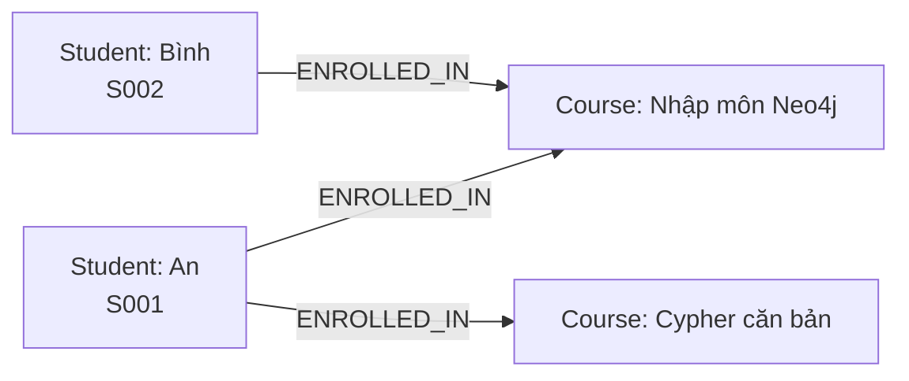

# Neo4j Browser: chạy truy vấn và xem kết quả dạng bảng hoặc đồ thị

> **Chương:** Công cụ làm việc  
> **Mô-đun:** `DATABASE_ENGINE_GRAPH_NEO4J`

## 1. Neo4j Browser dùng để làm gì?

Trong mô-đun này, Neo4j được dùng để mô hình hóa dữ liệu liên kết theo **property graph**, truy vấn quan hệ và đường đi bằng **Cypher**, đồng thời làm việc với node, relationship, index, constraint, nhập dữ liệu, Java Driver, Spring Data Neo4j và vận hành hệ thống đồ thị. **Neo4j Browser** là công cụ tương tác phục vụ giai đoạn khám phá, thử nghiệm và kiểm tra trực tiếp dữ liệu, đặc biệt hữu ích trước khi đưa truy vấn vào ứng dụng Java.

Một property graph gồm:

- **Node (đỉnh):** thực thể, chẳng hạn `Student` hoặc `Course`.
- **Relationship (cạnh có hướng):** quan hệ nối hai node, chẳng hạn `(student)-[:ENROLLED_IN]->(course)`.
- **Label và relationship type:** mô tả loại node và loại quan hệ.
- **Property:** thuộc tính dạng khóa–giá trị, chẳng hạn `studentId`, `name` hoặc `enrolledAt`.

Browser cho phép viết và chạy Cypher, xem kết quả có cấu trúc ở dạng **Table**, khám phá các node và relationship ở dạng **Graph**, đọc phản hồi chi tiết ở **RAW**, và kiểm tra kế hoạch thực thi ở **Plan** khi dùng `EXPLAIN` hoặc `PROFILE`. Đây là các chế độ hiển thị của *kết quả truy vấn*; chúng không tạo ra nhiều bản sao dữ liệu khác nhau.

Sau bài học, bạn cần làm được bốn việc: kết nối đúng database, thực thi một truy vấn Cypher, chọn đúng chế độ hiển thị cho đầu ra, và chẩn đoán các lỗi phổ biến khi không thấy kết quả mong đợi.

## 2. Mở Browser và kết nối đến database

### 2.1. Các cách truy cập thường gặp

| Môi trường | Cách mở | Điều cần biết |
| --- | --- | --- |
| Neo4j Server chạy trên máy cá nhân | Mở `http://localhost:7474/browser` nếu dùng cấu hình cổng mặc định | Server phải đang chạy; giao diện web và kết nối database là hai phần khác nhau. |
| Neo4j AuraDB | Mở công cụ **Query** từ giao diện quản lý instance | Trình soạn thảo Cypher và cách hiển thị kết quả tương tự Browser; bố cục có thể khác theo phiên bản. |
| Neo4j Browser độc lập | Truy cập `https://browser.neo4j.io/` | Cần cấu hình kết nối tới một instance đang hoạt động. |
| Neo4j Desktop | Mở công cụ truy vấn được tích hợp với DBMS/instance của dự án | Kiểm tra đúng instance trước khi thao tác ghi. |

Ở cài đặt local mặc định, địa chỉ web `http://localhost:7474/browser` khác với địa chỉ giao thức Bolt `bolt://localhost:7687`. Browser dùng thông tin kết nối phù hợp để trao đổi với server, thường gồm URI, tên người dùng, mật khẩu và tên database. Với AuraDB, sử dụng URI bảo mật và thông tin xác thực được cấp cho instance, không thay bằng địa chỉ local.

### 2.2. Quy trình kết nối

1. Khởi động instance Neo4j, rồi mở Browser/Query của instance đó.
2. Kiểm tra **Connection URL**, tên người dùng và thông tin xác thực; đăng nhập theo cấu hình môi trường.
3. Chọn đúng **database** mà bạn được phép truy vấn. Một DBMS có thể chứa nhiều database; dữ liệu ở database này không tự động xuất hiện trong database khác.
4. Chạy truy vấn chỉ đọc sau để xác nhận kết nối:

```cypher
RETURN 'Kết nối Cypher thành công' AS thongBao,
       2 + 3 AS ketQua;
```

Đầu ra dự kiến là **một dòng dạng bảng** với `thongBao` và `ketQua = 5`. Chưa có node hoặc relationship nào được trả về nên không có đồ thị để vẽ.

Nếu có quyền và cần đổi database, có thể nhập lệnh Browser sau **ở một lần chạy riêng**:

```text
:use neo4j
```

`neo4j` ở đây chỉ là tên database ví dụ; thay bằng tên database thực tế. Lệnh bắt đầu bằng dấu `:` là **lệnh giao diện Browser**, không phải câu lệnh Cypher gửi nguyên văn đến server.

## 3. Nhận diện các vùng làm việc

| Thành phần | Vai trò | Thao tác điển hình |
| --- | --- | --- |
| **Cypher editor** | Soạn Cypher hoặc lệnh Browser | Nhập `MATCH ... RETURN ...` rồi nhấn nút chạy hoặc `Ctrl + Enter` trên Windows/Linux, `Cmd + Enter` trên macOS. |
| **Result frame** | Hiển thị đầu ra của mỗi lần chạy | Chuyển giữa **Graph**, **Table**, **RAW**; khi thích hợp, xem **Plan**. |
| **Stream / danh sách kết quả** | Giữ các khung kết quả truy vấn gần đây | Mở lại truy vấn cũ, chỉnh sửa và chạy lại khung kết quả. |
| **Thanh bên / các drawer** | Truy cập thông tin cấu trúc graph, truy vấn đã lưu, lịch sử, tham số, cài đặt | Khám phá label và relationship type; dùng truy vấn đã lưu. |
| **Settings** | Giới hạn số bản ghi, số node trực quan hóa, lịch sử và các tùy chọn khác | Giảm số lượng bản ghi khi làm việc với đồ thị lớn. |

Các nút và vị trí cụ thể có thể thay đổi giữa các phiên bản Browser, nhưng luồng làm việc vẫn là **viết truy vấn → chạy → đọc result frame → đổi cách hiển thị**.

### 3.1. Cypher khác lệnh Browser như thế nào?

- `MATCH (n) RETURN n LIMIT 10` là **Cypher**. Server thực thi và trả về bản ghi.
- `:help`, `:history`, `:clear`, `:params` là **lệnh Browser**. Browser xử lý để điều khiển giao diện hoặc cấu hình phiên truy vấn.
- `:clear` chỉ dọn các khung kết quả trên giao diện; nó **không xóa** node hay relationship trong database.
- Ngược lại, `CREATE`, `MERGE`, `SET`, `DELETE`, `DETACH DELETE` là các thao tác có thể **thay đổi dữ liệu**. Luôn xác định database và môi trường trước khi chạy.

## 4. Tạo bộ dữ liệu nhỏ để thực hành

Ví dụ minh họa một hệ thống học trực tuyến: học viên ghi danh khóa học. Chúng ta dùng label `BrowserDemoStudent` và `BrowserDemoCourse` để phân biệt với dữ liệu thật. Hãy chạy khối Cypher dưới đây trong **database thử nghiệm**; không chạy trên database sản xuất nếu chưa được phép ghi.

```cypher
MERGE (an:BrowserDemoStudent {studentId: 'S001'})
SET an.name = 'An', an.city = 'Hà Nội'
MERGE (binh:BrowserDemoStudent {studentId: 'S002'})
SET binh.name = 'Bình', binh.city = 'Đà Nẵng'
MERGE (neo4j:BrowserDemoCourse {courseId: 'C-NEO4J'})
SET neo4j.title = 'Nhập môn Neo4j'
MERGE (cypher:BrowserDemoCourse {courseId: 'C-CYPHER'})
SET cypher.title = 'Cypher căn bản'
MERGE (an)-[e1:ENROLLED_IN]->(neo4j)
SET e1.enrolledAt = date('2026-01-15')
MERGE (an)-[e2:ENROLLED_IN]->(cypher)
SET e2.enrolledAt = date('2026-02-01')
MERGE (binh)-[e3:ENROLLED_IN]->(neo4j)
SET e3.enrolledAt = date('2026-02-02')
RETURN an, e1, neo4j, e2, cypher, binh, e3;
```

Với database thử nghiệm ban đầu chưa có các phần tử này, câu lệnh tạo **2 học viên, 2 khóa học và 3 quan hệ ghi danh**. `MERGE` tìm mẫu đã có trước khi tạo; chạy lại ví dụ trên dữ liệu được tạo chính xác từ bài học sẽ không nhân đôi các quan hệ đó. Trong ứng dụng thật, tính duy nhất của khóa nghiệp vụ như `studentId` hoặc `courseId` cần được bảo vệ thêm bằng **uniqueness constraint**, thay vì chỉ trông chờ vào `MERGE`.

Sơ đồ khái niệm tương ứng:



Ở câu lệnh trên, `RETURN` trả cả **node** lẫn **relationship**. Vì vậy, sau khi chạy, result frame có thể chuyển sang **Graph** để thấy các vòng tròn và đường nối.

> **Lưu ý:** Cypher có thể trả nhiều bản ghi và mỗi bản ghi có thể chứa nhiều giá trị. Đối với mục đích học tập, hãy thực thi từng khối truy vấn một lần và kiểm tra kết quả trước khi chạy khối tiếp theo.

## 5. Chế độ Graph: nhìn thấy node và relationship

### 5.1. Chạy truy vấn trả về cấu trúc graph

```cypher
MATCH (s:BrowserDemoStudent)-[e:ENROLLED_IN]->(c:BrowserDemoCourse)
RETURN s, e, c
LIMIT 20;
```

Ý nghĩa từng phần:

1. `MATCH` tìm mẫu `(học viên)-[ghi danh]->(khóa học)`.
2. `s` và `c` là biến node, `e` là biến relationship có hướng.
3. `RETURN s, e, c` gửi **cả hai đầu mút và cạnh nối** về Browser.
4. `LIMIT 20` giới hạn số **bản ghi**, không nhất thiết tương đương 20 node. Với bộ dữ liệu mẫu, kết quả có 3 bản ghi.

Chọn biểu tượng **Graph** ở result frame. Browser dùng hình tròn cho node, đường nối có hướng cho relationship; chọn node hoặc relationship để xem label, type và properties. Tùy phiên bản, có thể kéo vị trí node, thu/phóng, tìm kiếm phần tử trong khung đồ thị hoặc mở rộng node để khám phá các kết nối lân cận.

Một cách khác là trả cả **path**:

```cypher
MATCH p = (s:BrowserDemoStudent {studentId: 'S001'})
          -[:ENROLLED_IN]->(c:BrowserDemoCourse)
RETURN p;
```

Ở đây, `p` biểu diễn toàn bộ đường đi khớp mẫu, gồm node đầu, relationship và node cuối. Người học có thể quan sát ngay An kết nối đến hai khóa học.

### 5.2. Vì sao không có đường nối dù đã dùng MATCH?

So sánh:

```cypher
MATCH (s:BrowserDemoStudent)-[:ENROLLED_IN]->(c:BrowserDemoCourse)
RETURN s.name AS hocVien, c.title AS khoaHoc;
```

Câu lệnh **có dùng quan hệ trong điều kiện tìm kiếm**, nhưng chỉ **trả về chuỗi ký tự**. Browser chỉ có bảng với hai cột; không thể dựng quan hệ trực quan từ hai chuỗi tên. Để hiển thị đồ thị, trả về phần tử graph (`s`, `e`, `c`) hoặc path (`p`), ví dụ `RETURN s, e, c`.

Nếu chỉ trả node (`RETURN s, c`), hãy trả cả relationship để bảo đảm Browser nhận được cạnh cần vẽ. **Graph là hình ảnh của dữ liệu được tải trong kết quả**, không mặc nhiên là toàn bộ database. Thao tác mở rộng node, nếu được hỗ trợ và cho phép, có thể truy xuất thêm hàng xóm ngoài kết quả ban đầu.

### 5.3. Đổi nhãn hiển thị và kiểu trình bày

Browser thường chọn tự động một property làm chữ hiển thị trên node. Trong phần tùy chỉnh của Graph/Results overview, có thể chọn label `BrowserDemoStudent` và đổi **Caption** thành `name`; với `BrowserDemoCourse`, chọn `title`. Bạn cũng có thể đổi màu/kích thước node, màu/độ dày cạnh. Những thao tác này phục vụ **hiển thị trong Browser**, không sửa property thực tế của node.

Để xem hoặc đặt lại cấu hình kiểu trình bày, có thể dùng:

```text
:style
```

```text
:style reset
```

Trên đồ thị dày đặc, hãy giới hạn dữ liệu ngay trong Cypher bằng `WHERE` và `LIMIT`, rồi sử dụng chức năng zoom/fit-to-screen. Không nên tăng giới hạn trực quan hóa chỉ để vẽ hàng chục nghìn node trên một màn hình.

## 6. Chế độ Table: đọc bản ghi và số liệu

Chế độ **Table** thích hợp khi truy vấn trả về các trường nghiệp vụ hoặc giá trị tổng hợp. Với bộ dữ liệu vừa tạo:

```cypher
MATCH (s:BrowserDemoStudent)-[e:ENROLLED_IN]->(c:BrowserDemoCourse)
RETURN s.studentId AS maHocVien,
       s.name AS hocVien,
       c.title AS khoaHoc,
       toString(e.enrolledAt) AS ngayGhiDanh
ORDER BY maHocVien, khoaHoc;
```

Kết quả dự kiến:

| maHocVien | hocVien | khoaHoc | ngayGhiDanh |
| --- | --- | --- | --- |
| S001 | An | Cypher căn bản | 2026-02-01 |
| S001 | An | Nhập môn Neo4j | 2026-01-15 |
| S002 | Bình | Nhập môn Neo4j | 2026-02-02 |

`AS` đặt tên cột; `ORDER BY` xác định thứ tự; `toString` chuyển giá trị `DATE` thành chuỗi dễ so sánh trong bảng. Mỗi dòng là một bản ghi trong kết quả truy vấn, **không nhất thiết là một node**.

Để thống kê số lượt ghi danh theo khóa học:

```cypher
MATCH (:BrowserDemoStudent)-[e:ENROLLED_IN]->(c:BrowserDemoCourse)
RETURN c.title AS khoaHoc, count(e) AS soLuotGhiDanh
ORDER BY soLuotGhiDanh DESC, khoaHoc;
```

Kỳ vọng: **Nhập môn Neo4j = 2** và **Cypher căn bản = 1**. Đây là đầu ra dạng scalar/tổng hợp, vì vậy hãy xem ở **Table**; Graph không có node hoặc relationship để vẽ.

Table cho phép xem bản ghi dưới dạng hàng và cột, tìm/lọc trong kết quả đã tải về và xuất **CSV hoặc JSON** tùy lựa chọn có sẵn. Cần phân biệt **lọc dữ liệu trong Table** với `WHERE` của Cypher: thao tác lọc trên giao diện chỉ tác động đến tập bản ghi Browser đã nhận, còn `WHERE` thay đổi tập bản ghi mà database truy vấn và trả về.

## 7. Dùng tham số để chạy lại truy vấn

Trong thực tế, ứng dụng Java Driver hay Spring Data Neo4j cần đổi đầu vào mà không sửa trực tiếp chuỗi Cypher. Browser hỗ trợ thử nghiệm cách viết truy vấn có **parameter**.

Chạy **riêng** lệnh Browser:

```text
:param studentId => 'S001'
```

Sau đó chạy Cypher:

```cypher
MATCH (s:BrowserDemoStudent {studentId: $studentId})
      -[e:ENROLLED_IN]->(c:BrowserDemoCourse)
RETURN s, e, c;
```

Kết quả Graph có học viên An và hai đường ghi danh. Đổi giá trị:

```text
:param studentId => 'S002'
```

Chạy lại **cùng câu Cypher**, kết quả chỉ còn Bình và một đường ghi danh. Tên `$studentId` trong Cypher tham chiếu đến tham số đã đặt ở Browser; không phải biến Cypher `studentId` thông thường.

Các lệnh hữu ích:

| Lệnh | Công dụng |
| --- | --- |
| `:param ten => 'gia-tri'` | Khai báo/cập nhật một tham số. |
| `:params` | Xem các tham số hiện có. |
| `:params clear` | Xóa các tham số của phiên Browser. |
| `:history` | Mở lịch sử truy vấn đã chạy. |
| `:help` | Xem trợ giúp các lệnh Browser. |
| `:clear` | Dọn các result frame trên giao diện. |
| `:use tenDatabase` | Chuyển database mặc định cho truy vấn, nếu tài khoản có quyền. |

Có thể cấu hình tham số bằng **Parameters drawer** thay vì lệnh chữ. Tham số giúp dùng lại câu truy vấn và thuận tiện chuẩn bị cho mã ứng dụng; trong ứng dụng thật vẫn cần kiểm tra đầu vào và phân quyền truy cập dữ liệu.

## 8. Đọc RAW và kế hoạch truy vấn

### 8.1. RAW: quan sát phản hồi chi tiết

Chọn **RAW** khi cần xem phản hồi của truy vấn ở mức chi tiết hơn giao diện bảng/đồ thị: câu lệnh đã gửi, thông tin server và cấu trúc phản hồi. RAW hữu ích lúc kiểm tra kiểu giá trị hoặc so sánh kết quả với cách client nhận dữ liệu. Nó không phải ảnh đồ thị và không thay thế log của server.

### 8.2. EXPLAIN và PROFILE: bước đầu tối ưu Cypher

Khi dữ liệu tăng, việc xem chỉ kết quả đúng là chưa đủ; nên kiểm tra **execution plan** để biết database tìm node và duyệt relationship ra sao.

```cypher
EXPLAIN
MATCH (s:BrowserDemoStudent {studentId: 'S001'})
      -[e:ENROLLED_IN]->(c:BrowserDemoCourse)
RETURN s.name AS hocVien, c.title AS khoaHoc;
```

`EXPLAIN` tạo **kế hoạch dự kiến** và **không thực thi** truy vấn. Mở chế độ **Plan** để đọc cây toán tử, ví dụ quét label, sử dụng index hoặc mở rộng quan hệ. Toán tử cụ thể phụ thuộc dữ liệu, chỉ mục và phiên bản Neo4j.

```cypher
PROFILE
MATCH (s:BrowserDemoStudent {studentId: 'S001'})
      -[e:ENROLLED_IN]->(c:BrowserDemoCourse)
RETURN s.name AS hocVien, c.title AS khoaHoc;
```

`PROFILE` **thực thi** truy vấn rồi cung cấp số liệu thực tế của kế hoạch (chẳng hạn số hàng đi qua toán tử và số lần truy cập dữ liệu). Ở đây câu lệnh chỉ đọc nên phù hợp để thử. Nếu áp dụng `PROFILE` cho câu lệnh ghi, thao tác ghi **vẫn được thực hiện**. Vì vậy không dùng nó để “xem thử an toàn” câu lệnh `DELETE` hoặc `MERGE`.

Sau khi hiểu các toán tử cơ bản, người học có thể tiếp tục với index, constraint và cách tối ưu truy vấn trong các bài chuyên sâu của mô-đun Neo4j.

## 9. Xuất, lưu và chia sẻ kết quả

- **Table:** xuất CSV/JSON để phân tích tiếp hoặc đối chiếu dữ liệu, tùy phiên bản và nút tải xuống của result frame.
- **Graph:** xuất hình **PNG** để chèn vào ghi chú, tài liệu hoặc báo cáo. Hình chỉ thể hiện graph đang hiển thị trong khung kết quả.
- **Saved Cypher / History:** lưu truy vấn thường dùng và mở lại truy vấn đã chạy, thuận tiện tái hiện các bước kiểm tra.
- **RAW / Plan:** xem khi gỡ lỗi và phân tích truy vấn; khả năng xuất khác nhau theo từng chế độ và phiên bản.

Không chia sẻ ảnh chụp màn hình có chứa thông tin xác thực, dữ liệu cá nhân, hoặc thông tin nhạy cảm từ database. Với báo cáo cần có thể tái lập, nên lưu **câu Cypher**, **tên database/môi trường**, **tham số đầu vào** và **thời điểm chạy**, thay vì chỉ lưu ảnh Graph.

## 10. Sự cố thường gặp và cách xử lý

| Hiện tượng | Nguyên nhân có thể có | Cách kiểm tra hoặc khắc phục |
| --- | --- | --- |
| Không kết nối được | Server chưa chạy; sai URI/cổng; sai mật khẩu; cấu hình TLS không khớp | Kiểm tra trạng thái instance, URI Bolt và thông tin xác thực trong phần kết nối. |
| Chạy thành công nhưng **0 rows** | Không có dữ liệu khớp mẫu; sai database, label, type hoặc giá trị lọc | Chạy `MATCH (n:BrowserDemoStudent) RETURN n LIMIT 10`; xem lại database và viết hoa/thường. |
| Chỉ thấy Table, không bật Graph được | `RETURN` chỉ chứa số hoặc chuỗi, không chứa node/relationship/path | Chuyển sang `RETURN s, e, c` hoặc `RETURN p`. |
| Đồ thị có node nhưng thiếu cạnh | Không trả relationship trong kết quả hoặc không có cạnh khớp | Kiểm tra `MATCH` và trả rõ `e` trong `RETURN s, e, c`. |
| Không thấy toàn bộ graph | Truy vấn có `LIMIT` hoặc Browser giới hạn số record/node hiển thị | Giới hạn truy vấn có chủ đích, chia nhỏ theo điều kiện, kiểm tra Settings; không suy luận số node toàn DB từ ảnh. |
| `ParameterMissing` / thiếu tham số | Chưa khai báo `$studentId` hoặc tên không khớp | Chạy `:params` rồi đặt lại `:param studentId => 'S001'`. |
| `SyntaxError` | Sai cú pháp Cypher, thiếu dấu `)`/`]`, hoặc đưa lệnh `:` vào vị trí Cypher | Xem vị trí lỗi trong editor; chạy lệnh Browser và Cypher riêng. |
| `Permission denied` | User không có quyền trên database hoặc thao tác ghi | Kiểm tra đúng tài khoản, database, quyền được cấp; không tự đổi sang tài khoản đặc quyền. |
| Kết quả thay đổi sau khi chạy lại | Dữ liệu đang bị cập nhật, hoặc truy vấn thiếu `ORDER BY` | Với bảng cần thứ tự ổn định, chỉ định `ORDER BY`; kiểm tra dữ liệu tại thời điểm chạy. |

Một quy trình gỡ lỗi ngắn là: **xác nhận kết nối → xác nhận database → đếm dữ liệu khớp → kiểm tra mẫu MATCH → kiểm tra kiểu dữ liệu trong RETURN → chọn chế độ hiển thị**.

Ví dụ truy vấn đếm để tách lỗi “không có dữ liệu” khỏi lỗi “không hiển thị”:

```cypher
MATCH (s:BrowserDemoStudent)
RETURN count(s) AS soHocVienDemo;
```

Với mẫu ban đầu chưa có dữ liệu trùng, `soHocVienDemo = 2`. Nếu kết quả bằng 0, hãy kiểm tra lại database và bước tạo dữ liệu trước khi điều chỉnh phần Graph.

## 11. Bài thực hành tự kiểm tra

Trên database thử nghiệm đã có bộ dữ liệu ở mục 4, thực hiện các yêu cầu sau.

**Bài 1 — Bảng tra cứu.** Liệt kê tên học viên và khóa học của `S001`, sắp xếp theo tên khóa học. Có **2 dòng**. Gợi ý: `WHERE s.studentId = 'S001'`, `RETURN s.name, c.title` và `ORDER BY c.title`.

**Bài 2 — Đồ thị.** Hiển thị quan hệ ghi danh của `S002` bằng Graph, nhìn thấy **2 node và 1 relationship**. Gợi ý: `RETURN s, e, c` hoặc `RETURN p`.

**Bài 3 — Tổng hợp.** Đếm số học viên ghi danh từng khóa học. Dự kiến nhận được `Nhập môn Neo4j = 2` và `Cypher căn bản = 1`. Gợi ý: dùng `count(e)`; Cypher tự nhóm theo các trường không tổng hợp trong `RETURN`.

**Bài 4 — Tham số.** Khai báo `:param studentId => 'S001'` rồi chạy một câu Cypher có `$studentId`. Đổi sang `S002` mà không thay câu Cypher, quan sát kết quả Graph thay đổi.

**Bài 5 — Kế hoạch.** Chạy `EXPLAIN` và `PROFILE` cho cùng một `MATCH` chỉ đọc, phân biệt kế hoạch ước lượng với số liệu thực thi. Không cần có index để hoàn thành bài này.

### Dọn bộ dữ liệu mẫu khi đã hoàn tất

Chỉ chạy đoạn sau nếu bạn **chủ động muốn xóa** phần dữ liệu demo trong database thử nghiệm. `DETACH DELETE` cũng xóa các relationship gắn với node được chọn; đừng chạy trên database chứa dữ liệu cần giữ.

```cypher
MATCH (n)
WHERE (n:BrowserDemoStudent AND n.studentId IN ['S001', 'S002'])
   OR (n:BrowserDemoCourse AND n.courseId IN ['C-NEO4J', 'C-CYPHER'])
DETACH DELETE n;
```

Truy vấn này xác định node theo **label và mã ví dụ**, không xóa mọi node trong database. Nếu các node ví dụ từng được nối với dữ liệu khác, những quan hệ nối đó cũng bị xóa bởi `DETACH DELETE`; vì thế hãy giới hạn việc thực hành ở môi trường riêng.

## 12. Ghi nhớ

- **Cypher quyết định truy vấn gì**; **Browser quyết định trình bày kết quả đó thế nào**.
- Trả về **scalar/properties** để có bảng rõ nghĩa; trả về **node, relationship hoặc path** để có đồ thị trực quan.
- **Graph/Table/RAW/Plan** là các góc nhìn bổ trợ cho việc khám phá, đọc dữ liệu và tối ưu truy vấn.
- Dữ liệu đồ thị hiển thị có thể bị giới hạn bởi `LIMIT`, giới hạn tải bản ghi và giới hạn vẽ của Browser.
- Kết quả thí nghiệm trên Browser nên được tái sử dụng trong ứng dụng bằng **Cypher có tham số**, kèm phép đo phù hợp khi tối ưu hiệu năng.

### Tài liệu chính thức để học tiếp

- [Neo4j Browser — Tổng quan](https://neo4j.com/docs/browser/)
- [Neo4j Browser — Result frames: Graph, Table, RAW, Plan](https://neo4j.com/docs/browser/operations/result-frames/)
- [Neo4j Browser — Command reference](https://neo4j.com/docs/browser/reference-commands/)
- [Neo4j Browser — Query parameters](https://neo4j.com/docs/browser/operations/query-parameters/)
- [Neo4j Browser — Browser styling](https://neo4j.com/docs/browser/operations/browser-styling/)
