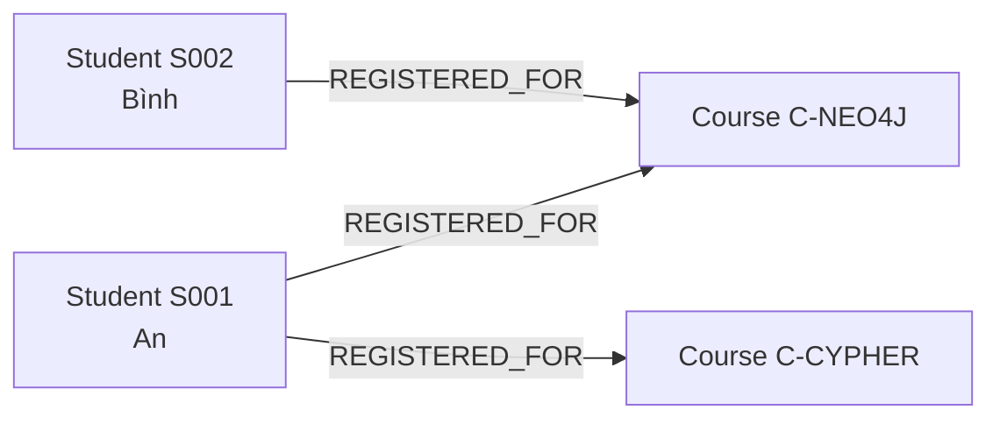

# Cypher Shell: truy vấn, truyền tham số và thực thi tập lệnh

> **Chương:** Công cụ làm việc  
> **Mô-đun:** `DATABASE_ENGINE_GRAPH_NEO4J`  
> **Công cụ:** `cypher-shell` (giao diện dòng lệnh của Neo4j)

## 1. Cypher Shell giải quyết vấn đề gì?

Neo4j là cơ sở dữ liệu **property graph**: node biểu diễn thực thể, relationship biểu diễn liên kết có hướng, label và relationship type phân loại cấu trúc, còn property lưu dữ liệu. Người phát triển dùng **Cypher** để tìm node, duyệt quan hệ, truy vấn đường đi, tạo hoặc cập nhật dữ liệu và kiểm tra hiệu năng.

Trong hệ sinh thái công cụ Neo4j, **Cypher Shell** cho phép kết nối database và gửi Cypher bằng terminal. Điểm mạnh của nó là lệnh có thể chạy **tương tác**, **được tham số hóa** và **đọc từ file** — rất phù hợp cho kiểm thử dữ liệu, tái hiện lỗi và tự động hóa tác vụ có kiểm soát.

| Công cụ | Cách tương tác | Trường hợp dùng phù hợp |
| --- | --- | --- |
| **Neo4j Browser** | Trình soạn thảo có kết quả Graph/Table và điều khiển trực quan | Khám phá node/relationship, xem đường đi bằng sơ đồ. |
| **Cypher Shell** | Terminal, kết quả dạng văn bản/bảng, thực thi script | Chạy truy vấn lặp lại, thao tác từ máy chủ, kiểm tra dữ liệu, pipeline. |
| **Neo4j Java Driver** | API được gọi từ mã Java | Thực thi câu lệnh với tham số, quản lý session/transaction trong ứng dụng. |
| **Spring Data Neo4j** | Repository, mapping object và thao tác dữ liệu từ Spring | Phát triển tầng truy cập graph trong ứng dụng Spring. |

Cypher Shell không vẽ đồ thị bằng các node và cạnh như Browser. Nếu cần dựng sơ đồ, dùng Browser; nếu cần ghi lại câu lệnh để chạy lại trên máy khác, Cypher Shell thường thuận tiện hơn.

**Mục tiêu của bài:** (1) kết nối đúng Neo4j instance và database; (2) chạy Cypher trong terminal; (3) dùng tham số an toàn; (4) tạo và chạy script `.cypher`; (5) hiểu kết quả, mã thoát và những giới hạn của việc chạy nhiều câu lệnh.

## 2. Chuẩn bị môi trường và tìm lệnh cypher-shell

### 2.1. Điều kiện cần

- Có **Neo4j DBMS/instance** đang hoạt động và tài khoản được cấp quyền.
- Có công cụ **Cypher Shell** tương thích với môi trường Neo4j; nếu dùng bản cài đặt Neo4j Server, tiện ích thường nằm trong thư mục `bin`.
- Biết **URI kết nối**, **username**, **database** và cách lấy mật khẩu. Ví dụ local hay dùng `bolt://localhost:7687`, username `neo4j`, database `neo4j`; đây là ví dụ cấu hình mặc định, không phải thông tin đúng cho mọi hệ thống.
- Terminal phù hợp: Bash/zsh trên Linux/macOS, PowerShell trên Windows, hoặc shell trong container nếu Neo4j được chạy bằng Docker.

Kiểm tra tiện ích:

```bash
cypher-shell --version
cypher-shell --help
```

Trên máy cài Neo4j bằng file phân phối, nếu lệnh chưa nằm trong `PATH` thì chạy trực tiếp công cụ ở thư mục `bin` (trên Windows, có thể là file `cypher-shell.bat`). Đừng nhầm **URI kết nối database** với URL giao diện Browser; ví dụ `http://localhost:7474/browser` là địa chỉ web, còn `bolt://localhost:7687` là địa chỉ giao thức Bolt dùng cho Cypher Shell.

Nếu đã có Neo4j chạy trong container Docker, có thể mở Cypher Shell **bên trong container**:

```bash
docker exec -it neo4j cypher-shell -u neo4j -d neo4j
```

`neo4j` sau `docker exec -it` là **tên container giả định**, không phải tên bắt buộc. Thay theo môi trường thực tế. Khi chạy bên trong container, địa chỉ kết nối mặc định có thể khác với địa chỉ mà một máy bên ngoài container cần dùng.

### 2.2. Kết nối tới database

Ví dụ kết nối đến server local qua Bolt:

```bash
cypher-shell -a "bolt://localhost:7687" -u neo4j -d neo4j
```

Các tham số chính:

| Tùy chọn | Ý nghĩa |
| --- | --- |
| `-a`, `--address` | URI Neo4j, ví dụ `bolt://localhost:7687`. |
| `-u`, `--username` | Tên đăng nhập. |
| `-p`, `--password` | Mật khẩu; nên tránh đưa trực tiếp vào câu lệnh vì dễ lộ qua history/process. |
| `-d`, `--database` | Chọn database để thực thi truy vấn. |
| `-f`, `--file` | Đọc và chạy câu lệnh từ một file script. |
| `--param` | Cấp giá trị tham số Cypher khi khởi động Shell. |
| `--format` | Chọn định dạng đầu ra theo các giá trị mà phiên bản đang dùng hỗ trợ. |

Khi bỏ `-p`, Cypher Shell có thể yêu cầu nhập mật khẩu qua terminal tương tác. Trong pipeline không có terminal tương tác, hãy dùng cơ chế quản lý secret và cách cấp credential phù hợp với phiên bản triển khai; không ghi mật khẩu thật vào mã nguồn, tài liệu hoặc log.

Với Neo4j AuraDB, URI thường có dạng:

```text
neo4j+s://<instance-id>.databases.neo4j.io
```

`neo4j+s://` là lựa chọn kết nối Neo4j bảo mật với xác minh chứng chỉ. Sử dụng URI được cấp cho đúng instance; đừng tùy ý đổi thành `bolt://` hoặc tắt TLS để bỏ qua lỗi cấu hình.

### 2.3. Xác minh kết nối và phiên bản

Sau khi vào dấu nhắc của Cypher Shell, chạy:

```cypher
RETURN 'Cypher Shell hoạt động' AS thongBao,
       2 + 3 AS ketQua;
```

Dự kiến một hàng có `ketQua = 5`. Đây là truy vấn chỉ đọc và không đòi hỏi database phải có node nào.

Để kiểm tra phiên bản Neo4j từ database (nếu tài khoản có quyền), có thể dùng:

```cypher
CALL dbms.components()
YIELD name, versions
RETURN name, versions;
```

Tên database và thông tin cấu hình quyền có thể khác tùy triển khai; nên xác nhận môi trường trước khi thực hiện thao tác ghi.

## 3. Chạy Cypher ở chế độ tương tác

Sau khi kết nối thành công, Shell hiển thị dấu nhắc để nhập lệnh. Ví dụ:

```cypher
RETURN 'Xin chào Neo4j' AS loiChao;
```

Khi viết Cypher trong Shell, dùng dấu **chấm phẩy `;`** để kết thúc một câu lệnh. Với câu lệnh dài, bạn có thể nhập trên nhiều dòng và chỉ đặt `;` ở dòng cuối:

```cypher
UNWIND [1, 2, 3, 4, 5] AS n
RETURN n,
       n * n AS binhPhuong
ORDER BY n;
```

Kết quả là năm hàng theo thứ tự từ 1 đến 5. `UNWIND` biến một danh sách thành các hàng; `RETURN` chọn cột, `AS` đặt bí danh, `ORDER BY` giữ thứ tự ổn định.

### 3.1. Lệnh điều khiển Shell và câu lệnh Cypher

Cypher Shell có các lệnh điều khiển bắt đầu bằng `:`. Chúng không phải cú pháp truy vấn gửi nguyên trạng đến database.

| Lệnh | Công dụng |
| --- | --- |
| `:help` | Liệt kê hướng dẫn/lệnh hỗ trợ trong phiên bản đang dùng. |
| `:history` | Xem lịch sử lệnh. |
| `:param` và `:params` | Thiết lập và xem các tham số của phiên làm việc. |
| `:use tenDatabase` | Chuyển database hiện hành nếu user có quyền và phiên bản hỗ trợ. |
| `:exit` | Kết thúc phiên Cypher Shell. |

Không cần chấm phẩy ở cuối **lệnh điều khiển** như `:help`. Ngược lại, nên luôn kết thúc câu lệnh Cypher bằng `;`, nhất là khi chuẩn bị chuyển từ thao tác tương tác sang script.

Thử khám phá graph bằng truy vấn chỉ đọc:

```cypher
MATCH (n)
RETURN labels(n) AS nhan,
       count(n) AS soNode
ORDER BY soNode DESC
LIMIT 10;
```

Câu lệnh chỉ tổng hợp số node theo tập label có thật trong database bạn đang kết nối. `LIMIT 10` giới hạn **10 dòng kết quả**, không có nghĩa chỉ khảo sát 10 node.

### 3.2. Kết quả hiển thị như thế nào?

Cypher Shell thường in hàng và cột ở dạng văn bản. Khi `RETURN` chứa node hoặc relationship, Shell vẫn trả giá trị biểu diễn dạng text; nó không tự mở khung Graph. Khi cần báo cáo hoặc kiểm tra tự động, nên trả về các property và giá trị scalar:

```cypher
MATCH (n)
RETURN elementId(n) AS maNoiBo,
       labels(n) AS labels
LIMIT 5;
```

`elementId` trả định danh nội bộ để tham chiếu trong phạm vi sử dụng phù hợp; không nên dùng nó làm khóa nghiệp vụ ổn định. Trong ví dụ nghiệp vụ bên dưới, chúng ta dùng `studentId` và `courseId` riêng.

## 4. Chuẩn bị bộ dữ liệu mẫu nhỏ

Hãy thực hành trong **database thử nghiệm**. Ví dụ dùng label `ShellDemoStudent` và `ShellDemoCourse` để giảm nguy cơ trùng với dữ liệu thật; các câu lệnh sau **có ghi dữ liệu**.

```cypher
MERGE (an:ShellDemoStudent {studentId: 'S001'})
SET an.name = 'An'
MERGE (binh:ShellDemoStudent {studentId: 'S002'})
SET binh.name = 'Bình'
MERGE (neo4j:ShellDemoCourse {courseId: 'C-NEO4J'})
SET neo4j.title = 'Nhập môn Neo4j'
MERGE (cypher:ShellDemoCourse {courseId: 'C-CYPHER'})
SET cypher.title = 'Cypher căn bản'
MERGE (an)-[r1:REGISTERED_FOR]->(neo4j)
SET r1.registeredAt = date('2026-01-15')
MERGE (an)-[r2:REGISTERED_FOR]->(cypher)
SET r2.registeredAt = date('2026-02-01')
MERGE (binh)-[r3:REGISTERED_FOR]->(neo4j)
SET r3.registeredAt = date('2026-02-02')
RETURN 'Đã chuẩn bị dữ liệu mẫu' AS thongBao;
```

Đoạn ví dụ tạo **hai học viên**, **hai khóa học** và **ba quan hệ `REGISTERED_FOR`** khi database chưa có các phần tử này. `MERGE` tìm mẫu có sẵn rồi mới tạo; chạy lại trên bộ dữ liệu demo vừa sinh thông thường không nhân đôi các quan hệ. Với ứng dụng thật hoặc ghi đồng thời từ nhiều phiên, nên tạo uniqueness constraint cho các khóa nghiệp vụ để bảo vệ tính duy nhất; `MERGE` riêng lẻ chưa thay thế ràng buộc này.

Có thể tự kiểm tra bằng truy vấn chỉ đọc:

```cypher
MATCH (s:ShellDemoStudent)-[r:REGISTERED_FOR]->(c:ShellDemoCourse)
RETURN s.studentId AS maHocVien,
       s.name AS hocVien,
       c.title AS khoaHoc,
       toString(r.registeredAt) AS ngayDangKy
ORDER BY maHocVien, khoaHoc;
```

Kỳ vọng có ba dòng:

| maHocVien | hocVien | khoaHoc | ngayDangKy |
| --- | --- | --- | --- |
| S001 | An | Cypher căn bản | 2026-02-01 |
| S001 | An | Nhập môn Neo4j | 2026-01-15 |
| S002 | Bình | Nhập môn Neo4j | 2026-02-02 |

Hình dung mẫu dữ liệu:



Sơ đồ chỉ là minh họa khái niệm trong tài liệu; trên terminal, các câu lệnh trả về **bảng ký tự**.

## 5. Truyền tham số trong phiên tương tác

### 5.1. Tại sao cần tham số?

Giả sử cần tìm khóa học của từng học viên. Cách thay trực tiếp `'S001'` thành `'S002'` trong câu Cypher vẫn chạy được, nhưng dễ dẫn đến sao chép/chỉnh sửa nhiều nơi. **Parameter** tách **giá trị đầu vào** khỏi **cấu trúc truy vấn**: một câu Cypher có thể dùng cho nhiều mã học viên.

Trong phiên Cypher Shell, khai báo bằng lệnh:

```text
:param studentId => 'S001'
```

Kiểm tra các tham số đã đặt:

```text
:params
```

Sau đó chạy Cypher:

```cypher
MATCH (s:ShellDemoStudent {studentId: $studentId})
      -[r:REGISTERED_FOR]->(c:ShellDemoCourse)
RETURN s.name AS hocVien,
       c.title AS khoaHoc,
       r.registeredAt AS ngayDangKy
ORDER BY khoaHoc;
```

`$studentId` là cách **tham chiếu** giá trị tham số từ Cypher. Dấu `$` thuộc cú pháp Cypher; dấu `=>` ở lệnh `:param` dùng để gán biểu thức cho tham số của Shell.

Đổi đầu vào mà không sửa câu truy vấn:

```text
:param studentId => 'S002'
```

Chạy lại cùng `MATCH`: kết quả chỉ còn khóa học **Nhập môn Neo4j** của Bình. Đây cũng là cách thiết kế câu Cypher sẽ dùng với **Java Driver** hoặc **Spring Data Neo4j**: truyền tham số theo API của thư viện, không ghép giá trị vào chuỗi truy vấn.

### 5.2. Tham số có kiểu dữ liệu

Giá trị tham số không chỉ là string; chúng có thể là số, boolean, ngày hoặc danh sách. Ví dụ:

```text
:param minEnrollments => 2
```

```cypher
MATCH (:ShellDemoStudent)-[r:REGISTERED_FOR]->(c:ShellDemoCourse)
WITH c, count(r) AS soLuot
WHERE soLuot >= $minEnrollments
RETURN c.title AS khoaHoc, soLuot
ORDER BY soLuot DESC;
```

Kết quả mẫu: **Nhập môn Neo4j — 2 lượt**. Đổi `minEnrollments` thành 1 để nhận cả hai khóa học.

Để lọc theo ngày, truyền biểu thức Cypher tương ứng với kiểu ngày (phụ thuộc ngữ cảnh truyền tham số):

```text
:param fromDate => date('2026-02-01')
```

```cypher
MATCH (s:ShellDemoStudent)-[r:REGISTERED_FOR]->(c:ShellDemoCourse)
WHERE r.registeredAt >= $fromDate
RETURN s.name AS hocVien, c.title AS khoaHoc, r.registeredAt AS ngayDangKy
ORDER BY ngayDangKy, hocVien;
```

Kết quả ví dụ có **hai đăng ký** từ ngày 2026-02-01 trở đi. Sử dụng kiểu `DATE` giúp so sánh theo thời gian đúng nghĩa thay vì so sánh các chuỗi tùy định dạng.

### 5.3. Lỗi thường gặp khi dùng tham số

- Chưa khai báo tham số → thông báo thiếu `$studentId` hoặc `$fromDate`.
- Tên khác chữ hoa/chữ thường → `$studentId` khác `$StudentId`.
- Viết `'$studentId'` trong truy vấn → đây chỉ là **chuỗi ký tự**, không phải tham chiếu tham số. Hãy viết `studentId: $studentId` mà không đặt trong dấu nháy.
- Giá trị sai kiểu → ví dụ so sánh `DATE` với một chuỗi không chuyển đổi có thể gây lỗi kiểu dữ liệu. Dùng `date(...)` khi cần kiểu ngày.
- Tham số không tự biến một đoạn text thành toàn bộ cú pháp Cypher. Dùng tham số cho **giá trị dữ liệu**; không thay nguyên câu truy vấn bằng đầu vào người dùng.

## 6. Truyền tham số từ dòng lệnh khi khởi động

Khi cần chạy một truy vấn có tham số **mà không vào phiên tương tác**, dùng tùy chọn `--param` của Cypher Shell.

Ví dụ thực thi một câu Cypher ngay trên dòng lệnh **Bash/zsh**:

```bash
cypher-shell -a "bolt://localhost:7687" -u neo4j -d neo4j \
  --param "studentId => 'S001'" \
  'MATCH (s:ShellDemoStudent {studentId: $studentId}) RETURN s.name AS ten;'
```

Trong Bash/zsh, ký tự `\` ở cuối dòng nối tiếp lệnh. Nếu chạy **PowerShell**, hãy viết trên một dòng để tránh nhầm quy tắc nối dòng:

```powershell
cypher-shell -a "bolt://localhost:7687" -u neo4j -d neo4j --param "studentId => 'S001'" 'MATCH (s:ShellDemoStudent {studentId: $studentId}) RETURN s.name AS ten;'
```

Lưu ý quan trọng về dấu nháy:

- `--param "studentId => 'S001'"` truyền biểu thức tham số chứa string `'S001'`. Đặt **ngoặc kép** ở lớp terminal để không làm mất ngoặc đơn bên trong biểu thức.
- Bọc **ngoặc đơn bên ngoài câu Cypher** để Bash và PowerShell không mở rộng `$studentId` thành biến của terminal. Dùng ngoặc kép bên ngoài cả câu Cypher có thể khiến terminal diễn giải sai giá trị tham số trước khi câu truy vấn đến được Neo4j.

Trong PowerShell, cách dùng ngoặc đơn bên ngoài câu Cypher như trên cũng tránh việc PowerShell diễn giải `$studentId` thành biến của terminal. Nếu cần câu truy vấn nhiều dòng hoặc có nhiều dấu nháy, cách dùng **file script** ở mục tiếp theo thường dễ bảo trì hơn.

Không đưa `-p matKhauThat` vào lịch sử terminal để “chạy nhanh”. Tùy phiên bản và môi trường, Cypher Shell có thể hỏi mật khẩu tương tác hoặc bạn phải cấu hình credential qua kênh bảo mật cho tác vụ tự động.

## 7. Viết và thực thi file .cypher

### 7.1. Viết script có nhiều câu lệnh

Tạo một file ví dụ tên `scripts/report-enrollments.cypher` trong thư mục làm việc của **người học** (đây là **tên file minh họa**, không phải yêu cầu tạo file bổ sung cho bài học). Nội dung:

```cypher
// 1. Liệt kê học viên
MATCH (s:ShellDemoStudent)
RETURN s.studentId AS maHocVien, s.name AS ten
ORDER BY maHocVien;

// 2. Tổng hợp lượt đăng ký
MATCH (:ShellDemoStudent)-[r:REGISTERED_FOR]->(c:ShellDemoCourse)
RETURN c.courseId AS maKhoaHoc,
       c.title AS khoaHoc,
       count(r) AS soLuot
ORDER BY soLuot DESC, maKhoaHoc;
```

Lưu file bằng **UTF-8**, nên dùng UTF-8 không BOM để hạn chế vấn đề ký tự ở công cụ dòng lệnh cũ. Đánh dấu kết thúc **từng câu Cypher bằng `;`**. Dấu `//` là comment một dòng trong Cypher; phần sau comment không được xử lý như lệnh.

Chạy script:

```bash
cypher-shell -a "bolt://localhost:7687" -u neo4j -d neo4j \
  --file "./scripts/report-enrollments.cypher"
```

Trên PowerShell, có thể viết một dòng:

```powershell
cypher-shell -a "bolt://localhost:7687" -u neo4j -d neo4j --file ".\scripts\report-enrollments.cypher"
```

Tùy chọn tương đương dạng ngắn là `-f`. Đường dẫn file được giải quyết theo **working directory của tiến trình** nếu bạn dùng đường dẫn tương đối; khi chạy từ thư mục khác, hãy điều chỉnh đường dẫn hoặc dùng đường dẫn tuyệt đối.

### 7.2. Thực thi script có tham số

Tạo file minh họa `scripts/find-student.cypher`:

```cypher
MATCH (s:ShellDemoStudent {studentId: $studentId})
      -[r:REGISTERED_FOR]->(c:ShellDemoCourse)
RETURN s.name AS hocVien, c.title AS khoaHoc
ORDER BY khoaHoc;
```

Chạy với tham số S001:

```bash
cypher-shell -a "bolt://localhost:7687" -u neo4j -d neo4j \
  --param "studentId => 'S001'" \
  --file "./scripts/find-student.cypher"
```

Đổi thành S002 chỉ bằng cách đổi giá trị `--param`. Cách làm này đặc biệt phù hợp khi tích hợp script trong pipeline: file Cypher giữ ổn định, còn giá trị đầu vào được cấp từ cấu hình chạy.

Nếu môi trường hoặc phiên bản hỗ trợ nhiều `--param`, hãy xem `cypher-shell --help` để dùng đúng cú pháp. Bài học ưu tiên một tham số cho mỗi ví dụ để tránh phụ thuộc vào chi tiết tùy phiên bản.

### 7.3. Chạy từ standard input

Trong các môi trường hỗ trợ stdin, có thể truyền Cypher qua pipe, ví dụ trên Bash:

```bash
printf 'RETURN 1 + 1 AS ketQua;\n' | \
  cypher-shell -a "bolt://localhost:7687" -u neo4j -d neo4j
```

Hoặc đọc file qua pipe:

```bash
cat "./scripts/report-enrollments.cypher" | \
  cypher-shell -a "bolt://localhost:7687" -u neo4j -d neo4j
```

Nếu tác vụ không có terminal tương tác, phải cấu hình credential bằng cơ chế an toàn có sẵn; không thể giả định prompt nhập mật khẩu vẫn hoạt động bình thường khi stdin đang dùng để nhận script. Với file có sẵn, `--file` thường rõ ràng hơn vì tránh nhầm giữa dữ liệu stdin và đầu vào tương tác.

### 7.4. Script không mặc nhiên là một transaction duy nhất

**Điểm quan trọng:** Một file chứa nhiều câu Cypher không tự bảo đảm rằng **toàn bộ file** được commit hoặc rollback như một đơn vị. Trong cách chạy thông thường, các statement được thực thi theo thứ tự; câu trước có thể đã ghi thành công trước khi câu sau báo lỗi.

Ví dụ:

```cypher
// Có thể ghi dữ liệu thành công
CREATE (:ShellDemoLog {message: 'step 1'});

// Statement tiếp theo có thể lỗi vì tham số không tồn tại
RETURN $unknownParameter AS ketQua;
```

Đừng dựa vào giả định “lỗi ở cuối file sẽ tự hủy mọi câu ghi ở đầu file”. Khi cần tính **all-or-nothing** giữa nhiều thao tác, hãy thiết kế transaction tường minh bằng cơ chế được hỗ trợ trong phiên bản đang dùng hoặc chuyển phần phối hợp transaction sang Neo4j Java Driver. Các kịch bản cập nhật production cần kiểm tra rollback, tính lặp lại và cách xử lý lỗi trước khi triển khai.

## 8. Điều khiển đầu ra để dùng trong script tự động

Ở terminal, Cypher Shell có thể hiển thị dữ liệu theo nhiều cách tùy phiên bản. Xem mô tả thực tế:

```bash
cypher-shell --help
```

Với phiên bản hỗ trợ định dạng `plain`, thử:

```bash
cypher-shell -a "bolt://localhost:7687" -u neo4j -d neo4j \
  --format plain \
  'MATCH (s:ShellDemoStudent) RETURN s.studentId AS id ORDER BY id;'
```

Định dạng này thuận tiện hơn khi lấy kết quả cho script khác xử lý, nhưng đầu ra CLI vẫn là **văn bản của công cụ**, không nhất thiết là CSV có escaping theo chuẩn. Nếu cần dữ liệu xuất khẩu đáng tin cậy, hãy chọn công cụ xuất dữ liệu phù hợp hoặc sử dụng Neo4j Driver để xây dựng JSON/CSV đúng định dạng.

Khi dùng Bash hoặc PowerShell để kiểm tra kết quả lệnh, hãy phân biệt:

- **stdout:** dữ liệu hoặc bản trình bày kết quả truy vấn.
- **stderr:** thông báo lỗi hoặc chẩn đoán.
- **exit code:** trạng thái kết thúc của tiến trình theo quy ước hệ điều hành.

Bash:

```bash
cypher-shell -a "bolt://localhost:7687" -u neo4j -d neo4j \
  'RETURN 1 AS ok;'
echo $?
```

PowerShell:

```powershell
cypher-shell -a "bolt://localhost:7687" -u neo4j -d neo4j 'RETURN 1 AS ok;'
$LASTEXITCODE
```

Thông thường mã thoát **0** nghĩa là tiến trình kết thúc thành công; giá trị khác 0 nghĩa là đã xảy ra lỗi. Hãy đọc thêm nội dung lỗi để biết có phải lỗi kết nối, xác thực, cú pháp, phân quyền hay lỗi truy vấn.

Để script tự động hóa đáng tin cậy, nên có quy ước: **kiểm tra exit code, giữ log chẩn đoán, dừng pipeline khi bước quan trọng thất bại, và kiểm tra dữ liệu đầu ra**. Nếu phiên bản cung cấp tùy chọn như `--fail-fast`, đọc `--help` và chọn hành vi dừng phù hợp thay vì mặc định mọi phiên bản như nhau.

## 9. Tác vụ truy vấn và kiểm tra dữ liệu thực tế

### 9.1. Kiểm tra dữ liệu đầu vào trước khi chạy script ghi

Trước một thao tác cập nhật, chạy truy vấn chỉ đọc để xác nhận số node/relationship đích:

```cypher
MATCH (s:ShellDemoStudent)
RETURN count(s) AS soHocVien;
```

Truy vấn trên bộ dữ liệu mẫu ban đầu trả `soHocVien = 2`. Nếu khác, xác minh **database**, **label** và trạng thái dữ liệu trước khi tiếp tục.

### 9.2. Lọc và tổng hợp bằng parameter

```text
:param minCount => 2
```

```cypher
MATCH (s:ShellDemoStudent)-[:REGISTERED_FOR]->(c:ShellDemoCourse)
WITH c, count(s) AS soHocVien
WHERE soHocVien >= $minCount
RETURN c.courseId AS maKhoaHoc, c.title AS khoaHoc, soHocVien
ORDER BY soHocVien DESC;
```

Kết quả mẫu gồm khóa học `C-NEO4J` với hai học viên. Trong dataset thực, phép `count(s)` đếm các hàng khớp; nếu có thể có nhiều quan hệ ghi danh của cùng học viên đến một khóa, dùng `count(DISTINCT s)` khi yêu cầu nghiệp vụ là **số học viên khác nhau**.

### 9.3. Xem kế hoạch truy vấn ngay trên terminal

Cypher Shell cũng thực thi `EXPLAIN` và `PROFILE`:

```cypher
EXPLAIN
MATCH (s:ShellDemoStudent {studentId: 'S001'})
      -[:REGISTERED_FOR]->(c:ShellDemoCourse)
RETURN c.title;
```

`EXPLAIN` xây dựng kế hoạch mà **không chạy** truy vấn; `PROFILE` thực thi truy vấn để thu thập số liệu thực tế về toán tử. Với câu lệnh chỉ đọc, `PROFILE` phù hợp để kiểm tra có scan hay dùng index. Nếu chuyển sang câu lệnh ghi, **PROFILE cũng thực hiện thao tác ghi**. Kế hoạch/định dạng in ra khác nhau tùy phiên bản Neo4j.

### 9.4. Tại sao không dùng một script cho mọi môi trường?

Một script có thể chứa `CREATE`, `MERGE`, `SET`, `DELETE` hoặc thay đổi schema (index/constraint). Khi chạy sai database, hậu quả có thể vượt xa một truy vấn đọc. Để vận hành an toàn:

1. Tách script chỉ đọc khỏi script thay đổi dữ liệu.
2. Ghi rõ môi trường và database đích trong cách gọi `-a` và `-d`.
3. Kiểm tra điều kiện đầu vào, số bản ghi mục tiêu và quyền trước khi ghi.
4. Giữ script trong hệ thống quản lý phiên bản để có thể review và tái lập.
5. Thiết kế script chạy lặp lại có chủ đích; khi phù hợp dùng `MERGE` và constraint, không mặc định mọi câu `CREATE` đều idempotent.

Đây là cầu nối giữa các bài thực hành CLI và các chủ đề vận hành, index, constraint, nhập dữ liệu, tối ưu Cypher, Java Driver và Spring Data Neo4j.

## 10. Những lỗi thường gặp

| Triệu chứng | Nguyên nhân có thể | Hướng xử lý |
| --- | --- | --- |
| `cypher-shell: command not found` hoặc lệnh không được nhận diện | Chưa cài công cụ hoặc thư mục `bin` không nằm trong `PATH` | Kiểm tra bản cài đặt, dùng đúng executable theo hệ điều hành, thử `--version`. |
| `Connection refused` / timeout | DBMS chưa chạy, sai host/cổng, mạng hoặc firewall chặn | Kiểm tra instance, URI Bolt và kết nối mạng; phân biệt `7474` (HTTP Browser) với `7687` (Bolt mặc định). |
| TLS/SSL hoặc lỗi xác minh chứng chỉ | Scheme URI hoặc chứng chỉ không khớp | Sử dụng đúng URI do instance cung cấp, đặc biệt với AuraDB; không tắt bảo mật tùy tiện. |
| `Authentication failed` | Sai username/password hoặc tài khoản bị khóa | Kiểm tra credential qua kênh quản trị đã được cấp; tránh log password. |
| `Database not found` / `Access denied` | Sai `-d` hoặc user thiếu quyền | Xác minh tên database hiện có và quyền truy cập. |
| Lệnh nhập nhiều dòng chưa chạy | Thiếu dấu `;` cuối statement | Thêm chấm phẩy rồi gửi; kiểm tra dấu ngoặc và dấu nháy chưa đóng. |
| Thiếu tham số `$studentId` | Không có `:param` hoặc `--param` tương ứng | Dùng `:params` ở phiên tương tác, hoặc cấp `--param` khi gọi lệnh. |
| `$studentId` biến mất trong Bash/PowerShell | Terminal đã mở rộng biến trong chuỗi ngoặc kép | Bọc toàn bộ câu Cypher bằng **ngoặc đơn** ở shell phù hợp, hoặc dùng `--file`. |
| File không được tìm thấy | Sai working directory hoặc sai đường dẫn `--file` | Kiểm tra vị trí file và đường dẫn tuyệt đối/tương đối. |
| Chạy script được vài câu rồi báo lỗi | Một statement lỗi; câu trước có thể đã ghi | Đọc lỗi, xác định bước đã chạy, không giả định tự rollback toàn file; thiết kế giao dịch phù hợp. |
| Truy vấn trả 0 rows | Sai database/label/type/property/parameter hoặc chưa tạo dữ liệu | Chạy truy vấn đếm, đối chiếu đúng database và mã khóa nghiệp vụ. |
| Kết quả hiển thị lạ với ký tự tiếng Việt | Mã hóa file hoặc terminal không thống nhất | Lưu script UTF-8, kiểm tra mã hóa terminal và font hiển thị. |

Để chẩn đoán hiệu quả, đi từ **tiện ích CLI → URI và xác thực → database → câu Cypher → tham số → dữ liệu thực tế → mã thoát và log**.

## 11. Bài thực hành tự kiểm tra

Các bài dưới đây dùng bộ dữ liệu `ShellDemoStudent`/`ShellDemoCourse` ở mục 4; thực hiện trên database thử nghiệm.

**Bài 1 — Kết nối:** chạy `cypher-shell --version`, kết nối database và thực thi `RETURN 10 * 3 AS ketQua;`. Kết quả dự kiến là `30`.

**Bài 2 — Truy vấn có kết quả bảng:** viết Cypher liệt kê học viên và khóa học, sắp xếp theo `studentId` và `title`. Kết quả dự kiến **3 dòng**.

**Bài 3 — Tham số tương tác:** đặt `:param studentId => 'S001'`, chạy truy vấn tìm khóa học với `$studentId`. Đổi thành `S002` mà không thay câu Cypher; số dòng đổi từ **2** thành **1**.

**Bài 4 — Tham số dòng lệnh:** gọi `cypher-shell` kèm `--param "studentId => 'S001'"` và chạy truy vấn ở mục 6. Quan sát kết quả và thử cách bọc dấu nháy hợp với terminal đang dùng.

**Bài 5 — Script:** viết hai câu truy vấn `MATCH ... RETURN ...;` trong một file `report.cypher` rồi chạy bằng `--file`. Giải thích tại sao cần dấu `;` kết thúc mỗi câu và khi nào chọn file thay vì dán lệnh trực tiếp.

**Bài 6 — Lỗi có chủ đích:** trong database thử nghiệm, chạy truy vấn đọc sử dụng một tham số chưa khai báo, quan sát thông báo lỗi; thêm `:param` rồi chạy lại. Kiểm tra mã thoát nếu thực thi ở chế độ không tương tác.

**Bài 7 — Hiệu năng:** dùng `EXPLAIN` và `PROFILE` trên một truy vấn đọc; ghi nhận sự khác biệt giữa kế hoạch dự kiến và số liệu thực thi.

### Dọn dữ liệu mẫu sau thực hành

Chỉ thực hiện trên **database thử nghiệm** sau khi đã xác nhận node đích. Đầu tiên kiểm tra:

```cypher
MATCH (n)
WHERE (n:ShellDemoStudent AND n.studentId IN ['S001', 'S002'])
   OR (n:ShellDemoCourse AND n.courseId IN ['C-NEO4J', 'C-CYPHER'])
RETURN labels(n) AS nhan, properties(n) AS duLieu;
```

Sau khi kiểm tra các node được chọn đúng là dữ liệu thực hành, bạn có thể chủ động xóa:

```cypher
MATCH (n)
WHERE (n:ShellDemoStudent AND n.studentId IN ['S001', 'S002'])
   OR (n:ShellDemoCourse AND n.courseId IN ['C-NEO4J', 'C-CYPHER'])
DETACH DELETE n;
```

`DETACH DELETE` xóa node và **mọi relationship liên kết với node đó**. Vì vậy đừng dùng trên database chung nếu những node mẫu đã có liên kết với dữ liệu khác. Nếu từng chạy ví dụ tạo `ShellDemoLog` ở mục 7.4, đó là một label riêng: kiểm tra và xử lý riêng theo dữ liệu thực tế, không dùng một câu xóa mọi node trong DB.

## 12. Ghi nhớ

- **Cypher Shell** là công cụ dòng lệnh để tương tác với Neo4j qua Bolt; thích hợp chạy câu Cypher lặp lại và tự động hóa.
- Trong phiên tương tác, viết Cypher và kết thúc statement bằng **`;`**; phân biệt lệnh điều khiển `:...` với Cypher.
- Dùng `:param` hoặc `--param` để truyền **giá trị có kiểu** vào `$tenThamSo`, giảm nhu cầu sửa trực tiếp truy vấn.
- Dùng `--file` để chạy một hoặc nhiều câu Cypher từ file UTF-8; kiểm tra working directory và dấu kết thúc câu lệnh.
- **Không giả định toàn bộ file là một transaction.** Lệnh trước có thể đã ghi dù lệnh sau lỗi.
- Với script tự động: bảo vệ credential, kiểm tra database, theo dõi exit code và log, thiết kế xử lý lỗi và tính lặp lại.
- Thao tác đồ thị trực quan dành cho Browser; quản lý giao dịch trong mã ứng dụng nên sử dụng Neo4j Java Driver hoặc tầng truy cập dữ liệu phù hợp.

## 13. Tài liệu tham khảo chính thức

- [Neo4j — Cypher Shell (Operations Manual)](https://neo4j.com/docs/operations-manual/current/tools/cypher-shell/)
- [Neo4j — Cypher Manual](https://neo4j.com/docs/cypher-manual/current/)
- [Neo4j — Cypher query parameters](https://neo4j.com/docs/cypher-manual/current/syntax/parameters/)
- [Neo4j — Java Driver Manual](https://neo4j.com/docs/java-manual/current/)

Các tùy chọn có thể thay đổi theo phiên bản Cypher Shell và Neo4j DBMS; khi triển khai thật, luôn đối chiếu `cypher-shell --help` trên đúng môi trường để chọn cờ và cách xác thực phù hợp.
