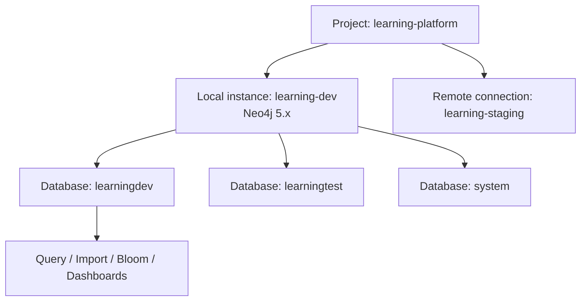
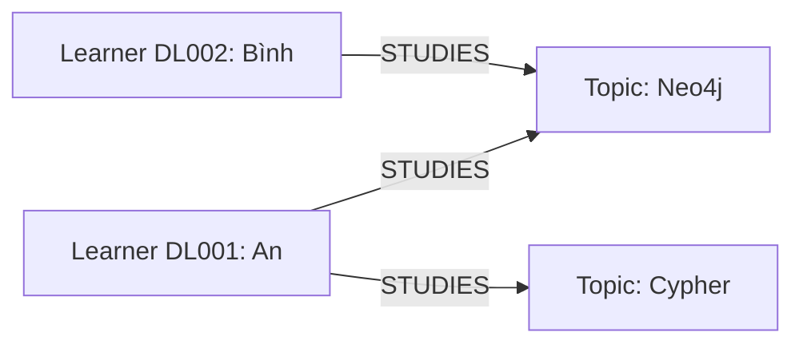

# Neo4j Desktop và cách tổ chức môi trường phát triển khi sử dụng

> **Chương:** Công cụ làm việc  
> **Mô-đun:** `DATABASE_ENGINE_GRAPH_NEO4J`  
> **Phạm vi:** Neo4j Desktop 2.x và các DBMS Neo4j tương thích.

## 1. Neo4j Desktop phục vụ bước nào trong quy trình phát triển?

Trong mô-đun này, Neo4j được dùng để mô hình hóa dữ liệu liên kết theo **property graph**: node biểu diễn thực thể, relationship biểu diễn liên kết có hướng, label/type phân loại phần tử, property lưu thuộc tính. Cypher giúp truy vấn các quan hệ và đường đi; các chủ đề tiếp theo gồm index, constraint, tối ưu truy vấn, nhập dữ liệu, Java Driver, Spring Data Neo4j và vận hành graph database.

**Neo4j Desktop** là ứng dụng dành cho nhà phát triển, giúp tạo và quản lý Neo4j DBMS trên máy cá nhân, kết nối database từ xa, dùng các công cụ phân tích và thử nghiệm graph. Desktop đặc biệt hữu ích khi người học cần:

- Khởi tạo nhanh database độc lập cho bài thực hành.
- Chạy Cypher và xem node, relationship ở dạng đồ thị.
- Thử lược đồ, constraint, index và các phép truy vấn đường đi.
- Import dữ liệu CSV trước khi kết nối ứng dụng Java/Spring.
- Theo dõi phiên bản Neo4j, cài plugin, xem log, export/clone database.
- Phân chia dữ liệu thử nghiệm và dữ liệu dùng để kiểm thử ứng dụng.

Desktop không tự triển khai một hệ thống production. Đối với ứng dụng cần chạy liên tục cho nhiều người dùng, DBMS thường được vận hành trên server, Neo4j AuraDB hoặc hạ tầng được quản lý riêng.

### Phân biệt Desktop và các công cụ liên quan

| Công cụ | Vai trò | Ví dụ sử dụng |
| --- | --- | --- |
| **Neo4j Desktop** | Quản lý local instance, database, project và kết nối từ xa. | Tạo môi trường phát triển độc lập trên laptop. |
| **Query** trong Desktop 2.x | Chạy Cypher; xem kết quả Graph, Table, RAW. | Xem quan hệ giữa học viên và khóa học. |
| **Neo4j Browser** độc lập | Giao diện tương tác Cypher tương tự Query. | Khám phá graph qua giao diện web/ứng dụng riêng. |
| **Cypher Shell** | Dòng lệnh chạy Cypher, tham số, script. | Chạy truy vấn lặp lại từ terminal/pipeline. |
| **Java Driver / Spring Data Neo4j** | Kết nối database từ mã ứng dụng. | Lập trình repository, truy vấn có tham số, transaction. |

Trong **Desktop 2.x**, công cụ tích hợp chạy truy vấn tên **Query**. Hướng dẫn cũ cho Desktop 1.x có thể dùng cách gọi Browser hoặc bố cục giao diện khác; luôn kiểm tra phiên bản khi làm theo tutorial.

## 2. Ba tầng cần hiểu: Project, Instance và Database

**Project** trong Desktop 2.x là một nhóm trên giao diện để tổ chức instance. Một instance có thể thuộc nhiều project, và xóa project không có nghĩa là xóa DBMS hoặc graph.

**Instance** đại diện cho một Neo4j **DBMS**: gồm phiên bản Neo4j, thông tin kết nối, cấu hình, plugin, log và các database. Desktop có thể tạo nhiều local instance để thử các phiên bản hoặc cấu hình khác nhau.

**Database** là đơn vị chứa dữ liệu graph. Instance mới thường có một database người dùng mặc định `neo4j` và database hệ thống `system`. Với bản Enterprise Developer Edition trong Desktop, có thể thêm database người dùng; mỗi database giữ dữ liệu riêng, nhưng các database trong cùng instance vẫn chia sẻ cấu hình và tài nguyên DBMS.

**Remote connection** là thông tin kết nối đến Neo4j Server/AuraDB ở nơi khác. Desktop quản lý cách kết nối, còn vòng đời DBMS từ xa do máy chủ/dịch vụ tương ứng quản lý.



**Lưu ý về Desktop 2.3:** theo tài liệu quản lý instance, Desktop chỉ cho chạy **một local instance cùng lúc**. Khi Start local instance khác, instance đang chạy sẽ bị dừng; có thể đồng thời kết nối các instance từ xa. Đây là giới hạn của cơ chế quản lý local instance trong Desktop 2.x, không phải giới hạn tổng quát của Neo4j khi triển khai bằng Docker/server khác.

Hai thư mục cố định trên Desktop 2.x là **All instances** (mọi instance/kết nối) và **Unassigned** (chưa gắn vào project). Project chỉ là cách nhóm và tìm, **không phải thư mục mã nguồn Git** hoặc ranh giới bảo mật.

## 3. Cài đặt và tạo instance đầu tiên

### 3.1. Chuẩn bị môi trường

Tải Desktop từ [Neo4j Deployment Center](https://neo4j.com/deployment-center/), cài đặt phù hợp hệ điều hành và kiểm tra tài nguyên máy. Desktop 2.x hỗ trợ quản lý Neo4j DBMS **từ phiên bản 5.1 trở lên**; chọn bản phù hợp với yêu cầu ứng dụng. Nếu chọn phiên bản không được cài sẵn, Desktop có thể phải tải thêm tài nguyên qua internet.

Desktop đi kèm **Enterprise Edition Developer License** cho mục đích phát triển của **một người trên một máy**. Những khả năng Enterprise dùng được trong môi trường này không đồng nghĩa với quyền mang giấy phép phát triển đó lên production.

### 3.2. Các bước tạo môi trường mẫu

Đặt mục tiêu tạo database phục vụ hệ thống học trực tuyến:

1. Mở Desktop, tạo **Project** có tên `learning-platform`.
2. Trong project, chọn **Create** và tạo **local instance** tên `learning-dev-neo4j5`.
3. Chọn phiên bản Neo4j yêu cầu cho dự án; tạo username/password theo hướng dẫn.
4. Hoàn tất tạo instance và chọn **Start**.
5. Mở **Overview** hoặc instance card để kiểm tra **Connection URI**, trạng thái và phiên bản thực tế.
6. Tại danh sách **Databases**, tạo `learningdev` và `learningtest` (nếu tài khoản và phiên bản hỗ trợ).
7. Từ instance đang chạy, chọn **Connect → Query**, rồi chọn đúng database `learningdev`.

Tên nút hoặc vị trí có thể thay đổi theo bản Desktop, nhưng luồng làm việc vẫn là **Project → Instance → Start → Database → Query**.

Truy vấn xác nhận kết nối:

```cypher
RETURN 'Neo4j đã sẵn sàng' AS thongBao,
       3 * 7 AS ketQua;
```

Kỳ vọng một dòng có `ketQua = 21`. Truy vấn chỉ đọc này không yêu cầu đã có node nào trong database.

### 3.3. Database hệ thống khác database nghiệp vụ

| Database | Mục đích | Tác động |
| --- | --- | --- |
| `system` | Lưu thông tin quản trị, user/role và metadata DBMS. | Không dùng để chứa graph nghiệp vụ của bài học. |
| `neo4j` | Database người dùng mặc định ở nhiều bản cài. | Có thể dành cho thực hành chung hoặc bỏ qua nếu nhóm dùng database đặt tên riêng. |
| `learningdev` | Dữ liệu phát triển, seed nhỏ. | Lập trình viên có thể thay đổi theo bài toán. |
| `learningtest` | Fixture kiểm thử tích hợp. | Dữ liệu phải có thể tái tạo để test ổn định. |

Hai database trong cùng một instance **cô lập dữ liệu**, nhưng không tạo ra hai bộ plugin/Neo4j version khác nhau. Muốn thử cấu hình bộ nhớ, plugin hoặc Neo4j version khác nhau thì nên tạo instance riêng.

## 4. Chạy Cypher trên Query và quan sát graph

Trong khu vực **Tools → Query** (hoặc menu **Connect** ở instance card), chọn instance và database. Sau đó nhập và chạy Cypher. Query có các kết quả **Graph** (node/relationship), **Table** (hàng/cột) và **RAW** (chi tiết request/response).

### 4.1. Tạo dữ liệu demo trong learningdev

Chỉ chạy đoạn **có ghi dữ liệu** sau trên database thử nghiệm. Tên label `DesktopDemoLearner` và `DesktopDemoTopic` giúp phân biệt với dữ liệu của dự án thật.

```cypher
MERGE (an:DesktopDemoLearner {learnerId: 'DL001'})
SET an.name = 'An'
MERGE (binh:DesktopDemoLearner {learnerId: 'DL002'})
SET binh.name = 'Bình'
MERGE (neo4j:DesktopDemoTopic {topicId: 'T-NEO4J'})
SET neo4j.title = 'Neo4j'
MERGE (cypher:DesktopDemoTopic {topicId: 'T-CYPHER'})
SET cypher.title = 'Cypher'
MERGE (an)-[:STUDIES]->(neo4j)
MERGE (an)-[:STUDIES]->(cypher)
MERGE (binh)-[:STUDIES]->(neo4j)
RETURN 'Đã chuẩn bị dữ liệu demo' AS thongBao;
```

Nếu database chưa có dữ liệu trùng, mẫu gồm **2 learner, 2 topic và 3 relationship**:



`MERGE` tìm mẫu có sẵn rồi mới tạo; trong dữ liệu phát triển nhiều người ghi đồng thời, nên dùng thêm **uniqueness constraint** cho khóa nghiệp vụ. Một mình `MERGE` không thay thế được ràng buộc dữ liệu.

### 4.2. Graph và Table phục vụ hai mục đích khác nhau

Để xem đường nối:

```cypher
MATCH p = (learner:DesktopDemoLearner)-[:STUDIES]->(topic:DesktopDemoTopic)
RETURN p
LIMIT 20;
```

Chọn **Graph** để nhìn thấy hai loại node và các đường `STUDIES` có hướng. Để báo cáo dạng bảng:

```cypher
MATCH (learner:DesktopDemoLearner)-[:STUDIES]->(topic:DesktopDemoTopic)
RETURN learner.learnerId AS maNguoiHoc,
       learner.name AS nguoiHoc,
       topic.title AS chuDe
ORDER BY maNguoiHoc, chuDe;
```

Kết quả dự kiến:

| maNguoiHoc | nguoiHoc | chuDe |
| --- | --- | --- |
| DL001 | An | Cypher |
| DL001 | An | Neo4j |
| DL002 | Bình | Neo4j |

**Không suy ra toàn bộ dữ liệu database từ hình Graph**: `LIMIT 20` giới hạn số bản ghi trả về; UI có thể giới hạn số node được vẽ. Muốn kiểm tra tổng số node chính xác, dùng truy vấn đếm:

```cypher
MATCH (learner:DesktopDemoLearner)
RETURN count(learner) AS soNguoiHoc;
```

Với bộ dữ liệu ban đầu, kết quả là `2`. Lưu ý **Query History** có thể chứa lịch sử truy vấn trên nhiều database/instance: đừng mở truy vấn cũ rồi chạy lại mà chưa kiểm tra **connection selector** hiện tại.

## 5. Tổ chức development, test, staging và production

Môi trường thực tế gồm **database, dữ liệu, phiên bản, cấu hình, credential và quyền truy cập**. Một project trong Desktop chỉ nhóm các connection và không tự tạo ra hàng rào bảo mật.

| Môi trường | Nơi đặt phù hợp | Dữ liệu | Mục đích |
| --- | --- | --- | --- |
| **Local dev** | Database `learningdev` trong local instance | Seed giả lập nhỏ | Phát triển mô hình, Cypher, thử API. |
| **Integration test** | `learningtest` hoặc instance riêng khi cần cô lập cấu hình | Fixture có thể tái lập | Kiểm thử repository, transaction, index/constraint. |
| **Staging** | Server/AuraDB từ xa | Dữ liệu ẩn danh hoặc data staging | Xác nhận hoạt động gần môi trường thật. |
| **Production** | Server/AuraDB vận hành chính thức | Dữ liệu người dùng thực | Phục vụ ứng dụng; giới hạn thao tác thủ công. |

Một cách đặt tên trên Desktop:

```text
All instances
├── Project: learning-platform
│   ├── Local instance: learning-dev-neo4j5
│   │   ├── Database: learningdev
│   │   └── Database: learningtest
│   ├── Remote connection: learning-staging
│   └── Remote connection: learning-prod-readonly
└── Unassigned
    └── (những instance chưa được nhóm)
```

Đây là **sơ đồ khái niệm trên giao diện**, không phải hệ thống thư mục thật. Tên `prod-readonly` chỉ là nhãn: phải dùng **tài khoản được cấp quyền chỉ đọc trên server** để đảm bảo không thể ghi. Với remote connection, luôn xác minh **URI → database → tài khoản** trước khi chạy câu `MERGE`, `DELETE`, `DROP` hoặc script schema.

### 5.1. Khi nào tách database, khi nào tách instance?

- **Tách database** khi cần hai bộ dữ liệu graph độc lập nhưng có thể dùng chung phiên bản và plugin, ví dụ `learningdev` và `learningtest`.
- **Tách instance** khi cần hai phiên bản Neo4j, cấu hình, plugin, bộ nhớ hoặc chu trình nâng cấp khác nhau.
- **Tách hạ tầng** khi cần kiểm thử thực tế khả năng kết nối remote, phân quyền, khối lượng, tính sẵn sàng hoặc yêu cầu vận hành.
- **Tách project trên UI** khi chỉ muốn nhóm các instance liên quan đến một sản phẩm; không dùng nó làm cách phân quyền dữ liệu.

Trong Desktop 2.x, có thể gắn cùng một instance vào **nhiều project**. Xóa project không làm mất dữ liệu instance; ngược lại, thao tác **Delete instance** có thể xóa toàn bộ database trong instance đó.

## 6. Quản lý thư mục mã nguồn và dữ liệu

Desktop 2.x thiên về quản lý instance và công cụ. Bạn nên đặt **script Cypher, fixture CSV, tài liệu mô hình và mã Java** trong repository riêng, có thể review bằng Git.

Cấu trúc gợi ý cho dự án:

```text
learning-platform/
├── README.md
├── app/
│   └── (mã Java / Spring Boot)
├── neo4j/
│   ├── schema/
│   │   └── 001-constraints.cypher
│   ├── seeds/
│   │   └── 010-dev-seed.cypher
│   ├── queries/
│   │   ├── learner-by-id.cypher
│   │   └── topics-of-learner.cypher
│   ├── fixtures/
│   │   ├── learners.csv
│   │   └── topics.csv
│   └── README.md
└── docs/
    └── graph-model.md
```

*Cây trên chỉ là ví dụ tổ chức repository; Desktop không tự tạo ra các file này.*

| Loại nội dung | Quản lý phù hợp |
| --- | --- |
| Cypher tạo constraint/index, câu truy vấn, seed giả lập | Lưu trong Git, có review và kiểm thử. |
| CSV fixture nhỏ, không chứa dữ liệu nhạy cảm | Lưu trong Git hoặc kho artifact kiểm thử. |
| Neo4j `data/`, transaction log, cache | Để DBMS quản lý; không commit Git, không sửa thủ công. |
| File `.dump`/backup thật | Kho lưu trữ backup được phân quyền, có chính sách lưu giữ. |
| Mật khẩu, API key, token | Secret manager, biến môi trường hoặc kho bảo mật; không commit. |
| Neo4j version, plugin, cấu hình cần tái tạo | Ghi trong README/manifest và tài liệu phát triển. |

### 6.1. Data path, neo4j.conf, log và import

Thông qua instance card, mở **Instance folder**, `neo4j.conf` và `neo4j.log` từ menu **Open**. Neo4j có các khu vực lưu trữ chính:

- **`conf/`:** chứa cấu hình DBMS; thay đổi thiết lập có thể cần restart.
- **`data/`:** graph store, transaction logs và dữ liệu nội bộ; tránh sửa trực tiếp.
- **`import/`:** thư mục đọc CSV trên phía server khi dùng `LOAD CSV` dạng `file:///...`.
- **`plugins/`:** thư viện chức năng mở rộng, nên quản lý qua cơ chế plugin được hỗ trợ.
- **`logs/`:** log chẩn đoán lỗi, hiệu năng và khởi động (tùy cấu hình).

Nếu muốn đổi data path của **Desktop 2.x**, tài liệu hỗ trợ biến môi trường `NEO4J_DESKTOP_DATA_PATH`. Thiết lập theo hệ điều hành và khởi động lại ứng dụng. Việc đổi biến môi trường **không tự động đảm bảo** các database cũ đã được chuyển sang nơi mới; phải sao lưu và lập kế hoạch chuyển dữ liệu riêng.

Desktop không thay thế Git, cũng không tự biến thao tác sửa dữ liệu trong Query thành commit của dự án.

## 7. Kết nối Java Driver và Spring Data Neo4j với local instance

Sau khi Start local instance, kiểm tra URI thực tế. Cài đặt mặc định thường là `bolt://localhost:7687`; nếu port hoặc host đổi, phải dùng đúng thông tin trong instance card.

Ví dụ cấu hình `application-local.yml` cho Spring Boot (chỉ để minh họa):

```yaml
spring:
  neo4j:
    uri: ${NEO4J_URI:bolt://localhost:7687}
    authentication:
      username: ${NEO4J_USERNAME:neo4j}
      password: ${NEO4J_PASSWORD}
  data:
    neo4j:
      database: ${NEO4J_DATABASE:learningdev}
```

Biến `NEO4J_PASSWORD` cần được cấp qua biến môi trường hoặc secret thích hợp. Việc chỉ rõ `spring.data.neo4j.database` tránh tình trạng ứng dụng ghi nhầm sang database mặc định khi bạn đang quan sát `learningdev` trong Query.

Cypher dùng chung với Query và ứng dụng:

```cypher
MATCH (learner:DesktopDemoLearner {learnerId: $learnerId})
      -[:STUDIES]->(topic:DesktopDemoTopic)
RETURN topic.topicId AS maChuDe, topic.title AS chuDe
ORDER BY chuDe;
```

Trong Query, đặt tham số `learnerId = 'DL001'` qua **Parameters drawer**; trong Java Driver, truyền giá trị qua API parameters; trong Spring Data Neo4j, dùng cơ chế truy vấn/repository tương ứng. **Không nối giá trị người dùng trực tiếp vào chuỗi Cypher**.

Quy trình xác nhận kết nối:

1. Instance đã **Start**, database `learningdev` đã có dữ liệu mẫu.
2. Chạy `RETURN 1 AS ok` trong Query ở `learningdev`.
3. Khởi động ứng dụng Java/Spring với URI, username, password và database đúng.
4. Thử một API/repository chỉ đọc với `DL001`; dự kiến trả hai topic.
5. Nếu dữ liệu khác, kiểm tra URI/database mà ứng dụng dùng trước khi sửa Cypher.

Nếu Java chạy trong Docker/VM còn Desktop chạy trên máy host, `localhost` ở Java có thể chỉ về container/VM, không phải máy host. Cần cấu hình địa chỉ truy cập và port mạng phù hợp.

## 8. Sử dụng Import và LOAD CSV

Trong Desktop 2.x, công cụ **Import** cho phép nạp CSV, tạo mô hình node/relationship trực quan rồi ánh xạ cột dữ liệu với property và khóa định danh. Quy trình:

1. Chuẩn bị CSV sạch, encoding thống nhất và cột định danh rõ ràng.
2. Mở Import trong **Tools**, kiểm tra database đích.
3. Nạp các CSV; tạo hoặc mở mô hình graph dạng JSON.
4. Ánh xạ cột của node, property, khóa nối relationship.
5. Chạy import vào database **thử nghiệm**.
6. Dùng Query kiểm tra số node, relationship và dữ liệu lỗi/trùng.

Ví dụ CSV học viên:

```csv
learnerId,name
DL001,An
DL002,Binh
```

Ví dụ dữ liệu quan hệ (nếu tách CSV):

```csv
learnerId,topicId
DL001,T-NEO4J
DL001,T-CYPHER
DL002,T-NEO4J
```

Trong Cypher, một cách khác là `LOAD CSV`. Khi file `learners.csv` **nằm trong import directory của Neo4j DBMS đang chạy** và cấu hình cho phép:

```cypher
LOAD CSV WITH HEADERS FROM 'file:///learners.csv' AS row
WITH row
WHERE row.learnerId IS NOT NULL AND row.learnerId <> ''
MERGE (learner:DesktopDemoLearner {learnerId: row.learnerId})
SET learner.name = row.name;
```

**Quan trọng:** `LOAD CSV` chạy trên phía **database server**. File CSV trên laptop không tự xuất hiện trong thư mục của một remote database. Công cụ Import có quy trình chọn file và mapping riêng, khác với đường dẫn `file:///` phía DBMS. Khi nhập dữ liệu lớn, cần constraint, kiểm tra bản ghi lỗi, chiến lược batch và phép đo hiệu năng.

## 9. Index, constraint và kiểm tra kế hoạch truy vấn

Một môi trường phát triển tái lập cần cả dữ liệu seed **và schema**. Đối với mã học viên `learnerId`, tạo uniqueness constraint trong database thử nghiệm:

```cypher
CREATE CONSTRAINT desktop_demo_learner_id IF NOT EXISTS
FOR (learner:DesktopDemoLearner)
REQUIRE learner.learnerId IS UNIQUE;
```

Tương tự với topic:

```cypher
CREATE CONSTRAINT desktop_demo_topic_id IF NOT EXISTS
FOR (topic:DesktopDemoTopic)
REQUIRE topic.topicId IS UNIQUE;
```

Với dữ liệu có sẵn vi phạm tính duy nhất, câu tạo constraint có thể thất bại; cần làm sạch dữ liệu đúng quy trình trước khi áp dụng. Constraint giúp giảm rủi ro trùng ID, và các uniqueness constraint tương ứng có index hỗ trợ. Không nên tạo thêm index trùng lặp khi chưa xem schema.

Kiểm tra schema (cần quyền phù hợp):

```cypher
SHOW CONSTRAINTS
YIELD name, type
RETURN name, type
ORDER BY name;
```

Và xem kế hoạch tìm learner theo ID:

```cypher
EXPLAIN
MATCH (learner:DesktopDemoLearner {learnerId: 'DL001'})
RETURN learner.name;
```

`EXPLAIN` xây dựng kế hoạch **chưa thực thi**; `PROFILE` **thực thi** truy vấn để lấy thống kê. Nếu dùng `PROFILE` với câu ghi thì dữ liệu **vẫn được ghi**. Hãy so sánh kế hoạch cùng phiên bản Neo4j, cùng index/constraint và dữ liệu đủ lớn thay vì dựa vào kết quả của vài node demo.

## 10. Plugin, cấu hình DBMS và quan sát lỗi

Trong menu quản lý local instance, Desktop có mục **Plugins** để enable các plugin được hỗ trợ, tùy DBMS version như **APOC**, **Graph Data Science**, **GenAI** và tính năng liên quan **Bloom**. Một số plugin/tính năng Enterprise có thể yêu cầu giấy phép riêng.

Các bước khi cần plugin:

1. Kiểm tra mục tiêu dùng plugin (import, graph algorithm, semantic/vector...).
2. Đối chiếu tương thích **Neo4j version ↔ plugin version**.
3. Cài/enable theo menu của instance; cấu hình quyền procedure theo tài liệu chính thức nếu cần.
4. Restart instance khi được yêu cầu, kiểm tra plugin hoạt động bằng truy vấn chỉ đọc.
5. Ghi lại phiên bản và cấu hình để đồng đội dựng lại môi trường.

Plugin là thành phần **cấp DBMS**: hai database trong cùng instance thường dùng chung tập plugin và cấu hình.

### Những vấn đề thường gặp

| Triệu chứng | Kiểm tra trước |
| --- | --- |
| Instance không Start | Local instance khác đang chạy, cổng bị chiếm, cấu hình trong `neo4j.conf` và log khởi động. |
| Query không kết nối | DBMS đã Start chưa, URI/user/password/database đúng chưa. |
| Java báo `Connection refused` | Host/port Bolt thực tế; ứng dụng có nằm trong Docker/VM không. |
| Plugin procedure không nhận diện | Plugin đúng phiên bản, enable/restart, quyền gọi procedure. |
| Import/LOAD CSV không thấy file | File nằm trên máy client hay import directory phía DBMS. |
| Kết quả truy vấn khác máy đồng đội | Khác database, chưa chạy seed, khác plugin/version/schema. |
| Truy vấn cũ chạy trên production | Query History/saved query không gắn chặt với database; kiểm tra lại connection selector. |

Không tự ý sửa/xóa thư mục `data` trong khi DBMS chạy. Với chỉnh sửa cấu hình, đọc tài liệu đúng phiên bản và lưu lại thay đổi cần thiết để môi trường có thể tái hiện.

## 11. Clone, export, backup và upgrade

| Tác vụ | Hỗ trợ trong Desktop 2.x | Điểm cần lưu ý |
| --- | --- | --- |
| **Clone instance** | Tạo bản sao local instance. | Instance nguồn cần **Stop** trước khi clone. |
| **Export databases** | Xuất một hoặc nhiều user database thành `.dump`. | Cần **Stop** instance; không xuất `system` qua thao tác này. |
| **Load database** | Nạp từ `.dump`, `.backup` hoặc `.tar` được hỗ trợ. | Cần **Stop** instance; kiểm tra database name/phiên bản. |
| **Upgrade instance** | Nâng Neo4j DBMS local lên phiên bản hỗ trợ mới hơn. | Cần **Stop**; không có thao tác downgrade đơn giản sau nâng cấp. |
| **Deploy to Aura** | Chuyển bản sao dữ liệu local lên AuraDB. | Kiểm tra mục tiêu và quyền; quy trình có thể **ghi đè dữ liệu AuraDB đích**. |

Một file `.dump` của user database không chuyển toàn bộ **user/role/permission**, vì những nội dung quản trị này gắn với database hệ thống. Khi chuyển sang instance khác, phải thiết lập lại những phần liên quan.

Trước khi cập nhật schema hoặc nâng phiên bản:

1. Xác minh local instance, database và dữ liệu đích.
2. Lưu thống kê node/relationship, schema hiện tại làm mốc.
3. Dừng instance nếu thao tác backup/export yêu cầu.
4. Tạo dump hoặc clone theo cơ chế được hỗ trợ.
5. Thử khôi phục bản sao ở môi trường thử nghiệm, kiểm tra dữ liệu.
6. Thực hiện thay đổi và đối chiếu lại bằng truy vấn chỉ đọc.

Một bản clone ở **cùng ổ đĩa** không thay thế chính sách backup dài hạn. Dữ liệu quan trọng cần được lưu ở nơi được phân quyền, có lịch kiểm tra phục hồi.

## 12. Kết nối staging và production từ Desktop

Desktop 2.x hỗ trợ **Remote connections** đến Neo4j Server hoặc AuraDB bằng URI, user, password tương ứng. Ví dụ URI AuraDB dạng:

```text
neo4j+s://<instance-id>.databases.neo4j.io
```

Đây chỉ là ví dụ định dạng; phải dùng URI do hệ thống thật cung cấp. Kết nối production thường cần cấu hình TLS, VPN, firewall và quyền truy cập phù hợp.

Trước khi chạy Cypher trên remote connection, kiểm tra:

- **URI:** đang nói chuyện với server nào?
- **Database:** có phải graph mong muốn?
- **User/role:** tài khoản chỉ đọc hay được phép ghi?
- **Statement:** có `CREATE`, `MERGE`, `SET`, `DELETE`, `DETACH DELETE` hoặc `DROP`?
- **Mục đích:** truy vấn điều tra hay thao tác thay đổi dữ liệu đã được review?

Desktop chỉ là **client** của DBMS từ xa. Dùng tài khoản chỉ đọc cho hoạt động quan sát production; triển khai schema hoặc dữ liệu theo pipeline/quy trình quản trị riêng. Cảnh báo bằng tên kết nối là hữu ích nhưng quyền thật phải cấu hình ở server.

## 13. Một quy trình phát triển nhóm có thể tái lập

Giả sử nhóm xây dựng chức năng gợi ý khóa học dựa trên quan hệ giữa `Learner`, `Course` và `Topic`:

1. Đồng bộ mã nguồn; đọc README yêu cầu phiên bản Neo4j và plugin.
2. Tạo local instance trong Desktop đúng phiên bản, chọn database `learningdev`.
3. Áp dụng script constraint/index từ `neo4j/schema/`.
4. Nạp fixture/seed nhỏ từ `neo4j/seeds/` và `neo4j/fixtures/`.
5. Dùng Query kiểm tra truy vấn path và truy vấn thống kê.
6. Chạy ứng dụng Java/Spring với `NEO4J_URI` và `NEO4J_DATABASE` chính xác.
7. Khi sửa mô hình hoặc truy vấn, cập nhật code, script schema và test cùng nhánh Git.
8. Kiểm thử trong `learningtest` với data fixture xác định.
9. Review thay đổi và triển khai staging/production bằng quy trình phù hợp.

Môi trường nhóm nên có tài liệu ghi **DBMS version, plugin, danh sách database, seed, schema, cấu hình mạng, cách reset dữ liệu thử và cách chạy test**. Không đưa secret thật vào tài liệu.

Những sai lầm thường thấy:

- Chia hai **Project** nhưng vẫn dùng chung một database rồi cho rằng dữ liệu đã tách.
- Tạo hai database trong cùng instance nhưng mong mỗi database có plugin/Neo4j version riêng.
- Commit database store hoặc dump thật vào Git thay vì commit schema và seed.
- Đặt mật khẩu production trong cấu hình Spring Boot được theo dõi bởi Git.
- Chỉ nhìn Graph đẹp mà bỏ qua cardinality, trùng ID, constraint và `EXPLAIN`.
- Chạy lại Cypher từ History khi đã chuyển connection từ dev sang staging.
- Nâng cấp local instance mà chưa có bản export/khôi phục kiểm chứng.

## 14. Bài thực hành tự kiểm tra

**Bài 1 — Tổ chức môi trường.** Tạo project `learning-platform` và một local instance. Trong instance, tạo `learningdev` và `learningtest`. Giải thích vì sao hai database này vẫn chia sẻ Neo4j version và plugin.

**Bài 2 — Truy vấn Graph.** Chọn `learningdev`, chạy mã `MERGE` ở mục 4, rồi chọn Graph với `RETURN p`. Bộ dữ liệu ban đầu có **4 node, 3 relationship**.

**Bài 3 — Truy vấn Table.** Chạy `MATCH ... RETURN learner.name, topic.title` có `ORDER BY`, đối chiếu **3 dòng**. Giải thích vì sao Graph và Table cùng nhìn vào một kết quả truy vấn chứ không tạo hai bản dữ liệu.

**Bài 4 — Kiểm tra cô lập.** Chuyển sang `learningtest` chưa seed, chạy:

```cypher
MATCH (learner:DesktopDemoLearner)
RETURN count(learner) AS soNguoiHoc;
```

Dự kiến kết quả là **0**, mặc dù ở `learningdev` đã có 2 learner. Nếu khác, xác minh database hiện tại và trạng thái seed.

**Bài 5 — Constraint và hiệu năng.** Tạo constraint duy nhất cho `learnerId`, kiểm tra bằng `SHOW CONSTRAINTS` và quan sát `EXPLAIN` của truy vấn tìm `DL001`. Nêu tác dụng của constraint với tính toàn vẹn dữ liệu.

**Bài 6 — Kết nối Java/Spring.** Cấu hình `spring.neo4j.uri` và `spring.data.neo4j.database` cho local instance, gọi truy vấn có tham số `$learnerId` và đối chiếu với Query.

**Bài 7 — Tái lập môi trường.** Phác thảo những thứ phải commit (script, fixture, README) và những thứ phải giữ riêng (password, dump, store data). Nêu cách xác minh bản backup trước khi đổi phiên bản.

### Dọn dữ liệu demo

Chỉ dọn trong **database thử nghiệm** và sau khi kiểm tra đúng phần tử. Trước tiên:

```cypher
MATCH (n)
WHERE (n:DesktopDemoLearner AND n.learnerId IN ['DL001', 'DL002'])
   OR (n:DesktopDemoTopic AND n.topicId IN ['T-NEO4J', 'T-CYPHER'])
RETURN labels(n) AS nhan, properties(n) AS duLieu;
```

Nếu đúng là dữ liệu demo và chủ động muốn xóa:

```cypher
MATCH (n)
WHERE (n:DesktopDemoLearner AND n.learnerId IN ['DL001', 'DL002'])
   OR (n:DesktopDemoTopic AND n.topicId IN ['T-NEO4J', 'T-CYPHER'])
DETACH DELETE n;
```

`DETACH DELETE` cũng xóa relationship liên kết với những node đó, kể cả nếu sau này bạn đã thêm quan hệ khác. Constraint đã tạo không biến mất khi xóa node; muốn thay đổi schema cần thao tác riêng.

## 15. Ghi nhớ

- **Project nhóm instance; instance chứa database; database chứa graph.** Đây là ba tầng khác nhau khi thiết kế môi trường làm việc.
- Desktop 2.x có các công cụ **Query, Import, Bloom, Dashboards**; trong đó Query dùng để thực thi và kiểm tra Cypher.
- Theo tài liệu Desktop 2.3, chỉ một local instance do Desktop quản lý chạy tại một thời điểm; kết nối tới remote DBMS là một trường hợp khác.
- Muốn thử plugin/Neo4j version khác nhau, tách instance; muốn dữ liệu khác nhau cùng cấu hình, tách database.
- Lưu schema, seed, query và fixture trong Git; giữ database store, password và backup ngoài repository.
- Trong Java/Spring, khai báo đúng URI/database, truyền tham số khi truy vấn và kiểm tra kết quả từ môi trường dev trước khi chạy staging/production.
- Thử backup/restore trước khi nâng cấp, và xác minh URI/database/quyền trước khi thực hiện thao tác ghi.

## 16. Tài liệu chính thức

- [Neo4j Desktop — Tổng quan](https://neo4j.com/docs/desktop/current/)
- [Neo4j Desktop — Installation](https://neo4j.com/docs/desktop/current/installation/)
- [Neo4j Desktop — Project management](https://neo4j.com/docs/desktop/current/operations/project-management/)
- [Neo4j Desktop — Instance management](https://neo4j.com/docs/desktop/current/operations/instance-management/)
- [Neo4j Desktop — Database management](https://neo4j.com/docs/desktop/current/operations/database-management/)
- [Neo4j Desktop — Connections](https://neo4j.com/docs/desktop/current/operations/connections/)
- [Neo4j Desktop — Query](https://neo4j.com/docs/desktop/current/query/)
- [Neo4j Desktop — Import](https://neo4j.com/docs/desktop/current/import/)
- [Neo4j Desktop — So sánh phiên bản 1.x và 2.x](https://neo4j.com/docs/desktop/current/comparison/)
- [Neo4j Java Driver](https://neo4j.com/docs/java-manual/current/)

> **Lưu ý:** Các menu và giới hạn phụ thuộc Desktop version. Nội dung này dựa vào dòng **Desktop 2.x**, đặc biệt tài liệu quản lý **Desktop 2.3**; cần xác nhận phiên bản thực tế và tài liệu tương ứng trước khi áp dụng vào hệ thống đang vận hành.
