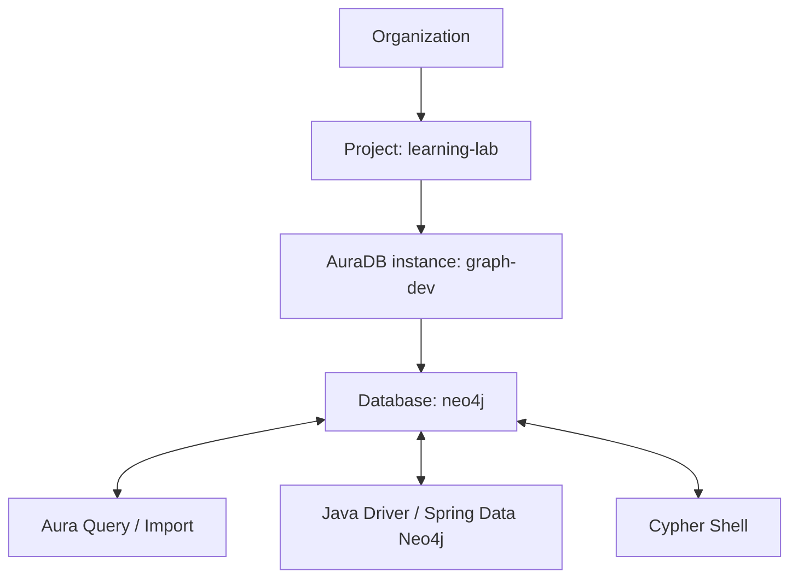
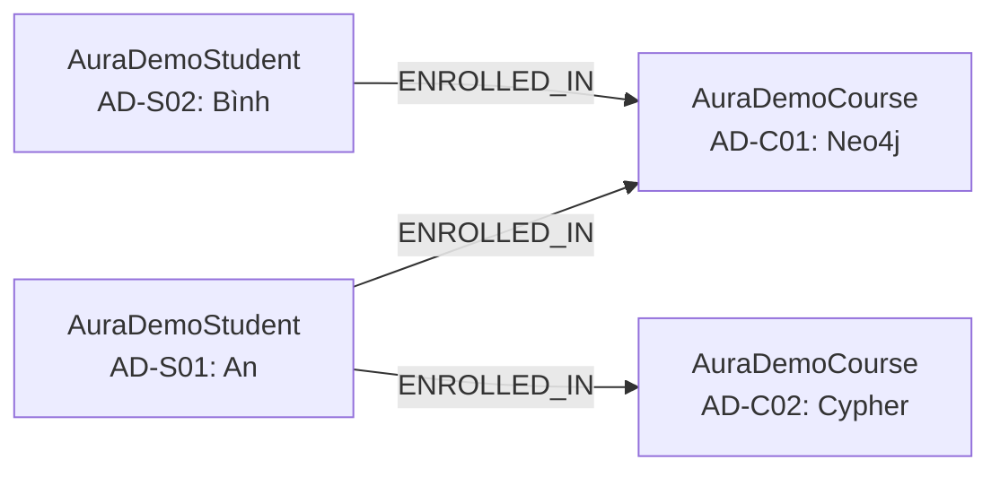

# Neo4j Aura: tạo cơ sở dữ liệu và quản lý thông tin kết nối

> **Chương:** Công cụ làm việc  
> **Mô-đun:** `DATABASE_ENGINE_GRAPH_NEO4J`  
> **Trọng tâm:** AuraDB, Aura Console, tạo instance, kết nối an toàn từ công cụ và ứng dụng.

## 1. Mục tiêu và bối cảnh sử dụng

Neo4j lưu dữ liệu theo mô hình **property graph**, trong đó **node** là thực thể, **relationship** là liên kết có hướng, **label/type** phân loại phần tử và **property** lưu thuộc tính. Cypher được dùng để tìm quan hệ, đường đi và cập nhật graph. Khi phát triển hệ thống thực tế, người học còn cần index, constraint, tối ưu truy vấn, nhập dữ liệu, Neo4j Java Driver, Spring Data Neo4j và quy trình vận hành.

**Neo4j Aura** là dịch vụ đồ thị được Neo4j quản lý trên cloud. Thay vì tự cài server, cấu hình ổ đĩa, cập nhật hệ thống và vận hành DBMS, người phát triển có thể tạo một **AuraDB instance**, kết nối rồi tập trung vào mô hình dữ liệu và mã ứng dụng.

Bài học tập trung vào bốn năng lực:

1. Hiểu đúng cấu trúc **Organization → Project → Instance → Database** trong Aura.
2. Tạo và xác nhận một AuraDB instance sẵn sàng chạy Cypher.
3. Lưu, sử dụng và bảo vệ **Connection URI**, **username**, **password**, **database name**.
4. Kết nối từ Aura Query, Cypher Shell, Java Driver và Spring Data Neo4j; biết xử lý lỗi kết nối và vòng đời instance.

Bài minh họa dùng dữ liệu giả lập. Các thao tác thay đổi dữ liệu chỉ nên thử ở instance/database dành cho học tập hoặc phát triển.

## 2. AuraDB và các thành phần trong Aura Console

**AuraDB** là dịch vụ Neo4j graph database được quản lý. **AuraDS** phục vụ bài toán khoa học dữ liệu đồ thị dưới dạng dịch vụ; **Aura Graph Analytics** cung cấp năng lực tính toán graph analytics. Khi mục tiêu là lưu node/relationship và dùng Cypher cho ứng dụng Java/Spring, hãy bắt đầu từ **AuraDB**.

Vào [Aura Console](https://console.neo4j.io/) để quản lý môi trường. Đây là giao diện quản trị tài nguyên, không phải địa chỉ kết nối trực tiếp của Java Driver.

| Thành phần | Ý nghĩa | Câu hỏi cần trả lời |
| --- | --- | --- |
| **Organization** | Không gian quản lý tài khoản, người dùng và tài nguyên thuộc tổ chức. | Đang ở tổ chức nào? |
| **Project** | Nhóm logic chứa các tài nguyên Aura, người dùng và cấu hình liên quan; được tạo mặc định khi đăng ký. | Instance thuộc project nào, ai có quyền? |
| **AuraDB instance** | DBMS được Aura cấp tài nguyên; có ID, URI, trạng thái, tier và thông số phiên bản. | Đang kết nối instance nào? |
| **Database** | Đồ thị người dùng bên trong instance; một số tier hỗ trợ nhiều database. | Đang chạy Cypher trên database nào? |
| **Tools / Query** | Giao diện chạy Cypher và trực quan hóa graph. | Truy vấn đã trả dữ liệu đúng chưa? |
| **Connection credentials** | Thông tin xác thực với DBMS; khác tài khoản đăng nhập Aura Console. | Username/password của database lưu ở đâu? |



**Đặc biệt:** tên **Project** trong Aura là nhóm tài nguyên trên cloud; không phải folder mã nguồn hay file cấu hình trong laptop. **Instance** mới là đối tượng có địa chỉ kết nối; **database name** chỉ định graph cụ thể trong instance đó.

### 2.1. Lựa chọn tier theo nhu cầu

Các tier AuraDB hiện được Neo4j mô tả gồm **Free**, **Professional**, **Business Critical** và **Virtual Dedicated Cloud**. Quy mô, giới hạn tài nguyên, khả năng backup, kiểm soát mạng, SLA, tính năng bảo mật và mô hình thanh toán thay đổi theo tier.

- **Free:** phù hợp học Cypher, thử mô hình và demo nhỏ; có chính sách tự tạm dừng và giới hạn tài nguyên.
- **Professional:** phù hợp môi trường phát triển hoặc ứng dụng cần thêm tài nguyên và khả năng quản trị theo tính năng của tier.
- **Business Critical / Virtual Dedicated Cloud:** phục vụ những yêu cầu chuyên sâu hơn về vận hành, độ sẵn sàng và bảo mật theo hợp đồng.

Không suy đoán một tính năng có trong tier chỉ từ tên của nó. Với dự án thực, hãy đối chiếu bảng tính năng và giá đang có ở [Neo4j Pricing](https://neo4j.com/pricing/) trước khi tạo tài nguyên có tính phí. Theo tài liệu tạo instance, tài khoản Free chỉ có thể tạo **một AuraDB Free instance**.

## 3. Tạo tài khoản, chọn project và khởi tạo AuraDB

### 3.1. Chuẩn bị

Cần có:

- Tài khoản Aura đã đăng ký, xác minh email và đăng nhập được.
- Quyền tạo instance trong **project** dự định sử dụng.
- Lựa chọn **AuraDB**, tier, tên instance, vùng cloud và cấu hình tài nguyên (những lựa chọn được hỗ trợ phụ thuộc tier).
- Nơi lưu password và file kết nối an toàn, chẳng hạn password manager hoặc secret vault của nhóm.
- Nếu dùng tier có phí: phương thức thanh toán và phê duyệt chi phí theo quy trình dự án.

Aura tạo Organization và Project mặc định khi đăng ký. Với một số tier/quyền, có thể thêm project mới; không phải mọi tài khoản Free đều có quyền tạo nhiều project. Trong ví dụ bên dưới, sử dụng **project sẵn có** là đủ.

### 3.2. Các bước tạo instance bằng giao diện

1. Mở [https://console.neo4j.io/](https://console.neo4j.io/), đăng nhập và kiểm tra **Organization/Project đang chọn**.
2. Chọn chức năng **Create instance** hoặc thao tác tạo AuraDB từ project.
3. Chọn **AuraDB**. Không chọn AuraDS khi bạn chỉ cần database Cypher cho ứng dụng.
4. Chọn **tier**. Để thực hành, dùng Free nếu đủ điều kiện; với tier khác, chọn vùng cloud, dung lượng và tính năng theo nhu cầu.
5. Nhập tên nhận diện, ví dụ `learning-neo4j-dev`. Tên dễ đọc giúp phân biệt môi trường, nhưng **instance ID** mới là định danh duy nhất do Aura cung cấp.
6. Kiểm tra cấu hình được hiển thị, điều khoản/tùy chọn thanh toán (nếu có), rồi xác nhận tạo.
7. **Ngay khi hệ thống sinh thông tin kết nối, tải file credentials hoặc sao chép URI/username/password/database name vào nơi bảo mật.** Mật khẩu được hiển thị ở thời điểm tạo và **không thể đọc lại nguyên văn từ Aura Console**.
8. Quan sát instance card; khi trạng thái chuyển sang **Running**, có thể mở Query hoặc kết nối từ ứng dụng. Thời điểm sẵn sàng phụ thuộc quá trình cấp tài nguyên.

Một số giao diện tạo AuraDB có thể cho chọn tùy chọn Graph Analytics hoặc Vector optimization. Đây là cấu hình mở rộng; để học node, relationship và Cypher cơ bản, hãy ưu tiên instance gọn, đúng tier, đúng region và dễ quản lý.

### 3.3. Cách xác nhận đã tạo đúng đối tượng

Từ **instance card** hoặc **Inspect → Overview**, đối chiếu:

| Thuộc tính | Ví dụ minh họa | Công dụng |
| --- | --- | --- |
| Instance name | `learning-neo4j-dev` | Giúp nhận diện trong giao diện. |
| Instance ID | `a1b2c3d4` (giả định) | Định danh duy nhất; không phụ thuộc tên hiển thị. |
| Tier | `AuraDB Free` | Xác định giới hạn và dịch vụ đi kèm. |
| Status | `Running` | DBMS đã sẵn sàng nhận kết nối. |
| Connection URI | `neo4j+s://a1b2c3d4.databases.neo4j.io` | Địa chỉ cho driver/Bolt. |
| Database name | `neo4j` (ví dụ) | Chọn database trong session. |

Các giá trị trên là **minh họa**; khi triển khai, lấy chính xác từ instance thực của bạn. Với instance có nhiều database, cần chỉ rõ database đích và quyền truy cập.

## 4. Hiểu file credentials và thông tin kết nối

### 4.1. Những thông tin thực sự cần

Một file credentials tải về khi tạo instance có thể chứa:

- **Connection URI**: địa chỉ để ứng dụng hoặc công cụ CLI kết nối.
- **Username**: tên user database, thường là `neo4j` ở thiết lập đầu.
- **Password**: bí mật xác thực **với database**.
- **Database name**: database mặc định hoặc tên database được cung cấp.
- **Instance ID** và **Instance name**: phục vụ quản lý và đối chiếu.

Một **mẫu nội dung** thường gặp có dạng environment variables; mọi giá trị dưới đây đều là placeholder, **không phải credential dùng được**:

```dotenv
NEO4J_URI=neo4j+s://<your-instance-id>.databases.neo4j.io
NEO4J_USERNAME=neo4j
NEO4J_PASSWORD=<your-password>
NEO4J_DATABASE=neo4j
```

File có thể tên dạng `Neo4j-<instance-id>-Created-<date>.txt`. Chỉ giữ file thật ở nơi được phân quyền; không đưa vào Git, chat nhóm, bug report, ảnh chụp màn hình hoặc artifact công khai. **URI thường không phải secret**, nhưng nên quản lý cùng metadata môi trường để tránh nhầm địa chỉ production; **password là secret**.

### 4.2. Phân biệt các loại URL và phương thức kết nối

| Giá trị | Mục đích | Lưu ý |
| --- | --- | --- |
| `https://console.neo4j.io/` | Đăng nhập, tạo và quản trị Aura. | Đây **không phải** URI cho Java Driver. |
| `neo4j+s://<id>.databases.neo4j.io` | Kết nối database bằng Bolt có TLS và xác minh certificate; dùng với Neo4j Driver/Cypher Shell. | Sử dụng URI lấy từ instance, không tự sửa scheme để bỏ TLS. |
| **Query API URL** được hiển thị ở Instance details | Gửi truy vấn bằng HTTPS theo Neo4j Query API. | Endpoint/API và cách xác thực khác với session Bolt; không thay chuỗi này vào driver nếu driver yêu cầu Bolt. |
| **Database name** | Chọn một database bên trong instance. | Nên đặt tường minh trong cấu hình Java/Spring, nhất là instance đa database. |

Aura Query có thể lựa chọn cơ chế kết nối phù hợp với browser/mạng, kể cả HTTPS khi Bolt bị firewall chặn; điều này **không có nghĩa** có thể đổi URI `neo4j+s://` thành `https://` trong bất kỳ Java Driver nào. Công cụ/driver phải hỗ trợ đúng giao thức.

### 4.3. Credential cho Console khác credential database

Đăng nhập Aura Console bằng email/SSO chỉ xác thực **người quản lý tài nguyên**. Một kết nối từ Java Driver đến AuraDB thường dùng **database username/password** hoặc phương án SSO/token theo cấu hình của tổ chức. Thông tin này có thể cần được nhập thêm khi mở Query, Import hoặc một công cụ khác.

Nếu đánh mất password ban đầu, **không thể yêu cầu Aura Console hiển thị lại chính mật khẩu đã sinh**. Hãy thực hiện phương án phục hồi được hỗ trợ và phù hợp quyền quản trị của project: nhờ quản trị viên cấp/tạo credential database mới nếu hệ thống hỗ trợ, hoặc làm theo hướng dẫn phục hồi/clone của Neo4j. Không chuyển password của tài khoản Aura Console vào trường database password.

## 5. Kết nối từ Aura Query và chạy Cypher đầu tiên

Từ instance card chọn **Connect → Query**, hoặc mở **Query** trong Console rồi dùng thanh chọn kết nối để chọn đúng instance. Nếu instance có nhiều database, chọn đúng **database** ở dropdown. Khi công cụ yêu cầu, nhập credential database đã lưu.

Bắt đầu bằng câu chỉ đọc:

```cypher
RETURN 'Đã kết nối AuraDB' AS thongBao,
       12 * 2 AS ketQua;
```

Kết quả dự kiến: một hàng, `ketQua = 24`. Không cần dữ liệu có sẵn. Nếu câu này thất bại, sửa **kết nối/trạng thái instance** trước khi tạo graph.

### 5.1. Mô hình đồ thị demo: học viên và khóa học

Để có dữ liệu nhìn được ở Graph, tạo một bộ dữ liệu nhỏ với label riêng, chỉ trên **database thử nghiệm**:



Lệnh tạo dữ liệu:

```cypher
MERGE (an:AuraDemoStudent {studentId: 'AD-S01'})
SET an.name = 'An'
MERGE (binh:AuraDemoStudent {studentId: 'AD-S02'})
SET binh.name = 'Bình'
MERGE (neo4j:AuraDemoCourse {courseId: 'AD-C01'})
SET neo4j.title = 'Neo4j'
MERGE (cypher:AuraDemoCourse {courseId: 'AD-C02'})
SET cypher.title = 'Cypher'
MERGE (an)-[:ENROLLED_IN]->(neo4j)
MERGE (an)-[:ENROLLED_IN]->(cypher)
MERGE (binh)-[:ENROLLED_IN]->(neo4j)
RETURN 'Đã tạo demo' AS thongBao;
```

Khi bắt đầu từ database sạch với các label trên, kết quả là **4 node và 3 relationship**. Trong ví dụ nhỏ, `MERGE` cho phép chạy lại mà thường không tạo thêm phần tử trùng; ở ứng dụng thật hoặc ghi đồng thời, hãy kết hợp **uniqueness constraint** theo khóa nghiệp vụ.

Xem đồ thị bằng cách trả cả path:

```cypher
MATCH p = (s:AuraDemoStudent)-[:ENROLLED_IN]->(c:AuraDemoCourse)
RETURN p
LIMIT 20;
```

Chọn chế độ **Graph** để quan sát node/relationship. Để xem bảng:

```cypher
MATCH (s:AuraDemoStudent)-[:ENROLLED_IN]->(c:AuraDemoCourse)
RETURN s.studentId AS maHocVien,
       s.name AS hocVien,
       c.title AS khoaHoc
ORDER BY maHocVien, khoaHoc;
```

Kết quả mẫu:

| maHocVien | hocVien | khoaHoc |
| --- | --- | --- |
| AD-S01 | An | Cypher |
| AD-S01 | An | Neo4j |
| AD-S02 | Bình | Neo4j |

**Graph, Table và RAW** là những cách hiển thị kết quả của **cùng một database**; chuyển chế độ không tạo bản sao dữ liệu. `LIMIT` giới hạn bản ghi được trả về, vì vậy hình Graph không thể thay cho truy vấn đếm toàn bộ dữ liệu.

## 6. Kết nối từ Cypher Shell

Cypher Shell giúp gửi câu Cypher từ terminal hoặc script CI. Công cụ cần tương thích với phiên bản Neo4j/Aura; kiểm tra trước bằng:

```bash
cypher-shell --version
cypher-shell --help
```

Kết nối bằng **URI thật** đã lưu:

```bash
cypher-shell -a "neo4j+s://<your-instance-id>.databases.neo4j.io" \
  -u neo4j -d neo4j
```

Ví dụ dùng cú pháp Bash/zsh. Nếu không truyền `-p`, trong chế độ terminal tương tác công cụ có thể hỏi mật khẩu. Hãy nhập password theo prompt, tránh đặt giá trị thật vào command history hoặc danh sách process.

Sau khi đăng nhập, chạy:

```cypher
MATCH (s:AuraDemoStudent)
RETURN s.studentId AS studentId, s.name AS ten
ORDER BY studentId;
```

Lưu ý kết thúc statement bằng dấu `;` trong Cypher Shell. Với **PowerShell**, viết cùng lệnh trên một dòng:

```powershell
cypher-shell -a "neo4j+s://<your-instance-id>.databases.neo4j.io" -u neo4j -d neo4j
```

Trong automation không có terminal tương tác, công cụ không thể mặc định hỏi password. Cần dùng cách cấp secret mà hệ thống chạy và phiên bản Cypher Shell hỗ trợ; tránh đưa bí mật vào lệnh, file log hay file script trong repository.

Nếu instance có database name khác `neo4j`, thay đối số `-d` bằng **tên thực tế**. Một URI có thể đúng nhưng truy vấn lại chạy sai database nếu bạn không chọn tường minh.

## 7. Kết nối Java Driver đến AuraDB

Ứng dụng Java dùng **Neo4j Java Driver** để tạo connection pool, session, transaction và chạy Cypher có tham số. Đầu tiên thêm dependency `org.neo4j.driver:neo4j-java-driver` phù hợp với phiên bản Java/Neo4j của dự án (dùng Maven hoặc Gradle theo quy ước repository).

### 7.1. Cấp credential qua biến môi trường

Tạo các biến trong môi trường chạy ứng dụng, từ secret manager hoặc nơi chứa credential được bảo vệ:

```dotenv
NEO4J_URI=neo4j+s://<your-instance-id>.databases.neo4j.io
NEO4J_USERNAME=neo4j
NEO4J_PASSWORD=<your-password>
NEO4J_DATABASE=neo4j
```

Đây là **mẫu tài liệu**, không phải file credential có thật. Neo4j Java Driver **không tự đọc file `.env`** khi chỉ gọi `System.getenv`; cần biến môi trường đã được khai báo trong tiến trình hoặc dùng thư viện/cơ chế cấu hình riêng để nạp file.

### 7.2. Ví dụ Java đầy đủ: kiểm tra kết nối và truy vấn parameter

```java
import java.util.Map;
import org.neo4j.driver.AuthTokens;
import org.neo4j.driver.Driver;
import org.neo4j.driver.GraphDatabase;
import org.neo4j.driver.SessionConfig;

public class AuraConnectionDemo {
    public static void main(String[] args) {
        String uri = System.getenv("NEO4J_URI");
        String username = System.getenv("NEO4J_USERNAME");
        String password = System.getenv("NEO4J_PASSWORD");
        String database = System.getenv("NEO4J_DATABASE");

        if (uri == null || username == null ||
            password == null || database == null) {
            throw new IllegalStateException("Thieu bien moi truong Neo4j");
        }

        try (Driver driver =
                 GraphDatabase.driver(uri, AuthTokens.basic(username, password))) {
            driver.verifyConnectivity();

            try (var session = driver.session(
                    SessionConfig.forDatabase(database))) {
                String title = session.executeRead(tx -> tx.run(
                        "MATCH (c:AuraDemoCourse {courseId: $id}) " +
                        "RETURN c.title AS title",
                        Map.of("id", "AD-C01")
                    ).single().get("title").asString());

                System.out.println("Khoa hoc: " + title);
            }
        }
    }
}
```

Nếu chạy đoạn tạo dữ liệu ở mục 5, kết quả là `Khoa hoc: Neo4j`. Nếu chưa tạo dữ liệu, `single()` sẽ thất bại vì không có bản ghi; đây là lỗi dữ liệu, khác với lỗi kết nối.

**Điểm kỹ thuật:**

- `GraphDatabase.driver(...)` tạo driver, cần đóng lại khi ứng dụng kết thúc. Trong ứng dụng server, thường tạo **một Driver dùng chung** thay vì tạo mới cho mọi request.
- `driver.verifyConnectivity()` kiểm tra có thể kết nối và xác thực tới instance.
- `SessionConfig.forDatabase(database)` xác định database đích, tránh phụ thuộc lựa chọn mặc định.
- `session.executeRead(...)` chạy một transaction đọc được driver quản lý; với cập nhật, dùng cơ chế ghi tương ứng.
- `$id` nhận giá trị từ `Map.of(...)`, tránh nối trực tiếp chuỗi người dùng vào Cypher.

Trong triển khai thật cần xử lý lỗi có phân loại, timeout, logging an toàn và quản lý vòng đời driver theo framework.

## 8. Kết nối Spring Data Neo4j / Spring Boot

Với Spring Boot dùng **Spring Data Neo4j**, URI và credential thường được cấu hình dưới `spring.neo4j`, còn database qua `spring.data.neo4j.database`.

Ví dụ `application.yml` **mang tính minh họa**:

```yaml
spring:
  neo4j:
    uri: ${NEO4J_URI}
    authentication:
      username: ${NEO4J_USERNAME}
      password: ${NEO4J_PASSWORD}
  data:
    neo4j:
      database: ${NEO4J_DATABASE:neo4j}
```

Nếu username/password được quản lý bởi secret manager, framework cần được cấu hình để đọc chúng đúng cách. Không lưu mật khẩu AuraDB trực tiếp ở `application.yml` trong Git.

Ứng dụng Spring Data Neo4j ánh xạ node/relationship sang domain object và có thể triển khai repository hoặc custom Cypher. Ví dụ truy vấn nghiệp vụ:

```cypher
MATCH (s:AuraDemoStudent {studentId: $studentId})
      -[:ENROLLED_IN]->(c:AuraDemoCourse)
RETURN c.courseId AS maKhoaHoc, c.title AS khoaHoc
ORDER BY khoaHoc;
```

Trong công cụ Query, nhập tham số `studentId = 'AD-S01'` theo giao diện cấu hình parameter. Trong repository/driver, truyền tham số bằng API tương ứng; cùng một cấu trúc Cypher có thể dùng lại với `AD-S02`.

**Thứ tự chẩn đoán khi kết nối Spring lỗi:** kiểm tra `spring.neo4j.uri`, username/password, database name, trạng thái instance, khả năng truy cập mạng, rồi mới kiểm tra repository và truy vấn.

## 9. AuraDB trên cloud và việc nhập dữ liệu

Vì AuraDB chạy trên cloud, **file `C:\data\learners.csv` hoặc `/home/user/learners.csv` trên laptop không tự nằm trong filesystem của database server**. Đây là khác biệt quan trọng so với local Neo4j Desktop.

Aura Console có **Import** để chọn nguồn CSV hoặc kết nối nguồn dữ liệu được hỗ trợ, dựng graph model, ánh xạ cột thành property và key, rồi chạy import. Các tính năng và quyền cần thiết phụ thuộc tier/role; tài liệu Import của Neo4j nêu rằng thao tác nhập có thể cần quyền quản trị project hoặc quyền schema tương ứng.

Quy trình nhập CSV mẫu:

1. Chuẩn bị file `learners.csv` với cột `studentId` và `name`, dữ liệu không chứa thông tin nhạy cảm.
2. Mở **Import** trong Aura Console.
3. Thêm file CSV nguồn; kiểm tra header/preview và encoding.
4. Tạo node label `AuraDemoStudent`, ánh xạ `studentId` làm khóa và `name` làm property.
5. Chọn đúng instance/database đích, kiểm tra preview rồi mới **Run import**.
6. Sau import, mở Query đếm node và kiểm tra index/constraint được tạo.

Ví dụ dữ liệu CSV:

```csv
studentId,name
AD-S01,An
AD-S02,Binh
```

Với `LOAD CSV` trực tiếp bằng Cypher, **đường dẫn URL cần được server truy cập**; trên Aura, không giả định đường dẫn `file:///learners.csv` của laptop sẽ hoạt động:

```cypher
LOAD CSV WITH HEADERS
FROM 'https://example.org/datasets/learners-demo.csv' AS row
WITH row
WHERE row.studentId IS NOT NULL AND row.studentId <> ''
MERGE (s:AuraDemoStudent {studentId: row.studentId})
SET s.name = row.name;
```

URL `example.org` chỉ minh họa cấu trúc, **không phải nguồn dataset có sẵn để chạy**. Cần thay bằng URL HTTPS hợp lệ có thể truy cập và chỉ import dữ liệu được phép sử dụng. Nếu dữ liệu không nên công khai, chọn phương án Import/cloud storage/stream được hỗ trợ với quyền truy cập phù hợp thay vì đưa file chứa dữ liệu thật lên URL public.

### 9.1. Kiểm tra dữ liệu sau import

```cypher
MATCH (s:AuraDemoStudent)
RETURN count(s) AS soHocVien;
```

Nếu bạn đã chạy demo mục 5, `soHocVien` dự kiến bằng 2. Khi có nhiều lần import, kết quả có thể thay đổi; cần kiểm tra **khóa trùng** và tính chất idempotent của script.

## 10. Quản lý database và sự khác nhau giữa instance với database

Một AuraDB instance có thể có **một hoặc nhiều database** tùy tier/tính năng. Trên instance đa database, Query có dropdown chọn database; với client bên ngoài, chỉ rõ database name ở session hoặc cấu hình ứng dụng.

Giả sử một instance hỗ trợ nhiều database và có hai tên:

- `learningdev`: dữ liệu để phát triển, được seed và reset có chủ đích.
- `learningtest`: dữ liệu fixture cho kiểm thử tự động, trạng thái phải tái tạo được.

Khi Java kết nối tới cùng URI nhưng đổi database name, tập node/relationship nhìn thấy có thể hoàn toàn khác. **Database không phải instance mới**; vì vậy các database cùng instance có thể chia sẻ tài nguyên và chính sách ở cấp instance.

Đối với **AuraDB Free**, khả năng nhiều database trong một instance **không nằm trong tính năng của tier** theo bảng giá hiện hành. Với môi trường dev/test tách rời mà tier hiện tại không hỗ trợ multi-database, dùng hạ tầng thử nghiệm khác hoặc nâng cấp phù hợp thay vì chỉ tạo hai nhãn trên UI.

Để kiểm tra cấu trúc dữ liệu nghiệp vụ, không nên thao tác quản trị database nếu bài toán chỉ cần truy vấn. Các lệnh quản trị có thể yêu cầu đặc quyền và khác theo tier; kiểm tra tài liệu Aura trước khi tạo, đổi hoặc xóa database.

## 11. Bảo mật và quản lý thông tin kết nối

Có ba nhóm thông tin cần phân biệt:

1. **Tài khoản Aura Console**: người có quyền quản lý project/instance, billing hoặc mời thành viên.
2. **Database credentials**: username/password hoặc phương án xác thực dành cho kết nối Neo4j DBMS.
3. **Aura API client credentials**: client ID/secret dùng để gọi **Aura Management API**; chúng **không phải password mặc định của database**.

### 11.1. Quy tắc thực hành

- Lưu bí mật trong **secret manager/password manager** và chỉ cấp cho người/ứng dụng cần dùng.
- Dùng **biến môi trường hoặc cơ chế secret của nền tảng** để cấp cho Java/Spring.
- Không commit file `Neo4j-...-Created-...txt`, `.env` thật, ảnh có password hoặc credential vào Git.
- Chia quyền theo **vai trò và môi trường**. Kết nối production dùng tài khoản chỉ đọc khi chỉ cần quan sát; quyền thực tế phải cấu hình ở Neo4j/Aura.
- Khi mất/lộ password, xử lý theo quy trình **thay đổi hoặc cấp lại credential** được hỗ trợ, cập nhật secret của ứng dụng và kiểm tra kết nối cũ.
- Log có thể chứa URI, database name và lỗi driver; tránh ghi password, token hoặc raw header xác thực vào log.
- Không dùng `-p "matkhau"` trực tiếp trong terminal nếu công cụ có lựa chọn an toàn hơn, vì shell history và process list có thể giữ bí mật.

### 11.2. Quy ước metadata của mỗi môi trường

| Trường quản lý | Dev | Staging | Production |
| --- | --- | --- | --- |
| Instance name | `learning-graph-dev` | `learning-graph-staging` | `learning-graph-prod` |
| URI | Lưu qua cấu hình riêng | Lưu qua cấu hình riêng | Lưu qua cấu hình riêng |
| Username | Quyền dev | Quyền kiểm thử | Quyền tối thiểu theo service |
| Password | Secret store | Secret store | Secret store có kiểm soát truy cập |
| Database name | Đặt tường minh | Đặt tường minh | Đặt tường minh |
| Data | Seed giả | Dữ liệu được làm sạch | Dữ liệu thật |

Tên ở bảng chỉ là ví dụ. Lựa chọn tốt là **tách instance theo môi trường** để giới hạn tác động của thao tác thử nghiệm; sau đó quản lý URI/secret và quyền riêng cho từng môi trường.

## 12. Theo dõi vòng đời instance: Running, Paused, Resume và Delete

Một số thao tác trên instance card gồm **Inspect**, **Connect**, **Pause/Resume**, **Snapshots/Backups**, **Resize**, **Clone** và **Delete**; chức năng cụ thể phụ thuộc tier và quyền.

### 12.1. AuraDB Free tự tạm dừng

Theo tài liệu Neo4j hiện hành, **AuraDB Free có thể tự tạm dừng sau 72 giờ không hoạt động**. Khi bị `Paused`:

- Ứng dụng/Java Driver không thể thực thi truy vấn cho đến khi instance được Resume.
- DNS/địa chỉ Bolt có thể báo không phân giải được do instance đã tạm dừng.
- Dữ liệu còn được giữ trong thời gian tạm dừng theo chính sách của gói.

Đăng nhập Aura Console, chọn **Resume** và chờ instance trở về `Running` trước khi thử lại truy vấn. Không giả định truy vấn chỉ đọc từ ứng dụng sẽ luôn duy trì instance Free ở trạng thái Running.

**Quan trọng:** tài liệu Neo4j nêu rằng nếu **AuraDB Free tiếp tục Paused quá 30 ngày**, instance và dữ liệu có thể bị **xóa tự động**. Chính sách/tier có thể thay đổi; người học nên kiểm tra trạng thái thường xuyên nếu cần giữ dữ liệu. Không coi AuraDB Free là kho lưu trữ lâu dài duy nhất cho dữ liệu quan trọng.

### 12.2. Pause/Resume ở tier khác

Với tier hỗ trợ pause thủ công, pause ngừng xử lý giao dịch và ngăn kết nối cho đến khi resume. Quá trình tạm dừng có thể đi kèm backup; thời gian khôi phục không cố định. Nếu instance chứa nhiều database, thao tác pause/resume tác động **toàn instance**, không tách riêng từng database.

Để xóa instance, Aura yêu cầu xác nhận trong giao diện. **Delete có thể xóa toàn bộ database và các snapshot liên quan**, nên phải kiểm tra kế hoạch giữ dữ liệu trước khi thực hiện. Không dùng **Reset to blank** hoặc **Restore** trên instance còn dữ liệu cần giữ nếu chưa kiểm tra rằng tác vụ có thể ghi đè/xóa dữ liệu.

## 13. Backup, restore và quản lý thay đổi

Aura cung cấp các cơ chế backup/snapshot/export/restore tùy tier, phiên bản và loại instance. Đối với **single-database instance**, snapshot biểu diễn trạng thái DBMS tại một thời điểm; với **multi-database instance**, backup có thể được quản lý theo từng database, bao gồm database hệ thống ở những tác vụ thích hợp.

Nguyên tắc cần nhớ:

- **Đừng mặc định gói Free có lịch snapshot/backup và chính sách giữ bản giống gói trả phí.**
- **Restore từ file** hoặc từ backup có thể **ghi đè dữ liệu hiện tại**.
- Export file backup giúp có bản lưu ngoài instance khi tier/chức năng hỗ trợ.
- Clone có thể phục vụ tạo môi trường thử từ dữ liệu có sẵn; cần cân nhắc nội dung nhạy cảm và nguồn tài nguyên sẽ tạo.
- Một bản backup chỉ thực sự hữu ích khi **đã kiểm tra khả năng phục hồi** ở một môi trường phù hợp.

Trước khi cập nhật graph schema:

```cypher
SHOW CONSTRAINTS YIELD name, type
RETURN name, type
ORDER BY name;
```

```cypher
SHOW INDEXES YIELD name, type, state
RETURN name, type, state
ORDER BY name;
```

Nếu vai trò cho phép, sử dụng các lệnh trên để ghi lại trạng thái schema. Sau khi nạp dữ liệu hoặc tạo constraint mới, kiểm tra tính nhất quán và hiệu năng bằng `EXPLAIN`, `PROFILE` trên **truy vấn đọc**. `PROFILE` thực thi câu truy vấn: nếu dùng với thao tác ghi thì dữ liệu cũng được ghi.

## 14. Xử lý sự cố kết nối

| Triệu chứng | Nguyên nhân cần kiểm tra | Hướng giải quyết |
| --- | --- | --- |
| `DNS resolution failed`, không tìm thấy hostname | Instance Free đang `Paused`, URI sai hoặc DNS/mạng gặp sự cố. | Kiểm tra instance card trước; Resume nếu đang Paused, rồi xác minh URI. |
| `Connection refused` / timeout | Firewall, cổng/giao thức bị chặn, mạng không tới Aura. | Dùng đúng `neo4j+s://`; xem chính sách mạng, kiểm tra qua công cụ Query hoặc HTTPS Query API phù hợp. |
| Lỗi TLS/certificate | Đã sửa scheme URI, proxy/interception hoặc cấu hình certificate. | Khôi phục URI chính thức, xác minh đường mạng và certificate; không tùy tiện tắt TLS. |
| `Authentication failed` | Sai database password, nhầm tài khoản Console với user DB, credential cũ. | Kiểm tra file credentials được lưu, xử lý đổi/cấp lại credential theo quyền. |
| `Database not found` / không đủ quyền | Tên database sai hoặc user không được cấp quyền. | Kiểm tra database dropdown/Instance details và cấu hình `-d` hoặc SessionConfig. |
| Query trong Console chạy nhưng Java thất bại | Java dùng URI khác, thiếu biến môi trường, phụ thuộc TLS/network hoặc database khác. | Log an toàn URI/database hiện dùng; chạy `verifyConnectivity()` và kiểm tra firewall. |
| Query trả về 0 rows | Chưa tạo dữ liệu mẫu, đang dùng database khác hoặc label sai. | Chạy `MATCH (n:AuraDemoStudent) RETURN count(n)`. |
| Chạy Import nhưng không thấy dữ liệu | Chọn nhầm instance/database, mapping chưa hoàn chỉnh hoặc thiếu quyền. | Kiểm tra import job, database đích và số node/relationship đã nạp. |
| Instance không xuất hiện trong Console | Đang chọn sai Organization hoặc Project, hoặc thiếu quyền. | Kiểm tra selector của tổ chức/project và quyền thành viên. |
| Ứng dụng thường xuyên lỗi sau thời gian nghỉ | Free auto-pause; các kết nối cũ cần tái kết nối khi resume. | Kiểm tra trạng thái, Resume và cấu hình retry hợp lý cho môi trường dev. |

Nếu Query cho phép **Export connection logs**, sử dụng file log để phân tích lỗi mạng/xác thực. Trước khi chia sẻ log, kiểm tra và loại bỏ thông tin nhạy cảm. Không sửa source code Java để “chữa” lỗi thực chất là instance đang tạm dừng.

### Quy trình chẩn đoán 6 bước

1. **Đúng Organization/Project?** Instance còn tồn tại trong Console không?
2. **Đúng trạng thái?** Running, Paused hay đang Provisioning?
3. **Đúng URI?** Lấy lại từ Instance details, không đoán ID.
4. **Đúng credential?** User database và password còn hiệu lực?
5. **Đúng database?** Khớp giữa Query, Cypher Shell, Java/Spring?
6. **Đúng mạng và dữ liệu?** TLS/firewall/port, rồi mới kiểm tra Cypher.

## 15. Quy trình phát triển nhóm với AuraDB

Một repository sử dụng Neo4j AuraDB nên lưu **mã và quy trình tái tạo schema**, còn secret được quản lý ngoài mã nguồn.

```text
learning-platform/
├── app/
│   └── (Java / Spring Boot)
├── neo4j/
│   ├── schema/
│   │   └── constraints.cypher
│   ├── seeds/
│   │   └── demo-data.cypher
│   ├── queries/
│   │   └── student-courses.cypher
│   └── fixtures/
│       └── students.csv
├── docs/
│   └── graph-model.md
└── README.md
```

*Cây thư mục là ví dụ thiết kế repository; không phải file được Aura tự sinh.*

Một vòng làm việc có thể lặp lại:

1. Tạo instance **dev** và lưu URI/database vào hệ thống cấu hình.
2. Lưu credential trong secret manager, phân quyền cho đúng người và service.
3. Áp dụng script constraint/index rồi seed dữ liệu giả lập.
4. Kiểm tra Cypher bằng Aura Query; ghi kết quả mong đợi cho từng truy vấn.
5. Chạy ứng dụng Java/Spring bằng URI và database đúng, không sửa password trong Git.
6. Chạy kiểm thử tích hợp với dữ liệu fixture có thể tái tạo.
7. Review schema/truy vấn và đưa lên staging bằng pipeline riêng.
8. Xác minh backup, quyền và chính sách phục hồi trước thay đổi production.

Đây là nền tảng để học các chủ đề tiếp theo: mô hình hóa graph, index/constraint, tối ưu Cypher, nhập dữ liệu và vận hành Neo4j với Java.

## 16. Bài tập thực hành

**Bài 1 — Tạo instance.** Trong Aura Console, xác nhận Organization/Project; tạo một AuraDB instance cho học tập với tier phù hợp. Ghi lại **instance name, instance ID, trạng thái, tier và database name**; lưu credential an toàn.

**Bài 2 — Kiểm tra kết nối.** Mở **Query**, chạy `RETURN 12 * 2 AS ketQua` và giải thích vì sao chưa có node vẫn nhận một dòng dữ liệu.

**Bài 3 — Graph và Table.** Chạy dữ liệu demo mục 5. Kiểm tra Graph có **4 node, 3 relationship** và bảng thống kê có **3 hàng**.

**Bài 4 — Cypher Shell.** Dùng URI thật và user/password đã lưu; kết nối với `-a`, `-u`, `-d`. Chạy truy vấn đếm `AuraDemoStudent`, kỳ vọng `2` nếu mới tạo demo.

**Bài 5 — Java Driver.** Đưa URI/username/password/database vào biến môi trường, chạy ví dụ `verifyConnectivity()` và truy vấn có tham số `AD-C01`. Đổi tham số thành `AD-C02` mà không thay cấu trúc Cypher.

**Bài 6 — Tìm lỗi cấu hình.** Giả sử Query trong Console chạy tốt nhưng Spring báo sai database. Kiểm tra thứ tự `URI → username → password → spring.data.neo4j.database`, nêu vì sao database phải chỉ định rõ với multi-database instance.

**Bài 7 — Vòng đời và bảo mật.** Tóm tắt các trạng thái Running/Paused/Resume của tier đang dùng. Nêu điều gì xảy ra với kết nối Java khi Free instance bị Paused, và giải thích vì sao không commit file credentials.

**Bài 8 — Backup và thay đổi schema.** Phân biệt snapshot/backup của tier đang dùng với mã `constraints.cypher` trong Git. Trình bày thao tác xác minh bản backup **trước** một đợt cập nhật dữ liệu quan trọng; không cần thực hiện xóa hay restore trong bài này.

### Dọn dữ liệu mẫu một cách có kiểm soát

Chỉ dọn trên database thử nghiệm và khi đã **xem đúng dữ liệu sẽ xóa**:

```cypher
MATCH (n)
WHERE (n:AuraDemoStudent AND n.studentId IN ['AD-S01', 'AD-S02'])
   OR (n:AuraDemoCourse AND n.courseId IN ['AD-C01', 'AD-C02'])
RETURN labels(n) AS nhan, properties(n) AS properties;
```

Nếu xác nhận chắc chắn các node đó chỉ phục vụ ví dụ và muốn xóa:

```cypher
MATCH (n)
WHERE (n:AuraDemoStudent AND n.studentId IN ['AD-S01', 'AD-S02'])
   OR (n:AuraDemoCourse AND n.courseId IN ['AD-C01', 'AD-C02'])
DETACH DELETE n;
```

`DETACH DELETE` cũng xóa **mọi relationship** gắn với những node được chọn. Nếu sau này bạn đã nối node demo với dữ liệu khác, các liên kết đó sẽ biến mất; vì vậy không chạy đoạn này trên database chung khi chưa kiểm tra.

## 17. Ghi nhớ

- **Aura Console** quản lý Organization, Project và AuraDB instance; **database** là nơi Cypher truy vấn graph.
- Tạo instance xong cần lưu **URI, username, password, database name và instance ID**. Mật khẩu ban đầu **không thể xem lại** nguyên văn từ Console.
- Để kết nối Java Driver/Cypher Shell, thường dùng **`neo4j+s://`** qua TLS; không nhầm với URL của Aura Console hoặc Query API.
- Trong Java/Spring, chọn database **tường minh** và truyền tham số Cypher qua API.
- Chia dev/staging/production theo tài nguyên, dữ liệu, credential và quyền. **Không đưa credential thật lên Git**.
- **AuraDB Free có thể tự Paused sau 72 giờ không hoạt động và bị xóa sau một thời gian Paused kéo dài theo chính sách**; phải quản lý vòng đời nếu cần lưu dữ liệu.
- Backup, restore, import, multi-database và giới hạn tài nguyên **phụ thuộc tier và quyền**. Trước thao tác ghi đè hoặc xóa, xác nhận đúng instance và phương án phục hồi.

## 18. Tài liệu chính thức để học tiếp

- [Neo4j Aura — Tài liệu tổng quan](https://neo4j.com/docs/aura/)
- [Aura — Create an instance](https://neo4j.com/docs/aura/getting-started/create-instance/)
- [Aura — Connect to an instance](https://neo4j.com/docs/aura/getting-started/connect-instance/)
- [Aura — Instance details](https://neo4j.com/docs/aura/managing-instances/instance-details/)
- [Aura — Instance actions, pause/resume/delete](https://neo4j.com/docs/aura/managing-instances/instance-actions/)
- [Aura — Backup, export and restore](https://neo4j.com/docs/aura/managing-instances/backup-restore-export/)
- [Aura — Data Import](https://neo4j.com/docs/aura/import/introduction/)
- [Neo4j — Java Driver connection](https://neo4j.com/docs/java-manual/current/connect/)
- [Neo4j — Cypher Manual](https://neo4j.com/docs/cypher-manual/current/)
- [Neo4j — Pricing and tier features](https://neo4j.com/pricing/)

> **Lưu ý thời điểm:** Giao diện Aura, điều kiện thanh toán và chính sách của từng tier có thể thay đổi. Khi thao tác trên instance thật, sử dụng hướng dẫn cập nhật trong Aura Console và tài liệu phiên bản tương ứng. Các URI/ID/credential trong ví dụ đều là placeholder, không phải thông tin kết nối có hiệu lực.
