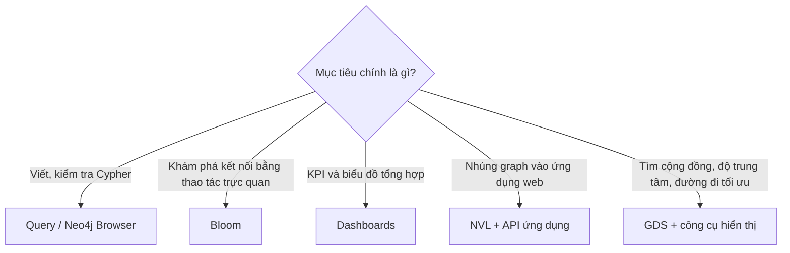
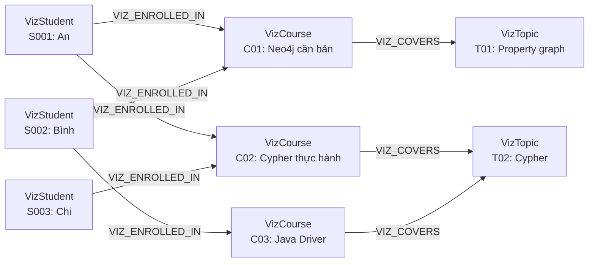
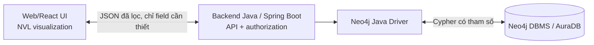

# Công cụ khám phá và trực quan hóa đồ thị trong hệ sinh thái Neo4j

> **Chương:** Công cụ làm việc  
> **Mô-đun:** `DATABASE_ENGINE_GRAPH_NEO4J`  
> **Phạm vi:** công cụ có giao diện dành cho người phát triển, nhà phân tích và ứng dụng tùy biến khi làm việc với dữ liệu property graph trong Neo4j.

## 1. Tại sao cần công cụ trực quan hóa đồ thị?

Neo4j lưu dữ liệu liên kết dưới dạng **property graph**: **node** biểu diễn thực thể, **relationship** biểu diễn liên kết có hướng, **label / relationship type** mô tả vai trò, còn **property** lưu thông tin của từng phần tử. Cypher giúp tìm node, quan hệ, đường đi và tính toán kết quả. Trong một hệ thống học trực tuyến, câu hỏi “học viên nào đang học khóa Neo4j?” có thể trả bằng một bảng, nhưng câu hỏi “những học viên nào học chung các chủ đề và họ kết nối với nhau qua khóa học nào?” sẽ dễ hiểu hơn khi hiển thị thành graph.

Trực quan hóa giúp người học:

- **Kiểm tra mô hình:** mối quan hệ có đúng hướng, node có bị thiếu, đường đi có hợp lý?
- **Khám phá:** bắt đầu từ một node, mở rộng các kết nối, nhận diện những cụm hoặc nút trung tâm.
- **Giải thích nghiệp vụ:** thể hiện kết nối bằng màu, nhãn và nhóm khái niệm gần với người dùng.
- **Theo dõi số liệu:** hiển thị số lượt ghi danh, số node theo label, tỷ lệ hoàn thành dưới dạng bảng hoặc biểu đồ.
- **Tích hợp ứng dụng:** đưa graph có thể tương tác vào web app thay vì chỉ sử dụng giao diện quản trị Neo4j.

Tuy nhiên, **hình trực quan là một phép chiếu của dữ liệu được truy vấn**, không đồng nghĩa toàn bộ database. Việc kéo, sắp xếp, ẩn node hoặc đổi màu thường chỉ thay đổi cách hiển thị; thao tác **edit/create/delete** được hỗ trợ trong một số công cụ mới thực sự có thể ghi dữ liệu. Cần phân biệt hai nhóm này khi làm việc trên môi trường thật.

Bài học này sẽ sử dụng một bộ dữ liệu thống nhất để thực hành **Query / Neo4j Browser**, **Bloom**, **Dashboards** và tìm hiểu cách xây dựng visualization riêng với **Neo4j Visualization Library (NVL)**. Những công cụ ấy bổ trợ các chủ đề khác của mô-đun: mô hình graph, Cypher, index, constraint, nhập dữ liệu, tối ưu truy vấn, Java Driver, Spring Data Neo4j và vận hành hệ thống đồ thị.

## 2. Bản đồ các công cụ trong hệ sinh thái Neo4j

| Công cụ | Người dùng chính | Kết quả mạnh nhất | Có cần viết Cypher? | Điểm cần nhớ |
| --- | --- | --- | --- | --- |
| **Query / Neo4j Browser** | Lập trình viên, DBA, người học Cypher | Graph, Table, RAW, kế hoạch truy vấn | Thường **có** | Vẽ các node, relationship hoặc path được `RETURN`. |
| **Bloom** | Nhà phân tích, người dùng nghiệp vụ, người khám phá dữ liệu | Scene đồ thị tương tác, Perspective, Search phrases | Không bắt buộc | Tìm theo ngữ nghĩa của mô hình, mở rộng từ node, đổi góc nhìn. |
| **Dashboards** | Chủ sản phẩm, người phân tích chỉ số, đội vận hành | Bảng, KPI, biểu đồ cột/tròn/đường, graph | Có thể viết Cypher; một số môi trường hỗ trợ tạo với AI | Mỗi card lấy dữ liệu bằng truy vấn và trình bày một câu hỏi cụ thể. |
| **Neo4j Visualization Library (NVL)** | Frontend developer, nhóm xây sản phẩm | Graph tùy biến trong web/React | Không bắt buộc ở lớp render; backend thường dùng Cypher | Thư viện JavaScript/TypeScript nhận dữ liệu node/relationship để render. |
| **Neo4j Graph Data Science (GDS)** | Data scientist, kỹ sư graph analytics | Thuật toán centrality, community, similarity, pathfinding | Có hoặc kết hợp GDS API | GDS **phân tích dữ liệu**, không phải công cụ kéo-thả để vẽ; kết quả có thể được hiển thị bằng Bloom/Query/Dashboards/NVL. |
| **BI connector và công cụ BI** | Nhóm báo cáo doanh nghiệp | Biểu đồ tổng hợp, báo cáo tích hợp | Tùy connector | Phù hợp khi kết quả graph cần ghép vào hệ thống BI sẵn có. |

Có thể chọn công cụ theo câu hỏi:



**Nơi mở công cụ:**

- **Neo4j Desktop 2.x:** trong **Studio**, có các công cụ **Import, Query, Bloom, Dashboards**. Chọn **instance** và **database** trước khi thao tác.
- **Neo4j Aura Console:** mở các công cụ tương ứng trong môi trường Aura và chọn instance/database phù hợp.
- **Neo4j Server / Browser độc lập:** mở Neo4j Browser bằng endpoint/giao diện tương ứng của server.
- **Ứng dụng riêng:** viết frontend với NVL hoặc giải pháp đồ thị khác; gọi API backend để lấy dữ liệu từ Neo4j.

Tên menu và quyền truy cập có thể thay đổi theo phiên bản sản phẩm, tier Aura và cấu hình của tổ chức. Đừng giả định một công cụ có sẵn ở mọi phiên bản hoặc mọi tài khoản chỉ vì thấy trong tài liệu.

## 3. Tạo bộ dữ liệu thực hành chung

Để so sánh kết quả giữa các công cụ, ta dùng một graph nhỏ của hệ thống học trực tuyến. Node gồm học viên, khóa học và chủ đề; relationship `VIZ_ENROLLED_IN` nối học viên tới khóa học, `VIZ_COVERS` nối khóa học tới chủ đề.

### 3.1. Mô hình



Khi database thử nghiệm chưa chứa các phần tử mẫu, graph tạo được gồm **8 node** (3 học viên, 3 khóa học, 2 chủ đề) và **8 relationship** (5 ghi danh, 3 quan hệ bao phủ chủ đề). Một số node sẽ xuất hiện nhiều lần trong đường đi; **số đường đi/bản ghi không phải số node**.

### 3.2. Cypher tạo dữ liệu

**Chỉ chạy đoạn có ghi này trên database thử nghiệm**, không chạy trên production nếu chưa được cho phép.

```cypher
MERGE (an:VizStudent {studentId: 'S001'})
SET an.name = 'An'
MERGE (binh:VizStudent {studentId: 'S002'})
SET binh.name = 'Bình'
MERGE (chi:VizStudent {studentId: 'S003'})
SET chi.name = 'Chi'

MERGE (neo4j:VizCourse {courseId: 'C01'})
SET neo4j.title = 'Neo4j căn bản'
MERGE (cypher:VizCourse {courseId: 'C02'})
SET cypher.title = 'Cypher thực hành'
MERGE (java:VizCourse {courseId: 'C03'})
SET java.title = 'Java Driver'

MERGE (propertyGraph:VizTopic {topicId: 'T01'})
SET propertyGraph.title = 'Property graph'
MERGE (cypherTopic:VizTopic {topicId: 'T02'})
SET cypherTopic.title = 'Cypher'

MERGE (an)-[:VIZ_ENROLLED_IN]->(neo4j)
MERGE (an)-[:VIZ_ENROLLED_IN]->(cypher)
MERGE (binh)-[:VIZ_ENROLLED_IN]->(neo4j)
MERGE (binh)-[:VIZ_ENROLLED_IN]->(java)
MERGE (chi)-[:VIZ_ENROLLED_IN]->(cypher)

MERGE (neo4j)-[:VIZ_COVERS]->(propertyGraph)
MERGE (cypher)-[:VIZ_COVERS]->(cypherTopic)
MERGE (java)-[:VIZ_COVERS]->(cypherTopic)

RETURN 'Đã tạo dữ liệu demo' AS thongBao;
```

`MERGE` tìm mẫu đã tồn tại trước khi tạo, nên chạy lại toàn khối trên một bộ dữ liệu mẫu nhất quán thường không nhân đôi quan hệ. Trong hệ thống thực có nhiều tiến trình ghi đồng thời, cần **uniqueness constraint** bảo vệ các khóa `studentId`, `courseId`, `topicId`; `MERGE` một mình không bảo đảm tính duy nhất dưới mọi điều kiện cạnh tranh.

### 3.3. Kiểm tra số lượng trước khi trực quan hóa

```cypher
MATCH (n)
WHERE n:VizStudent OR n:VizCourse OR n:VizTopic
RETURN count(n) AS soNodeDemo;
```

```cypher
MATCH ()-[r]->()
WHERE type(r) IN ['VIZ_ENROLLED_IN', 'VIZ_COVERS']
RETURN type(r) AS loaiQuanHe, count(r) AS soLuong
ORDER BY loaiQuanHe;
```

Với dataset demo sạch, kết quả dự kiến: **8 node**, `VIZ_COVERS = 3` và `VIZ_ENROLLED_IN = 5`. Nếu con số khác, kiểm tra đúng database, tình trạng dữ liệu trước khi tạo và các lần import/ghi bổ sung.

## 4. Query / Neo4j Browser: khám phá bắt đầu từ câu Cypher

**Query** trong Desktop/Aura và **Neo4j Browser** là giao diện tập trung vào việc soạn Cypher. Sau mỗi truy vấn, kết quả có thể chuyển giữa **Graph**, **Table**, **RAW**; với `EXPLAIN` hoặc `PROFILE`, xem thêm **Plan**.

### 4.1. Trả node và relationship để bật chế độ Graph

```cypher
MATCH (s:VizStudent)-[e:VIZ_ENROLLED_IN]->(c:VizCourse)
RETURN s, e, c
ORDER BY s.studentId, c.courseId
LIMIT 20;
```

Chọn **Graph**. Giao diện biểu diễn node bằng vòng tròn và relationship bằng đường nối có hướng. Với dataset mẫu, đây là **5 dòng kết quả**, nhưng các node khóa học/học viên được hợp nhất khi hiển thị nên số vòng tròn ít hơn 10. Bấm node hoặc relationship để xem property; có thể kéo node, zoom và mở rộng lân cận tùy giao diện.

Hoặc trả một biến `path` gồm nhiều chặng:

```cypher
MATCH p = (s:VizStudent)
          -[:VIZ_ENROLLED_IN]->(c:VizCourse)
          -[:VIZ_COVERS]->(t:VizTopic)
RETURN p
LIMIT 20;
```

Đây là các đường đi **học viên → khóa học → chủ đề**. Kết quả mẫu có 5 đường đi độ dài 2 relationship; hình Graph chứa tối đa 8 node và 8 relationship của bộ dữ liệu này nếu các đường đi đều được trả về.

### 4.2. Vì sao chỉ thấy Table?

So sánh:

```cypher
MATCH (s:VizStudent)-[:VIZ_ENROLLED_IN]->(c:VizCourse)
RETURN s.name AS hocVien, c.title AS khoaHoc
ORDER BY hocVien, khoaHoc;
```

Dù `MATCH` đi qua relationship, `RETURN` chỉ trả **hai chuỗi**; Browser/Query không có phần tử graph để vẽ đường nối, nên hiển thị ở **Table** hoặc **RAW**. Muốn nhìn hình graph, cần trả node, relationship hoặc path; không thể chỉ đổi nút hiển thị mà phục hồi được cạnh không được trả về.

### 4.3. Khi nào dùng từng chế độ?

| Chế độ | Dữ liệu thích hợp | Điều có thể học được |
| --- | --- | --- |
| **Graph** | `RETURN s, e, c` hoặc `RETURN p` | Hướng quan hệ, vùng kết nối, node trung gian. |
| **Table** | `RETURN s.name, c.title`, `count(...)`, `avg(...)` | Giá trị, bản ghi có thứ tự, dữ liệu tổng hợp. |
| **RAW** | Cần quan sát cấu trúc request/response | Kiểu dữ liệu và thông tin phản hồi chi tiết. |
| **Plan** | `EXPLAIN` hoặc `PROFILE` | DBMS tìm node, sử dụng index và duyệt relationship như thế nào. |

Để kiểm tra truy vấn có sử dụng index hay không:

```cypher
EXPLAIN
MATCH (s:VizStudent {studentId: 'S001'})
RETURN s.name;
```

`EXPLAIN` chỉ lập kế hoạch, không thực thi. `PROFILE` sẽ thực thi và thu thập thống kê; vì vậy **`PROFILE` với câu lệnh ghi vẫn thực hiện thao tác ghi**.

### 4.4. Hình Graph có phải toàn bộ database?

Không. Giới hạn `LIMIT`, tùy chọn số bản ghi và giới hạn số node được vẽ làm cho tập hiển thị chỉ là **phần kết quả truy vấn**. Việc mở rộng một node có thể tải thêm dữ liệu. Cần phân biệt:

- **Số row:** số bản ghi do Cypher trả về.
- **Số node/relationship duy nhất:** số phần tử graph xuất hiện trong các bản ghi được tải.
- **Tổng số phần tử trong database:** phải dùng truy vấn đếm với điều kiện phù hợp.

Khi graph dày đặc, hãy lọc bằng `WHERE` và `LIMIT`, chọn **một điểm bắt đầu** rồi mở rộng dần thay vì kéo hàng nghìn node về trình duyệt.

## 5. Neo4j Bloom: khám phá graph bằng Perspective và Scene

**Bloom** là công cụ khám phá đồ thị phục vụ người dùng cần tương tác bằng từ khóa, mẫu quan hệ, màu sắc và thao tác trên Scene. Trong **Neo4j Desktop 2.x**, mở **Bloom** từ Studio; trong **Aura Console**, mở Bloom trong bộ công cụ của instance. Các màn hình và tính năng có thể thay đổi theo môi trường hoặc tier.

### 5.1. Những khái niệm quan trọng

| Khái niệm | Ý nghĩa |
| --- | --- |
| **Perspective** | “Lăng kính nghiệp vụ” quyết định những category, relationship, property, nhãn, màu, icon và Search phrase nào được trình bày. |
| **Category** | Nhóm thực thể nghiệp vụ có thể ánh xạ từ một hoặc nhiều node label. |
| **Scene** | Không gian hiển thị các phần tử đã tìm hoặc mở rộng; không tự động chứa mọi node database. |
| **Search bar** | Nhập từ khóa, graph pattern hoặc Search phrase; nhận gợi ý theo Perspective. |
| **Search phrase** | Tên thân thiện đại diện cho truy vấn Cypher đã định nghĩa, có thể có tham số. |
| **Legend / Styling** | Đặt màu, caption, icon, kích thước và điều kiện thể hiện của category/relationship. |
| **Inspector / Card list** | Xem property chi tiết của phần tử đang chọn, hỗ trợ điều tra quan hệ. |

Ví dụ một **Perspective “Học tập”** có thể ánh xạ:

- `VizStudent` → **Học viên**, màu xanh dương, caption `name`.
- `VizCourse` → **Khóa học**, màu tím, caption `title`.
- `VizTopic` → **Chủ đề**, màu cam, caption `title`.
- `VIZ_ENROLLED_IN` → **Đăng ký học**.
- `VIZ_COVERS` → **Bao phủ chủ đề**.

Màu, tên category và caption là lớp **diễn giải**; chúng không sửa label/property trong Neo4j chỉ vì được đổi trong Perspective.

**Giới hạn theo tier:** AuraDB Free hiện chỉ có **Default Perspective**; trên tier phù hợp mới tạo được thêm Perspective tùy biến. Nếu nút tạo hoặc chỉnh Perspective không xuất hiện, hãy kiểm tra tier/quyền thay vì nghĩ dữ liệu có lỗi.

### 5.2. Bài thực hành khám phá trong Bloom

1. Trong Desktop/Aura, chọn đúng instance/database đã tạo dữ liệu mục 3.
2. Mở **Bloom**, chọn **Default Perspective** nếu chưa có Perspective riêng.
3. Trong **Search bar**, dùng gợi ý `Show me a graph` để lấy mẫu graph, hoặc tìm theo category/mẫu như học viên liên kết tới khóa học.
4. Chọn một học viên có caption `An`, mở thông tin property và quan sát mã `S001`.
5. **Expand** node để xem các khóa mà An đăng ký; tiếp tục expand một khóa học để thấy chủ đề được bao phủ.
6. Dùng **Legend** để phân biệt ba nhóm node và hai loại quan hệ; tùy quyền và tier, chỉnh màu/caption của Perspective riêng.
7. Thu nhỏ/fit-to-screen để xem cách biểu diễn thay đổi khi thêm nhiều phần tử.

Kết quả kỳ vọng về mặt dữ liệu: **An** nối tới **Neo4j căn bản** và **Cypher thực hành**; hai khóa đó tiếp tục nối đến **Property graph** và **Cypher** tương ứng.

Bloom có thể gợi ý **graph pattern** dựa trên label, relationship type và property. Hãy chọn gợi ý chính xác trong menu thay vì giả định mọi câu tiếng Việt tự do đều sẽ trở thành Cypher đúng.

### 5.3. Search phrase: tạo điểm vào dễ hiểu cho người dùng nghiệp vụ

Một Search phrase có thể có tên **“Khóa học của một học viên”** và thực thi Cypher có tham số như:

```cypher
MATCH (s:VizStudent {studentId: $studentId})
      -[e:VIZ_ENROLLED_IN]->(c:VizCourse)
RETURN s, e, c;
```

Trong cấu hình Search phrase của Bloom, tạo **tham số** `studentId` với kiểu phù hợp, rồi đưa giá trị như `S001` khi chạy. Phần cấu hình cụ thể thực hiện trong giao diện Perspective ở bản/tier cho phép. Không kỳ vọng việc chỉ dán Cypher vào Search bar là tự tạo Search phrase đã lưu.

Ngoài Search phrase, Bloom còn hỗ trợ tìm theo graph pattern, tìm kiếm full-text và các action điều khiển Scene. Full-text có thể cần index hoặc gây chi phí truy vấn, nên cần giới hạn các kiểu khám phá tốn kém trên graph lớn.

### 5.4. Những thao tác trong Bloom có ghi database không?

- **Pan, zoom, move/arrange, dismiss, clear Scene:** thao tác trình bày hoặc thay đổi phần tử đang thấy trong Scene; không mặc nhiên xóa graph trong database.
- **Expand/search:** có thể gửi thêm truy vấn đọc vào DBMS và làm Scene chứa nhiều phần tử hơn.
- **Create/Edit/Delete node/relationship, Search phrase có lệnh ghi:** có thể **thay đổi graph** nếu tài khoản đủ quyền.

Cần chú ý rằng **Clear Scene** làm sạch canvas, không tương đương `MATCH (n) DETACH DELETE n`. Ngược lại, xóa một node bằng tính năng chỉnh sửa dữ liệu là tác vụ ghi thật, có thể không hoàn tác được chỉ bằng nút Undo của Scene.

### 5.5. Export và chia sẻ

Bloom hỗ trợ xuất **ảnh Scene (PNG)** và các phương thức xuất/chia sẻ khác tùy sản phẩm, phiên bản và quyền. Xuất ảnh hữu ích cho sơ đồ kiến trúc hoặc giải thích một kết nối, nhưng ảnh không đủ để tái tạo truy vấn. Khi cần báo cáo có thể lặp lại, lưu thêm:

- Instance/database và thời điểm truy vấn.
- Perspective hoặc bộ quy tắc style được dùng.
- Search phrase/graph pattern hoặc Cypher tương đương.
- Tiêu chí lọc, giới hạn và dữ liệu đầu vào.

Trước khi chia sẻ ảnh hay CSV, kiểm tra ảnh có hiển thị thông tin cá nhân, định danh nội bộ hoặc thuộc tính nhạy cảm hay không.

### 5.6. Ghi chú về vòng đời Bloom

Tài liệu chính thức công bố rằng **từ ngày 01/01/2027**, các tính năng Bloom mới sẽ tập trung vào **Studio tools** trong Aura Console, Neo4j Enterprise Studio và Desktop; các phiên bản Bloom **standalone** sẽ dần bị ngừng phát triển tính năng mới theo chính sách công bố. Khi xây quy trình lâu dài, nên ưu tiên lối mở Bloom từ Studio nếu tổ chức đang dùng Aura/Desktop và đối chiếu chính sách sản phẩm ở thời điểm triển khai.

## 6. Dashboards: từ đồ thị thành số liệu và quyết định

Đôi khi câu hỏi không phải “node nào kết nối node nào?” mà là “mỗi khóa học có bao nhiêu học viên?” hoặc “khóa nào thu hút nhiều lượt học nhất?”. **Dashboards** trong Aura/Desktop cho phép tạo **card** hiển thị Table, bar chart, pie chart và các loại visualization khác từ kết quả Cypher.

Mỗi card có **truy vấn** và **cách trình bày**. Không nên dùng mọi câu `MATCH` trả về path để vẽ bar chart; cần tổng hợp thành các cột đúng kiểu số liệu.

### 6.1. Card số lượt ghi danh theo khóa học

```cypher
MATCH (s:VizStudent)-[:VIZ_ENROLLED_IN]->(c:VizCourse)
RETURN c.title AS khoaHoc,
       count(DISTINCT s) AS soHocVien
ORDER BY soHocVien DESC, khoaHoc;
```

Kết quả với bộ dữ liệu mẫu:

| khoaHoc | soHocVien |
| --- | ---: |
| Cypher thực hành | 2 |
| Neo4j căn bản | 2 |
| Java Driver | 1 |

Mở **Dashboards**, chọn instance/database rồi thêm **card**. Dán câu Cypher, chạy **Preview**, chọn **Bar chart** và ánh xạ `khoaHoc` làm nhãn phân loại, `soHocVien` làm giá trị. Các tên trường trong UI có thể khác theo bản. Nếu chỉ ra bảng, kiểm tra **chart type**, tên cột và kiểu số của `count(...)`.

### 6.2. Card KPI tổng lượt ghi danh

```cypher
MATCH (:VizStudent)-[e:VIZ_ENROLLED_IN]->(:VizCourse)
RETURN count(e) AS soLuotGhiDanh;
```

Kết quả mẫu là **5**. Đặt kiểu card KPI/Number nếu có trong bản đang dùng. Đây là **số relationship ghi danh**, không phải số học viên khác nhau. Nếu cần số học viên duy nhất:

```cypher
MATCH (s:VizStudent)-[:VIZ_ENROLLED_IN]->(:VizCourse)
RETURN count(DISTINCT s) AS soHocVien;
```

Kết quả mẫu là **3**. Sự khác nhau giữa hai số rất quan trọng khi giải thích dashboard cho người ra quyết định.

### 6.3. Card thống kê theo chủ đề

```cypher
MATCH (s:VizStudent)-[:VIZ_ENROLLED_IN]->(c:VizCourse)
      -[:VIZ_COVERS]->(t:VizTopic)
RETURN t.title AS chuDe,
       count(DISTINCT s) AS soHocVien
ORDER BY soHocVien DESC, chuDe;
```

Dự kiến có **Property graph = 2** (An, Bình) và **Cypher = 3** (An, Bình, Chi), vì các khóa `C02` và `C03` cùng bao phủ chủ đề Cypher. `count(DISTINCT s)` ngăn đếm một học viên nhiều lần khi người đó đi qua nhiều khóa học đến cùng một topic.

### 6.4. Dashboards có thay thế công cụ khám phá graph không?

Không hoàn toàn. Dashboards phù hợp **theo dõi chỉ số định kỳ**, nhưng một card cột không trình bày rõ chuỗi quan hệ dài hoặc nút trung gian. Khi cần điều tra đường đi, mở Query hoặc Bloom từ dữ liệu tương ứng; khi cần chỉ số, dùng card với Cypher tổng hợp.

Trên một số tier Aura, số dashboard được tạo có giới hạn. Tính năng **tạo dashboard bằng AI** và chia sẻ trực tuyến cũng phụ thuộc nền tảng/tier; trong Desktop, có thể tạo card bằng Cypher mà không cần tính năng AI. Trước khi chia sẻ dashboard, kiểm tra quyền truy cập **database** và quyền **chia sẻ dashboard** là hai loại quyền khác nhau.

## 7. Neo4j Visualization Library (NVL): nhúng graph vào ứng dụng

Khi sản phẩm muốn có màn hình tương tác riêng, ví dụ “sơ đồ học tập của từng học viên” trong web app, không nên giả định có thể tùy chỉnh trực tiếp giao diện Query hoặc Bloom đến mọi yêu cầu. **Neo4j Visualization Library (NVL)** là bộ thư viện TypeScript/JavaScript để render graph tùy biến; có wrapper cho React và các interaction handler đi kèm.

### 7.1. Kiến trúc đúng trách nhiệm



Luồng dữ liệu khuyến nghị:

1. Frontend gửi yêu cầu lấy graph của học viên `S001` tới backend qua API có xác thực.
2. Backend kiểm tra quyền truy cập, đặt giới hạn số phần tử rồi chạy **Cypher có tham số** bằng Java Driver.
3. Backend ánh xạ node/relationship thành DTO JSON rõ ràng, chỉ chứa những field được phép hiển thị.
4. Frontend nhận JSON và đưa vào NVL để vẽ, lọc, chọn node và điều hướng.

**Không nhúng Neo4j database password/URI có credential vào mã JavaScript giao cho trình duyệt.** NVL là thư viện hình ảnh; nó không thay thế backend, kiểm soát quyền hoặc transaction.

### 7.2. Cài đặt và ví dụ đơn giản

Cài trong dự án frontend dùng npm:

```bash
npm install @neo4j-nvl/base
```

Ví dụ TypeScript minh họa render một graph tĩnh, không mở kết nối đến DB:

```typescript
import { NVL } from '@neo4j-nvl/base';

const nodes = [
  { id: 'S001', caption: 'An' },
  { id: 'C01', caption: 'Neo4j căn bản' },
  { id: 'T01', caption: 'Property graph' }
];

const relationships = [
  { id: 'r01', from: 'S001', to: 'C01' },
  { id: 'r02', from: 'C01', to: 'T01' }
];

const target = document.getElementById('graph');
if (!target) {
  throw new Error('Không tìm thấy phần tử graph');
}

const graph = new NVL(target, nodes, relationships);
// Biến graph có thể dùng để cập nhật dữ liệu hoặc gắn tương tác
// theo hướng dẫn của phiên bản NVL đang cài.
```

Phần tử chứa graph phải có chiều cao rõ ràng. Ví dụ trong trang HTML:

```html
<div id="graph" style="width: 100%; height: 480px;"></div>
```

Nếu container có chiều cao bằng 0, graph có thể được tạo mà người dùng **không nhìn thấy**. Khi chuyển sang React, hãy sử dụng cách mount/unmount phù hợp với wrapper và lifecycle component để tránh tạo nhiều instance trên một DOM node.

### 7.3. Lấy dữ liệu động từ Neo4j

Một truy vấn backend có thể trả ra các phần tử có định danh ứng dụng rõ ràng:

```cypher
MATCH (s:VizStudent {studentId: $studentId})
      -[e:VIZ_ENROLLED_IN]->(c:VizCourse)
RETURN s.studentId AS fromId,
       c.courseId AS toId,
       s.name AS studentCaption,
       c.title AS courseCaption,
       type(e) AS relationshipType
LIMIT $maxRows;
```

Backend có thể tạo mảng `nodes` từ `fromId/toId` (loại trùng theo id) và `relationships` từ từng dòng, với ID của cạnh ổn định trong **payload hiển thị**. Nếu một cặp node có nhiều relationship cùng type, cần khóa riêng để phân biệt từng cạnh; tránh dùng ghép `fromId + toId` như một định danh toàn cục khi chưa bảo đảm uniqueness.

Không nên dùng `elementId()` của Neo4j làm khóa nghiệp vụ sống lâu dài: nó là định danh nội bộ, không bảo đảm tính ổn định theo vòng đời dữ liệu/DBMS. Nên định nghĩa property ID ứng dụng và uniqueness constraint phù hợp.

### 7.4. Khi nào chọn NVL?

NVL phù hợp khi cần:

- Giao diện theo nhận diện thương hiệu và luồng nghiệp vụ riêng.
- Khả năng click vào node để mở hồ sơ học viên/khóa học.
- Tích hợp với bộ lọc, search, biểu mẫu, API và quyền theo user của chính ứng dụng.
- Kiểm soát kích thước payload, phân trang khám phá, cache và ghi log sự kiện UI.

Đổi lại, đội phát triển phải tự xây **backend, bảo mật, khả năng truy cập, xử lý lỗi và hiệu năng**. Đối với phân tích nhanh, Query/Bloom/Dashboards thường tiết kiệm công triển khai hơn.

## 8. Graph Data Science và trực quan hóa kết quả thuật toán

**Graph Data Science (GDS)** cung cấp thuật toán cho graph, ví dụ xác định **độ trung tâm (centrality)**, **cộng đồng (community detection)**, **similarity** và **đường đi**. Nó không phải canvas graph mặc định; người học cần kết hợp kết quả thuật toán với một công cụ hiển thị.

Ví dụ tình huống: tìm khóa học được nhiều học viên kết nối nhất. Trên graph nhỏ, có thể dùng Cypher tổng hợp:

```cypher
MATCH (:VizStudent)-[e:VIZ_ENROLLED_IN]->(c:VizCourse)
RETURN c.courseId AS maKhoaHoc,
       c.title AS khoaHoc,
       count(e) AS bacKetNoi
ORDER BY bacKetNoi DESC, maKhoaHoc;
```

Với graph lớn, những phân tích phức tạp hơn có thể dùng GDS để tính trung tâm hoặc nhóm cộng đồng trong đồ thị chiếu (graph projection). Kết quả sau đó có thể:

- **Stream** ra bảng rồi đưa sang Dashboards.
- **Ghi** các thuộc tính phân tích về graph khi có quyền và có chủ đích, sau đó dùng **Bloom styling** theo score hoặc community.
- Trả về JSON cho frontend rồi điều chỉnh màu/kích thước node bằng NVL.

Một node lớn hoặc màu đậm **chỉ thực sự thể hiện score của thuật toán** nếu có quy tắc ánh xạ score rõ ràng. Không nên mặc định “node nằm giữa hình = node quan trọng nhất”, vì thuật toán sắp xếp layout chỉ phục vụ hiển thị.

Quyền dùng GDS, phiên bản và cú pháp procedure phụ thuộc bản Neo4j/GDS đang cài. Hãy đối chiếu tài liệu đúng phiên bản trước khi dùng trong production.

## 9. Quy tắc làm graph rõ nghĩa và tránh diễn giải sai

### 9.1. Chọn caption và màu nhất quán

| Loại phần tử | Caption đề xuất | Màu/kiểu gợi ý | Lý do |
| --- | --- | --- | --- |
| `VizStudent` | `name`, kèm `studentId` khi xem chi tiết | Một màu riêng | Dễ tìm người học nhưng vẫn có mã phân biệt tên trùng. |
| `VizCourse` | `title` | Màu khác học viên | Dễ nhận diện nơi nhiều quan hệ hội tụ. |
| `VizTopic` | `title` | Màu thứ ba | Giữ rõ ý nghĩa tầng chủ đề. |
| `VIZ_ENROLLED_IN` | Nhãn “đăng ký học” | Mũi tên từ student sang course | Hướng quan hệ biểu đạt nghiệp vụ. |
| `VIZ_COVERS` | Nhãn “bao phủ” | Mũi tên từ course sang topic | Cho thấy cách diễn giải chuỗi đường đi. |

Caption không phải khóa duy nhất. Nếu hai học viên cùng tên “An”, cần property `studentId` để phân biệt. Màu có thể khó nhìn với người gặp khó khăn phân biệt màu; nên kết hợp **nhãn, biểu tượng và độ tương phản** thay vì chỉ dựa vào màu.

### 9.2. Không lẫn “độ lớn trên màn hình” với “độ lớn dữ liệu”

- **Node size** theo degree/centrality phải được gắn với phép đo cụ thể.
- **Edge width** theo số giao dịch hoặc trọng số phải có chú thích, nếu không người xem có thể hiểu nhầm là nhiều relationship.
- **Layout** thay đổi theo vị trí, thuật toán sắp xếp và kích thước canvas; khoảng cách pixel không nhất thiết mang ý nghĩa khoảng cách nghiệp vụ.
- **Hướng relationship** cần được thể hiện bằng mũi tên hoặc chú giải, nhất là graph có nhiều loại cạnh.
- **Trục thời gian** và **địa lý** nên dùng loại chart phù hợp khi graph thuần túy không làm rõ xu hướng.

### 9.3. Tránh quá tải trên graph lớn

Một truy vấn như:

```cypher
MATCH (n)
RETURN n;
```

có thể kéo quá nhiều node về client, chậm giao diện và thiếu bối cảnh. Hãy thay bằng truy vấn có **điểm bắt đầu, loại quan hệ, giới hạn và tiêu chí nghiệp vụ**:

```cypher
MATCH (s:VizStudent {studentId: $studentId})
      -[e:VIZ_ENROLLED_IN]->(c:VizCourse)
RETURN s, e, c
ORDER BY c.courseId
LIMIT 20;
```

Nếu thường tìm theo `studentId`, cân nhắc index hoặc uniqueness constraint trên property đó. Dùng `EXPLAIN`/`PROFILE` cho truy vấn đọc khi dữ liệu lớn để quan sát hành vi tìm và duyệt. **Chi phí truy vấn server** và **chi phí render client** là hai vấn đề khác nhau: query có thể nhanh nhưng graph hàng nghìn node vẫn khó thao tác.

## 10. Bảo mật, quyền truy cập và chia sẻ hình ảnh

Một công cụ đồ thị có thể hiển thị property về người dùng, giao dịch, liên hệ hoặc ID nội bộ. Vì vậy:

1. Dùng **tài khoản Neo4j có quyền phù hợp**, ưu tiên chỉ đọc khi mục đích là khám phá.
2. Không nhập password/token vào ảnh chụp, ghi chú chia sẻ, URL nhúng hoặc source frontend.
3. Trong Bloom, phân biệt **Clear Scene/Dismiss** với **Delete**; thao tác Edit/Delete thật có thể thay đổi DB.
4. Khi xuất PNG/CSV hoặc chia sẻ Scene/Dashboard, kiểm tra property nhạy cảm, phạm vi dữ liệu và quyền của người nhận.
5. Với NVL, backend phải kiểm tra danh tính và **lọc field/record theo quyền**, tránh trả cả property graph cho mọi frontend.
6. Khi dùng dữ liệu production để làm minh họa, chọn dữ liệu đã được ẩn danh hoặc bộ fixture; không chuyển dữ liệu thật sang công cụ bên ngoài nếu chưa được phép.

Đối với bảng báo cáo có thể tái lập, nên lưu **Cypher, tham số, database, thời gian, tiêu chí lọc và phiên bản schema** cùng ảnh; chỉ một bức ảnh không đủ xác nhận cách tính số liệu.

## 11. So sánh qua một kịch bản thực tế

**Tình huống:** quản lý học tập muốn biết khóa học nào được học nhiều nhất và điều tra vì sao chủ đề Cypher có nhiều học viên.

| Câu hỏi / hành động | Công cụ nên dùng | Đầu ra kỳ vọng với dataset mẫu |
| --- | --- | --- |
| Viết và kiểm tra câu `MATCH` | Query/Browser | Bảng 5 dòng ghi danh. |
| Xem An nối tới hai khóa và hai chủ đề nào | Bloom hoặc Query Graph | Hai đường đi từ An qua khóa học đến topic. |
| Thấy học viên nào cùng đăng ký khóa Neo4j | Bloom / graph query | An và Bình cùng nối tới `C01`. |
| Xem số người học mỗi khóa | Dashboards | `C01 = 2`, `C02 = 2`, `C03 = 1`. |
| Giải thích chủ đề Cypher có nhiều học viên | Query + Dashboard | `T02 = 3` học viên duy nhất, nhờ hai khóa `C02` và `C03`. |
| Nhúng nút “Xem mạng học tập” vào web | NVL + Java/Spring backend | Graph tương tác có điều hướng và phân quyền theo user. |
| Xếp hạng node quan trọng trên graph lớn | GDS + Query/Bloom/NVL | Điểm số được tính và hiển thị theo quy tắc rõ ràng. |

Điểm chung của quy trình là **dữ liệu và phép truy vấn phải đúng** trước khi giao diện trở nên đẹp. Với cùng tập graph, các biểu đồ có thể mô tả các cấp độ khác nhau: `count(e)` đếm lượt quan hệ, `count(DISTINCT s)` đếm học viên duy nhất, còn hình Graph chủ yếu thể hiện **cấu trúc kết nối**.

## 12. Các lỗi thường gặp khi khám phá và trực quan hóa

| Triệu chứng | Nguyên nhân thường gặp | Cách kiểm tra |
| --- | --- | --- |
| Query chỉ hiện Table, không có Graph | `RETURN` chỉ có scalar/chuỗi | Trả thêm `node`, `relationship` hoặc `path`. |
| Graph có node nhưng không có đường nối | Chỉ trả node hoặc truy vấn không trả relationship | Dùng `RETURN s, e, c` hoặc `RETURN p`. |
| Bloom không thấy label/course vừa tạo | Đang chọn sai database, Perspective chưa thể hiện category mới, Scene chưa refresh | Kiểm tra connection, database, Default Perspective và Refresh/Explore. |
| Không tạo được Perspective tùy biến | Giới hạn tier hoặc thiếu quyền | Kiểm tra tier Aura và quyền của tài khoản. |
| Scene trống sau Clear Scene | Canvas đã bị dọn | Tìm kiếm lại; dữ liệu có thể vẫn còn nguyên trong DB. |
| Dashboard bar chart trống/sai nhãn | Truy vấn trả sai kiểu, sai alias hoặc thiếu mapping cột | Chạy Cypher trong Query, kiểm tra cột text/số và Preview. |
| Dashboard đếm nhầm học viên | Dùng `count(*)`/`count(e)` khi cần số duy nhất | Dùng `count(DISTINCT s)` nếu bài toán cần người học riêng biệt. |
| NVL hiển thị canvas trắng | Container không có chiều cao, dữ liệu node ID bị thiếu hoặc JS lỗi | Kiểm tra kích thước element, mảng nodes/relationships và console của ứng dụng. |
| Dữ liệu trong UI khác dữ liệu báo cáo | Khác instance/database, bộ lọc/`LIMIT`, cache, thời điểm chạy | Ghi rõ URI/database/parameter, đối chiếu truy vấn và làm mới kết quả. |
| Graph phản hồi chậm | Trả quá nhiều node/relationship, truy vấn hoặc rendering đắt | Thêm `WHERE`/`LIMIT`, index phù hợp, chia nhỏ vùng khám phá. |
| Không được sửa node từ Bloom | Tài khoản chỉ đọc, thiếu quyền hoặc UI/tier hạn chế | Kiểm tra quyền; không nâng quyền chỉ để thực hiện khám phá. |
| Java/Spring kết nối được nhưng frontend NVL không hiện dữ liệu | Backend chưa xuất JSON đúng schema hoặc endpoint trả 403/0 row | Kiểm tra API response, DTO, phân quyền và mapping ID. |

Để tách lỗi truy vấn và lỗi hiển thị, chạy truy vấn **đếm** ngay trên database đã chọn:

```cypher
MATCH (n:VizStudent)
RETURN count(n) AS soHocVien;
```

Nếu trả `0`, trước tiên xác nhận dữ liệu và database; nếu trả `3` mà Bloom không thấy, tập trung kiểm tra Perspective, Search, Scene và bộ lọc của công cụ.

## 13. Bài thực hành tự kiểm tra

Dùng một **database thử nghiệm** và dữ liệu `VizStudent`/`VizCourse`/`VizTopic` ở mục 3.

**Bài 1 — Khởi tạo.** Chạy Cypher tạo dữ liệu mẫu; kiểm tra có **8 node**, **5 `VIZ_ENROLLED_IN`** và **3 `VIZ_COVERS`**. Giải thích khác biệt giữa số node và số relationship.

**Bài 2 — Graph trong Query.** Trả `RETURN p` với pattern `Student → Course → Topic`. Quan sát **5 đường đi**; giải thích vì sao chỉ có **8 node duy nhất** mặc dù nhiều node lặp trong các đường đi.

**Bài 3 — Table trong Query.** Trả `s.name` và `c.title`, sắp xếp theo học viên rồi khóa học. Thử bật Graph và giải thích vì sao không có node/relationship để render.

**Bài 4 — Bloom.** Mở Default Perspective, dùng Search bar để tìm học viên `An`, mở rộng qua `VIZ_ENROLLED_IN` đến course và tiếp tục tới topic. Quan sát khác biệt giữa **Dismiss/Clear Scene** với thao tác **xóa dữ liệu**.

**Bài 5 — Chọn caption.** Nếu phiên bản/tier hỗ trợ Perspective tùy biến, cấu hình caption `name` cho học viên và `title` cho khóa học; giải thích vì sao `studentId` vẫn cần làm ID nghiệp vụ.

**Bài 6 — Dashboard.** Tạo hai card: `count(e) = 5` lượt ghi danh và bar chart số học viên theo khóa `2, 2, 1`. Tạo thêm card số học viên duy nhất `3` rồi so sánh ba phép đo.

**Bài 7 — Chủ đề Cypher.** Dùng `count(DISTINCT s)` qua `VIZ_COVERS` để tính số học viên mỗi chủ đề. Chứng minh **Property graph = 2** và **Cypher = 3** từ đường đi.

**Bài 8 — NVL.** Dùng dữ liệu node/relationship tĩnh ở mục 7.2 để render graph trong trang thử nghiệm của bạn, bảo đảm container có height. Phác thảo API Java/Spring trả JSON có các field `id, from, to, caption` và không chứa database password.

**Bài 9 — Hiệu năng.** So sánh truy vấn mở rộng graph có `LIMIT 20` với truy vấn không giới hạn trên dataset nhỏ; giải thích tại sao query trên production có hàng triệu quan hệ cần điểm bắt đầu và giới hạn.

### Dọn dữ liệu demo có kiểm soát

Chỉ thao tác trong database thử nghiệm và kiểm tra node trước khi xóa:

```cypher
MATCH (n)
WHERE (n:VizStudent AND n.studentId IN ['S001', 'S002', 'S003'])
   OR (n:VizCourse AND n.courseId IN ['C01', 'C02', 'C03'])
   OR (n:VizTopic AND n.topicId IN ['T01', 'T02'])
RETURN labels(n) AS nhan, properties(n) AS thuocTinh
ORDER BY nhan;
```

Sau khi xác nhận đúng bộ dữ liệu chỉ phục vụ bài học và **chủ động muốn xóa**, chạy:

```cypher
MATCH (n)
WHERE (n:VizStudent AND n.studentId IN ['S001', 'S002', 'S003'])
   OR (n:VizCourse AND n.courseId IN ['C01', 'C02', 'C03'])
   OR (n:VizTopic AND n.topicId IN ['T01', 'T02'])
DETACH DELETE n;
```

`DETACH DELETE` xóa node và **mọi relationship gắn vào các node đó**. Nếu đã gắn node demo với dữ liệu khác, những kết nối bổ sung ấy cũng sẽ bị xóa. Vì vậy không sử dụng ví dụ này trên database chung nếu chưa xác minh ảnh hưởng.

## 14. Ghi nhớ

- **Query/Browser** thích hợp kiểm tra Cypher, Graph/Table/RAW và kế hoạch truy vấn; để hiện Graph cần trả node/relationship/path.
- **Bloom** thích hợp khám phá mạng liên kết qua Perspective, Search bar và Scene; Scene là tập phần tử đang hiển thị, **không phải toàn bộ database**.
- **Dashboards** thích hợp trả lời câu hỏi số liệu bằng card; chọn phép tổng hợp đúng, đặc biệt phân biệt `count(e)` và `count(DISTINCT s)`.
- **NVL** thích hợp cho ứng dụng web tùy biến; cấp graph data qua backend Java/Spring có xác thực và kiểm soát quyền.
- **GDS** tạo kết quả phân tích graph; cần kết hợp công cụ visualization và giải thích đúng ý nghĩa màu/kích thước.
- **Giới hạn dữ liệu hiển thị** và **độ chính xác của câu truy vấn** quan trọng hơn số lượng node được vẽ trên màn hình.
- Khi dùng instance từ xa hoặc môi trường production, kiểm tra **URI, database, tài khoản, quyền** và đặc biệt phân biệt thao tác sắp xếp Scene với thao tác ghi/xóa thật.

## 15. Tài liệu tham khảo chính thức

- [Neo4j — Data visualization: toàn cảnh công cụ](https://neo4j.com/docs/visualize/)
- [Neo4j Browser — Result frames](https://neo4j.com/docs/browser/operations/result-frames/)
- [Neo4j Desktop — Query](https://neo4j.com/docs/desktop/current/query/)
- [Neo4j Desktop — Bloom](https://neo4j.com/docs/desktop/current/explore/)
- [Neo4j Desktop — Dashboards](https://neo4j.com/docs/desktop/current/dashboards/)
- [Neo4j Aura — Bloom](https://neo4j.com/docs/aura/explore/introduction/)
- [Neo4j Aura — Perspectives](https://neo4j.com/docs/aura/explore/explore-perspectives/perspectives/)
- [Neo4j Aura — Search bar và Search phrases](https://neo4j.com/docs/aura/explore/explore-visual-tour/search-bar/)
- [Neo4j Aura — Dashboards](https://neo4j.com/docs/aura/dashboards/)
- [Neo4j Aura — Dashboard visualizations](https://neo4j.com/docs/aura/dashboards/visualizations/)
- [Neo4j Visualization Library (NVL)](https://neo4j.com/docs/nvl/current/)
- [Neo4j NVL — Installation and usage](https://neo4j.com/docs/nvl/current/installation/)
- [Neo4j Bloom — Thay đổi vòng đời standalone từ 2027](https://neo4j.com/docs/bloom-user-guide/current/deprecation/)
- [Neo4j Graph Data Science — Tài liệu](https://neo4j.com/docs/graph-data-science/current/)

> **Ghi chú phiên bản:** các tên công cụ và khả năng theo tier thay đổi giữa Neo4j Desktop, Aura và bản standalone. Bài tập dùng dữ liệu giả lập; trước khi áp dụng lên hệ thống thật, kiểm tra tài liệu của phiên bản sản phẩm đang chạy và quyền tài khoản hiện có.
