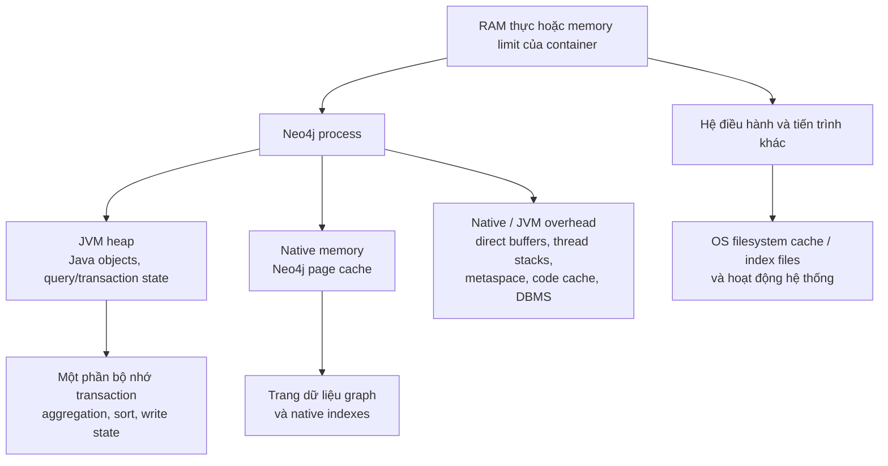
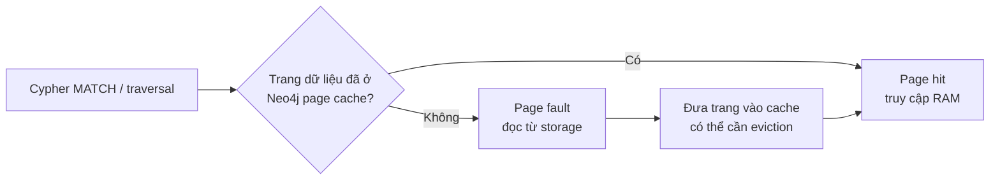

# Quan hệ giữa heap, page cache, bộ nhớ giao dịch và bộ nhớ hệ điều hành trong Neo4j

Một máy chủ Neo4j có **32 GiB RAM** không có nghĩa ta có thể cấu hình **16 GiB JVM heap + 16 GiB page cache** rồi coi như đã dùng hết tài nguyên một cách tối ưu. Ngoài hai vùng đó, tiến trình Neo4j và hệ điều hành còn cần bộ nhớ cho thread stack, JVM metaspace, network buffers, index, thư viện native, các tiến trình nền và hoạt động I/O. Nếu không dự trù, container có thể bị OOM-kill hoặc hệ điều hành phải swap dù Java heap chưa đầy.

Ngược lại, phân bổ quá ít heap khiến truy vấn `collect()`, `ORDER BY`, đường đi biến độ dài hoặc batch ghi lớn gặp áp lực GC và giới hạn bộ nhớ giao dịch; phân bổ quá ít page cache khiến Neo4j phải đọc dữ liệu đồ thị/index từ disk thường xuyên hơn.

Bài thuộc chương **Cấu hình tài nguyên** của module `DATABASE_ENGINE_GRAPH_NEO4J`: sử dụng Neo4j để mô hình hóa property graph, truy vấn node/relationship/đường đi bằng Cypher, tối ưu index/constraint, nhập dữ liệu, và vận hành từ Java Driver/Spring Data Neo4j. Mục tiêu là hiểu **quan hệ giữa heap, page cache, transaction memory và RAM của hệ điều hành**, lập một ngân sách sơ bộ, đo đúng tín hiệu và thay đổi cấu hình có kiểm chứng.

> **Nguyên tắc quan trọng:** **transaction memory thường nằm trong heap**, không phải một khối RAM độc lập phải cộng toàn bộ lần nữa vào `heap + page cache`. Tuy nhiên, một phần hoạt động của transaction có thể dùng off-heap; vì vậy vẫn phải dành chỗ cho native memory và phần hệ điều hành. Không có công thức phần trăm RAM cố định tối ưu cho mọi workload.

## 1. Bản đồ bộ nhớ của một Neo4j server

Neo4j là một tiến trình JVM, nhưng **không phải toàn bộ RAM của Neo4j đều nằm trong JVM heap**.



Bốn khái niệm thường gặp:

| Khái niệm | Nơi sử dụng chính | Nội dung đặc trưng | Khóa cấu hình |
| --- | --- | --- | --- |
| **JVM heap** | Bộ nhớ trong JVM, quản lý bằng garbage collector | Java object, trạng thái truy vấn/giao dịch, cấu trúc runtime, query cache | `server.memory.heap.initial_size`, `server.memory.heap.max_size` |
| **Neo4j page cache** | Native/off-heap do Neo4j quản lý | Trang dữ liệu graph và các cấu trúc native index, tránh đọc disk lặp lại | `server.memory.pagecache.size` |
| **Transaction memory** | **Chủ yếu là phần sử dụng trong heap**, có thể có phần off-heap | Kết quả trung gian, sort, aggregation, thay đổi chưa commit; phụ thuộc truy vấn | `dbms.memory.transaction.total.max`, `db.memory.transaction.total.max`, `db.memory.transaction.max` |
| **OS và bộ nhớ ngoài heap khác** | Hệ điều hành và vùng native của tiến trình | Thread stacks, metaspace, network buffers, filesystem cache, một số search/vector indexes và tiến trình nền | **Dự phòng qua ngân sách tổng**, không có một khóa Neo4j duy nhất |

Các vùng trên có **quan hệ bao hàm**. Ví dụ: một transaction đang dùng 200 MiB heap không đồng nghĩa đã chiếm thêm 200 MiB *bên ngoài* con số heap tối đa. Transaction memory limit là **giới hạn tiêu thụ được theo dõi**, không phải một lệnh yêu cầu hệ điều hành cấp sẵn một vùng RAM vật lý riêng.

Tương tự, **Neo4j page cache** và **filesystem page cache của Linux** là hai cơ chế khác nhau; không nên coi tên gọi gần giống là cùng một vùng có thể cộng/trừ tùy ý.

## 2. JVM heap: nơi các object và kết quả trung gian sống

### 2.1. Heap phục vụ công việc gì?

Một truy vấn Cypher thường trải qua nhiều operator: tìm node bằng index, mở rộng relationship, lọc, kết hợp hàng, tổng hợp, sắp xếp và trả kết quả. Một phần trạng thái đó được giữ trong Java heap.

Ví dụ:

```cypher
MATCH (p:Person)-[:BOUGHT]->(o:Order)
WITH p, collect(o) AS allOrders
RETURN p.customerId AS customerId,
       allOrders;
```

Nếu một khách hàng có hàng trăm nghìn đơn hàng, danh sách `allOrders` và các kết quả trung gian có thể tạo áp lực bộ nhớ giao dịch. Một heap lớn hơn có thể giúp chịu tải cao hơn, nhưng **không sửa được** một truy vấn gom kết quả không có giới hạn.

Heap được quản lý bằng **garbage collection (GC)**. Khi cấp phát object nhiều và giữ chúng lâu, Neo4j có thể dành thêm CPU/thời gian cho GC; độ trễ của truy vấn tăng dù CPU phía ứng dụng không bận.

### 2.2. Hai thiết lập heap

Trong `neo4j.conf` của các phiên bản Neo4j hiện hành:

```properties
server.memory.heap.initial_size=8G
server.memory.heap.max_size=8G
```

- `initial_size` tương ứng kích thước heap khởi tạo (tư duy tương đương `-Xms`).
- `max_size` giới hạn heap tối đa (tư duy tương đương `-Xmx`).
- Neo4j khuyến nghị **đặt hai giá trị bằng nhau** để giảm nguy cơ dừng GC không mong muốn khi heap thay đổi kích thước.
- Hai giá trị này là cấu hình tiến trình, **không** phải giới hạn bộ nhớ của toàn container/máy chủ.

Không nên tự kết luận “heap càng lớn càng tốt”: tăng heap trong ngân sách RAM cố định thường lấy mất phần dành cho page cache hoặc OS. Heap quá lớn còn có thể làm quá trình quản lý GC phức tạp hơn; điều quan trọng là quan sát mức dùng sau GC, số lần và thời gian pause, số query đồng thời và mô hình dữ liệu.

### 2.3. Heap không chứa toàn bộ dữ liệu graph

Hàng triệu node/relationship thường nằm trên disk trong các file store. Khi truy vấn cần truy cập chúng, Neo4j sử dụng page cache để giữ những **trang dữ liệu đang cần** trong RAM. Vì vậy **không cần heap đủ lớn để chứa toàn bộ graph**.

Ví dụ: graph có 80 GiB file dữ liệu và native index, máy chủ có heap 8 GiB vẫn có thể hoạt động bình thường nếu page cache, tốc độ storage và workload được thiết kế phù hợp.

## 3. Page cache: giảm thao tác đọc/ghi dữ liệu trên disk

Neo4j page cache là vùng bộ nhớ native dùng để giữ những trang của dữ liệu graph và các native indexes. Khi truy vấn cần một trang:

1. Nếu trang có sẵn trong cache: **page cache hit**, có thể dùng mà không cần đọc lại từ disk.
2. Nếu không có: **page cache fault**, hệ thống phải đưa trang cần thiết vào cache.
3. Nếu cache đã kín, có thể cần **evict** một trang khác; việc ghi dirty page và checkpoint cũng liên quan I/O.



Thiết lập page cache:

```properties
server.memory.pagecache.size=18G
```

Điều này **không** bắt buộc mọi trang của mọi database/index phải có mặt đồng thời trong RAM. Neo4j sẽ ưu tiên giữ dữ liệu vừa được hoặc thường được truy cập theo cơ chế quản lý cache.

### 3.1. Khi tăng page cache có ích?

- Truy vấn lặp lại trên các phần dữ liệu có độ phủ lớn, page cache fault nhiều và disk I/O cao.
- Dữ liệu graph và native index được truy cập thường xuyên có thể nằm trong cache sau khi tăng vùng nhớ.
- Đồ thị có nhiều phép traversal: mỗi bước lại cần đọc node record, relationship record và các cấu trúc liên quan.

Tuy nhiên, nếu workload chủ yếu nằm trong tập nhỏ đã được cache, tăng page cache từ 18 GiB lên 24 GiB có thể **không cải thiện đáng kể** kết quả.

### 3.2. Không phải index nào cũng nằm trong Neo4j page cache

Một số search index như Lucene/full-text và đặc biệt các cấu trúc vector index có thể sử dụng **bộ nhớ hệ điều hành và cơ chế khác**, không phải đơn giản được chứa trọn trong `server.memory.pagecache.size`. Tài liệu vận hành Neo4j lưu ý cần dành đủ OS memory để vector index hoạt động tốt. Vì vậy, khi dùng full-text/vector search, không phân bổ toàn bộ RAM dư cho page cache.

**Quy tắc:** khi ước lượng kích thước store, native indexes và search indexes, phân loại chúng theo cơ chế thực tế của **phiên bản Neo4j đang chạy**, không cộng tất cả file index rồi coi page cache là nơi duy nhất chứa mọi index.

### 3.3. Page cache lúc khởi động có thể còn lạnh

Ngay sau restart, page cache có thể chưa chứa các trang thường dùng; lượng page faults/I/O có thể tăng tạm thời khi cache được làm ấm. Vì vậy không lấy vài phút đầu sau restart làm kết luận cuối cùng rằng page cache quá nhỏ.

Một số phiên bản/edition có tính năng **page cache warmup**; điều kiện hỗ trợ và các tùy chọn cần xem theo bản đang triển khai. Không dùng warmup như cách thay thế cho ngân sách RAM hợp lý.

## 4. Transaction memory nằm ở đâu trong ngân sách?

Transaction memory là lượng bộ nhớ cần để Neo4j xử lý transaction đang chạy: giữ thay đổi chưa commit, kết quả trung gian, cấu trúc lọc/sắp/tổng hợp, và hoạt động duyệt đồ thị. Nó **không phải** một bộ nhớ cố định có kích thước bằng setting giới hạn.

Ví dụ, cùng một database:

```cypher
// Khối lượng trung gian có thể tăng khi số quan hệ lớn
MATCH (u:User)-[:VIEWED]->(p:Product)
WITH u, collect(DISTINCT p) AS viewed
RETURN u.userId AS userId, viewed;
```

và:

```cypher
// Trả một số thay vì tạo danh sách node
MATCH (u:User)-[:VIEWED]->(p:Product)
RETURN u.userId AS userId,
       count(DISTINCT p) AS viewedCount;
```

Hai truy vấn trả **thông tin khác nhau**, nhưng câu thứ hai thường ít phải giữ dữ liệu đầu ra hơn vì không vật hóa danh sách node lớn. Truy vấn nhiều đường đi, `ORDER BY` trên tập hàng lớn, `collect(path)` và batch `UNWIND` quá rộng đều có thể đẩy bộ nhớ transaction lên cao.

**Bộ nhớ giao dịch chủ yếu thuộc heap và có thể có phần off-heap.** Giới hạn transaction memory thường dựa trên **ước lượng và theo dõi phân bổ**, không phải con số đo chính xác tuyệt đối của mọi object. Neo4j có thể chấm dứt transaction khi vượt hạn mức để bảo vệ tiến trình, nhưng việc không chạm hạn mức cũng không bảo đảm tiến trình không bao giờ thiếu RAM.

### 4.1. Ba tầng giới hạn

Các setting hiện hành:

| Setting | Phạm vi | Công dụng |
| --- | --- | --- |
| `dbms.memory.transaction.total.max` | **Toàn Neo4j DBMS** | Tổng bộ nhớ các transaction đang chạy trên server |
| `db.memory.transaction.total.max` | **Một database** | Tổng mức tiêu thụ transaction trong database đó |
| `db.memory.transaction.max` | **Một transaction** | Ngăn một truy vấn/giao dịch riêng tiêu thụ quá nhiều bộ nhớ |

Theo tài liệu Neo4j hiện hành, mức mặc định của **DBMS global transaction total** được suy theo giới hạn heap (tài liệu nêu 70% heap), còn per-database total và per-transaction có thể mặc định `0` tức không áp thêm giới hạn riêng ở lớp đó. **Phải kiểm tra bằng `SHOW SETTINGS` trên server cụ thể**, vì version/edition có thể khác.

Một ví dụ ràng buộc minh họa:

```properties
dbms.memory.transaction.total.max=4G
db.memory.transaction.total.max=3G
db.memory.transaction.max=512M
```

Ý nghĩa:

- Một transaction vượt khoảng `512M` theo bộ đo của Neo4j có thể bị chấm dứt.
- Tổng nhiều transaction trong một database bị chặn bởi mức `3G`.
- Tổng transaction trên toàn server bị chặn bởi mức `4G`.
- Nếu database A và B cùng hoạt động, hai hạn mức per-database không phải lời hứa “mỗi database luôn được dành riêng 3 GiB”. Chúng vẫn **cạnh tranh ngân sách global và heap**.

**Đừng cộng `4G + 3G + 512M` vào `heap` để tính RAM cần mua.** Đây là các tầng giới hạn chồng lấp về tiêu thụ, không phải ba vùng memory được đặt cạnh heap.

### 4.2. Ví dụ theo tải đồng thời

Giả sử mỗi transaction tiêu thụ khoảng **300 MiB** được theo dõi:

| Số transaction chạy đồng thời trong một database | Tổng gần đúng | So với hạn mức 3 GiB |
| ---: | ---: | --- |
| 4 | 1.200 MiB | Thấp hơn |
| 8 | 2.400 MiB | Thấp hơn |
| 12 | 3.600 MiB | **Cao hơn**, có thể chạm giới hạn |

Mỗi transaction đơn lẻ đều dưới `512M`, nhưng tổng 12 transaction có thể vượt hạn mức database. Điều này giải thích tại sao một truy vấn chạy riêng được mà chạy đồng thời với nhiều request khác lại bị dừng.

Đây là **bài toán số học minh họa**, không phải phép dự đoán bộ nhớ chính xác: kích thước thực thay đổi theo dữ liệu, plan, độ rộng kết quả, các bản ghi được giữ và độ trễ client.

### 4.3. Trường hợp bị từ chối vì ước lượng

Neo4j lưu ý đo bộ nhớ transaction theo ước lượng có thể bảo thủ, nhất là khi nhiều đường đi cùng dùng chung các node/relationship hoặc `UNWIND` một list rất lớn. Có thể xảy ra trường hợp giới hạn bị chạm trước khi actual heap đạt mức nghĩ tới.

Không xử lý bằng cách **đặt mọi hạn mức thành 0** trên production. Cần xác minh query, plan và đo, xem có thể giảm `collect()`, batch size, chiều sâu duyệt, số request song song trước; chỉ thay hạn mức trong môi trường được kiểm soát và có lý do kỹ thuật.

## 5. OS memory và native overhead: phần RAM không được quên

Khi Neo4j chạy, ngoài JVM heap và page cache, RAM còn được dùng cho:

- **JVM metaspace và code cache:** metadata class, mã do JIT sinh ra.
- **Thread stacks:** mỗi thread có stack riêng; nhiều kết nối/workers có thể ảnh hưởng.
- **Network/direct buffers:** Bolt và các hoạt động I/O.
- **Neo4j native DBMS/database overhead:** một số cache/allocator khác.
- **OS filesystem cache:** các file và index có thể dùng cơ chế nhớ đệm của hệ điều hành.
- **Hệ điều hành và dịch vụ giám sát:** kernel, agent, exporter, những tiến trình khác cùng host.
- **Các cấu trúc search/vector index:** cần dự toán theo tính năng và phiên bản cụ thể.

Một máy 32 GiB không thể an toàn khi đồng thời cấp heap 24 GiB và page cache 8 GiB rồi **để phần OS/native bằng 0**. Cấu hình đó không kể đến chi phí ngoài heap và có thể dẫn đến swap hoặc OOM kill.

Trên hệ thống Linux dành riêng cho Neo4j, tài liệu khuyến nghị có dự phòng OS và tránh swap khi phù hợp; tuy nhiên **số GiB cụ thể** còn phụ thuộc tổng RAM, số index, workload, JVM, container và phần mềm cùng chạy. Không cố áp dụng duy nhất một “tỷ lệ OS 10%” cho mọi máy.

### 5.1. OS cache khác Neo4j page cache

Nếu thấy Linux báo nhiều bộ nhớ ở cột cache, không mặc định Neo4j page cache đã chiếm quá mức. Hệ điều hành có thể dùng RAM trống để cache filesystem; một phần cache có thể thu hồi khi có nhu cầu. Cần phân biệt:

- `server.memory.pagecache.size`: budget cho **Neo4j page cache**.
- **Heap used/committed/max**: các trạng thái khác nhau của JVM.
- **RSS / cgroup memory.current**: bộ nhớ tiến trình/container đang sử dụng theo cách hệ điều hành theo dõi.
- **buff/cache và MemAvailable**: thông tin của host Linux; ý nghĩa phụ thuộc cơ chế account của OS và container.

Đừng dựa vào **một** số “used memory” của dashboard để kết luận heap thiếu hoặc page cache quá lớn.

## 6. Công thức ngân sách RAM mà không đếm trùng

Để suy nghĩ ở mức sơ bộ:

\[
M_{\text{available}} \gtrsim
M_{\text{heap max}}+
M_{\text{page cache}}+
M_{\text{native/JVM ngoài heap}}+
M_{\text{OS và phần dùng chung}}
\]

Đây là **bất đẳng thức dự trù**, không phải công thức đo chính xác RSS trong mọi thời điểm. Một số vùng được cấp phát theo nhu cầu và báo cáo memory của OS có thể chồng lấp thông tin.

Đặc biệt, **không viết**:

\[
M_{\text{available}} =
M_{\text{heap}} + M_{\text{page cache}} +
M_{\text{transaction limit}} + M_{\text{OS}}
\]

nếu đang giả định transaction memory là toàn bộ phần **thêm bên ngoài heap**. Như vậy sẽ **đếm trùng** bộ nhớ giao dịch on-heap, dẫn đến một mô hình sai về capacity.

### 6.1. Ví dụ máy/container có giới hạn 32 GiB

Giả sử workload thiên về traversal và có mức đồng thời vừa phải. Một **điểm bắt đầu thử nghiệm**, không phải khuyến nghị universal:

| Thành phần | Ngân sách minh họa |
| --- | ---: |
| JVM heap max | **8 GiB** |
| Neo4j page cache | **18 GiB** |
| Phần dư cho OS, JVM native/off-heap và overhead khác | **6 GiB** |
| **Tổng** | **32 GiB** |

Công thức kiểm tra:

```text
32 GiB tổng hạn mức
- 8 GiB heap
- 18 GiB page cache
= 6 GiB chưa cấp phát cứng cho hai vùng trên
```

**6 GiB này không phải “bộ nhớ transaction”.** Transaction on-heap sử dụng trong 8 GiB heap; phần off-heap và các hoạt động khác góp vào việc sử dụng khoảng dự phòng.

Nếu workload gồm nhiều `collect()` lớn hoặc batch import cần nhiều trạng thái query, có thể cần **tăng heap và giảm page cache**. Nếu workload chủ yếu đọc graph, truy vấn gọn và page faults cao, có thể cần page cache lớn hơn — miễn không bóp nghẹt OS/native. Quyết định được đưa ra từ **đo thực tế**, không chỉ từ tổng số node trong graph.

### 6.2. Khi nào ví dụ 32 GiB không phù hợp?

- Có vector index lớn cần thêm OS memory.
- Có nhiều database trong cùng DBMS, mỗi database thêm overhead/cache.
- Có plugin/APOC/GDS hoặc workload native dùng lượng RAM đáng kể.
- Có nhiều tiến trình ứng dụng chạy cùng host.
- Host/container có memory limit thực nhỏ hơn 32 GiB.
- Dung lượng dữ liệu + native index nóng vượt quá 18 GiB, disk chịu tải lớn.
- Truy vấn đồng thời nhiều, heap/transaction limit quá thấp.

Mỗi thay đổi này có thể buộc **thiết kế lại tỷ lệ**, không chỉ cộng thêm 1–2 GiB tùy cảm giác.

## 7. Tệp neo4j.conf: một cấu hình minh họa nhất quán

Một cấu hình tham khảo **cho máy/container thử nghiệm có 32 GiB memory limit**:

```properties
# JVM heap (on-heap)
server.memory.heap.initial_size=8G
server.memory.heap.max_size=8G

# Neo4j native page cache
server.memory.pagecache.size=18G

# Hạn mức sử dụng memory được theo dõi cho transaction
# Không cộng các mức sau vào tổng 8G + 18G.
dbms.memory.transaction.total.max=4G
db.memory.transaction.total.max=3G
db.memory.transaction.max=512M
```

Các setting heap/page cache nói chung cần lập kế hoạch **restart** để áp dụng thay đổi; một số transaction memory settings được Neo4j đánh dấu **Dynamic** và có thể thay đổi lúc chạy theo cơ chế cấu hình phù hợp.

**Không coi mọi thay đổi runtime là vĩnh viễn**: tài liệu Neo4j nêu các thay đổi dynamic chỉ ở runtime có thể mất khi restart; cần cập nhật file cấu hình/Helm values/infrastructure-as-code và áp dụng trên từng thành viên cluster theo quy trình. Cũng không nên thao tác config dựa trên tên setting từ Neo4j 4.x mà không đối chiếu mục Upgrade/Migration; nhiều tên đã đổi trong Neo4j 5.

### 7.1. Kiểm tra cấu hình server đang chạy

Các lệnh sau là **đọc thông tin**, không thay đổi database:

```cypher
SHOW SETTINGS
YIELD name, value
WHERE name IN [
  'server.memory.heap.initial_size',
  'server.memory.heap.max_size',
  'server.memory.pagecache.size',
  'dbms.memory.transaction.total.max',
  'db.memory.transaction.total.max',
  'db.memory.transaction.max'
]
RETURN name, value
ORDER BY name;
```

Một số bản/edition có hạn chế về quyền `SHOW SETTINGS` hoặc tên cột chi tiết; kiểm tra tài liệu và quyền của server. Quan trọng là **đọc giá trị thực tế đang dùng**, không chỉ xem tệp `neo4j.conf` nằm ở thư mục triển khai.

Kiểm tra tài nguyên tiến trình Neo4j đang sử dụng có thể dùng:

```cypher
CALL dbms.listPools();
```

Procedure này cung cấp thông tin các vùng/bể nhớ theo hỗ trợ của server/edition; có thể yêu cầu quyền. Số liệu là **snapshot tại thời điểm chạy** và tên cột có thể thay đổi giữa phiên bản.

## 8. Chọn giá trị ban đầu bằng memory-recommendation

Thay vì chọn tỷ lệ ngẫu nhiên, Neo4j cung cấp công cụ:

```bash
bin/neo4j-admin server memory-recommendation --memory=32g
```

Công cụ tạo **khuyến nghị khởi điểm** cho heap và page cache; với tùy chọn thích hợp nó còn có thể đưa ra thông tin tổng dung lượng các file store/index hiện có.

Nếu đang cấu hình Docker, có thể dùng định dạng biến môi trường:

```bash
bin/neo4j-admin server memory-recommendation --memory=32g --docker
```

Lưu ý:

- Chạy với đúng phiên bản Neo4j và **ngân sách RAM thực tế của tiến trình/container**, không lấy tổng RAM host nếu container nhỏ hơn.
- Kết quả không phải cấu hình tự động tối ưu cho mọi truy vấn; cần đo GC, page faults, số transaction đồng thời và workload thật.
- Khi database dùng nhiều native indexes, cần tính cả dữ liệu/index được truy cập thường xuyên, không chỉ kích thước file node store.
- Với Lucene/full-text/vector indexes, xem thêm OS memory thay vì nhét tất cả file vào page cache.
- Thêm tăng trưởng dữ liệu, backup/restore, rebuild index và headroom cho các đợt nhập lớn.

**Chọn số từ tài liệu công cụ là bước khởi đầu, không phải kết thúc capacity planning.**

## 9. Docker và Kubernetes: memory limit mới là ngân sách sát thực tế

### 9.1. Docker: tên biến môi trường khác tên config

Trong container, Neo4j hỗ trợ chuyển dấu chấm `.` sang gạch dưới và dấu gạch dưới `_` gốc sang `__` trong tên biến môi trường. Ví dụ:

| neo4j.conf | Docker env |
| --- | --- |
| `server.memory.heap.initial_size` | `NEO4J_server_memory_heap_initial__size` |
| `server.memory.heap.max_size` | `NEO4J_server_memory_heap_max__size` |
| `server.memory.pagecache.size` | `NEO4J_server_memory_pagecache_size` |
| `dbms.memory.transaction.total.max` | `NEO4J_dbms_memory_transaction_total_max` |

Ví dụ Compose có giới hạn bộ nhớ minh họa, **chưa gồm cấu hình production như secret, volume, TLS hoặc network**:

```yaml
services:
  neo4j:
    image: neo4j:5
    mem_limit: 32g
    environment:
      NEO4J_server_memory_heap_initial__size: "8G"
      NEO4J_server_memory_heap_max__size: "8G"
      NEO4J_server_memory_pagecache_size: "18G"
```

Tag `neo4j:5` chỉ là **minh họa**, không nên dùng tag động trong CI/CD/production có yêu cầu tái lập; chọn image tag đã kiểm chứng theo phiên bản server thật. Khi triển khai, phải có volume dữ liệu, credential và policy restart phù hợp.

Một lỗi thường gặp: host có 64 GiB RAM nhưng container chỉ được `--memory=16g`. Cấu hình `heap=8G` và `pagecache=18G` sẽ không phù hợp vì tổng hai vùng **đã vượt limit container**, ngay cả khi host còn nhiều RAM.

### 9.2. Kubernetes: request khác limit

Trong Kubernetes, `resources.requests.memory` phục vụ điều phối/scheduling, còn `resources.limits.memory` là ngưỡng container bị kiểm soát. Nếu memory usage vượt limit, **OOMKilled** có thể xảy ra ở cấp container **mà không cần xuất hiện Java `OutOfMemoryError` trước đó**.

Với Neo4j Helm chart, một cấu hình sơ đồ cho 32 GiB:

```yaml
neo4j:
  resources:
    cpu: "4"
    memory: "32Gi"

config:
  server.memory.heap.initial_size: "8G"
  server.memory.heap.max_size: "8G"
  server.memory.pagecache.size: "18G"
```

Đây là đoạn minh họa theo cú pháp Helm chart Neo4j được tài liệu hóa, **không phải manifest Kubernetes độc lập**. Cần xem bản chart đang chạy, vì cấu trúc values/giới hạn hỗ trợ có thể thay đổi.

Nếu container bị `OOMKilled`, tăng `-Xmx` thường **có thể làm tình hình tệ hơn** do lấy thêm RAM từ phần native/OS. Trước hết phải xem memory limit, heap + page cache + headroom và số liệu thực tế của container.

## 10. Quan hệ giữa loại truy vấn Cypher và nhu cầu RAM

Không có một phân bổ heap/page cache phù hợp tuyệt đối cho mọi loại câu truy vấn. Ví dụ:

| Workload | Dễ gây áp lực ở đâu? | Tín hiệu cần xem | Hướng xử lý ưu tiên |
| --- | --- | --- | --- |
| Tra cứu node/relationship lặp lại | Page cache / storage I/O | Page fault, hit ratio, disk latency | Index phù hợp, page cache nếu hot set chưa đủ |
| `collect()` rất lớn | Heap và transaction memory | Allocated heap, GC, transaction limits | Không gom khi chỉ cần count; giới hạn list |
| `ORDER BY` trên hàng triệu kết quả | Heap và transaction state | Sort/Top operator, Rows/DB Hits, GC | Top-k, index, giảm số hàng trước sort |
| Traversal/đường đi biến độ dài | Cả page cache và query state | Page faults, cardinality, transaction memory | `maxDepth`/pattern giới hạn, lọc sớm |
| `UNWIND` batch import rất lớn | Transaction state, heap; ghi page cache | Memory errors, commit latency, GC | Chia lô, index khóa `MERGE`, giới hạn song song |
| Full-text/vector search | OS memory, index/cache; cả query state | OS/cgroup memory, index behavior, latency | Dự phòng OS, đo theo index/tính năng |
| Hàng trăm request Java Driver đồng thời | Heap, transaction memory, network buffers | Pool usage, active transactions, GC | Giới hạn concurrency, page size, timeout |

Ví dụ một API không cần trả toàn bộ node:

```cypher
// Dữ liệu trả về rộng, dễ làm ứng dụng tạo payload lớn
MATCH (p:Person)-[:PURCHASED]->(o:Order)
RETURN p, collect(o) AS orders;
```

```cypher
// Nếu nghiệp vụ chỉ cần số đơn hàng, giảm output state
MATCH (p:Person)-[:PURCHASED]->(o:Order)
RETURN p.customerId AS customerId,
       count(o) AS orderCount;
```

Vì hai câu có **ngữ nghĩa đầu ra khác nhau**, chỉ thay bằng câu thứ hai khi API thật sự cần số đếm thay vì danh sách order.

Trường hợp `LIMIT 10` ở cuối không bảo đảm truy vấn chỉ xử lý 10 hàng trước đó. Một phép `collect()` hoặc sort không phù hợp có thể vẫn xử lý hàng triệu bản ghi trung gian. Vì thế **tối ưu Cypher trước khi nới heap/transaction limit** thường hiệu quả và bền vững hơn.

## 11. Đo bộ nhớ: kiểm tra bằng nhiều nguồn, không dựa một biểu đồ

### 11.1. SHOW TRANSACTIONS

Khi có quyền phù hợp, truy vấn đang chạy có thể được quan sát:

```cypher
SHOW TRANSACTIONS
YIELD database,
      transactionId,
      estimatedUsedHeapMemory,
      allocatedDirectBytes,
      currentQueryAllocatedBytes
RETURN database,
       transactionId,
       estimatedUsedHeapMemory,
       allocatedDirectBytes,
       currentQueryAllocatedBytes
ORDER BY estimatedUsedHeapMemory DESC;
```

Các cột có thể `null` nếu không có query đang chạy, không có quyền hoặc server không cung cấp thông tin. Giá trị `estimatedUsedHeapMemory` là **ước lượng** theo cơ chế tracking, không phải số bytes vật lý chính xác tuyệt đối.

Ở database ít tải, chạy `SHOW TRANSACTIONS` có thể chỉ nhìn thấy chính transaction của lệnh theo dõi. Trong trường hợp thực tế cần thu thập định kỳ vào monitoring để thấy các đỉnh khi batch import hoặc request đồng thời.

### 11.2. PROFILE cho truy vấn có nghi vấn

```cypher
EXPLAIN
MATCH (p:Person)-[:CONNECTED_TO*1..3]->(other:Person)
RETURN p.personId, count(DISTINCT other);
```

```cypher
PROFILE
MATCH (p:Person)-[:CONNECTED_TO*1..3]->(other:Person)
RETURN p.personId, count(DISTINCT other);
```

`EXPLAIN` chỉ dựng plan và **không thực thi query**; `PROFILE` **chạy thật**, cho các số liệu như Rows/DB Hits, đôi khi có Memory/Time tùy runtime. Cú pháp đường đi `*1..3` là dạng quen thuộc ở Cypher 5; với Cypher 25 cần kiểm tra syntax path tương ứng.

**Chỉ chạy `PROFILE` với truy vấn đọc đã được cho phép hoặc môi trường thử kiểm soát.** Với `PROFILE CREATE/DELETE`, database vẫn bị ghi/xóa. Một plan bị nhân hàng ở `Expand`, `CartesianProduct`, `Sort` hay `Aggregation` có thể giải thích tình trạng tăng bộ nhớ transaction.

### 11.3. Metrics từ Neo4j và OS

| Chỉ số | Nơi xem | Câu hỏi trả lời |
| --- | --- | --- |
| JVM heap used/committed/max | JMX/metrics của Neo4j/JVM | Heap có sát trần liên tục không? |
| GC count/time/pause | GC log/metrics | Có pause dài hoặc GC dày khi tăng tải không? |
| Page cache hit/fault/usage | Neo4j metrics | Working set có liên tục fault vì cache thiếu không? |
| Transaction memory pool | `dbms.listPools()`, `SHOW TRANSACTIONS` | Có transaction/ngưỡng nào quá lớn không? |
| Process RSS, memory.current, OOM events | OS/cgroup/container metrics | Container có gần limit hoặc bị kill không? |
| Disk read/write, IOPS, latency | Host/volume metrics | Truy vấn có bị nghẽn storage khi page cache fault không? |
| App latency, timeouts, pool wait | Java Driver/Spring/observability | Hệ quả tới người dùng là gì? |

Các tên metric và khả năng export phụ thuộc phiên bản, edition và hệ thống giám sát. Các số liệu JVM, transaction pool, page cache và OS cần được đặt **cùng trục thời gian** với workload để không kết luận nhầm từ một sự kiện riêng lẻ.

Đừng lấy **hit ratio cao** làm kết luận “page cache đang đủ” nếu workload vừa thay đổi hoặc có spike. Tương tự, GC không cao cũng không bảo đảm container còn native headroom.

## 12. Ba tình huống chẩn đoán dễ nhầm

### Tình huống A — Transaction memory limit reached

**Biểu hiện:** câu `collect(path)` hoặc batch nhập có lỗi vượt giới hạn bộ nhớ transaction, nhưng OS còn nhiều RAM.

Phân tích theo thứ tự:

1. `SHOW SETTINGS` xem per-transaction, per-database và global limit hiện tại.
2. `PROFILE` trên dữ liệu thử để thấy operator nở số hàng.
3. Kiểm tra list `collect`, độ sâu đường đi, batch `UNWIND` và concurrency.
4. Thử giảm batch size, số path, dùng `count`/`EXISTS` hay pagination theo yêu cầu nghiệp vụ.
5. Chỉ tăng giới hạn nếu **đã chứng minh có heap/native headroom**, đồng thời cập nhật monitoring và test tải.

**Sai lầm:** coi lỗi giới hạn transaction là dấu hiệu chắc chắn phải tăng page cache. Page cache chủ yếu giải quyết truy cập store, không thể tự cung cấp heap cho một `collect()` quá lớn.

### Tình huống B — Page faults và disk latency tăng

**Biểu hiện:** các truy vấn đọc/duyệt graph lặp đi lặp lại, GC bình thường, nhưng page fault và thời gian đọc disk cao.

Kiểm tra:

- Page cache có đang được warm sau restart không?
- Working set gồm các file graph/native index nào? Kích thước hot set gần/đã vượt page cache?
- Có full scan/traversal quá rộng vì thiếu index/predicate không?
- Disk đã quá tải hay latency tăng vì workload khác?
- Có đủ native/OS RAM để tăng `server.memory.pagecache.size` mà không giảm headroom quá nhiều không?

**Sai lầm:** cứ tăng heap. Khi bottleneck là page faults, heap lớn hơn có thể **làm giảm phần RAM còn lại cho page cache**, khiến vấn đề trầm trọng hơn.

### Tình huống C — Container OOMKilled, không có Java OOME

**Biểu hiện:** Kubernetes restart Neo4j với trạng thái `OOMKilled`; log ứng dụng không có `java.lang.OutOfMemoryError` rõ ràng.

Giả thuyết ưu tiên:

- `heap.max_size + pagecache` quá gần memory limit.
- Native/direct buffers, JVM thread stacks, metaspace hoặc search/vector index dùng thêm nhiều RAM.
- Cgroup limit nhỏ hơn tài nguyên host; cấu hình heuristic khởi động không phản ánh đúng giới hạn mong muốn.
- Tải đồng thời tăng, plugin/OS cache có biến động.

Hành động: đọc `memory limit` của container, RSS/cgroup memory.current, native/heap/pagecache metrics, cấu hình và thời điểm peak. Có thể phải **giảm** heap/page cache hoặc **tăng** limit sau khi đo, không nhất thiết tăng JVM heap.

## 13. Nhiều database, clustering và khác biệt giữa các node

Trong Neo4j DBMS có nhiều database, một số tài nguyên tính theo **server**, số khác tính theo **database**:

- `server.memory.heap.max_size` và `server.memory.pagecache.size` áp dụng cho **Neo4j process/server**; không cấp riêng cùng số GiB cho mỗi database.
- `dbms.memory.transaction.total.max` điều tiết transaction memory ở phạm vi **DBMS server**.
- `db.memory.transaction.total.max` đặt hạn mức tổng giao dịch **trong một database**.
- Các database có chi phí riêng: metadata, query cache, dữ liệu/index và transaction; tổng memory pressure tăng khi số database và tải tăng.
- Trong cluster, mỗi server có **tiến trình và RAM riêng**. Cấu hình cho một member không tự thay toàn bộ các member; workload đọc/ghi, replication hoặc vai trò có thể tạo pressure khác nhau.

Khi một ứng dụng dùng Neo4j Java Driver với URI `neo4j://` để routing, truy vấn có thể đi tới những member khác nhau. Vì vậy, phải quan sát **bộ nhớ trên từng server**, không chỉ biểu đồ trung bình toàn cluster.

Nếu node A có page cache lớn và node B nhỏ, tải đọc chuyển sang B có thể làm latency cao hơn. Quản trị nên chuẩn hóa các cấu hình nền quan trọng giữa các member theo tài liệu và workload thực.

## 14. Quy trình tuning có kiểm soát

Một cách làm bền vững hơn “tăng heap rồi xem sao”:

1. **Ghi workload:** truy vấn đọc/ghi chủ đạo, p95/p99 latency, số transaction song song, import batch, kích thước graph/native index, full-text/vector index.
2. **Chốt ngân sách thật:** RAM host hoặc memory limit container, tiến trình khác cùng host và yêu cầu OS/native.
3. **Xác nhận phiên bản:** tên setting, edition, cơ chế index và memory metrics có thể thay đổi theo Neo4j release.
4. **Chụp hiện trạng:** `SHOW SETTINGS`, memory-recommendation, heap/GC, page cache hit/fault/usage, transaction pool, OS RSS/cgroup, disk I/O.
5. **Đặt giả thuyết cụ thể:** thiếu page cache hay một transaction tạo danh sách quá lớn? OS/headroom thiếu hay lỗi network?
6. **Ưu tiên sửa query/data access:** giảm cardinality, tránh Cartesian product, giới hạn path, batch nhập, chọn index trước khi tăng tài nguyên.
7. **Chỉ thay một nhóm setting mỗi lần:** heap hoặc page cache hoặc transaction limit; giữ lại cấu hình cũ để rollback.
8. **Triển khai canary/staging:** xác minh config đã có hiệu lực, xem JVM startup và page cache warmup; chạy cùng workload đại diện.
9. **Đo lại các chỉ số và kết quả nghiệp vụ:** GC, hit/fault, memory pool, container headroom và latency; bảo đảm query không đổi ngữ nghĩa.
10. **Ghi nhận quyết định:** giá trị cũ/mới, lý do, ngày đo, chỉ số và điều kiện rollback.

### Bảng đối chiếu thay đổi

| Giả thuyết | Thay đổi nên thử | Rủi ro cần kiểm tra |
| --- | --- | --- |
| Heap thiếu do workload hợp lệ | Tăng heap trong ngân sách | Giảm page cache/headroom, GC behavior |
| Page cache thiếu, disk I/O lớn | Tăng page cache nếu có RAM | OOM do native/OS thiếu |
| Một transaction quá lớn | Giảm batch/query state hoặc điều chỉnh per-tx limit có đo | Lỗi lặp lại dưới tải song song |
| Quá nhiều transaction đồng thời | Giới hạn concurrency, queue, timeout, global/per-db limits | Throughput và SLA của ứng dụng |
| Container OOMKilled | Giảm phần cấp phát cứng, tăng cgroup limit hoặc giảm native use | Tải vẫn vượt ngưỡng, restart |
| Đọc graph chậm do scan | Tạo/điều chỉnh index hoặc predicate | Chi phí index khi ghi, thống kê/planner |

## 15. Câu hỏi tự luyện

**Câu 1.** Một container có limit **16 GiB**, cấu hình heap max **8 GiB**, page cache **8 GiB**. Vì sao đây là rủi ro dù tổng đúng 16 GiB?

**Câu 2.** Bộ nhớ transaction đã được giới hạn 4 GiB toàn DBMS. Có cần cộng đủ 4 GiB ấy **ngoài** heap khi tính RAM tối thiểu không? Giải thích trường hợp off-heap.

**Câu 3.** Truy vấn `collect(path)` bị chấm dứt vì memory limit, còn page cache hit ratio cao. Nên kiểm tra gì trước khi tăng RAM?

**Câu 4.** Heap/GC bình thường nhưng page faults và disk latency rất cao trong các truy vấn traversal. Khả năng bottleneck nằm ở đâu?

**Câu 5.** Dưới tải đồng thời, 12 transaction mỗi transaction 300 MiB, per-transaction limit là 512 MiB nhưng per-database total limit là 3 GiB. Có nguy cơ bị chấm dứt transaction không?

**Câu 6.** Tại sao `OOMKilled` của Kubernetes không nhất thiết để lại Java `OutOfMemoryError`?

**Câu 7.** Trong một DBMS có 5 database, `server.memory.pagecache.size=18G` nghĩa là mỗi database có 18 GiB riêng không?

**Câu 8.** Vì sao sau restart vài phút đầu thường nhiều page faults không nhất thiết là cấu hình sai?

**Đáp án gợi ý:** (1) Không còn RAM cho OS/native/JVM overhead. (2) Không; phần lớn transaction state dùng heap, off-heap vẫn cần headroom. (3) Plan, số hàng, batch, độ sâu path, transaction limits. (4) Page cache working set/storage hoặc scan/traversal quá rộng. (5) Có: tổng xấp xỉ 3.600 MiB vượt 3 GiB dù từng transaction dưới 512 MiB. (6) Kernel/cgroup có thể kill tiến trình khi vượt giới hạn container trước khi JVM ném lỗi. (7) Không, page cache được quản lý ở phạm vi server. (8) Cache đang lạnh, phải làm ấm theo workload.

## 16. Tài liệu tham khảo

- [Neo4j Operations Manual — Memory configuration](https://neo4j.com/docs/operations-manual/current/performance/memory-configuration/): phân vùng RAM, heap, native memory, page cache, transaction limit và capacity planning.
- [Neo4j Operations Manual — Configuration settings](https://neo4j.com/docs/operations-manual/current/configuration/configuration-settings/): tên setting và giá trị/khả năng dynamic theo phiên bản.
- [Neo4j Operations Manual — The neo4j.conf file](https://neo4j.com/docs/operations-manual/current/configuration/neo4j-conf/): cú pháp tệp và vòng đời cấu hình.
- [Neo4j Operations Manual — Docker configuration](https://neo4j.com/docs/operations-manual/current/docker/configuration/): chuyển cấu hình sang biến môi trường và lưu ý container.
- [Neo4j Operations Manual — Kubernetes Helm configuration](https://neo4j.com/docs/operations-manual/current/kubernetes/configuration/): memory limit và phần dự phòng khi chạy Kubernetes.
- [Neo4j Operations Manual — Essential metrics](https://neo4j.com/docs/operations-manual/current/monitoring/metrics/essential/): page cache, GC và các tín hiệu theo dõi.
- [Neo4j Operations Manual — Show transactions](https://neo4j.com/docs/operations-manual/current/database-internals/show-and-terminate-transactions/): các cột usage/allocated memory theo transaction.

**Ghi nhớ:** **heap** giữ object và nhiều trạng thái truy vấn, **page cache** giữ những trang dữ liệu graph/native index thường dùng, **transaction memory** là phần tiêu thụ có thể đặt hạn mức **chủ yếu bên trong heap**, còn **OS/native headroom** bảo đảm tiến trình và hệ thống có đủ chỗ vận hành. Cấu hình tốt không chỉ chia RAM hợp lý mà còn kiểm tra query, đo GC/page faults/transaction metrics và thử dưới workload thật.
