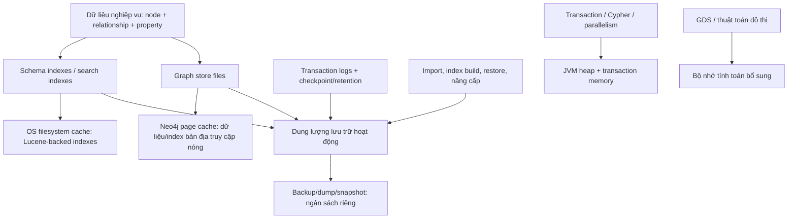
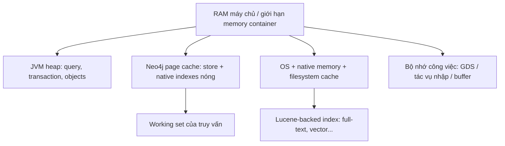

# Lập dung lượng theo số nút, số quan hệ, thuộc tính và chỉ mục trong Neo4j

## 1. Bài toán lập dung lượng: đếm node chưa đủ để chọn máy chủ

Một hệ thống dùng **Neo4j** để biểu diễn quan hệ bằng *property graph*: **node** là thực thể, **relationship** là liên kết có hướng và **property** lưu thông tin của node/relationship. Trong module `DATABASE_ENGINE_GRAPH_NEO4J`, các ứng dụng dùng **Cypher**, **Neo4j Java Driver** và **Spring Data Neo4j** để nhập dữ liệu, tra cứu kết nối và duyệt đường đi. Khi số lượng dữ liệu tăng, câu hỏi vận hành không còn là «Neo4j lưu được bao nhiêu node?» mà là:

- Với **N node**, **R relationship**, bao nhiêu property và index, cần bao nhiêu dung lượng đĩa?
- Bộ dữ liệu nào nên nằm trong **page cache** để tránh I/O chậm?
- Bao nhiêu **JVM heap** cho transaction, truy vấn và các phép mở rộng đồ thị?
- Cần dự phòng bao nhiêu dung lượng cho **transaction logs, nạp dữ liệu, index rebuild, backup, cluster replica** và tăng trưởng?
- Làm thế nào đo lại để điều chỉnh dự báo thay vì tin vào một con số «byte mỗi node» không đúng với mọi graph?

Bài thuộc chương **Cấu hình tài nguyên**, với trọng tâm **lập dung lượng theo số nút, số quan hệ, thuộc tính và chỉ mục**. Đây là hướng dẫn thiết kế và vận hành có thể áp dụng cho Neo4j tự quản lý; trên **Neo4j Aura**, kích thước instance, giới hạn và cơ chế cấp phát phụ thuộc dịch vụ quản lý.

### Mục tiêu

Sau bài học, bạn có thể:

1. Xây dựng bản kiểm kê **node, relationship, property, index** theo nhãn và loại quan hệ.
2. Hiểu vì sao số property, kiểu dữ liệu, chiều dài chuỗi, degree và **store format** thay đổi kích thước lưu trữ.
3. Lập bảng dự báo **data store + index + transaction logs + không gian tạm + dự phòng**.
4. Phân biệt nhu cầu **disk** với **page cache, heap, OS cache và bộ nhớ tính toán GDS**.
5. Dùng `neo4j-admin server memory-recommendation` và metric thực tế làm cơ sở hiệu chỉnh.
6. Đưa tăng trưởng, nhân bản cluster, backup và kiểm tra hiệu năng vào kế hoạch tài nguyên.

> **Phạm vi phiên bản:** Neo4j 4.4, dòng 5.x và các bản phát hành hiện hành có khác biệt về store format, tên cài đặt, chỉ mục và khả năng Enterprise. Ví dụ cấu hình ở đây dùng tên phổ biến của **Neo4j 5.x trở lên**; các giá trị số chỉ là **mẫu tính toán minh họa**, không phải kích thước chuẩn do Neo4j cam kết. Luôn xác định đúng version, edition và hình thức triển khai trước khi áp dụng.

## 2. Chia tổng dung lượng thành những hạng mục đúng nghĩa



**Hai câu hỏi khác nhau:**

1. **Disk capacity:** Cần đủ chỗ lưu file hiện tại và tăng trưởng, cộng các vùng làm việc phát sinh theo thời gian.
2. **RAM capacity:** Cần đủ bộ nhớ cho **working set** mà tải truy vấn thực sự đọc, transaction đang chạy, JVM, OS và thuật toán.

Không thể lấy tổng kích thước database trên đĩa rồi kết luận RAM phải bằng đúng số đó. Một graph nhiều terabyte vẫn có thể chạy với RAM nhỏ hơn nếu tập dữ liệu truy cập nóng hẹp và I/O phù hợp; ngược lại, một graph nhỏ có query trả hàng triệu path vẫn có thể gây hết heap.

### 2.1. Hạng mục nào thuộc Neo4j Database?

| Hạng mục | Hình thành từ | Điều làm nó tăng |
| --- | --- | --- |
| **Node storage** | Số node, label và thông tin tham chiếu | Tạo thêm node; thay đổi cách lưu label theo format |
| **Relationship storage** | Số cạnh, loại quan hệ, node đầu/cuối, cấu trúc adjacency | Tạo thêm cạnh; degree cao, topology lệch |
| **Property storage** | Số property và dữ liệu của chúng trên node/cạnh | Thêm trường, string dài, list hoặc vector |
| **Index storage** | Token lookup, range/text/point/full-text/vector index, constraint backing index | Thêm index, thêm giá trị được đánh chỉ mục, chiều dài giá trị |
| **Transaction logs** | Mọi cập nhật đã ghi vào transaction log | Tốc độ ghi, retention policy, backup/cluster |
| **Khác** | Metadata, checkpoint, hệ thống, cấu trúc quản trị và file phụ | Số database, loại triển khai, bảo trì/nâng cấp |

Đừng tự coi **tất cả index đều nằm trong cùng một loại file hoặc cùng một loại cache**. Một số index sử dụng cấu trúc bản địa, một số là **Lucene-backed**; sự khác biệt này có ý nghĩa đối với việc cấp RAM.

## 3. Thu thập số lượng trước khi dự báo

### 3.1. Kiểm kê node theo nhãn

Giả sử ứng dụng thương mại điện tử có:

```text
(:Customer {customerId, name, email, createdAt})
(:Order {orderId, state, total, createdAt})
(:Product {sku, title, category, price})

(Customer)-[:PLACED]->(Order)
(Order)-[:CONTAINS {quantity, unitPrice}]->(Product)
```

Đây là mẫu giúp hiểu vì sao **R có thể lớn hơn N nhiều lần**: mỗi order có một cạnh đến customer nhưng có thể có nhiều cạnh `CONTAINS` đến product.

```cypher
MATCH (c:Customer)
RETURN count(c) AS customerCount;
```

```cypher
MATCH (o:Order)
RETURN count(o) AS orderCount;
```

```cypher
MATCH (p:Product)
RETURN count(p) AS productCount;
```

Nếu cần đếm tổng node:

```cypher
MATCH (n)
RETURN count(n) AS totalNodes;
```

Kết quả theo nhãn **có thể bị đếm chồng** nếu một node mang nhiều nhãn, chẳng hạn `:Customer:VIP`. Không cộng các `count(:Label)` rồi giả định bằng tổng node khi các nhãn có thể chồng nhau.

### 3.2. Kiểm kê relationship theo type

```cypher
MATCH (:Customer)-[r:PLACED]->(:Order)
RETURN count(r) AS placedCount;
```

```cypher
MATCH (:Order)-[r:CONTAINS]->(:Product)
RETURN count(r) AS containsCount;
```

```cypher
MATCH ()-[r]->()
RETURN count(r) AS totalRelationships;
```

Theo Neo4j, một relationship có **một hướng được lưu**. Truy vấn `MATCH ()-[r]->()` nhận một hướng của mỗi cạnh, tránh nhầm một quan hệ thành hai chỉ vì có thể duyệt ngược trong Cypher. Khi sử dụng pattern vô hướng `-[r]-` hay nhiều đoạn pattern, việc đếm và nhân dòng có thể khác; nên dùng một pattern rõ ràng để lập thống kê.

### 3.3. Lưu cả tỷ lệ cạnh trên node

Từ số đếm:

\[
\text{Mật độ quan hệ trung bình}=\frac{R}{N}
\]

Chỉ số `R/N` có ích để nhận ra graph «nhiều cạnh», nhưng **không phản ánh phân bố degree**. Hai graph cùng N và R có thể có cấu trúc hoàn toàn khác:

- Graph A: phần lớn node có 5–10 cạnh.
- Graph B: đa số node có 1–2 cạnh nhưng một số node «siêu kết nối» có hàng triệu cạnh.

Các node degree rất cao có thể ảnh hưởng cách lưu adjacency theo store format và đặc biệt ảnh hưởng **chi phí traversal**. Vì vậy phải thu thập **P50/P95/P99/max degree** hoặc ít nhất một danh sách node degree cao, không chỉ trung bình toàn graph.

Ví dụ kiểm tra người dùng có nhiều quan hệ theo dõi:

```cypher
MATCH (u:GraphUser)
OPTIONAL MATCH (u)-[r:FOLLOWS]->()
RETURN u.userId AS userId,
       count(r) AS outgoingFollows
ORDER BY outgoingFollows DESC
LIMIT 20;
```

**Cảnh báo:** Đây là truy vấn đo đếm có thể rất tốn tài nguyên trên graph lớn. Chạy trên bản thử nghiệm/replica phù hợp, giới hạn thời gian và theo dõi `PROFILE`; đừng mặc định nó «rẻ» chỉ vì trả 20 dòng, bởi hệ thống vẫn có thể phải tính số cạnh cho rất nhiều node trước khi sắp xếp.

## 4. Thuộc tính: số lượng và kiểu dữ liệu quyết định kích thước

### 4.1. Đếm property trung bình trên node và cạnh

```cypher
MATCH (n:Order)
RETURN count(n) AS nodes,
       avg(size(keys(n))) AS avgPropertiesPerNode,
       max(size(keys(n))) AS maxPropertiesPerNode;
```

```cypher
MATCH ()-[r:CONTAINS]->()
RETURN count(r) AS relationships,
       avg(size(keys(r))) AS avgPropertiesPerRelationship,
       max(size(keys(r))) AS maxPropertiesPerRelationship;
```

`keys(...)` trả danh sách tên property đang tồn tại trên thực thể. Những câu trên cần đọc dữ liệu thực, có thể tốn tài nguyên ở quy mô lớn. **Không chạy trên toàn bộ graph sản xuất trong giờ cao điểm** chỉ để lấy một con số ước lượng; thay vào đó lấy mẫu theo partition, nhóm hoặc dữ liệu staging.

Nếu có `N` node với trung bình `p_N` property/node và `R` relationship với `p_R` property/relationship:

\[
P_N\approx N \times p_N,\qquad
P_R\approx R \times p_R
\]

Đây là **số lượng property-value**, không phải số byte. Cùng một số property nhưng kiểu `BOOLEAN`, số nguyên, chuỗi 200 ký tự, mảng dài và vector nhúng có kích thước rất khác.

### 4.2. Phân loại property có ảnh hưởng đến dung lượng

| Kiểu giá trị | Ví dụ | Điểm cần đo |
| --- | --- | --- |
| Boolean/số nhỏ | `active`, `quantity` | Giá trị và biểu diễn theo store format |
| Chuỗi ngắn | `status = 'PAID'`, `sku` | Chiều dài và phân bố giá trị |
| Chuỗi dài | `description`, `comment` | P50/P95/P99 chiều dài, ký tự UTF-8 |
| Date/datetime | `createdAt` | Kiểu temporal và cách lưu thực tế |
| Danh sách | `tags`, mảng số | Số phần tử và phân bố chiều dài |
| Point | `location` | Loại không gian và index sử dụng |
| Vector embedding | `embedding` gồm hàng trăm/nghìn chiều | Số chiều, kiểu phần tử, vector index và bản sao dữ liệu |

**UTF-8 không có một số byte cố định trên ký tự.** Chuỗi tiếng Việt, emoji và chuỗi ASCII khác nhau về số byte; bản thân store format cũng có cách tổ chức/đóng gói khác nhau. Không nên dùng `length(name)` như phép đo dung lượng vật lý chính xác.

### 4.3. Thu thập mẫu kích thước chuỗi

```cypher
MATCH (p:Product)
WHERE p.title IS NOT NULL
RETURN count(p) AS productsWithTitle,
       avg(size(p.title)) AS avgCharacters,
       max(size(p.title)) AS maxCharacters;
```

Đoạn này lấy **số ký tự** của chuỗi theo Cypher, giúp phát hiện phân bố dữ liệu nhưng **không tính overhead lưu trữ hoặc số byte UTF-8 thực tế**. Với dữ liệu lớn, cần mẫu đủ đại diện, gồm cả các nhóm có mô tả dài bất thường. Nên ghi lại tỷ lệ property **không tồn tại**, vì một node không có property hoàn toàn khác một node có chuỗi dài.

### 4.4. Dung lượng tăng không đều theo số dòng

Nếu phiên bản sau thêm `embedding` gồm 768 số vào mọi `Product`, tổng số property trên node chỉ tăng **một**, nhưng lượng dữ liệu có thể tăng mạnh so với việc thêm một Boolean. Khi gắn **vector index**, còn có chi phí cấu trúc tìm kiếm, dữ liệu vector được lưu trong index và nhu cầu **OS filesystem cache**.

Vì vậy, báo cáo capacity phải có **phân bố độ lớn property**, không chỉ số property trung bình.

## 5. Chỉ mục và constraint: tính riêng phần trùng lặp lưu trữ

### 5.1. Kiểm tra index thực sự đang tồn tại

Với Neo4j 5.x và các phiên bản hiện đại:

```cypher
SHOW INDEXES
YIELD name, type, entityType, labelsOrTypes, properties, state
RETURN name, type, entityType, labelsOrTypes, properties, state
ORDER BY name;
```

```cypher
SHOW CONSTRAINTS
YIELD name, type, labelsOrTypes, properties
RETURN name, type, labelsOrTypes, properties
ORDER BY name;
```

Một **unique constraint** thường có index hỗ trợ tương ứng. Nếu lập ngân sách từ **số đo file index thực tế**, đừng vừa cộng một index tồn tại vừa cộng lại chính nó như «chi phí constraint» riêng. `SHOW INDEXES` mô tả danh mục; nó **không trực tiếp hứa hẹn tổng số byte của từng index** ở mọi version.

### 5.2. Loại index ảnh hưởng gì?

| Loại | Mục đích | Ghi chú về capacity |
| --- | --- | --- |
| Lookup index | Tra cứu node theo label, quan hệ theo type | Có chi phí index riêng |
| Range index | Đẳng thức, khoảng, truy cập theo property | Chi phí phụ thuộc số entry, kiểu/độ lớn property |
| Composite range index | Kết hợp nhiều property trên cùng entity | Kích thước/chi phí thay đổi theo số entry và trường |
| Text index | Tìm chuỗi theo pattern | Không nên gán cùng byte/entry với range index |
| Point index | Phép tra cứu không gian | Chi phí phụ thuộc giá trị và loại index |
| Full-text index | Tìm kiếm từ khóa Lucene | Dùng cấu trúc Lucene-backed riêng và chi phí filesystem cache |
| Vector index | Tra cứu theo embedding và độ tương tự | Có cấu trúc HNSW/quantization, file Lucene và RAM hệ điều hành |

**Chỉ mục không chỉ tốn disk:** mỗi lần cập nhật property liên quan, index cũng phải được duy trì. Quá nhiều index làm tăng chi phí ghi, checkpoint/backup và thời gian nạp dữ liệu.

### 5.3. Không tạo index «cho chắc»

Ví dụ:

```cypher
CREATE CONSTRAINT customer_business_id IF NOT EXISTS
FOR (c:Customer)
REQUIRE c.customerId IS UNIQUE;
```

Với khóa duy nhất như `Customer.customerId`, constraint giúp bảo vệ tính duy nhất và có index hỗ trợ. Không cần tạo thêm một range index giống hệt chỉ để phục vụ cùng điều kiện tìm bằng ID. Với nhu cầu mới như `Order(state, createdAt)` có thể cân nhắc composite range index riêng, rồi đo tổng chi phí và lợi ích.

## 6. Vì sao không có công thức «mỗi node X byte» đáng tin tuyệt đối?

Một ước lượng phân rã về mặt ý tưởng:

\[
\begin{aligned}
D_{\text{data+index}}\approx&
N\cdot b_{\text{node}}+
R\cdot b_{\text{rel}}\\
&+P_N\cdot b_{\text{prop,node}}+
P_R\cdot b_{\text{prop,rel}}\\
&+D_{\text{labels/types/dynamic values}}+
D_{\text{indexes}}+
D_{\text{metadata}}
\end{aligned}
\]

Trong đó:

- `N`: số node, `R`: số relationship.
- `P_N` và `P_R`: tổng số property-value của node và relationship.
- `b_node`, `b_rel`, `b_prop`: **hệ số đo được trên dữ liệu mẫu cùng phiên bản/format**, không phải định mức byte cố định của Neo4j.
- `D_indexes`: kích thước file index thực tế theo schema sẽ sử dụng.

Các hệ số thay đổi bởi **store format** (`standard`, `aligned`, `high_limit`, `block` tùy version/edition), phân bố degree, số label, kích thước property, kiểu dữ liệu và cơ chế tổ chức bản ghi. Đặc biệt, các store format hiện đại có cách xử lý phần tử lớn và node nhiều quan hệ khác nhau; không lấy số byte từ một blog phiên bản cũ áp cho database mới.

### 6.1. Mô hình đo chênh lệch đáng tin hơn

Thay vì đoán hệ số:

1. Tạo database **thử nghiệm** sử dụng **đúng edition, version, store format và index schema** dự kiến.
2. Nhập mẫu có tỷ lệ node/relationship, degree, property và chiều dài giá trị gần với production.
3. Đo **dung lượng store files và index files** sau khi tạo và hoàn tất index.
4. Tăng dữ liệu theo đợt (ví dụ từ 100 nghìn lên 300 nghìn node), đo chênh lệch.
5. Tách số đo **transaction logs, dump, backup, temp files** khỏi store/index để tránh tính chúng như byte/node.
6. Lặp trên ít nhất hai quy mô nhằm phát hiện overhead cố định và sai số phi tuyến.

Đây là phép đo **empirical sizing**. Cần ghi rõ **dữ liệu đo, thời gian, tập index, phương pháp nhập, phiên bản và filesystem** để có thể so sánh các lần đo.

## 7. Ví dụ tính dung lượng từ số liệu mẫu

Giả sử một bài đo được thực hiện trên **database thử nghiệm** có dữ liệu giả lập cùng đặc tính nghiệp vụ dự kiến:

| Chỉ số | Mẫu thử | Quy mô dự kiến sau mở rộng |
| --- | ---: | ---: |
| Node | 100.000 | 2.000.000 |
| Relationship | 500.000 | 10.000.000 |
| Property trung bình/node | 5 | 5 |
| Property trung bình/relationship | 2 | 2 |
| Số bộ index | Giữ nguyên schema | Giữ nguyên schema |
| File data store đo được | **0,42 GiB** | Ngoại suy |
| File index đo được | **0,12 GiB** | Ngoại suy |

**Các số 0,42 GiB và 0,12 GiB là giả định minh họa, không phải benchmark Neo4j**. Chúng giả sử đo riêng vùng dữ liệu và index không chồng lặp, không tính logs/backup.

Tỷ lệ tăng:

\[
k=\frac{2.000.000}{100.000}
=\frac{10.000.000}{500.000}=20
\]

Nếu cùng kiểu dữ liệu và phân bố, ngoại suy ban đầu:

\[
D_{\text{data+index}}
\approx (0{,}42+0{,}12)\times 20
=10{,}8\ \text{GiB}
\]

Chọn **30% headroom cho data/index** để minh họa:

\[
10{,}8\times 1{,}30
=14{,}04\ \text{GiB}
\]

Sau đó **cộng riêng** các khoản:

| Khoản mục | Minh họa lập ngân sách |
| --- | ---: |
| Data + index sau ngoại suy và 30% headroom | 14,04 GiB |
| Transaction log retention tạm tính | 2,00 GiB |
| Vùng trống cho import/index build và vận hành | 5,00 GiB |
| Tổng sàn tính cho volume hoạt động trong ví dụ | **21,04 GiB** |
| Backup/dump và snapshot | **Chưa tính**; cấp vùng/chính sách riêng |
| Cài đặt DBMS, OS, system DB, log vận hành | **Chưa tính**; cần cộng tùy hạ tầng |

Không lấy `21,04 GiB` làm dung lượng production tối thiểu cho bất kỳ hệ thống thật nào. Bài toán thực tế còn có biến động tỉ lệ quan hệ, property dài, loại index mới, retention lâu hơn, dự phòng khi phục hồi/nâng cấp và đặc điểm filesystem.

### 7.1. Vì sao ngoại suy tuyến tính có thể sai?

- Tỉ lệ `R/N` tăng khi ứng dụng thêm recommendation, follow hoặc liên kết sản phẩm.
- Dữ liệu thời gian đầu chỉ có chuỗi ngắn, về sau thêm mô tả, ảnh metadata hoặc embedding.
- Có thêm range/full-text/vector indexes.
- Nhiều node trở thành **supernode** với degree lớn.
- Sau xóa/sửa hàng loạt, dung lượng file và cách tái sử dụng khoảng trống khác lúc nhập mới.
- Store format hoặc phiên bản Neo4j được đổi khi nâng cấp.
- Tần suất ghi tăng tạo nhiều transaction logs hơn dù `N` và `R` không tăng tương ứng.

Vì vậy, dùng ít nhất **ba kịch bản**: thấp/cơ sở/cao, và cập nhật dự báo định kỳ bằng số liệu quan sát.

## 8. Lập ngân sách RAM khác với lập ngân sách đĩa

Neo4j dùng nhiều vùng bộ nhớ:



### 8.1. JVM heap

Heap hỗ trợ transaction state, đối tượng Java, query execution và một phần bộ nhớ trung gian. Những tác vụ dễ gây áp lực heap:

- Query `collect(...)` quá nhiều phần tử.
- `ORDER BY`/aggregation trên lượng dòng lớn.
- Duyệt path không giới hạn số hop hoặc bùng nổ hàng trung gian.
- Transaction ghi/`UNWIND` quá lớn.
- Nhiều query/transaction chạy đồng thời.

Cấu hình được tài liệu hiện hành mô tả:

```properties
server.memory.heap.initial_size=8g
server.memory.heap.max_size=8g
```

Đây chỉ là **ví dụ cú pháp**, không phải khuyến nghị 8 GiB cho mọi hệ thống. Neo4j thường khuyến nghị đặt initial và max hợp lý, có thể bằng nhau để giảm một số lần điều chỉnh/GC không mong muốn. Cần đo heap thực, GC, transaction memory và workload. Không tăng heap vô hạn vì làm giảm RAM còn lại cho cache/OS.

### 8.2. Page cache

`server.memory.pagecache.size` quy định lượng RAM Neo4j dùng để cache dữ liệu trên disk và các index tương ứng được quản lý qua page cache:

```properties
server.memory.pagecache.size=16g
```

Điều quan trọng nhất là **working set**:

- Nếu 80% truy vấn chỉ truy cập 5% node/relationship gần đây, page cache có thể tập trung vào phần nóng.
- Nếu truy vấn quét toàn bộ graph liên tục, nhu cầu page cache/I/O có thể lớn hơn rất nhiều.
- Nếu dữ liệu chưa được tải vào cache sau khởi động, giai đoạn warm-up có thể có **page faults** cao và độ trễ lớn.

Ở một số workload, có lợi khi cache phần lớn dữ liệu/index bản địa. Tuy nhiên **không buộc page cache phải bằng tổng toàn bộ disk**, nhất là khi đã dành RAM cho OS, heap và những thành phần khác.

### 8.3. OS filesystem cache và Lucene

Text/full-text/vector indexes có thể sử dụng Lucene và phụ thuộc **filesystem cache của hệ điều hành**, **không được tính như toàn bộ index đều sẽ nằm trong Neo4j page cache**. Với vector index, Neo4j có tài liệu riêng về HNSW, giá trị vector và bộ nhớ cần cho Lucene.

Nếu một node chứa cả `embedding` và có vector index:

- Property vector trong graph store có chi phí lưu trữ riêng.
- Index vector có dữ liệu/cấu trúc riêng, có thể giữ cả biểu diễn lượng tử hóa.
- Tìm kiếm vector có thể dùng bộ nhớ OS filesystem cache; nếu truy vấn còn đọc property embedding từ graph, có thể cần page cache cho property đó.

Đừng dựa vào tổng kích thước index rồi dồn toàn bộ RAM vào `server.memory.pagecache.size`, khiến hệ điều hành thiếu RAM để cache Lucene và dễ phát sinh I/O.

### 8.4. GDS và tính toán thuật toán

Graph Data Science có thể tạo **graph projection trong bộ nhớ**, dùng thêm bộ nhớ ngoài nhu cầu duy trì database. Một PageRank trên vài trăm nghìn node khác xa một thuật toán embedding trên hàng chục triệu node.

Nếu triển khai GDS, hãy lập **ngân sách bộ nhớ riêng cho named graphs và thuật toán**, dùng memory estimation của GDS phù hợp version. Không suy ra graph có 10 GiB trên disk thì graph projection cũng chính xác 10 GiB trong RAM.

### 8.5. Dùng công cụ memory recommendation làm điểm bắt đầu

Trong môi trường có quyền quản trị, trên máy chạy Neo4j:

```bash
neo4j-admin server memory-recommendation --memory=64g
```

Lệnh cung cấp **đề xuất ban đầu** về JVM heap và page cache cho ngân sách RAM giả định. Trên Neo4j hiện hành, nó còn hữu ích khi xem kích thước dữ liệu và index đang có. **Không chạy lệnh đó trên một máy không chứa store thật rồi mặc định các số đo file sẽ phản ánh máy production**.

Điểm quan trọng: đây là **khuyến nghị heuristic**, không phải auto-tuning bảo đảm hiệu năng. Neo4j khuyến nghị điều chỉnh tiếp bằng metric và thử tải; khi chạy trong container, thông số `--memory` nên phản ánh **giới hạn RAM thực được cấp cho Neo4j**, không phải tổng RAM của host lớn hơn.

## 9. Transaction logs và ghi dữ liệu: khoảng trống thường bị quên

Neo4j duy trì **transaction logs** để hỗ trợ khôi phục, backup và vận hành cluster. Tốc độ tăng log phụ thuộc số **thay đổi**, không chỉ số node/relationship tồn tại.

### 9.1. Hai graph có cùng dung lượng nhưng log khác nhau

- Hệ thống A: 10 triệu node ít thay đổi, chủ yếu truy vấn đọc.
- Hệ thống B: 10 triệu node nhưng mỗi ngày cập nhật nhiều property, tạo/xóa quan hệ và import dữ liệu.

Dù tổng số node gần nhau, hệ thống B có thể tạo lượng log và I/O ghi lớn hơn rất nhiều. Vì vậy phải đo **write rate, độ dài retention và checkpoint/backup policy**.

### 9.2. Cấu hình log theo đúng version

Một số cài đặt hiện hành:

```properties
# Ví dụ cấu hình: kiểm tra tài liệu phiên bản trước khi dùng.
db.tx_log.rotation.size=256MiB
db.tx_log.rotation.retention_policy=2 days 2G
```

Hai giá trị trên mang tính minh họa và trùng một số giá trị mặc định được tài liệu hiện hành nêu; môi trường thật phải chọn theo **RPO, yêu cầu differential backup, lưu giữ log và tốc độ ghi**.

**Không xóa transaction log thủ công để giải phóng dung lượng.** Neo4j quản lý việc prune gắn với checkpoint và an toàn khôi phục. Một giới hạn retention không có nghĩa dung lượng luôn chính xác bằng một con số cứng ở mọi thời điểm, do log đang hoạt động, checkpoint và các yêu cầu backup.

### 9.3. Không gian trống cho vận hành

Các thao tác có thể cần thêm vùng trống:

- Nhập khối lượng lớn và tạo index mới.
- Rebuild/cập nhật index.
- Restore database hoặc thay đổi store format/nâng cấp.
- Checkpoint, log rotation, snapshot ở tầng storage.
- Export/dump/backup tạo trên cùng máy.

Khi storage gần đầy, một thao tác phục hồi hoặc migration có thể thất bại **ngay cả khi database hiện tại vẫn đọc được**. Cần dự phòng theo **thao tác bảo trì lớn nhất** trong quy trình vận hành, không chỉ theo tốc độ tăng hàng ngày.

## 10. Cluster và backup: phân biệt kích thước một bản sao với tổng hạ tầng

### 10.1. Dung lượng theo từng máy lưu một database

Một database trong Neo4j cluster có thể được phân bổ trên nhiều máy chủ ở vai trò **primary** và **secondary** tùy topology. Mỗi bản sao được phân bổ và duy trì trên máy đích cần ngân sách disk phù hợp cho store/index/log và công việc vận hành của chính máy đó.

Ví dụ minh họa:

- Một database cần **15 GiB** vùng store/index có dự phòng trên một bản sao.
- Topology đặt database đó lên **3 máy**, mỗi máy giữ một bản sao.
- Ngân sách chỉ riêng phần store/index có thể gần **3 × 15 = 45 GiB** trên toàn cluster.

Tuy nhiên, **không tính tổng storage chỉ bằng «số node × số máy»** khi một máy chứa nhiều database, phân bổ primary/secondary khác nhau hoặc giữ nhiều vùng log/temporary. Phải lập bảng **database × server × vai trò × vùng lưu trữ** để tránh vừa thiếu vừa đếm trùng.

### 10.2. Backup là ngân sách riêng

Backup có yêu cầu về:

- Dung lượng bản full đầu tiên và những phần incremental/differential tương ứng cơ chế đang dùng.
- Tần suất tạo bản sao và thời gian lưu giữ.
- Số phiên bản backup giữ lại, chính sách nén và mã hóa.
- Phục hồi thử nghiệm, vùng tạm cần khi restore.
- Vị trí backup khác failure domain với database production.

Không để mọi bản backup tồn tại trên đúng volume hoạt động duy nhất; khi volume đó hỏng hoặc đầy, cả database và bản dự phòng có thể bị ảnh hưởng.

### 10.3. Không nhầm disk backup với RAM

Ba bản backup không có nghĩa phải tăng page cache gấp ba. Backup tác động đến **storage, network, I/O và thời gian vận hành**, còn page cache phục vụ working set của database chạy trên từng instance.

## 11. Mô hình tốc độ tăng trưởng và ba kịch bản

### 11.1. Theo tốc độ phát sinh dữ liệu

Giả sử ứng dụng ghi trung bình:

- 20.000 đơn hàng mới mỗi ngày.
- 1 relationship `PLACED` cho mỗi đơn.
- Trung bình 4 relationship `CONTAINS` cho mỗi đơn.
- 5 property trên Order và 2 property trên mỗi `CONTAINS`.

Số lượng mới mỗi ngày (không kể các node loại khác):

\[
\begin{aligned}
\Delta N/\text{ngày}&=20.000\ \text{Order}\\
\Delta R/\text{ngày}&=20.000\times(1+4)=100.000
\end{aligned}
\]

Sau 365 ngày, nếu không xóa và không thay đổi tỷ lệ:

\[
\Delta N_{\text{năm}}=7.300.000,\quad
\Delta R_{\text{năm}}=36.500.000
\]

Đây **chỉ là số thực thể phát sinh**, chưa phải dung lượng byte. Dùng hệ số **đo thực tế** từ mẫu nhập cùng kiểu dữ liệu và index để tính dung lượng tăng.

### 11.2. Tính thêm tốc độ cập nhật, không chỉ tạo mới

Nếu 80% đơn hàng đổi `state` nhiều lần, sẽ có log và I/O bổ sung nhưng node count không tăng theo số lần cập nhật. Nếu doanh nghiệp bổ sung một loại relationship mới, tỷ lệ `R/N` có thể tăng nhanh hơn dự báo.

Lập ít nhất ba kịch bản:

| Biến | Thấp | Cơ sở | Cao |
| --- | --- | --- | --- |
| Tăng trưởng node | Ít hơn dự báo | Theo business plan | Tăng mạnh theo sản phẩm mới |
| Relationship/node | Ổn định | Tăng nhẹ | Tăng do tính năng gợi ý/liên kết |
| Độ dài property | Chủ yếu giá trị ngắn | Theo mẫu hiện tại | Có comment, list, embedding |
| Index | Schema hiện tại | Thêm vài index theo query | Full-text/vector index quy mô lớn |
| Write rate | Nhiều đọc | Tải hỗn hợp | Import liên tục, cập nhật thường xuyên |
| Retention/backup | Ngắn theo chính sách | Mức vận hành hiện tại | Nhiều bản lưu, RPO khắt khe |

Kịch bản cao phải phản ánh **rủi ro thực tế** của sản phẩm, không chỉ nhân một hệ số tùy tiện cho mọi cột.

## 12. Chọn ổ đĩa và theo dõi I/O

Dung lượng đĩa (GiB/TiB) chỉ là một chiều. Hai máy cùng 1 TiB có thể cho độ trễ hoàn toàn khác nhau:

- Truy vấn đọc nhảy giữa nhiều node/relationship có thể gây nhiều **random read** nếu working set không đủ page cache.
- Import và cập nhật index tạo lượng ghi đáng kể.
- Transaction log, checkpoint và backup có thể cạnh tranh **IOPS, bandwidth và latency** với query online.
- Sau restart, quá trình warm-up có thể làm page faults và I/O tăng đột biến.

Theo dõi:

| Nhóm metric | Dấu hiệu cần chú ý |
| --- | --- |
| Disk usage/free space | Dung lượng tăng đều, mức trống thấp hơn ngưỡng vận hành |
| Disk IOPS, throughput, await/latency | Query chậm đồng thời với I/O cao |
| Neo4j page cache hit ratio / faults | Thiếu working set hoặc warm-up |
| JVM heap và GC | Transaction/query quá lớn hoặc nhiều concurrent |
| Transaction logs rate/retention | Log tăng nhanh khác dự báo số node |
| Checkpoint duration | Checkpoint kéo dài hoặc cạnh tranh I/O |
| Query latency, DB hits, Rows | Sai index, supernode, fan-out cao |
| Native/OS cache và swap | Thiếu RAM cho Lucene/vector index/OS |

Các ngưỡng cảnh báo phải phù hợp **SLA và workload**. Một metric page cache hit ratio cao không bảo đảm query nhanh nếu plan duyệt quá nhiều quan hệ. Đối chiếu metric theo thời gian và **`PROFILE`** của truy vấn đại diện.

## 13. Kịch bản triển khai: từ phép đo đến quyết định hạ tầng

### Bước 1. Khóa phạm vi dữ liệu

Lập bảng node label, relationship type, khóa nghiệp vụ, property bắt buộc/tùy chọn và schema indexes. Ghi rõ có dùng **vector index, full-text index, GDS, nhiều database hay cluster** không.

### Bước 2. Thu thập phân bố

Đối với từng nhóm:

- Node count, relationship count, `R/N`.
- Số property trung bình, phần trăm thiếu property.
- Phân bố kích thước string/list/vector.
- Top degree nodes, chiều và type relationship.
- Tỉ lệ ghi/ngày, xóa/cập nhật và thời gian lưu giữ.

Nếu production quá lớn, dùng mẫu phân tầng hoặc số liệu ingestion thay vì quét toàn bộ graph vô điều kiện.

### Bước 3. Tạo dữ liệu mẫu tương đương

Nạp một phần dữ liệu trên bản Neo4j **cùng phiên bản và store format**, tạo đủ constraint/index. Đo file sau khi index đã được xây xong và workload ổn định. Lưu cả **tốc độ tăng log** riêng biệt.

### Bước 4. Ngoại suy nhiều quy mô

Tính từ số liệu đo, không áp mặc định «mỗi node 100 byte». Đưa cả các yếu tố độ dài property, density, chỉ mục mới và retention vào model.

### Bước 5. Xác định RAM theo working set

Chọn một ngân sách heap, page cache, OS filesystem cache và bộ nhớ bổ sung (GDS, import) có tổng phù hợp RAM/cgroup. Dùng:

```bash
neo4j-admin server memory-recommendation --memory=64g
```

như một **điểm xuất phát**, rồi thử tải và điều chỉnh. Không tự đặt page cache/heap sao cho tổng vừa bằng toàn bộ RAM và không chừa gì cho OS/native allocations.

### Bước 6. Thêm chi phí vận hành

Tính transaction logs, headroom tăng trưởng, backup, restore, import, index build và các bản sao database theo topology cụ thể.

### Bước 7. Kiểm chứng và cập nhật định kỳ

Đo P95/P99 query, page cache, I/O, heap/GC và đỉnh ghi. So sánh dung lượng đo với forecast sau mỗi đợt release hoặc import. Khi phân bố dữ liệu đổi, xây lại hệ số sizing.

## 14. Những sai lầm thường gặp

| Sai lầm | Hậu quả | Cách tránh |
| --- | --- | --- |
| Chỉ đếm node mà bỏ relationship | Thiếu đáng kể dung lượng ở graph nhiều cạnh | Lập `N` và `R` theo type, theo hướng |
| Dùng byte/node lấy từ phiên bản khác | Sai do store format, property, adjacency | Đo trên version/format thực tế |
| Bỏ qua loại property | Không dự báo được string dài, list, vector | Thống kê độ lớn và tần suất |
| Cộng hai lần backing index của constraint | Dự toán index bị đếm trùng | So khớp constraint với index thực |
| Coi toàn bộ index nằm trong page cache | Thiếu RAM OS cho Lucene/vector | Phân biệt native index và Lucene |
| Coi dung lượng disk là yêu cầu RAM | Cấp RAM không đúng working set | Đo page cache faults, query patterns |
| Quên transaction logs | Volume đầy khi ghi mạnh | Dự báo log rate và retention |
| Coi log retention như giới hạn tuyệt đối từng byte | Chủ quan về checkpoint/rotation | Theo dõi peak log space và policy |
| Xóa log thủ công khi gần đầy | Mất khả năng khôi phục/backup | Dùng cơ chế prune chính thức |
| Dồn tất cả RAM cho heap | Page cache/OS đói RAM, I/O cao | Phân chia heap/page cache/native/OS |
| Dùng `LIMIT` để «giảm công» của mọi query | Query vẫn có thể duyệt/sort rất nhiều | Dùng index, anchor, giới hạn hop và `PROFILE` |
| Không tính cluster replica | Thiếu storage tổng hạ tầng | Tính theo database × server allocations |
| Đặt backup trên cùng volume duy nhất | Khi storage lỗi mất cả DB và backup | Tách failure domain và thử restore |
| Chỉ đo snapshot hiện tại | Bỏ qua tăng trưởng và maintenance | Lập forecast cùng headroom và scenario |

## 15. Bài tập thực hành

### Bài 1. Dự báo số lượng quan hệ

Ứng dụng có 200.000 khách hàng và 1.000.000 đơn; mỗi đơn có 1 cạnh `PLACED` và trung bình 3 cạnh `CONTAINS`. Hỏi số quan hệ liên quan đến đơn là bao nhiêu?

**Đáp án:** `1.000.000 × (1 + 3) = 4.000.000` relationship. Không được kết luận có đúng 4 triệu relationship **toàn database** nếu còn loại quan hệ khác.

### Bài 2. Ước tính property-value

Có 2 triệu node với trung bình 5 property/node và 10 triệu relationship với trung bình 2 property/relationship. Tính tổng số property-value.

**Đáp án:** `2.000.000 × 5 + 10.000.000 × 2 = 30.000.000` property-value. Đây **không phải 30 triệu byte**; cần loại/kích thước property và store format.

### Bài 3. Đo và ngoại suy

Mẫu 100.000 node, 500.000 relationship có store `0,42 GiB` và index `0,12 GiB`. Mục tiêu gấp 20 lần, giữ đặc tính dữ liệu/index. Thêm 30% headroom trên store/index, chưa tính log/backup. Dự báo bao nhiêu?

**Đáp án:** `(0,42 + 0,12) × 20 × 1,30 = 14,04 GiB`. Bài này chỉ kiểm tra phương pháp; số thực cần đo lại để xác nhận tuyến tính.

### Bài 4. Page cache và vector index

Server có range index và vector index; đội vận hành tính tổng dung lượng tất cả index rồi cấp hết số đó cho `server.memory.pagecache.size`. Vì sao có thể sai?

**Đáp án:** Vector index/Lucene cần **OS filesystem cache**, không phải mọi file index đều được cache trong Neo4j page cache. Phải chừa RAM cho heap, OS, native buffers và Lucene, và đo working set thật.

### Bài 5. Dung lượng cluster

Một database cần 20 GiB storage hoạt động trên mỗi máy chứa bản sao. Nếu có ba máy đều lưu bản sao đó, ước lượng phần storage hoạt động gộp là bao nhiêu? Đã bao gồm backup chưa?

**Đáp án:** Khoảng `3 × 20 = 60 GiB`, chưa tính backup, log/temporary bổ sung nếu con số 20 GiB chưa bao quát, và database khác trên các máy.

### Bài 6. Đếm node theo nhãn

Một node có cả `:Customer` và `:VIP`. Nếu cộng `count(:Customer) + count(:VIP)`, kết quả có bằng tổng số node phân biệt thuộc hai nhãn không?

**Đáp án:** Không nhất thiết; node mang hai nhãn bị đếm hai lần. Phải thống nhất cách đếm **tập thực thể phân biệt** khi lập forecast.

### Bài 7. Vì sao disk không giảm ngay sau khi xóa?

Sau khi xóa nhiều node cũ, số node/relationship giảm nhưng tổng size của store file không giảm tương ứng. Có thể kết luận ngay database hỏng hay không?

**Đáp án:** Không. Neo4j có cơ chế tái sử dụng không gian trong store, và việc xóa không đồng nghĩa mọi file sẽ được thu nhỏ vật lý ngay. Cần xem tài liệu **space reuse/store format** theo version và đo lại trước khi cân nhắc một quy trình bảo trì phù hợp.

### Bài 8. Lập capacity cho tính năng mới

Sản phẩm sắp thêm embedding 768 chiều vào 5 triệu node và vector index. Ngoài số node, hãy liệt kê ít nhất năm dữ liệu cần thu thập.

**Đáp án gợi ý:** Kiểu/độ chính xác số của vector; tỷ lệ node có embedding; kích thước property vector trong store; loại/cấu hình vector index và quantization; kích thước index đo được; OS filesystem cache cần cho tìm kiếm; có đọc lại embedding từ graph không; RAM khả dụng; tốc độ cập nhật embedding và chi phí rebuild.

## 16. Checklist trước khi chốt ngân sách

- [ ] Đã xác định **Neo4j Server version, edition, store format** và hình thức triển khai.
- [ ] Có số **node theo nhãn** và chú ý node nhiều nhãn.
- [ ] Có số **relationship theo type**, tỷ lệ `R/N` và phân bố degree/supernode.
- [ ] Có số property/node/cạnh, kiểu, kích thước và tỷ lệ giá trị thiếu.
- [ ] Có danh mục **index/constraint** thực tế, không cộng trùng backing index.
- [ ] Đã đo store/index trên dữ liệu thử **đại diện**, không dùng định mức byte cứng.
- [ ] Đã dự báo tăng trưởng node, cạnh, property, index và write rate.
- [ ] Đã tách disk của store/index, transaction logs, backup và vùng làm việc tạm.
- [ ] Đã tính replica allocations cho từng database nếu dùng cluster.
- [ ] Đã phân chia RAM cho heap, page cache, OS/Lucene/native và GDS nếu có.
- [ ] Đã kiểm tra khuyến nghị `neo4j-admin server memory-recommendation`.
- [ ] Đã chạy load test với query đại diện, theo dõi GC, I/O và page cache.
- [ ] Đã dự phòng thao tác import/restore/index rebuild/nâng cấp.
- [ ] Đã có cảnh báo dung lượng, xu hướng tăng và kiểm tra restore backup.

## 17. Tổng kết

Lập dung lượng Neo4j cần bắt đầu bằng **mô hình dữ liệu thật**: số **node**, số **relationship**, số và kích thước **property** trên cả hai loại thực thể, cùng danh mục **index/constraint**. Không tồn tại một định mức byte/node có thể áp dụng chính xác cho mọi store format hoặc mọi ứng dụng. Phương pháp đáng tin cậy là **đo mẫu đại diện, ngoại suy có điều kiện, kiểm chứng trên quy mô lớn và cập nhật theo số liệu thực tế**.

Phần **disk** phải tính data store, index, transaction logs, backup và không gian tạm; phần **RAM** phải tách JVM heap, Neo4j page cache, OS/native filesystem cache và bộ nhớ thuật toán nếu có. Với cluster, mỗi bản sao database được phân bổ trên máy chủ nào cũng cần dung lượng và tài nguyên tương ứng. Cuối cùng, chỉ số **query latency, page cache hit/faults, I/O, GC và log rate** mới cho thấy dự báo có đáp ứng tải nghiệp vụ hay không.

### Tài liệu tham khảo chính thức

- [Neo4j Operations Manual – Memory configuration](https://neo4j.com/docs/operations-manual/current/performance/memory-configuration/)
- [Neo4j Operations Manual – Get initial memory recommendations](https://neo4j.com/docs/operations-manual/current/configuration/neo4j-admin-memrec/)
- [Neo4j Operations Manual – Store formats](https://neo4j.com/docs/operations-manual/current/database-internals/store-formats/)
- [Neo4j Operations Manual – Transaction logging](https://neo4j.com/docs/operations-manual/current/database-internals/transaction-logs/)
- [Neo4j Operations Manual – Vector index memory configuration](https://neo4j.com/docs/operations-manual/current/performance/vector-index-memory-configuration/)
- [Neo4j Operations Manual – Essential metrics](https://neo4j.com/docs/operations-manual/current/monitoring/metrics/essential/)
- [Neo4j Cypher Manual – Show indexes](https://neo4j.com/docs/cypher-manual/current/indexes/search-performance-indexes/)
- [Neo4j Operations Manual – Disks, RAM and other tips](https://neo4j.com/docs/operations-manual/current/performance/disks-ram-and-other-tips/)
