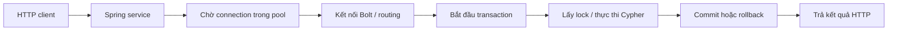
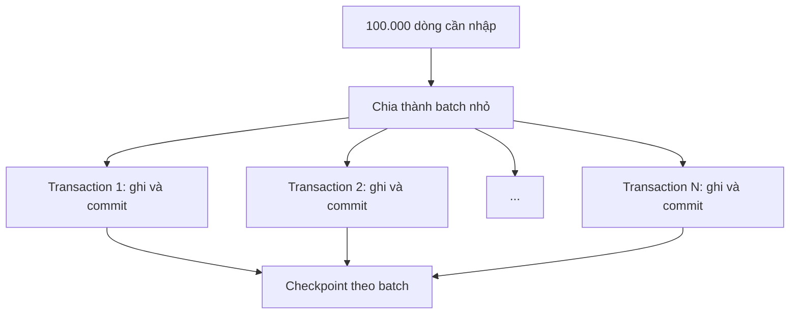

# Cấu hình thời gian chờ, giới hạn giao dịch và khả năng theo phiên bản trong Neo4j

## 1. Mục tiêu và phạm vi

Một ứng dụng dùng **Neo4j** để quản lý **property graph** thường thực hiện các truy vấn Cypher đọc đường đi, mở rộng quan hệ, tạo node/relationship bằng `MERGE` hoặc nhập dữ liệu hàng loạt. Cùng một câu truy vấn có thể chạy nhanh trên graph nhỏ nhưng trở nên rất chậm khi số quan hệ trên mỗi node tăng lên, khi index chưa phù hợp, hoặc khi nhiều transaction cùng giữ khóa.

Các giới hạn tài nguyên không nhằm “làm truy vấn nhanh” theo nghĩa trực tiếp. Chúng giúp **giữ hệ thống ở trạng thái có thể kiểm soát**: giao dịch không treo vô thời hạn, tài nguyên không bị một tác vụ chiếm hết, lỗi có dấu hiệu rõ ràng và các ứng dụng biết khi nào cần retry hay chia lô.

Bài thuộc chương **Cấu hình tài nguyên** của mô-đun `DATABASE_ENGINE_GRAPH_NEO4J`. Nội dung liên hệ giữa cấu hình máy chủ Neo4j, giới hạn transaction, Cypher, Java Driver, Spring Data Neo4j và việc giám sát ứng dụng trong production.

Sau bài học, bạn có thể:

1. Phân biệt thời gian **kết nối**, **chờ connection pool**, **chờ khóa**, **thực thi transaction**, **chờ bookmark** và **giao dịch HTTP không hoạt động**.
2. Đọc và cấu hình các giới hạn `db.transaction.timeout`, `db.lock.acquisition.timeout`, `db.transaction.concurrent.maximum` cùng giới hạn bộ nhớ transaction phù hợp.
3. Xác minh giá trị thực bằng `SHOW SETTINGS`, theo dõi transaction bằng `SHOW TRANSACTIONS` và hiểu ảnh hưởng của quyền/phiên bản.
4. Đặt timeout cho từng giao dịch trong Neo4j Java Driver thay vì nhầm với timeout của HTTP hoặc pool.
5. Nhận biết cấu hình có thể thay đổi động, cấu hình cần restart và những điểm khác biệt giữa Neo4j 4.x, 5.x, các bản phát hành mới và dịch vụ quản lý như Aura.
6. Chọn chính sách thử nghiệm, đo đạc, rollback và xử lý lỗi mà không chỉ tăng giới hạn khi truy vấn chậm.

> **Phiên bản:** Các khóa cấu hình Neo4j được minh họa chủ yếu theo **Neo4j 5 và họ tài liệu Operations Manual mới**. Ở Neo4j 4.x, một số tên có tiền tố `dbms.`; các bản phát hành về sau có thể thêm, đổi hoặc loại bỏ cài đặt. Ví dụ Java dùng Java 17+ và Java Driver 5.x. Hãy xác nhận với phiên bản, edition và môi trường triển khai đang vận hành trước khi thay đổi bất kỳ giới hạn nào.

## 2. Sáu “đồng hồ” không nên gộp thành một timeout

Một yêu cầu API có thể đi qua nhiều giai đoạn:



Mỗi đoạn có thể có một thời gian chờ khác nhau. Một lỗi `connection acquisition timeout` **không đồng nghĩa** Neo4j đã hủy một transaction chạy quá lâu.

| Giới hạn | Áp dụng ở đâu? | Thường biểu hiện khi vượt giới hạn |
| --- | --- | --- |
| **Connection timeout** | Driver kết nối DNS/TCP/Bolt/TLS đến endpoint | Không tạo được kết nối mới |
| **Pool acquisition timeout** | Driver chờ lấy connection khả dụng | Yêu cầu không lấy được connection trong thời gian cho phép |
| **Lock acquisition timeout** | Neo4j chờ khóa mà transaction khác đang giữ | Transaction gặp lỗi lấy khóa/được hủy |
| **Transaction timeout** | Neo4j theo dõi vòng đời transaction | Transaction bị đánh dấu kết thúc/rollback nếu chưa commit |
| **Bookmark ready timeout** | Chờ database đạt trạng thái được biểu thị bằng bookmark | Lỗi chờ trạng thái đọc nhất quán theo bookmark |
| **HTTP transaction idle timeout** | HTTP endpoint hỗ trợ transaction lâu sống và không có hoạt động | Transaction HTTP nhàn rỗi bị đóng theo chính sách |

**Ngoài ra còn thời hạn của request HTTP tại ứng dụng hoặc load balancer.** Một proxy hết hạn ở giây 20 không tự đảm bảo Neo4j đã dừng công việc trong database ở cùng thời điểm. Cần cơ chế hủy hoặc timeout transaction ở tầng database nếu muốn giới hạn công việc còn chạy sau khi client bỏ cuộc.

### 2.1. Ví dụ một request trải qua nhiều ngưỡng

Giả sử hệ thống thử nghiệm có:

```text
API request budget:                  20 giây
Driver chờ lấy connection:            3 giây
Neo4j chờ khóa:                       5 giây
Transaction timeout do API đặt:      12 giây
```

Đây là **chính sách ví dụ**, không phải bộ giá trị mặc định. Nếu transaction bị chặn ở bước lấy khóa, lock timeout có thể phát sinh trước transaction timeout. Nếu chỉ có quá ít connection khả dụng, lỗi pool phát sinh trước cả khi mở một transaction mới. Nếu Neo4j tốn 12 giây để xử lý, việc API timeout ở giây 20 không biến thành commit một phần.

**Không cộng các ngưỡng này thành một SLA tuyệt đối.** Các giai đoạn có thể chồng lấn, cần thời gian thiết lập TLS/routing, thời gian gửi kết quả, xử lý ứng dụng và độ trễ giám sát timeout. Hãy đo **end-to-end latency** bên cạnh từng timeout thành phần.

## 3. Transaction, khóa và giới hạn thời gian phía Neo4j

Neo4j sử dụng transaction để nhóm các thao tác đọc/ghi vào một đơn vị có tính chất ACID. Với transaction ghi, khi transaction **chưa commit** bị hủy hoặc rollback, những thay đổi chưa commit trong **transaction đó** không được xem là dữ liệu đã ghi thành công.

### 3.1. db.transaction.timeout

Trong Neo4j 5, khóa cấu hình thông dụng là:

```properties
# neo4j.conf — ví dụ để thảo luận, không áp dụng trực tiếp lên production
db.transaction.timeout=30s
```

Đây là **timeout mặc định cho transaction phía database**. Trong các cấu hình Neo4j được tài liệu hóa, `0s` thường biểu thị việc **tắt giới hạn timeout mặc định**, không phải hủy mọi transaction ngay lập tức. Không vì mặc định có thể là `0s` mà kết luận đây là cấu hình phù hợp cho production.

Những điểm cần nhớ:

- Giới hạn áp dụng cho **vòng đời transaction**, không chỉ thời gian CPU của một câu `MATCH`.
- Thời gian chờ khóa và thời gian xử lý nhiều câu Cypher trong cùng transaction có thể làm transaction kéo dài.
- Driver có thể truyền **timeout riêng cho từng transaction**; theo Neo4j hiện đại, giá trị riêng này **ghi đè timeout mặc định**, vì vậy mặc định server không nên được giả định là “trần không thể vượt” đối với mọi request.
- Neo4j giám sát timeout theo cơ chế kiểm tra định kỳ. Không xem giá trị `30s` là đồng hồ thời gian thực chính xác đến từng mili giây.
- Khi có lỗi timeout, ứng dụng phải xem transaction bị lỗi là **không thành công**; không chuyển lỗi thành HTTP 200 chỉ vì vài dòng đã được xử lý trước đó.

### 3.2. db.lock.acquisition.timeout

Khi hai transaction cùng muốn ghi vào một node hoặc relationship, một transaction có thể phải đợi khóa mà transaction kia đang giữ.

```properties
db.lock.acquisition.timeout=5s
```

Giá trị này giới hạn việc **chờ lấy lock**, không giới hạn toàn bộ thời gian của query. Theo tài liệu Neo4j, `0s` có thể biểu thị việc tắt lock acquisition timeout. Transaction timeout vẫn có thể kết thúc một giao dịch đang chờ nếu được cấu hình.

Ví dụ nghiệp vụ:

```cypher
MATCH (p:Product {sku: $sku})
SET p.stock = p.stock + $delta;
```

Nếu nhiều writer liên tục cập nhật cùng `Product`, một writer có thể giữ khóa khiến các writer khác chờ. Chỉnh `db.lock.acquisition.timeout` **không sửa** nguyên nhân tranh chấp; cần xem xét khóa nghiệp vụ, thiết kế cập nhật, mức đồng thời, batch và liệu phép cộng delta có an toàn khi retry.

### 3.3. db.transaction.bookmark_ready_timeout

Trong cluster hoặc ứng dụng sử dụng **bookmark** để duy trì trình tự quan sát giao dịch, một phiên đọc có thể cần chờ database bắt kịp trạng thái biểu thị bởi bookmark:

```properties
# Ví dụ: ngưỡng chờ trạng thái bookmark trong một môi trường cụ thể
db.transaction.bookmark_ready_timeout=30s
```

Đây **không phải** transaction timeout và cũng không phải timeout của việc tạo TCP connection. Nếu ứng dụng thấy lỗi chờ bookmark, cần kiểm tra vai trò server, replication/routing, độ trễ cluster và vòng đời bookmark, thay vì tăng thời gian chạy Cypher một cách mù quáng.

### 3.4. Timeout không có nghĩa commit những phần đã chạy

Một transaction:

```cypher
UNWIND $rows AS row
MERGE (p:Product {sku: row.sku})
SET p.name = row.name;
```

nếu bị rollback trước commit, **toàn bộ ghi chưa commit trong transaction đó** bị hủy. Nhưng nếu ứng dụng đã chia dữ liệu thành 20 transaction riêng biệt và 10 transaction đầu commit thành công, lỗi ở transaction thứ 11 **không rollback 10 transaction trước**.

Do đó, giới hạn thời gian và **ranh giới giao dịch** phải được thiết kế cùng nhau: timeout, batch, checkpoint và thao tác idempotent.

## 4. Giới hạn số transaction đồng thời và tài nguyên bộ nhớ

Timeout chỉ hạn chế **thời lượng**. Nếu có hàng trăm transaction nặng cùng chạy, hệ thống vẫn có thể bị quá tải trước khi bất kỳ timeout nào xảy ra.

### 4.1. db.transaction.concurrent.maximum

```properties
# Ví dụ hạn chế mức transaction đồng thời
db.transaction.concurrent.maximum=200
```

Thiết lập này hạn chế **số transaction được phép chạy đồng thời** theo phạm vi cấu hình của Neo4j. Trong tài liệu Neo4j mới, giá trị `0` dùng để tắt giới hạn. Mức mặc định và phạm vi triển khai thực tế cần đọc ở `SHOW SETTINGS` của phiên bản đang vận hành.

Điều này **không đồng nghĩa**:

- Số HTTP request/giây tối đa là 200.
- Tổng số connection Bolt tối đa là 200.
- Mỗi transaction chỉ đọc một node hoặc một relationship.
- Tất cả transaction sẽ hoàn thành trong thời hạn đã đặt.

Nếu hạ mức quá thấp, ứng dụng có thể gặp lỗi từ chối/không thể bắt đầu transaction khi đạt ngưỡng. Nếu tăng quá cao, hệ thống có thể chịu nhiều khóa, bộ nhớ và I/O hơn mức phần cứng cho phép. Không sử dụng con số mặc định như bảo đảm thông lượng cho mọi dạng graph.

### 4.2. Giới hạn bộ nhớ của transaction

Có ba tầng giới hạn cần phân biệt:

| Khóa cấu hình | Ý nghĩa |
| --- | --- |
| `db.memory.transaction.max` | Ngưỡng bộ nhớ cho **một transaction** trong database |
| `db.memory.transaction.total.max` | Ngưỡng tổng bộ nhớ transaction trong **một database** |
| `dbms.memory.transaction.total.max` | Ngưỡng tổng bộ nhớ transaction trên **một server/DBMS** |

Ví dụ các ngưỡng **minh họa**, không phải đề xuất định cỡ cho máy bất kỳ:

```properties
db.memory.transaction.max=256m
db.memory.transaction.total.max=1g
dbms.memory.transaction.total.max=2g
```

Nếu một transaction cần hơn ngưỡng riêng, nó có thể bị kết thúc do vượt giới hạn bộ nhớ thay vì tiếp tục lấy thêm. Nếu nhiều transaction cùng chạy, tổng theo database hoặc DBMS có thể trở thành giới hạn trước. Cấu hình phải phù hợp với heap, workload, index, lượng entity bị thay đổi và bộ nhớ có thể dành cho các thành phần khác.

**Lưu ý quan trọng:** đây là các **giới hạn bộ nhớ transaction được Neo4j theo dõi**, không phải giới hạn tuyệt đối của **mọi** bộ nhớ trong JVM, page cache, native driver hoặc Graph Data Science. Một hệ thống vẫn có thể gặp áp lực bộ nhớ do những phần không được quy về bộ đếm transaction này.

### 4.3. Heap và page cache khác với transaction limit

Hai nhóm cài đặt quen thuộc:

```properties
# Chỉ minh họa tên khóa; không chọn dung lượng thật khi chưa đo host/container
server.memory.heap.initial_size=4g
server.memory.heap.max_size=4g
server.memory.pagecache.size=4g
```

- **Heap:** nơi JVM dùng cho nhiều cấu trúc thực thi, quản lý và một phần trạng thái truy vấn/giao dịch.
- **Page cache:** bộ nhớ cache các trang store file, ảnh hưởng chi phí đọc/ghi dữ liệu trên disk.
- **Transaction memory:** bộ nhớ Neo4j theo dõi cho các giao dịch, chịu ảnh hưởng của query và số thực thể thay đổi.

Không thể đơn giản lấy `RAM - heap = pagecache` rồi cấp hết phần còn lại: cần bộ nhớ cho hệ điều hành, native/off-heap, thread stacks, networking, GDS và các dịch vụ khác. Với Docker/Kubernetes, giới hạn memory của **container** cũng cần được tính; một cấu hình vừa trên máy vật lý vẫn có thể vượt giới hạn container.

## 5. Đọc cấu hình đang chạy bằng SHOW SETTINGS

Trước khi sửa `neo4j.conf`, cần biết **giá trị thực sự được áp dụng** và khả năng thay đổi của chúng.

Trong phiên bản Neo4j hỗ trợ quyền xem settings:

```cypher
SHOW SETTINGS
YIELD name, value, defaultValue, isDynamic, description
WHERE name IN [
  'db.transaction.timeout',
  'db.lock.acquisition.timeout',
  'db.transaction.bookmark_ready_timeout',
  'db.transaction.concurrent.maximum',
  'db.memory.transaction.max',
  'db.memory.transaction.total.max',
  'dbms.memory.transaction.total.max'
]
RETURN name, value, defaultValue, isDynamic, description
ORDER BY name;
```

Ý nghĩa:

- `name`: tên khóa cấu hình được server hiện tại nhận diện.
- `value`: giá trị đang có hiệu lực theo server đó, hiển thị dạng chuỗi.
- `defaultValue`: giá trị mặc định theo phiên bản/môi trường, **không bắt buộc** là giá trị đang chạy.
- `isDynamic`: cho biết setting có hỗ trợ cập nhật động hay không; **không đồng nghĩa** user hiện tại có quyền cập nhật.
- `description`: giải thích chức năng và phạm vi của setting.

Để xem ngắn hơn:

```cypher
SHOW SETTINGS
YIELD name, value, isDynamic
WHERE name STARTS WITH 'db.transaction.'
RETURN name, value, isDynamic
ORDER BY name;
```

**Giới hạn cần biết:**

1. `SHOW SETTINGS` phản ánh **server đang thực thi lệnh**, không tự động cho cùng một kết quả tổng hợp mọi thành viên cluster. Khi kiểm tra từng thành viên có thể cần kết nối trực tiếp theo cơ chế được triển khai hỗ trợ.
2. Quyền xem setting có thể bị giới hạn; không phải user ứng dụng nào cũng được xem toàn bộ cấu hình.
3. Trong **Neo4j Aura**, `SHOW SETTINGS` có thể **không khả dụng**; kiểm tra khả năng cấu hình và quan sát do dịch vụ quản lý cung cấp.
4. Một số phiên bản cũ có cơ chế khác như procedure `dbms.listConfig()`; không dùng lệnh của tài liệu phiên bản mới để suy ra tên cài đặt hợp lệ cho phiên bản cũ.
5. `isDynamic = true` không có nghĩa giá trị này tự thay đổi trên tất cả server hay được lưu bền vững sau restart mà không có quy trình quản trị rõ ràng.

Để chẩn đoán một setting không xuất hiện, kiểm tra phiên bản, edition, quyền và tên khóa đã đổi; **không tự thêm một khóa không được công bố** vào cấu hình production.

## 6. Quan sát transaction đang chạy với SHOW TRANSACTIONS

`SHOW TRANSACTIONS` cho phép xem các transaction đang thực thi trong phạm vi quyền của người gọi:

```cypher
SHOW TRANSACTIONS
YIELD database, transactionId, username,
      elapsedTime, waitTime, status, activeLockCount
RETURN database, transactionId, username,
       elapsedTime, waitTime, status, activeLockCount
ORDER BY elapsedTime DESC;
```

Các tín hiệu:

| Trường | Cách sử dụng |
| --- | --- |
| `elapsedTime` | Transaction sống bao lâu từ lúc bắt đầu |
| `waitTime` | Thời gian chờ liên quan đến lock của transaction |
| `status` | Trạng thái như đang chạy/bị chặn/đang kết thúc theo phiên bản |
| `activeLockCount` | Số khóa transaction đang giữ theo thống kê |
| `transactionId` | Định danh transaction giúp điều tra hoặc kết thúc có kiểm soát |
| `username` | Ai đang thực thi; cần xử lý như metadata vận hành có kiểm soát |

Không kết luận “query chạy CPU cao” chỉ từ `elapsedTime`: transaction có thể đang chờ lock, chờ client nhận kết quả hoặc chưa kết thúc. Muốn phân tích hiệu năng, kết hợp query metrics, kế hoạch `PROFILE`, GC, I/O và các số liệu thread/CPU có sẵn.

### 6.1. Đánh dấu transaction bằng metadata ứng dụng

Neo4j Java Driver hỗ trợ gắn metadata vào transaction. Có thể dùng trường không nhạy cảm như:

```json
{
  "application": "graph-service",
  "operation": "list-products",
  "requestClass": "interactive"
}
```

Khi điều tra, nếu phiên bản/quyền hỗ trợ:

```cypher
SHOW TRANSACTIONS
YIELD transactionId, elapsedTime, status, metaData
RETURN transactionId, elapsedTime, status, metaData
ORDER BY elapsedTime DESC;
```

Metadata có thể xuất hiện trong log, dashboard và công cụ vận hành. Không đưa **password**, token, dữ liệu khách hàng, thông tin nhạy cảm hoặc toàn bộ tham số nghiệp vụ vào metadata.

### 6.2. Kết thúc transaction phải có quyền và quy trình

Neo4j có thao tác `TERMINATE TRANSACTIONS` cho tài khoản được phép. Đây là biện pháp khẩn cấp có thể làm một giao dịch đang ghi bị rollback, khiến ứng dụng nhận lỗi. Không tự động terminate mọi transaction “quá 10 giây” mà chưa phân biệt công việc import hợp lệ, migration, backup và truy vấn tương tác.

Khi phải kết thúc một transaction:

1. Xác định transaction ID, chủ sở hữu, loại công việc và ảnh hưởng.
2. Kiểm tra liệu ứng dụng có thể retry an toàn, dữ liệu đã commit ở batch trước hay không.
3. Thực hiện bởi tài khoản/nhóm có quyền theo quy trình vận hành.
4. Theo dõi lock, transaction count và phục hồi ở tầng ứng dụng.

## 7. Java Driver: đặt thời hạn cho từng transaction

Ứng dụng thường có nhiều loại công việc: truy vấn danh sách 20 kết quả, báo cáo dài hơn và batch import. Một ngưỡng server duy nhất chưa phản ánh tốt **ngân sách độ trễ** của từng loại.

Neo4j Java Driver cung cấp `TransactionConfig` để cấu hình **timeout** và **metadata** cho giao dịch. Ví dụ Java 17+, driver 5.x:

```java
import java.time.Duration;
import java.util.Map;
import org.neo4j.driver.Driver;
import org.neo4j.driver.Session;
import org.neo4j.driver.SessionConfig;
import org.neo4j.driver.TransactionConfig;

public final class TimedNeo4jReader {
    public static int probe(Driver driver, String database) {
        TransactionConfig config = TransactionConfig.builder()
            .withTimeout(Duration.ofSeconds(8))
            .withMetadata(Map.of(
                "application", "graph-service",
                "operation", "connectivity-probe"
            ))
            .build();

        try (Session session =
                 driver.session(SessionConfig.forDatabase(database))) {
            return session.executeRead(tx -> {
                return tx.run("RETURN 1 AS ok")
                         .single()
                         .get("ok")
                         .asInt();
            }, config);
        }
    }
}
```

Giải thích:

- `Duration.ofSeconds(8)` là **ngưỡng transaction do client yêu cầu**, không phải timeout của việc lấy connection.
- `withMetadata(...)` gắn nhãn để chẩn đoán. Không được dùng metadata như nơi chứa thông tin xác thực.
- `session.executeRead(...)` quản lý transaction đọc. Driver có thể **retry** một số lỗi tạm thời theo cấu hình retry của driver; callback có thể chạy lại.
- `try (Session ...)` đảm bảo session được đóng sau công việc và tài nguyên connection được trả về pool theo cơ chế driver.
- `RETURN 1` dùng để minh họa an toàn; nó **không đo hiệu năng** đọc graph thực tế và không thay thế health check có phân quyền.

**Không dùng callback managed transaction để phát side effect ngoài Neo4j** nếu những side effect đó không idempotent (ví dụ gửi email/ghi tiền), vì callback có thể chạy lại. Nếu muốn cập nhật tồn kho bằng delta, cần cơ chế chống xử lý trùng phù hợp.

### 7.1. Timeout client ghi đè mặc định server

Với Neo4j mới, `TransactionConfig.withTimeout(...)` có thể chỉ định một giá trị **khác** `db.transaction.timeout`. Ví dụ:

```text
Server default transaction timeout: 30s
Request A đặt timeout riêng:          8s
Request B không đặt timeout riêng:   30s (theo default server)
```

Không coi `30s` ở máy chủ là **trần tuyệt đối** nếu client được phép chỉ định timeout riêng dài hơn. Một số phiên bản Neo4j/driver cũ có hành vi khác; đây là lý do phải kiểm tra bảng tương thích.

Muốn giới hạn **SLA của request HTTP**, cần thêm timeout ở tầng web/reverse proxy và kế hoạch hủy công việc phía database. Một transaction timeout **không bảo đảm** toàn bộ vòng đời HTTP, JSON serialization và network nằm trong 8 giây.

### 7.2. Session, transaction và thread

Driver là thành phần có thể được tái sử dụng ở phạm vi ứng dụng. `Session` là phạm vi tương tác nhẹ nhưng **không thread-safe**; không chia một session cho nhiều request/luồng độc lập. Khi dùng Spring Data Neo4j, ưu tiên cơ chế transaction được Spring quản lý cho repository/`Neo4jClient`, thay vì tạo driver riêng cho từng phương thức.

Không nên mở một explicit transaction và giữ nó qua nhiều request của người dùng. Nó có thể chiếm lock, tài nguyên và bị timeout, đồng thời làm nghiệp vụ khó phục hồi.

## 8. Spring Boot và Spring Data Neo4j: timeout của pool và retry

Ứng dụng Spring Boot dùng `spring-boot-starter-data-neo4j` thường nhận bean `Driver` do Boot cấu hình. Các thuộc tính pool sau là ví dụ từ hệ cấu hình Spring Boot hiện đại:

```yaml
spring:
  neo4j:
    uri: ${NEO4J_URI}
    authentication:
      username: ${NEO4J_USERNAME}
      password: ${NEO4J_PASSWORD}

    pool:
      max-connection-pool-size: 30
      connection-acquisition-timeout: 5s
      max-connection-lifetime: 1h

    max-transaction-retry-time: 15s

  data:
    neo4j:
      database: ${NEO4J_DATABASE}
```

Ví dụ trên dùng **placeholder biến môi trường**, không chứa thông tin xác thực thực. Các con số là **mốc minh họa**; không mặc định phù hợp với production.

| Thuộc tính | Điều nó giới hạn | Điều nó không giới hạn |
| --- | --- | --- |
| `spring.neo4j.pool.max-connection-pool-size` | Connection pool phía driver | Số transaction tối đa của server hoặc toàn cluster |
| `spring.neo4j.pool.connection-acquisition-timeout` | Thời gian chờ lấy connection | Tổng thời gian chạy Cypher sau khi đã lấy connection |
| `spring.neo4j.pool.max-connection-lifetime` | Tuổi tối đa của pooled connection | Tuổi tối đa của một transaction |
| `spring.neo4j.max-transaction-retry-time` | Ngân sách driver retry lỗi tạm thời | Không phải database transaction timeout; không biến lỗi dữ liệu thành lỗi retryable |

Các tên property và default của Spring Boot có thể đổi theo **major version** hoặc cấu hình custom. Hãy đối chiếu **Common Application Properties** đúng Spring Boot đang chạy, thay vì sao chép các khóa đó vào `neo4j.conf`.

### 8.1. Tính số connection ở nhiều replica

Giả sử có 8 pod, mỗi pod có pool tối đa 30 connection cho một đích. Về mặt **giới hạn cấu hình lý thuyết**, có thể có tới:

```text
8 pod × 30 connection = 240 connection
```

Đây **không phải** số connection thực tế tại một thời điểm hoặc trên toàn cluster: routing có thể tạo pool cho nhiều endpoint, workload có thể không dùng hết pool, và server có giới hạn riêng.

Tăng pool từ 30 lên 100 **không đảm bảo** giảm timeout nếu nguyên nhân là query giữ connection lâu, CPU/IO đã bão hòa hoặc các transaction chờ cùng một khóa. Hãy đo số lượng connection đang dùng, thời gian chờ pool, độ trễ query và mức đồng thời trước khi tăng.

### 8.2. @Transactional có ranh giới riêng

Trong Spring Data Neo4j, một phương thức `@Transactional` có thể gom nhiều thao tác repository vào **một transaction**. Dù trong method có vòng lặp 10.000 dòng, điều đó không tự tạo 20 transaction theo batch.

Nếu muốn mỗi batch commit độc lập, hãy thiết kế transaction tại **mỗi batch**, ví dụ thông qua service tách ranh giới proxy phù hợp hoặc `TransactionTemplate`. Đừng vô tình tạo một transaction dài rồi chỉ tăng `db.transaction.timeout` để làm cho nó “chạy được”.

## 9. Chia lô ghi dữ liệu để tránh transaction quá lớn

Chia batch thường giúp kiểm soát cả thời gian, bộ nhớ transaction và mức giữ khóa:



Trong Cypher, một phương án là `CALL { ... } IN TRANSACTIONS` (trên Neo4j mới có cú pháp khai báo biến đầu vào rõ ràng):

```cypher
UNWIND range(1, 2000) AS i
CALL (i) {
  MERGE (p:ResourceDemoItem {id: 'ITEM-' + toString(i)})
  SET p.value = i
} IN TRANSACTIONS OF 500 ROWS;
```

Lệnh minh họa này tạo/cập nhật node test; **chỉ chạy ở database thực hành**. Cú pháp `CALL (i) { ... }` sử dụng *variable scope clause*, được hỗ trợ từ Neo4j 5.23; phiên bản 5.x cũ hơn có thể dùng `CALL { WITH i ... }` theo khả năng phiên bản.

Cần lưu ý:

- Đây là **nhiều transaction**. Nếu transaction thứ ba bị hủy do timeout hoặc bộ nhớ, hai transaction đầu đã commit không tự rollback.
- `OF 500 ROWS` giới hạn **số dòng** mỗi transaction, không phải byte và không phải “tự commit cứ 5 giây”.
- `CALL { ... } IN TRANSACTIONS` cần chạy trong **implicit transaction**; không đặt nó vào một explicit/managed transaction của Java Driver.
- Đọc danh sách nguồn, xử lý lỗi và tiếp tục sau sự cố phải có **idempotency key** cùng checkpoint. `MERGE` trên khóa ổn định giúp tránh tạo trùng khi replay, nhưng không tự bảo vệ phép cộng như `SET p.stock = p.stock + delta`.
- Với các bản Neo4j có khả năng chia subtransaction khác nhau, phải xác minh cú pháp và xử lý lỗi theo tài liệu đúng phiên bản.

**Một ngưỡng transaction timeout không làm dữ liệu sai trở thành dữ liệu đúng.** Trước khi nhập, vẫn cần constraint/index trên khóa nghiệp vụ và kiểm tra dữ liệu đầu vào; `PROFILE`/`EXPLAIN` giúp đánh giá kế hoạch Cypher.

## 10. Khả năng theo phiên bản, edition và hình thức triển khai

Đây là phần quan trọng của đề mục: **không dùng tên khóa hoặc API giống nhau cho mọi bản Neo4j**.

### 10.1. Bảng định hướng tương thích

| Nhóm môi trường | Điều thường cần kiểm tra | Thao tác phù hợp |
| --- | --- | --- |
| **Neo4j 4.x** | Một số khóa transaction mang tiền tố `dbms.`, ví dụ `dbms.transaction.timeout` | Tra Operations Manual đúng 4.x, không sao chép nguyên cấu hình 5.x |
| **Neo4j 5.x** | Họ khóa như `db.transaction.timeout`, `db.lock.acquisition.timeout`, `db.memory.transaction.max`; mức hỗ trợ dynamic khác nhau | Xem `SHOW SETTINGS`/tài liệu tương ứng bản 5.x |
| **Bản phát hành mới theo năm** | Có thể bổ sung/đổi setting, tùy runtime Cypher và edition; defaults không bất biến | Xem tài liệu version đúng và kết quả server hiện tại |
| **Aura / managed Neo4j** | Không nhất thiết được sửa `neo4j.conf` hoặc chạy `SHOW SETTINGS` | Dùng dashboard/giới hạn/tùy chọn được nhà cung cấp hỗ trợ |
| **Docker/Kubernetes tự quản lý** | Biến môi trường, file mount, cấu hình khởi động, memory limit container | Kiểm tra áp dụng trên từng instance và tác động rollout |
| **Java Driver / Spring Boot** | API timeout, retry và thuộc tính pool thuộc phía client, version riêng | Đối chiếu manual của driver/Boot và integration test |

Một ví dụ tên khóa đổi giữa các major version:

```text
Neo4j 4.x:  dbms.transaction.timeout
Neo4j 5.x: db.transaction.timeout
```

Trong phiên bản mới, `db.transaction.timeout` là **mặc định transaction**, không nhất thiết là giới hạn áp đặt lên mọi client timeout. Ở một số bản cũ, hành vi ghi đè có thể khác. **Không đoán** phiên bản chỉ từ chuỗi kết nối Bolt; truy vấn thông tin phiên bản và tài liệu vận hành được cấp quyền.

### 10.2. isDynamic không đồng nghĩa được đổi tùy tiện

Trong những bản hỗ trợ `SHOW SETTINGS`, cột `isDynamic` cho biết một setting có thể đổi động hay không. Neo4j có cơ chế quản trị cập nhật một số setting động, nhưng:

- Cần quyền quản trị thích hợp; ứng dụng nghiệp vụ không nên có quyền đó.
- Giá trị có thể cần được cập nhật trên **từng server** hoặc đồng bộ bằng hệ quản lý cấu hình.
- Việc thay đổi động trong runtime **không tự thay thế** cấu hình bền vững trong file/manifest; sau restart, giá trị có thể quay lại như cũ nếu không có quy trình áp dụng.
- Cần đo trước/sau và có kế hoạch rollback; không nên tự động chỉnh timeout bằng một request người dùng.

Với setting **không dynamic**, thường cần một đợt áp dụng cấu hình/restart theo quy trình của server. Trong cluster production, không restart tất cả thành viên cùng lúc chỉ để thay một ngưỡng.

### 10.3. Docker, file cấu hình và biến môi trường

Với Neo4j Docker tự quản lý, nhiều setting được ánh xạ sang biến môi trường theo quy tắc chuyển đổi dấu chấm/gạch dưới của image. Ví dụ mô tả:

```text
neo4j.conf:
  db.transaction.timeout=30s

Neo4j Docker environment:
  NEO4J_db_transaction_timeout=30s
```

**Chỉ áp dụng quy tắc ánh xạ mà image/version cụ thể công bố**, đặc biệt với những khóa có dấu gạch dưới: cách escape có thể khác với phép thay ký tự đơn giản. Không coi ví dụ biến môi trường này là cách cấu hình Aura hoặc Spring Boot.

Trong Kubernetes, thay đổi `ConfigMap`/environment không mặc nhiên cập nhật Neo4j process đang chạy; tùy cách mount và khả năng dynamic, có thể cần rollout/restart. Cấu hình memory phải được xét cùng **pod limits/requests** và cấu hình JVM để không gây OOMKill.

## 11. Thiết kế ngân sách thời gian theo loại công việc

Một hệ thống có thể phân loại tác vụ:

| Tác vụ | Mục tiêu vận hành | Chính sách thiết kế |
| --- | --- | --- |
| Truy vấn danh sách API | p95 thấp, trả nhanh, số dòng cố định | Cypher có index, `LIMIT`, timeout per transaction ngắn hơn |
| Đọc đường đi có giới hạn | Tránh bùng nổ số path | Giới hạn độ sâu/fan-out, timeout và hạn chế result size |
| Ghi một đơn hàng | Đảm bảo tính nguyên tử | Transaction ngắn, khóa nghiệp vụ, retry có kiểm soát |
| Nhập CSV lớn | Throughput và khả năng resume | Batch theo rows/bytes/thời gian, checkpoint/idempotency |
| Báo cáo tổng hợp | Có thể chạy dài hơn | Queue/background job được hệ thống thực thi, ngân sách riêng; không giữ HTTP request quá lâu |
| Maintenance/migration | Cần dự báo tài nguyên và quyền | Chạy theo change window có giám sát và phương án rollback |

Các ngưỡng dưới đây chỉ nhằm **minh họa cách phân tầng**:

```text
API list:          timeout transaction 5s,  pageSize tối đa 50
API graph search:  timeout transaction 10s, hop tối đa 3
Import batch:      timeout transaction 30s, batch 500 dòng
Admin reporting:   timeout transaction riêng theo job, có quota tài nguyên
```

Không chọn giá trị chỉ từ bảng minh họa; chúng phải dựa trên p95/p99, số entity bị mở rộng, lock wait, kích thước dữ liệu và năng lực phần cứng. Một báo cáo nhiều phút không nên được phục vụ bằng cách mở một HTTP request lâu và tăng mọi timeout lên hàng giờ.

## 12. Giám sát, xử lý sự cố và điều chỉnh giới hạn

### 12.1. Bộ chỉ số nên có

| Chỉ số | Câu hỏi trả lời |
| --- | --- |
| `requestLatencyMs` p50/p95/p99 | Người dùng phải chờ bao lâu? |
| `transactionDurationMs` | Transaction chạy bao lâu trước commit/rollback? |
| Lock wait và deadlock | Ghi đồng thời có tranh chấp trên node/relationship không? |
| Số transaction đang chạy | Có đang tiến sát giới hạn đồng thời? |
| Pool acquisition time | Ứng dụng có thiếu connection do tải hoặc session rò rỉ? |
| Transaction memory và heap/GC | Query/batch có chạm ngưỡng bộ nhớ không? |
| Page-cache hit/fault, disk I/O | Nút thắt là dữ liệu trên disk hay chi phí query? |
| Retry/timeout/rollback theo loại | Lỗi tạm thời, lỗi dữ liệu và giới hạn cấu hình phân bố ra sao? |
| Số batch hoàn tất và checkpoint | Import có thể resume an toàn sau khi một batch fail không? |

Nếu lỗi tăng sau một thay đổi cấu hình, trước tiên đối chiếu **thời điểm rollout** với đồ thị latency, GC, memory và log; không dựa trên một thông báo timeout để tăng ngưỡng đồng loạt.

### 12.2. Quy trình xử lý một truy vấn bị timeout

1. **Xác định nơi phát sinh:** HTTP gateway, application, driver pool, Bolt connection, lock hay transaction server.
2. **Xác định truy vấn:** operation name, database, request ID, timestamp, số dòng và thời gian; giữ log ở mức không lộ dữ liệu nhạy cảm.
3. **Xem transaction:** `SHOW TRANSACTIONS` nếu còn chạy và tài khoản có quyền, kiểm tra `elapsedTime`/`waitTime`/`status`.
4. **Xem kế hoạch:** `EXPLAIN` để hiểu operator dự kiến; `PROFILE` chỉ chạy khi an toàn vì nó **thực thi** truy vấn.
5. **Đối chiếu tải:** mức đồng thời, pool, heap/GC, page cache, I/O, lock contention.
6. **Sửa nguyên nhân:** index/constraint, điều kiện lọc, thứ tự query, batch, giới hạn số hop, số hàng, hoặc phân phối tải.
7. **Chỉ sau đó** điều chỉnh timeout/limit khi có bằng chứng ngưỡng cũ không hợp lý và tài nguyên còn đủ.
8. **Kiểm chứng rollback/retry:** bảo đảm transaction bị hủy không làm ứng dụng ghi nhận nhầm thành công.

### 12.3. Vì sao tăng timeout không giải quyết truy vấn kém?

Ví dụ:

```cypher
MATCH (u:User)-[:FOLLOWS*1..6]->(other:User)
RETURN other.id AS userId;
```

Truy vấn mở rộng nhiều hop có thể chạm rất nhiều path; tăng timeout từ 10 giây lên 120 giây chỉ cho phép nó giữ tài nguyên lâu hơn. Trước hết cần giới hạn tập node xuất phát, định nghĩa hướng và giới hạn đường đi, giảm số kết quả hoặc dùng thuật toán/phương pháp truy vấn khác phù hợp.

Nếu một `MERGE` chậm do thiếu index trên khóa nghiệp vụ, tăng `db.transaction.concurrent.maximum` có thể **làm tăng** tranh chấp. Đánh giá index và kế hoạch Cypher thường mang lại lợi ích hơn việc nới ngưỡng trên toàn server.

## 13. Những trường hợp lỗi thường gặp

| Triệu chứng | Nguyên nhân có thể | Cách xử lý |
| --- | --- | --- |
| Transaction bị hủy sau thời gian dài | `db.transaction.timeout` hoặc timeout riêng của driver | Xác minh giá trị thực, tối ưu query/chia batch |
| Query chậm khi nhiều request ghi cùng node | Lock contention, deadlock | Đo `waitTime`, giảm cạnh tranh hoặc thay mô hình cập nhật |
| Ứng dụng không lấy được connection | Pool cạn, session chưa đóng hoặc server chậm | Đo pool, đóng session đúng, tối ưu query |
| Lỗi khi có quá nhiều transaction | Đạt `db.transaction.concurrent.maximum` hoặc server quá tải | Giới hạn concurrency phía app, cân nhắc capacity |
| Transaction lớn bị lỗi bộ nhớ | Vượt ngưỡng memory per transaction/database/server | Chia batch, giảm dữ liệu trung gian, đo memory |
| Tăng memory limit nhưng container vẫn bị OOMKill | Heap/page cache/native/OS vượt cgroup limit | Tính ngân sách tổng thể và kiểm tra pod memory |
| Thay `neo4j.conf` nhưng giá trị không đổi | Chưa restart/apply, sửa nhầm server hoặc bị ghi đè | `SHOW SETTINGS` đúng server, kiểm tra phương thức triển khai |
| Cài đặt có trong tài liệu nhưng `SHOW SETTINGS` không thấy | Khác phiên bản/edition, quyền hoặc Aura | Tra tài liệu đúng môi trường, không tự suy tên khóa |
| Java đặt timeout 60s trong khi server default 30s | Timeout per transaction có thể ghi đè default ở bản mới | Rà chính sách client/server và thử trên version thực |
| Transaction đã timeout nhưng API vẫn báo thành công | Bắt exception và trả kết quả giả, hoặc hiểu nhầm partial commit | Xử lý lỗi rollback và đối soát checkpoint |
| Import có một batch fail nhưng batch trước vẫn tồn tại | Các batch là transaction độc lập | Idempotent replay và checkpoint theo batch |
| `SHOW TRANSACTIONS` không thấy transaction của user khác | Giới hạn quyền quan sát | Dùng tài khoản vận hành được phân quyền, không cấp admin cho app |

## 14. Bài tập thực hành

### Bài 1 — Phân biệt timeout

Một ứng dụng có pool 10 connection. Mọi connection đang bận với query ghi. Request thứ 11 phải chờ 5 giây rồi báo lỗi lấy connection, dù `db.transaction.timeout` ở server là 30 giây.

**Câu hỏi:** loại timeout nào đã xảy ra? Có nên chỉ tăng `db.transaction.timeout`?

**Gợi ý:** đây là **pool acquisition timeout**; request thứ 11 có thể chưa mở transaction. Tăng server transaction timeout có thể làm query giữ connection lâu hơn. Cần đo pool/độ trễ query và xác định nguyên nhân trước.

### Bài 2 — Lock khác với transaction timeout

Transaction A giữ khóa ghi trên `Product P1` trong 12 giây. Transaction B muốn cập nhật cùng node, trong khi `db.lock.acquisition.timeout=5s` và timeout riêng của B là 20 giây.

**Gợi ý:** B có thể thất bại do chờ lock vượt 5 giây trước khi chạm 20 giây của transaction. Cách giải quyết bền vững là giảm thời gian giữ khóa/tranh chấp hoặc quản lý retry an toàn, không chỉ tăng cả hai ngưỡng.

### Bài 3 — Chia batch và partial commit

Một job nhập 2.300 dòng bằng `IN TRANSACTIONS OF 500 ROWS`. Ba batch đầu commit, batch thứ tư bị lỗi. Có bao nhiêu dòng đã được xác nhận commit trong tình huống giả định và điều gì xảy ra với batch thứ năm?

**Gợi ý:** ba batch đã commit tương ứng **1.500 dòng**; batch thứ tư chưa thể xem là thành công. Việc truy vấn dừng/lỗi và các batch sau xử lý thế nào phụ thuộc cơ chế lỗi/cấu hình câu lệnh; không tự suy đoán batch thứ năm đã chạy. Resume phải có marker/checkpoint và phép ghi idempotent.

### Bài 4 — Bộ nhớ transaction

Một server có `db.memory.transaction.max=256m`, `db.memory.transaction.total.max=1g` và có sáu transaction đều cố sử dụng xấp xỉ 200 MiB. Có thể kết luận cả sáu chắc chắn chạy hoàn tất không?

**Gợi ý:** không. Mỗi transaction riêng lẻ chưa vượt 256 MiB, nhưng tổng dự kiến khoảng 1.200 MiB vượt 1 GiB; còn phụ thuộc global memory limit, thời điểm cấp phát và workload thực tế. Cần đo, giới hạn concurrent/batch hoặc cấu hình phù hợp.

### Bài 5 — Di trú từ Neo4j 4.x lên 5.x

File cấu hình cũ có `dbms.transaction.timeout=15s`. Một thành viên sao chép nguyên file sang Neo4j 5 rồi khẳng định tất cả transaction có timeout 15 giây.

**Gợi ý:** cần kiểm tra tên khóa mới `db.transaction.timeout` trong Neo4j 5 và giá trị thực từ `SHOW SETTINGS`. Đồng thời kiểm tra timeout riêng ở driver, cấu hình các thành viên cluster và thay đổi của phiên bản thực tế.

### Bài 6 — Chọn chính sách cho service

Ứng dụng có endpoint danh sách sản phẩm, endpoint mở rộng graph tới 4 hop và job import hàng triệu bản ghi. Hãy chọn cách giới hạn cho từng loại, nêu ít nhất một metric cần theo dõi và một trường hợp phải retry.

**Gợi ý:** danh sách dùng index/`LIMIT` và transaction ngắn; graph traversal cần hop/fan-out/result limit và đo path; import chia batch có checkpoint/idempotency. Retry chỉ cho lỗi tạm thời được xác định, không retry vô hạn một dòng sai kiểu. Theo dõi p95/p99 latency, timeout, memory, lock wait và tốc độ batch commit.

## 15. Checklist trước khi áp dụng trong production

- [ ] Đã xác định đúng **phiên bản Neo4j, edition và kiểu triển khai**; không dùng tên khóa theo trí nhớ.
- [ ] Phân biệt timeout kết nối, pool, lock, transaction, bookmark, HTTP idle và deadline của request.
- [ ] `db.transaction.timeout` là giá trị mặc định phù hợp workload; đã xem xét timeout do client ghi đè.
- [ ] `db.lock.acquisition.timeout` và mức ghi đồng thời phù hợp thực tế tranh chấp.
- [ ] `db.transaction.concurrent.maximum` không vượt năng lực server; app cũng giới hạn mức đồng thời.
- [ ] Các ngưỡng `db.memory.transaction.*` và `dbms.memory.transaction.total.max` được xét cùng heap/page cache/container memory.
- [ ] `SHOW SETTINGS` đã được kiểm tra trên server đích khi hỗ trợ; biết setting nào dynamic và setting nào cần restart.
- [ ] `SHOW TRANSACTIONS`, query log/metrics và quyền quan sát đã được thiết kế, tránh log PII/secret.
- [ ] Java Driver sử dụng session/transaction đúng phạm vi, đóng session và gắn metadata không nhạy cảm.
- [ ] Spring Boot cấu hình pool/retry đúng tên property của phiên bản đang dùng.
- [ ] Query có index/constraint phù hợp, giới hạn mở rộng graph và kết quả trả về.
- [ ] Import dài được chia batch; hiểu rõ partial commit, checkpoint và idempotency.
- [ ] Đã kiểm thử timeout, lock wait, memory limit, pool saturation và hành vi rollback/retry.
- [ ] Thay đổi cấu hình có benchmark, rollout có giám sát và kế hoạch rollback.
- [ ] Với Aura/managed environment, dùng những khả năng được dịch vụ cho phép thay vì giả định có quyền sửa `neo4j.conf`.

## Kết luận

**Cấu hình tài nguyên trong Neo4j là một hệ thống nhiều lớp, không phải một con số timeout duy nhất.** Thời gian chờ kết nối và pool thuộc phía driver; thời gian chờ khóa, transaction timeout, giới hạn số transaction đồng thời và bộ nhớ transaction thuộc phía Neo4j; thời hạn HTTP và công việc của ứng dụng lại có ngân sách riêng. Cách làm đúng là **đặt mục tiêu theo loại công việc → đo kế hoạch Cypher và tài nguyên → đặt giới hạn phù hợp → kiểm tra giá trị đang chạy → thử lỗi/rollback/retry → giám sát sau rollout**. Đặc biệt, phải xác nhận **khả năng theo phiên bản**, vì tên cấu hình, quyền xem settings và cách client ghi đè timeout có thể khác giữa Neo4j 4.x, 5.x, các bản phát hành mới và Aura.

### Tài liệu tham khảo

- [Neo4j Operations Manual — Configuration settings](https://neo4j.com/docs/operations-manual/current/configuration/configuration-settings/)
- [Neo4j Operations Manual — Show configuration settings](https://neo4j.com/docs/operations-manual/current/configuration/show-settings/)
- [Neo4j Operations Manual — Update dynamic settings](https://neo4j.com/docs/operations-manual/current/configuration/dynamic-settings/)
- [Neo4j Operations Manual — Transaction management](https://neo4j.com/docs/operations-manual/current/database-internals/transaction-management/)
- [Neo4j Operations Manual — Show and terminate transactions](https://neo4j.com/docs/operations-manual/current/database-internals/show-and-terminate-transactions/)
- [Neo4j Operations Manual — Memory configuration](https://neo4j.com/docs/operations-manual/current/performance/memory-configuration/)
- [Neo4j Java Driver Manual — Transactions](https://neo4j.com/docs/java-manual/current/transactions/)
- [Spring Boot Reference — Common Application Properties](https://docs.spring.io/spring-boot/appendix/application-properties/)
