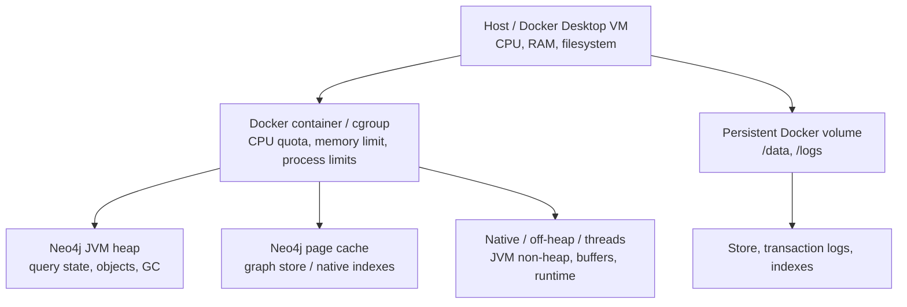

# Giới hạn CPU, RAM và volume khi triển khai bằng container

## 1. Vì sao phải cấu hình tài nguyên cho Neo4j trong container?

Neo4j lưu **property graph** gồm node, relationship, thuộc tính và index, rồi dùng Cypher để truy vấn quan hệ hoặc đường đi. Khi chạy trong Docker, Neo4j không chỉ tiêu thụ tài nguyên JVM heap: nó còn cần **page cache**, bộ nhớ native/off-heap, CPU để duyệt graph, I/O để đọc/ghi store và dung lượng lâu dài cho dữ liệu, transaction log, index.

Một container chạy được với cấu hình mặc định **chưa phải cấu hình sẵn sàng cho production**. Ba lỗi thường gặp:

- Đặt `mem_limit: 4g` nhưng đồng thời cấp `heap = 3G` và `page cache = 2G`. Tổng bộ nhớ đã vượt ngân sách container trước khi tính native memory; container có thể bị kernel OOM-kill.
- Đặt `cpus: 1` để tiết kiệm tài nguyên trong khi nhiều truy vấn nhiều-hop cùng hoạt động. CPU quota gây throttling, p95/p99 tăng mạnh dù truy vấn Cypher vẫn đúng.
- Không gắn volume cho `/data` hoặc vô tình chạy `docker compose down -v`. Container được tạo lại thì dữ liệu biến mất.

**Mục tiêu của bài:** hiểu rõ giới hạn ở tầng container khác gì với ngân sách tài nguyên trong Neo4j, viết một cấu hình Docker Compose có CPU/RAM/volume hợp lý, đo được giới hạn có hiệu lực và nhận diện các tình huống hết RAM, đầy đĩa, quá tải CPU.

Đây là bài của chương **Cấu hình tài nguyên** trong module `DATABASE_ENGINE_GRAPH_NEO4J`, liên hệ với mô hình graph, Cypher, index/constraint, tối ưu truy vấn, nhập dữ liệu, Java Driver và Spring Data Neo4j. Ví dụ dùng một instance đơn lẻ cho phòng thực hành; cụm Neo4j cần ngân sách và volume riêng cho **từng thành viên**, cùng thiết kế dự phòng/replication khác.

### Sau bài này, bạn có thể

1. Giải thích ý nghĩa của **CPU quota**, **memory hard limit**, **soft reservation** và tài nguyên còn lại trên host.
2. Phân chia RAM giữa **JVM heap**, **page cache**, native memory và khoảng dự phòng.
3. Sử dụng đúng biến môi trường Neo4j dạng `NEO4J_server_memory_...` trong Docker.
4. Cấu hình **named volume** cho `/data`, `/logs` và hiểu sự khác nhau với bind mount, ephemeral filesystem và backup.
5. Kiểm tra giới hạn CPU/RAM thực tế, phát hiện OOM-kill, CPU throttling và áp lực I/O.
6. Tối ưu sau khi đo bằng `docker stats`, Neo4j metrics, `EXPLAIN`/`PROFILE` và tải ứng dụng.

## 2. Phân biệt hai tầng cấu hình tài nguyên



| Tầng | Điều khiển cái gì? | Ví dụ cấu hình |
|---|---|---|
| **Host / Docker Desktop VM** | Tổng CPU/RAM/đĩa có thể cung cấp cho tất cả container | Tài nguyên máy chủ, cấu hình Docker Desktop/WSL2 |
| **Docker CPU** | Mức sử dụng CPU tối đa theo quota hoặc ràng buộc core | `cpus: 2.0`, `cpuset` nếu cần |
| **Docker RAM** | Giới hạn bộ nhớ container được dùng | `mem_limit: 4g` |
| **Neo4j heap** | Heap Java: state của transaction, query, object... | `server.memory.heap.max_size` |
| **Neo4j page cache** | Giữ các trang graph store/index native để hạn chế I/O | `server.memory.pagecache.size` |
| **Native / off-heap** | Các vùng ngoài heap, memory-mapped files, thread stacks, runtime, buffers... | Chủ yếu cần dành **headroom** |
| **Docker volumes** | Lưu các tệp ngoài vòng đời container | `neo4j_data:/data`, `neo4j_logs:/logs` |

**Giới hạn Docker không tự cấu hình hoàn hảo bộ nhớ Neo4j.** Ngược lại, đặt heap và page cache nhỏ cũng không ngăn container sử dụng thêm native memory. Cả hai tầng phải được thiết kế **cùng một ngân sách**.

> Các khóa cấu hình và image minh họa ở dưới dùng nhánh phát hành Neo4j `2026.10.2` đang được tài liệu chính thức lấy làm ví dụ. Trên một deployment khác, hãy khóa phiên bản image đã được tổ chức kiểm thử và kiểm tra lại tài liệu tương ứng; không dùng `latest` để nâng cấp cơ sở dữ liệu tự động khi chưa đánh giá tương thích.

## 3. Giới hạn CPU: quota không phải CPU riêng được bảo đảm

Docker có thể áp dụng **CPU quota** qua cgroups. Ví dụ `cpus: 2.0` đặt ngân sách sử dụng tương đương khoảng **hai CPU logic** theo thời gian; nó **không** cấp hai lõi vật lý độc quyền, cũng không đảm bảo container luôn nhận đủ CPU nếu host bị chia sẻ hoặc quá tải.

| Cách cấu hình | Ý nghĩa | Điểm cần lưu ý |
|---|---|---|
| `cpus: 2.0` trong Compose | Giới hạn mức CPU mà container được dùng theo quota | Dễ cấu hình; CPU có thể bị throttle |
| `docker run --cpus=2` | Tương tự cho container được khởi chạy trực tiếp | Không phải đặt số thread Neo4j |
| `cpuset: "0-1"` | Giới hạn container chạy trên các CPU logic chỉ định | Không tạo độc quyền; tùy host/cgroup |
| `cpu_shares` / `cpu_weight` | Trọng số phân chia khi cạnh tranh tài nguyên | Không có ý nghĩa là hard limit hai CPU |
| `deploy.resources.limits.cpus` | CPU limit trong Compose Deploy spec | Khả năng áp dụng tùy công cụ triển khai |

### 3.1. CPU quota ảnh hưởng truy vấn graph như thế nào?

Với Cypher:

```cypher
MATCH (a:Person {id: $personId})-[:FOLLOWS*1..3]->(b:Person)
RETURN count(DISTINCT b) AS reachablePeople;
```

Đây là **mẫu ý tưởng**, không phải truy vấn chạy được trước khi tạo dữ liệu tương ứng. Một node có độ bậc cao có thể khiến Neo4j mở rộng rất nhiều relationship. Khi CPU bị giới hạn:

- Tổng throughput (truy vấn/giây) có thể giảm.
- p95/p99 tăng khi đồng thời có nhiều truy vấn mở rộng quan hệ, sort hoặc aggregation.
- Hàng đợi ở connection pool hay ở service tăng, mặc dù bộ nhớ chưa chạm hard limit.
- Tăng số thread/worker trong ứng dụng không mặc nhiên tăng throughput nếu CPU đã bị quota.

Trong Docker/cgroup, **throttling** nghĩa là container đã dùng hết ngân sách CPU cho chu kỳ đo và bị hoãn chạy cho đến chu kỳ tiếp theo. Đó khác với ứng dụng tự ngủ hoặc chờ ổ đĩa.

### 3.2. Cách chọn CPU ban đầu

Với một instance phòng thực hành, `2 vCPU` có thể là **điểm bắt đầu đo thử**, không phải chuẩn tối thiểu cho mọi ứng dụng. Cần chạy workload đại diện gồm đọc theo index, traversal nhiều hop, cập nhật relationship, xây index, import và truy vấn tổng hợp.

Nguyên tắc:

1. Ghi số truy vấn/giây, p50/p95/p99, độ trễ mở kết nối và tỷ lệ lỗi.
2. Tăng concurrency từ từ; tìm điểm tăng tải nhưng throughput không còn tăng tương ứng.
3. Quan sát CPU usage và thời gian throttled; phân biệt CPU saturation với disk I/O wait và GC.
4. Sửa Cypher/index gây nhiều DB Hits hoặc nhân dòng trước khi chỉ tăng CPU.
5. Để dự phòng cho batch ingestion, index population và công việc quản trị, không thiết kế production luôn chạy sát mức quota.

## 4. RAM: heap, page cache và bộ nhớ ngoài heap phải cùng nằm trong giới hạn

Neo4j cần tối thiểu các nhóm:

| Vùng | Chứa chủ yếu | Khi quá nhỏ |
|---|---|---|
| **JVM heap** | Object Java, transaction/query state, aggregation | GC liên tục, lỗi heap OOME, query memory limit |
| **Page cache** | Trang graph store và native index | Page fault/cache miss tăng, I/O đọc đĩa tăng |
| **Off-heap / JVM non-heap** | Metaspace, thread stacks, direct/native buffers, runtime | OOM ở container dù heap chưa đầy |
| **Filesystem cache / OS khác** | Buffer, bộ nhớ tiến trình phụ và kernel accounting | I/O chậm hoặc container có thể vượt cgroup limit |

Không nhầm **page cache Neo4j** với **JVM heap**: tăng heap không có nghĩa các trang store lập tức được cache tốt hơn. Cũng không nên cấp page cache bằng toàn bộ phần RAM còn lại vì native memory, hệ điều hành và workload truy vấn có thể tăng.

### 4.1. Công thức ngân sách

Với giới hạn RAM container, ước lượng:

```text
Container memory hard limit
  > JVM heap max
  + Neo4j page cache
  + JVM non-heap + direct/native memory
  + thread stacks + runtime/OS overhead
  + khoảng dự phòng cho tải đột biến
```

Dấu `>` ở đây là nguyên tắc **để dư ngân sách**, không phải công thức chính xác cho mọi phiên bản/runtime. Tổng mức sử dụng được cgroup ghi nhận còn phụ thuộc các loại memory accounting của host.

Một phương án **minh họa để học**, không phải khuyến nghị production:

| Mục | Ngân sách ước tính |
|---|---:|
| Hard limit container | 4 GiB (xấp xỉ) |
| `server.memory.heap.initial_size` | 1 GiB |
| `server.memory.heap.max_size` | 1 GiB |
| `server.memory.pagecache.size` | 1 GiB |
| Phần còn lại cho native, OS, overhead, biến động | Xấp xỉ 2 GiB |

**Lưu ý:** initial heap và max heap **không cộng thành hai khoản**; initial heap là mức ban đầu bên trong ngưỡng heap max. Một lần benchmark thật cần xem memory working set, GC pause, transaction memory, page cache faults và `docker stats` rồi mới cân chỉnh các giá trị.

Đặt `heap = 3G`, `pagecache = 2G` trong container `4G` là cấu hình **sai ngân sách**: tổng hai khoản đã 5G, chưa tính overhead.

### 4.2. Biến môi trường Neo4j trong Docker

Neo4j chuyển khóa cấu hình thành environment variables theo quy tắc:

- Thêm tiền tố `NEO4J_`.
- Dấu chấm `.` thành dấu gạch dưới đơn `_`.
- Dấu gạch dưới vốn có trong khóa thành **hai** dấu `__`.

| Khóa trong `neo4j.conf` | Environment variable trong container |
|---|---|
| `server.memory.heap.initial_size` | `NEO4J_server_memory_heap_initial__size` |
| `server.memory.heap.max_size` | `NEO4J_server_memory_heap_max__size` |
| `server.memory.pagecache.size` | `NEO4J_server_memory_pagecache_size` |
| `server.jvm.additional` | `NEO4J_server_jvm_additional` |

Ví dụ tại môi trường Docker:

```yaml
environment:
  NEO4J_server_memory_heap_initial__size: "1G"
  NEO4J_server_memory_heap_max__size: "1G"
  NEO4J_server_memory_pagecache_size: "1G"
```

Đối với các bản Neo4j cũ, tên khóa có thể dùng dạng `dbms.memory...`. **Không trộn biến của các đời phiên bản** rồi hy vọng Neo4j tự giải thích. Xác nhận khóa và warning khi khởi động, nhất là sau khi nâng cấp image.

### 4.3. Dùng công cụ gợi ý ngân sách

Neo4j có lệnh:

```bash
neo4j-admin server memory-recommendation --memory=4g --docker
```

Khi neo4j-admin được cài trong image, có thể thực thi trong container thử nghiệm:

```bash
docker compose exec neo4j neo4j-admin server memory-recommendation --memory=4g --docker
```

Lệnh trả các biến môi trường gợi ý dựa trên **ngân sách đầu vào**, không phải cấu hình bắt buộc cho mọi workload. Với database đã có dữ liệu, hãy xem thêm kích thước store và index để đối chiếu với page cache. `memory-recommendation` không thay thế đo thực tế khi có workload nhiều transaction, full-text/vector search hoặc import lớn.

## 5. Docker Compose: cấu hình CPU, RAM và volume an toàn để thử nghiệm

Ví dụ đầy đủ sau dùng **Docker Compose V2**. Tên service là `neo4j`; image được pin vào một tag cụ thể để tránh nâng cấp bất ngờ. Mật khẩu được cung cấp qua **Docker Compose secret**, không đặt thẳng vào YAML.

**Chuẩn bị trước:** tạo file riêng `./secrets/neo4j_auth.txt` trong máy chạy Compose, nội dung là **một dòng** dạng `neo4j/<mật-khẩu-mạnh>`. Hạn chế quyền đọc file, đặt ngoài kho mã nguồn hoặc cấu hình gitignore và cấp qua secret store của nền tảng ở môi trường thật. Neo4j dùng `NEO4J_AUTH_FILE` để đọc secret lần khởi tạo.

```yaml
services:
  neo4j:
    image: neo4j:2026.10.2
    restart: unless-stopped

    # Giới hạn ở tầng Docker/container.
    cpus: 2.0
    mem_limit: 4g
    mem_reservation: 3g
    pids_limit: 512
    stop_grace_period: 90s

    # Bind localhost trong môi trường học tập,
    # không mở Bolt/Browser trực tiếp ra Internet.
    ports:
      - "127.0.0.1:7474:7474"
      - "127.0.0.1:7687:7687"

    environment:
      NEO4J_AUTH_FILE: /run/secrets/neo4j_auth
      NEO4J_server_memory_heap_initial__size: "1G"
      NEO4J_server_memory_heap_max__size: "1G"
      NEO4J_server_memory_pagecache_size: "1G"

    secrets:
      - neo4j_auth

    volumes:
      - neo4j_data:/data
      - neo4j_logs:/logs

secrets:
  neo4j_auth:
    file: ./secrets/neo4j_auth.txt

volumes:
  neo4j_data:
  neo4j_logs:
```

Giải thích:

1. `cpus: 2.0` giới hạn CPU; **không phải số worker/query thread**.
2. `mem_limit: 4g` là giới hạn RAM ở container; `mem_reservation: 3g` là ngưỡng mềm, **không** là RAM được bảo đảm như quota cứng.
3. Heap 1G + page cache 1G để lại khoảng trống cho phần dùng ngoài hai vùng; vẫn phải theo dõi `OOMKilled` và RSS/working set.
4. `neo4j_data` và `neo4j_logs` là **named volumes**, giữ lại dữ liệu/log khi container bị thay hoặc tạo lại đúng volume.
5. `127.0.0.1` chỉ publish cổng cho host cục bộ; nếu ứng dụng chạy ở container khác cùng network Compose, nên kết nối qua service name `neo4j:7687` và tránh công khai port không cần thiết.
6. `NEO4J_AUTH_FILE` dùng secret dạng file, giúp tránh nhúng mật khẩu vào `compose.yaml` hoặc environment. Cần bảo vệ file nguồn trên host.

**Cảnh báo:** `NEO4J_AUTH`/`NEO4J_AUTH_FILE` dùng thiết lập **mật khẩu ban đầu**; nếu `/data` đã chứa database có cấu hình xác thực, thay secret khi restart **không tự đổi mật khẩu đang tồn tại**. Thay/rotate mật khẩu theo quy trình quản trị danh tính Neo4j.

### 5.1. Chạy và xác nhận cấu hình

Những lệnh dưới đây là các bước **người học tự chạy trong môi trường Docker thực hành**; tài liệu này không thực hiện lệnh trên máy của bạn:

```bash
docker compose config --quiet
docker compose up -d
docker compose ps
docker compose logs --tail 80 neo4j
```

`docker compose config --quiet` kiểm tra cú pháp/khả năng phân tích file mà tránh in toàn bộ cấu hình ra terminal. Không đăng nội dung `docker compose config` đầy đủ hoặc `docker inspect` chưa lọc lên hệ thống log công khai nếu có khả năng để lộ secret.

Kết nối Neo4j Browser tại `http://localhost:7474` và Bolt tại `bolt://localhost:7687` nếu triển khai đúng như ví dụ. Với môi trường production, cần chính sách mạng, TLS, phân quyền, vận hành và backup riêng; **không** dùng ngay ví dụ học tập này làm production deployment.

### 5.2. Khởi động trực tiếp bằng docker run

Nếu không dùng Compose, cùng ý tưởng có thể được chuyển thành:

```bash
docker run -d --name neo4j-lab \
  --cpus 2 \
  --memory 4g \
  --memory-reservation 3g \
  -p 127.0.0.1:7474:7474 \
  -p 127.0.0.1:7687:7687 \
  -v neo4j_lab_data:/data \
  -v neo4j_lab_logs:/logs \
  -e NEO4J_server_memory_heap_initial__size=1G \
  -e NEO4J_server_memory_heap_max__size=1G \
  -e NEO4J_server_memory_pagecache_size=1G \
  neo4j:2026.10.2
```

Đây chỉ là ví dụ về **tùy chọn tài nguyên**. Nó chưa cấu hình secret/mật khẩu khởi tạo; sử dụng hướng dẫn **Compose có secret** ở mục trước để thực hành xác thực. Không bật `NEO4J_AUTH=none` chỉ để chạy nhanh một database được người khác truy cập.

### 5.3. Compose `deploy.resources` khác các khóa service

Trong **Compose Deploy Specification**, một mẫu khác là:

```yaml
services:
  neo4j:
    image: neo4j:2026.10.2
    deploy:
      resources:
        limits:
          cpus: "2.0"
          memory: 4G
        reservations:
          cpus: "1.0"
          memory: 2G
```

Đây là **đoạn minh họa riêng**, không phải file Compose thứ hai đầy đủ (chưa có volume/auth/network). `deploy.resources` diễn đạt limit/reservation theo nền tảng triển khai; mức thực thi cụ thể tùy Docker Compose/Swarm và phiên bản công cụ. Trong một service, **không đặt `mem_limit` và `deploy.resources.limits.memory` mâu thuẫn nhau**. Sau triển khai phải kiểm tra thông số container được tạo, không chỉ nhìn YAML.

Đối với local `docker compose up`, ví dụ chính dùng `cpus`, `mem_limit`, `mem_reservation` trực tiếp để minh họa. Với Kubernetes, sử dụng `resources.requests/limits` và PersistentVolumeClaim tương ứng; **không** sao chép nguyên file Compose để thay manifest Kubernetes.

## 6. Volume: persistence không phải quota và không phải backup

Đường dẫn được Neo4j Docker image sử dụng thường gặp:

| Mount trong container | Vai trò | Quyền / lưu ý |
|---|---|---|
| `/data` | Database store, transaction log và dữ liệu liên quan | **Thiết yếu**; cần đọc/ghi, storage ổn định |
| `/logs` | Các tệp log của Neo4j | Nên tách để theo dõi, xoay vòng và điều tra lỗi |
| `/import` | Nguồn CSV/tệp cho nhập dữ liệu | Thường mount **chỉ đọc** khi không cần ghi |
| `/conf` | Cấu hình Neo4j | Chỉ mount khi hiểu cách cung cấp cấu hình và quyền file |
| `/plugins` | JAR APOC và extension đã được phê duyệt | Hạn chế sửa, tương thích phiên bản |
| `/licenses` | License của Neo4j/plugin nếu cần | Bảo vệ quyền đọc phù hợp |

### 6.1. Named volume và bind mount khác gì?

| Tiêu chí | Named volume | Bind mount |
|---|---|---|
| Khai báo | `neo4j_data:/data` | `/srv/neo4j/data:/data` |
| Quản lý path trên host | Docker quản lý | Người vận hành kiểm soát đường dẫn |
| Di chuyển host | Cần sao lưu/chuyển dữ liệu hoặc giải pháp storage | Phải chuẩn bị path/permissions trên host mới |
| Quyền file | Theo volume và UID container | Cần kiểm tra UID/GID, ACL, SELinux/AppArmor |
| Rủi ro | Lệnh xóa volume/cleanup sai | Gắn nhầm thư mục, quyền sai, filesystem không phù hợp |

Ví dụ bind mount thay cho named volume trong một môi trường Linux đã tạo sẵn thư mục:

```yaml
services:
  neo4j:
    volumes:
      - /srv/neo4j/data:/data
      - /srv/neo4j/logs:/logs
      - /srv/neo4j/import:/import:ro
```

Đây là đoạn **thay thế phần volumes**, không phải một Compose file đầy đủ. Host phải có thư mục, quyền ghi/đọc phù hợp và storage đủ độ bền. Neo4j image chạy bằng user `neo4j` trong container; trên các image phổ biến user có UID `7474`, nhưng cần kiểm tra image và chính sách `--user`/user namespace của deployment trước khi điều chỉnh ownership. **Không giải quyết lỗi permission bằng `chmod -R 777` hoặc chạy DB bằng root không cần thiết.**

### 6.2. Docker không tự giới hạn kích thước named volume

`mem_limit` chỉ giới hạn **RAM**, không đặt giới hạn 10 GB hoặc 100 GB cho `neo4j_data`. Named volume thông thường dùng dung lượng của filesystem/driver chứa nó. Trường `storage_opt` hoặc một số cấu hình filesystem/quota có thể cung cấp hạn mức trong hoàn cảnh cụ thể, nhưng **không phải cách chung để áp một quota cố định cho mọi Docker volume**.

Vì vậy cần **kiểm soát dung lượng bằng storage layer**: phân vùng/LVM/quota hoặc filesystem, volume driver có quota, cloud disk/PVC có size được quản lý, và cảnh báo dung lượng. Không dựa trên tên volume để suy ra volume còn bao nhiêu GB.

Dung lượng tăng từ nhiều nguồn:

- Graph store của node và relationship.
- Native index, full-text index (Lucene), vector index và các cấu trúc phục vụ truy vấn.
- Transaction log, checkpoint và thay đổi chưa được dọn theo chính sách.
- Tệp log, export/import tạm, database dump/backup nếu lưu chung filesystem.
- Index population trong lúc xây/rebuild có thể cần dung lượng tạm và I/O đáng kể.

**Lập ngân sách trên tổng nhu cầu đĩa**, kể cả **tốc độ tăng trưởng** và khoảng trống để thao tác khôi phục/nâng cấp, không chỉ đo kích thước store lúc khởi tạo.

### 6.3. Dữ liệu bền vững và lệnh xóa nguy hiểm

`docker compose stop` hoặc `docker compose down` thường không xóa named volumes do Compose tạo. Nhưng:

```bash
# NGUY HIỂM: chỉ minh họa, KHÔNG CHẠY trên dữ liệu cần giữ.
docker compose down -v
```

Tham số `-v` yêu cầu xóa các named volumes được quản lý phù hợp với project. Nếu chúng chứa `/data`, dữ liệu có thể bị xóa không thể khôi phục nếu không có backup.

Việc đổi **project name** hoặc tên volume Compose cũng có thể khiến container mới gắn **volume khác**, làm Neo4j khởi động với store trống dù dữ liệu vẫn nằm ở volume cũ. Trước khi kết luận "mất dữ liệu", kiểm tra tên volume, mount thực tế, database được chọn và backup.

**Persistence ≠ backup.** Volume giúp dữ liệu còn khi container thay đổi, nhưng không bảo vệ khỏi xóa nhầm, hỏng store, ransomware, lỗi filesystem, lỗi quản trị hoặc mất host. Cần quy trình backup/restore Neo4j phù hợp với edition và trạng thái online/offline, lưu bản sao ngoài host, kiểm tra khả năng restore. **Không đơn giản tar/copy một `/data` đang ghi** rồi mặc định bản sao nhất quán.

## 7. Xác minh giới hạn CPU/RAM và volume đã có hiệu lực

Đừng đánh giá cấu hình bằng việc `docker compose up` trả mã 0. Cần kiểm tra thực tế ở **host Docker**, **container** và **Neo4j**.

### 7.1. Kiểm tra Docker/cgroup

```bash
# Xem trạng thái container thuộc project Compose.
docker compose ps

# CPU%, MEM USAGE / LIMIT, NET I/O, BLOCK I/O.
docker stats --no-stream

# Kiểm tra giới hạn memory/cpu Docker ghi cho container Neo4j.
docker inspect --format '{{.HostConfig.Memory}}' <container-id>
docker inspect --format '{{.HostConfig.NanoCpus}}' <container-id>

# Kiểm tra container có bị OOM kill ở lần thoát gần nhất hay không.
docker inspect --format '{{.State.OOMKilled}}' <container-id>

# Volume nào đang được gắn thật sự?
docker inspect --format '{{json .Mounts}}' <container-id>
```

Trong các lệnh trên, `<container-id>` là ID hoặc tên container Neo4j lấy từ `docker compose ps`, **không** gõ dấu ngoặc nhọn như một giá trị thật. `HostConfig.Memory` thường biểu diễn byte; `HostConfig.NanoCpus` biểu diễn quota theo nano-CPU khi dùng trường đó. Hệ Docker có thể lưu quota qua các thuộc tính khác, vì vậy hãy đối chiếu container runtime thay vì chỉ dựa một trường.

**Cảnh báo bảo mật:** `docker inspect` đầy đủ có thể chứa môi trường và mount paths nhạy cảm; trong báo cáo, chỉ thu các trường cần thiết và bảo vệ log/trace. Ví dụ trên lọc ra một số trường thông dụng.

### 7.2. Quan sát tình trạng volume và đĩa

```bash
# Tên volume và mount point do Docker quản lý.
docker volume ls
docker volume inspect <volume-name>

# Tổng quan dung lượng Docker đang dùng.
docker system df -v

# Quan sát filesystem nhìn từ container.
docker compose exec neo4j df -h /data /logs
```

Các lệnh này không tạo quota. `docker volume inspect` cho metadata volume, **không đảm bảo một trường "capacity" chính xác**. `df -h` cho biết dung lượng filesystem đang chứa mount; với nhiều volume cùng chia sẻ filesystem, phải đối chiếu cách quota được thiết lập tại storage layer.

Với storage có giới hạn theo volume (cloud/PVC/driver chuyên dụng), cần đọc thêm metric dung lượng của chính nền tảng đó. Nếu `/data` và `/logs` cùng dùng một disk, log phát triển quá mức cũng có thể khiến database không còn chỗ ghi.

### 7.3. Kiểm tra Neo4j từ bên trong

Sau khi Neo4j hoạt động, tài khoản được quyền xem cấu hình có thể dùng:

```cypher
SHOW SETTINGS
YIELD name, value
WHERE name IN [
  'server.memory.heap.initial_size',
  'server.memory.heap.max_size',
  'server.memory.pagecache.size'
]
RETURN name, value
ORDER BY name;
```

Kỳ vọng lần lượt tương ứng cấu hình 1G/1G/1G; cách hiển thị byte/đơn vị tùy phiên bản. Quyền `SHOW SETTINGS` có thể bị RBAC giới hạn; không cấp quyền admin cho application chỉ để kiểm tra.

Đọc log khởi động:

```bash
docker compose logs --tail 150 neo4j
```

Tìm dấu hiệu **cấu hình không được nhận**, cảnh báo bộ nhớ, lỗi quyền `/data`, index không thể khởi tạo hoặc thiếu dung lượng. Docker cấp memory hard limit không đảm bảo JVM luôn tự nhận diện đúng mức ngân sách cho workload; đối chiếu các setting mà Neo4j đã áp dụng.

## 8. Cấu hình theo triệu chứng, không tinh chỉnh ngẫu nhiên

| Triệu chứng | Nguồn số liệu | Khả năng nguyên nhân | Bước tiếp theo |
|---|---|---|---|
| Container bị `OOMKilled` | Docker state/event, memory metrics | Tổng heap + page cache + native vượt limit | Giảm phân bổ, tăng limit phù hợp; xem dump/log và peak |
| Java báo heap `OutOfMemoryError` | JVM GC log, heap metrics | Tập kết quả, transaction, aggregation rất lớn | Tối ưu Cypher, giới hạn query memory, cân nhắc heap |
| P95 tăng, GC pause cao | JVM GC, heap usage | Heap thiếu hoặc nhiều object sống lâu | Xem transaction/query, batch size, profiling |
| Page cache faults tăng | Neo4j metrics, I/O read | Working set vượt page cache hoặc cache còn lạnh | Đo warm-up, memory budget, index/scan |
| CPU% sát quota, throttling cao | `docker stats`, cgroup CPU stats | Quota thấp so với concurrency và query cost | Tối ưu `PROFILE`/index, giới hạn tải, cân nhắc tăng CPU |
| I/O wait cao nhưng CPU không đầy | Disk latency, page faults, block I/O | Đĩa chậm, cache thiếu, index population | Đánh giá SSD, capacity/IOPS và workload |
| Lỗi `No space left on device` | `df`, volume metrics, logs | Store/index/log làm đầy filesystem | Tăng storage, dọn dữ liệu được phép, kiểm tra backup/retention |
| Khởi động thất bại sau mount | Container logs, filesystem ACL | Quyền `/data`/`/logs` sai | Chỉnh ownership/ACL an toàn theo UID runtime |
| Sau `up` thấy database trống | Mounts, project name, volume list | Gắn nhầm volume khác hoặc database khác | Xác định volume cũ; không khởi tạo/ghi đè trước khi điều tra |

### 8.1. Phân biệt ba loại "hết bộ nhớ"

1. **Heap OOME**: vùng JVM heap cạn; container **có thể vẫn còn** memory headroom nhưng một phép tổng hợp hay hàng triệu record trong Java heap khiến Neo4j lỗi.
2. **OOM ở native/off-heap**: cấp phát ngoài heap thất bại dù heap chưa đạt max, có thể liên quan page cache, direct buffers và runtime.
3. **Container OOM kill**: hệ điều hành/cgroup dừng tiến trình khi memory usage vượt hard limit; dấu `OOMKilled=true` là tín hiệu hữu ích nhưng cần kiểm tra state/event/log để kết luận đúng lần sự cố.

Đừng tự động tăng heap lên bằng `mem_limit` khi thấy OOM. Làm vậy giảm chỗ cho native memory và page cache, có thể làm sự cố tệ hơn.

### 8.2. Đánh giá bằng EXPLAIN và PROFILE

Một query Cypher mở rộng quan hệ nhiều hop có thể đắt ngay cả khi container có nhiều CPU/RAM:

```cypher
EXPLAIN
MATCH (p:Person {id: $personId})-[:FOLLOWS*1..3]->(other:Person)
RETURN count(DISTINCT other) AS reachablePeople;
```

`EXPLAIN` không thực thi; đọc cây toán tử để tìm điểm bắt đầu, loại scan/index, các `Expand` và estimated rows. Chỉ dùng `PROFILE` trên database/test data phù hợp, vì nó **thực thi truy vấn**:

```cypher
PROFILE
MATCH (p:Person {id: $personId})-[:FOLLOWS*1..3]->(other:Person)
RETURN count(DISTINCT other) AS reachablePeople;
```

Truy vấn là **minh họa cú pháp**, cần fixture `Person` và `FOLLOWS` có thật mới đo được. Đọc `Rows`, `DB Hits`, memory và runtime pipeline để tìm phép duyệt quá rộng, lọc muộn hoặc sort/aggregation tốn kém. `DB Hits` là số công việc truy cập database, **không phải** số lần đọc đĩa hay thời gian CPU.

**Luôn tối ưu truy vấn và index song song với thiết lập tài nguyên.** Container memory lớn hơn không sửa một truy vấn nhân dòng ngoài ý muốn; CPU cao hơn không sửa index thiếu.

## 9. Tối ưu volume và bảo đảm độ bền dữ liệu

### 9.1. Đặc điểm I/O của Neo4j

Một lần giao dịch tạo/cập nhật relationship có thể tác động tới:

- Database store.
- Transaction log và checkpoint.
- Index cập nhật cùng node/relationship.
- Page cache và cơ chế flush dữ liệu xuống đĩa.

Vì vậy, cần storage có độ trễ ổn định và **khả năng ghi bền vững**. SSD/NVMe hoặc managed persistent disk với IOPS và throughput được giám sát thường phù hợp hơn filesystem mạng không đảm bảo semantics/độ trễ cần thiết. Trước khi dùng NFS, SMB, Docker Desktop file sharing hoặc storage driver đặc biệt cho `/data` production, kiểm tra khuyến nghị của Neo4j và nền tảng triển khai.

### 9.2. Import, log rotation và tăng trưởng

- Khi nạp dữ liệu CSV, ưu tiên mount nguồn vào `/import` theo nhu cầu, thường là `read-only`; không đặt tệp CSV cực lớn vào cùng volume store nếu không cần.
- Theo dõi log rotation và retention; tránh để `/logs` làm đầy filesystem.
- Tạo full-text/vector index có thể tăng dung lượng và thời gian build; cần thêm khoảng trống trong giai đoạn chuyển schema.
- Backup/archive nên lưu **ngoài volume data và ngoài host** hoặc ít nhất ở vị trí được quản lý độc lập, đồng thời kiểm thử restore.
- Nếu cần thay image, giữ volume nhưng vẫn phải kiểm tra **tương thích store format/upgrade path**, backup và thời gian downtime; volume persistent không bảo đảm rollback phiên bản database tùy ý.

### 9.3. Khởi động và dừng an toàn

Cho container một **stop grace period** phù hợp để Neo4j có cơ hội dừng có trật tự, flush dữ liệu và đóng transaction. Ví dụ Compose đặt `stop_grace_period: 90s` để minh họa, không có nghĩa 90 giây luôn đủ khi database rất lớn hoặc workload đặc biệt.

`restart: unless-stopped` giúp container khởi động lại sau một số sự cố, **nhưng không chữa** lỗi OOM lặp, hỏng volume hoặc thiếu RAM. Restart loop cần cảnh báo và điều tra; với dữ liệu thật không "sửa" bằng cách xóa `/data`.

## 10. Triển khai trên Docker Desktop, server và orchestrator

| Môi trường | Điểm khác biệt cần nhớ |
|---|---|
| Docker Engine Linux | Cgroups và quota áp lên tài nguyên host, còn storage/volume nằm theo driver và filesystem |
| Docker Desktop Windows/macOS | Docker chạy trong VM/WSL2; ngân sách RAM/CPU VM cũng giới hạn các container, kể cả khi host có thêm tài nguyên |
| Docker Compose một host | Dễ dùng `cpus`, `mem_limit` và named volume, nhưng không tự mang lại HA |
| Docker Swarm | Dùng `deploy.resources` theo nền tảng và volume có thiết kế placement/persistence phù hợp |
| Kubernetes | Cấu hình CPU/memory requests/limits, PersistentVolumeClaim; kiểm soát eviction, readiness/liveness và topology |

Với cluster Neo4j, **mỗi thành viên phải có storage riêng đúng mô hình**, tài nguyên CPU/RAM phù hợp vai trò, networking/discovery, quorum và monitoring. Không gắn **cùng một volume `/data`** cho nhiều process Neo4j hoạt động độc lập; làm vậy có thể hỏng dữ liệu.

### 10.1. Đừng trộn requests/reservations với limits

- **Limit**: trần; CPU có thể bị throttle và memory có thể bị OOM-kill.
- **Reservation/request**: lượng tài nguyên dùng để lập lịch hoặc ưu tiên theo nền tảng; không đồng nghĩa hard cap.
- **Resource availability**: host vẫn phải có tổng RAM, CPU và I/O phù hợp cho **tất cả** container. Hai container cùng `mem_limit: 4g` trên máy 4 GB không có nghĩa chúng đều có 4 GB thực để sử dụng.

## 11. Quy trình đo và thay đổi cấu hình an toàn

Một quy trình thực tế cho service Neo4j dùng Java Driver hoặc Spring Data Neo4j:

1. **Đóng băng workload và dữ liệu đo:** số node/relationship, kích thước native/full-text/vector index, nhóm Cypher, concurrent users, batch ingestion.
2. **Xác định SLO:** ví dụ read p95 < 200 ms ở 100 QPS, lỗi < 0,1%, thời gian nhập dữ liệu chấp nhận được; các số là **minh họa**, không phải SLO chuẩn Neo4j.
3. **Ghi baseline:** CPU throttling, RSS/working set, container OOM, heap/GC, page cache faults/hits, block I/O, đĩa còn trống và p50/p95/p99 của API.
4. **Thay một nhóm tham số:** ví dụ tăng `cpus` từ 1 lên 2 và giữ RAM nguyên; hoặc tăng page cache trong memory budget có headroom.
5. **Khởi động/áp dụng thay đổi theo quy trình:** xác nhận cgroup và `SHOW SETTINGS` phản ánh cấu hình thực, index và database online.
6. **Warm-up rồi benchmark:** tách cold/warm cache, nhiều mức concurrency, nhóm truy vấn phổ biến/hiếm, workload vừa đọc vừa ghi.
7. **So before/after:** cùng dữ liệu, hardware, load profile và thời gian; nếu p95 tốt hơn nhưng OOM/GC hoặc latency ghi xấu đi, chưa đạt.
8. **Định nghĩa rollback và giám sát:** lưu cấu hình trước thay đổi, không rollback store/database version nếu chưa có đường nâng/hạ cấp được hỗ trợ và bản backup hợp lệ.

### 11.1. Bảng so sánh ví dụ (số liệu giả định)

| Phương án | CPU limit | Container RAM | Heap | Page cache | p95 read | OOM/đĩa |
|---|---:|---:|---:|---:|---:|---|
| A | 1 vCPU | 4G | 1G | 1G | 310 ms | Không / đủ |
| B | 2 vCPU | 4G | 1G | 1G | 160 ms | Không / đủ |
| C | 2 vCPU | 4G | 2.5G | 1.5G | 120 ms trong thử ngắn | Có nguy cơ OOM do hết headroom |
| D | 2 vCPU | 6G | 2G | 2G | 135 ms | Không / đủ |

Những số trên **không được đo từ Neo4j thực tế**; mục đích là chỉ ra cách đọc đánh đổi. C không phải lựa chọn an toàn chỉ vì p95 ngắn hạn thấp hơn: heap và page cache đã chiếm trọn 4G, chưa tính native/OS. B có thể được ưu tiên khi ngân sách cố định 4G; D cần so chi phí tài nguyên với mức cải thiện có ý nghĩa.

## 12. Lỗi thường gặp và cách phòng tránh

1. **Cấp heap bằng RAM container.** Thiếu page cache và native memory; gây OOM. Luôn dành headroom.
2. **Chỉ tăng heap khi truy vấn chậm.** Truy vấn có thể chậm vì page cache misses, CPU throttling hoặc fan-out graph; dùng metrics và `PROFILE`.
3. **Coi `cpus` là CPU độc quyền.** CPU quota không bảo đảm host đủ CPU; theo dõi saturation và throttling.
4. **Coi memory reservation là memory limit.** Reservation không thay thế hard limit; đọc `docker inspect` để xác minh.
5. **Coi volume là backup.** Volume không ngăn xóa nhầm hoặc mất host; cần backup và diễn tập restore.
6. **Không mount `/data`.** Mất dữ liệu khi container bị thay hoặc xóa; gắn persistent volume trước khi nhập dữ liệu.
7. **Tưởng Docker named volume có quota sẵn.** Dung lượng thường do filesystem/driver quyết định; đặt cảnh báo.
8. **Dùng `down -v` trong cleanup production.** Lệnh có thể xóa volume và dữ liệu; không dùng nếu chưa xác minh phạm vi.
9. **Dùng bind mount không có quyền.** Neo4j không ghi được store/log, không khởi động; kiểm tra UID/GID/ACL.
10. **Gắn cùng một `/data` cho nhiều server Neo4j.** Không phải cách tạo cluster; có nguy cơ phá store.
11. **Đặt `NEO4J_AUTH` mới rồi tưởng đổi mật khẩu cũ.** Nó chỉ ảnh hưởng lần khởi tạo; mật khẩu hiện hữu cần quy trình rotate.
12. **Nâng image qua `latest` mà không backup.** Store format và config có thể thay đổi; pin tag và kiểm thử upgrade.

## 13. Bài tập thực hành

1. **Lập ngân sách 4G:** một nhóm đề xuất heap 2G và page cache 2G với hard limit 4G. Giải thích vì sao sai; đưa phương án thay thế có khoảng dự phòng.
2. **Thực hành Compose:** viết file với `cpus: 1.5`, `mem_limit: 6g`, heap 2G, page cache 2G, named volumes `/data`/`/logs`. Kiểm tra bằng `docker compose config --quiet` rồi `docker inspect`.
3. **So CPU:** chạy cùng nhóm Cypher với giới hạn 1 và 2 vCPU ở concurrency cố định. Đo p50/p95, throughput, throttling. Không kết luận từ một lượt.
4. **So page cache:** giữ hard limit cố định, thay page cache từ 512M lên 1G khi còn headroom. Quan sát cache faults, I/O và p95 trong warm/cold cache.
5. **Kiểm tra volume:** tạo vài node trên database học tập, dừng và tạo lại container **với cùng named volume**, xác minh node còn; giải thích nguy cơ `down -v` mà **không thực thi lệnh phá dữ liệu**.
6. **Khảo sát permissions:** dùng bind mount có UID/GID không phù hợp trong môi trường test, đọc log khởi động và sửa ACL theo user chạy Neo4j; không dùng `chmod 777`.
7. **Phân biệt giới hạn:** tạo một Compose có `deploy.resources` và một Compose có `mem_limit/cpus`, triển khai riêng trên môi trường đã phê duyệt, so hạn mức có hiệu lực.
8. **Chẩn đoán OOM:** giả lập số liệu heap 1G, page cache 1G, native peak 1.5G, limit 3G; giải thích vì sao OOM có thể xảy ra dù heap không đầy.
9. **Dự toán dung lượng:** với graph store 30G, index 12G, log 8G, tăng trưởng 4G/tháng và yêu cầu khoảng trống cho backup/index rebuild, lập ngân sách storage và ngưỡng cảnh báo trong 12 tháng.
10. **Review production:** soạn checklist CPU/RAM/volume, image tag, TLS, backup/restore, quyền file, metric, stop grace period, upgrade và rollback cho một service dùng Spring Data Neo4j.

**Tiêu chí hoàn thành:** người học chứng minh được giới hạn CPU/RAM container **đang có hiệu lực**, Neo4j áp dụng đúng heap/page cache, `/data` có persistence, storage được giám sát, và kết quả benchmark không đánh đổi tốc độ bằng OOM, mất dữ liệu hoặc rủi ro nâng cấp.

## 14. Checklist trước khi đưa vào môi trường thật

- [ ] CPU quota và ngân sách RAM phù hợp với tải đo được; host còn tài nguyên cho workload khác.
- [ ] Heap/page cache/transaction memory không chiếm hết RAM cgroup; đã theo dõi native headroom.
- [ ] `docker inspect`/`docker stats` và `SHOW SETTINGS` xác nhận config có hiệu lực.
- [ ] `/data` là persistent volume riêng cho instance; `/logs` được quản lý, có rotation và cảnh báo dung lượng.
- [ ] Có storage capacity/IOPS thích hợp và **backup nhất quán**, restore test thành công.
- [ ] Không mở Bolt/Browser công khai; secret và TLS được thiết kế theo môi trường.
- [ ] Image pin phiên bản, có kế hoạch nâng cấp, backup và rollback **hợp lệ về store format**.
- [ ] Có SLO, theo dõi CPU throttling, OOM, heap/GC, page cache, I/O, p95/p99 và tình trạng volume.
- [ ] Không dùng `down -v` như bước dọn container thông thường.

## 15. Tài liệu tham khảo

- [Neo4j Operations Manual — Docker](https://neo4j.com/docs/operations-manual/current/docker/): vận hành Neo4j trong Docker, cấu hình và image.
- [Neo4j — Configure Docker image](https://neo4j.com/docs/operations-manual/current/docker/configuration/): biến môi trường và ánh xạ `neo4j.conf`.
- [Neo4j — Docker-specific configuration settings](https://neo4j.com/docs/operations-manual/current/docker/ref-settings/): danh sách tên biến môi trường `NEO4J_server_memory_*`.
- [Neo4j — Persisting data with Docker volumes](https://neo4j.com/docs/operations-manual/current/docker/mounting-volumes/): `/data`, `/logs`, `/import` và file permissions.
- [Neo4j — Deploy with Docker Compose](https://neo4j.com/docs/operations-manual/current/docker/docker-compose-standalone/): cấu hình Compose và Docker secrets.
- [Neo4j — Docker-specific operations](https://neo4j.com/docs/operations-manual/current/docker/operations/): `neo4j-admin server memory-recommendation --docker`.
- [Neo4j — Memory configuration](https://neo4j.com/docs/operations-manual/current/performance/memory-configuration/): heap/page cache, store/index và kiểm soát transaction memory.
- [Docker Docs — Compose container specification](https://docs.docker.com/reference/compose-file/container-spec/): `cpus`, `mem_limit`, `mem_reservation`, mount.
- [Docker Docs — Compose Deploy Specification](https://docs.docker.com/reference/compose-file/deploy/): `deploy.resources.limits` và `reservations`.
- [Neo4j Cypher Manual — Execution plans](https://neo4j.com/docs/cypher-manual/current/planning-and-tuning/execution-plans/): dùng `EXPLAIN`/`PROFILE` để chẩn đoán query tốn tài nguyên.
