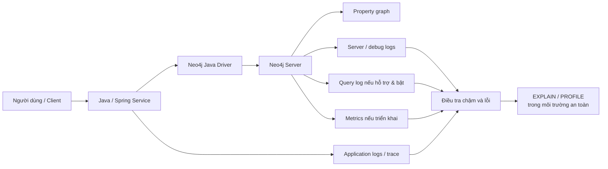
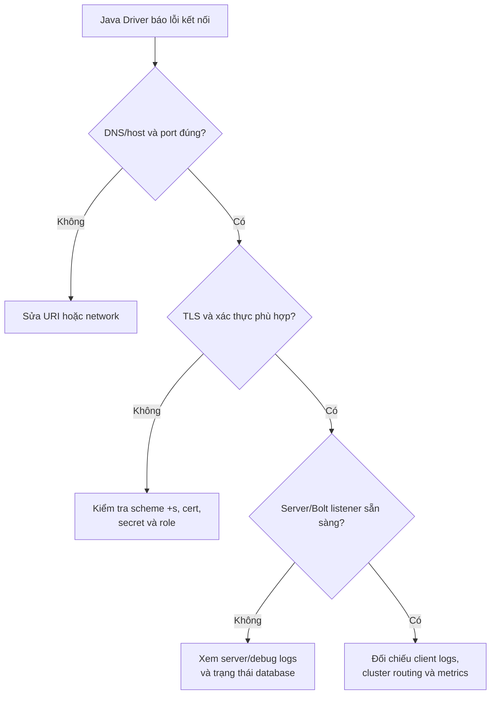
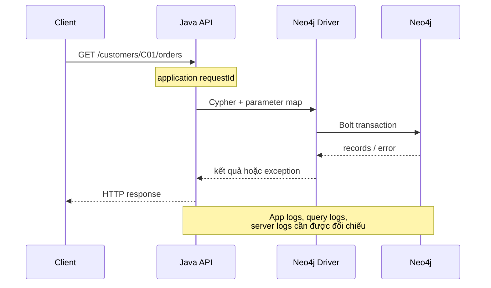
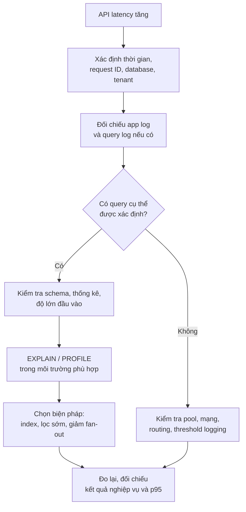

# Nhật ký máy chủ, nhật ký truy vấn và phạm vi hỗ trợ

Một truy vấn Cypher chậm, ứng dụng Java Driver không kết nối được hoặc Neo4j khởi động thất bại đều có thể xuất hiện dưới dạng “lỗi Neo4j”. Tuy nhiên, ba vấn đề này cần các loại bằng chứng khác nhau. **Nhật ký máy chủ** (*server logs*) giúp hiểu vòng đời và lỗi của tiến trình Neo4j; **nhật ký truy vấn** (*query log*) giúp điều tra những câu Cypher được thực thi, thời gian xử lý và thông tin thực thi được cấu hình ghi nhận; trong khi **nhật ký bảo mật** và **metric** hỗ trợ nhận diện sự kiện xác thực, tải và tình trạng tài nguyên.

Bài thuộc chương **Giám sát** của module **DATABASE_ENGINE_GRAPH_NEO4J**. Bối cảnh là một hệ thống *property graph* truy vấn node, relationship và đường đi bằng Cypher, sử dụng **index/constraint**, **Neo4j Java Driver** hoặc **Spring Data Neo4j**, cùng các luồng nhập dữ liệu và vận hành đồ thị. Nội dung tập trung vào **loại log nào trả lời câu hỏi nào, đọc và sử dụng chúng ra sao, và giới hạn hỗ trợ theo phiên bản, edition, quyền và môi trường triển khai**.

> **Nguyên tắc đầu tiên:** Không mặc định Neo4j nào cũng có cùng những file log hoặc cùng quyền xem log. Một số khả năng chỉ hiện diện trong phiên bản, edition hoặc gói dịch vụ phù hợp; hệ thống managed có thể chỉ cung cấp log/metric qua giao diện hay API của nhà cung cấp, không cho đọc trực tiếp thư mục log của server.

## 1. Bản đồ giám sát: log, metric, trace và execution plan

Trong vận hành, bốn nguồn quan sát bổ sung cho nhau:

| Nguồn | Trả lời tốt câu hỏi | Giới hạn |
| --- | --- | --- |
| **Server logs** | Neo4j đã khởi động/tắt ra sao? Có lỗi cấu hình, kết nối, bộ nhớ hay thành phần server? | Không nhất thiết liệt kê từng câu Cypher |
| **Query logs** | Truy vấn nào được ghi nhận? Mất bao lâu? Có tham số/thông tin thực thi nào được cho phép? | Không tự thay thế kế hoạch `PROFILE`; có thể không bật hoặc bị giới hạn |
| **Metrics** | CPU, heap, page cache, transaction, throughput, độ trễ thay đổi thế nào theo thời gian? | Dữ liệu tổng hợp thường không đủ xác định chính xác câu Cypher gây chậm |
| **Distributed tracing / app logs** | Request API nào tạo giao dịch gì? Độ trễ nằm ở Java, mạng, Neo4j hay dịch vụ khác? | Cần instrumentation và correlation phù hợp |
| **`EXPLAIN` / `PROFILE`** | Planner chọn toán tử nào; dòng trung gian và `DB Hits` phân bố ra sao? | `PROFILE` thực sự chạy truy vấn; không phải log dài hạn |

Một sơ đồ điều tra từ API đến Neo4j:



Không nên chỉ dựa vào một tín hiệu. Ví dụ một query log cho thấy truy vấn mất 8 giây, nhưng không thể kết luận 8 giây đó đều do duyệt relationship. Nguyên nhân có thể là chờ khóa, page cache miss, tải hệ thống, sắp xếp dữ liệu hoặc thời gian thực thi thực sự. Cần đối chiếu kế hoạch, metric và các request cùng thời điểm.

## 2. Những loại nhật ký thường gặp trong Neo4j

Khi **tự quản trị Neo4j**, các tên dưới đây là những loại log cần tìm hiểu. File có tồn tại, chứa gì, có được bật và tên chính xác ra sao phụ thuộc phiên bản/cấu hình/edition.

| Loại log thường gặp | Vai trò chính | Tình huống thường tra |
| --- | --- | --- |
| `neo4j.log` / server log | Sự kiện vận hành cấp server, khởi động/tắt, cảnh báo và lỗi | Khởi động lỗi, server không sẵn sàng, cấu hình không hợp lệ |
| `debug.log` | Chẩn đoán chi tiết hơn cho thành phần nội bộ, tùy mức log | Lỗi sâu ở thành phần server, thao tác kỹ thuật với nhóm vận hành |
| `query.log` | Thông tin truy vấn được cấu hình ghi, như câu Cypher, thời lượng hoặc trạng thái | Truy vấn chậm, mẫu truy vấn nặng, điều tra yêu cầu cụ thể |
| `security.log` | Sự kiện xác thực, phân quyền hoặc thay đổi liên quan bảo mật khi tính năng hỗ trợ | Đăng nhập thất bại, thao tác quản trị bảo mật |
| `http.log` | Lượt truy cập HTTP nếu HTTP request logging được triển khai/bật | Lỗi endpoint HTTP/Browse hoặc traffic qua HTTP |
| GC/JVM log | Thông tin garbage collection và hành vi JVM khi cấu hình | Heap pressure, GC pause, nguy cơ OutOfMemory |
| Application/Driver logs | Sự kiện phía Java Driver hoặc ứng dụng, ở nơi chạy client | DNS, TLS, retry, request ID, lỗi ánh xạ |
| Transaction log (WAL) | Cấu trúc ghi giao dịch phục vụ tính bền vững/phục hồi | Khôi phục và vận hành lưu trữ; **không phải** nhật ký truy vấn để đọc bằng text editor |

**Hai điều cần phân biệt rõ:**

1. **`query.log` không phải transaction log**: transaction log là dữ liệu nội bộ phục vụ giao dịch và phục hồi, không được đọc như danh sách câu Cypher con người có thể phân tích.
2. **`security.log` không đồng nghĩa audit đầy đủ mọi hành vi đọc dữ liệu**: sự kiện và phạm vi được ghi phụ thuộc edition, cấu hình và quyền; muốn audit đáp ứng quy định cần thiết kế và xác minh riêng.

### 2.1. Log không phải thông số hiệu năng tuyệt đối

Một thông điệp log là bằng chứng rằng **một sự kiện cụ thể đã được ghi nhận**; không chứng minh rằng không có các sự kiện khác. Chẳng hạn, không thấy một câu Cypher trong `query.log` có thể do:

- Query logging chưa bật hoặc edition không hỗ trợ.
- Truy vấn chạy nhanh hơn ngưỡng logging.
- Bộ lọc mức log không ghi loại sự kiện đó.
- Log đã được rotate, xóa theo retention hoặc nằm ở node khác trong cluster.
- Truy vấn chạy ở database/node khác với nơi đang xem log.
- Ứng dụng chưa gửi request đến server đó.

Vì vậy, **“không tìm thấy log” không có nghĩa “truy vấn chắc chắn chưa chạy”**.

## 3. Tìm log ở đâu tùy môi trường triển khai?

### 3.1. Neo4j tự quản trị trên máy chủ

Trong nhiều bản cài Neo4j tự quản trị, log file nằm trong thư mục **`logs`** thuộc vùng dữ liệu/đường dẫn được cấu hình cho Neo4j. Ví dụ **cấu trúc minh họa**, không phải đường dẫn bắt buộc:

```text
neo4j-home/
  conf/
    neo4j.conf
    server-logs.xml       # Có thể có cấu hình Log4j riêng tùy bản
    user-logs.xml
  logs/
    neo4j.log
    debug.log
    query.log             # Chỉ khi được hỗ trợ và cấu hình
    security.log          # Tùy phiên bản/edition
```

**Không dựa vào cây minh họa để tự tạo file hoặc thay config.** Trong container hoặc bản cài theo OS package, file cấu hình và thư mục log có thể được ánh xạ ra vị trí khác. Một số log được gửi tới **stdout/stderr** thay vì lưu thành file có tên tương ứng.

Khi cần xác định vị trí, quản trị viên nên kiểm tra **tài liệu cấu hình log đúng phiên bản đang chạy**, manifest/container mounts và chính sách thu thập log của hệ thống.

### 3.2. Docker và Kubernetes

Với Docker, có thể xem log **stdout/stderr của tiến trình container** qua công cụ vận hành tương ứng, ví dụ về ý tưởng:

```bash
docker logs --tail 200 neo4j
```

Trong Kubernetes:

```bash
kubectl logs deploy/neo4j --tail=200
```

Các lệnh trên là **ví dụ vận hành**, chỉ sử dụng nếu có đúng tên container/deployment và quyền cần thiết. **Stdout/stderr không bảo đảm bao gồm toàn bộ `query.log` hoặc `security.log`**, vì từng log có thể được xuất đến file/collector khác. Trong cluster, cần xem đúng pod/member đã xử lý truy vấn hoặc tập hợp log từ nhiều node.

Nếu cần giữ log sau khi container bị xóa, phải có **persistent volume hoặc log collector** phù hợp. Không lưu bí mật trong log và không dựa vào filesystem tạm của container để đáp ứng yêu cầu retention dài hạn.

### 3.3. Managed Neo4j và Aura

Với dịch vụ được quản lý, người dùng thường **không có quyền SSH hoặc đọc tùy ý file phía server**. Tùy gói dịch vụ và thời điểm, có thể có:

- Chỉ số vận hành qua console/dashboards.
- Những khả năng quan sát truy vấn hoặc chẩn đoán được nhà cung cấp cho phép.
- Hỗ trợ xuất/tra cứu log qua chức năng, API hoặc gói hỗ trợ cụ thể.
- Giới hạn quyền cấu hình mức log, filesystem, retention và plugin.

Không hướng dẫn người học tự sửa `neo4j.conf` hoặc tìm `logs/query.log` trên máy chủ Aura như thể đây là máy ảo tự quản. Hãy dùng **tính năng được công bố của đúng sản phẩm/gói hiện hành**; nếu không có query log thô, cần bổ sung logging/tracing ở phía ứng dụng và những công cụ quan sát do dịch vụ hỗ trợ.

## 4. Nhật ký máy chủ: đọc những gì?

Server log và debug log thường hữu ích khi lỗi xảy ra **trước khi** truy vấn được thực thi hoặc ở tầng hạ tầng.

Các nhóm sự kiện nên tìm:

1. **Startup/shutdown**: Neo4j đã bắt đầu lắng nghe Bolt chưa? Database có chuyển sang trạng thái sẵn sàng không?
2. **Configuration**: khóa cấu hình không hợp lệ, đường dẫn không đủ quyền, chứng chỉ TLS không đọc được.
3. **Database lifecycle**: database khởi động, dừng, lỗi khôi phục hoặc tình trạng thành viên cluster.
4. **Runtime errors**: lỗi JVM/heap, file system, lỗi nội bộ hoặc tình huống không thể phục vụ.
5. **Network/Bolt/HTTP**: thông điệp về cổng, listener và kết nối nếu chế độ log được bật.
6. **Operational warnings**: dấu hiệu tài nguyên hoặc cấu hình cần điều tra sâu.

Ví dụ dạng thông điệp **minh họa**, không phải output nguyên văn của một phiên bản Neo4j:

```text
2026-11-25T08:00:01Z INFO  [Server] Starting Neo4j ...
2026-11-25T08:00:08Z INFO  [Bolt] Listening on 0.0.0.0:7687
2026-11-25T08:00:10Z INFO  [Database] Database "neo4j" is available
2026-11-25T08:14:20Z WARN  [Memory] Resource pressure detected
```

Để diễn giải một dòng log, cần biết:

- **Timestamp** và timezone: dữ liệu ở UTC hay giờ địa phương?
- **Mức log**: DEBUG/INFO/WARN/ERROR là độ ưu tiên ghi nhận, không tự đồng nghĩa severity nghiệp vụ.
- **Thành phần phát log**: Bolt, database, transaction, JVM, security hoặc module khác.
- **Database/server**: một Neo4j cluster có nhiều thành viên, nhiều database.
- **Thông điệp và lỗi đi kèm**: stack trace, mã lỗi hoặc context của request.

Không nên chỉ tìm dòng có chữ `ERROR`: một chuỗi cảnh báo lặp lại có thể diễn tả vấn đề kéo dài, trong khi một lỗi đơn lẻ đã tự phục hồi có thể không gây sự cố người dùng.

### 4.1. Server log và sự cố Java Driver

Khi Java Driver báo không kết nối được, trước hết cần xác định **request đã tới Neo4j chưa**. Một lỗi DNS hoặc firewall ở phía ứng dụng có thể xảy ra trước khi server nhận bất kỳ kết nối nào; khi đó, server log không nhất thiết có bằng chứng.

Quy trình thường là:



Ví dụ:

- `bolt://localhost:7687` từ container Java có thể trỏ nhầm **container Java**, không phải Neo4j.
- `neo4j+s://...` có thể báo lỗi TLS do endpoint hoặc chứng chỉ sai; không đổi sang `+ssc` tùy tiện trong production.
- `verifyConnectivity()` thành công chỉ xác nhận kết nối có thể được thiết lập; nó chưa chứng minh người dùng có quyền chạy truy vấn dữ liệu thật trong đúng database.

## 5. Query log: nhật ký truy vấn thực sự dùng để làm gì?

**Query logging** ghi lại **những truy vấn phù hợp với chính sách được cấu hình**, giúp tìm kiếm câu Cypher chậm, theo dõi workload và đối chiếu các sự cố người dùng phản ánh.

Các câu hỏi điển hình:

- Những query template nào thường xuyên vượt ngưỡng thời gian?
- Truy vấn nào bị chậm sau khi một bản phát hành đưa thêm mẫu duyệt quan hệ?
- Có request ghi kéo dài làm tăng thời gian chờ của nhiều request khác không?
- Giai đoạn nào có lượng truy vấn lớn bất thường?
- Một câu Cypher có sử dụng kiểu truy vấn không mong đợi hoặc trả lỗi không?

Query log có thể chứa các thông tin như câu Cypher, thời điểm, database, thời lượng, trạng thái, client hoặc thông tin transaction theo **định dạng và cấu hình tương ứng**. Tập field cụ thể **không giống nhau** trong mọi bản Neo4j.

### 5.1. Mức logging và ngưỡng truy vấn chậm

Trong một số phiên bản Neo4j 5.x có hỗ trợ query logging, các setting thường được gặp:

```properties
# Ví dụ cấu hình cho môi trường tự quản có hỗ trợ tính năng.
# Phải kiểm tra tên setting, edition và cú pháp với phiên bản thực tế.
db.logs.query.enabled=INFO
db.logs.query.threshold=1s
db.logs.query.parameter_logging_enabled=false
```

Ý tưởng:

| Cấu hình | Mục đích |
| --- | --- |
| `db.logs.query.enabled` | Bật/tắt hoặc điều chỉnh mức chi tiết của query logging nếu hệ thống hỗ trợ |
| `db.logs.query.threshold` | Đặt ngưỡng thời gian để nhận diện truy vấn dài khi mức logging phù hợp |
| `db.logs.query.parameter_logging_enabled` | Kiểm soát việc ghi giá trị tham số theo khả năng phiên bản; đặc biệt liên quan bảo mật |

Đây là **ví dụ để hiểu cấu hình**, không phải bộ tham số chuẩn cho mọi sản phẩm/edition. Neo4j 4.x, 5.x và các phiên bản phát hành sau có thể thay tên hoặc điều chỉnh hành vi. Trong môi trường managed, người dùng có thể **không được phép** đặt các setting này.

Khi mức logging là `INFO` hay `VERBOSE`, tập truy vấn được ghi và lượng chi tiết có thể khác nhau. Không tự suy rằng một giá trị cấu hình chắc chắn bật “tất cả truy vấn” hoặc “chỉ slow query” trong mọi phiên bản; cần đọc mô tả cấu hình của chính bản đang dùng.

### 5.2. Kiểm tra setting hiện hành (nếu được hỗ trợ)

Trên những phiên bản có hỗ trợ lệnh quản trị và tài khoản được cấp quyền:

```cypher
SHOW SETTINGS
YIELD name, value
WHERE name STARTS WITH 'db.logs.query'
RETURN name, value
ORDER BY name;
```

**Giới hạn:**

- `SHOW SETTINGS` và các field được trả có thể phụ thuộc phiên bản, edition và quyền người dùng.
- Một setting không xuất hiện có thể do khác phiên bản, không được hỗ trợ hoặc quyền hạn không đủ.
- Giá trị setting không tự xác nhận đã có một log collector đang lưu dữ liệu đúng thời hạn.
- Thay đổi logging ở production phải theo quy trình vận hành: khả năng reload/restart, dung lượng, retention và ảnh hưởng hiệu năng.

Nếu không có quyền kiểm tra config, lấy thông tin từ quản trị viên hoặc dashboard cấu hình của môi trường thay vì suy đoán từ một file log rỗng.

### 5.3. Log query không đồng nghĩa full audit

Query logging thường phục vụ chẩn đoán **truy vấn và hiệu năng**. Một tổ chức có yêu cầu audit phải xác định rõ sự kiện cần lưu, danh tính, quyền, phạm vi đọc/ghi, chống sửa log và thời gian lưu trữ.

Một query log không mặc định có:

- Toàn bộ statement từng chạy, nếu threshold hoặc level đã lọc.
- Toàn bộ bản ghi thực tế được trả về.
- Tất cả giá trị tham số nếu chính sách đã tắt logging parameter.
- Các sự kiện nghiệp vụ ở ứng dụng không phát sinh Cypher trực tiếp.
- Bằng chứng đầy đủ về “ai đã xem thuộc tính nào” cho yêu cầu compliance.

Vì thế, không dùng `query.log` như **nguồn sự thật duy nhất** cho đối soát pháp lý hoặc điều tra truy cập dữ liệu nhạy cảm.

## 6. Đọc query log mà không suy diễn quá mức

Một sự kiện query log có thể chứa dữ liệu sau. Đây là **dạng giả lập**, không phải format chuẩn Neo4j:

```text
timestamp=2026-11-25T09:41:12Z
database=sales
query="MATCH (c:Customer {customerId: $id})-[:PLACED]->(o:Order) RETURN o"
durationMs=2450
status=completed
parameters=[redacted]
source=order-api
```

Các câu hỏi nên đặt khi đọc:

| Field/ý nghĩa | Điều nên hỏi |
| --- | --- |
| Timestamp | Bắt đầu/kết thúc lúc nào? Log dùng timezone nào? |
| Query text/template | Đây là truy vấn business nào? Có bị thay đổi ở phiên bản ứng dụng mới? |
| Duration | Mất bao lâu, đo theo ngữ nghĩa nào của phiên bản? |
| Database/server | Truy vấn thuộc database nào, member nào trong cluster? |
| Parameter logging | Đã tắt/ẩn để bảo vệ dữ liệu chưa? |
| Client/transaction info | Có đủ để đối chiếu với log phía ứng dụng không? |
| Status/error | Hoàn tất, thất bại hoặc bị hủy? Mã lỗi có cho thấy lý do? |

**Không khẳng định `durationMs=2450` ở ví dụ bằng đúng 2.450 ms CPU hoặc đĩa**. Khoảng thời gian được ghi phụ thuộc định nghĩa metric; có thể chứa thời gian chờ và nhiều thành phần khác. Cũng không suy từ một dòng rằng tất cả request đều chậm như nhau.

### 6.1. Query text, literal và tham số có thể nhạy cảm

Ví dụ một request truy vấn dữ liệu cá nhân:

```cypher
MATCH (c:Customer {email: $email})
RETURN c.customerId AS id;
```

Nếu logging tham số bật, giá trị `$email` có thể bị ghi vào hệ thống log. Nếu ứng dụng dùng cách nối literal trực tiếp, thông tin nhạy cảm có thể xuất hiện **ngay trong query text** cho dù đã tắt logging tham số.

Vì vậy cần:

- **Tham số hóa** mọi giá trị đầu vào.
- Ưu tiên tắt/giảm logging tham số nếu không cần cho vận hành và khi phiên bản cho phép.
- Không ghi mật khẩu, token, cookie, payload cá nhân vào query text hoặc query metadata.
- Thiết lập quyền đọc log, cơ chế làm mờ dữ liệu và retention.
- Khi gửi log cho hỗ trợ kỹ thuật, **lọc bí mật/PII trước khi chia sẻ**.

### 6.2. Log query có thể thiếu những truy vấn rất nhanh

Nếu chỉ bật log cho các truy vấn vượt 1 giây, những câu trả kết quả trong 30 ms sẽ không xuất hiện. Đây có thể là **chủ ý để hạn chế noise**, không phải lỗi.

Ngược lại, bật ghi chi tiết toàn bộ query trên một server nhiều QPS có thể:

- Tăng lượng I/O dành cho ghi log.
- Làm file log phát triển nhanh.
- Gây tốn chi phí thu thập và lưu trữ log.
- Tăng bề mặt rủi ro vì số câu truy vấn và metadata được giữ lại nhiều hơn.
- Làm việc tìm một lỗi quan trọng khó hơn giữa hàng triệu dòng.

Hãy ưu tiên ngưỡng chậm và chính sách sampling/phân loại phù hợp mục tiêu chẩn đoán; khi cần tăng verbosity trong một sự cố, đặt **thời gian bật, người chịu trách nhiệm và điều kiện quay về cấu hình bình thường**.

## 7. Query log khác EXPLAIN và PROFILE thế nào?

Giả sử một API tìm đơn hàng theo mã khách hàng:

```cypher
MATCH (c:Customer {customerId: $customerId})
      -[:PLACED]->(o:Order)
WHERE o.createdAt >= $startDate
RETURN o.orderId AS orderId,
       o.createdAt AS createdAt
ORDER BY createdAt DESC;
```

Nếu log cho thấy truy vấn chậm, quy trình phân tích là:

1. **Dựa vào query log** để xác định mẫu truy vấn, thời điểm, database, mức độ chậm và điều kiện được ghi.
2. **Lấy đúng query template** từ mã nguồn ứng dụng và bộ tham số test **đã được làm sạch dữ liệu nhạy cảm**.
3. **Chạy `EXPLAIN`** để xem planner định tìm điểm bắt đầu ở đâu, có thể dùng index hay quét toàn bộ.
4. Nếu an toàn và cần số đo thực tế, **chạy `PROFILE`** trong database thử nghiệm/điều kiện được kiểm soát.
5. Xem **Rows**, **DB Hits**, page cache, operator mở rộng relationship, sắp xếp và độ trễ.
6. Kiểm tra **index/constraint, phân bố dữ liệu và workload**; không tối ưu dựa trên một lần đo riêng lẻ.

Ví dụ:

```cypher
EXPLAIN
MATCH (c:Customer {customerId: $customerId})
      -[:PLACED]->(o:Order)
WHERE o.createdAt >= $startDate
RETURN o.orderId AS orderId,
       o.createdAt AS createdAt
ORDER BY createdAt DESC;
```

```cypher
PROFILE
MATCH (c:Customer {customerId: $customerId})
      -[:PLACED]->(o:Order)
WHERE o.createdAt >= $startDate
RETURN o.orderId AS orderId,
       o.createdAt AS createdAt
ORDER BY createdAt DESC;
```

Trong Neo4j Browser, tham số cần được đặt trước khi thực thi; trong Java Driver, chúng được truyền bằng parameter map. `PROFILE` ở ví dụ này chạy **truy vấn đọc**. Với `CREATE`, `MERGE`, `SET` hoặc `DELETE`, `PROFILE` **thực sự ghi dữ liệu**, nên phải dùng database test/transaction kiểm soát được hoặc chọn `EXPLAIN` nếu chỉ cần xem kế hoạch.

### 7.1. Các toán tử cần quan sát

| Toán tử hoặc nhóm | Dấu hiệu cần xem |
| --- | --- |
| `NodeByLabelScan` | Có lấy quá nhiều node trước khi lọc thuộc tính không? |
| `NodeIndexSeek` / `NodeUniqueIndexSeek` | Index có được planner chọn cho điều kiện tìm không? |
| `Expand(All)` / `VarLengthExpand` | Quan hệ có bậc lớn, số dòng có tăng đột biến? |
| `Filter` | Bao nhiêu dòng bị loại sau khi đã tốn công duyệt? |
| `Sort` / `Top` | Có sắp xếp/tổ hợp dữ liệu lớn không? |
| `CartesianProduct` | Có hai mẫu graph chưa được nối tạo tích Descartes? |
| `Eager` / `Aggregation` | Có bước phải giữ nhiều dữ liệu trung gian? |

**`DB Hits` không phải số lần đọc đĩa vật lý**, và `Rows` là số dòng trung gian của toán tử, không phải tổng số node trong database. Query log giúp tìm truy vấn đáng xem; `PROFILE` giúp hiểu **vì sao** một lần thực thi cụ thể lại tốn công.

## 8. Ví dụ thực hành: từ triệu chứng đến truy vấn nguyên nhân

Dữ liệu học tập gồm khách hàng và đơn hàng. Chạy trên **database thử nghiệm**:

```cypher
CREATE CONSTRAINT customer_id_unique IF NOT EXISTS
FOR (c:Customer)
REQUIRE c.customerId IS UNIQUE;

CREATE CONSTRAINT order_id_unique IF NOT EXISTS
FOR (o:Order)
REQUIRE o.orderId IS UNIQUE;
```

```cypher
MERGE (c1:Customer {customerId: 'C01'})
SET c1.name = 'An'
MERGE (c2:Customer {customerId: 'C02'})
SET c2.name = 'Bình'
MERGE (o1:Order {orderId: 'O01'})
SET o1.createdAt = date('2026-11-01')
MERGE (o2:Order {orderId: 'O02'})
SET o2.createdAt = date('2026-11-03')
MERGE (o3:Order {orderId: 'O03'})
SET o3.createdAt = date('2026-11-04')
MERGE (c1)-[:PLACED]->(o1)
MERGE (c1)-[:PLACED]->(o2)
MERGE (c2)-[:PLACED]->(o3);
```

Truy vấn đã tham số hóa:

```cypher
MATCH (c:Customer {customerId: $customerId})
      -[:PLACED]->(o:Order)
WHERE o.createdAt >= $startDate
RETURN o.orderId AS orderId
ORDER BY orderId;
```

Với `customerId = 'C01'` và `startDate = date('2026-11-01')`, kết quả là `O01` và `O02`. Với `customerId = 'C02'`, kết quả là `O03`.

Điều cần rút ra:

- Cùng **query template**, nhưng số dòng thực thi có thể khác theo `customerId`.
- Có unique constraint, việc tìm điểm bắt đầu theo `customerId` có thể được hỗ trợ bằng index phù hợp.
- Trên ba đơn hàng, khó tạo ra slow query có ý nghĩa; **không đưa ra số liệu DB Hits hoặc latency giả định**.
- Để đánh giá slow query thực, cần bộ dữ liệu đại diện về số lượng node, bậc relationship, index, cache và tải đồng thời.

Nếu một lần chạy thật xuất hiện trong query log vì mất nhiều giây, hãy kiểm tra thêm liệu khách hàng có quá nhiều quan hệ `PLACED`, hoặc điều kiện ngày bị áp dụng sau khi hệ thống đã mở rộng một tập lớn.

## 9. Quan sát truy vấn đang chạy khi log chưa có dữ liệu

Query log ghi **sự kiện theo chính sách**; một số môi trường cho phép xem các transaction đang hoạt động qua Cypher quản trị. Trong phiên bản Neo4j hỗ trợ và với quyền phù hợp:

```cypher
SHOW TRANSACTIONS
YIELD transactionId, currentQuery, elapsedTime, status
RETURN transactionId, currentQuery, elapsedTime, status
ORDER BY elapsedTime DESC;
```

Lệnh này hữu ích khi có truy vấn kéo dài mà **chưa thể thấy bản ghi hoàn tất** trong query log. Tuy nhiên:

- Quyền xem toàn bộ transaction có thể bị hạn chế; tài khoản có thể chỉ xem transaction được phép.
- Tên field và tính khả dụng phụ thuộc phiên bản Neo4j.
- `currentQuery` có thể chứa dữ liệu nhạy cảm; không để API người dùng thường gọi tùy tiện.
- Không mặc định rằng một transaction đang chờ là truy vấn CPU-heavy; có thể nó đang chờ khóa/tài nguyên.
- Cần cẩn thận nếu quyết định chấm dứt transaction: đó là thao tác quản trị có ảnh hưởng tới request đang chạy và dữ liệu chưa commit.

**Không nhầm “current query” với lịch sử truy vấn**: danh sách transaction hiện hành là ảnh chụp tức thời, không thay thế hệ thống thu thập log theo thời gian.

## 10. Liên hệ log server với Java Driver và Spring Data Neo4j

Một dịch vụ Java nhận request HTTP rồi gọi Neo4j:



Khi người dùng nói “API trả chậm 5 giây”, nên đo và quan sát ít nhất:

1. **Tổng độ trễ HTTP** tại API gateway/controller.
2. **Thời gian lấy kết nối** từ pool Driver và độ trễ mạng.
3. **Thời gian chạy Cypher** tại Neo4j hoặc qua metric/log có hỗ trợ.
4. **Thời gian nhận và chuyển đổi Result/Record** thành DTO.
5. **Tải hệ thống** ở thời điểm phát sinh: CPU, heap, page cache, transaction, khóa, network.

Một query log 3 giây không chứng minh API 5 giây đều do Neo4j; 2 giây còn lại có thể là hoạt động Java hoặc dịch vụ khác. Ngược lại, query log không có dòng chậm nào cũng không chứng minh API không phải chờ kết nối hoặc timeout trước khi truy vấn đến server.

### 10.1. Thêm correlation ID vào transaction metadata

Khi phiên bản Java Driver hỗ trợ transaction metadata, ứng dụng có thể truyền **mã request không nhạy cảm** để hỗ trợ đối chiếu trong các công cụ giám sát có khả năng hiển thị metadata.

Ví dụ dùng Java Driver 5.x:

```java
import java.time.Duration;
import java.util.Map;

import org.neo4j.driver.Driver;
import org.neo4j.driver.Session;
import org.neo4j.driver.SessionConfig;
import org.neo4j.driver.TransactionConfig;

public final class CustomerQuery {
    public static long countOrders(
            Driver driver, String databaseName,
            String customerId, String requestId) {

        TransactionConfig config = TransactionConfig.builder()
            .withTimeout(Duration.ofSeconds(10))
            .withMetadata(Map.of(
                "requestId", requestId,
                "component", "order-api"
            ))
            .build();

        try (Session session = driver.session(
                SessionConfig.forDatabase(databaseName))) {

            return session.executeRead(tx ->
                tx.run("""
                    MATCH (c:Customer {customerId: $customerId})
                          -[:PLACED]->(o:Order)
                    RETURN count(o) AS total
                    """, Map.of("customerId", customerId))
                    .single()
                    .get("total")
                    .asLong(),
                config
            );
        }
    }
}
```

Ở đây:

- `requestId` nên là mã được ứng dụng tạo/kiểm soát; **không** chứa token, mật khẩu hoặc dữ liệu cá nhân.
- `withTimeout` giới hạn thời gian transaction theo cơ chế Driver/server, không thay thế timeouts của gateway hoặc ứng dụng.
- Transaction metadata chỉ hữu ích khi **log/metrics/công cụ giám sát của phiên bản Neo4j thực sự cung cấp cách quan sát chúng**. Không hứa mọi cài đặt `query.log` sẽ in nguyên giá trị `requestId`.
- Nếu request tạo **nhiều transaction**, cần gắn cùng mã correlation trên các transaction có liên quan, hoặc dùng tracing ở tầng ứng dụng.
- `Driver` nên được tái sử dụng, `Session` ngắn và đóng đúng lúc.

### 10.2. Với Spring Data Neo4j

Spring Data Neo4j có thể quản lý Driver, repository và transaction cho ứng dụng. Việc framework tự sinh Cypher có thể khiến query text trong log khác dự đoán từ tên method repository.

Khi điều tra:

- Xác định **repository method/service operation** gắn với request ID.
- Xem query được tạo thực tế nếu framework cung cấp log phù hợp, nhưng không bật logging parameter nhạy cảm bừa bãi.
- Phân biệt thời gian database với thời gian dựng aggregate, deserialize và logic service.
- Kiểm tra query tự viết bằng `@Query`, ranh giới `@Transactional` và việc duyệt relationship không cần thiết.
- Trên môi trường test, dùng `EXPLAIN`/`PROFILE` cho mẫu Cypher thực tế và xác nhận index phù hợp.

**Log của Spring Data/Driver ở phía ứng dụng không thay thế `query.log` server**, và ngược lại.

## 11. Phạm vi hỗ trợ: phiên bản, edition, sản phẩm và quyền

Cụm từ **“Neo4j có query log”** cần được diễn giải kèm các điều kiện:

| Yếu tố | Cần xác minh | Hệ quả |
| --- | --- | --- |
| **Neo4j version** | 4.x, 5.x hoặc bản mới hơn; tên setting/API tương ứng | Không dùng lệnh/cấu hình không thuộc phiên bản |
| **Community vs Enterprise** | Tính năng logging/metrics/security và công cụ quản trị của edition | Không mặc định mọi tính năng Enterprise có ở Community |
| **Self-managed vs managed** | Có quyền đọc file server, chỉnh config hoặc dùng dashboard/API? | Aura/managed có thể không cho truy cập file `query.log` |
| **Single instance vs cluster** | Có nhiều server/member và database không? | Cần tổng hợp log từ đúng những node tham gia |
| **Role/privileges** | Có quyền `SHOW SETTINGS`, `SHOW TRANSACTIONS` hoặc đọc log không? | Một số thông tin không được phép hiển thị |
| **Query logging configuration** | Bật/tắt, threshold, verbosity, parameter logging | Không thấy query trong log có thể là đúng chính sách |
| **Log destination & retention** | File, stdout, collector, rotation, khoảng lưu | Log có thể không còn trên server hiện tại |
| **Application logging** | Driver/framework có được cấu hình log/trace không? | Cần bổ sung correlation ở client |

**Không nên dùng bảng này như bảng cam kết tính năng theo từng phiên bản.** Quyết định cuối cùng phải dựa vào **tài liệu Neo4j của phiên bản và edition đang vận hành**, quyền đã được cấp và khả năng của dịch vụ managed hiện tại.

### 11.1. Trong Neo4j Community

Không nên hướng dẫn “bật mọi loại security log, query log, metrics Enterprise” như thể chúng chắc chắn hiện diện. Một số khả năng quản trị/giám sát nâng cao có thể chỉ hỗ trợ ở edition cao hơn.

Nếu thiếu tính năng query logging hoặc không có quyền truy cập:

- Tăng instrumentation ở Java Driver hoặc Spring Data Neo4j cho **latency và tên template**, không log dữ liệu nhạy cảm.
- Sử dụng `EXPLAIN`/`PROFILE` trên môi trường thử nghiệm để phân tích kế hoạch.
- Quan sát server logs và metric của hệ điều hành/container mà môi trường cho phép.
- Xem xét khả năng đổi edition hoặc mô hình triển khai theo yêu cầu vận hành thực tế.

### 11.2. Trong Neo4j Enterprise/cluster

Các khả năng log/metric phong phú hơn có thể giúp điều tra sâu, nhưng cũng cần:

- Chỉ định **server/member** và database.
- Thu log từ nhiều member; một request có thể đi qua routing và được phục vụ ở member khác với entrypoint.
- Đồng bộ thời gian NTP và timezone ở ứng dụng, máy chủ, collector.
- Theo dõi membership/topology, leader/follower hoặc cơ chế điều phối phù hợp phiên bản.
- Xác minh rằng log aggregation không làm mất metadata cần thiết để tương quan.

Không mặc định lấy `query.log` ở một node là nhìn thấy **tất cả** query của cluster.

### 11.3. Trong môi trường managed

Phạm vi hỗ trợ phụ thuộc gói sản phẩm và quyền của tài khoản. Nếu không thể mở file log thô, **không cố dùng đường dẫn filesystem hoặc thao tác shell không được hỗ trợ**. Dùng dashboard/log export/metrics được cung cấp, thêm tracing phía ứng dụng và liên hệ hỗ trợ khi cần chứng cứ ở tầng server không được cung cấp cho khách hàng.

## 12. Bảo vệ log và giảm rủi ro rò rỉ dữ liệu

Log hữu ích để vận hành nhưng có thể chứa:

- Username, client address, tên database, câu Cypher.
- Giá trị tham số chứa email, số điện thoại, mã khách hàng hoặc nội dung tài liệu.
- URI hoặc error message chứa token/secret nếu ứng dụng xây sai.
- Sơ đồ nhãn, tên relationship và cấu trúc nghiệp vụ.
- Stack trace, internal path hoặc thông tin hạ tầng.

Do đó, chính sách logging là **một phần của bảo mật**:

1. **Data minimization:** ghi số đo và metadata đủ để xử lý sự cố, không ghi mọi payload theo thói quen.
2. **Access control:** chỉ tài khoản vận hành được cấp quyền mới đọc log.
3. **Retention/rotation:** giới hạn thời gian lưu và dung lượng theo nhu cầu, tuân thủ chính sách tổ chức.
4. **Encryption:** bảo vệ log trên đường truyền và tại nơi lưu nếu cần.
5. **Redaction:** xóa/mask PII và secret trước khi chia sẻ với nhóm khác hoặc nhà cung cấp.
6. **Integrity:** dùng hệ thống log có kiểm soát sửa/xóa khi audit yêu cầu.
7. **Separation of duties:** người quản trị ứng dụng không nhất thiết cần đọc toàn bộ security log hoặc thay chính sách logging.
8. **Change management:** mọi đợt bật log chi tiết có người chịu trách nhiệm và thời điểm tắt.

### 12.1. Cảnh giác khi bật ghi tham số

Khi điều tra một lỗi khó tái hiện, người vận hành có thể muốn bật toàn bộ parameter logging. Việc đó có thể ghi những giá trị nhạy cảm vào log collector vốn được nhiều người truy cập hơn database. Giải pháp ưu tiên:

- Dùng request ID và tên template, không ghi trực tiếp PII.
- Tái hiện ở môi trường test với dữ liệu giả.
- Giữ tham số nhạy cảm ở chế độ không log/masked.
- Nếu buộc phải thu dữ liệu chi tiết, phải có phê duyệt, phạm vi nhỏ, thời hạn rõ và quy trình xóa an toàn.

**Không sử dụng tham số hóa như lý do mặc định bật ghi mọi giá trị tham số.** Parameter binding giúp giảm injection, nhưng chính những tham số đó vẫn có thể là dữ liệu nhạy cảm.

## 13. Log rotation, retention và khả năng thu thập

Một server chạy liên tục có thể tạo lượng log rất lớn. Cần xác định:

| Thành phần | Quy tắc vận hành cần có |
| --- | --- |
| Destination | File, stdout/stderr hoặc collector |
| Rotation | Điều kiện chuyển file theo kích thước/thời gian |
| Retention | Số ngày/lượng dữ liệu giữ lại theo chính sách |
| Compression | Nén log cũ khi phù hợp |
| Backup / export | Có cần giữ log để điều tra sự cố hay compliance? |
| Alerting | Cảnh báo khi log không tới collector, disk gần đầy hoặc lỗi nghiêm trọng |
| Correlation | Giữ timestamp, server ID, database, request ID khi có |
| Privacy | Đảm bảo masking và quyền truy cập trước khi forward log |

Khi cấu hình cụ thể, hãy dùng hệ thống logging/config của **phiên bản đang vận hành**. Neo4j có thể dựa trên cấu hình logging riêng, stdout/stderr và công cụ thu thập ngoài. Đừng giả định có thể thay bằng một cấu hình `logrotate` bất kỳ mà không kiểm tra interaction với logger của Neo4j.

### 13.1. Log collector không làm thay phép đo

Số lượng dòng `ERROR` tăng đột ngột là tín hiệu cần điều tra, nhưng **không nhất thiết** đồng nghĩa độ trễ query tăng. Ngược lại, một truy vấn chạy lâu trong hàng phút có thể chưa có dòng query log nếu cấu hình chỉ ghi khi hoàn tất.

Vì vậy, cần kết hợp log với:

- Transaction latency và số transaction đang hoạt động.
- CPU, heap, garbage collection.
- Page cache hit/miss và IO.
- Connection pool phía Java Driver.
- Độ trễ API theo p50/p95/p99.
- Tỷ lệ error/retry của ứng dụng.

Đừng thiết lập một cảnh báo “mọi dòng INFO đều là incident”. Chỉ số cảnh báo nên phản ánh **SLO của dịch vụ** và tác động người dùng.

## 14. Runbook: điều tra truy vấn Cypher chậm

Một quy trình khả thi:



### Bước 1 — Xác định triệu chứng

Ghi nhận một thông tin thực tế thay vì chỉ “Neo4j chậm”:

- Endpoint nào?
- Database nào?
- Khoảng thời gian nào và timezone gì?
- Từ phiên bản ứng dụng nào?
- Phần trăm request bị ảnh hưởng?
- Chỉ query đọc hay có cả `MERGE`/`SET`?
- Số kết quả và kích thước dữ liệu trả về có tăng không?

### Bước 2 — Thu chứng cứ đúng nguồn

- Query log nếu tính năng hỗ trợ và được bật.
- App/Driver logs và request tracing.
- Server/debug logs nếu có dấu hiệu hạ tầng.
- Metrics CPU/heap/cache/transaction/lock.
- `SHOW TRANSACTIONS` khi cần xem query còn chạy.
- Query template và tham số test đã loại dữ liệu nhạy cảm.

### Bước 3 — Phân tích kế hoạch

Với Neo4j graph:

- Có **index seek** trên khóa `customerId`, `orderId` hoặc thuộc tính được lọc không?
- Có mở rộng quá nhiều relationship từ một node bậc cao không?
- Có `CartesianProduct` do hai mẫu không được nối?
- Có `Sort`, `Aggregation` hoặc `Eager` giữ nhiều dòng trung gian?
- Có batch ghi quá lớn làm transaction/lock kéo dài?
- Có query plan cũ không phù hợp với phân bố dữ liệu hiện tại?

**Không kết luận chỉ vì có scan**: trên bảng nhỏ, scan đôi khi hợp lý. Tối ưu cần dựa trên dữ liệu đại diện, kết quả đúng và metric trước/sau.

### Bước 4 — Xác nhận hiệu quả

Giữ cùng bộ tham số, dữ liệu và điều kiện tải đủ tương đương. Ghi:

| Tiêu chí | Trước | Sau |
| --- | --- | --- |
| Query template | Phiên bản cũ | Phiên bản mới |
| Kết quả nghiệp vụ | Cần đúng | Phải tương đương |
| `Rows` / `DB Hits` | Đo thực tế | Đo thực tế |
| Plan/operator | Từ `EXPLAIN`/`PROFILE` | Từ `EXPLAIN`/`PROFILE` |
| p95 API latency | Đo thực tế | Đo thực tế |
| Server CPU/cache/locks | Theo metric | Theo metric |
| Rủi ro/side effects | Ghi rõ | Xác nhận không phát sinh |

**Không tự bịa số liệu**; các cột là khung thu thập cho hệ thống thật.

## 15. Runbook: một số sự cố không phải slow query

| Sự cố | Nguồn chứng cứ ưu tiên | Điều không nên suy |
| --- | --- | --- |
| Neo4j không khởi động | Server/debug logs, cấu hình, disk, JVM | Không thấy `query.log` không phải nguyên nhân |
| Driver `connection refused` | URI, Bolt listener, network, server logs | Không phải lỗi Cypher; chưa có query nào chạy |
| TLS certificate error | Client logs, scheme, CA/hostname | Không cần tắt xác thực chứng chỉ |
| Authentication failed | App/Driver log đã che secret, security events khi hỗ trợ | Không phải do index/plan |
| Một query chạy lâu | Query log, current transactions, metrics, plan | Không mặc định là thiếu index |
| Nhiều query cùng chậm | CPU, heap, GC, locks, page cache, I/O, cluster | Không chắc một câu Cypher gây tất cả |
| Ghi `MERGE` chậm | Unique constraints, transaction/lock, query plan, metrics | Plan cache không thay thế index/constraint |
| Query kết quả sai | Test Cypher, mô hình node/relationship, tham số | Chỉ nhìn log thời gian không chứng minh đúng dữ liệu |
| Không thấy query log | Edition, config, threshold, destination, rotation | Không đồng nghĩa query chưa thực thi |
| Disk đầy vì logs | Retention, rotation, collector, file system | Không chỉ xóa file đang mở mà không kiểm tra quy trình vận hành |

## 16. Bài tập thực hành

### Bài tập 1 — Chọn đúng loại nhật ký

Với bốn tình huống: server khởi động thất bại, `MATCH` trả chậm, nhiều đăng nhập sai mật khẩu và Docker container bị kill vì thiếu RAM, hãy chọn **server/debug log**, **query log**, **security log** hoặc **JVM/container metrics** phù hợp. Trình bày lý do vì sao không có một loại log duy nhất bao quát đủ.

### Bài tập 2 — Phân biệt query log với PROFILE

Một query log ghi nhận truy vấn mất 2.400 ms. Hãy nêu những thông tin cần thu thập trước khi chạy `EXPLAIN`/`PROFILE` và giải thích vì sao `PROFILE` có thể chỉ ra `Rows`/`DB Hits` còn query log thông thường không cung cấp cây toán tử tương đương.

### Bài tập 3 — Ngưỡng logging

Giả sử môi trường có hỗ trợ cấu hình `db.logs.query.threshold=1s`. Vì sao một query hoàn tất trong 50 ms có thể không xuất hiện ở query log? Hãy nêu những trường hợp khác cũng khiến không tìm thấy query và cách xác minh mà **không khẳng định query chưa chạy**.

### Bài tập 4 — Quyền và phạm vi hỗ trợ

Một nhóm dùng môi trường managed Neo4j không được phép truy cập thư mục `logs`, nhưng muốn phân tích query chậm. Thiết kế cách kết hợp dashboard được cung cấp, application tracing, Driver latency và `EXPLAIN`/`PROFILE` trong môi trường test. Tại sao không yêu cầu nhóm truy cập shell Neo4j Aura?

### Bài tập 5 — Bảo vệ tham số

Truy vấn `MATCH (c:Customer {email: $email}) RETURN c` đã dùng tham số đúng. Điều gì xảy ra nếu bật logging giá trị `$email`? Đề xuất cách giảm dữ liệu nhạy cảm trong log nhưng vẫn giữ khả năng chẩn đoán hiệu năng.

### Bài tập 6 — Đối chiếu request Java

Thiết kế Java service truyền transaction metadata gồm `requestId` không nhạy cảm, đồng thời log phía API ghi thời gian request. Nêu vì sao transaction metadata có thể hữu ích nhưng **không thể hứa** mọi phiên bản/query log đều tự hiển thị `requestId`.

### Bài tập 7 — Cluster nhiều thành viên

Một ứng dụng dùng URI routing `neo4j://...` và nhận kết quả chậm. Quản trị viên chỉ xem `query.log` trên một server nhưng không tìm thấy truy vấn. Hãy nêu các giả thuyết về routing, database, threshold và log destination. Làm thế nào chọn đúng tập server/member để điều tra?

### Bài tập 8 — Truy vấn ghi và PROFILE

Một job đồng bộ dùng `MERGE` để cập nhật nhiều node, đội vận hành muốn chạy `PROFILE` trên production “chỉ để xem kế hoạch”. Giải thích nguy cơ và đề xuất quy trình `EXPLAIN` trước, `PROFILE` trong môi trường thử nghiệm hoặc transaction có rollback được kiểm chứng.

### Bài tập 9 — Thiết kế dashboard

Chọn một dashboard giám sát Neo4j gồm tối thiểu: API p95 latency, tỷ lệ lỗi Driver, transaction đang chạy, server CPU/heap, page cache, query chậm và tình trạng log collector. Mỗi chỉ số nên trả lời một câu hỏi vận hành nào? Đặt ngưỡng cảnh báo dựa trên SLO nào?

### Bài tập 10 — Runbook sự cố

Một API truy vấn đơn hàng sau khi phát hành phiên bản mới có p95 từ 300 ms lên 3 giây. Hãy viết checklist điều tra theo thứ tự thời gian, request correlation, log, metric, `EXPLAIN`/`PROFILE` và kế hoạch so sánh trước/sau. Phải xác minh **kết quả nghiệp vụ đúng** bên cạnh mục tiêu latency.

## 17. Ghi nhớ

**Server logs** giúp chẩn đoán vòng đời, lỗi cấu hình và vấn đề vận hành của Neo4j. **Query logs** hỗ trợ xác định những truy vấn được ghi nhận, độ trễ và workload, nhưng phụ thuộc **mức logging, ngưỡng, phiên bản, edition, quyền và destination**. **Security logs** và **JVM/container metrics** trả lời các câu hỏi khác; không phải mọi loại log đều khả dụng ở mọi môi trường.

Khi điều tra truy vấn Cypher, hãy nối **request phía ứng dụng → Java Driver/Spring Data Neo4j → log truy vấn (nếu có) → metric server → `EXPLAIN`/`PROFILE`**. Đừng dùng query log thay cho plan, đừng dùng `PROFILE` như thao tác chỉ đọc với truy vấn ghi, và đừng coi một dòng log hoặc việc không thấy log là kết luận tuyệt đối. Muốn giám sát đáng tin, cần **phạm vi hỗ trợ được xác minh, correlation, bảo vệ dữ liệu nhạy cảm, rotation/retention và quy trình điều tra có kiểm chứng**.
