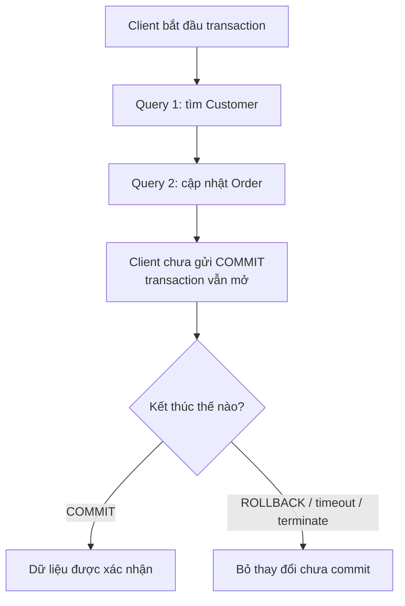
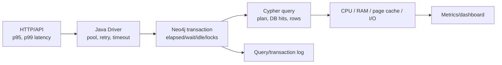

# Theo dõi truy vấn hoặc giao dịch đang chạy và xử lý truy vấn kéo dài trong Neo4j

Trong một hệ thống Neo4j, truy vấn Cypher có thể chạy lâu vì nhiều nguyên nhân khác nhau: mở rộng đường đi trên đồ thị quá rộng, quét node khi thiếu index, tổng hợp trên tập hàng bị nhân, tranh chấp khóa khi cập nhật cùng node hoặc đơn giản là **ứng dụng mở transaction rồi không đóng**. Những tình huống này có thể cùng biểu hiện thành API chậm, request hết hạn, CPU cao, bộ nhớ tăng hoặc nhiều request xếp hàng chờ. Nhưng **cách xử lý không giống nhau**: truy vấn tính toán nặng cần tối ưu Cypher, transaction bị chặn cần điều tra lock, còn transaction nhàn rỗi cần sửa vòng đời session/transaction ở ứng dụng.

Bài thuộc chương **Giám sát** của module **DATABASE_ENGINE_GRAPH_NEO4J**, trong bối cảnh sử dụng Neo4j để mô hình hóa property graph, truy vấn node, relationship, đường đi bằng Cypher; thiết kế index/constraint; tối ưu truy vấn, nhập dữ liệu, tích hợp Java Driver và Spring Data Neo4j; và vận hành hệ thống đồ thị.

Sau bài này, bạn có thể:

- Phân biệt **transaction đang mở** với **query đang thực thi** và hiểu ý nghĩa các trường quan sát.
- Dùng `SHOW TRANSACTIONS` để nhận diện giao dịch lâu, đang chờ khóa hoặc không có truy vấn hiện hành.
- Đọc `elapsedTime`, `currentQueryElapsedTime`, `cpuTime`, `waitTime`, `idleTime`, `activeLockCount`, `currentQueryId` và `transactionId` đúng ngữ cảnh.
- Sử dụng **query log**, transaction logging, metrics và metadata từ Java Driver để tìm nguyên nhân.
- Chẩn đoán query chậm bằng `EXPLAIN`/`PROFILE`, index, cardinality, bậc node, khóa và batch.
- Cân nhắc `TERMINATE TRANSACTIONS` an toàn, hiểu rollback và giới hạn của việc hủy.
- Thiết lập runbook cho sự cố thực tế, ngưỡng cảnh báo và cách phòng ngừa tái diễn.

> **Phạm vi phiên bản:** Cú pháp tập trung vào Neo4j 5.x và các bản Neo4j hiện hành. Một số cột thống kê, tùy chọn log, quyền quản trị và hành vi trong cluster phụ thuộc phiên bản/edition; hãy chọn tài liệu chính thức đúng môi trường. Không chạy những ví dụ tạo tranh chấp hoặc hủy giao dịch trên database production.

## 1. Câu hỏi đầu tiên: query lâu hay transaction lâu?

**Query** là một câu lệnh Cypher như `MATCH`, `MERGE` hoặc `CALL` đang được thực thi. **Transaction** là đơn vị công việc có thể chứa **một hoặc nhiều query**, và có vòng đời từ lúc bắt đầu cho tới khi commit, rollback hoặc bị kết thúc.



Một transaction có thể tồn tại **2 phút** trong khi query gần nhất chỉ chạy **50 ms** và ứng dụng đã giữ transaction nhàn rỗi phần còn lại. Ngược lại, một query duyệt đường đi có thể sử dụng CPU liên tục trong phần lớn thời gian transaction.

Do đó, không thể chỉ nhìn một con số `elapsedTime` rồi kết luận query hiện tại bị treo.

| Đại lượng | Đo điều gì? | Câu hỏi phù hợp |
| --- | --- | --- |
| `elapsedTime` | Thời gian kể từ khi transaction bắt đầu | “Transaction này mở bao lâu?” |
| `currentQueryElapsedTime` | Thời gian từ khi query hiện hành bắt đầu; có thể `null` | “Câu Cypher đang chạy bao lâu?” |
| `cpuTime` / `currentQueryCpuTime` | Thời gian CPU đã dùng nếu hệ thống cung cấp | “Có đang tiêu thụ CPU thực sự không?” |
| `waitTime` / `currentQueryWaitTime` | Thời gian chờ lấy lock | “Có dấu hiệu tranh chấp khóa không?” |
| `idleTime` | Thời gian nhàn rỗi của transaction nếu có | “Ứng dụng có giữ transaction mở mà không chạy query?” |
| `activeLockCount` | Số lock đang được giữ | “Transaction có thể đang giữ tài nguyên chặn người khác?” |

`currentQuery...` liên quan **query hiện hành**; các trường không có tiền tố thường phản ánh transaction. Một vài số liệu có thể là `null` nếu không sẵn có, không thể suy diễn `null = 0`.

## 2. Vì sao Neo4j cần quan sát đồng thời query và transaction?

Trong property graph, một query có thể mở rộng từ một node sang hàng triệu relationship. Tình huống khác là nhiều request cập nhật cùng một `:Product`, khiến transaction sau phải **chờ lock** mặc dù query của nó chỉ chạm một node.

Cũng có thể import dữ liệu trong một transaction rất lớn: việc tìm node bằng index nhanh nhưng **số thao tác ghi** và thời gian giữ lock kéo dài, gây độ trễ cho người dùng khác.

Một bức tranh giám sát hữu ích phải nhìn từ nhiều tầng:



**Không có một metric duy nhất chứng minh nguyên nhân.** API p99 cao có thể đến từ network hoặc connection pool trước khi Cypher chạy; transaction chờ lâu có thể do một writer khác đang giữ lock; CPU cao có thể do một truy vấn read-only duyệt đồ thị quá rộng.

## 3. Công cụ trực tiếp: `SHOW TRANSACTIONS`

Neo4j cung cấp câu lệnh quản trị để quan sát **những transaction đang tồn tại** trên server đang kết nối:

```cypher
SHOW TRANSACTIONS;
```

Lệnh trả thông tin các transaction mà tài khoản hiện tại được phép xem. Người dùng có thể xem transaction của chính mình; việc xem transaction của người khác phụ thuộc quyền **`SHOW TRANSACTION`**, edition/cấu hình và phạm vi được cấp.

### 3.1. Chọn các cột quan trọng

```cypher
SHOW TRANSACTIONS
YIELD database, transactionId, username,
      status, currentQueryStatus,
      elapsedTime, currentQueryElapsedTime,
      waitTime, idleTime,
      activeLockCount, currentQueryId, currentQuery
RETURN database, transactionId, username,
       status, currentQueryStatus,
       elapsedTime, currentQueryElapsedTime,
       waitTime, idleTime,
       activeLockCount, currentQueryId, currentQuery
ORDER BY elapsedTime DESC
LIMIT 20;
```

Lệnh `SHOW TRANSACTIONS` là **ảnh chụp tại thời điểm thực thi**. Nó không phải hệ thống lưu trữ lịch sử tất cả query. Nếu query đã hoàn tất trước khi bạn mở bảng quan sát, nó có thể không xuất hiện.

**Điểm dễ nhầm:** chính query `SHOW TRANSACTIONS` của bạn cũng có thể tạo một transaction ngắn và xuất hiện trong kết quả. Đừng vội xem nó là sự cố.

### 3.2. Đọc đúng các cột

| Cột | Ý nghĩa | Lưu ý |
| --- | --- | --- |
| `database` | Database của transaction | Cần nhận diện đúng trong môi trường nhiều database |
| `transactionId` | ID transaction hiện hành | **Dùng ID này** cho `TERMINATE TRANSACTIONS` |
| `currentQueryId` | ID query đang thực thi, có thể `null` | **Không dùng thay transactionId để terminate** |
| `username` | User đang thực thi | Hỗ trợ định vị service/workload |
| `status` | Trạng thái transaction, ví dụ Running/Blocked/Closing/Terminated | Không đồng nghĩa trực tiếp lỗi của query |
| `currentQueryStatus` | Trạng thái query, ví dụ planning/running/waiting, có thể `null` | Query có thể không tồn tại trong transaction đang mở |
| `elapsedTime` | Tuổi transaction | Transaction có thể nhàn rỗi hoặc đã chạy nhiều query |
| `currentQueryElapsedTime` | Tuổi query hiện hành | Hữu ích khi tách query chậm khỏi transaction lâu |
| `waitTime` | Thời gian transaction chờ **lấy lock** | Cần đối chiếu trạng thái và tài nguyên đang khóa |
| `idleTime` | Thời gian không hoạt động của transaction, nếu có | Có thể gợi ý client giữ transaction mở |
| `activeLockCount` | Số lock transaction đang giữ | Không phải càng nhiều lock thì chắc chắn lỗi |
| `currentQuery` | Nội dung Cypher đang chạy hoặc `null` | Có thể chứa dữ liệu nhạy cảm |

Theo Neo4j, `transactionId` thường có dạng `<database>-transaction-<id>`, ví dụ `neo4j-transaction-123`. Giá trị thật phải được **lấy từ kết quả quan sát**, không tự chế từ thứ tự bảng hay từ `currentQueryId`.

### 3.3. Lọc transaction đã mở quá một khoảng

```cypher
SHOW TRANSACTIONS
YIELD database, transactionId, username,
      elapsedTime, currentQueryElapsedTime,
      status, currentQueryStatus, waitTime, idleTime
WHERE elapsedTime > duration({seconds: 30})
RETURN database, transactionId, username,
       elapsedTime, currentQueryElapsedTime,
       status, currentQueryStatus, waitTime, idleTime
ORDER BY elapsedTime DESC;
```

`duration({seconds: 30})` là **ngưỡng ví dụ** cho bài học. Một job phân tích hoặc batch import hợp lệ có thể kéo dài vài phút; không nên mặc định “quá 30 giây = phải hủy”.

Khi tìm đúng **query đang chạy lâu**, chú ý `currentQueryElapsedTime`; khi muốn tìm **transaction mở lâu dù không chạy query**, chú ý `elapsedTime` và `idleTime`.

### 3.4. Quan sát lock và tài nguyên

```cypher
SHOW TRANSACTIONS
YIELD transactionId, username, status,
      currentQueryStatus, elapsedTime,
      cpuTime, waitTime, idleTime,
      activeLockCount, resourceInformation,
      pageHits, pageFaults
RETURN transactionId, username, status,
       currentQueryStatus, elapsedTime,
       cpuTime, waitTime, idleTime,
       activeLockCount, resourceInformation,
       pageHits, pageFaults
ORDER BY waitTime DESC
LIMIT 20;
```

Các trường giúp đặt giả thuyết:

- `waitTime` tăng và trạng thái `Blocked`/`waiting`: có thể đang **chờ khóa**.
- `cpuTime` cao, `waitTime` thấp: có thể thiên về **tính toán/duyệt đồ thị**.
- `pageFaults` cao: có thể cần đọc dữ liệu ngoài page cache; phải đối chiếu I/O và workload.
- `activeLockCount` lớn: transaction có thể đang giữ nhiều khóa; điều này cần được xem cùng query và tổng số cập nhật.
- `resourceInformation` có thể cung cấp thông tin về transaction bị chặn, nhưng **hình dạng dữ liệu có thể thay đổi** theo trạng thái/phiên bản.

**Đừng coi các metric trên là chứng cứ đơn độc.** `cpuTime` hoặc `idleTime` có thể không khả dụng, còn một transaction bị chặn là **nạn nhân chờ khóa** chứ chưa chắc là transaction nên bị hủy.

## 4. Phân biệt query đang thực thi, transaction bị chặn và transaction nhàn rỗi

Ba trường hợp dưới đây có biện pháp khắc phục khác nhau:

| Trường hợp | Dấu hiệu thường gặp | Điều tra ưu tiên |
| --- | --- | --- |
| **Query thực thi lâu** | `currentQueryElapsedTime` tăng, `currentQueryStatus = running`, CPU/DB hits có thể cao | Mẫu Cypher, index, số hàng và đường đi |
| **Query chờ khóa** | `currentQueryStatus = waiting` hoặc transaction `Blocked`, `waitTime` tăng | Ai giữ lock, transaction nào cập nhật cùng node |
| **Transaction mở nhàn rỗi** | `elapsedTime` cao, `currentQueryId` hoặc `currentQuery` bằng `null`, `idleTime` lớn | Vòng đời session, quên commit/rollback, HTTP call ở trong transaction |

Trạng thái quan sát có thể thay đổi ngay sau mỗi lần chạy `SHOW TRANSACTIONS`. Nếu transaction xuất hiện ở hai ảnh chụp với cùng ID nhưng khác trạng thái, đó là tình huống bình thường khi công việc đang tiến triển.

### 4.1. Query kết thúc rồi nhưng transaction vẫn mở

Một ứng dụng có thể làm như sau:

```text
BEGIN TRANSACTION
  -> MATCH Customer (10 ms)
  -> SET Order.status (20 ms)
  -> gọi HTTP tới dịch vụ ngoài (15 giây)
  -> COMMIT
```

Trong 15 giây chờ HTTP, Neo4j có thể không chạy query nào, nhưng transaction vẫn mở và **những lock đã lấy có thể vẫn được giữ** cho đến khi transaction kết thúc. Việc tăng độ lớn của connection pool không giải quyết bản chất vấn đề.

Cách thiết kế thường hợp lý hơn là **không đặt network I/O dài trong ranh giới transaction Neo4j**. Nếu quy trình nhiều bước, phải xác định trạng thái trung gian/idempotency và xử lý thất bại khi các transaction commit độc lập.

### 4.2. Query bị chặn không nhất thiết là thủ phạm

Giả sử:

- Transaction **T1** cập nhật node `:Product {sku:'P-100'}`, sau đó giữ transaction mở.
- Transaction **T2** cố cập nhật cùng node, phải chờ lock.
- `SHOW TRANSACTIONS` có thể báo **T2 chờ**, nhưng T1 mới là transaction đang giữ tài nguyên lâu.

Nếu hủy T2, một request bị lỗi; T1 vẫn giữ lock. Trước khi can thiệp, tìm **transaction giữ khóa** và lý do nó chưa kết thúc. Không hủy nhầm các tác vụ dữ liệu quan trọng chỉ vì chúng xuất hiện ở đầu danh sách `waitTime`.

## 5. Gắn metadata từ Java Driver để nhận diện workload

Trong hệ thống nhiều service, chỉ nhìn `username` đôi khi chưa đủ: cả API và batch job có thể dùng cùng danh tính kỹ thuật. Neo4j Java Driver cho phép gắn **metadata trên transaction**, để quan sát qua `SHOW TRANSACTIONS` và query log khi được cấu hình phù hợp.

Ví dụ:

```java
import java.time.Duration;
import java.util.Map;

import org.neo4j.driver.Session;
import org.neo4j.driver.TransactionConfig;

TransactionConfig config = TransactionConfig.builder()
    .withTimeout(Duration.ofSeconds(8))
    .withMetadata(Map.of(
        "appName", "graph-api",
        "operation", "lookup-related-products",
        "requestId", "req-042"
    ))
    .build();

try (Session session = driver.session()) {
    var related = session.executeRead(tx ->
        tx.run("""
            MATCH (p:Product {sku: $sku})
                  -[:RELATED_TO]->(other:Product)
            RETURN other.sku AS sku
            LIMIT 20
            """, Map.of("sku", "SKU-001"))
          .list(record -> record.get("sku").asString()),
        config
    );

    related.forEach(System.out::println);
}
```

Ở đây:

- `withTimeout(...)` đặt thời gian tối đa cho transaction cụ thể; nếu vượt giới hạn, server có thể kết thúc transaction.
- `withMetadata(...)` giúp gắn hoạt động với **service, operation và request ID** khi điều tra.
- `executeRead()` quản lý transaction và có thể retry với lỗi transient theo chính sách của Driver.
- `try-with-resources` đóng session sau khi công việc hoàn tất.

**Không đưa password, token, email cá nhân, số thẻ hoặc dữ liệu nhạy cảm vào metadata.** Metadata có thể xuất hiện trong query log và lệnh quản trị.

Quan sát metadata:

```cypher
SHOW TRANSACTIONS
YIELD transactionId, username, elapsedTime,
      currentQuery, metaData
WHERE metaData.appName = 'graph-api'
RETURN transactionId, username, elapsedTime,
       metaData, currentQuery
ORDER BY elapsedTime DESC;
```

Nếu `metaData` rỗng hoặc client chưa gắn metadata thì không thể phân loại theo `appName`. Trong trường hợp đó, dùng log ứng dụng và thông tin kết nối/request để đối chiếu.

## 6. Một tình huống tái hiện tranh chấp khóa an toàn

Chỉ thực hiện trong **database test cô lập**, không trên môi trường đang phục vụ người dùng.

### 6.1. Dữ liệu mẫu

```cypher
CREATE CONSTRAINT monitor_account_id IF NOT EXISTS
FOR (a:MonitorAccount)
REQUIRE a.accountId IS UNIQUE;
```

```cypher
MERGE (a:MonitorAccount {accountId: 'A-001'})
ON CREATE SET a.balanceMinor = 100000;
```

### 6.2. Hai transaction độc lập

```mermaid
sequenceDiagram
    participant T1 as Session 1 / TX1
    participant DB as Neo4j
    participant T2 as Session 2 / TX2
    participant ADM as Session giám sát
    T1->>DB: BEGIN; SET A-001.balanceMinor
    Note over T1,DB: TX1 giữ lock, chưa commit
    T2->>DB: BEGIN; SET cùng A-001
    Note over T2,DB: TX2 phải chờ lock
    ADM->>DB: SHOW TRANSACTIONS
    DB-->>ADM: TX1 đang mở; TX2 waiting/Blocked
    T1->>DB: ROLLBACK (trong test)
    DB-->>T2: Lock được giải phóng
    T2->>DB: COMMIT hoặc ROLLBACK theo test
```

Để tạo tình huống trên, dùng **hai Java Driver Session riêng** và hai luồng/request tách biệt. Một đoạn mô phỏng phần TX1:

```java
import org.neo4j.driver.Session;
import org.neo4j.driver.Transaction;

try (Session session = driver.session();
     Transaction tx = session.beginTransaction()) {

    tx.run("""
        MATCH (a:MonitorAccount {accountId: 'A-001'})
        SET a.balanceMinor = 99000
        """).consume();

    // CHỈ TRONG TEST: giữ transaction tại breakpoint hoặc đồng bộ
    // bằng CountDownLatch, để một session khác thử SET cùng node.
    // Một session thứ ba chạy SHOW TRANSACTIONS để quan sát.

    tx.rollback();
}
```

Phần giữ transaction mở trong ví dụ là **thao tác mô phỏng lỗi có kiểm soát**, không phải pattern ứng dụng nên dùng trong production. Nếu chạy trong một luồng tuần tự, không có TX2 hoạt động đồng thời thì sẽ **không xuất hiện tranh chấp khóa**.

### 6.3. Đọc kết quả và sửa nguyên nhân

Nếu `waitTime` của TX2 tăng, cần xác định TX1 là ai và nó đang thực hiện việc gì. TX1 có thể đã hoàn thành query nhưng chưa commit vì:

- Có đoạn Java chờ HTTP/queue hoặc sleep trong transaction.
- Có logic xử lý lâu giữa các câu Cypher.
- Code bỏ sót `commit()` / `rollback()` khi gặp exception.
- Client mất kết nối và vòng đời tài nguyên chưa được xử lý như kỳ vọng.
- Batch ghi quá lớn, giữ lock lâu.

Giải pháp thường là **rút ngắn transaction**, tách network I/O, dùng `try-with-resources` hoặc managed transaction và chia batch phù hợp. Không chỉ tăng `db.lock.acquisition.timeout` để làm cho lỗi xuất hiện muộn hơn.

## 7. Ví dụ truy vấn đọc kéo dài do số hàng tăng

Một query có thể chạy lâu dù không chờ lock. Trong graph có nhiều đường đi, pattern biến độ dài không có giới hạn rõ có thể mở rộng rất nhiều path:

```cypher
// Chỉ để minh họa rủi ro; KHÔNG chạy tùy tiện trên graph lớn.
MATCH path = (u:User {userId: $userId})-[:KNOWS*]->(v)
RETURN path;
```

Truy vấn có thể tạo số lượng đường đi khổng lồ, tốn CPU và bộ nhớ. Một phiên bản có phạm vi rõ hơn:

```cypher
MATCH path = (u:User {userId: $userId})-[:KNOWS*1..3]->(v:User)
WHERE v.active = true
RETURN DISTINCT v.userId AS relatedUserId
LIMIT 100;
```

**Giới hạn độ sâu và `LIMIT` không bảo đảm truy vấn sẽ ít tốn tài nguyên**: database có thể vẫn phải mở rộng nhiều nhánh rồi mới lọc, khử trùng và trả 100 kết quả. Hãy xem execution plan và áp dụng điều kiện chọn node đầu tiên, loại quan hệ, hướng, index và mô hình truy vấn phù hợp.

### Các vấn đề cardinality hay gặp

| Cấu trúc | Vì sao số hàng tăng | Hậu quả |
| --- | --- | --- |
| `MATCH (a:Author), (b:Book)` | Tích Descartes hai tập độc lập | Số hàng = số tác giả × số sách |
| Hai nhánh `Customer→Order` và `Customer→Ticket` | Mỗi order kết hợp với nhiều ticket | `sum(amount)` / `count()` có thể sai và tốn tài nguyên |
| `MATCH p=(a)-[:KNOWS*1..10]->(b)` | Nhiều đường đi và nhánh mở rộng | CPU, memory tăng |
| `collect()` trên nhiều triệu hàng | Dồn dữ liệu vào tập trung gian | Bộ nhớ transaction tăng |
| `ORDER BY` / `DISTINCT` trên tập lớn | Cần sắp xếp/khử trùng | Bộ nhớ và thời gian tăng |
| Không có index cho khóa `customerId` | Quét rất nhiều node | DB hits tăng, response chậm |

Không nên kết luận mọi query chậm là “Neo4j không phù hợp”. Nhiều khi query đang thực hiện lượng công việc lớn hơn yêu cầu nghiệp vụ vì thiếu ràng buộc hoặc vì mô hình graph chưa phù hợp.

## 8. Dùng `EXPLAIN` và `PROFILE` sau khi xác định query nghi vấn

Sau khi tìm được câu Cypher có vấn đề, bước tiếp theo là xem **kế hoạch thực thi**.

```cypher
EXPLAIN
MATCH (c:Customer {customerId: $customerId})
MATCH (c)-[:PLACED]->(o:Order)
RETURN o.orderId AS orderId
LIMIT 20;
```

- `EXPLAIN` tạo kế hoạch dự kiến mà **không chạy công việc của query**.
- `PROFILE` **thực thi query** và cung cấp thống kê thực tế theo operator như `Rows`, `DB Hits` và bộ nhớ/timing khi runtime hỗ trợ.
- Không chạy `PROFILE` trên query `CREATE`, `SET`, `MERGE` hoặc `DELETE` trong production chỉ để “xem thử”: nó **có thể thay đổi dữ liệu thật**.
- Nếu query gốc đang khiến production quá tải, dùng `EXPLAIN` trước hoặc thử trên dữ liệu đại diện ở môi trường an toàn.

### Đọc plan theo câu hỏi, không theo một operator

| Operator/metric | Câu hỏi chẩn đoán |
| --- | --- |
| `NodeByLabelScan` | Có đang quét nhiều node thay vì dùng điểm bắt đầu có index? |
| `NodeIndexSeek` | Có đang dùng index đúng khóa không? |
| `Expand` / `VarLengthExpand` | Sau khi mở rộng quan hệ, số hàng tăng bao nhiêu lần? |
| `CartesianProduct` | Có đang ghép hai mẫu độc lập ngoài ý muốn? |
| `EagerAggregation` / `OrderedAggregation` | Tổng hợp/khử trùng nằm trước hay sau bước nhân hàng? |
| `Sort` | Có phải sắp xếp tập lớn để trả ít kết quả? |
| `Rows` | Bước nào có cardinality tăng đột biến? |
| `DB Hits` | Thao tác nào truy cập nhiều dữ liệu nhất? |
| `Page Cache Hits/Faults` | Có nhiều truy cập phải đọc dữ liệu ngoài cache? |

**Đừng chỉ tìm chữ `CartesianProduct`.** Hai nhánh cùng xuất phát từ một Customer vẫn có thể nhân hàng theo fan-out mà plan không cần operator `CartesianProduct` riêng biệt.

### Khi có thiếu index

Tạo constraint thích hợp cho khóa nghiệp vụ:

```cypher
CREATE CONSTRAINT customer_id_unique IF NOT EXISTS
FOR (c:Customer)
REQUIRE c.customerId IS UNIQUE;
```

Kiểm tra schema:

```cypher
SHOW INDEXES
YIELD name, type, labelsOrTypes, properties, state
RETURN name, type, labelsOrTypes, properties, state
ORDER BY name;
```

Uniqueness constraint giúp định vị node nhanh, **không** tự ngăn việc một node có hàng trăm nghìn relationship được mở rộng tiếp sau đó. Cũng không nên tạo index thiếu mục đích vì index làm tăng chi phí lưu trữ và ghi.

## 9. Lệnh `TERMINATE TRANSACTIONS`: công cụ can thiệp có rủi ro

Khi một transaction gây tác động nghiêm trọng và cần dừng, Neo4j hỗ trợ:

```cypher
TERMINATE TRANSACTIONS $transactionId
YIELD transactionId, username, message
RETURN transactionId, username, message;
```

**`$transactionId` phải là ID transaction thực tế đã lấy qua `SHOW TRANSACTIONS`**, không phải `currentQueryId` hoặc một ID tự đoán.

### 9.1. Quy trình an toàn trước khi hủy

1. Xác nhận **database, transactionId, username, metadata và workload**.
2. Xem `elapsedTime`, `currentQueryElapsedTime`, `waitTime`, `idleTime` và query/loại nghiệp vụ.
3. Phân biệt transaction **đang giữ lock** với transaction **đang chờ lock**.
4. Kiểm tra tác vụ có thuộc import, migration, phân tích hoặc backup được thiết kế chạy lâu không.
5. Xác định nguy cơ nếu dừng giữa chừng: rollback, batch đã commit, trạng thái client chưa rõ.
6. Nếu có thể, liên hệ owner của service/job và cân nhắc giảm tải hoặc ngừng gửi yêu cầu mới.
7. Khi hủy là cần thiết và được phép, dùng **đúng ID** rồi quan sát kết quả; không hủy hàng loạt chỉ dựa trên thời gian.

### 9.2. Kiểm tra ID trước khi gửi terminate

```cypher
SHOW TRANSACTIONS $transactionId
YIELD database, transactionId, username,
      status, elapsedTime, currentQuery,
      metaData, activeLockCount
RETURN database, transactionId, username,
       status, elapsedTime, currentQuery,
       metaData, activeLockCount;
```

Khi thấy đúng transaction gây vấn đề mới gửi lệnh terminate. Có thể transaction đã **kết thúc** giữa hai bước; trong trường hợp đó cần đọc `message` và trạng thái thực tế, không mặc định lệnh hủy luôn thành công.

### 9.3. Quyền thực hiện

Người dùng có thể terminate những transaction thuộc quyền của chính mình theo quy tắc Neo4j. Muốn hủy transaction của người khác cần quyền **`TERMINATE TRANSACTION`** theo phạm vi được cấp. Không nên cấp quyền terminate rộng cho tài khoản ứng dụng thông thường; thiết kế **account vận hành riêng** và quy trình có audit.

### 9.4. Hủy transaction thực sự có nghĩa gì?

- Server nhận yêu cầu **kết thúc transaction**, không phải yêu cầu “quay ngược mọi lịch sử”.
- Những thay đổi **chưa commit** của transaction bị kết thúc sẽ không được xác nhận và được rollback.
- Lock/tài nguyên sẽ được giải phóng khi transaction dừng và quá trình rollback hoàn tất, không nhất thiết ngay tại mili giây gửi lệnh.
- Một transaction đã commit **trước khi lệnh terminate có hiệu lực** không bị hoàn tác.
- Các transaction **khác** hoặc batch **đã commit riêng** không tự rollback chỉ vì transaction hiện tại bị hủy.
- Client có thể nhận lỗi hoặc biết kết quả commit chưa rõ nếu xảy ra đứt kết nối quanh thời điểm commit; phải xử lý ở tầng ứng dụng.

`TERMINATE TRANSACTIONS` là **biện pháp ứng cứu**, không thay thế cách sửa query, schema và transaction lifecycle.

## 10. Quan hệ giữa terminate, rollback và các batch import

Một job có thể dùng `CALL { ... } IN TRANSACTIONS` để xử lý import theo batch. Với cú pháp hiện đại:

```cypher
UNWIND $rows AS row
CALL (row) {
  MERGE (u:User {userId: row.userId})
  SET u.displayName = row.displayName
} IN TRANSACTIONS OF 500 ROWS;
```

Lưu ý:

1. Cú pháp `CALL (row) { ... }` dùng trên Neo4j hỗ trợ scope clause (dòng 5.23 trở lên); bản cũ có thể cần `CALL { WITH row ... }`.
2. `CALL { ... } IN TRANSACTIONS` chạy trong ngữ cảnh **implicit transaction** theo quy định Cypher; không lồng tùy tiện trong explicit/managed transaction.
3. Mỗi batch **commit độc lập**. Nếu job bị terminate khi batch thứ 8 đang chạy, những batch 1–7 đã commit sẽ **không bị rollback** cùng batch 8.
4. Vì vậy job import phải có **checkpoint, đối soát dữ liệu, khóa nghiệp vụ và khả năng chạy lại**.
5. Mức `500 ROWS` chỉ để minh họa; phải thử nghiệm theo kích thước dữ liệu, lock contention và memory.

Không nên nhìn dòng “import terminated” rồi báo rằng **toàn bộ 4.000 bản ghi đã rollback**. Hãy xác định số batch thực sự đã commit và dữ liệu đang còn lại.

### Với truy vấn ghi khác

Nếu một HTTP request thực hiện ba transaction riêng A, B, C, terminate C chỉ ảnh hưởng C. Hai transaction A và B đã commit vẫn giữ thay đổi. Một luồng nghiệp vụ cần tính nguyên tử xuyên nhiều transaction phải có cơ chế thiết kế/đối soát phù hợp, không thể trông đợi Neo4j tự hoàn tác lịch sử các transaction trước.

## 11. Timeout: bảo vệ hệ thống trước truy vấn kéo dài

Neo4j và ứng dụng có thể có nhiều loại timeout:

| Cơ chế | Phạm vi | Khác biệt cần nhớ |
| --- | --- | --- |
| `db.transaction.timeout` | Transaction timeout mặc định phía server | Áp dụng cho tuổi transaction, không phải chỉ một query |
| `db.lock.acquisition.timeout` | Thời gian chờ lấy một lock | Không giới hạn tổng thời gian chạy query |
| `TransactionConfig.withTimeout(...)` | Timeout riêng của transaction do Java Driver gửi | Có thể ghi đè cấu hình mặc định server |
| Driver retry budget | Thời gian Driver thử lại managed transaction sau lỗi transient | Tổng thời gian API có thể lớn hơn timeout một lần transaction |
| HTTP/request deadline | Deadline của request ở API gateway/app | Client timeout không đảm bảo server đã rollback |
| Connection/network timeout | Chờ kết nối hoặc liên lạc | Cần phân biệt lỗi network với query chậm |

Cấu hình máy chủ minh họa:

```properties
# Giá trị ví dụ, phải sizing theo SLA/workload thực tế.
db.transaction.timeout=30s
db.lock.acquisition.timeout=10s
```

Không tự tăng mọi timeout lên nhiều phút để “chữa lỗi”. Có thể chỉ khiến transaction giữ lock lâu hơn và làm tăng hàng chờ.

### Timeout 30 giây có chính xác tuyệt đối không?

Neo4j kiểm tra và xử lý timeout theo cơ chế nội bộ, vì vậy **không nên kỳ vọng kết thúc đúng từng mili giây**. Giao thức client, retry, độ trễ network và việc dọn transaction cũng tác động tới thời gian phản hồi mà người dùng thấy.

### Client timeout không phải kết luận transaction đã rollback

Ví dụ API timeout ngay sau khi gửi `COMMIT`. Client có thể không nhận được xác nhận dù server đã commit. Nếu ứng dụng retry thao tác tạo Order mà không có khóa idempotency, có thể tạo dữ liệu trùng. Cần dùng định danh nghiệp vụ và kiểm tra trạng thái đã commit trong những trường hợp kết quả chưa rõ.

## 12. Query log: tìm truy vấn đã hoàn tất hoặc query chậm không kịp quan sát

`SHOW TRANSACTIONS` là **ảnh chụp hiện thời**. Để phân tích query đã thực thi trước đó, dùng **query log** khi tính năng được hỗ trợ và cấu hình.

Ví dụ một cấu hình **Neo4j Enterprise** được điều chỉnh theo chính sách logging:

```properties
# Minh họa: chỉ log query kết thúc trên ngưỡng.
db.logs.query.enabled=INFO
db.logs.query.threshold=5s

# Hạn chế giá trị tham số xuất hiện trong log.
db.logs.query.parameter_logging_enabled=false
db.logs.query.obfuscate_literals=true
```

Ý nghĩa:

- `INFO`: ghi khi query hoàn thành nếu vượt `db.logs.query.threshold`.
- `VERBOSE`: ghi cả lúc bắt đầu và khi kết thúc query theo cấu hình hiện hành; hữu ích để quan sát nhưng log có thể lớn.
- `OFF`: tắt query logging.
- `db.logs.query.threshold=5s`: ngưỡng **ví dụ**, không phải mức cố định tốt cho mọi hệ.
- `parameter_logging_enabled=false` giúp tránh log giá trị tham số không cần thiết.
- `obfuscate_literals=true` giúp giảm rủi ro để lộ literal nhạy cảm trong query, nhưng **không phải bảo đảm tuyệt đối** cho mọi dạng log/lỗi hay query malformed.

Các setting và hỗ trợ query log có thể phụ thuộc **edition/phiên bản**, một số bản hiện hành bật query log theo mặc định. Kiểm tra trạng thái thật bằng `SHOW SETTINGS` hoặc tài liệu tương ứng; đừng mặc định file config ví dụ phản ánh production.

### 12.1. Query log cho thấy điều gì?

Một entry có thể chứa thời gian thực thi, thời gian plan, waiting, CPU, page hits/faults, lượng bộ nhớ được theo dõi, query text, database, user và metadata. Tên trường, format text/JSON, mức độ chi tiết tùy phiên bản và cấu hình.

Dùng log để trả lời:

- Query nào đã mất **5 giây** lúc 10:31?
- Nó chạy từ service, user hoặc request ID nào?
- Có wait time lớn hay chủ yếu dùng CPU?
- Một mẫu Cypher có lặp lại nhiều lần gây tải cao không?
- Transaction có kéo dài **sau khi query đã kết thúc** không?

### 12.2. Transaction logging trong query log

Với các môi trường hỗ trợ, có thể log thời điểm transaction bắt đầu/kết thúc, giúp tìm trường hợp **một query ngắn nhưng transaction mở lâu**:

```properties
# Chỉ dùng nếu edition/phiên bản triển khai hỗ trợ.
db.logs.query.transaction.enabled=INFO
db.logs.query.transaction.threshold=20s
```

Khi đặt `INFO`, transaction vượt ngưỡng sẽ được ghi theo cơ chế của query/transaction logging. Không nên bật ghi mọi transaction ở mức chi tiết cao trong môi trường tải lớn mà chưa đánh giá lượng log và chính sách bảo mật.

### 12.3. Query log khác transaction log nội bộ

| Tệp/khái niệm | Mục đích |
| --- | --- |
| `query.log` | Thông tin giám sát, thời gian và hành vi các query đã chạy |
| Transaction logging trong `query.log` | Dấu mốc transaction cho mục đích quan sát |
| **Transaction log files** của database | Dữ liệu ghi phục vụ tính nhất quán, phục hồi và backup/replication |

**Transaction log files không phải lịch sử “query nào chạy chậm”**. Không nên đọc file log ghi dữ liệu nội bộ như một phương án thay thế query log.

## 13. Bảo vệ quyền và dữ liệu khi giám sát

Thông tin hiển thị bởi `SHOW TRANSACTIONS` hoặc query log có thể chứa:

- Câu Cypher có literal nhạy cảm.
- Query parameters, metadata request.
- User/service đang sử dụng database.
- Địa chỉ client hoặc connection ID.
- Mẫu dữ liệu nghiệp vụ được gửi qua truy vấn.

Vì vậy:

1. Chỉ cấp quyền `SHOW TRANSACTION` và `TERMINATE TRANSACTION` cho nhóm cần thiết.
2. Không đưa toàn bộ `currentQuery`, `parameters` hoặc query log lên dashboard công khai.
3. Gắn metadata bằng **mã tham chiếu không nhạy cảm**, tránh email, token và mật khẩu.
4. Quản lý log retention, encryption at rest và quyền truy cập theo chính sách.
5. Không đưa thông tin xác thực vào query text hoặc URI.
6. Khi chia sẻ câu query để điều tra, thay dữ liệu thật bằng biến tham số hoặc dữ liệu giả lập.
7. Ghi audit thao tác terminate: ai, lúc nào, transaction nào, lý do và kết quả.

Giám sát tốt không đánh đổi bảo mật dữ liệu để lấy đầy đủ mọi tham số.

## 14. Theo dõi trong cluster và nhiều database

Trong Neo4j cluster, request có thể được xử lý trên **nhiều server thành viên**. Tài liệu quản trị định nghĩa `SHOW TRANSACTIONS` trên **server hiện tại**; không nên coi kết quả ở một kết nối bất kỳ là danh sách đầy đủ giao dịch của toàn cluster.

Những lưu ý vận hành:

- Xác định transaction chạy trên **database/server nào**.
- Nếu đang truy cập qua routing URI, biết query quản trị được gửi tới thành viên nào.
- Kiểm tra đúng server khi transaction ID từ log chỉ ra một nơi khác.
- Không suy diễn “transaction đã biến mất khỏi server A” nghĩa là không còn job nào chạy ở server B.
- Với remote database alias, cách quan sát có ngữ nghĩa riêng; cần chạy lệnh đúng target theo tài liệu.
- Thu thập metrics/log theo **server, database và service** trước khi gộp dashboard.

Nếu ứng dụng dùng Spring Data Neo4j hoặc Driver với connection pool, cũng cần xem lượng kết nối, request xếp hàng và retry phía client. Một query chậm từ phía người dùng có thể chưa hề được gửi tới Neo4j nếu ứng dụng đang chờ connection.

## 15. Dashboard và cảnh báo nên nhìn những gì?

Các metric hệ thống không thay thế `SHOW TRANSACTIONS`, nhưng giúp phát hiện vấn đề **trước khi request hàng loạt bị timeout**.

| Nhóm tín hiệu | Ví dụ quan sát | Giải thích |
| --- | --- | --- |
| **Độ trễ API** | p50/p95/p99 latency theo endpoint | Triệu chứng nhìn từ người dùng |
| **Transaction** | Số transaction đang mở, độ tuổi lớn nhất, tỷ lệ rollback | Phát hiện tăng đồng thời và transaction bất thường |
| **Query** | Query vượt 5s, số lần retry, tần suất mẫu Cypher | Tìm query lặp và regression |
| **Khóa** | Lock wait time, blocked transactions | Phát hiện contention |
| **Tài nguyên** | CPU, heap/GC, page cache, disk I/O | Phân biệt nghẽn tính toán, bộ nhớ và I/O |
| **Driver** | Pool saturation, connection acquisition, retry | Phát hiện vấn đề trước hoặc sau query |
| **Database** | Availability, lỗi truy vấn, error rate | Xác định sự cố ảnh hưởng dịch vụ |
| **Batch/job** | Tiến độ import, số batch commit, backlog | Tránh hủy nhầm công việc hợp lệ |

Tên metric Prometheus/JMX/Neo4j Ops Manager cụ thể có thể thay đổi theo **edition, phiên bản và nguồn xuất metric**. Không nên chép tên metric từ bài viết cũ mà không xác minh chúng thực sự tồn tại trên instance.

### 15.1. Ngưỡng cảnh báo ví dụ

Có thể thiết kế cảnh báo theo **SLO**:

- API đọc graph có p95 vượt ngưỡng trong 10 phút.
- Tỷ lệ transaction timeout/lock timeout tăng trên mức nền.
- Có transaction tương tác mở hơn 60 giây và không nằm trong allowlist job chạy dài.
- Số blocked transaction hoặc tổng wait time tăng nhanh.
- Query log ghi nhiều mẫu Cypher vượt 5 giây.
- Heap/GC hoặc page faults tăng cùng thời điểm latency tăng.

Các con số chỉ để diễn giải. Một job GDS chạy 20 phút có thể hợp lệ, trong khi API đăng nhập chậm 3 giây đã không đạt yêu cầu. **Phân loại workload** quan trọng hơn một ngưỡng duy nhất cho toàn database.

### 15.2. Tránh alert ồn ào

Nếu một query vượt ngưỡng một lần nhưng không ảnh hưởng SLA, có thể ghi log mà chưa cần paging. Khi CPU, lock wait, p99 và error rate cùng tăng, cần ưu tiên hơn.

Cảnh báo nên kèm bối cảnh:

- Database và server.
- Service/operation từ metadata.
- Thời gian bắt đầu và mức độ ảnh hưởng.
- Số transaction đang chờ hoặc query chậm.
- Link runbook và hướng kiểm tra.
- Trạng thái đã được xử lý trước đó hay chưa.

Không nhúng `currentQuery` hoặc tham số nhạy cảm trực tiếp vào notification công khai.

## 16. Runbook: xử lý một truy vấn kéo dài trên production

Giả sử người dùng báo API lấy danh sách khách hàng liên quan bị chậm, trong khi nhiều transaction đã mở lâu. Hành động nên đi theo thứ tự giảm rủi ro.

### Bước 1 — Xác nhận ảnh hưởng

Thu thập thời điểm, p95/p99, error rate, database, endpoint, request ID và service. Xác định có phải sự cố mới hay công việc theo lịch đã được biết.

**Không bắt đầu bằng lệnh terminate** khi chưa biết transaction nào liên quan.

### Bước 2 — Chụp trạng thái transaction

```cypher
SHOW TRANSACTIONS
YIELD database, transactionId, username,
      elapsedTime, currentQueryElapsedTime,
      status, currentQueryStatus,
      cpuTime, waitTime, idleTime,
      activeLockCount, metaData
RETURN database, transactionId, username,
       elapsedTime, currentQueryElapsedTime,
       status, currentQueryStatus,
       cpuTime, waitTime, idleTime,
       activeLockCount, metaData
ORDER BY elapsedTime DESC
LIMIT 30;
```

Chỉ ghi nhận các cột cần thiết; tránh xuất dữ liệu nhạy cảm. Chạy ở server/database phù hợp.

### Bước 3 — Phân loại trường hợp

- **CPU cao, wait thấp:** kiểm tra Cypher/cardinality/query plan.
- **Wait cao:** tìm lock holder, giảm tranh chấp hoặc dừng transaction giữ khóa quá lâu sau khi đánh giá.
- **Idle cao:** kiểm tra ứng dụng giữ session/transaction mở.
- **Page faults cao:** kiểm tra memory/page cache và I/O.
- **Không thấy transaction:** có thể query đã kết thúc; chuyển sang query log, driver log và metrics.

### Bước 4 — Xác định owner và tác động

Đọc `username` và `metaData`, đối chiếu log ứng dụng và job đang hoạt động. Nếu đó là migration, nhập liệu lớn hoặc bảo trì có lịch, xác định điều kiện dừng và kế hoạch resume.

### Bước 5 — Tối ưu hoặc giảm tải ít phá hủy trước

Có thể:

- Giảm request mới hoặc hạn chế concurrency ở service gây tải.
- Sửa query bằng điều kiện lọc, index, hướng/độ sâu quan hệ.
- Thu nhỏ transaction, tránh HTTP call bên trong transaction.
- Chia batch và tách tác vụ nặng khỏi giờ cao điểm.
- Điều chỉnh cache và connection pool nếu có bằng chứng phù hợp.

Không vội tăng mọi timeout hoặc cấu hình bộ nhớ khi chưa có bằng chứng.

### Bước 6 — Nếu bắt buộc, terminate theo ID

Chỉ khi tác động đủ lớn và người vận hành có quyền:

```cypher
SHOW TRANSACTIONS $transactionId
YIELD database, transactionId, username,
      status, elapsedTime, metaData
RETURN database, transactionId, username,
       status, elapsedTime, metaData;
```

Sau khi xác nhận đúng ID:

```cypher
TERMINATE TRANSACTIONS $transactionId
YIELD transactionId, username, message
RETURN transactionId, username, message;
```

Đọc `message`, không dựa vào giả định “gửi lệnh = rollback tức thì”.

### Bước 7 — Xác minh sau can thiệp

- `SHOW TRANSACTIONS` còn transaction liên quan không?
- Lock wait và p95/p99 có giảm không?
- Application có báo lỗi và retry ồ ạt không?
- Batch/job đã commit được đến đâu?
- Có transaction mới cùng mẫu tiếp tục tạo ra vấn đề không?

Nếu nguồn vẫn gửi workload gây tắc, terminate một transaction có thể chỉ làm sự cố lặp lại.

### Bước 8 — Phân tích nguyên nhân gốc

Lưu bằng chứng đủ an toàn: loại query, plan, DB hits, lock metrics, phiên bản triển khai, index, batch size, service/operation ID. Tạo hành động phòng ngừa: test hiệu năng, metadata, timeout thích hợp, code review transaction lifecycle và cảnh báo.

## 17. Các tình huống ra quyết định

### 17.1. Một transaction rất lâu nhưng không có current query

**Quan sát:** `elapsedTime` 120 giây, `currentQuery = null`, `idleTime` lớn.

**Giả thuyết:** ứng dụng đã mở explicit transaction, chạy query ngắn rồi chờ tác vụ khác hoặc quên đóng.

**Xử lý:** tìm session và request owner, kiểm tra source code, đặt timeout phòng ngừa, dùng managed transaction/`try-with-resources`; hủy nếu ảnh hưởng nghiêm trọng và đã đánh giá rollback.

### 17.2. Một query đọc có CPU cao

**Quan sát:** `currentQueryElapsedTime` tăng, `cpuTime` cao, wait thấp, DB hits lớn.

**Giả thuyết:** duyệt path rộng, scan thiếu index hoặc hàng trung gian bị nhân.

**Xử lý:** `EXPLAIN` truy vấn, `PROFILE` trên dữ liệu an toàn, giới hạn phạm vi/độ sâu, lọc sớm, tối ưu index và lựa chọn thuật toán đồ thị khi phù hợp.

### 17.3. Nhiều request ghi cùng node sản phẩm

**Quan sát:** nhiều transaction `Blocked`, `waitTime` tăng, query dạng cập nhật `:Product`.

**Giả thuyết:** điểm nóng lock.

**Xử lý:** kiểm tra transaction đang giữ khóa, rút ngắn thời gian giữ lock, điều tiết concurrency, cân nhắc thay cấu trúc cập nhật; không chỉ tăng lock timeout.

### 17.4. Batch import bị terminate giữa chừng

**Quan sát:** job báo lỗi, số row nhập vào không rõ.

**Giả thuyết:** batch hiện tại rollback nhưng batch trước đã commit.

**Xử lý:** kiểm tra checkpoint, đối soát node/relationship theo khóa nghiệp vụ, replay idempotent; không khởi động import từ đầu một cách mù quáng nếu có thao tác không idempotent.

### 17.5. API timeout nhưng SHOW TRANSACTIONS không có query chậm

**Quan sát:** HTTP request 20 giây, trong Neo4j các query chỉ vài mili giây hoặc không thấy.

**Giả thuyết:** request chờ connection pool, mạng, retry ở Driver, dịch vụ khác hoặc cache.

**Xử lý:** xem metric Driver, trace ứng dụng và độ trễ từng chặng. Không tối ưu Cypher theo suy đoán khi query chưa phải nguyên nhân.

## 18. Spring Data Neo4j: đặt transaction đúng ranh giới

Spring Data Neo4j giúp ánh xạ object graph, nhưng vẫn cần ranh giới transaction rõ ràng:

```java
import org.springframework.stereotype.Service;
import org.springframework.transaction.annotation.Transactional;

@Service
public class OrderService {

    private final OrderRepository orderRepository;

    public OrderService(OrderRepository orderRepository) {
        this.orderRepository = orderRepository;
    }

    @Transactional
    public void markCancelled(String orderId) {
        Order order = orderRepository.findByOrderId(orderId)
            .orElseThrow(() ->
                new IllegalArgumentException("Order not found"));

        order.setStatus("CANCELLED");
        orderRepository.save(order);
    }
}
```

Ví dụ giả định `Order` và `OrderRepository` đã được định nghĩa trong project. Phương thức `@Transactional` không nên bọc thêm việc gọi HTTP sang cổng thanh toán hoặc chờ tác vụ lâu.

Nếu chỉ cần cập nhật một field trên node có nhiều relationship, cân nhắc **Cypher ghi có phạm vi hẹp** thay vì tải cả object graph chỉ để thay một thuộc tính:

```cypher
MATCH (o:Order {orderId: $orderId})
SET o.status = 'CANCELLED'
RETURN o.orderId AS orderId, o.status AS status;
```

Lưu ý Spring transaction manager và Neo4j Driver có cấu hình timeout/retry riêng; không mặc định một timeout ở `@Transactional` là tương đương tuyệt đối với `TransactionConfig.withTimeout()` ở mọi version.

## 19. Những lỗi hiểu sai phổ biến

| Nhận định sai | Vì sao sai | Hiểu đúng |
| --- | --- | --- |
| “`elapsedTime` là thời gian query hiện tại chạy.” | Đó là tuổi transaction | Xem `currentQueryElapsedTime` để biết query hiện hành |
| “`currentQueryId` là ID dùng để hủy.” | Lệnh terminate nhận ID transaction | Dùng `transactionId` |
| “Transaction không có current query nghĩa là không đáng lo.” | Nó có thể vẫn giữ lock | Xem `idleTime`, lock và owner |
| “`waitTime` cao nghĩa là query nặng CPU.” | `waitTime` đo chờ lock | Tìm lock holder và đối chiếu CPU |
| “Transaction đang chờ khóa chắc chắn là thủ phạm.” | Nó có thể là nạn nhân của writer khác | Tìm transaction giữ khóa |
| “`SHOW TRANSACTIONS` là lịch sử mọi query.” | Chỉ phản ánh transaction hiện tại | Query log/metrics cho lịch sử |
| “Không thấy query ở server này nghĩa là cluster không có query nào.” | Query có thể chạy trên server khác | Quan sát đúng thành viên/database |
| “`TERMINATE` sẽ hủy mọi batch trước đó.” | Batch đã commit riêng không rollback | Kiểm tra checkpoint |
| “HTTP timeout chứng minh DB đã rollback.” | Commit có thể thành công nhưng client không nhận ACK | Kiểm tra trạng thái và idempotency |
| “Tăng timeout luôn chữa được query chậm.” | Chỉ cho phép giữ tài nguyên lâu hơn | Sửa nguyên nhân, cấu hình theo SLA |
| “`LIMIT 10` khiến query luôn nhanh.” | Có thể phải tính nhiều hàng trước LIMIT | Xem plan và cardinality |
| “`PROFILE` chỉ xem kế hoạch, không chạy query.” | `PROFILE` thực thi thật | Dùng `EXPLAIN` khi chỉ muốn dự kiến |
| “Chỉ cần log mọi tham số là tốt.” | Có thể làm lộ dữ liệu nhạy cảm | Giới hạn/redact theo chính sách |
| “Query log là transaction log phục hồi database.” | Hai loại log có mục đích khác | Phân biệt logging quan sát và log giao dịch nội bộ |
| “Một quyền admin tiện cho mọi service.” | Tăng tác động khi credential bị lộ | Quyền tối thiểu và tài khoản vận hành riêng |

## 20. Bài tập thực hành

**Bài 1 — Phân biệt thời gian.** `SHOW TRANSACTIONS` báo `elapsedTime = 90s`, `currentQueryElapsedTime = 2s`, `idleTime` lớn. Có nên kết luận query hiện hành chạy chậm 90 giây không? Nêu thêm thông tin cần quan sát.

**Bài 2 — Xác định ID.** Bảng có `transactionId = 'neo4j-transaction-23'` và `currentQueryId = 'query-57'`. Lệnh terminate nhận giá trị nào? Vì sao người vận hành cần kiểm tra user/database và metadata trước khi sử dụng?

**Bài 3 — Khóa.** TX1 cập nhật cùng một node `:Product` rồi chờ 60 giây trước khi commit; TX2 đang `waiting`. Hãy xác định nguyên nhân, transaction nào đang giữ lock và hai cách sửa lâu dài.

**Bài 4 — Query plan.** Một query duyệt `[:KNOWS*]` từ một user và trả rất nhiều path. Viết phiên bản giới hạn độ sâu, chọn điểm xuất phát bằng index và nêu vì sao `LIMIT` không đủ.

**Bài 5 — Query log.** Giải thích điểm khác nhau giữa `db.logs.query.enabled=INFO` với `VERBOSE` và vai trò của `db.logs.query.threshold`. Vì sao cần tắt hoặc kiểm soát logging tham số có dữ liệu nhạy cảm?

**Bài 6 — Batch import.** Một job dùng `IN TRANSACTIONS OF 500 ROWS`, bảy batch đã commit và batch thứ tám bị terminate. Những thay đổi nào vẫn còn? Thiết kế cách resume idempotent theo khóa nghiệp vụ.

**Bài 7 — Driver metadata.** Thêm `withMetadata` cho `appName`, `operation` và một request ID không nhạy cảm vào `TransactionConfig`. Viết câu `SHOW TRANSACTIONS` lọc theo `metaData.appName`.

**Bài 8 — API timeout.** HTTP request quá 10 giây nhưng query log cho thấy mọi query Neo4j hoàn tất trong 30 ms. Đề xuất ba tầng khác cần kiểm tra trước khi đổ lỗi cho Cypher.

**Bài 9 — Khi nào terminate?** Có hai transaction đã mở 15 phút: một job GDS chạy theo lịch hợp lệ, một request API đang giữ lock nhưng không chạy query. Bạn sẽ thu thập bằng chứng và ra quyết định thế nào?

**Bài 10 — An toàn khi PROFILE.** Vì sao không chạy `PROFILE MATCH ... SET ...` trực tiếp trong production chỉ để xem số DB hits? Đề xuất quy trình thay thế.

### Checklist vận hành

- [ ] Có phân biệt query hiện hành, transaction mở lâu và request/driver timeout.
- [ ] Đã biết cách dùng `SHOW TRANSACTIONS` với `YIELD`, lọc và sắp xếp.
- [ ] Không nhầm `currentQueryId` với `transactionId`.
- [ ] Có cách xác định owner bằng user/service và transaction metadata.
- [ ] Có theo dõi CPU, lock wait, idle, page cache, connection pool và p95/p99.
- [ ] Query log/transaction logging được cấu hình theo edition, chính sách bảo mật và retention.
- [ ] Biết khi nào dùng `EXPLAIN`/`PROFILE` và kiểm soát rủi ro query ghi.
- [ ] Có cơ chế xác định lock holder và giảm transaction giữ khóa lâu.
- [ ] Có timeout thích hợp, không coi timeout là phương án tối ưu duy nhất.
- [ ] Trước terminate, có xác minh ID, database, owner và tác động rollback.
- [ ] Sau terminate, có kiểm tra batch đã commit, retry của app và sự cố có tái phát không.
- [ ] Có runbook, cảnh báo theo workload và lịch tối ưu truy vấn dài hạn.

## 21. Tài liệu đối chiếu

Cú pháp và tên cột/setting có thể thay đổi theo Neo4j version và edition; đối chiếu nguồn chính thức khi triển khai:

- [Neo4j Operations Manual — Show and terminate transactions](https://neo4j.com/docs/operations-manual/current/database-internals/show-and-terminate-transactions/): `SHOW TRANSACTIONS`, `TERMINATE TRANSACTIONS`, quyền và các trường trạng thái.
- [Neo4j Operations Manual — Logging](https://neo4j.com/docs/operations-manual/current/monitoring/logging/): query log, transaction logging, cấu hình và dữ liệu có thể xuất hiện trong log.
- [Neo4j Operations Manual — Configuration settings](https://neo4j.com/docs/operations-manual/current/configuration/configuration-settings/): timeout, log threshold và các giới hạn tài nguyên.
- [Neo4j Operations Manual — Transaction management](https://neo4j.com/docs/operations-manual/current/database-internals/transaction-management/): transaction lifecycle và quản lý thời gian chờ.
- [Neo4j Cypher Manual — Query tuning](https://neo4j.com/docs/cypher-manual/current/planning-and-tuning/query-tuning/): `EXPLAIN`/`PROFILE`, các operator và hiệu năng truy vấn.
- [Neo4j Java Driver Manual — Transactions](https://neo4j.com/docs/java-manual/current/transactions/): `TransactionConfig`, timeout, metadata và retry.
- [Neo4j Operations Manual — Monitoring](https://neo4j.com/docs/operations-manual/current/monitoring/): metrics và công cụ quan sát server/database.

**Ghi nhớ:** xử lý một “truy vấn kéo dài” bắt đầu từ việc **quan sát đúng đối tượng**. `elapsedTime` cho biết transaction đã mở bao lâu; `currentQueryElapsedTime` cho biết query hiện hành chạy bao lâu; `waitTime` và `idleTime` giúp nhận diện tranh chấp khóa hoặc client giữ transaction. `SHOW TRANSACTIONS` cung cấp hiện trạng, query log cung cấp lịch sử, `EXPLAIN`/`PROFILE` hỗ trợ tìm nguyên nhân, còn `TERMINATE TRANSACTIONS` chỉ nên dùng **có chọn lọc** khi đã hiểu tác động commit/rollback.
