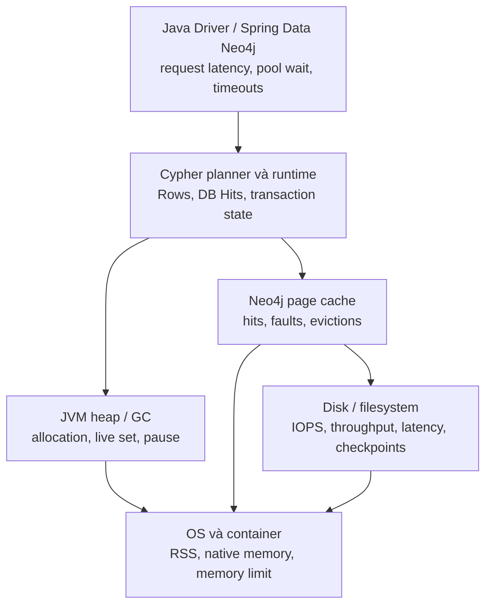
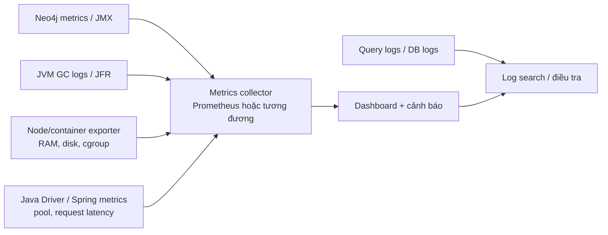

# Các chỉ số bộ nhớ, page cache, garbage collection và I/O trong Neo4j

Một ứng dụng Neo4j bắt đầu chậm không có nghĩa nguyên nhân luôn là câu Cypher hoặc thiếu index. Truy vấn tìm đúng node bằng index vẫn có thể chịu độ trễ lớn khi hệ thống phải đọc dữ liệu từ disk, JVM liên tục chạy garbage collection, bộ nhớ giao dịch bị giới hạn hoặc container sắp vượt memory limit. Ngược lại, một biểu đồ “RAM sử dụng 90%” chưa đủ để kết luận Neo4j đang thiếu bộ nhớ.

Bài thuộc chương **Giám sát** của module `DATABASE_ENGINE_GRAPH_NEO4J`. Module sử dụng Neo4j để mô hình hóa dữ liệu liên kết theo property graph, truy vấn node, relationship và đường đi bằng Cypher, tối ưu index/constraint, nhập dữ liệu và kết nối từ Neo4j Java Driver hoặc Spring Data Neo4j. Bài này giúp người học thiết kế và đọc các chỉ số **memory, page cache, JVM garbage collection (GC) và disk I/O**, liên kết chúng với tình trạng truy vấn và biết lúc nào cần điều chỉnh hệ thống.

Mục tiêu thực tế: biết **đo cái gì, ở đâu, theo khoảng thời gian nào, các chỉ số liên hệ với nhau ra sao và hành động nào nên làm trước**. Một dashboard tốt giúp tìm nguyên nhân và xác nhận hiệu quả sửa lỗi; nó không chỉ tô đỏ những con số vượt ngưỡng.

## 1. Quan sát Neo4j theo nhiều lớp

Neo4j vận hành trên JVM, lưu graph và index chủ yếu trong storage, dùng page cache riêng, và phục vụ truy vấn qua Bolt. Vì vậy, độ trễ của một request có thể đến từ nhiều lớp:



Một truy vấn có thể mất thời gian vì nhiều nguyên nhân đồng thời. Ví dụ:

- `MATCH` không dùng index phù hợp, làm tăng số node và relationship phải đọc.
- Page cache không có những trang dữ liệu cần thiết, khiến Neo4j thực hiện page fault và có thể phải đọc storage.
- `collect(path)` hoặc `ORDER BY` tạo nhiều dữ liệu trung gian, gây áp lực bộ nhớ giao dịch và heap.
- Garbage collector phải làm việc thường xuyên hơn; request chờ trong những đợt GC pause.
- Volume lưu database có độ trễ ghi cao khi transaction log hoặc checkpoint tạo áp lực I/O.
- Driver chờ kết nối từ connection pool hoặc client tiêu thụ kết quả quá chậm.

**Phân biệt ba nhóm bằng chứng:**

1. **Metrics:** chuỗi số theo thời gian, như heap used, page faults/giây, thời gian GC, disk read latency.
2. **Logs và sự kiện:** query log, lỗi transaction, `OutOfMemoryError`, container `OOMKilled`, log checkpoint, GC log.
3. **Truy vấn chẩn đoán:** `SHOW TRANSACTIONS`, `EXPLAIN`/`PROFILE`, xem cấu hình và thống kê database.

Không nên thay thế metrics bằng một lần chạy `PROFILE`, hoặc thay thế việc đo I/O bằng biểu đồ heap.

## 2. Trước khi đọc số liệu: phân biệt gauge, counter, rate và histogram

Các nguồn đo thường có những kiểu dữ liệu khác nhau:

| Kiểu chỉ số | Ví dụ | Cách đọc đúng |
| --- | --- | --- |
| **Gauge** | JVM heap đang dùng, dung lượng page cache đã cấp, số connection active | Giá trị tại một thời điểm; xem mức hiện tại, đỉnh và xu hướng |
| **Counter** | Tổng page hits, page faults, số lần GC, tổng byte disk read | Chỉ số tích lũy; xem **mức tăng theo thời gian** thay vì giá trị tuyệt đối |
| **Rate** | Page faults/giây, IOPS, byte đọc/giây | Lấy chênh lệch counter qua một cửa sổ quan sát |
| **Histogram / phân vị** | GC pause p95/p99, request latency p95/p99 | Phản ánh phân bố; trung bình thấp không có nghĩa không có đỉnh lớn |
| **Ratio** | Page cache hit ratio, heap used/max | Mẫu số và phạm vi đo phải rõ ràng |

Nếu counter tăng từ 120.000 lên 132.000 trong 60 giây:

\[
\text{Tốc độ sự kiện} =
\frac{132000 - 120000}{60} = 200\ \text{sự kiện/giây}
\]

Tổng counter lớn có thể chỉ vì server đã chạy lâu; **200 sự kiện/giây** mới cho biết tốc độ trong khoảng đo. Counter thường reset khi server restart, vì vậy khi tính rate phải xử lý reset thay vì coi chênh lệch âm là lưu lượng âm.

Một dashboard thường cần đồng thời **mức sử dụng, tốc độ thay đổi và độ trễ**. Ví dụ: page cache hit ratio, page fault rate và disk read latency; chỉ một trong ba chỉ số dễ dẫn tới kết luận thiếu cơ sở.

## 3. Bộ nhớ: bốn vùng phải theo dõi khác nhau

### 3.1. Sơ đồ bộ nhớ

```text
Giới hạn RAM host / container
│
├── Neo4j JVM heap
│   ├── Java objects, trạng thái thực thi Cypher
│   └── phần lớn bộ nhớ được theo dõi cho transaction
│
├── Neo4j page cache (native/off-heap)
│   └── trang dữ liệu graph và native indexes
│
├── Các vùng khác của tiến trình Neo4j
│   └── thread stacks, metaspace, direct buffers, native allocations
│
└── OS / cgroup / tiến trình và cache khác
    └── filesystem cache, index ngoài page cache, agents...
```

**Không cộng nguyên transaction memory limit vào heap như một vùng RAM độc lập.** Phần lớn trạng thái giao dịch nằm **trong heap**; transaction memory setting thường là giới hạn sử dụng được theo dõi, không phải vùng RAM đã được cấp sẵn. Một phần tác vụ có thể dùng off-heap nên vẫn phải dành ngân sách cho native memory.

Ví dụ máy hoặc container có giới hạn **32 GiB RAM** có thể bắt đầu thử với heap **8 GiB**, page cache **18 GiB**, và **6 GiB dự phòng** cho OS/native/vùng khác. Đây là một **kịch bản minh họa**, không phải tỷ lệ được khuyến nghị cho mọi tải. Workload full-text/vector, nhiều database, plugin hoặc nhiều truy vấn đồng thời có thể đòi cấu hình rất khác.

### 3.2. Bộ chỉ số memory cốt lõi

| Chỉ số logic | Nên vẽ gì? | Khi nào đáng nghi? |
| --- | --- | --- |
| JVM heap **used** | Giá trị và % của heap max | Sau nhiều lần GC, heap vẫn gần max |
| JVM heap **committed** và **max** | So với used, cùng trục thời gian | Heap thay đổi kích thước, phân bổ không đúng dự kiến |
| Heap **used sau GC** / live set | Xu hướng qua nhiều chu kỳ GC | Tăng liên tục dù workload ổn định, cần kiểm tra |
| Non-heap JVM | Metaspace, code cache, thread overhead khi exporter hỗ trợ | Native/JVM overhead tăng ngoài dự kiến |
| Neo4j page cache size/usage | Phần đã cấp và tỷ lệ sử dụng | Cache kín **kèm** page faults và I/O cao |
| Transaction allocated/estimated memory | Theo transaction/database/server khi được hỗ trợ | Truy vấn riêng hoặc tổng đồng thời chạm limit |
| Process **RSS** | Bộ nhớ resident của tiến trình | Gần giới hạn, có native growth khó giải thích |
| Container/cgroup memory | Dung lượng tính vào cgroup và memory limit | Sát limit, có sự kiện OOM kill |
| OS `MemAvailable`, swap | Khả năng cấp RAM và swap-in/out | Host thiếu headroom hoặc đang swap |

**Heap used khác RSS.** RSS có thể bao gồm heap, page cache native và các vùng khác của tiến trình. Container memory cũng không hoàn toàn đồng nghĩa RSS: cách cgroup tính page cache/file cache có thể khác báo cáo JVM. Vì vậy không cộng nhiều chỉ số chồng lấp rồi gọi là “tổng RAM đang dùng”.

### 3.3. Mẫu biểu đồ heap và GC cần đọc cùng nhau

Một dao động heap như răng cưa là bình thường:

```text
Heap used
  8 GiB ┤      /\       /\       /\
        │     /  \     /  \     /  \
  4 GiB ┤  __/    \___/    \___/    \__
        └───────────────────────────────→ thời gian
              GC        GC        GC
```

Heap tăng khi ứng dụng cấp phát object rồi giảm sau GC. Điều đáng nghi không phải mỗi đường tăng, mà là **đường đáy sau GC tăng dần**, GC diễn ra quá thường xuyên, pause quá dài hoặc heap sát max liên tục dưới workload không đổi.

**Ví dụ có tính suy luận:** nếu heap used trung bình là 7,5 GiB trên heap max 8 GiB nhưng sau full/major GC giảm về 2 GiB và latency bình thường, chưa đủ cơ sở tăng heap. Ngược lại, heap luôn còn 7,6 GiB sau GC và số lỗi transaction tăng là tín hiệu đáng điều tra.

### 3.4. Bộ nhớ giao dịch và truy vấn cụ thể

Các câu Cypher có thể làm transaction memory tăng:

```cypher
// Nếu mỗi người có quá nhiều kết nối, list có thể rất lớn.
MATCH (p:Person)-[:FOLLOWS]->(f:Person)
RETURN p.personId AS id,
       collect(f) AS allFollowers;
```

Nếu chỉ cần số người theo dõi:

```cypher
MATCH (p:Person)-[:FOLLOWS]->(f:Person)
RETURN p.personId AS id,
       count(f) AS followerCount;
```

Hai câu trả kết quả khác nhau; chỉ đổi nếu nghiệp vụ thật sự cần **count** thay vì danh sách node. Các toán tử `Sort`, `Aggregation`, `Expand` hoặc `CartesianProduct` gây nhiều hàng trung gian cũng có thể làm tăng lượng bộ nhớ dùng trong transaction.

Các tầng hạn mức thường gặp trong Neo4j hiện hành:

| Setting | Phạm vi |
| --- | --- |
| `dbms.memory.transaction.total.max` | Tổng transaction memory theo dõi trên toàn DBMS |
| `db.memory.transaction.total.max` | Tổng theo dõi trong một database |
| `db.memory.transaction.max` | Một transaction riêng |

Các limit **chồng lên nhau**, không phải ba vùng RAM độc lập. Lỗi “transaction memory limit reached” không tự động chứng minh JVM đã hết heap hoặc OS đã hết RAM; cần xem mức giới hạn, truy vấn và concurrency thực tế.

## 4. Page cache: các chỉ số phản ánh truy cập graph

Page cache là vùng native của Neo4j giữ những trang dữ liệu từ graph store và native indexes. Khi truy vấn cần một trang:

- **Page hit:** trang đã có trong page cache.
- **Page fault:** trang không có và phải được đưa vào cache; có thể dẫn tới đọc storage.
- **Eviction:** thay một trang khác khi cần chỗ; cache eviction cao trong một workload lặp có thể gợi ý working set vượt cache.
- **Flush/write:** trang đã thay đổi được ghi về storage theo cơ chế quản lý; hoạt động này có thể gây I/O.

### 4.1. Bốn số nên đặt cạnh nhau

| Chỉ số logic | Loại | Mục đích |
| --- | --- | --- |
| Page cache **hits** | Counter → hits/giây | Đo lượng truy cập được phục vụ từ cache |
| Page cache **faults** | Counter → faults/giây | Đo số trang không tìm thấy trong cache |
| Page cache **hit ratio** | Ratio | Xem tỷ lệ truy cập cache thành công |
| Page cache **evictions/flushes** | Counter → rate | Hiểu thay thế trang và áp lực ghi |

Công thức mô tả đơn giản:

\[
\text{Hit ratio} \approx
\frac{\text{hits}}{\text{hits}+\text{faults}}
\times 100\%
\]

Ví dụ trong một cửa sổ quan sát có **19.500 hits** và **500 faults**:

\[
\frac{19500}{19500+500}\times100\% = 97{,}5\%
\]

Đây là cách minh họa ý nghĩa tỷ lệ. Metric hit ratio của một phiên bản có thể sử dụng phương pháp tổng hợp/cửa sổ đo cụ thể; khi xây dashboard, nên ưu tiên **metric do Neo4j exporter cung cấp** hoặc xác nhận công thức phù hợp với loại counter đã thu thập.

**Không suy rằng 500 faults là đúng 500 lần đọc disk vật lý.** Một page fault ở lớp Neo4j có thể được hệ điều hành phục vụ từ filesystem cache tùy môi trường; muốn biết storage chịu tải bao nhiêu phải xem thêm **disk I/O**.

### 4.2. Hit ratio cao vẫn có thể chậm

Giả sử workload có 1.000.000 hits/giây và 10.000 faults/giây. Tỷ lệ hit vẫn khoảng **99%**, nhưng 10.000 faults mỗi giây có thể đáng kể nếu volume chậm. Do đó cần đọc **hit ratio + absolute fault rate + disk latency + request latency**.

Mặt khác, sau restart, page cache còn **lạnh**; faults cao trong một thời gian không nhất thiết là cấu hình sai. Chỉ kết luận thiếu cache sau khi quan sát đủ thời gian, tải ổn định và cache đã có cơ hội làm ấm.

Page cache thường đầy ở hệ thống đang hoạt động. **“Page cache usage gần 100%” tự nó không phải lỗi.** Cache được thiết kế để tận dụng bộ nhớ được cấp; vấn đề cần quan sát là tỷ lệ thay trang, faults, độ trễ và working set.

### 4.3. Những tình huống thường làm page faults tăng

- Khởi động lại database hoặc đổi member nhận truy vấn đọc.
- Một batch import/scan quét phạm vi lớn, đẩy dữ liệu truy cập thường xuyên ra khỏi cache.
- Đồ thị tăng kích thước hoặc workload đổi sang những vùng node/relationship khác.
- Truy vấn sai kế hoạch: label scan, mở rộng đường đi không giới hạn hoặc lọc quá muộn.
- Page cache nhỏ so với working set thường xuyên truy cập.
- Nhiều database cùng chia sẻ cache của một server.

Không phải mọi Lucene full-text hoặc vector index đều được giữ trong cùng Neo4j page cache; một số cấu trúc dựa thêm vào OS/native memory. Vì vậy việc tăng `server.memory.pagecache.size` có thể không xử lý được mọi độ trễ từ search index.

## 5. Garbage collection: đo áp lực heap và độ trễ tạm dừng

Java garbage collector (GC) thu hồi bộ nhớ của những object không còn được dùng. Trong Neo4j, các truy vấn tạo nhiều hàng, danh sách, đường đi hoặc object có thể làm tốc độ cấp phát tăng. GC là hoạt động bình thường, nhưng pause và chi phí GC cao có thể ảnh hưởng request latency.

### 5.1. Những tín hiệu GC cần theo dõi

| Chỉ số | Cần quan sát |
| --- | --- |
| **Số lần GC** | Mức tăng theo phút, so với throughput query |
| **Tổng thời gian GC** | Số giây GC trong khoảng quan sát |
| **Thời lượng mỗi pause** | Phân bố p50/p95/p99/max nếu có |
| **Heap sau GC** | Có quay về mức nền không, hay tăng dần |
| **Allocation rate** | Tốc độ object được cấp phát, nếu metric/JFR hỗ trợ |
| **GC cause** | Young/old/mixed/concurrent/explicit GC tùy bộ thu gom |
| **JVM process CPU** | GC chiếm bao nhiêu tài nguyên so với thực thi query |

Có thể định nghĩa tỷ lệ chi phí GC sơ bộ trong một khoảng:

\[
\text{GC time fraction} =
\frac{\text{thời gian GC trong khoảng}}{\text{độ dài khoảng quan sát}}
\]

Ví dụ tổng thời gian tạm dừng stop-the-world là **12 giây trong 5 phút**, thì tổng pause chiếm khoảng **4% wall-clock**. Tuy nhiên, **không lấy thời gian các pha concurrent GC cộng trực tiếp thành tỷ lệ downtime**. Cần xem loại collector và đúng metric pause khi liên hệ với thời gian dừng phục vụ.

### 5.2. Đọc cùng p95/p99 latency

Nếu p99 request latency tăng từ 150 ms lên 1.200 ms đúng lúc GC pause có đỉnh khoảng 900 ms, đó là một **giả thuyết đáng kiểm tra**. Nhưng chưa thể kết luận quan hệ nhân quả từ hai đường biểu đồ trùng nhau: có thể cùng lúc disk I/O, CPU hoặc connection pool cũng quá tải.

Khi GC dày, nên xem trước:

1. Query nào tạo nhiều kết quả trung gian hoặc `collect()` lớn?
2. Batch `UNWIND`/import có quá rộng không?
3. Số transaction đồng thời có tăng đột biến không?
4. Heap sau GC có cao sát max không?
5. JVM và collector đang dùng có phù hợp phiên bản Neo4j không?
6. Có Java Driver/Spring client giữ result/session quá lâu hay ứng dụng tải hàng triệu record không?

**Không tự điều chỉnh các tham số GC nâng cao** chỉ từ một biểu đồ. Neo4j/JDK có những mặc định được kiểm thử theo phiên bản; một thay đổi GC cần thử trong staging, xem GC logs và đánh giá p95/p99.

### 5.3. Các dấu hiệu lỗi khác nhau

- **`java.lang.OutOfMemoryError: Java heap space`:** JVM không cấp được heap; xem query state, live set, heap max.
- **Transaction memory limit exceeded:** một hoặc nhiều giao dịch chạm hạn mức theo dõi; không nhất thiết toàn heap đã đầy.
- **Container `OOMKilled`:** cgroup/kernel chấm dứt tiến trình vì tổng bộ nhớ container; có thể xảy ra mà **không** có Java OOME.
- **GC pause cao nhưng heap không sát trần:** có thể do allocation burst, collector settings hoặc workload ngắn hạn; cần xem GC cause/log.

Các dấu hiệu này cần **hướng điều tra khác nhau**, không được gộp tất cả thành “thiếu RAM”.

## 6. I/O: storage đọc/ghi, transaction log và checkpoint

Neo4j cần I/O để truy cập dữ liệu ngoài cache, ghi transaction log, flush dirty pages, checkpoint và hỗ trợ backup/index maintenance. Vì vậy I/O **không chỉ xuất hiện khi page cache miss**.

### 6.1. Nhóm chỉ số disk

| Chỉ số OS/storage | Đơn vị thường gặp | Để trả lời câu hỏi |
| --- | --- | --- |
| Read IOPS | Reads/giây | Bao nhiêu thao tác đọc đang diễn ra? |
| Write IOPS | Writes/giây | Bao nhiêu thao tác ghi đang diễn ra? |
| Read/write throughput | MiB/giây | Tổng băng thông I/O lớn hay nhỏ? |
| Read/write latency | ms/op | Mỗi thao tác bị chậm bao lâu? |
| Queue depth / await | Số yêu cầu / ms | Có I/O xếp hàng, chờ storage không? |
| Disk utilization / busy time | % theo công cụ | Thiết bị có bận trong phần lớn thời gian không? |
| Filesystem free space | GiB/% | Có nguy cơ đầy disk, thiếu chỗ cho log/checkpoint không? |
| Filesystem errors | Sự kiện | Có read-only mount, lỗi volume, retry hoặc mất kết nối storage không? |

Các thông số của `iostat`, cloud block storage, SAN/NVMe hoặc container overlay filesystem **không hoàn toàn đồng nghĩa**. Ví dụ `%util` gần 100% trên một loại thiết bị không tự chứng minh giới hạn hiệu năng tuyệt đối của SSD/NVMe có nhiều hàng đợi. Hãy kiểm tra **latency và throughput thực tế so với năng lực storage**.

### 6.2. Vì sao có page hit ratio cao mà write I/O vẫn cao?

Transaction ghi vẫn tạo log và làm thay đổi trang dữ liệu; dirty pages cần được flush/checkpoint. Vì vậy hệ thống có thể:

- Page cache hits nhiều, faults ít.
- Disk **writes/giây cao** vì ứng dụng đang import/update.
- Checkpoint gây burst ghi ở những thời điểm nhất định.
- Độ trễ transaction tăng do log flush hoặc storage saturation.

Do đó không thể chẩn đoán vấn đề **ghi** chỉ bằng page cache hit ratio. Với write-heavy workload phải xem commit latency, checkpoint activity, log volume, disk write await và mức đồng thời.

### 6.3. Phân biệt fault và I/O thực

```text
Cypher cần một trang dữ liệu
  │
  ├── Page hit: đã có trong Neo4j page cache
  │
  └── Page fault: Neo4j page cache chưa có
         │
         ├── OS/filesystem cache có thể đã có dữ liệu
         └── Hoặc cần đọc thực tế từ storage
                        │
                        ▼
                  Disk I/O latency
```

Nếu faults tăng nhưng disk reads không tăng tương ứng, có thể có cache phía OS hoặc hiệu ứng khác của phép đo. Nếu disk reads tăng mà page faults ít, cần xét transaction logs, backup, các file/index ngoài Neo4j page cache hoặc tiến trình khác cùng volume.

**Không dùng một nguồn đo làm bằng chứng duy nhất.** Phải xác định volume nào chứa data, transaction logs, index và backup; các vị trí storage khác nhau có thể tạo tình trạng nghẽn khác nhau.

## 7. Nguồn thu thập: Neo4j metrics, JVM, OS và client

Một hệ thống giám sát thực tế thường kết hợp nhiều exporter:



### 7.1. Xác minh các setting đã cấu hình

Trên Neo4j server phù hợp, có thể xem cấu hình tài nguyên:

```cypher
SHOW SETTINGS
YIELD name, value
WHERE name IN [
  'server.memory.heap.initial_size',
  'server.memory.heap.max_size',
  'server.memory.pagecache.size',
  'dbms.memory.transaction.total.max',
  'db.memory.transaction.total.max',
  'db.memory.transaction.max'
]
RETURN name, value
ORDER BY name;
```

Đây là truy vấn đọc; kết quả/đặc quyền có thể khác theo Neo4j version/edition. Giá trị cấu hình không đồng nghĩa **giá trị đang sử dụng**: heap max 8 GiB không có nghĩa JVM đang dùng 8 GiB.

Có thể xem thông tin pool memory khi server hỗ trợ và tài khoản có quyền:

```cypher
CALL dbms.listPools();
```

Các cột, pool và ý nghĩa từng số liệu cần đối chiếu tài liệu cho đúng bản Neo4j. Không nên cố gắng cộng tất cả pool như những vùng không chồng lấp.

### 7.2. Xem transaction gây áp lực heap

Ví dụ truy vấn chẩn đoán:

```cypher
SHOW TRANSACTIONS
YIELD database, transactionId, estimatedUsedHeapMemory
RETURN database,
       transactionId,
       estimatedUsedHeapMemory
ORDER BY estimatedUsedHeapMemory DESC;
```

`estimatedUsedHeapMemory` là **số ước lượng**, không phải lượng RSS chính xác. Có thể thấy chính giao dịch giám sát trong kết quả. Tùy phiên bản/cấu hình, chỉ số có thể không có hoặc yêu cầu quyền quản trị; không nên viết automation dựa trên tên cột trước khi xác minh server thực tế.

Nếu thấy một transaction dùng nhiều memory, điều tra query và operator trên môi trường phù hợp; **không tự động terminate transaction** chỉ vì vượt một ngưỡng tùy ý.

### 7.3. Thu metrics ra Prometheus

Các phiên bản/edition Neo4j hỗ trợ xuất metrics có thể cung cấp endpoint cho Prometheus. Ví dụ **mẫu cấu hình cần đối chiếu tài liệu bản đang chạy** trong `neo4j.conf`:

```properties
# Chỉ là ví dụ trên host dev; kiểm tra edition/version trước.
server.metrics.enabled=true
server.metrics.prometheus.enabled=true
server.metrics.prometheus.endpoint=127.0.0.1:2004
```

- Ràng endpoint về **localhost** trong ví dụ để tránh vô tình công khai chỉ số vận hành ra Internet.
- Nếu Prometheus chạy máy khác, dùng agent/proxy hoặc cấu hình network và xác thực phù hợp theo thiết kế bảo mật.
- Cổng, tên khóa và khả năng exporter có thể thay đổi theo release/edition; xác minh thông qua tài liệu Operations Manual và config thực tế.
- **Không đoán tên time series** từ tên metric trong bài. Xem endpoint `/metrics`/metric catalog đúng phiên bản, rồi xây dashboard trên những series thật sự được export.

Chỉ số theo **database**, **server/member** hoặc **DBMS** có các phạm vi khác nhau. Một số metric chỉ có ở edition nhất định; thiếu time series có thể là **không được export**, không phải đo được giá trị 0.

### 7.4. Công cụ ở Linux/container

Các lệnh chỉ đọc, chạy trên đúng host/container khi có quyền:

```bash
# JVM/host tổng quan
free -h
vmstat 1

# Thông số đọc/ghi trên từng thiết bị (cần sysstat)
iostat -xz 1

# Theo tiến trình Neo4j; thay PID bằng PID thực tế
pidstat -r -u -d -p 12345 1

# Cgroup v2: nếu file tồn tại trong môi trường
cat /sys/fs/cgroup/memory.current
cat /sys/fs/cgroup/memory.max
cat /sys/fs/cgroup/memory.events
```

Không phải mọi môi trường Windows, Docker hoặc Kubernetes có sẵn các công cụ này. `free -h` trong container đôi khi phản ánh host hơn là cgroup limit; hãy đối chiếu với metrics cgroup/Kubernetes. PID trong ví dụ là giá trị minh họa, không phải một PID thực cần áp dụng.

Dữ liệu phía OS còn giúp xác định **swap activity**, filesystem saturation, OOM events và memory headroom — những điều không thể suy ra trực tiếp từ heap used.

## 8. Dashboard tối thiểu cho hệ thống Neo4j

Đề xuất bốn nhóm panel chính và một nhóm tác động người dùng:

| Nhóm dashboard | Panel nên có | Mục tiêu |
| --- | --- | --- |
| **Memory** | Heap used/max, heap after GC, RSS/cgroup memory/max, transaction memory | Phát hiện thiếu heap hoặc headroom |
| **Page cache** | Hit ratio, hits/s, faults/s, evictions/s, cache size/usage | Phân biệt cache bình thường và thrashing |
| **GC** | GC time/rate, pause p95/p99/max, allocation rate nếu có | Liên hệ JVM pauses với độ trễ |
| **I/O** | Read/write IOPS, throughput, await/latency, queue, free disk | Phát hiện storage bottleneck |
| **Ứng dụng và query** | Query throughput, p95/p99 latency, timeouts, transaction errors, Driver pool wait | Thấy hệ quả thực tế của sự cố |

Mỗi panel nên có:

- **Trục thời gian đồng nhất** giữa các nguồn, ví dụ 1 giờ, 6 giờ, 24 giờ.
- **Nhãn instance/server, database và role** khi dữ liệu hỗ trợ; không trộn metric của nhiều cluster vào cùng một tỷ lệ.
- **Đơn vị rõ ràng:** byte, MiB/GiB, requests/s, page faults/s, ms, %.
- **Rate theo khoảng đủ dài** để loại bớt nhiễu nhưng không làm mất spike quan trọng.
- **Marker khi triển khai/restart/import/backup** để người trực hiểu sự kiện thay đổi tải.
- **Baseline của giờ cao điểm** và SLO để phân biệt hoạt động bình thường với suy giảm.

Hạn chế label cardinality cao: không dùng `queryText`, ID giao dịch, `personId` hoặc giá trị parameter làm label của time series cho mỗi request. Vừa tốn hệ thống metrics, vừa có thể làm lộ thông tin nghiệp vụ hoặc cá nhân.

### 8.1. Cảnh báo theo bằng chứng kết hợp

| Giả thuyết | Điều kiện cảnh báo minh họa | Hành động ưu tiên |
| --- | --- | --- |
| Heap pressure | Heap sau GC cao kéo dài, GC pause tăng **và** p95/p99 query xấu đi | Xem allocation, query state, concurrency |
| Cache thiếu working set | Faults/s hoặc evictions/s tăng kéo dài **và** disk read latency/IOPS cao | Kiểm tra scan, hot set, page cache budget |
| Vấn đề native/container | Cgroup memory sát limit, OOM events tăng dù heap chưa đầy | Kiểm tra page cache, native RSS, OS headroom |
| Storage bottleneck | Disk await và queue tăng, query/commit latency tăng | Kiểm tra volume, I/O batch, checkpoint |
| Transaction bất thường | Bộ nhớ transaction gần limit, lỗi transaction tăng | Xem query, `collect`, sort, batch size |
| GC pause ảnh hưởng người dùng | GC pause p99 vượt budget latency và trùng spike request | GC logs, heap live set, JVM config |

Các ngưỡng % trong thực tế phải dựa trên **đường nền và SLO**. Ví dụ `heap used > 85%` trong một phút **không tự chứng minh có vấn đề** nếu ngay sau GC lại giảm thấp và response ổn. Tương tự, page cache hit ratio dưới 98% không phải một quy tắc cảnh báo chung cho mọi workload.

## 9. Ví dụ điều tra: đọc các chỉ số cùng một thời điểm

Giả sử hệ thống có 32 GiB RAM, heap max 8 GiB, page cache 18 GiB. Một dashboard cho hai khoảng tải:

| Chỉ số | Buổi sáng ổn định | Khi chậm lúc 14:00 |
| --- | ---: | ---: |
| API p95 latency | 90 ms | 850 ms |
| Page faults/s | 120 | 8.000 |
| Page cache hit ratio | 99,8% | 94,0% |
| Disk read await | 3 ms | 65 ms |
| Heap used sau GC | 3,0 GiB | 3,2 GiB |
| GC pause p99 | 18 ms | 22 ms |
| Read IOPS | 300 | 5.500 |

Dữ liệu này là **giả định để tập phân tích**, không phải số đo từ một Neo4j server cụ thể.

Diễn giải hợp lý:

1. **Có suy giảm rõ:** API p95 tăng khoảng 9 lần.
2. **Page faults tăng mạnh:** nhiều trang graph không được tìm thấy trong Neo4j page cache.
3. **Disk read latency tăng mạnh:** storage chịu áp lực hoặc bị nghẽn khi cần đọc.
4. **Heap sau GC và GC pause gần như ổn:** không có bằng chứng nổi bật cho giả thuyết GC là nguyên nhân chính.
5. **Cần kiểm tra thêm:** có query quét rộng mới triển khai lúc 14:00 không? Có import/backup làm thay đổi working set hoặc cùng dùng volume không? Page cache có vừa cold sau restart không?

**Không kết luận ngay “tăng page cache”.** Nếu nguyên nhân là một câu Cypher thiếu index và quét toàn graph, sửa query có thể hiệu quả hơn và tránh tăng phần bộ nhớ cấp phát cố định.

Một cách xử lý:

- Xác minh thời điểm deploy, restart, backup, import.
- Đối chiếu query log và `EXPLAIN`/`PROFILE` của truy vấn đọc nghi vấn trong môi trường được phép.
- Xem index, cardinality, hướng relationship, `Sort`/`Aggregation` và số hàng trung gian.
- Kiểm tra IO của **đúng volume** chứa data/index.
- Nếu query hợp lý nhưng working set tăng bền vững, cân nhắc tăng page cache trong ngân sách RAM, rồi đo lại fault rate và p95 latency.

## 10. Bốn runbook sự cố thường gặp

### 10.1. Heap tăng và GC pause cao

**Triệu chứng:** request timeout nhiều hơn, heap sau GC liên tục tăng, pause p95/p99 tăng, transaction memory cao.

**Các bước:**

1. Xem heap max và heap used sau GC cùng thời gian.
2. Xác định query/batch import trùng thời điểm spike.
3. Kiểm tra truy vấn có `collect(path)`, `ORDER BY` quá rộng, `UNWIND` batch lớn hoặc nhiều đường đi không giới hạn.
4. Chạy `EXPLAIN` trước, `PROFILE` có kiểm soát trên truy vấn đọc hoặc staging.
5. Giới hạn dữ liệu trung gian, chia batch, giảm concurrency nếu cần.
6. Chỉ tính tăng heap nếu workload hợp lệ vẫn thiếu và còn OS/native headroom; so GC/latency trước và sau.

**Tránh:** tăng page cache như một cách sửa GC; xóa hết transaction limits; chỉnh JVM GC flags tùy tiện trên production.

### 10.2. Page faults tăng kèm disk reads

**Triệu chứng:** hit ratio giảm hoặc faults/s tăng, disk read await cao, heap/GC bình thường.

**Các bước:**

1. Xem database/member vừa restart hay được chuyển tải không.
2. Xác nhận các query đang chạy và kế hoạch: scan/index/expand.
3. Quan sát faults, evictions, read IOPS và await **qua cùng cửa sổ thời gian**.
4. Ước lượng working set và dung lượng native data/index thường dùng.
5. Tối ưu truy vấn trước, rồi đánh giá kích thước page cache nếu có memory headroom.
6. Đo hiệu quả khi cache đã ấm, không chỉ trong 30 giây đầu.

**Tránh:** coi page cache usage 100% là sự cố; suy mỗi fault là một lần đọc disk vật lý.

### 10.3. Kubernetes OOMKilled nhưng heap không đầy

**Triệu chứng:** Neo4j pod restart, `reason: OOMKilled`, GC log không có Java heap OOME.

**Các bước:**

1. Lấy `memory limit` của pod/container và sự kiện cgroup OOM.
2. So cấu hình heap max + page cache với limit; tính headroom.
3. Xem RSS, cgroup memory.current, page cache, native allocations, JVM overhead và search/vector index memory.
4. Xem workload/import/concurrency ở thời điểm kill.
5. Có thể cần **giảm** heap/page cache, giảm tải hoặc tăng limit phù hợp — không mặc định tăng heap.
6. Thử lại bằng load test và theo dõi thời gian dài.

**Tránh:** chỉ theo dõi `heap_used / heap_max` mà không có OS/container memory panel.

### 10.4. Ghi chậm đúng lúc checkpoint hoặc import

**Triệu chứng:** nhiều transaction `MERGE` chậm, write IOPS/latency cao, page cache hit ratio vẫn tốt.

**Các bước:**

1. Xem transaction log/checkpoint activity, backup, compaction/index maintenance và volume chịu tải.
2. Kiểm tra write throughput, disk await, queue, fsync/commit latency nếu được thu thập.
3. Đánh giá batch size, số writer đồng thời, index/constraint và số property/relationship cập nhật.
4. Giảm concurrency hoặc chia lô khi workload tạo burst quá mạnh.
5. Kiểm tra khả năng IOPS/băng thông/dung lượng và storage provisioning.
6. Đo lại throughput lẫn p95 commit latency; đừng chỉ tối đa hóa số bản ghi/giây.

**Tránh:** tăng heap khi bottleneck nằm ở durable writes hoặc throughput của volume.

## 11. Kết nối các chỉ số với EXPLAIN và PROFILE

Metrics trả lời **hệ thống đang có biểu hiện gì**; `EXPLAIN`/`PROFILE` giúp trả lời **truy vấn nào tạo biểu hiện đó**.

Ví dụ một truy vấn duyệt quan hệ có thể tạo rất nhiều hàng:

```cypher
EXPLAIN
MATCH (p:Person)-[:FOLLOWS*1..3]->(f:Person)
RETURN p.personId AS id,
       count(DISTINCT f) AS reachable;
```

Với Cypher 5, cú pháp quan hệ biến độ dài `*1..3` được dùng rộng rãi; với Cypher 25, cần xem cách viết quantified patterns tương ứng. `EXPLAIN` **không chạy** query, nên thích hợp để xem plan ban đầu.

Khi đã bảo đảm truy vấn **chỉ đọc** và môi trường cho phép đo:

```cypher
PROFILE
MATCH (p:Person)-[:FOLLOWS*1..3]->(f:Person)
RETURN p.personId AS id,
       count(DISTINCT f) AS reachable;
```

Trong plan, quan sát các operator `Expand`, `Filter`, `Aggregation`, `Sort`, `Rows` và `DB Hits`. Nếu một bước mở rộng nhân 10.000 hàng thành 1.000.000 hàng rồi tổng hợp về 50 hàng, đó là ứng viên đáng xét để giảm transaction memory và I/O.

**Giới hạn của PROFILE:** nó đo hoạt động trong database theo thông tin runtime cung cấp; không trực tiếp đo toàn bộ chi phí serializing payload, Java Driver network round trips hoặc latency render. `PROFILE` trên truy vấn **ghi** vẫn thực sự ghi dữ liệu. Không chạy `PROFILE DELETE` hay `PROFILE CREATE` trên production chỉ để “xem thử”.

Khi một query mới được tối ưu, hãy so các chỉ số theo workload đại diện:

- Correctness: kết quả nghiệp vụ vẫn đúng.
- Query metrics: Rows, DB Hits, operator và độ trễ.
- Server metrics: page fault rate, heap/GC, transaction memory, disk I/O.
- Client metrics: p95/p99 request latency và số timeout.

## 12. Sai lầm khi diễn giải biểu đồ

| Kết luận sai | Vì sao sai | Cách đọc đúng |
| --- | --- | --- |
| “Heap used 90% nghĩa là Neo4j sắp OOM.” | Heap được phép tăng trước GC | Xem heap sau GC, GC pauses, max và lỗi |
| “RSS cao là JVM heap cao.” | RSS bao gồm native/page cache và vùng khác | Tách heap, page cache, native, cgroup |
| “Transaction limit 4 GiB cộng thêm ngoài 8 GiB heap.” | Phần lớn transaction state nằm trong heap | Hiểu các giới hạn chồng lấp |
| “Page cache đầy 100% nghĩa là hết RAM.” | Cache được thiết kế tận dụng phần đã cấp | Xem faults/evictions/latency |
| “99% hits chắc chắn ổn.” | 1% faults trên lưu lượng cực lớn vẫn đáng kể | Xem faults/s và disk read await |
| “Mỗi page fault là một disk read.” | OS filesystem cache có thể phục vụ | Đối chiếu disk I/O thật |
| “GC count tăng là JVM lỗi.” | GC là hoạt động bình thường | Xem pause, live set, latency, allocation |
| “Không thấy Java OOME thì không thể OOM.” | Container có thể bị kernel/cgroup kill | Xem OOMKilled và memory events |
| “Disk utilization 100% chắc chắn đĩa đạt IOPS tối đa.” | Phụ thuộc thiết bị và cách tính metric | Xem await, queue, throughput, giới hạn volume |
| “Counter tăng liên tục là bất thường.” | Counter vốn tích lũy theo thời gian | Dùng rate và xử lý reset |
| “Dashboard trung bình cluster xanh là mọi member khỏe.” | Một member có thể nóng hơn hẳn | Xem từng member và database |
| “Có metrics là không cần query log/PROFILE.” | Metrics không chỉ ra chính xác logic truy vấn | Kết hợp logs, plans và metrics |

## 13. Bài tập áp dụng

**Bài 1 — Phân biệt counter và rate.** Page faults counter tăng từ 600.000 lên 618.000 trong 3 phút. Tính faults/giây; giải thích tại sao không dùng giá trị 618.000 làm ngưỡng cảnh báo.

**Bài 2 — Hit ratio.** Trong một khoảng có 97.000 hits và 3.000 faults. Hit ratio minh họa là bao nhiêu? Nếu disk read latency cao, chỉ số này có đủ để kết luận page cache thiếu không?

**Bài 3 — Memory budget.** Container limit 16 GiB, heap max 8 GiB và page cache 8 GiB. Vì sao cấu hình này rủi ro dù tổng vừa bằng limit?

**Bài 4 — GC.** P99 request latency tăng cùng lúc GC pauses tăng, nhưng heap sau GC thường giảm về mức nền. Nêu ít nhất ba giả thuyết ngoài “thiếu heap”.

**Bài 5 — I/O.** Một batch import tạo write IOPS và disk await cao, page cache hit ratio vẫn 99%. Nêu lý do hợp lý và cách xác nhận bằng metrics/logs.

**Bài 6 — Đọc đa chỉ số.** Page faults/s tăng, disk await tăng, GC pause gần như không đổi. Nên kiểm tra query plan, page cache hay GC trước? Tại sao?

**Bài 7 — Counter reset.** Server restart giữa hai mẫu counter, mẫu sau thấp hơn mẫu trước. Dashboard phải xử lý thế nào để không hiện một giá trị rate âm vô nghĩa?

**Đáp án gợi ý:** (1) `18000 / 180 = 100 faults/s`; counter là số tích lũy. (2) `97%`; cần xem fault rate, workload và I/O. (3) Không còn chỗ cho native/OS/JVM overhead. (4) Allocation burst, collector pause, CPU contention, workload đồng thời hoặc disk bottleneck. (5) Transaction log/checkpoint/dirty-page flush, xem disk writes/commit latency. (6) Trước hết xem truy vấn và page cache/storage vì các tín hiệu này cùng thay đổi. (7) Dùng hàm rate có xử lý counter reset hoặc bắt đầu cửa sổ tính mới.

## 14. Quy trình áp dụng vào môi trường thực tế

Một triển khai giám sát Neo4j nên theo thứ tự:

1. **Xác định đối tượng đo:** instance/server, database, member role, cluster, container, volume và client application.
2. **Chốt phiên bản và edition:** metric names, exporter, JMX, cấu hình và quyền có thể khác; không copy dashboard chưa kiểm chứng.
3. **Thu bốn nhóm cốt lõi:** heap/transaction/native, page cache, GC, disk I/O; đồng bộ nhãn và đồng hồ.
4. **Thu tác động nghiệp vụ:** QPS, request p95/p99, error/timeout, retry và Driver pool wait.
5. **Lập baseline:** giờ cao điểm, batch import, backup, sau restart và giai đoạn ổn định.
6. **Đặt cảnh báo theo tương quan:** nhiều tín hiệu suy giảm kéo dài, không chỉ % heap hoặc page cache.
7. **Viết runbook:** mỗi cảnh báo phải dẫn tới kiểm tra logs, query plan, cấu hình, OS/container và hành động rollback.
8. **Thử mô phỏng trong staging:** query tạo nhiều hàng, cache lạnh, batch ghi, tăng concurrency; xác nhận dashboard thực sự phản ánh hiện tượng.
9. **Đánh giá định kỳ:** sau nâng Neo4j/JDK, đổi storage, thêm index, tăng graph, thêm workload APOC/GDS hoặc thay chế độ routing.
10. **Bảo vệ dữ liệu giám sát:** kiểm soát quyền truy cập exporter/log; tránh đưa mật khẩu, query parameter nhạy cảm hoặc ID cá nhân vào label.

## 15. Tài liệu tham khảo

- [Neo4j Operations Manual — Essential metrics](https://neo4j.com/docs/operations-manual/current/monitoring/metrics/essential/): các chỉ số quan trọng để vận hành.
- [Neo4j Operations Manual — Metrics](https://neo4j.com/docs/operations-manual/current/monitoring/metrics/): bộ chỉ số và cơ chế xuất metrics theo phiên bản/edition.
- [Neo4j Operations Manual — Memory configuration](https://neo4j.com/docs/operations-manual/current/performance/memory-configuration/): heap, page cache, transaction memory và headroom.
- [Neo4j Operations Manual — Show and terminate transactions](https://neo4j.com/docs/operations-manual/current/database-internals/show-and-terminate-transactions/): xem memory theo transaction và quyền truy cập.
- [Neo4j Cypher Manual — Execution plans](https://neo4j.com/docs/cypher-manual/current/planning-and-tuning/execution-plans/): EXPLAIN, PROFILE, Rows và DB Hits.
- [Prometheus — Metric types](https://prometheus.io/docs/concepts/metric_types/): gauge, counter, histogram và ý nghĩa khi lấy rate.

**Ghi nhớ:** hãy đọc **heap + transaction memory + RSS/cgroup**, **page cache hit/fault/eviction**, **GC pause và live set**, **disk I/O latency/throughput**, rồi đặt tất cả cạnh **độ trễ truy vấn và lỗi ứng dụng**. Một chỉ số riêng lẻ hiếm khi chứng minh nguyên nhân. Giám sát đúng giúp biết nên **tối ưu Cypher, điều chỉnh bộ nhớ, xử lý storage hay giảm tải**, và đo được hiệu quả sau thay đổi.
