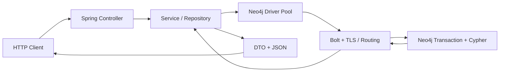
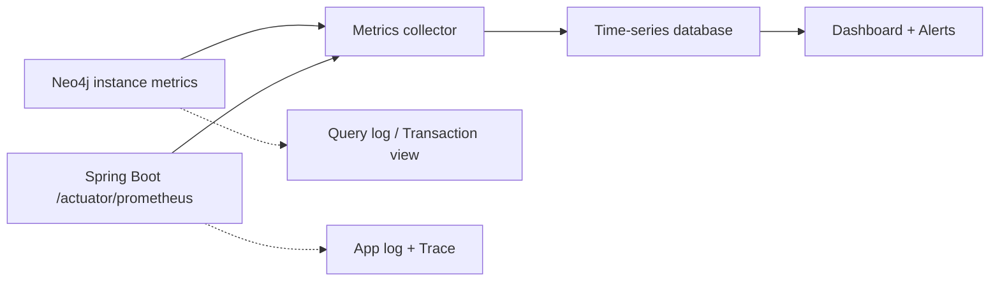

# Kết hợp số liệu máy chủ với connection pool và độ trễ phía ứng dụng trong Neo4j

## 1. Vì sao phải quan sát nhiều tầng?

Neo4j lưu dữ liệu theo mô hình **property graph**: ứng dụng truy vấn node, relationship, property và đường đi bằng **Cypher**. Một API đọc 20 sản phẩm hoặc duyệt đường đi qua 3 hop có thể chậm vì rất nhiều nguyên nhân khác nhau: truy vấn phải quét nhiều node, thiếu index trên khóa nghiệp vụ, transaction chờ lock, JVM máy chủ đang GC, connection pool của ứng dụng đã hết kết nối, mạng tới cluster bị chậm hoặc thời gian chuyển JSON quá lớn.

Nếu chỉ xem CPU máy chủ Neo4j, ta có thể bỏ sót việc ứng dụng **chờ lấy kết nối**. Nếu chỉ xem thời gian xử lý HTTP, ta có thể kết luận nhầm rằng Cypher chậm, dù phần lớn thời gian đang dành cho mã Java hoặc serialization.

Bài thuộc chương **Giám sát** của mô-đun `DATABASE_ENGINE_GRAPH_NEO4J`. Trọng tâm là xây dựng **quan sát xuyên tầng** (*end-to-end observability*): liên hệ số liệu máy chủ Neo4j với pool của **Neo4j Java Driver**, độ trễ của **Spring Boot/Spring Data Neo4j** và trải nghiệm thực tế của API.

Sau bài học, bạn có thể:

1. Vẽ một luồng request từ HTTP tới Neo4j và xác định thời gian nào được đo ở tầng nào.
2. Chọn các metric cần có ở máy chủ, driver/pool, Cypher/transaction và ứng dụng.
3. Dùng Micrometer/Actuator, Prometheus hoặc một hệ giám sát tương đương để quan sát độ trễ theo operation.
4. Tính throughput, error rate, p95/p99, saturation và phân biệt counter, gauge, histogram.
5. Điều tra các tình huống chậm do **pool**, **server**, **lock**, **fan-out graph**, **network** hay **serialization**.
6. Thiết kế dashboard, alert và quy trình xử lý sự cố mà không làm lộ secret, PII hoặc tạo nhãn metric có cardinality quá lớn.

> **Phiên bản:** Ví dụ hướng đến Neo4j 5.x, Java Driver 5.x, Spring Boot 3.x và Micrometer tương ứng. Tên metric máy chủ, tùy chọn exporter, giấy phép, khả năng driver metrics và danh sách cột quản trị có thể khác theo phiên bản/edition hoặc dịch vụ quản lý như **Neo4j Aura**. Hãy xem catalog metric của phiên bản đang vận hành; những tên metric ứng dụng trong bài là **metric do ta tự định nghĩa**, không phải cam kết rằng Neo4j sẽ tự phát chúng.

## 2. Bản đồ thời gian của một yêu cầu

Một request thường đi qua các lớp:



Các khoảng thời gian có thể đặt tên như sau:

| Khoảng đo | Điểm bắt đầu và kết thúc | Chứa những công việc nào? |
| --- | --- | --- |
| `http.duration` | Nhận request → gửi xong response theo cách framework đo | Controller, service, database, serialization và có thể một phần network của server |
| `graph.operation.duration` | Service chuẩn bị gọi Neo4j → nhận DTO/records cần thiết | Chờ pool, transaction, Bolt, Cypher, retry và ánh xạ record tùy vị trí đặt timer |
| `pool.acquire.duration` | Yêu cầu connection → được cấp connection | Chờ connection khả dụng; **không phải** thời gian chạy truy vấn |
| `bolt.network.duration` | Gửi/nhận thông điệp qua Bolt | Round trip, routing, TLS và truyền kết quả; cần công cụ/trace phù hợp để tách chính xác |
| `transaction.duration` | Bắt đầu → commit/rollback | Cypher, chờ lock, server execution và các khoảng tương tác client trong transaction |
| `server.query.duration` | Neo4j theo dõi một câu truy vấn | Xử lý truy vấn phía server theo định nghĩa metric/log của phiên bản |
| `json.serialization.duration` | Chuyển DTO → JSON | Mapping/truyền dữ liệu của API, không nhất thiết liên quan tới Neo4j |

**Không cộng tất cả những con số trên với nhau.** `http.duration` thường đã **bao gồm** phần lớn `graph.operation.duration`; transaction và query cũng có thể nằm trong nhau. Chúng là các phép đo **lồng nhau** hoặc có phạm vi chồng lấn, không phải các đoạn độc lập luôn cộng được.

Ví dụ minh họa:

```text
HTTP tổng:                         420 ms
  Java validation / xử lý khác:     20 ms
  Gọi graph service:               330 ms
    chờ connection pool:           180 ms
    giao tiếp + transaction:       130 ms
    chuyển Record thành DTO:        20 ms
  xây JSON và trả response:         70 ms
```

Ví dụ trên dùng các đoạn **được phân rã có chủ đích** nên tổng khớp 420 ms. Nếu chỉ có metric `graph.operation.duration = 330 ms`, không được khẳng định server Neo4j đã thực thi Cypher trong 330 ms: trong ví dụ, **180 ms** đã mất ở pool.

### 2.1. Đặt tên cho cùng một thao tác ở nhiều lớp

Giả sử API `GET /products` phục vụ danh sách 20 node `:Product`. Ở các hệ đo, thống nhất một tên operation có cardinality thấp:

```text
operation = "products.list"
database  = "neo4j"
app       = "catalog-service"
```

Tên operation này được dùng trong span, timer, log và metadata transaction. Khi lỗi, đội vận hành tìm theo cùng giá trị `products.list` để liên hệ metric và trace, thay vì phải đoán rằng route HTTP và câu Cypher nào thuộc cùng một công việc.

## 3. Bốn nhóm tín hiệu để biết hệ thống “khỏe” hay không

Một hệ thống có thể dùng mô hình **RED** ở tầng dịch vụ và **USE** ở tầng tài nguyên:

- **Rate:** số request/transaction hoặc thao tác graph mỗi giây.
- **Errors:** tỷ lệ lỗi theo nhóm: client input, timeout, transient, authentication/authorization, query/constraint.
- **Duration:** phân phối thời gian xử lý, đặc biệt p95/p99, không chỉ thời gian trung bình.
- **Utilization:** CPU, heap, page cache, pool connections và tài nguyên storage đang được dùng.
- **Saturation:** yêu cầu đang xếp hàng, connection đang chờ, transaction chờ lock hoặc tiến sát giới hạn.

| Lớp | Metric hoặc tín hiệu nên xem | Giúp trả lời câu hỏi gì? |
| --- | --- | --- |
| HTTP/Spring Boot | request rate, 4xx/5xx, p50/p95/p99, số request đang xử lý | Người dùng có gặp chậm/lỗi không? |
| Service/query client | `graph.operation.duration` theo operation/outcome, retry, timeout | Loại thao tác nào đang gây chậm? |
| Driver/pool | active/idle connection, pending acquisition, pool acquisition wait, lỗi kết nối mới | App có đang xếp hàng trước Neo4j không? |
| Bolt/network | connection error, reconnect, routing failure, TLS handshake, network RTT | Kênh tới Neo4j có ổn định không? |
| Transaction server | transaction đang chạy, chờ khóa, bị hủy, duration, lỗi timeout | Neo4j đang bận ở transaction nào? |
| Query/Cypher | query duration, DB hits, rows, plan, index seek/scan, fan-out | Truy vấn có làm nhiều việc hơn cần thiết không? |
| JVM/host | CPU, heap, GC pause, native memory, container RSS | Máy chủ có bị giới hạn tính toán/bộ nhớ không? |
| Storage | page-cache hit/fault, disk latency/IOPS, transaction log throughput | Working set có vừa bộ nhớ, I/O có thành nút thắt? |

Đừng chọn metric chỉ vì dashboard mặc định có sẵn. Ví dụ, nếu hệ thống nhập dữ liệu theo batch, **số batch commit**, **lag của hàng chờ** và **số bản ghi cần retry** có thể quan trọng không kém p95 API.

## 4. Nguồn số liệu phía Neo4j server

Neo4j có các cơ chế metrics, query logging, transaction monitoring và quản trị. Những chức năng cụ thể cần xác minh theo **edition, phiên bản và cách triển khai**. Đối với Neo4j Aura, khả năng thu thập/tùy chỉnh exporter khác với một hệ Neo4j self-managed.

### 4.1. Số liệu transaction và lock

Theo dõi những nhóm sau, với tên metric cụ thể lấy từ catalog vận hành:

- Số transaction **bắt đầu**, **commit**, **rollback/failed/terminated** theo khoảng thời gian.
- Số transaction **đang hoạt động** hoặc blocked nếu hệ thống có số đo.
- **Thời gian chờ lock**, lock contention/deadlock và các transaction chạm cùng node/relationship.
- Transaction quá dài, timeout hoặc bị terminate có kiểm soát.
- Sử dụng bộ nhớ transaction và các lỗi vượt giới hạn nếu được công bố.

Neo4j có thể cho phép xem transaction trực tiếp bằng Cypher:

```cypher
SHOW TRANSACTIONS
YIELD database, transactionId, username,
      elapsedTime, waitTime, status, activeLockCount
RETURN database, transactionId, username,
       elapsedTime, waitTime, status, activeLockCount
ORDER BY elapsedTime DESC;
```

Đây là **ảnh chụp trạng thái tại thời điểm truy vấn**, không phải chuỗi thời gian thay thế metrics. Một transaction đã kết thúc có thể không còn xuất hiện khi đội vận hành bắt đầu điều tra. Quyền xem transaction của người khác bị giới hạn theo vai trò; không cấp tài khoản ứng dụng quyền quản trị chỉ để làm dashboard.

### 4.2. Bộ nhớ, page cache và JVM

Đối với truy vấn đọc nhiều node/relationship, nhóm metric cần phân biệt:

| Nhóm | Ý nghĩa |
| --- | --- |
| Heap used, heap committed, GC pause | Mức sử dụng/thu hồi bộ nhớ Java; GC pause có thể gây spike latency |
| Page cache size/usage | Tỷ lệ working set của store được giữ trong cache |
| Page cache hits/faults | Cần lấy trang dữ liệu từ cache hay phải đọc từ storage |
| Native/off-heap/process RSS | Bộ nhớ ngoài heap, kể cả một số thành phần database hoặc plugin |
| Transaction memory | Tài nguyên do transaction đang dùng theo cơ chế theo dõi của Neo4j |
| CPU và disk I/O | Mức dùng tài nguyên vật lý, saturation khi tăng tải |

**Page-cache hit ratio cao** thường có lợi, nhưng không phải bằng chứng duy nhất rằng query đã tối ưu. Một truy vấn thiếu index có thể quét hàng triệu node đều nằm trong cache và vẫn tốn CPU. Ngược lại, một truy vấn nhẹ có fault do lần đầu đọc không nhất thiết là vấn đề production.

Khi chạy Neo4j trong Docker/Kubernetes, theo dõi cả **memory limit/cgroup, OOMKilled, CPU throttling** và khả năng storage. Tổng heap, page cache và bộ nhớ native cần dành chỗ cho hệ điều hành cùng các thành phần khác; không dùng transaction memory như phép đo của **toàn bộ RSS**.

### 4.3. Bolt connections và routing

Một server có thể theo dõi số **Bolt connection** đang mở, kết nối được chấp nhận/đóng, failure và throughput. Trên cluster, quan sát theo **server instance** và vai trò của nó. Tổng số connection phía server **không nhất thiết trùng** với số pool active phía một ứng dụng:

1. Nhiều ứng dụng/replica có thể cùng kết nối đến server.
2. Driver trong chế độ routing có thể duy trì pool tới **nhiều endpoint**.
3. Connections đang idle vẫn tồn tại, không đồng nghĩa có truy vấn đang chạy.
4. Server có thể chấp nhận kết nối từ công cụ quản trị, ETL, backup hay driver khác.

Khi gặp lỗi routing, cần kiểm tra cả seed URI và những địa chỉ **advertised** mà driver nhận được; một endpoint không truy cập được hoặc sai TLS có thể ảnh hưởng chỉ một phần lưu lượng.

### 4.4. Xuất metrics và bảo vệ endpoint

Một kiến trúc phổ biến trên self-managed:



Nếu hệ Neo4j đang dùng **Prometheus exporter** hoặc exporter tương đương, cần bật chức năng đúng phiên bản, định cấu hình **endpoint**, mở kết nối từ **collector đáng tin cậy** và kiểm tra tập metric thực nhận. Một số dịch vụ quản lý chỉ cung cấp dashboard/metrics API được thiết kế sẵn.

Không công khai cổng metrics ra Internet. Dù không chứa mật khẩu, số liệu CPU, database name, topology, query activity và trạng thái cụm có thể là thông tin hạ tầng nhạy cảm.

**Quy tắc sử dụng:** tên metric server có thể khác giữa bản phát hành. Trong bài này, các tên dạng `graph_query_duration_seconds` thuộc **ứng dụng tự định nghĩa**; mọi biểu thức dashboard đọc metric Neo4j server phải được đối chiếu bằng kết quả scrape thực tế, không suy từ tên giả định.

## 5. Connection pool của Neo4j Java Driver

Java Driver tái sử dụng Bolt connection trong pool. Trong cấu hình routing, pool được quản lý theo địa chỉ server/driver tương ứng; **một Driver không nhất thiết chỉ có một pool toàn cục**.

### 5.1. Active, idle và pending khác nhau

```text
                yêu cầu dùng Neo4j
                        │
                        ▼
          ┌────────────────────────┐
          │ Chờ lấy connection     │ ◀── acquisition wait
          └────────────┬───────────┘
                       ▼
          ┌────────────────────────┐
          │ Connection đang dùng   │ ◀── active / in-use
          └────────────┬───────────┘
                       ▼
          ┌────────────────────────┐
          │ Trả về pool (idle)     │
          └────────────────────────┘
```

| Trạng thái | Diễn giải | Khi tăng bất thường |
| --- | --- | --- |
| **Idle** | Connection khả dụng đang giữ sẵn | Có thể là tải thấp hoặc pool giữ nhiều kết nối; không tự là lỗi |
| **In-use/active** | Connection đang phục vụ công việc | Kiểm tra query chậm, transaction dài và số yêu cầu đồng thời |
| **Pending acquisition** | Yêu cầu đang đợi connection | Dấu hiệu pool saturation hoặc connection bị giữ quá lâu |
| **Acquisition wait** | Thời gian phải chờ trước khi được cấp connection | Ảnh hưởng trực tiếp tới latency phía ứng dụng |
| **Connection creation/failure** | Mở kết nối mới, reconnect/TLS/routing lỗi | Có thể là mạng, credential, cert hoặc server không sẵn sàng |

Những tên trên là **khái niệm quan sát**, không phải lời cam kết rằng mọi bản Java Driver phát sẵn các gauge có chính xác tên đó. Hãy dùng API driver metrics/exporter được phiên bản hỗ trợ hoặc tự instrument phần thích hợp ở ứng dụng; không gán `http.duration - server.query.duration` thành “pool wait” vì hai phép đo có phạm vi khác nhau.

### 5.2. Cấu hình pool trong Spring Boot

Ví dụ minh họa cho Spring Boot 3.x:

```yaml
spring:
  neo4j:
    uri: ${NEO4J_URI}
    authentication:
      username: ${NEO4J_USERNAME}
      password: ${NEO4J_PASSWORD}
    pool:
      max-connection-pool-size: 30
      connection-acquisition-timeout: 5s
      max-connection-lifetime: 1h

  data:
    neo4j:
      database: ${NEO4J_DATABASE}
```

Tùy version, cấu hình pool của Java Driver có thể được tùy chỉnh qua `Config`/bean customizer phù hợp. Các giá trị `30`, `5s` và `1h` chỉ để minh họa. **Không sao chép chúng trực tiếp vào production** khi chưa benchmark.

`max-connection-pool-size` không phải giới hạn transaction đồng thời của toàn Neo4j cluster. Nếu 8 replica đều dùng giới hạn 30 connection cho mỗi server, số connection có thể lớn hơn nhiều so với con số 30 khi tính nhiều replica và nhiều endpoint routing.

### 5.3. Pool đầy chưa chắc do pool quá nhỏ

Giả sử:

```text
Pool maximum:             30
Connections in use:       30
Waiting for connection:   45 requests
Neo4j server CPU:         35%
API p95:                  2.8 seconds
```

Có nhiều giả thuyết:

- Một hoặc nhiều transaction đang **giữ connection rất lâu** vì chờ lock hoặc đợi client lấy kết quả.
- Nhiều thread dùng session không đóng đúng phạm vi, hoặc giữ transaction qua thao tác I/O ngoài database.
- Mức concurrency của ứng dụng quá lớn so với kích thước pool.
- Một endpoint routing chậm, khiến chỉ pool tới endpoint ấy trở thành nút thắt.
- Pool giới hạn quá thấp so với năng lực server còn dư, **sau khi đã loại trừ** những vấn đề khác.

CPU 35% **không chứng minh** Neo4j rảnh: có thể đang chờ disk, lock, network hoặc chỉ một core bị bão hòa. **Không tăng pool lên 200 ngay**; cần đo query/transaction duration, pending acquisition, wait time, server metrics và trạng thái session.

### 5.4. Phân biệt pool Neo4j và HikariCP

Spring Boot có thể kết nối đồng thời đến relational database qua JDBC/HikariCP và đến Neo4j qua Java Driver. **HikariCP metrics là metrics của JDBC**, không phải bằng chứng rằng Bolt connection pool của Neo4j đang hoạt động tốt. Dashboard gắn tên `hikaricp.connections.active` không thay thế việc instrument Neo4j Driver.

Khi dùng repository Spring Data Neo4j, yêu cầu vẫn đi qua **Neo4j Java Driver**. Phải đo đúng pool của driver được Spring Boot quản lý, thay vì tự tạo thêm một Driver để lấy metrics rồi vô tình duy trì hai pool riêng.

## 6. Độ trễ phía ứng dụng: đo đúng đoạn và tiêu thụ hết kết quả

Ở tầng Java, timer nên có **phạm vi rõ ràng**. Nếu đo từ lúc gọi service đến lúc danh sách DTO sẵn sàng, kết quả có thể bao gồm chờ pool, routing, retry, Cypher và chuyển Record thành DTO. Phép đo đó rất hữu ích cho vận hành, nhưng **không phải server execution time thuần túy**.

### 6.1. Micrometer timer cho một operation ổn định

Ví dụ Java 17+, Spring Boot + Micrometer + Neo4j Java Driver 5.x. Giả định `Driver` và `MeterRegistry` được Spring inject, database `neo4j` tồn tại và dữ liệu có thể đọc. Đặt mỗi `public record`/`public class` trong tệp Java riêng khi đưa vào dự án:

```java
import java.util.List;
import java.util.Map;
import org.neo4j.driver.Driver;
import org.neo4j.driver.Session;
import org.neo4j.driver.SessionConfig;
import io.micrometer.core.instrument.MeterRegistry;
import io.micrometer.core.instrument.Timer;
import org.springframework.stereotype.Service;

public record ProductSummary(String sku, String name) {}

@Service
public final class ProductGraphReader {
    private final Driver driver;
    private final MeterRegistry metrics;

    public ProductGraphReader(Driver driver, MeterRegistry metrics) {
        this.driver = driver;
        this.metrics = metrics;
    }

    public List<ProductSummary> listProducts(
        String tenantId, int pageSize
    ) {
        if (tenantId == null || tenantId.isBlank()
            || pageSize < 1 || pageSize > 100) {
            throw new IllegalArgumentException("Invalid list request");
        }

        Timer.Sample sample = Timer.start(metrics);
        String outcome = "success";
        try (Session session =
                 driver.session(SessionConfig.forDatabase("neo4j"))) {
            return session.executeRead(tx -> tx.run("""
                MATCH (p:Product {tenantId: $tenantId})
                RETURN p.sku AS sku, p.name AS name
                ORDER BY sku ASC
                LIMIT $pageSize
                """, Map.of(
                    "tenantId", tenantId,
                    "pageSize", pageSize
                )).list(record -> new ProductSummary(
                    record.get("sku").asString(),
                    record.get("name").asString()
                ))
            );
        } catch (RuntimeException exception) {
            outcome = "error";
            throw exception;
        } finally {
            Timer timer = Timer.builder("graph.query.duration")
                .description("Client-side Neo4j operation latency")
                .tag("operation", "products.list")
                .tag("outcome", outcome)
                .publishPercentileHistogram()
                .register(metrics);
            sample.stop(timer);
        }
    }
}
```

**Điểm đo của ví dụ:** từ lúc bắt đầu tạo session đến khi `executeRead` hoàn tất hoặc ném exception, bao gồm những bước driver thực hiện và việc ánh xạ `Record` thành `ProductSummary`. Nó **không** bao gồm thời gian Spring MVC serialize DTO thành JSON sau khi method trả về.

Các lưu ý quan trọng:

- `.list(...)` tiêu thụ các dòng kết quả trong callback. Nếu chỉ gọi `tx.run(...)` mà chưa consume dữ liệu, timer có thể **không đo trọn** chi phí streaming/result handling.
- `executeRead` của driver có thể retry một số lỗi tạm thời; timer đo **một lần gọi service**, có thể bao gồm nhiều attempt. Nếu muốn đếm attempt phải có cơ chế instrument bổ sung.
- `Timer` dùng `operation = products.list` và `outcome = success/error`; đây là nhãn **ít giá trị khác nhau**, phù hợp tổng hợp.
- Ví dụ giả định `name` và `sku` không phải `null`. Sản phẩm thực phải kiểm tra property bắt buộc, kiểu dữ liệu và quyền tenant.
- Không đưa `tenantId`, `sku`, `orderId`, query parameters hoặc `requestId` vào nhãn timer nếu cardinality có thể lớn. Đặt những giá trị cần điều tra ở log/trace đã được kiểm soát.
- Query `ORDER BY sku LIMIT $pageSize` không bảo đảm server chỉ đọc `pageSize` node; cần index phù hợp và xem `EXPLAIN`/`PROFILE` trên dữ liệu đại diện.

### 6.2. Histogram và p95/p99

`publishPercentileHistogram()` yêu cầu Micrometer tạo histogram phù hợp backend, khi registry hỗ trợ. Với `micrometer-registry-prometheus`, timer `graph.query.duration` thường xuất thành các time series với tiền tố:

```text
graph_query_duration_seconds_count
graph_query_duration_seconds_sum
graph_query_duration_seconds_bucket
```

Đây là **tên kỳ vọng của metric do đoạn code trên tạo** với registry Prometheus tương ứng, không phải tên metric từ Neo4j server. Tên/nhãn chính xác nên được xác minh ở endpoint scrape thực tế.

Ý nghĩa:

- **Count:** số lần operation được ghi nhận.
- **Sum:** tổng thời gian của các lần quan sát, thường theo giây ở Prometheus.
- **Bucket:** số lần nằm trong hoặc dưới ngưỡng `le`, dùng tính phân vị.

Ví dụ với 100 request trong cửa sổ, `p95 = 800 ms` nghĩa là khoảng 95% mẫu có duration không lớn hơn giá trị p95 theo cách tính phân vị đang dùng. Nó **không** có nghĩa request chậm nhất là 800 ms.

**Đừng lấy trung bình p95 của từng pod** để ra p95 toàn cụm. Với histogram dùng chung các bucket, hãy gộp tần suất `rate(...)` theo bucket rồi tính `histogram_quantile`.

### 6.3. Export metric bằng Actuator/Prometheus

Trong Maven (dự án Spring Boot đã có dependency management):

```xml
<dependencies>
    <dependency>
        <groupId>org.springframework.boot</groupId>
        <artifactId>spring-boot-starter-actuator</artifactId>
    </dependency>
    <dependency>
        <groupId>io.micrometer</groupId>
        <artifactId>micrometer-registry-prometheus</artifactId>
    </dependency>
</dependencies>
```

Ví dụ cấu hình:

```yaml
management:
  endpoints:
    web:
      exposure:
        include: health,info,prometheus
  endpoint:
    health:
      show-details: never
```

Trên ứng dụng có cấu hình phù hợp, endpoint `/actuator/prometheus` có thể chứa timer vừa định nghĩa. Đội vận hành phải **giới hạn đường truy cập** qua mạng nội bộ, ingress policy hoặc cơ chế xác thực phù hợp; `prometheus` không nên được công khai tùy tiện.

Một lượt `curl` tới endpoint không đủ xác nhận metric đã sẵn: timer thường chỉ xuất hiện **sau khi operation được gọi ít nhất một lần**. Hãy gọi endpoint ứng dụng thử với dữ liệu hợp lệ rồi kiểm tra series thực tế.

## 7. Tách transaction latency và network/pool latency bằng trace

Metric theo operation cho biết **có chậm hay không**. Trace giúp định vị **đoạn nào chậm** trong một request:

```text
Trace: GET /products                     420 ms
  ├─ HTTP filter/security                 12 ms
  ├─ ProductService.list                  338 ms
  │   ├─ acquire Neo4j connection         180 ms
  │   ├─ Bolt + Neo4j transaction          135 ms
  │   └─ map Record -> DTO                 23 ms
  └─ serialize / finish response           70 ms
```

Đây là **trace minh họa**, không phải các span mà Java Driver tự động phát ra theo đúng tên và thời lượng trên mọi phiên bản. Muốn có span `acquire connection` riêng, cần driver instrumentation có hỗ trợ hoặc hook đo cụ thể; không thể tự suy ra nó chỉ từ span bao trùm `ProductService.list`.

### 7.1. Trace ID và metadata transaction

Một thực hành tốt:

- Giữ **traceId** hoặc correlation ID trong log ứng dụng và request; có thể gắn vào transaction metadata nếu chính sách cho phép.
- Gắn `operation = products.list` để nhận ra câu truy vấn tương ứng.
- Chỉ thêm **nhãn ít cardinality** vào metric (operation, outcome, môi trường), không đưa từng traceId vào metric.
- Thực hiện truyền trace context qua HTTP và service boundary bằng OpenTelemetry hoặc hệ tracing đã triển khai.
- Không chép nguyên Cypher chứa tham số nhạy cảm hoặc stack trace database vào response API.

Ví dụ tạo metadata khi ứng dụng tự quản lý transaction bằng Java Driver:

```java
import java.time.Duration;
import java.util.Map;
import org.neo4j.driver.TransactionConfig;

TransactionConfig config = TransactionConfig.builder()
    .withTimeout(Duration.ofSeconds(8))
    .withMetadata(Map.of(
        "application", "catalog-service",
        "operation", "products.list",
        "workload", "interactive"
    ))
    .build();

// Dùng config với session.executeRead(callback, config)
// khi transaction do Java Driver quản lý.
```

Đoạn trên không tự gửi trace đến server tracing. Nó chỉ gắn **metadata** để hỗ trợ tra cứu transaction theo chức năng Neo4j hỗ trợ. Với **Spring Data Neo4j `@Transactional`**, ranh giới transaction thuộc Spring; đừng tạo một Driver transaction độc lập bên trong mà mặc định nó có cùng phạm vi với transaction Spring.

### 7.2. SHOW TRANSACTIONS và metadata

Trong môi trường có quyền:

```cypher
SHOW TRANSACTIONS
YIELD database, transactionId, status, elapsedTime,
      waitTime, metaData
RETURN database, transactionId, status, elapsedTime,
       waitTime, metaData
ORDER BY elapsedTime DESC;
```

Nếu nhiều transaction có `operation = products.list` và `waitTime` cao, nghi vấn tranh chấp lock trở nên rõ hơn. Tuy nhiên **SHOW TRANSACTIONS chỉ cho snapshot của những transaction còn tồn tại**, nên cần metrics/log dài hạn để phân tích sự cố đã xảy ra.

## 8. Truy vấn Cypher: liên hệ DB Hits, rows và plan với độ trễ

Một query đọc graph có thể trả 20 dòng nhưng xử lý hàng triệu dòng trung gian. Ví dụ:

```cypher
MATCH (u:User {id: $userId})-[:FOLLOWS*1..4]->(other:User)
RETURN DISTINCT other.id AS userId
LIMIT 20;
```

Nếu một user có hàng nghìn hàng xóm, số đường đi tăng nhanh theo độ sâu. `LIMIT 20` giới hạn số dòng **được trả**, không bảo đảm query chỉ mở rộng 20 relationship.

### 8.1. EXPLAIN trước, PROFILE khi được phép

`EXPLAIN` cho biết kế hoạch dự kiến mà **không thực thi** câu truy vấn:

```cypher
EXPLAIN
MATCH (u:User {id: $userId})-[:FOLLOWS*1..4]->(other:User)
RETURN DISTINCT other.id AS userId
LIMIT 20;
```

`PROFILE` **thực thi** truy vấn và hiển thị số liệu thực tế của plan:

```cypher
PROFILE
MATCH (u:User {id: $userId})-[:FOLLOWS*1..4]->(other:User)
RETURN DISTINCT other.id AS userId
LIMIT 20;
```

Quan sát operator và số liệu theo khả năng phiên bản:

| Tín hiệu | Cách diễn giải |
| --- | --- |
| `NodeIndexSeek` hoặc index operator tương ứng | Neo4j có dùng index để tìm node xuất phát không? |
| `NodeByLabelScan` / scan tương tự | Có phải quét nhiều node hơn dự kiến? |
| Expansion/path operators | Số dòng tăng như thế nào qua mỗi hop? |
| `Distinct` / aggregation / sort | Có bước loại trùng hoặc sắp xếp một tập lớn? |
| `Rows` | Dòng trung gian nhiều đến mức nào? |
| `DB Hits` | Khối lượng truy cập dữ liệu theo mô hình đo của engine; không phải số lần đọc disk vật lý |
| Estimated vs actual rows | Planner ước lượng lệch nhiều so với thực tế không? |

Không dùng `PROFILE` cho câu ghi dữ liệu trong production chỉ để “xem thử”: nó có thể **thực sự tạo/sửa/xóa node hoặc relationship**. Hãy dựng dữ liệu và tải đại diện ở môi trường thử nghiệm.

### 8.2. Kết hợp nhiều dữ liệu để phân loại vấn đề

Nếu `graph.operation.p95` tăng đồng thời:

- `DB Hits` tăng hoặc scan xuất hiện → xem index, bộ lọc tenant, cardinality, fan-out.
- `waitTime`/lock contention tăng → xem transaction ghi vào cùng entity và thời gian giữ khóa.
- page-cache fault và disk I/O tăng → xem working set, page cache, storage.
- GC pause tăng → xem heap, memory pressure và lượng dữ liệu trung gian.
- pool pending tăng nhưng server query duration ổn định → xem connection pool/session/concurrency.

Không có **một metric duy nhất** đủ để kết luận nguyên nhân.

## 9. Prometheus: ghép metric ứng dụng với số liệu máy chủ

Trong mục này, ta dùng **metric ứng dụng do ví dụ Micrometer tạo** và những đại lượng máy chủ phải liên kết qua dashboard. Không giả định tên metric Neo4j server nào là cố định trên mọi version.

### 9.1. p95 của graph operation từ histogram

Ví dụ PromQL:

```promql
histogram_quantile(
  0.95,
  sum by (le, operation) (
    rate(graph_query_duration_seconds_bucket[5m])
  )
)
```

Đây là p95 được ước lượng từ histogram trong cửa sổ 5 phút, **gộp qua các replica** nếu các series có bucket tương thích và cùng định nghĩa đo. Có thể tách theo `operation`, `environment` hoặc `service` khi các label tồn tại và cardinality còn kiểm soát.

### 9.2. Thông lượng theo operation

```promql
sum by (operation) (
  rate(graph_query_duration_seconds_count[5m])
)
```

Kết quả là số **lượt gọi operation/giây** trung bình theo cửa sổ, không phải số record Neo4j được tạo hoặc số transaction attempt của driver. Một operation có thể được driver retry bên trong.

### 9.3. Tỷ lệ lỗi của graph operation

```promql
sum by (operation) (
  rate(graph_query_duration_seconds_count{outcome="error"}[5m])
)
/
clamp_min(
  sum by (operation) (
    rate(graph_query_duration_seconds_count[5m])
  ),
  0.001
)
```

Ví dụ này tính tỷ lệ lỗi sau khi loại tình huống chia cho 0 bằng `clamp_min`. Khi lưu lượng rất thấp, mẫu trong cửa sổ có thể quá ít để kết luận; cần bổ sung điều kiện **số lượng request tối thiểu**, thời gian duy trì và metric khác nếu dùng để cảnh báo.

### 9.4. Không “join” chuỗi thời gian thiếu căn cứ

Để một dashboard hiển thị tương quan, cần metadata nhất quán:

```text
Application side:  environment, app, instance, operation, outcome
Neo4j server:     environment, cluster, database, instance
Common time:      timestamps và cùng timezone trong hệ metric
```

Metric query theo `operation` ở app **không tự có ánh xạ 1:1** tới metric CPU ở một Neo4j server, nhất là khi routing đưa request đến nhiều thành viên cụm. Dashboard có thể xếp hai đồ thị lên cùng trục thời gian để điều tra tương quan; chỉ khi có **mapping routing/span/log** phù hợp mới nên kết luận operation đã dùng server cụ thể.

### 9.5. Counter reset, gauge và nhãn

- **Counter** tăng theo sự kiện, có thể reset khi process restart. Dùng `rate`/`increase` theo backend thay vì lấy chênh lệch thô mà quên reset.
- **Gauge** phản ánh trạng thái tức thời như active connection; nó có thể dao động giữa các lần scrape.
- **Histogram** cần bucket có ý nghĩa và chi phí quan sát được; không tạo hàng nghìn giá trị nhãn tùy ý.
- **Summary/percentile đã tổng hợp** thường không thể gộp phân vị giữa các pod bằng trung bình đơn giản.

Một metric với nhãn `customerId` có thể tạo hàng triệu time series. Tác hại gồm RAM của collector tăng, dashboard chậm và chi phí lưu trữ cao. Dùng `operation` từ allowlist, `outcome` từ tập nhỏ và `instance`/`database` ở mức thật sự cần.

## 10. Dashboard kết hợp: từ trải nghiệm người dùng đến server

Một dashboard vận hành có thể chia thành các hàng:

| Hàng | Biểu đồ/thông tin | Cách dùng |
| --- | --- | --- |
| **User experience** | HTTP RPS, 5xx, p50/p95/p99 theo endpoint | Có tác động tới khách hàng không? |
| **Graph operations** | `graph.query.duration` p95, count, outcome | Operation Cypher nào tăng thời gian/lỗi? |
| **Driver/pool** | active/idle/pending, acquisition duration, lỗi connect/retry | App có nghẽn ở connection trước khi query chạy? |
| **Transaction** | active, commit/rollback, blocked/lock wait, timeout | Neo4j có bị tranh chấp transaction? |
| **Server compute** | CPU, heap/GC, process memory, page cache | Server đang thiếu CPU hoặc memory? |
| **Storage/network** | Disk latency, page faults, Bolt connections, routing failures | Có nút thắt I/O hoặc đường truyền? |
| **Data/import** | Rows/batch, committed batches, queue lag, rejected rows | Tác vụ nền có ảnh hưởng API tương tác? |

Mỗi dashboard nên có bộ lọc `environment`, `database` và `instance/cluster` thích hợp. Không gộp mọi database trên host thành một con số duy nhất khi ứng dụng phụ thuộc một database cụ thể.

### 10.1. Lát cắt thời gian khi phân tích sự cố

Giả sử p95 API tăng từ 250 ms lên 2 giây lúc 10:02:

1. Xem deployment/feature release/cấu hình thay đổi lúc 10:00–10:05.
2. Xem `graph.query.duration` có tăng cùng thời điểm không.
3. Nếu có, so với pending acquisition và pool wait.
4. Nếu pool không chờ, xem server transaction/query duration, lock wait, CPU, GC, page faults.
5. Chọn một trace hoặc query log representative để xác định chính xác operation, query, số dòng và endpoint.
6. Chỉ kết luận nguyên nhân sau khi có **bằng chứng nhiều tầng**, không dựa vào biểu đồ tương quan duy nhất.

Hãy chú ý độ trễ metrics: scrape mỗi 30 giây, aggregation 5 phút, log đến chậm và clock skew có thể làm các đỉnh nhìn như lệch nhau dù cùng một sự cố.

## 11. Cảnh báo theo SLO thay vì một ngưỡng ngẫu nhiên

Một **SLO** mô tả mức trải nghiệm mục tiêu, ví dụ:

```text
Operation: products.list
SLO minh họa: 99% lần gọi thành công trong <= 500 ms
Cửa sổ đánh giá: 28 ngày
```

Mốc này chỉ là **ví dụ**. Không nên lấy mục tiêu 500 ms của một truy vấn danh sách áp đặt lên job nhập dữ liệu hàng triệu record.

### 11.1. Cảnh báo p95 cao

Ví dụ quy tắc Prometheus cho metric ứng dụng trong mục 6:

```yaml
groups:
  - name: neo4j-app-query-latency
    rules:
      - alert: ProductGraphQueryP95High
        expr: |
          histogram_quantile(
            0.95,
            sum by (le) (
              rate(
                graph_query_duration_seconds_bucket{
                  operation="products.list"
                }[5m]
              )
            )
          ) > 0.5
        for: 10m
        labels:
          severity: warning
        annotations:
          summary: "Product graph query p95 above 500 ms"
```

Quy tắc này chỉ xem độ trễ **operation client-side**, không phải `http.duration`. Một operation có p95 tốt nhưng JSON serialization chậm vẫn có thể gây API latency xấu. Trong production, cần kiểm soát số lượng request tối thiểu và bổ sung alert về error rate, saturation, queue depth hoặc burn rate của SLO.

### 11.2. Chia cảnh báo theo nguyên nhân và tác động

| Alert | Điều kiện gợi ý | Hành động đầu tiên |
| --- | --- | --- |
| API p95 cao + 5xx tăng | Ảnh hưởng người dùng | Mở dashboard app, so graph operation và deployment |
| Pool pending tăng liên tục | App chờ connection | Kiểm tra transaction dài, connection leak, query latency, routing |
| Lock wait và rollback tăng | Tranh chấp ghi | Xác định entity nóng, batch/concurrency và deadlock |
| Page fault + disk latency cao | Working set/I/O có thể là nút thắt | Kiểm tra storage, page cache, scan và kế hoạch |
| GC pause hoặc OOMKill | Áp lực JVM/container | Kiểm tra heap/native memory, batch và dung lượng dữ liệu trung gian |
| Bolt connection/routing failures tăng | Endpoint hay mạng bất thường | Kiểm tra TLS, DNS, routing, advertised addresses và server health |
| Import queue lag liên tục tăng | Hệ xử lý nền không theo kịp | Kiểm tra batch throughput, lỗi, pool và ưu tiên tải |

Một alert tốt cần **chủ sở hữu**, **runbook**, mức độ nghiêm trọng và cách xác minh. Nếu chỉ tạo cảnh báo “CPU > 70%” mà không có tác động người dùng hoặc bão hòa tài nguyên, đội vận hành dễ rơi vào tình trạng alert fatigue.

## 12. Sáu tình huống chẩn đoán xuyên tầng

### 12.1. Tình huống A — Pool là điểm nghẽn

**Tín hiệu:** HTTP p95 tăng, `graph.query.duration` tăng, pool pending và acquisition wait tăng, nhưng server query duration theo log ít thay đổi.

**Giả thuyết:** request đợi connection nhiều hơn, có thể do số request đồng thời tăng, transaction lâu giữ connection, session chưa đóng hoặc kích thước pool không phù hợp.

**Thử nghiệm:**

1. Kiểm tra số connection in-use theo endpoint và pod.
2. Tìm transaction mở lâu hoặc các callback `executeRead`/`executeWrite` đang giữ connection.
3. Kiểm tra số replica, retry và tải sau deployment.
4. Thử giảm concurrency hoặc tối ưu transaction dài rồi đo lại acquisition wait.
5. Chỉ tăng pool sau khi xác nhận Neo4j còn năng lực và tính được tổng connection dự kiến.

### 12.2. Tình huống B — Lock contention

**Tín hiệu:** p95 của API ghi tăng, `SHOW TRANSACTIONS` có `waitTime` lớn, rollback/deadlock tăng; pool cũng có thể dần cạn vì connection bị giữ.

**Giả thuyết:** nhiều transaction tranh cùng `(Product {sku})` hoặc tạo relationship chạm những node nóng.

**Hành động:** giảm thời gian transaction, tránh I/O ngoài trong transaction, nhóm/chia lô hợp lý, kiểm soát concurrency trên khóa nóng, đảm bảo phép ghi **idempotent** khi retry. Tăng timeout chỉ giữ lock lâu hơn nếu không sửa nguyên nhân.

### 12.3. Tình huống C — Cypher quét quá nhiều dữ liệu

**Tín hiệu:** server CPU tăng, DB Hits/Rows lớn, query duration tăng, operator scan hoặc mở rộng đường đi nhiều hop.

**Giả thuyết:** thiếu index cho `tenantId` + khóa nghiệp vụ, điều kiện lọc quá rộng, sử dụng `MATCH ... *1..6` không giới hạn tập node xuất phát hoặc paginate sau khi đã nhân dòng.

**Hành động:** kiểm tra `EXPLAIN`/`PROFILE`, tạo index/constraint phù hợp, paginate node trước khi mở rộng relationship, giới hạn hop/fan-out và kết quả trả về.

### 12.4. Tình huống D — Network hoặc routing

**Tín hiệu:** driver ghi nhận lỗi connect/retry, pool creation lâu hoặc connection failure theo một server; CPU server không tăng tương ứng.

**Giả thuyết:** DNS, firewall, TLS/CA/hostname, advertised addresses hoặc một thành viên cluster không truy cập được.

**Hành động:** kiểm tra từ mạng của ứng dụng đến các endpoint thực tế; giữ xác minh TLS, không đổi `neo4j+s://` sang `neo4j+ssc://` để “sửa nhanh” production.

### 12.5. Tình huống E — Server memory hoặc storage

**Tín hiệu:** GC pause tăng, heap/RSS cao, page fault/disk latency tăng hoặc container OOMKilled; API và batch import đều chậm.

**Giả thuyết:** working set lớn hơn page cache, batch transaction quá lớn, query cần nhiều bộ nhớ trung gian hoặc container memory limit không phù hợp.

**Hành động:** xem tổng ngân sách heap/page cache/native/container, workload, số transaction đồng thời, truy vấn sort/aggregation và kích thước batch. Không tăng một giới hạn memory trong khi container vẫn giữ nguyên mức trần.

### 12.6. Tình huống F — Server nhanh nhưng API chậm

**Tín hiệu:** server query duration ổn định, pool ít chờ, `graph.query.duration` tương đối thấp, nhưng HTTP p95 tăng và response size lớn.

**Giả thuyết:** ánh xạ graph entity thành DTO, serialize JSON có tham chiếu vòng, N+1, xử lý Java hoặc truyền payload lớn.

**Hành động:** đo serialization riêng, kiểm soát DTO phẳng/`nodes + edges`, không trả toàn graph không giới hạn; kiểm tra nén, kích thước response, backpressure và thread pool của web server.

**Bài học chung:** một server dashboard “xanh” và HTTP dashboard “đỏ” không mâu thuẫn. Chúng đang đo các đoạn khác nhau của cùng yêu cầu.

## 13. Quan sát nhập dữ liệu và truy vấn tương tác cùng lúc

Trong ứng dụng thương mại, job nhập `100.000` node `:Product` có thể chạy đồng thời với API danh sách sản phẩm. Nếu job nhập giữ nhiều connection hoặc tạo tranh chấp khóa, độ trễ API có thể tăng dù query đọc không thay đổi.

Một mô hình giám sát theo workload:

```text
interactive:
  products.list
  products.details
  search.related-products

background:
  products.import-batch
  graph.rebuild-index
  reconciliation.scan
```

Theo dõi riêng:

- **Interactive:** p95/p99, error rate, active requests, pool wait.
- **Import:** số dòng nhận, dòng hợp lệ/bị loại, batches committed, retry, throughput, queue lag và thời gian mỗi transaction.
- **Neo4j:** transaction concurrency, lock wait, memory, CPU, page cache và transaction logs.

Giải pháp giảm ảnh hưởng có thể gồm **giới hạn concurrent writers**, batch nhỏ hơn, lịch chạy ngoài giờ cao điểm, worker pool riêng hoặc tách ưu tiên truy cập. Dùng **một Driver** cho ứng dụng có thể vẫn phù hợp nếu được cấu hình/điều phối đúng; tạo nhiều Driver với nhiều pool chỉ để “cách ly” có thể làm tổng số connection và tài nguyên khó kiểm soát hơn.

### 13.1. Dấu hiệu một batch quá lớn

| Dấu hiệu | Ý nghĩa có thể |
| --- | --- |
| `transactionDurationMs` p95 tăng mạnh theo batchSize | Transaction giữ tài nguyên quá lâu |
| Timeout/rollback khi nhập tăng | Cấu hình timeout hoặc kích thước batch chưa phù hợp |
| Transaction memory/GC tăng | Một lô chạm nhiều entity hoặc tạo dữ liệu trung gian |
| API pool pending tăng trong lúc nhập | Batch có thể chiếm connection lâu hoặc đẩy concurrency quá cao |
| Throughput không tăng khi tăng batchSize | Nút thắt đã ở CPU, I/O, lock hoặc network |

Batch nên được chọn bằng **thử nghiệm có kiểm soát**. Ví dụ chạy cùng dữ liệu đại diện với 100, 500 và 1.000 dòng/batch; so throughput, p95 transaction, rollback, lock wait và tác động lên API. Không chọn kích thước batch chỉ từ dung lượng file CSV.

## 14. Bảo mật dữ liệu quan sát

Một hệ monitoring sai thiết kế có thể trở thành nguồn rò rỉ dữ liệu, kể cả khi Neo4j đã có TLS và role phù hợp.

### 14.1. Không đưa dữ liệu nhạy cảm vào metric labels

Những nhãn **nên tránh**:

```text
customerId = "C189391"
orderId    = "O900012"
cypher     = "MATCH (u {email: 'real-user@example...'} ) ..."
requestId  = "c1ab...một giá trị mới cho mọi request"
```

Các ví dụ trên chỉ minh họa **mẫu dữ liệu không nên sử dụng**. Dùng label ổn định như `operation=products.list`, `outcome=success/error`, `environment=prod` và `instance` với số giá trị hợp lý.

### 14.2. Query log và tracing cần kiểm soát

- Cấu hình query logging theo **quyền, phiên bản và chính sách bảo mật**. Cân nhắc có log parameter hay không; parameter có thể chứa thông tin cá nhân hoặc bí mật nghiệp vụ.
- Không log password, token, private key, chuỗi kết nối chứa credential hoặc cấu hình secret store.
- Dùng query name/operation ID và **hash của query template** khi cần thống kê, thay vì lưu nguyên dữ liệu người dùng.
- Hạn chế thời hạn lưu trữ log/trace, quyền xem dashboard, khả năng tải xuống và xuất qua hệ thống bên thứ ba.
- Tách trace ID khỏi metric label; dùng trace/log để điều tra request cụ thể.
- Áp dụng phân vùng tenant/quyền cho dashboard nếu dữ liệu vận hành có thể cho biết cấu trúc graph nhạy cảm.

Không dùng `SHOW TRANSACTIONS` hoặc query logging không giới hạn như một API cung cấp thông tin quản trị cho người dùng ứng dụng.

## 15. Tương thích phiên bản và bẫy cấu hình

| Chủ đề | Điểm cần xác minh |
| --- | --- |
| Neo4j self-managed 5.x | Edition, metric exporter, nhóm metrics database/DBMS/Bolt, quyền xem transaction |
| Các bản Neo4j mới | Tên setting/metric, khả năng exporter và các trường quản trị có thể đổi |
| Neo4j Aura | Dashboard/API metrics được dịch vụ cung cấp; không mặc định sửa được `neo4j.conf` hoặc mở cổng exporter |
| Java Driver 5.x | Cách bật/đọc driver metrics theo API thực tế; pool theo server/routing, số liệu sẵn có |
| Spring Boot 3.x | Actuator, Micrometer Registry, auto-configuration, nhóm property `spring.neo4j.pool.*` |
| Spring Data Neo4j | Repository/`Neo4jClient` chạy qua Driver/transaction manager; không mặc định mọi operation tự có timer riêng |
| Kubernetes/Docker | Pod memory/CPU, scrape labels, số replica, readiness/liveness, routing mạng |

**Một sai lầm thường gặp:** dùng metric `hikaricp.connections.active` làm số connection Bolt hoặc cho rằng `/actuator/metrics` luôn tự xuất mọi trạng thái Neo4j Driver. Cần kiểm tra bean registry, driver instrumentation, exporter và dữ liệu thực nhận ở hệ theo dõi.

**Một sai lầm khác:** cùng câu Cypher chạy ở hai Neo4j version có plan và metric khác nhau. Khi so trước/sau nâng cấp, ghi lại phiên bản, dataset, schema/index, workload, page cache warm-up và môi trường đo.

## 16. Quy trình điều tra sự cố theo thứ tự

Khi nhận cảnh báo `products.list p95 high`:

1. **Xác định tác động:** p95/p99 HTTP, 5xx, tỉ lệ request, tenant/phạm vi và thời điểm bắt đầu.
2. **Khoanh operation:** `graph.query.duration` cho `products.list` có tăng không; kết quả có lỗi hay retry?
3. **Đo pool:** pending acquisition, active/idle, thời gian chờ, connection failure. Nếu thiếu metric, bổ sung instrumentation thay vì suy đoán.
4. **Quan sát server:** transaction count, lock wait, CPU, GC, page cache, disk và Bolt connections của đúng database/instance.
5. **Đọc một trace/log đại diện:** liên kết request ID, operation, transaction metadata và query template an toàn.
6. **Kiểm tra Cypher plan:** `EXPLAIN`, `PROFILE` trên môi trường an toàn, index/constraint, số dòng trung gian và fan-out.
7. **Kiểm tra thay đổi:** deployment, import job, cấu hình pool, số replica, restart cluster, schema migration.
8. **Đưa ra giả thuyết và thử nghiệm:** thay một yếu tố, so metric trước/sau và ghi lại kết quả.
9. **Khôi phục an toàn:** rollback release, giảm concurrency, chia batch hoặc chuyển workload tùy nguyên nhân; không tắt TLS, không dùng tài khoản admin để “đi đường vòng”.
10. **Postmortem:** lưu timeline, metric/trace liên quan, nguyên nhân, biện pháp phòng ngừa và người chịu trách nhiệm.

Không tăng đồng thời `pool.maxConnectionPoolSize`, transaction timeout và heap khi chưa có dữ liệu giải thích. Nếu sự cố biến mất sau khi tăng cả ba, rất khó biết chính xác yếu tố nào cần thiết và có thể đã che giấu tình trạng quá tải.

## 17. Bài tập thực hành

### Bài 1 — Phân biệt p95 client và server

Một operation có các số đo:

```text
HTTP p95:                 900 ms
Graph operation p95:      740 ms
Server query p95:         180 ms
Pool acquisition p95:    490 ms
```

**Câu hỏi:** có thể kết luận Neo4j Cypher đang chạy 740 ms không? Bước kiểm tra tiếp theo là gì?

**Gợi ý:** không. `graph operation` bao gồm nhiều lớp; pool acquisition p95 cao cho thấy cần điều tra connection saturation, transaction giữ connection, retry và tính tương thích giữa các phép đo. Không được trừ các **p95** để tìm khoảng thời gian chính xác của một request: p95 thuộc **các mẫu khác nhau**.

### Bài 2 — Pool đầy, CPU thấp

Tám replica ứng dụng, mỗi replica pool tối đa 30, API gặp connection acquisition timeout nhưng CPU Neo4j chỉ khoảng 40%.

**Câu hỏi:** có nên tăng mọi pool lên 100? Hãy nêu ít nhất ba phép kiểm tra trước.

**Gợi ý:** kiểm tra active/idle/pending theo pod và endpoint, thời gian transaction/lock wait, lỗi routing, số session đóng đúng và request concurrency. CPU tổng thấp không chứng minh server còn đủ I/O hay lock capacity.

### Bài 3 — Query fan-out

Truy vấn `MATCH (u)-[:FOLLOWS*1..5]->(v) RETURN v LIMIT 20` có `LIMIT 20` nhưng p99 tăng mạnh khi có nhiều `FOLLOWS`.

**Câu hỏi:** vì sao limit không cứu được? Làm thế nào kiểm tra?

**Gợi ý:** kết quả cuối giới hạn 20 dòng, nhưng số path trung gian có thể rất lớn. Xem `EXPLAIN`/`PROFILE`, giới hạn node xuất phát, chiều đi, hop/fan-out và giảm đường trùng.

### Bài 4 — Tính throughput và error rate

Trong 5 phút, metric ứng dụng ghi `1.200` lần gọi `products.list`, có `24` lần lỗi.

**Đáp án gợi ý:** throughput trung bình `1200 / 300 = 4` operation/giây; error rate `24 / 1200 = 2%`. Đó là tỷ lệ **lượt gọi service** được ghi nhận, không phản ánh trực tiếp số query attempt của Neo4j Driver khi có retry.

### Bài 5 — Không lấy trung bình p95

Pod A xử lý 10 request với p95 50 ms; pod B xử lý 10.000 request với p95 500 ms. Có thể lấy `(50 + 500)/2 = 275 ms` làm p95 toàn hệ thống không?

**Đáp án:** không. Phân vị không cộng tuyến tính và số mẫu của hai pod khác nhau rất nhiều. Dùng histogram bucket tương thích rồi `histogram_quantile` trên series đã tổng hợp; hoặc tái tính phân vị từ toàn bộ mẫu nếu hệ thống lưu được dữ liệu tương ứng.

### Bài 6 — Thiết kế dashboard của một job nhập

Ứng dụng nhập 2 triệu node và relationship theo batch, đồng thời vẫn phục vụ API đọc. Hãy chọn tối thiểu 8 metric trải trên **app/pool/server/storage** và nêu hai alert.

**Gợi ý:** batch throughput, row rejection, queue lag, transaction p95, retry, HTTP p95, pool pending, lock wait, heap/GC, page faults, disk latency. Alert khi API p95 cao kéo dài hoặc import lag tăng cùng tỷ lệ lỗi, kèm runbook điều tra.

### Bài 7 — Quan sát có an toàn không?

Một dashboard dùng label `queryText` chứa Cypher với email khách hàng và `requestId` mới cho mọi request. Đây có phải giải pháp truy vết tốt?

**Đáp án:** không. Dữ liệu có nguy cơ lộ thông tin và tạo cardinality cực lớn. Metric dùng operation/outcome ít cardinality; request ID và thông tin điều tra có kiểm soát nằm trong logs/traces với chính sách masking, phân quyền và retention.

## 18. Checklist trước khi triển khai

- [ ] Có bản đồ request từ HTTP tới driver pool/Bolt/Cypher/DTO để hiểu phạm vi từng timer.
- [ ] Đo rate, errors, p50/p95/p99 của HTTP và operation dùng Neo4j.
- [ ] Đã xác minh cách thu số liệu pool cho **Neo4j Java Driver**, không nhầm HikariCP.
- [ ] Có số liệu server theo database/instance: transaction, lock wait, CPU, heap/GC, page cache, disk.
- [ ] Có trace/log và transaction metadata phù hợp để liên hệ cùng operation mà không lộ secret.
- [ ] Có histogram phù hợp để tính p95/p99, không lấy trung bình các percentile giữa pod.
- [ ] Nhãn metrics nằm trong allowlist có cardinality hữu hạn; không dùng request/customer/order ID.
- [ ] Biết nguồn metric, tên series thực tế và khác biệt giữa Neo4j version/edition/Aura.
- [ ] Dashboard có bộ lọc environment, app, database, instance/cluster và workload class.
- [ ] Có cảnh báo ảnh hưởng người dùng và saturation, kèm runbook và giới hạn số lần báo.
- [ ] Tách interactive workload với import/background, đo batch/checkpoint và tác động lên pool.
- [ ] Đã kiểm thử tình huống pool đầy, lock contention, scan/fan-out, routing lỗi và GC/storage pressure.
- [ ] `EXPLAIN`/`PROFILE` dùng đúng chỗ; không PROFILE query ghi tùy tiện ở production.
- [ ] Endpoint `/actuator/prometheus` và exporter Neo4j được bảo vệ bằng network/access control.
- [ ] Có retention, masking, phân quyền cho logs/traces; không ghi mật khẩu hoặc tham số nhạy cảm.
- [ ] Sau thay đổi pool/index/config, đo trước–sau trên workload đại diện và có kế hoạch rollback.

## Kết luận

**Quan sát Neo4j hiệu quả là liên hệ trải nghiệm ứng dụng với những tài nguyên tạo ra nó.** HTTP p95 trả lời người dùng đang chờ bao lâu; timer của service cho biết thao tác graph nào chậm; connection pool cho thấy phần thời gian đang xếp hàng; số liệu transaction/lock, Cypher plan, JVM, page cache và storage giúp nhận diện việc database thực sự đang làm. Không có phép trừ đơn giản giữa các p95 và không có một chỉ số CPU nào đủ để khẳng định nguyên nhân. Hãy kết hợp **metrics, logs, traces, kế hoạch Cypher và kiểm thử có kiểm soát**, đồng thời giữ các nhãn metric ít cardinality và bảo vệ dữ liệu vận hành. Khi đó, đội ngũ có thể tối ưu node/relationship queries, Java Driver, Spring Data Neo4j và batch import dựa trên bằng chứng thay vì chỉ tăng pool hoặc timeout.

### Tài liệu tham khảo

- [Neo4j Operations Manual — Monitoring](https://neo4j.com/docs/operations-manual/current/monitoring/)
- [Neo4j Operations Manual — Metrics](https://neo4j.com/docs/operations-manual/current/monitoring/metrics/)
- [Neo4j Operations Manual — Show and terminate transactions](https://neo4j.com/docs/operations-manual/current/database-internals/show-and-terminate-transactions/)
- [Neo4j Cypher Manual — Execution plans](https://neo4j.com/docs/cypher-manual/current/planning-and-tuning/execution-plans/)
- [Neo4j Java Driver Manual — Performance](https://neo4j.com/docs/java-manual/current/performance/)
- [Neo4j Java Driver Manual — Transactions](https://neo4j.com/docs/java-manual/current/transactions/)
- [Spring Boot Reference — Actuator](https://docs.spring.io/spring-boot/reference/actuator/index.html)
- [Micrometer Reference](https://docs.micrometer.io/micrometer/reference/)
- [Prometheus — Histogram and summaries](https://prometheus.io/docs/practices/histograms/)
