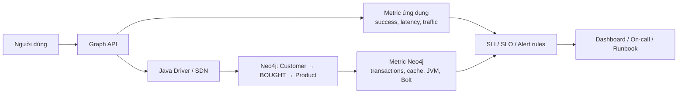
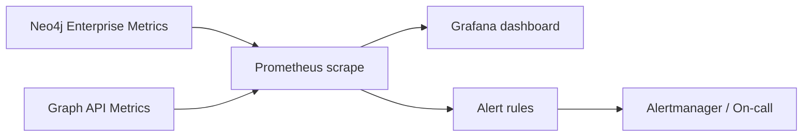

# Thiết lập ngưỡng cảnh báo theo tải nền và mục tiêu dịch vụ trong Neo4j

Một hệ thống Neo4j có thể hoạt động bình thường khi CPU đạt 80% trong giờ cao điểm nhưng lại đang gặp sự cố nếu **độ trễ truy vấn tăng gấp ba lần** trong giờ thấp điểm. Nếu đặt một ngưỡng cố định như “CPU > 70% là báo động” cho mọi thời điểm, nhóm vận hành sẽ nhận quá nhiều cảnh báo giả. Ngược lại, nếu chỉ cảnh báo khi database dừng hoàn toàn, người dùng có thể đã chịu truy vấn chậm hoặc lỗi trong thời gian dài.

Bài học thuộc chương **Giám sát** của module **DATABASE_ENGINE_GRAPH_NEO4J**: sử dụng Neo4j để lưu property graph, truy vấn quan hệ/đường đi bằng Cypher, tối ưu chỉ mục và vận hành các ứng dụng **Neo4j Java Driver** hoặc **Spring Data Neo4j**. Trọng tâm ở đây là thiết kế **ngưỡng cảnh báo dựa trên tải nền (baseline)** và **mục tiêu dịch vụ (SLO)**, thay vì chọn một con số tùy ý.

Sau bài học, bạn có thể:

- Phân biệt **metric, SLI, SLO, SLA, baseline, alert threshold và error budget**.
- Xây dựng baseline có xét giờ cao điểm, ngày trong tuần, loại query, tenant và các đợt nhập dữ liệu.
- Chọn tín hiệu phản ánh trải nghiệm người dùng rồi liên hệ với metric bên trong Neo4j.
- Thiết kế **ngưỡng cố định**, **ngưỡng theo baseline**, **cảnh báo nhiều cửa sổ thời gian** và **error-budget burn rate**.
- Giảm alert noise bằng thời gian duy trì, severity, chống lặp, loại trừ bảo trì và kiểm tra thiếu dữ liệu giám sát.
- Xây dựng bảng cảnh báo, ví dụ Prometheus/Grafana và runbook phân tích **Cypher/Neo4j** có thể áp dụng trong thực tế.

> **Phạm vi triển khai:** Tên metric, khả năng xuất metric, query log và giao diện theo dõi khác nhau giữa Neo4j Community, Enterprise và Aura, cũng như giữa các phiên bản. Các con số trong bài là **ví dụ minh họa có tính toán**, không phải ngưỡng mặc định Neo4j hay giá trị bắt buộc cho production.

## 1. Từ tín hiệu hệ thống đến cảnh báo có ý nghĩa

Xét một ứng dụng recommendation dùng graph:



Giả sử API `GET /recommendations` phải trả danh sách sản phẩm gợi ý trước deadline. Có bốn tầng cần quan sát:

1. **Người dùng:** request có thành công và đủ nhanh không?
2. **Ứng dụng:** request/s, lỗi, p95/p99, thời gian đợi connection pool, retry.
3. **Neo4j:** transaction, lỗi query, Bolt, page cache, JVM/GC, thời gian checkpoint.
4. **Hạ tầng:** CPU, RAM, disk, IO, network, sức khỏe cluster.

**Cảnh báo tốt không chỉ nói “metric tăng” mà phải trả lời “có nguy cơ vi phạm mục tiêu nào, ai cần hành động và hành động gì?”**

Ví dụ, page cache hit ratio giảm sau khi restart có thể là hiện tượng warm-up; nếu không đi kèm suy giảm SLI thì trước tiên nên **theo dõi và xác minh**, thay vì tự động đánh thức on-call.

## 2. Các thuật ngữ cần dùng đúng

| Thuật ngữ | Ý nghĩa | Ví dụ |
| --- | --- | --- |
| **Metric** | Giá trị đo được từ ứng dụng/Neo4j/hạ tầng | Request/s, transaction active, page faults/s |
| **SLI** (*Service Level Indicator*) | Chỉ số đo chất lượng dịch vụ người dùng nhận | Tỷ lệ request hợp lệ được xử lý thành công trước deadline |
| **SLO** (*Service Level Objective*) | Mục tiêu định lượng cho SLI trong khoảng thời gian | ≥ 99,9% request thành công trong 30 ngày |
| **SLA** (*Service Level Agreement*) | Cam kết/thỏa thuận với bên sử dụng, có thể có hệ quả hợp đồng | Cam kết uptime và cơ chế bồi hoàn nếu vi phạm |
| **Baseline** | Phân bố metric thường thấy theo hoàn cảnh tải | p95 latency vào giờ 9–18 khác giờ đêm |
| **Alert threshold** | Điều kiện đo được khiến hệ thống tạo cảnh báo | Error ratio > ngưỡng trong một cửa sổ đủ dài |
| **Error budget** | Mức vi phạm mục tiêu SLO còn cho phép | SLO 99,9% tương ứng 0,1% request có thể không đạt |
| **Burn rate** | Tốc độ sử dụng error budget so với tốc độ trung bình cho phép | Burn rate 10 nghĩa là đang tiêu ngân sách lỗi nhanh gấp 10 lần mức cho phép |

### SLI phải dựa trên đơn vị được người dùng cảm nhận

Một Cypher query trả kết quả thành công **không đồng nghĩa request API thành công**:

- Query có thể hoàn tất nhưng serialization trong ứng dụng bị lỗi.
- Java Driver có thể retry, khiến API trả về chậm hơn mục tiêu.
- API có thể gặp timeout trước khi người dùng nhận kết quả.
- Business logic có thể trả sai hoặc thiếu dữ liệu dù Neo4j báo query thành công.

Vì vậy, với API graph, SLI thường được đo ở **biên dịch vụ ứng dụng**; metric Neo4j là **tín hiệu chẩn đoán** giải thích tại sao SLI suy giảm.

## 3. Thiết lập SLO rõ ràng trước khi đặt ngưỡng

Giả sử đội sản phẩm xác định hai mục tiêu **minh họa** cho endpoint `/recommendations`:

| Mục tiêu | SLI | SLO minh họa | Cửa sổ |
| --- | --- | --- | --- |
| **Tính sẵn sàng** | Tỷ lệ request hợp lệ trả kết quả thành công trong deadline | **≥ 99,9%** | 30 ngày trượt |
| **Độ trễ** | Tỷ lệ request hợp lệ hoàn tất trong **400 ms** | **≥ 99%** | 30 ngày trượt |

Hai mục tiêu khác nhau: dịch vụ có thể trả HTTP 200 cho mọi request nhưng chậm hơn 400 ms trên 20% request; khi ấy SLO độ trễ bị vi phạm dù SLO availability đạt.

**Định nghĩa SLI phải ghi rõ:**

1. **Mẫu số:** những request nào được tính, ví dụ request hợp lệ tới endpoint, có loại trừ chủ động các truy vấn admin hoặc request bị client hủy không?
2. **Tử số:** request nào được xem là tốt, ví dụ HTTP 2xx và thời gian nhỏ hơn deadline; lỗi 4xx do input sai có tính là lỗi dịch vụ không?
3. **Điểm đo:** ở API gateway, ứng dụng, trace end-to-end hay từ probe bên ngoài?
4. **Cửa sổ:** 30 ngày trượt, tuần hoặc tháng dương lịch.
5. **Phân nhóm:** endpoint, khu vực, tenant tier; không chia label theo user ID để tránh cardinality metric quá lớn.

Một SLO không có định nghĩa tử số/mẫu số dễ dẫn đến việc hai dashboard báo hai “tỷ lệ thành công” khác nhau.

### 3.1. Error budget trong 30 ngày

Với SLO thành công **99,9%**, tỷ lệ lỗi cho phép là:

\[
e_{\text{budget}} = 1 - 0{,}999 = 0{,}001 = 0{,}1\%.
\]

Nếu 30 ngày có **1.000.000** request đủ điều kiện thì số request không đạt mục tiêu được phép là:

\[
1.000.000 \times 0{,}001 = 1.000\ \text{request}.
\]

Với SLO uptime theo **phút**, 30 ngày có 43.200 phút; 0,1% tương ứng **43,2 phút** downtime cho phép. **Không trộn hai cách tính**: error budget theo request và error budget theo phút có mẫu số khác nhau; cần chọn một định nghĩa và dùng nhất quán.

### 3.2. Burn rate cho thấy mức độ khẩn cấp

Gọi `error_ratio` là tỷ lệ request không đạt SLO trong cửa sổ đo:

\[
\text{burn rate} =
\frac{\text{error ratio quan sát}}{1 - \text{SLO target}}.
\]

Ví dụ SLO 99,9% có budget 0,1%:

| Error ratio đo được | Burn rate | Diễn giải |
| --- | ---: | --- |
| 0,05% | 0,5× | Thấp hơn tốc độ tiêu ngân sách trung bình |
| 0,1% | 1× | Đúng tốc độ tiêu ngân sách cho phép |
| 0,6% | 6× | Tiêu ngân sách nhanh gấp sáu |
| 1,44% | 14,4× | Rất cao, đáng xem xét cảnh báo khẩn nếu đủ volume |

Burn rate có ưu điểm là gắn độ nghiêm trọng với **mục tiêu dịch vụ**, không phải ngưỡng % lỗi tùy ý.

## 4. Khái niệm tải nền (baseline) trong Neo4j

**Baseline** là phân bố của metric trong điều kiện hoạt động đã hiểu rõ, không đơn giản là **trung bình tất cả số liệu**.

Ví dụ hệ thống graph có:

- Ban ngày: API tra cứu recommendation nhiều hơn.
- Ban đêm: ít request online, nhưng có job nhập CSV hoặc CDC backfill.
- Thứ Hai: có báo cáo tổng hợp graph nặng.
- Cuối tháng: có batch tính quan hệ, GDS hoặc tạo index.
- Một vài tenant lớn: có node bậc rất cao, query p95 có thể khác nhóm tenant nhỏ.

Nếu trộn mọi thời điểm thành một đường trung bình, cảnh báo sẽ bị méo bởi **seasonality**, batch được lên lịch và các nhóm workload khác nhau.

### 4.1. Bộ số liệu baseline giả định

Giả sử đã thu thập dữ liệu từ một ứng dụng đọc graph trong hai tuần ổn định:

| Ngữ cảnh | Lưu lượng nền | API p95 latency | CPU Neo4j | Ghi chú |
| --- | ---: | ---: | ---: | --- |
| Giờ hành chính ngày thường | 120 req/s | 180 ms | 65–80% | Nhiều traversal đồng thời |
| Đêm ngày thường | 15 req/s | 75 ms | 20–35% | Nhiều cache hit |
| Đêm có batch import | 25 req/s | 150 ms | 60–85% | Transaction ghi, I/O tăng |
| Cuối tuần | 35 req/s | 110 ms | 30–55% | Truy vấn khác giờ hành chính |

Đây là **dữ liệu giả định** để thực hành cách đặt ngưỡng. Không suy rằng Neo4j luôn cần CPU dưới 80% hay mọi API graph phải đạt 180 ms.

Ví dụ:

- Cảnh báo CPU > 75% ngay lập tức sẽ báo giả nhiều lần trong **giờ hành chính**.
- p95 180 ms lúc 11:00 có thể bình thường, nhưng p95 180 ms lúc 02:00 không có batch có thể đáng điều tra.
- Khi batch import đang chạy, page faults tăng không tự chứng minh có sự cố nếu mục tiêu API và deadline vẫn đạt.

### 4.2. Thu thập baseline như thế nào?

Một quy trình thực tế:

1. **Chọn giai đoạn đủ đại diện**, ví dụ 2–4 tuần để bao phủ ngày thường/cuối tuần và các batch định kỳ.
2. **Ghi các sự kiện vận hành**: deploy, restart, backup, import, tạo index, thay memory/page cache, thử nghiệm tải.
3. **Phân nhóm hợp lý**: endpoint, workload đọc/ghi, giờ trong ngày, ngày trong tuần, tenant tier.
4. **Lưu phân bố**: median, p90/p95/p99, độ lệch; không chỉ average.
5. **Đánh dấu sự cố cũ**: không đưa giai đoạn outage vào “chuẩn khỏe mạnh” một cách vô thức.
6. **Kiểm tra lượng mẫu**: 10 request/giờ không đủ để ước lượng p99 ổn định.
7. **Đối chiếu SLO**: baseline mô tả hệ thống **đang như thế nào**; SLO mô tả hệ thống **phải đạt gì**.

**Không nâng ngưỡng cảnh báo lên để hợp thức hóa tình trạng chậm kéo dài.** Một baseline xấu không có nghĩa hiệu năng đó là mục tiêu chấp nhận được.

## 5. Chọn metric phù hợp: ưu tiên người dùng, rồi đến tài nguyên

Neo4j xuất nhiều metric thuộc loại **gauge** (giá trị tức thời), **counter** (tích lũy) và **histogram** (phân bố). Theo tài liệu Neo4j, metric có thể ở **cấp DBMS** hoặc **theo database**. Một số cách xuất metric chi tiết là tính năng **Enterprise Edition**, trong khi Aura cung cấp dashboard metric theo gói dịch vụ.

| Nhóm metric | Ví dụ quan sát | Dùng để làm gì? |
| --- | --- | --- |
| **SLI của API** | Success ratio, latency p95/p99, timeout ratio | Cảnh báo khi trải nghiệm người dùng đang mất SLO |
| **Traffic** | Request/s, query/s, tỷ lệ read/write | Phân biệt suy giảm do tải tăng hay do tài nguyên |
| **Neo4j query** | Query execution failure, query latency | Khoanh vùng câu Cypher chậm/lỗi |
| **Transaction** | Active read/write, started, committed, rollbacks, terminated | Phát hiện transaction dài, lock contention hoặc rollback tăng |
| **Bolt** | Kết nối mở, messages failed/done | Phân biệt tải driver và lỗi tầng kết nối |
| **Page cache** | Hit ratio, page faults, usage ratio | Điều tra dữ liệu đọc từ disk, vấn đề cache |
| **JVM** | Heap usage, GC time/pause, thread | Phát hiện GC pressure hoặc giới hạn heap |
| **Disk/IO** | Disk free, IO latency, checkpoint duration | Nguy cơ hết dung lượng/đĩa nghẽn |
| **Cluster** | Member availability, replication/raft state | Phát hiện lỗi node, leader hoặc replication |
| **Pipeline** | CDC lag, age of last event, backlog | Đo độ mới dữ liệu graph khi có luồng đồng bộ |

**Đừng gọi mọi metric là SLI.** Ví dụ page cache hit ratio là metric nội bộ quan trọng, nhưng không trực tiếp chứng minh request người dùng tốt hay xấu.

### 5.1. Metric Neo4j hiện hành: nhận diện đúng kiểu

Trong Neo4j Enterprise, nhóm metric tài liệu Operations Manual bao gồm những tên dạng khái niệm sau (thường có prefix `neo4j`, và với metric database còn có tên database):

| Nhóm | Ví dụ tên metric trong Neo4j | Kiểu/ý nghĩa |
| --- | --- | --- |
| Page cache | `<prefix>.dbms.page_cache.hit_ratio` | Gauge; tỷ lệ hit, không lấy `rate()` trực tiếp |
| Page cache | `<prefix>.dbms.page_cache.page_faults` | Counter; nên xem **tốc độ tăng** |
| Transaction | `<prefix>.database.<db>.transaction.active` | Gauge; số transaction đang hoạt động |
| Transaction | `<prefix>.database.<db>.transaction.rollbacks` | Counter; xem rollback/s và tỷ lệ |
| Bolt | `<prefix>.dbms.bolt.messages_failed` | Counter; xem rate và đối chiếu messages done |
| JVM | `<prefix>.dbms.vm.gc.time.<gc>` | Counter; thời gian GC tích lũy |
| Checkpoint | `<prefix>.database.<db>.check_point.duration` | Gauge; thời gian checkpoint gần nhất |

**Lưu ý về tên:** Không giả định chuỗi metric trong tài liệu là **tên Prometheus đã chuẩn hóa** đúng từng ký tự. Exporter có thể đổi dấu `.` thành `_`, thêm suffix cho histogram/counter hoặc bổ sung label database/instance. Trước khi viết PromQL cho metric Neo4j thực, **xem đầu ra `/metrics` của deployment đang dùng** và tài liệu của bản phát hành.

Với một số version Neo4j mới, metric có thể được đổi tên, deprecated hoặc thêm mới. Quy tắc cảnh báo nên được kiểm tra lại khi upgrade.

### 5.2. Metric query khác log truy vấn chậm

- **Metric** giúp thấy xu hướng, ví dụ tỷ lệ lỗi query tăng hoặc page faults/s tăng.
- **Query log** giúp tìm câu Cypher, thời gian chạy, các dấu hiệu chờ lock/chi phí nếu được bật và cấu hình tương ứng.
- **`EXPLAIN`/`PROFILE`** giúp phân tích kế hoạch thực thi của một mẫu Cypher trên dữ liệu đại diện.

Không bật log chi tiết mọi query vô thời hạn rồi coi đó là giải pháp monitoring duy nhất; log có chi phí lưu trữ, bảo mật và có thể chứa giá trị nhạy cảm.

## 6. Cách lấy metric: self-managed và Aura

### 6.1. Self-managed Enterprise với Prometheus

Ở **Neo4j Enterprise**, có thể bật endpoint xuất metric cho Prometheus trong `neo4j.conf`:

```properties
# Ví dụ cho môi trường self-managed Enterprise:
server.metrics.prometheus.enabled=true
server.metrics.prometheus.endpoint=localhost:2004
```

`localhost:2004` là địa chỉ lắng nghe mặc định thường dùng của endpoint này. Nếu Prometheus chạy trên máy/container khác thì `localhost` của Prometheus **không phải** `localhost` của Neo4j. Hãy cấu hình kết nối giám sát hợp lệ qua private network, proxy hoặc cơ chế thu thập tương ứng; **không công khai endpoint metric ra Internet**.

Ví dụ cấu hình scrape phía Prometheus khi collector được đặt **cùng máy hoặc cùng namespace mạng** với Neo4j:

```yaml
scrape_configs:
  - job_name: neo4j
    scrape_interval: 15s
    static_configs:
      - targets:
          - "127.0.0.1:2004"
```

Trong môi trường Docker/Kubernetes, phải thay target bằng địa chỉ Neo4j mà collector **thực sự** truy cập được, giới hạn kết nối theo chính sách bảo mật. Cấu hình setting có thể cần restart, và không mặc định môi trường Community/Aura hỗ trợ việc sửa `neo4j.conf`.

**Luồng thu thập:**



Các lựa chọn khác có thể gồm Neo4j Ops Manager, JMX, CSV metrics hoặc công cụ giám sát của tổ chức khi phiên bản/edition hỗ trợ.

### 6.2. Aura

Với **Neo4j Aura**, dùng trang **Metrics** trong Aura Console khi gói dịch vụ hỗ trợ. Tài liệu Aura nêu rằng **AuraDB Free không có trang metrics** như các gói trả phí. Một số gói cũng có cách tích hợp xuất metric phù hợp với dịch vụ quản lý.

Không copy nguyên cấu hình Prometheus endpoint self-managed vào Aura và giả định có thể sửa file `neo4j.conf` của máy Neo4j. Nếu metric Neo4j server không truy cập trực tiếp, vẫn nên đo **SLI tại ứng dụng Java/Spring** và dùng thông tin từ Aura Console/log/metrics được gói cung cấp.

## 7. Từ baseline đến ngưỡng cảnh báo

Có ba lớp ngưỡng thường dùng, mỗi lớp giải quyết một mục đích khác nhau.

### 7.1. Ngưỡng cố định cho giới hạn vật lý hoặc quy tắc tuyệt đối

Một số trạng thái phù hợp ngưỡng cố định:

- Endpoint health probe thất bại liên tiếp.
- Disk **còn rất ít dung lượng** hoặc ngày dự báo hết dung lượng quá gần.
- Số lỗi `OutOfMemoryError` tăng.
- Database ngừng hoạt động ngoài lịch bảo trì.
- Thời gian từ event nguồn tới graph vượt giới hạn nghiệp vụ khi có SLO về freshness.

Ví dụ **chính sách giả định**: nếu disk free dưới 10% **và** dự báo hết dung lượng trong 24 giờ, tạo ticket hoặc page tùy mức ảnh hưởng. Không áp chung mốc 10% cho mọi dung lượng đĩa: 10% của 10 TB khác hẳn 10% của 100 GB.

### 7.2. Ngưỡng theo baseline cho tín hiệu có tính mùa vụ

Giả sử baseline p95 latency của endpoint trong giờ hành chính là 180 ms và ban đêm là 75 ms. Một ngưỡng minh họa có thể là:

```text
Giờ hành chính: cảnh báo điều tra nếu p95 > 300 ms trong 10 phút
Giờ thấp điểm:  cảnh báo điều tra nếu p95 > 150 ms trong 10 phút
```

Đây là ngưỡng **điều tra**, không tự động đồng nghĩa mất SLO. Ngưỡng được chọn từ baseline, variance, traffic và chi phí phản ứng. Với metric biến động mạnh, có thể dùng:

\[
T_{\text{dynamic}}(h) =
\max(T_{\text{floor}},\ Q_{0.99,\text{healthy}}(h)),
\]

trong đó `h` là nhóm giờ/ngày tương đương, `Q_{0.99,healthy}` là phân vị 99% của các quan sát khỏe mạnh, và `T_floor` là mức sàn chống báo động do nhiễu nhỏ.

**Cần kết hợp trần SLO.** Nếu baseline vốn p95 = 700 ms trong khi dịch vụ cam kết phần lớn request dưới 400 ms thì không được đặt ngưỡng “bình thường” là 1.000 ms rồi bỏ qua vi phạm mục tiêu.

### 7.3. Ngưỡng theo SLO cho sự cố ảnh hưởng người dùng

Thay vì page khi CPU > 80%, có thể page khi **error budget tiêu hao quá nhanh**. Ví dụ:

- SLO 99,9% thành công.
- Error ratio 1,44% tương ứng burn rate 14,4×.
- Nếu tỷ lệ này kéo dài **1 giờ**, hệ thống dùng khoảng **2% error budget của 30 ngày**, giả sử lưu lượng ổn định và cách đo SLI theo request.

Khi alert dựa vào budget, nhóm vận hành ít phải tranh luận liệu 75% CPU là xấu hay tốt. Nhưng metric nội bộ vẫn cần có để xác định **nguyên nhân**.

## 8. Cảnh báo nhiều cửa sổ thời gian và burn rate

Ngưỡng nhìn một cửa sổ quá ngắn dễ bị nhiễu; cửa sổ quá dài có thể phản ứng chậm. Giải pháp thường dùng là **multi-window / multi-burn-rate**:

| Mục đích | Burn rate | Cửa sổ dài + ngắn | Mức phản ứng minh họa |
| --- | ---: | --- | --- |
| Phát hiện lỗi lớn nhanh | 14,4× | 1 giờ và 5 phút | Page nếu cả hai đều vượt |
| Phát hiện lỗi dai dẳng | 6× | 6 giờ và 30 phút | Page/ticket theo chính sách |
| Phát hiện suy giảm kéo dài | Ngưỡng thấp hơn | 3 ngày và cửa sổ ngắn hơn | Ticket, lập kế hoạch khắc phục |

Theo cách tính 30 ngày = 720 giờ:

\[
\frac{14{,}4 \times 1}{720} = 2\%
\]

ngân sách bị tiêu trong một giờ ở burn rate 14,4×, và

\[
\frac{6 \times 6}{720} = 5\%
\]

ngân sách bị tiêu trong sáu giờ ở burn rate 6×.

Các cặp cửa sổ này là **mẫu thiết kế từ thực hành SRE**, không phải cấu hình mặc định của Neo4j. Cần kiểm thử phù hợp lưu lượng, mức độ biến động và lịch trực on-call.

### Vì sao cần cả cửa sổ ngắn và dài?

- **Cửa sổ dài** xác định lỗi có thực sự đáng kể, không chỉ một vài request ngẫu nhiên.
- **Cửa sổ ngắn** xác nhận vấn đề còn đang diễn ra, tránh tiếp tục page một sự cố đã hồi phục.
- **Điều kiện volume** ngăn một lỗi trong một phút rất ít request gây kết luận quá lớn.
- **Cảnh báo không có traffic** phải được xử lý riêng: tỉ lệ thành công không có ý nghĩa khi mẫu số bằng 0.

## 9. Ví dụ tính toán từ một tình huống sự cố

Giả sử SLO thành công là 99,9% và thời điểm 11:00 có số đo ở endpoint `/recommendations`:

| Metric | Baseline giờ 11:00 | Hiện tại |
| --- | ---: | ---: |
| Lưu lượng | 120 req/s | 115 req/s |
| Error ratio 5 phút | 0,03% | 2,0% |
| API p95 latency | 180 ms | 730 ms |
| Neo4j transaction active | 35 | 210 |
| Page cache hit ratio | 99% | 98,5% |
| CPU Neo4j | 70% | 76% |

Nhận định:

1. Traffic hiện tại gần baseline, nên không thể giải thích toàn bộ bằng “lưu lượng tăng vọt”.
2. Error ratio **2%** tương ứng **20×** ngân sách lỗi 0,1% — đáng cảnh báo nếu đủ volume và kéo dài.
3. p95 cao gấp khoảng **4,1 lần** baseline, có khả năng vi phạm mục tiêu độ trễ.
4. Transaction active tăng từ 35 lên 210; cần xem query chạy lâu, lock contention hoặc retry.
5. CPU 76% chỉ tăng nhẹ; nếu chỉ đặt cảnh báo “CPU > 80%”, sự cố đã **bị bỏ lỡ**.
6. Page cache 98,5% chưa tự là nguyên nhân chính; cần đối chiếu page faults/s, query latency, GC, disk IO và query log.

**Ưu tiên:** báo động theo SLI/error budget, sau đó dùng metric Neo4j điều tra **transaction, slow Cypher, Bolt và driver retry**. Không tự tăng RAM hoặc restart database chỉ vì nhìn thấy một metric thay đổi.

## 10. PromQL mẫu cho SLI của ứng dụng graph

Giả sử ứng dụng Java/Spring **đã instrument** các metric sau (đây là **tên metric ứng dụng do nhóm tự định nghĩa**, không phải metric Neo4j có sẵn):

- `graph_api_requests_total{endpoint="recommendations"}`: counter tổng request hợp lệ.
- `graph_api_request_errors_total{endpoint="recommendations"}`: counter request không đạt tiêu chí thành công SLI.
- `graph_api_request_duration_seconds_bucket{endpoint="recommendations",le="..."}`: histogram đo thời gian end-to-end.

Metric errors nên được khởi tạo từ 0 để không biến mất khi chưa có lỗi; cần tránh dùng `userId` hoặc `queryText` làm label vì số tổ hợp label tăng rất lớn.

### 10.1. Error ratio 5 phút

```promql
sum(rate(graph_api_request_errors_total{endpoint="recommendations"}[5m]))
/
clamp_min(
  sum(rate(graph_api_requests_total{endpoint="recommendations"}[5m])),
  0.001
)
```

Mẫu trên chỉ cho ra một tỷ lệ có ý nghĩa nếu counter và label đúng, đủ request và dữ liệu không bị mất. `clamp_min` tránh phép chia cho 0, **không phải** cách kết luận rằng endpoint khỏe khi hoàn toàn không có traffic.

### 10.2. P95 latency theo 5 phút

```promql
histogram_quantile(
  0.95,
  sum by (le) (
    rate(
      graph_api_request_duration_seconds_bucket{
        endpoint="recommendations"
      }[5m]
    )
  )
)
```

Nếu xuất metric dưới dạng **classic histogram**, mẫu `histogram_quantile` này có ý nghĩa khi bucket và nhãn `le` đúng. Với native histogram hoặc exporter khác, cú pháp có thể thay đổi; cần dựa vào dữ liệu exporter thực tế. Đơn vị trả về là **giây**, nên 400 ms = **0,4 giây**.

Không lấy trung bình của p95 từ nhiều instance: percentile toàn dịch vụ phải được tính từ **bucket đã tổng hợp**, hoặc từ phương pháp phân vị phù hợp.

### 10.3. Cảnh báo burn rate nhanh với hai cửa sổ

Ví dụ **Prometheus alert rule tham khảo** cho mục tiêu success 99,9% trong 30 ngày:

```yaml
groups:
  - name: graph-api-slo
    rules:
      - alert: GraphApiFastErrorBudgetBurn
        expr: |
          (
            sum(rate(graph_api_request_errors_total{
              endpoint="recommendations"
            }[1h]))
            /
            clamp_min(
              sum(rate(graph_api_requests_total{
                endpoint="recommendations"
              }[1h])),
              0.001
            )
          ) > 0.0144
          and
          (
            sum(rate(graph_api_request_errors_total{
              endpoint="recommendations"
            }[5m]))
            /
            clamp_min(
              sum(rate(graph_api_requests_total{
                endpoint="recommendations"
              }[5m])),
              0.001
            )
          ) > 0.0144
          and
          sum(increase(graph_api_requests_total{
            endpoint="recommendations"
          }[1h])) >= 100
        for: 2m
        labels:
          severity: page
          service: graph-api
        annotations:
          summary: "Graph API đang tiêu hao error budget nhanh"
          description: "Kiểm tra SLI, traffic và runbook Neo4j."
```

Ở SLO 99,9%:

\[
14{,}4 \times (1 - 0{,}999) = 0{,}0144 = 1{,}44\%.
\]

**Cách đọc rule:** chỉ page khi tỷ lệ lỗi **cả cửa sổ 1 giờ và 5 phút** vượt 1,44%, có ít nhất 100 request trong một giờ, và điều kiện vẫn đúng sau `for: 2m`.

Đây là mẫu **minh họa**, không nên copy thẳng vào production mà không:

- Xác minh counter, naming, labels và trường hợp zero-traffic/no-data.
- Điều chỉnh điều kiện volume cho lưu lượng thật, nhất là endpoint ít request.
- Xác định error classification đúng với SLO (4xx do client, timeout, 5xx...).
- Kiểm tra đường truyền alert, routing on-call và thời gian phản ứng.
- Kiểm thử bằng sự cố giả lập và các số liệu lịch sử.

**Quan trọng:** Dùng `and` trong PromQL yêu cầu các biểu thức có tập label khớp phù hợp. Ở ví dụ này mỗi `sum(...)` được tổng hợp thành một chuỗi không có nhãn, nên phép kết hợp phù hợp. Khi phân tách theo service/endpoint/tenant tier, cần giữ đúng nhãn nhóm.

## 11. Ma trận cảnh báo kết hợp SLO và baseline

Ví dụ một bảng dùng để thiết kế **rule có owner và runbook**:

| Tín hiệu | Điều kiện minh họa | Severity | Hành động |
| --- | --- | --- | --- |
| Graph API error-budget burn | 14,4× cả 1h và 5m, đủ volume | **Page** | Điều tra request errors, dependency, Neo4j availability |
| Graph API latency burn | Request vượt deadline tiêu budget nhanh | **Page** hoặc ticket theo SLO | Kiểm tra query log, plan, pool wait |
| Neo4j unreachable từ ứng dụng | Synthetic probe lỗi liên tiếp, trên nhiều nguồn đo | **Page** nếu user impact | Xác minh endpoint, routing, auth, cluster/network |
| Transaction rollback tăng | Rollback/s cao hơn nền và API lỗi tăng | **Page/ticket** theo tác động | Kiểm tra deadlock, timeout, query write |
| Page cache page faults/s tăng | Vượt baseline trong 15–30 phút | **Ticket** | Kiểm tra query access pattern, warm-up, RAM, IO |
| JVM GC pressure | GC time tăng nhiều lần so với nền và p95 xấu | **Page/ticket** theo tác động | Kiểm tra heap và allocation, query/cardinality |
| Disk free thấp | Theo dung lượng tuyệt đối + xu hướng hết | **Ticket/page** theo thời gian còn lại | Giải phóng/điều chỉnh capacity |
| Transaction active cao | Vượt baseline theo giờ + queue/latency tăng | **Ticket/page** | Xem long-running transactions, lock/wait |
| Metrics endpoint mất dữ liệu | Không scrape trong thời gian đã định | **Ticket/page cho monitoring** | Sửa scrape/network/exporter; không kết luận DB down |

**Mọi con số là ví dụ để bắt đầu thiết kế.** Cùng một ngưỡng transaction active có thể bình thường ở cluster lớn và nguy hiểm ở instance nhỏ.

### Hai chiều khẩn cấp

- **Page:** tác động người dùng đang lớn hoặc error budget bị đốt nhanh, người trực có hành động ngay.
- **Ticket:** xu hướng tài nguyên xấu đi hoặc suy giảm nhẹ nhưng chưa cần đánh thức người trực.
- **Dashboard-only:** thông tin có ích để chẩn đoán, nhưng chưa có hành động cụ thể nếu tách khỏi SLI.

Không tạo alert chỉ vì công cụ cho phép. Nếu không có **owner, mức ảnh hưởng, hành động và điều kiện kết thúc**, có thể cần dashboard thay vì cảnh báo.

## 12. Cách giảm cảnh báo giả và tránh che sự cố

Một hệ thống tốt phải phát hiện được sự cố thật **và** không làm on-call kiệt sức vì nhiễu.

### 12.1. Các kỹ thuật thường dùng

1. **Thời gian duy trì:** `for: 5m` hoặc nhiều điểm đo liên tiếp, không báo ngay khi một sample đơn lẻ vượt ngưỡng.
2. **Hysteresis:** ngưỡng bật cao hơn ngưỡng tắt, tránh alert bật/tắt liên tục gần ranh giới.
3. **Multi-window:** cửa sổ ngắn xác nhận sự cố còn diễn ra; cửa sổ dài đánh giá ý nghĩa của nó.
4. **Volume guard:** đủ request mẫu mới đánh giá tỷ lệ lỗi/p99.
5. **Lịch bảo trì:** dùng silencing có giới hạn thời gian, có owner; không “mute mãi mãi”.
6. **Nhóm/deduplicate:** gom nhiều instance cùng nguyên nhân thành một incident thay vì gửi hàng trăm thông báo.
7. **Dependency-aware alerts:** nếu Neo4j unavailable đã được page, có thể nhóm những alert API đi theo cùng sự cố.
8. **Thiếu dữ liệu:** giám sát `up` hoặc scrape success **riêng**; không xem series biến mất là metric bằng 0.
9. **Kiểm tra đột biến theo deployment:** đánh dấu sự kiện deploy/restart/import để điều tra nhanh nhưng không tự bỏ qua SLO vi phạm thật.
10. **Giới hạn cardinality metric:** chỉ dùng label như service, route, database, role; không đặt userId, raw Cypher hoặc transactionId làm label.

### 12.2. Hysteresis bằng số liệu minh họa

Giả sử hệ thống có signal transaction active cao khi giờ thấp điểm:

```text
Bật cảnh báo điều tra:    active transactions > 120 trong 10 phút
Kết thúc cảnh báo:        active transactions < 90 trong 10 phút
```

Nếu active dao động 115–125, hai ranh giới giúp tránh alert flapping. Nhưng nếu SLO đã vi phạm nghiêm trọng, **không chờ hết mọi điều kiện hạ tầng** mới page.

### 12.3. Tải nền có thể thay đổi sau deploy hoặc tăng trưởng dữ liệu

Sau một đợt tăng trưởng graph hoặc thay kiến trúc query, baseline cần được đánh giá lại. Không tự động học “bình thường mới” từ thời điểm đang có incident. Nên:

- So sánh trước/sau deploy, có chú thích rõ thay đổi index/schema.
- Theo dõi phân bố theo workload ổn định, không chỉ tổng transaction.
- Duyệt lại SLO với chủ sản phẩm nếu yêu cầu thật thay đổi.
- Giữ lịch sử alert để đánh giá alert có mang lại hành động hữu ích không.

## 13. Phân tích một cảnh báo bằng log và Cypher

Khi nhận page rằng API p95 tăng và error ratio cao, có thể dùng quy trình sau.

### Bước 1 — Xác định phạm vi

Kiểm tra dashboard:

- Lỗi chỉ ở endpoint traversal hay mọi endpoint?
- Lỗi chỉ một tenant lớn hay toàn dịch vụ?
- Có đợt import, rebuild index, backup, tạo projection GDS hoặc deploy gần đây không?
- Lưu lượng có tăng hay chất lượng suy giảm khi traffic vẫn bình thường?

Nếu chỉ một loại query chậm, đừng vội kết luận mọi database đều quá tải.

### Bước 2 — Kiểm tra Neo4j

Quan sát transaction active/rollback/terminated, Bolt failures, page faults, GC, disk và database availability. Nếu là cluster, so sánh thành viên và đường routing, không chỉ tổng trung bình.

Khi có quyền quản trị phù hợp, dùng:

```cypher
SHOW TRANSACTIONS;
```

Lệnh này giúp xem transaction đang chạy, nhưng cột và khả năng hiển thị phụ thuộc quyền, edition và phiên bản. **Không chạy lệnh terminate transaction hàng loạt chỉ để giảm số liệu active**; cần hiểu query và tác động nghiệp vụ trước.

### Bước 3 — Xem truy vấn chậm qua query log

Trên Neo4j Enterprise self-managed, có thể cấu hình query log để theo dõi truy vấn vượt ngưỡng:

```properties
# Minh họa cách bật query log với ngưỡng theo nhu cầu.
db.logs.query.enabled=INFO
db.logs.query.threshold=200ms

# Bảo vệ tham số chứa dữ liệu nhạy cảm.
db.logs.query.parameter_logging_enabled=false
db.logs.query.obfuscate_literals=true
```

`200ms` là **ngưỡng bắt log minh họa**, không phải SLO hay timeout. Cần kiểm tra các setting còn được hỗ trợ trên bản Neo4j cụ thể. Query log có thể chứa nội dung nhạy cảm; cấu hình log an toàn, retention và quyền đọc phải được quản lý rõ ràng.

Một câu Cypher có thể chạy chậm vì quét nhãn lớn, duyệt node hub, thiếu index, sắp xếp lớn, chờ lock hoặc page cache misses. Query log giúp chọn câu lệnh cần phân tích, **không tự giải thích toàn bộ kế hoạch truy vấn**.

### Bước 4 — Kiểm tra kế hoạch thực thi

Ví dụ câu query recommendation theo property graph:

```cypher
EXPLAIN
MATCH (u:Customer {customerId: $customerId})
      -[:BOUGHT]->(p:Product)
RETURN p.productId AS productId,
       count(*) AS purchases
ORDER BY purchases DESC
LIMIT 20;
```

`EXPLAIN` không chạy query; dùng `PROFILE` trên **môi trường phù hợp** để đo `Estimated Rows`, `Rows`, `DB Hits`, operator `Expand`, `Sort`, `Filter` và chi phí thực tế:

```cypher
PROFILE
MATCH (u:Customer {customerId: $customerId})
      -[:BOUGHT]->(p:Product)
RETURN p.productId AS productId,
       count(*) AS purchases
ORDER BY purchases DESC
LIMIT 20;
```

`PROFILE` **thực thi query**: cần tránh dùng nó vô tư với câu ghi dữ liệu trên production. Khi phân tích hiệu năng, dùng **tham số và phân bố dữ liệu đại diện**, đặc biệt những khách hàng có nhiều quan hệ (hub).

### Bước 5 — Phân biệt triệu chứng và nguyên nhân

| Quan sát | Giả thuyết cần kiểm tra |
| --- | --- |
| API latency tăng, Neo4j query latency bình thường | Chờ pool, network, retry, mapping/serialization trong Java |
| Neo4j query latency tăng, page faults/s tăng | Cache/IO hoặc truy vấn chạm dữ liệu mới quá rộng |
| Rollbacks write tăng, transaction active tăng | Lock contention, deadlock hoặc timeout |
| Bolt failures tăng, nhiều ứng dụng lỗi kết nối | Pool/connections, network, auth hoặc Neo4j bận |
| Chỉ tenant lớn chậm | Data skew, hub, cardinality/plan không phù hợp |
| DB metrics ổn nhưng graph dữ liệu cũ | CDC/backfill bị trễ; cần SLO về freshness và metric pipeline |

**Không áp một cách sửa chung** như “tăng heap” hoặc “restart Neo4j” cho mọi cảnh báo. Quyết định dựa trên nguyên nhân đã được kiểm chứng.

## 14. Đo từ Java Driver và Spring Data Neo4j

Với Neo4j Java Driver, ứng dụng biết đầy đủ thời gian end-to-end từ lúc API gọi query cho tới khi nhận và xử lý kết quả. Đây là vị trí phù hợp để đo **latency của nghiệp vụ**, bao gồm các giai đoạn ngoài database.

Trong ứng dụng Spring Boot, thường dùng **Micrometer/Actuator** để xuất metric cho Prometheus. Đo tối thiểu:

- `requests_total` và `request_errors_total` theo endpoint và result class.
- Histogram `request_duration_seconds` với bucket phù hợp deadline SLO.
- Số timeout, retry, lỗi kết nối Neo4j và thời gian chờ pool nếu instrument được.
- Thời gian truy cập Neo4j tách khỏi thời gian tổng request nếu cần chẩn đoán.
- Độ mới dữ liệu graph so với event nguồn khi hệ thống dùng CDC/Kafka connector.

### Mẫu pseudo-code instrumentation

```java
// Mã minh họa ý tưởng, không phải class đầy đủ.
// Registry/metrics được ứng dụng khởi tạo và quản lý.
Timer.Sample sample = Timer.start(meterRegistry);

try {
    List<Recommendation> result = graphService.findRecommendations(
        customerId, 20
    );
    graphApiRequests.increment();
    return result;
} catch (RuntimeException ex) {
    graphApiRequests.increment();
    graphApiRequestErrors.increment();
    throw ex;
} finally {
    sample.stop(graphApiRequestDurationTimer);
}
```

Trong thực tế, cần đặt instrumentation ở ranh giới request phù hợp, tránh **đếm nhiều lần** khi Neo4j Driver tự retry, xác định rõ HTTP timeout hay lỗi do client và dùng label có số lượng giá trị hữu hạn.

**Không dùng metric số lần query thành công của Neo4j thay thế metric request thành công của graph API.** Một API request có thể tạo nhiều query, retry hoặc thất bại sau khi query đã hoàn tất.

## 15. Giám sát dữ liệu mới khi dùng CDC, ETL và Graph Data Science

Một database có thể **online** và CPU thấp nhưng graph trả thông tin **cũ**. Nếu Neo4j là bản sao phục vụ đọc được cập nhật qua Kafka, CDC hoặc ETL, chất lượng còn phụ thuộc vào **freshness**.

Ví dụ mục tiêu nghiệp vụ:

> 99% sự kiện thay đổi trạng thái đơn hàng được phản ánh trong graph trong vòng 60 giây.

SLI tương ứng phải đo tuổi sự kiện đến khi graph áp dụng thay đổi, hoặc thời gian chậm nhất của checkpoint xử lý, tùy hợp đồng dữ liệu.

Các chỉ số cần quan sát:

| Metric pipeline | Ý nghĩa |
| --- | --- |
| Event processing lag | Số event/chênh lệch offset đang chờ xử lý |
| Event age | Tuổi sự kiện cũ nhất chưa áp dụng |
| Dead-letter queue size | Số bản ghi lỗi cần can thiệp |
| Last successful import timestamp | Thời điểm import/CDC commit thành công gần nhất |
| Reconciliation mismatch | Khác biệt giữa nguồn và graph theo business key |
| GDS graph projection age | Độ cũ của bản graph trong bộ nhớ so với dữ liệu lưu trữ |

**Graph Data Science projection là snapshot** tại thời điểm chiếu đồ thị; nếu thuật toán đang tính trên projection cũ, Neo4j database vẫn online và cập nhật bình thường nhưng **kết quả GDS có thể lỗi thời**. Cần định nghĩa quy trình refresh riêng theo nhu cầu nghiệp vụ.

Không dùng một metric “consumer lag = 0” làm bằng chứng duy nhất về tính đúng của dữ liệu; cần kiểm tra mapping, thất bại bị bỏ qua, idempotency và đối chiếu với nguồn.

## 16. Runbook cho một cảnh báo hữu ích

Mỗi alert nên có runbook tóm tắt:

| Mục | Nội dung cần có |
| --- | --- |
| **Tên alert** | `GraphApiFastErrorBudgetBurn` |
| **Điều kiện** | Burn rate vượt 14,4× trong 1h và 5m, đủ volume |
| **Tác động** | Tỷ lệ request recommendation lỗi lớn hơn mục tiêu |
| **Owner** | Nhóm trực Graph API/Neo4j theo quy định tổ chức |
| **Dashboard** | SLI, traffic, latency, transaction, Bolt, page cache, GC |
| **Bước xác nhận** | Kiểm tra probe, phân nhóm lỗi, deploy gần đây |
| **Bước chẩn đoán** | Query log, `SHOW TRANSACTIONS`, `EXPLAIN`/`PROFILE` trên môi trường phù hợp |
| **Giảm tác động** | Giảm tải/điều chỉnh concurrency, rollback deploy, chuyển hướng lưu lượng khi được hỗ trợ |
| **Cách xác nhận hồi phục** | Burn rate và p95 giảm, traffic thật vẫn còn, backlog được xử lý |
| **Bàn giao/hậu kiểm** | Postmortem, cập nhật threshold, kiểm thử và nhiệm vụ cải thiện |

Runbook không nên dừng ở “nếu CPU cao thì restart”. Mỗi bước thay đổi trạng thái database (restart, terminate transaction, drop index) phải được đánh giá rủi ro và có thẩm quyền thực hiện.

## 17. Thử nghiệm alert trước khi tin cậy

Trước khi triển khai production:

1. **Replay số liệu lịch sử**: rule có page đúng ở các incident trước không?
2. **Kiểm tra alert noise**: mỗi tuần có bao nhiêu cảnh báo không cần hành động?
3. **Thử burst ngắn**: spike 1 phút có bị `for` và multi-window xử lý đúng không?
4. **Thử sự cố kéo dài**: lỗi 0,6% liên tục có tạo cảnh báo dài hạn không?
5. **Thử ít traffic**: một lỗi trong 2 request không gây page sai khi thiếu dữ liệu.
6. **Thử mất exporter**: metric biến mất tạo cảnh báo về **monitoring gap**, không bị xem là sức khỏe tốt.
7. **Thử bảo trì**: silence có thời hạn; SLO vẫn được đo rõ theo hợp đồng.
8. **Thử outage toàn phần**: probe và error rate vẫn phát hiện được khi ứng dụng không phát metric vì đã dừng.
9. **Thử thay phiên bản Neo4j**: tên metric hoặc cấu hình deprecated phải được đối chiếu sau upgrade.
10. **Thử channel trực**: cảnh báo có đủ owner, link dashboard, runbook và mức ưu tiên không?

### Đánh giá chất lượng cảnh báo theo định kỳ

Sau mỗi incident hoặc mỗi kỳ vận hành, đánh giá:

- Tỷ lệ alert dẫn tới một hành động có ích.
- Thời gian từ lúc SLI suy giảm đến khi nhận page.
- Số lần page nhầm trong giờ cao điểm/batch.
- Sự cố bị bỏ lỡ do ngưỡng quá cao hoặc chuỗi metric biến mất.
- SLO còn phù hợp với yêu cầu sản phẩm không.
- Tải nền có đổi sau khi thêm tenant, index, job GDS hoặc luồng nhập dữ liệu không.

Ngưỡng là một **quyết định vận hành có thể sửa đổi**, không phải hằng số vĩnh viễn.

## 18. Bài tập tự kiểm tra

**Câu 1.** Trong giờ hành chính, CPU Neo4j thường 70–80% nhưng API vẫn đáp ứng SLO. Có nên page mỗi khi CPU vượt 75% không?

<details>
<summary>Đáp án gợi ý</summary>

Không. Đó là mức tải có thể thuộc baseline khỏe mạnh. CPU chỉ là metric hỗ trợ chẩn đoán; page nên dựa vào tác động người dùng như SLO error budget hoặc latency. Có thể tạo ticket theo xu hướng CPU kéo dài và headroom nếu cần capacity planning.

</details>

**Câu 2.** SLO thành công 99,9% trên 1.000.000 request cho phép tối đa bao nhiêu request không đạt?

<details>
<summary>Đáp án gợi ý</summary>

Budget là 0,1% tổng số request: `1.000.000 × 0,001 = 1.000` request không đạt. Đây là budget theo request; không tự chuyển thành số phút downtime nếu chưa định nghĩa SLI theo thời gian.

</details>

**Câu 3.** Error ratio hiện tại 0,6% trong khi SLO yêu cầu 99,9%. Burn rate là bao nhiêu?

<details>
<summary>Đáp án gợi ý</summary>

Tỷ lệ lỗi cho phép là 0,1%, vì vậy burn rate = `0,6% / 0,1% = 6×`. Muốn xác định mức khẩn cấp cần xem cửa sổ dài/ngắn, lưu lượng và mức budget đang bị tiêu.

</details>

**Câu 4.** Page cache hit ratio giảm ngay sau restart nhưng API thành công và latency không đổi. Có đủ cơ sở page không?

<details>
<summary>Đáp án gợi ý</summary>

Chưa. Cache có thể đang warm-up; cần xem xu hướng page faults, I/O, thời gian từ restart, tải nền và SLI. Nếu hit ratio thấp kéo dài và query chậm, mới điều tra khả năng cache/IO là nguyên nhân.

</details>

**Câu 5.** Vì sao alert `error_ratio > 1%` trên 1 phút có thể gây nhiễu cho endpoint chỉ 2 request/phút?

<details>
<summary>Đáp án gợi ý</summary>

Chỉ một lỗi đã tạo tỷ lệ 50%, không phản ánh đủ phân bố dài hạn. Cần volume guard, cửa sổ dài/ngắn, ngưỡng và tiêu chí riêng cho endpoint ít traffic; kết hợp synthetic probe/availability nếu có ý nghĩa.

</details>

**Câu 6.** Neo4j báo các query thành công nhưng API graph liên tục trả HTTP 504. Nên đo SLI ở đâu?

<details>
<summary>Đáp án gợi ý</summary>

Ở tầng API/gateway mà người dùng trải nghiệm. Query có thể thành công nhưng ứng dụng chậm do pool wait, retry, network hoặc serialization. Metric Neo4j giúp chẩn đoán chứ không thay thế SLI của API.

</details>

**Câu 7.** Prometheus không lấy được metric từ Neo4j trong 10 phút. Có thể kết luận Neo4j đang dừng không?

<details>
<summary>Đáp án gợi ý</summary>

Không. Có thể do exporter, scrape target, mạng hoặc collector. Cần alert `monitoring gap` riêng và một health/synthetic probe độc lập trước khi quy kết database down.

</details>

**Câu 8.** Một pipeline CDC có lag 0 nhưng graph vẫn thiếu relationship ở một số order. Cảnh báo nên chỉ nhìn lag hay có thêm metric khác?

<details>
<summary>Đáp án gợi ý</summary>

Cần thêm đối chiếu nguồn, số event lỗi/bỏ qua, DLQ, độ mới và chất lượng mapping. Lag 0 chỉ nói consumer đã theo kịp offset được đo, không chứng minh graph có dữ liệu đúng.

</details>

**Câu 9.** Vì sao dùng trung bình của p95 từ ba instance để tạo p95 toàn dịch vụ là không phù hợp?

<details>
<summary>Đáp án gợi ý</summary>

Phân vị không cộng/trung bình trực tiếp theo cách đó, nhất là khi số request của từng instance khác nhau. Nên tính từ histogram buckets được tổng hợp đúng, hoặc phương pháp phân vị phân tán tương ứng.

</details>

## Ghi nhớ

- **SLO là mục tiêu**, **baseline là phân bố quan sát**, **alert threshold là quyết định khi nào cần hành động**.
- Đặt cảnh báo ảnh hưởng người dùng dựa trên **SLI, error budget và burn rate**; dùng metric Neo4j để tìm nguyên nhân.
- Baseline phải xét **giờ/ngày, read/write workload, batch import, tenant lớn và thay đổi graph**, không dùng một đường trung bình duy nhất.
- **CPU, heap, page cache và transaction active** không nên trở thành pager chỉ vì vượt một giá trị tuyệt đối chưa gắn với rủi ro.
- **Multi-window, volume guard, hysteresis, `for` và deduplication** giúp giảm cảnh báo giả mà không bỏ qua sự cố dài.
- Phân biệt **metric ứng dụng**, **metric Neo4j**, **query log** và **synthetic availability probe**; chúng cung cấp góc nhìn khác nhau.
- Neo4j Enterprise có thể xuất metric cho Prometheus; Aura có metric qua giao diện/gói hỗ trợ; **đối chiếu version trước khi dùng tên metric và config**.
- Mỗi cảnh báo phải có **owner, severity, runbook, cách xác nhận hồi phục và quy trình hậu kiểm**.

### Tài liệu tham khảo

- [Neo4j Operations Manual — Essential metrics](https://neo4j.com/docs/operations-manual/current/monitoring/metrics/essential/)
- [Neo4j Operations Manual — Metrics reference](https://neo4j.com/docs/operations-manual/current/monitoring/metrics/reference/)
- [Neo4j Operations Manual — Expose metrics](https://neo4j.com/docs/operations-manual/current/monitoring/metrics/expose/)
- [Neo4j Operations Manual — Logging](https://neo4j.com/docs/operations-manual/current/monitoring/logging/)
- [Neo4j Aura — View metrics](https://neo4j.com/docs/aura/metrics/view-metrics/)
- [Google SRE Workbook — Alerting on SLOs](https://sre.google/workbook/alerting-on-slos/)
- [Prometheus — Alerting rules](https://prometheus.io/docs/prometheus/latest/configuration/alerting_rules/)
- [Prometheus — Histogram and summary](https://prometheus.io/docs/practices/histograms/)
- [Spring Data Neo4j Reference](https://docs.spring.io/spring-data/neo4j/reference/)
