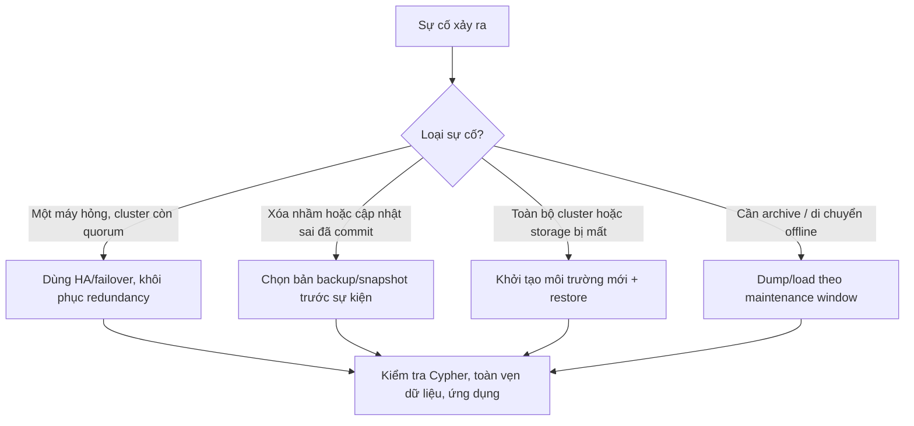
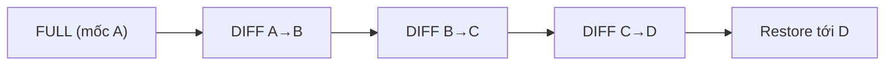
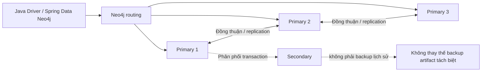
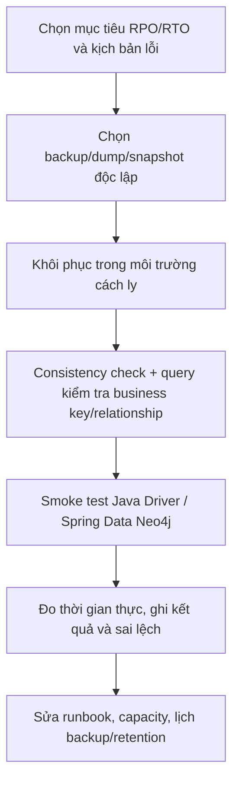

# Phân biệt sao lưu, dump, snapshot và bản sao phục vụ sẵn sàng cao trong Neo4j

## 1. Một hệ thống có nhiều bản sao vẫn có thể mất dữ liệu

Ứng dụng Neo4j lưu **node, relationship, property, label, index và constraint** thành dữ liệu của một database. Dịch vụ Java sử dụng **Neo4j Java Driver**, **Spring Data Neo4j** và truy vấn **Cypher** để cập nhật dữ liệu nghiệp vụ và đi theo những quan hệ trong *property graph*. Khi máy chủ hoặc ổ đĩa hỏng, người vận hành phải biết **dùng bản nào để khôi phục** và **chấp nhận mất bao nhiêu dữ liệu mới nhất**.

Trong chương **Sao lưu và phục hồi** của module `DATABASE_ENGINE_GRAPH_NEO4J`, có bốn thuật ngữ rất dễ bị sử dụng thay nhau:

1. **Backup (sao lưu database)**: tạo một hiện vật khôi phục có chủ đích, bảo quản tách khỏi nguồn đang hoạt động.
2. **Dump**: tạo một archive của database trong điều kiện offline để có thể `load` lại.
3. **Snapshot**: bản chụp ở tầng volume, máy ảo, file system hoặc dịch vụ cloud tại một thời điểm.
4. **Replica/copy trong cluster phục vụ HA**: bản database đang được duy trì để hỗ trợ hệ thống tiếp tục hoạt động khi có lỗi.

Bốn lựa chọn giải quyết **những loại rủi ro khác nhau**. HA giúp giảm gián đoạn khi mất máy, nhưng thường **nhân bản cả thao tác xóa nhầm, dữ liệu bị sửa sai và nhiều lỗi logic**. Backup giữ lại trạng thái ở thời điểm trước lỗi; snapshot có thể giúp rút ngắn một số bước phục hồi nhưng phải đáp ứng yêu cầu nhất quán; dump thích hợp với maintenance hoặc chuyển dữ liệu có thời gian dừng.

### Sau bài học, bạn có thể

- Giải thích chính xác đối tượng được lưu, nguồn lấy dữ liệu và điều kiện tạo cho từng phương án.
- Phân biệt **RPO**, **RTO**, tính nhất quán và tính sẵn sàng.
- Chọn giữa online full/differential backup, offline dump, storage snapshot và HA replica theo kịch bản lỗi.
- Nhận diện các lệnh `neo4j-admin database backup`, `restore`, `dump`, `load` và giới hạn theo edition/version.
- Thiết kế một chuỗi **sao lưu → kiểm tra → lưu giữ → khôi phục thử → xác minh**.
- Tránh dùng nhầm snapshot hoặc bản replica làm bằng chứng rằng dữ liệu có thể phục hồi đến một mốc quá khứ.

> **Phạm vi phiên bản:** Lệnh minh họa dựa trên hướng dẫn **Neo4j 5.x và các bản phát hành hiện hành**. Cú pháp, edition, quyền, cách xử lý metadata và tính năng mới có thể khác theo phiên bản. `neo4j-admin database backup` là tính năng **Enterprise Edition** dành cho Neo4j tự quản lý, không chạy trực tiếp trên Neo4j Aura. Với Aura cần dùng **backup/restore features do dịch vụ cung cấp** theo plan và tài liệu Aura.

## 2. Bốn khái niệm đặt cạnh nhau

| Tiêu chí | Online backup | Offline dump | Storage snapshot | HA replica/cluster copy |
| --- | --- | --- | --- | --- |
| Mục đích chính | Khôi phục database khi gặp mất mát/corruption/lỗi vận hành | Archive, di chuyển, phục hồi từ database không hoạt động | Khôi phục hoặc clone nhanh ở tầng hạ tầng khi được bảo đảm nhất quán | Duy trì hoạt động khi một hay nhiều server gặp lỗi |
| Nguồn dữ liệu | DB đang chạy | Database phải được dừng/offline tại nguồn | Volume/file system/storage layer | Các transaction được nhân bản theo topology cluster |
| Định dạng đầu ra | Backup artifact và có thể có chuỗi full + differential | Archive `.dump` | Block/volume image hoặc snapshot của hạ tầng | Database copy đang sống, không phải archive độc lập |
| Có cần downtime ở DB nguồn? | Không cần dừng DB cho backup | Có, đối với database được dump | Tùy công nghệ và quy trình application-consistent | Không có «bước backup»; HA hoạt động liên tục |
| Giữ mốc lịch sử | Có, theo backup retention/chain | Có, theo các archive được lưu | Có, theo lịch snapshot và retention | **Không tự tạo kho lịch sử để quay lui** |
| Định mức RPO | Theo lịch backup hoàn tất, log chain và khả năng phục hồi | Theo lần dump gần nhất | Theo thời điểm snapshot nhất quán | Thường phục vụ HA gần thời gian thực; không bảo đảm rollback về quá khứ |
| Định mức RTO | Phụ thuộc tải backup, replay chain, restore, kiểm thử | Phụ thuộc giải nén/load, khởi tạo và kiểm thử | Có thể nhanh khi restore volume, nhưng phải xác minh DB | Phụ thuộc quorum, routing và failover |
| Bảo vệ khỏi xóa nhầm đã lan truyền | **Có**, nếu còn bản backup trước thời điểm xóa | **Có**, nếu còn archive cũ | **Có**, nếu snapshot cũ còn và dùng được | **Không**, thay đổi hợp lệ sẽ được nhân bản |
| Tài nguyên và edition | Enterprise, backup service và tài nguyên backup client | Community/Enterprise theo điều kiện offline | Do nhà cung cấp storage quyết định | Enterprise cluster với topology phù hợp |
| Kiểm chứng quan trọng | Chain đầy đủ, consistency, restore drill | Archive đọc được, load + verify | Tính nhất quán đa-volume, log, thử recovery | Quorum, replication lag, failover, sức chứa |

Không nên đánh giá chỉ bằng một ô «có bản sao hay không». **Một bản sao còn sống không nhất thiết là một điểm khôi phục độc lập**, và một file archive tồn tại không tự chứng minh nó có thể load vào môi trường cần thiết.

## 3. Phân loại sự cố trước khi chọn công cụ



### 3.1. Mất một server

Nếu database có đủ **primary allocations** và đáp ứng điều kiện quorum theo topology, cluster có thể tiếp tục phục vụ ghi khi một máy hỏng. Có thể cần phục hồi số bản sao và phân phối tải sau sự cố.

Nếu chỉ có một primary hoặc mất quá nhiều primary, database có thể không còn ghi được dù vẫn còn một số bản sao secondary. **Không mặc định «có 3 máy» tức là database nào cũng chịu mất 1–2 máy giống nhau**: phải xem phân bổ của chính database đó.

### 3.2. Lỡ xóa node và relationship

Giả sử một administrator chạy:

```cypher
MATCH (c:Customer {customerId: 'C001'})
DETACH DELETE c;
```

Đây là thao tác hợp lệ về mặt transaction. Khi nó được commit trong cluster, thay đổi có thể được nhân bản tới những bản sao khác. HA **giúp mọi bản sao phản ánh trạng thái được commit**, không thể tự suy ra node `C001` còn tồn tại trên một replica để «lấy lại».

Muốn quay về trạng thái trước thao tác xóa phải có **bản backup, dump hoặc snapshot độc lập** còn giữ mốc cần thiết, hoặc có cơ chế nghiệp vụ khác để tái tạo dữ liệu.

### 3.3. Ransomware, lỗi logic, thiên tai

Một bản backup đặt cùng volume hoặc dùng cùng quyền quản trị có thể bị xóa/mã hóa cùng database nguồn. Một cluster đặt tất cả máy trong cùng **failure domain** cũng không đủ bảo vệ trước sự cố vùng hạ tầng.

Chiến lược phục hồi cần bảo vệ **vị trí, thông tin xác thực, quyền xóa, retention và khả năng mở bản backup**. «Có file backup» chưa đồng nghĩa «có năng lực khôi phục».

## 4. Hai thước đo quyết định: RPO và RTO

### 4.1. RPO: có thể mất tối đa bao nhiêu dữ liệu?

**Recovery Point Objective (RPO)** là mức mất dữ liệu theo thời gian mà nghiệp vụ chấp nhận, ví dụ **15 phút**.

Giả sử:

```text
10:00  Full backup đã hoàn tất
10:15  Differential backup hoàn tất
10:30  Differential backup hoàn tất
10:45  Differential backup hoàn tất
10:52  Sự cố phá hủy database
```

Nếu chuỗi backup đủ và restore được tới lần 10:45, khoảng dữ liệu có nguy cơ mất là **7 phút**, không phải toàn bộ 52 phút sau full backup. Tuy nhiên, RPO được cam kết phải tính cả **lịch chạy thực tế, thời gian backup hoàn tất, trễ scheduler, lỗi job và kiểm thử chain**, chứ không chỉ ghi cron «15 phút/lần».

### 4.2. RTO: mất bao lâu để hoạt động trở lại?

**Recovery Time Objective (RTO)** là thời gian tối đa dịch vụ được phép ngừng hoạt động theo mục tiêu nghiệp vụ, ví dụ **60 phút**.

Một kịch bản khôi phục:

| Bước | Thời gian dự tính minh họa |
| --- | ---: |
| Phát hiện, quyết định cô lập nguồn | 5 phút |
| Cấp môi trường sạch, credentials/network | 15 phút |
| Restore và replay backup chain | 25 phút |
| Kiểm tra tính nhất quán, ứng dụng và chuyển traffic | 10 phút |
| **Tổng** | **55 phút** |

Số phút trong bảng **không phải benchmark Neo4j**. Một database nhiều terabyte hoặc chuỗi differential dài có thể cần nhiều thời gian và không gian tạm hơn. RTO chỉ được chứng minh bằng **diễn tập khôi phục trên dữ liệu có quy mô tương ứng**, không phải bằng phép cộng dự đoán.

### 4.3. Phân biệt RPO/RTO với HA

HA chủ yếu cải thiện **availability** và giảm thời gian phục hồi trước lỗi phần cứng. Backup lịch sử hỗ trợ **data recovery** trước thao tác sai, storage loss hoặc sự cố toàn cụm. Một chiến lược tốt có thể cần **cả HA, backup thường xuyên và một vài snapshot có quản trị**.

## 5. Online backup: bản sao lưu nhất quán của database đang chạy

### 5.1. Khi nào nên dùng?

Với hệ thống Neo4j **Enterprise tự quản lý** và yêu cầu vẫn phục vụ người dùng khi sao lưu, công cụ chính là:

```bash
neo4j-admin database backup \
  --from=backup-source.example.internal:6362 \
  --to-path=/secure/neo4j-backups \
  --temp-path=/secure/neo4j-backup-work \
  --type=FULL \
  neo4j
```

Đây là **mẫu lệnh để học**, không dùng nguyên hostname/path trong production. Backup service phải được cho phép ở server nguồn, đường mạng/tài khoản phải phù hợp và lệnh chạy bằng user hệ thống `neo4j` theo hướng dẫn. Không chạy các lệnh vận hành trên production khi chưa có runbook và quyền phê duyệt.

Online backup thường được thực hiện từ **backup client riêng** để giảm ảnh hưởng tài nguyên tới các server cluster. Một server chứa database có thể làm nguồn backup; khi cluster có nhiều allocation, nên chọn nguồn thích hợp, xem xét **replication lag** và ưu tiên tránh ảnh hưởng khả năng ghi của primary.

### 5.2. Full backup và differential backup

Neo4j Enterprise hỗ trợ:

- **Full backup**: tạo hiện vật chứa toàn bộ database store tại một mốc backup.
- **Differential backup**: tạo hiện vật dựa trên **transaction logs** có thể áp dụng nối tiếp lên full backup.
- **Backup chain**: một full backup và các differential liền mạch theo quan hệ transaction cần thiết.



Nếu backup server không còn transaction logs cần thiết cho differential, lệnh có thể **fallback về full backup** theo chính sách/chế độ được hỗ trợ. Không nên xóa một file differential giữa chain rồi kỳ vọng những file sau vẫn khôi phục độc lập.

Lệnh chạy kế tiếp khi đã có full trong đích:

```bash
neo4j-admin database backup \
  --from=backup-source.example.internal:6362 \
  --to-path=/secure/neo4j-backups \
  --temp-path=/secure/neo4j-backup-work \
  --type=AUTO \
  neo4j
```

`AUTO` để công cụ xác định full/differential theo trạng thái và chính sách phiên bản; `DIFF` không thay thế việc phải có full và các logs thích hợp.

### 5.3. Differential giảm truyền dữ liệu, không tự bảo đảm restore nhanh

Giả sử full backup là 500 GiB, mỗi differential là 5 GiB:

- Tạo differential có thể ít dữ liệu phải chuyển hơn.
- Khi khôi phục, hệ thống vẫn phải phục hồi full và **replay những transaction phù hợp** trong chain.
- Chain dài làm tăng thời gian xử lý và số hiện vật phải giữ đúng.

Trong các phiên bản hỗ trợ, có thể **aggregate backup chain** thành một hiện vật full đã được khôi phục để đơn giản hóa và giảm thời gian restore:

```bash
neo4j-admin backup aggregate \
  --from-path=/secure/neo4j-backups \
  --temp-path=/secure/neo4j-backup-work \
  neo4j
```

Tên `neo4j-admin backup aggregate` được khuyến nghị từ dòng **2025.01**; ở bản cũ hơn có tên command khác. Trước khi chạy, xem tài liệu về **giữ/xóa hiện vật cũ** và dung lượng tạm. Không tự xóa các mắt xích của chain khi chưa có phương án lưu giữ và kiểm tra.

### 5.4. Không nhầm «backup hoàn tất» với «có thể phục hồi»

Một lần chạy exit code thành công chỉ chứng minh công cụ đã hoàn tất thao tác của nó; để bảo đảm khả năng khôi phục còn cần:

- Có file artifact ở nơi được phép truy cập và không bị xóa bởi job retention quá sớm.
- Có full và các differential cần thiết.
- Archive/chain có metadata tương ứng database đúng.
- Phiên bản khôi phục tương thích.
- Dung lượng, quyền truy cập và tài nguyên đủ để restore.
- Có thử nghiệm thực tế đưa database lên chạy, kiểm tra dữ liệu và kết nối ứng dụng.

## 6. Dump: archive từ database offline

### 6.1. Khi nào dump phù hợp?

`neo4j-admin database dump` tạo archive `.dump` từ **database không được mount/đang hoạt động**. Đây là lựa chọn phổ biến cho môi trường lab, môi trường phát triển, việc di chuyển offline hoặc maintenance window có thể chấp nhận downtime.

Trên một database **đã dừng**, có thể chạy:

```bash
neo4j-admin database dump neo4j \
  --to-path=/secure/neo4j-dumps
```

Ví dụ `neo4j` là tên **database được dump**, không phải toàn bộ DBMS. Nếu DBMS có nhiều user database, phải lập danh sách những database cần archive và xử lý riêng các phần có yêu cầu bảo vệ. Với cluster, database phải được **stop trên máy thực hiện dump**; thao tác này không đồng nghĩa toàn cluster đã được dừng.

> **Ranh giới quan trọng:** `dump` **không** được dùng như một bản sao file trực tiếp của database đang được mount. Neo4j không hỗ trợ việc tùy tiện copy-and-paste các file store của database đang chạy để thay thế backup nhất quán.

### 6.2. Load lại dump

Khi chuẩn bị **môi trường đích riêng** và database đích không được mount, sử dụng:

```bash
neo4j-admin database load neo4j \
  --from-path=/secure/neo4j-dumps
```

Nếu cần **thay thế database có sẵn**, phải dừng database đích và chỉ dùng tùy chọn `--overwrite-destination=true` khi đã xác nhận được phép xóa/ghi đè dữ liệu đích. Lệnh mẫu ở trên cố ý **không** tự ghi đè.

Trong Enterprise, sau khi load một database mới chưa tồn tại, cần bước **CREATE DATABASE** với quyền quản trị trên `system` phù hợp quy trình khởi tạo; không mặc định việc load archive vào filesystem đã đủ để database được phục vụ.

### 6.3. Dump có bao gồm users và roles không?

`dump` chỉ sao lưu dữ liệu database tương ứng; không mặc nhiên mang theo **metadata users/roles** để phục hồi đầy đủ quyền truy cập. Phải có kế hoạch cho:

- `system` database và trạng thái quản trị phù hợp.
- Quy tắc sao lưu/khôi phục **RBAC**, account, credentials và role grants.
- Các file cấu hình Neo4j, TLS/private keys/certificates, plugin và license nếu áp dụng.

Đừng kết luận «dump file load thành công» nghĩa là ứng dụng đã lấy lại đầy đủ quyền, cấu hình và kết nối như trước sự cố.

### 6.4. Dump khác với xuất dữ liệu Cypher/CSV

Một file CSV xuất bằng:

```cypher
MATCH (c:Customer)
RETURN c.customerId AS id, c.name AS name;
```

chỉ chứa những cột được chọn trong query. Nó **không** tương đương archive đầy đủ của graph: có thể thiếu relationship, index, constraint, kiểu property, metadata và những label khác.

Dump dành cho **phục hồi database**; CSV phù hợp **trao đổi/nhập dữ liệu ở tầng nghiệp vụ** khi xác định rõ schema và cách tái dựng liên kết.

## 7. Storage snapshot: bản chụp hạ tầng không tự đồng nghĩa backup Neo4j

### 7.1. Snapshot lưu gì?

Snapshot tại tầng block storage, volume, VM hoặc file system thường giữ **trạng thái dữ liệu ở tầng hạ tầng** tại một mốc. Tùy nhà cung cấp, snapshot có thể dùng copy-on-write hoặc cơ chế lưu chênh lệch. Nó có thể hỗ trợ tạo volume khác hoặc rollback volume nhanh hơn sao chép toàn bộ file trong một số trường hợp.

Nhưng snapshot không có cùng hợp đồng với lệnh `neo4j-admin database backup`. Về mặt database, phải phân biệt:

- **Application-consistent snapshot**: cơ chế tạo snapshot đã phối hợp đầy đủ với database/transaction logs theo một quy trình được nhà cung cấp hỗ trợ.
- **Crash-consistent snapshot**: chỉ đảm bảo trạng thái tương đương mất điện tại một thời điểm; DB có thể phải chạy recovery từ transaction logs.
- **Snapshot không đồng bộ nhiều volume**: store ở một mốc, transaction logs ở mốc khác; có thể không phục hồi an toàn.

Một snapshot file system lúc database đang ghi **không tự được chứng nhận nhất quán** chỉ vì tên dịch vụ cloud gọi nó là «snapshot».

### 7.2. Cẩn thận khi data store và transaction log nằm ở volume khác nhau

Giả sử:

```text
Volume A: Neo4j database files
Volume B: Neo4j transaction log files

Snapshot A vào 11:00:00
Snapshot B vào 11:00:07
```

Hai volume ở hai thời điểm khác nhau không mặc nhiên tạo thành một trạng thái có thể recovery như một crash đơn nhất. Với môi trường dùng nhiều volume, cần **snapshot group atomic** hoặc quy trình Neo4j/storage phối hợp đã được kiểm chứng, bao gồm cả log và thành phần liên quan.

Nếu không có quy trình đảm bảo, ưu tiên công cụ **backup chính thức** của Neo4j hoặc dừng database trước khi sao chụp phù hợp, thay vì tự suy diễn tính an toàn.

### 7.3. Những giới hạn của snapshot

- Snapshot trên **cùng tài khoản/cloud region** có thể cùng chịu rủi ro xóa nhầm, mất quyền hoặc sự cố rộng.
- Snapshot **không tự bảo đảm** RBAC, config, cert và plugin đã được lưu.
- Snapshot cũ có thể không có đủ log/metadata để chuyển thành database khỏe mạnh.
- Khả năng restore/clone sang version và store format khác phụ thuộc Neo4j cùng hạ tầng.
- Snapshot phục vụ **rollback volume** khác với **restoring one logical database** khi máy chủ có nhiều database.

Vì vậy snapshot có thể là **một lớp bảo vệ bổ sung**, nhưng không nên xem nó là phương án duy nhất nếu chưa có bằng chứng restore drill, tính nhất quán và failure domain độc lập.

## 8. HA replicas trong cluster: sẵn sàng cao, không phải lịch sử sao lưu

### 8.1. Primary và secondary phục vụ mục đích gì?

Trong Neo4j Enterprise cluster, một database có thể được phân bổ lên nhiều **primary** và **secondary**:

- **Primary** tham gia cơ chế đồng thuận/ghi theo topology và có thể duy trì khả năng ghi khi đủ điều kiện quorum.
- **Secondary** thường hữu ích để mở rộng khả năng đọc và có thể nhận dữ liệu bằng cơ chế bất đồng bộ; chúng không được coi là luôn có transaction mới nhất.
- Việc một thành viên hỏng không nhất thiết làm mất database nếu còn các bản sao và thành viên cần thiết.



Sơ đồ minh họa khái niệm, không phải mô tả mọi topology, protocol hoặc quy tắc định tuyến cụ thể của phiên bản Neo4j. Một hệ thống chỉ có một primary không có cùng khả năng chịu lỗi như một hệ thống có đủ primary; một secondary có thể **lag** so với những transaction đã commit.

### 8.2. Vì sao replica không cứu được sau xóa nhầm?

```text
T0:  Customer C001 tồn tại trên các bản sao
T1:  Client commit DETACH DELETE Customer C001
T2:  Cluster nhân bản thay đổi sang các copy còn lại
T3:  Người dùng phát hiện mất Customer C001
```

Ở T3, các replica đang phục vụ bình thường có thể đều phản ánh việc xóa. **Replica có nhiệm vụ tiếp tục cung cấp trạng thái đã commit**, không phải giữ riêng một bản ảnh từ trước T1. Chỉ các **điểm phục hồi được giữ độc lập** mới giúp quay về thời điểm trước T1.

### 8.3. Quorum không thay thế một bản backup ngoài cluster

Các rủi ro cluster không tự giải quyết:

- Lệnh xóa/sửa sai có quyền hợp lệ.
- Corruption hoặc lỗi ứng dụng được lan truyền về mặt trạng thái.
- Ransomware/phá hoại tác động cả cluster và credentials.
- Mất toàn bộ availability zone/data center chứa tất cả thành viên.
- Xóa toàn bộ database hoặc mất mọi allocation.

Thậm chí khi một **secondary** còn bản dữ liệu, khả năng dùng nó để tái lập database phụ thuộc trạng thái/transaction ID và quy trình disaster recovery của phiên bản, không phải bảo đảm có thể sao chép trực tiếp file để làm backup.

## 9. Chọn công cụ theo nhu cầu thật

| Mục tiêu | Ưu tiên chính | Phương án bổ sung |
| --- | --- | --- |
| Không gián đoạn khi một máy mất | HA cluster, quorum, routing | Backup độc lập cho rủi ro mất nhiều máy |
| Khôi phục sau cập nhật nhầm đã commit | Full/differential backup giữ các mốc cần thiết | Snapshot được chứng minh nhất quán, audit log |
| Archive database cho môi trường lab | Offline dump/load | Online backup nếu Enterprise và không muốn dừng DB |
| Khôi phục database quy mô lớn sau mất storage | Backup ngoài vùng lỗi + runbook restore | HA ở site khác, snapshot hợp lệ nếu giúp RTO |
| Cần nhiều điểm phục hồi gần nhau | Differential backup theo lịch, retention và chain | CDC/event log ngoài hệ thống nếu thiết kế phù hợp |
| Cần clone volume nhanh trong cùng hạ tầng | Storage snapshot có kiểm chứng | Backup để bảo vệ trước sự cố cùng failure domain |
| Muốn giảm thời gian restore chuỗi dài | Full định kỳ, aggregate chain, thử diễn tập | Storage/bandwidth đủ mạnh |
| Cần bảo toàn tài khoản/quyền sau DR | Backup phù hợp cho `system`, RBAC metadata, config/certs | IaC, secrets vault, hướng dẫn bootstrap |

### Quy trình ra quyết định

1. Phân loại **sự cố**: hỏng máy, xóa nhầm, corruption, mất site hay chuyển môi trường.
2. Xác định **RPO**, **RTO** được chấp thuận bởi nghiệp vụ.
3. Kiểm tra **edition/version** và cơ chế triển khai (standalone, cluster, Docker/Kubernetes, Aura).
4. Tìm **điểm khôi phục độc lập** còn dùng được, hoặc phương án HA nếu chỉ mất thành viên.
5. Ước lượng thời gian, chi phí, metadata, quyền và khả năng phục hồi **trên bản sao thử nghiệm**.
6. Chỉ thay đổi production/cutover khi đã có xác nhận và bước rollback tương ứng.

## 10. Ví dụ dữ liệu nghiệp vụ: điểm kiểm tra khi phục hồi

Một backup thành công phải phục hồi **mối quan hệ giữa các thực thể**, không chỉ vài node.

### 10.1. Tạo dữ liệu nhỏ trong database thử nghiệm

```cypher
CREATE CONSTRAINT recovery_customer_id IF NOT EXISTS
FOR (c:RecoveryCustomer)
REQUIRE c.customerId IS UNIQUE;

CREATE CONSTRAINT recovery_order_id IF NOT EXISTS
FOR (o:RecoveryOrder)
REQUIRE o.orderId IS UNIQUE;
```

```cypher
MERGE (c:RecoveryCustomer {customerId: 'C001'})
SET c.name = 'An';

MERGE (o:RecoveryOrder {orderId: 'O001'})
SET o.amount = 250000,
    o.status = 'PAID';

MATCH (c:RecoveryCustomer {customerId: 'C001'})
MATCH (o:RecoveryOrder {orderId: 'O001'})
MERGE (c)-[:PLACED]->(o);
```

Đây là nhãn test riêng, không phải dữ liệu thương mại thật. Khi thực hành backup/dump, phải thực hiện trên **database lab độc lập**; đừng thực hiện thao tác phá hủy production chỉ để minh họa.

### 10.2. Ghi lại các mốc dữ liệu

Trước khi backup:

```cypher
MATCH (c:RecoveryCustomer)
RETURN count(c) AS customers;
```

```cypher
MATCH (o:RecoveryOrder)
RETURN count(o) AS orders;
```

```cypher
MATCH (:RecoveryCustomer)-[r:PLACED]->(:RecoveryOrder)
RETURN count(r) AS placedRelationships;
```

```cypher
MATCH (c:RecoveryCustomer {customerId: 'C001'})
      -[:PLACED]->
      (o:RecoveryOrder {orderId: 'O001'})
RETURN c.customerId AS customerId,
       o.orderId AS orderId,
       o.amount AS amount,
       o.status AS status;
```

Kỳ vọng trên database test sạch: 1 customer, 1 order, 1 relationship và kết quả `C001 / O001 / 250000 / PAID`.

Sau phục hồi, so sánh các **business key** và mối liên kết, không dùng `id(node)` hoặc internal ID làm định danh ổn định giữa lần restore/chuyển môi trường.

## 11. Kịch bản khôi phục một database standalone

### 11.1. Không khôi phục đè lên hệ thống thật khi đang học

Trình tự hợp lý:

1. Chọn artifact full/chain hoặc dump cần thử.
2. Tạo **môi trường Neo4j sạch, cách ly network** với production để không nhầm endpoint.
3. Xác định version/edition của archive và Neo4j đích; không khôi phục backup vào **phiên bản cũ hơn** bản đã tạo backup.
4. Chuẩn bị data path, transaction log path, dung lượng trống, user/group quyền truy cập và file cấu hình cần thiết.
5. Chạy công cụ restore/load tương ứng.
6. Khởi tạo database/DBMS theo yêu cầu; không mở nhận write traffic ngay.
7. Kiểm tra consistency, schema, số node/relationship, business invariants và kết nối ứng dụng.
8. Chỉ khi diễn tập đạt mới cập nhật runbook production.

### 11.2. Restore backup từ Enterprise

Mẫu command theo tài liệu hiện hành:

```bash
neo4j-admin database restore \
  --from-path=/secure/neo4j-backups \
  --temp-path=/secure/neo4j-restore-work \
  neo4j
```

`--from-path` phải trỏ đúng hiện vật/thư mục chứa chain phù hợp; nếu thư mục chứa nhiều database, có thể cần thêm tùy chọn lọc **source database** theo phiên bản. Trên môi trường đích mới, có thể cần `CREATE DATABASE` sau restore, theo hướng dẫn của Neo4j Enterprise. Với môi trường có database đích cũ, quy trình thay thế phải dừng DB và có phê duyệt.

Không thêm `--overwrite-destination=true` vào script một cách mặc định; đó là thao tác **phá hủy dữ liệu hiện có ở đích**. Ở cluster, restore/seed/recreate có quy trình riêng, không sao chép nguyên mẫu standalone sang mọi thành viên.

### 11.3. Load dump từ offline archive

Mẫu command cho database chưa có trên một môi trường đích thích hợp:

```bash
neo4j-admin database load neo4j \
  --from-path=/secure/neo4j-dumps
```

Lưu ý: `load` đọc archive `.dump` (hoặc một **full backup** được loại này hỗ trợ theo version); nó **không thay thế quy trình apply differential chain**. Không thử `load` riêng từng file `.backup` differential rồi kỳ vọng có một database hoàn chỉnh.

### 11.4. Phục hồi và điểm cắt traffic

Trước khi đổi URI cho Java Driver/Spring Data Neo4j:

- Xác nhận DB phục hồi đã online và truy vấn đọc/ghi kiểm thử đúng.
- Tạo/kiểm tra user, role, grants và secrets phù hợp.
- Xác nhận certificate/TLS, driver URI, routing và network policy.
- Kiểm tra **schema indexes/constraints** đã sẵn sàng; một số thao tác import/restore cần thời gian cho index.
- Xác định **traffic cutover**, dừng writer cũ hoặc cơ chế ngăn ghi hai nơi không đồng bộ.
- Chuẩn bị cách rollback/forward-fix rõ ràng nếu điểm khôi phục chưa đủ mới.

Đừng chỉ kiểm tra `MATCH (n) RETURN count(n)` rồi kết luận ứng dụng đã sẵn sàng phục vụ mọi API.

## 12. Kiểm tra tính toàn vẹn và khả năng sử dụng

### 12.1. Consistency check

Neo4j cung cấp công cụ kiểm tra cấu trúc và quan hệ dữ liệu của database/backup/dump:

```bash
neo4j-admin database check \
  --from-path=/secure/neo4j-dumps \
  neo4j
```

Lệnh mẫu minh họa kiểm tra một archive thích hợp với phiên bản công cụ tương ứng. Với **differential chain hoặc full backup chưa recovery**, có thể cần **aggregate/recover** trước khi consistency check; đừng tự cho rằng `check` trên một diff riêng là phép kiểm tra hợp lệ.

Consistency check trả về một tín hiệu quan trọng về cấu trúc lưu trữ, nhưng **không phát hiện mọi lỗi nghiệp vụ** như đơn hàng thuộc sai khách hàng, tổng tiền sai hoặc quyền cấp nhầm.

### 12.2. Kiểm tra dữ liệu bằng Cypher

```cypher
MATCH (c:RecoveryCustomer)
RETURN count(c) AS customers;
```

```cypher
MATCH (o:RecoveryOrder)
RETURN count(o) AS orders;
```

```cypher
MATCH (c:RecoveryCustomer)-[r:PLACED]->(o:RecoveryOrder)
RETURN count(r) AS relationships,
       count(DISTINCT c) AS linkedCustomers,
       count(DISTINCT o) AS linkedOrders;
```

Thêm kiểm tra nghiệp vụ:

```cypher
MATCH (o:RecoveryOrder)
WHERE o.amount < 0
RETURN count(o) AS ordersWithNegativeAmount;
```

Kết quả mong đợi theo ví dụ: không có order có `amount` âm. Kiểm tra thêm số hàng theo ngày/cutoff, ràng buộc khóa định danh, quan hệ thiếu đầu mút **trong logic nguồn** và các invariant nghiệp vụ đặc thù.

### 12.3. Kiểm tra những thứ không nằm trong graph

Một bản restore có thể đúng node/relationship nhưng ứng dụng vẫn lỗi vì:

- Người dùng/role chưa được tạo hay grant chưa được phục hồi.
- Certificate hoặc secrets hết hạn/sai.
- Plugin/APOC/GDS version không tương thích.
- Cấu hình routing, DNS, driver URI hoặc pool connection sai.
- Job ETL/CDC chạy lại từ checkpoint không phù hợp, gây trùng hoặc bỏ sót dữ liệu.
- Neo4j server, database, schema và client driver đang ở version không tương thích.

Vì vậy, khôi phục hoàn tất khi **luồng nghiệp vụ và vận hành quan trọng chạy được**, không phải chỉ khi CLI trả exit code 0.

## 13. Quản lý `system` database, quyền và cấu hình bên ngoài

### 13.1. Không chỉ sao lưu một user database

Neo4j có **`system` database** phục vụ metadata quản trị như database allocations và bảo mật. Đối với môi trường nhiều database, cần kế hoạch sao lưu **từng database cần phục hồi**, không chỉ database mặc định `neo4j`.

Không mặc định dump một user database đã chứa toàn bộ user/role của DBMS. Ngược lại, một số tùy chọn **backup Enterprise** có thể kèm metadata RBAC, nhưng điều đó phụ thuộc lệnh và cấu hình phiên bản; cần xác định rõ nó có nằm trong artifact nào và thử restore quyền thực tế.

### 13.2. Danh mục ngoài database

| Tài nguyên | Tại sao cần phục hồi | Cách quản lý |
| --- | --- | --- |
| `neo4j.conf` | Bộ nhớ, connector, đường dẫn, cấu hình backup/cluster | Versioned IaC, backup có kiểm soát |
| TLS certificates/private keys | Client/cluster/backup kết nối bảo mật | Secret manager + chính sách xoay vòng |
| Plugins/APOC/GDS | Query phụ thuộc procedure hoặc thuật toán | Danh sách version tương thích, artifact repository |
| License/entitlement files | Điều kiện sử dụng chức năng Enterprise/extension | Lưu riêng có quyền hạn phù hợp |
| User/role/grants | Ứng dụng có quyền truy cập đúng | Backup `system`/RBAC metadata, script quản trị |
| Application secrets/credentials | Java Driver/Spring Data Neo4j kết nối | Vault, không đưa vào dump hoặc git |
| Job checkpoints/queues | Tránh import/CDC xử lý lặp hoặc thiếu | Runbook đồng bộ state tại thời điểm khôi phục |

Một bản sao lưu tốt gồm cả **khả năng xây dựng lại môi trường**, không chỉ lưu các file database.

## 14. Bảo mật backup: phương án lưu giữ quan trọng như cách tạo

### 14.1. Chiến lược 3-2-1 và bản không thể xóa sửa ngay

Một nguyên tắc thông dụng:

- Có **ít nhất ba bản** dữ liệu tổng cộng tính cả bản đang hoạt động.
- Dùng **hai dạng thiết bị/nơi lưu độc lập phù hợp**.
- Có **một bản ở off-site/failure domain khác**.

Với dữ liệu quan trọng, bổ sung bản **immutable/offline** theo quy định bảo mật và **kiểm chứng restore** định kỳ. Đây là mục tiêu thiết kế, không phải con số mà Neo4j tự động bảo đảm.

### 14.2. Quyền truy cập

- Thư mục chứa backup/dump **không world-readable hoặc world-executable**.
- Dùng tài khoản backup có quyền tối thiểu, tách khỏi tài khoản quản trị ứng dụng nếu khả thi.
- Mã hóa dữ liệu **at rest** và **in transit** phù hợp tổ chức; bảo vệ cả metadata và cấu hình backup.
- Backup port chỉ mở tới nguồn đáng tin cậy; không phơi ra Internet công cộng.
- Áp dụng retention và object lock/WORM nếu chính sách chống ransomware yêu cầu.
- Kiểm tra định kỳ quyền **restore**, không chỉ quyền tạo backup: trong khủng hoảng có thể người chạy backup không có quyền cấp tài nguyên đích.

### 14.3. Capacity và chi phí

Ngoài tổng dung lượng archive:

- Tính chỗ trống cho **temporary directory**, vì backup lên cloud có thể vẫn cần giữ dữ liệu trung gian tại máy backup client.
- Chi phí network egress và bandwidth ảnh hưởng thời gian restore.
- Differential chain có rủi ro mất một mắt xích.
- Backup lâu hơn retention interval có thể khiến lịch backup chồng nhau.
- Restore trên cluster lớn cần đủ storage mỗi bản sao và thời gian tái phân bổ.

Không giả định có thể backup 1 TiB chỉ với 1 GiB vùng trống tạm tại máy backup.

## 15. Diễn tập: chỉ restore test mới chứng minh năng lực phục hồi

### 15.1. Thiết kế một lần diễn tập



Mỗi lần diễn tập nên lưu:

1. Database, Neo4j edition/version, artifact/chain được chọn.
2. Mốc dữ liệu cuối cùng có thể khôi phục; so sánh với RPO.
3. Thời điểm bắt đầu xử lý, hoàn tất restore và hoàn tất smoke test; so sánh với RTO.
4. Kích thước backup, tốc độ network, CPU/RAM/disk và vùng tạm đã dùng.
5. Kết quả consistency check và các phép kiểm tra business key, node, relationship, constraint.
6. Kết quả xác thực, RBAC, Java Driver routing và tính năng ứng dụng chính.
7. Sự cố gặp phải và thay đổi cần đưa vào runbook.

### 15.2. Lịch chạy và tiêu chí thất bại

Backup job nên cảnh báo khi:

- Không có artifact mới trong ngưỡng RPO.
- Chain bị đứt hoặc full backup gần nhất quá cũ.
- Dung lượng free space tạm/đích thấp.
- Job backup kéo dài bất thường hoặc có exit code khác 0.
- Không thể đọc archive/metadata, không xác minh consistency được.
- Một lần **restore drill thất bại** hoặc vượt RTO.

Không chỉ báo «backup cron đã chạy»; giám sát cần nói rõ **mốc khôi phục gần nhất được chứng minh là usable**.

## 16. Những hiểu lầm phổ biến

| Hiểu lầm | Vì sao sai | Cách đúng |
| --- | --- | --- |
| «Có 3 primary thì không cần backup» | Xóa nhầm/corruption logic có thể lan truyền, mất cả cluster vẫn xảy ra | HA **và** backup off-site |
| «Replica là phiên bản dữ liệu cũ để rollback» | Replica duy trì trạng thái đã commit theo replication | Lưu mốc lịch sử độc lập |
| «Snapshot cloud luôn nhất quán với Neo4j» | Có thể chỉ crash-consistent hoặc sai mốc giữa các volume | Quy trình supported + restore drill |
| «Copy thư mục data lúc DB đang chạy là backup» | Có thể thiếu log/metadata nhất quán, Neo4j không hỗ trợ copy-paste tùy tiện | Dùng online backup hoặc offline dump |
| «Dump chính là online backup» | Dump yêu cầu database offline và không có differential chain | Chọn đúng công cụ/edition |
| «Chỉ cần giữ file differential mới nhất» | Differential cần full và chain đúng | Giữ đầy đủ những artifact phụ thuộc |
| «Backup job exit 0 là đã khôi phục được» | Chưa test quyền, version, chain, schema và ứng dụng | Kiểm tra và diễn tập restore |
| «Một file .dump chứa tất cả users/roles» | Dump không tự lưu RBAC metadata của DBMS | Kế hoạch `system` và grants |
| «Backup vào cùng server đủ chống thiên tai» | Chung failure domain | Lưu off-site, bất biến nếu cần |
| «RPO = 15 phút nếu cron 15 phút» | Backup có thể trễ, lỗi hoặc chưa upload xong | Theo dõi điểm phục hồi thực tế |
| «Restore nhanh vì backup file nhỏ» | Có thể phải replay chain, xây index, kiểm tra và cutover | Đo RTO end-to-end |
| «Chỉ test count(node) là đủ» | Có thể thiếu cạnh, property, quyền, ứng dụng | Kiểm tra nghiệp vụ và hệ sinh thái |
| «Dùng --overwrite-destination trong mọi script» | Có thể xóa DB đích không thể phục hồi | Tách lab/prod, xác nhận quyền và dừng DB |

## 17. Bài tập thực hành có đáp án

### Bài 1. Xóa nhầm trong cluster

Một cluster có ba primary, database đang hoạt động bình thường. Một quản trị viên vô tình xóa 2.000 node và commit. HA có tự đưa dữ liệu trở lại không?

**Đáp án:** Không. Những thay đổi hợp lệ đã commit sẽ được nhân bản. Cần mốc khôi phục độc lập trước khi xóa, hoặc quy trình tái tạo nghiệp vụ được thiết kế từ trước.

### Bài 2. RPO theo lịch differential

Backup full xong 00:00 và differential xong 00:15, 00:30, 00:45, 01:00. Sự cố xảy ra 01:08. Giả sử chain đầy đủ và phục hồi được đến 01:00, khoảng dữ liệu nguy cơ mất là bao nhiêu?

**Đáp án:** **8 phút**. RPO thực tế của một sự cố là khoảng từ mốc cuối được phục hồi đến thời điểm lỗi, không đơn thuần là số phút giữa hai cron.

### Bài 3. Chọn dump hay online backup

Một hệ thống Community nhỏ dùng cho lab và được phép dừng database 20 phút để tạo archive. Một hệ thống Enterprise production không thể dừng việc phục vụ API. Phương án nào phù hợp?

**Đáp án:** Lab có thể chọn `neo4j-admin database dump` khi database đã offline; Enterprise production nên xem xét `neo4j-admin database backup` online và giữ backup độc lập. Cả hai đều cần kế hoạch restore.

### Bài 4. Snapshot trên hai volume

Neo4j lưu store files ở volume A, transaction logs ở volume B. Snapshot A lúc 13:00:00, snapshot B lúc 13:00:05. Có thể tuyên bố ngay «application-consistent backup» không?

**Đáp án:** Không. Hai thời điểm khác nhau có thể tạo trạng thái không tương ứng. Cần cơ chế snapshot nhóm atomic/phối hợp với Neo4j và test khôi phục; nếu không, chọn backup chính thức hoặc snapshot offline.

### Bài 5. Tại sao full + differential chain có thể làm RTO lớn?

Đội vận hành có một full backup 500 GiB và 96 differential nhỏ. Họ tin rằng «mỗi diff chỉ vài MiB nên restore sẽ nhanh». Có điều gì bị bỏ quên?

**Đáp án:** Cần khôi phục full, xử lý/replay những transaction phù hợp trong chain, kiểm tra consistency và khởi động dịch vụ. Thời gian có thể đáng kể. Có thể tạo full mới/aggregate theo bản Neo4j hỗ trợ, rồi diễn tập đo RTO.

### Bài 6. Phân biệt backup và xuất CSV

Một báo cáo chạy `MATCH (c:Customer) RETURN c.customerId, c.name` rồi lưu CSV. Có thể dùng file đó để phục hồi toàn bộ quan hệ `PLACED`, index và constraint không?

**Đáp án:** Không. CSV chỉ chứa hai property được chọn; không tự lưu relationship, schema hay database metadata. Nó phục vụ data export, không phải một backup đủ của property graph.

### Bài 7. Backup có nhưng ứng dụng không đăng nhập được

Sau restore, Cypher đếm node đúng nhưng Spring Data Neo4j báo không có quyền truy vấn. Cần kiểm tra những gì?

**Đáp án:** `system` database, user/role/grants, RBAC metadata đi cùng backup hay không, secrets, URI/TLS, quyền tài khoản ứng dụng, phiên bản cấu hình. Đừng xóa toàn bộ cơ chế xác thực chỉ để vượt qua smoke test.

### Bài 8. Mất toàn site

Toàn bộ máy của một cluster bị mất, backup gần nhất nằm trên cùng site. Phương án cluster HA có còn giúp phục hồi không?

**Đáp án:** Không thể dựa vào một cluster đã mất mọi server. Cần backup hoặc bản dữ liệu theo chiến lược DR **ở failure domain khác**, xây dựng lại cluster/database và khôi phục. Đây là lý do phải có bản off-site và thử restore ở nơi khác.

## 18. Checklist runbook sao lưu và phục hồi

- [ ] Xác định database cần bảo vệ, gồm **user databases** và `system` theo chiến lược.
- [ ] Ghi rõ **Neo4j version, edition, topology và hình thức triển khai**.
- [ ] Có RPO, RTO được nghiệp vụ phê duyệt và quy tắc đo chúng.
- [ ] Phân biệt backup artifact, dump, storage snapshot và HA replica trong runbook.
- [ ] Online backup Enterprise dùng backup client/nguồn và quyền thích hợp.
- [ ] Offline dump chỉ chạy trên database đã dừng/offline đúng điều kiện.
- [ ] Snapshot có cơ chế nhất quán được hỗ trợ; không copy store khi đang chạy.
- [ ] Full/differential chain đầy đủ; không xóa mắt xích đang được dùng.
- [ ] Backup lưu **ngoài failure domain**, có bảo vệ quyền xóa/mã hóa.
- [ ] Có ngân sách temp disk, storage, network, CPU/RAM cho backup và restore.
- [ ] Có metadata để phân biệt database, tx ID, thời điểm, version và artifact.
- [ ] Có kế hoạch `system`, RBAC, Neo4j config, TLS, plugins và license.
- [ ] Có lệnh kiểm tra consistency và **smoke test ứng dụng** sau restore.
- [ ] Có kế hoạch cutover, dừng writer cũ, kiểm tra tránh split-brain/ghi hai nơi.
- [ ] Không đặt `--overwrite-destination` mặc định vào runbook chưa phê duyệt.
- [ ] Có metric/alert cho backup freshness, chain integrity và restore drill.
- [ ] Có diễn tập định kỳ với dữ liệu đủ lớn để đo RPO/RTO thực tế.

## 19. Tổng kết

**Online backup** của Neo4j Enterprise tạo hiện vật phục hồi từ database đang hoạt động, có thể dùng full/differential và cần giữ chain đúng. **Offline dump** tạo archive database không hoạt động, phù hợp maintenance và di chuyển; nó không tự lưu đầy đủ users/roles. **Storage snapshot** là khả năng của hạ tầng, chỉ trở thành một phương án phục hồi đáng tin khi có tính nhất quán và quy trình kiểm chứng rõ. **HA replica/cluster copy** làm giảm gián đoạn khi mất server nhưng không giữ các mốc lịch sử để quay lại trước lỗi logic đã commit.

Chiến lược tốt cần kết hợp **RPO/RTO theo nghiệp vụ, mốc backup độc lập, topology HA, retention an toàn, bảo mật quyền truy cập, consistency check và diễn tập restore thực tế**. Điểm kết thúc không phải «tồn tại file .backup hay .dump», mà là **đã phục hồi được những node, relationship, constraint, quyền và chức năng ứng dụng đúng ở mốc dữ liệu được chấp thuận**.

### Tài liệu tham khảo chính thức

- [Neo4j Operations Manual – Backup and restore planning](https://neo4j.com/docs/operations-manual/current/backup-restore/planning/)
- [Neo4j Operations Manual – Backup modes](https://neo4j.com/docs/operations-manual/current/backup-restore/modes/)
- [Neo4j Operations Manual – Online backup](https://neo4j.com/docs/operations-manual/current/backup-restore/online-backup/)
- [Neo4j Operations Manual – Offline dump](https://neo4j.com/docs/operations-manual/current/backup-restore/offline-backup/)
- [Neo4j Operations Manual – Restore a database backup](https://neo4j.com/docs/operations-manual/current/backup-restore/restore-backup/)
- [Neo4j Operations Manual – Restore a database dump](https://neo4j.com/docs/operations-manual/current/backup-restore/restore-dump/)
- [Neo4j Operations Manual – Aggregate backup chain](https://neo4j.com/docs/operations-manual/current/backup-restore/aggregate/)
- [Neo4j Operations Manual – Consistency checker](https://neo4j.com/docs/operations-manual/current/backup-restore/consistency-checker/)
- [Neo4j Operations Manual – Clustering](https://neo4j.com/docs/operations-manual/current/clustering/)
- [Neo4j Operations Manual – Disaster recovery](https://neo4j.com/docs/operations-manual/current/clustering/multi-region-deployment/disaster-recovery/)
