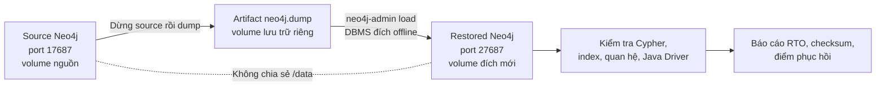
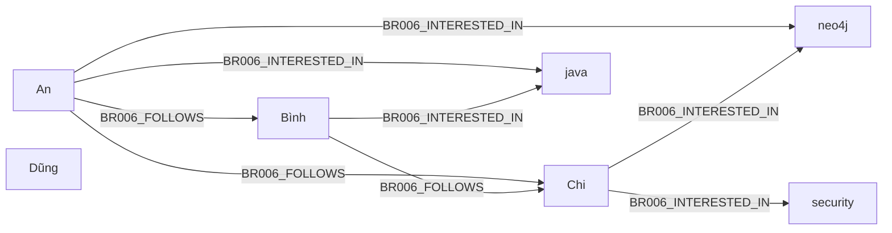

# Thực hành khôi phục vào môi trường tách biệt

## 1. Mục tiêu: chứng minh có thể phục hồi, không chỉ tạo được file sao lưu

Trong hệ thống Neo4j, dữ liệu nằm trong **property graph** gồm node, relationship, thuộc tính và index; các ứng dụng Java Driver hoặc Spring Data Neo4j truy vấn graph bằng Cypher. Khi mất database, lỗi ổ đĩa, xóa nhầm hoặc cần kiểm tra bản sao lưu trước khi thay đổi hệ thống, một file `.dump` hoặc `.backup` **chỉ là đầu vào**. Khả năng phục hồi thực sự phải được kiểm chứng bằng cách dựng một Neo4j khác, nạp bản sao, chạy truy vấn và xác nhận dữ liệu **đúng, đủ, dùng được**.

Bài này thuộc chương **Sao lưu và phục hồi** của module `DATABASE_ENGINE_GRAPH_NEO4J`. Trọng tâm là **khôi phục vào môi trường tách biệt** (*isolated restore rehearsal*): source Neo4j không bị ghi đè, môi trường đích có volume riêng, endpoint riêng và không được kết nối tới các hệ thống production ngoài ý muốn.

**Sau bài học, bạn có thể:**

1. Giải thích vì sao phục hồi sang nơi khác an toàn hơn thao tác ghi đè ngay trên production.
2. Phân biệt `neo4j-admin database dump/load` khi database offline với `backup/restore` của Enterprise Edition.
3. Dựng hai Neo4j độc lập bằng Docker, tạo fixture, dump nguồn và nạp sang volume mới.
4. Kiểm tra **file sao lưu, checksum, node/relationship, thuộc tính, index/constraint, truy vấn nghiệp vụ** và khả năng ứng dụng kết nối.
5. Xác nhận mốc phục hồi (*recovery point*), đo RTO thực tế, phát hiện quyền cấu hình và metadata chưa được đưa theo bản sao.
6. Đề xuất checklist bảo mật, báo cáo phục hồi, điều kiện dừng và cách dọn phòng lab mà không xóa nhầm dữ liệu gốc.

> **Ranh giới an toàn:** Tất cả lệnh bên dưới là **bài thực hành** để người học chạy trong **môi trường Docker tự tạo**. Không trỏ volume, thư mục backup hoặc tên database tới hệ thống thật. Không chạy `--overwrite-destination`, `docker volume rm` hoặc `docker compose down -v` với dữ liệu cần giữ. Chưa có lệnh nào trong bài này được thực thi tự động trên Neo4j production.

## 2. Mô hình cô lập và tiêu chí thành công



| Thành phần | Bắt buộc phải khác nhau | Lý do |
|---|---|---|
| **Source** | Volume `br006_lab_source_data`, container/service `source` | Giữ dữ liệu gốc để so sánh và không vô tình ghi đè |
| **Restore** | Volume `br006_lab_restored_data`, service `restored` | Tạo bản graph độc lập, không dùng chung `/data` |
| **Backup artifact** | Volume `br006_lab_archives` | Tách file sao lưu ra khỏi filesystem của database |
| **Endpoint** | Bolt `17687` nguồn, `27687` đích trên localhost | Tránh Java Driver/Browser ghi nhầm cơ sở dữ liệu |
| **Tài khoản** | Secret source và restored riêng | Đảm bảo mật khẩu của source không tự được áp vào đích |
| **Docker network** | Hai mạng riêng trong Compose | Không kết nối container source và restored với nhau qua cùng mạng ứng dụng |

Ở môi trường thật, **tách biệt còn bao gồm VM/VPC/network, quyền truy cập, secrets, tích hợp outbound, queue consumer và job scheduler**. Hai container trên cùng host chỉ mô phỏng sự cô lập về volume/network ở mức phòng lab; chúng **không** bảo vệ khỏi mất toàn bộ host và không đủ cho một bản sao lưu chống thảm họa.

### 2.1. RPO và RTO đo gì?

| Chỉ số | Định nghĩa | Ví dụ minh họa |
|---|---|---|
| **RPO – Recovery Point Objective** | Mức mất dữ liệu tối đa doanh nghiệp chấp nhận | RPO 15 phút nghĩa là mục tiêu không mất quá 15 phút thay đổi |
| **RTO – Recovery Time Objective** | Khoảng gián đoạn tối đa chấp nhận để khôi phục dịch vụ | RTO 60 phút gồm tìm backup, restore, kiểm chứng và đưa ứng dụng trở lại |
| **Recovery point thực tế** | Thời điểm/transaction mới nhất mà bản khôi phục chứa | `neo4j.dump` offline phản ánh trạng thái database tại lúc dump |
| **Restore elapsed time** | Thời gian thao tác nạp artifact vào store | Chỉ là **một phần** của RTO tổng |

Trong bài, sau khi dump xong ta cố ý tạo một node mới **chỉ ở nguồn**. Node đó **không** được xuất hiện ở database khôi phục: đây là cách trực quan chứng minh bản phục hồi có mốc dữ liệu riêng, không phải bản sao đồng bộ liên tục.

## 3. Chọn cơ chế sao lưu trước khi khôi phục

| Artifact | Lệnh tạo | Điều kiện cơ bản | Lệnh phục hồi thích hợp |
|---|---|---|---|
| **Offline dump `.dump`** | `neo4j-admin database dump` | Database phải offline; Community Edition cần DBMS offline | `neo4j-admin database load` |
| **Online full backup `.backup`** | `neo4j-admin database backup` | Enterprise Edition với dịch vụ backup đã cấu hình, database đang chạy | `neo4j-admin database restore`; có thể `load` một **full backup** |
| **Online differential backup** | `database backup --type=DIFF` | Enterprise; cần chain full/differential hợp lệ | `database restore` xử lý backup chain |
| **Sao chép trực tiếp `/data` lúc database đang ghi** | Copy filesystem thông thường | **Không phải** cách sao lưu nhất quán được khuyến nghị | Không dùng làm đầu vào khôi phục chuẩn |

Theo tài liệu Neo4j hiện hành, `database dump` chỉ sao lưu **dữ liệu của database**, **không bao gồm user/role** thuộc `system`. Phải lên kế hoạch sao lưu `system`, cấu hình, certificates, plugin và secrets theo phạm vi sự cố; trong bài thực hành chúng ta **không khôi phục `system` của source sang đích** để tránh nhập luôn danh tính, quyền và cấu hình nhạy cảm từ nơi khác.

**Lựa chọn của lab:** dùng `dump → load` offline vì phù hợp cho cả Community và Enterprise, không cần mở dịch vụ backup mạng và dễ kiểm chứng trong Docker. Online backup của Enterprise được so sánh riêng ở mục 11.

## 4. Điều kiện tiên quyết và khóa an toàn

Trước khi bắt đầu:

1. Có Docker Engine và **Docker Compose V2**, đủ RAM, CPU và dung lượng để giữ **hai** store cộng một bản dump.
2. Chọn image Neo4j và image `neo4j/neo4j-admin` **cùng phiên bản**; ví dụ sử dụng `2026.10.2` như tài liệu Docker chính thức tại thời điểm soạn. Trong dự án thật phải pin tag đã được kiểm thử.
3. Tên volume `br006_lab_*` **chưa có sẵn**; nếu trùng tên với volume đang chứa dữ liệu, **dừng** và chọn tên khác. Không tái sử dụng một volume không rõ chủ sở hữu.
4. Chuẩn bị hai secret riêng, không commit vào Git, không gửi vào log/chat, dùng mật khẩu mạnh và hạn chế quyền đọc.
5. Đảm bảo **không có** Neo4j nào khác đang dùng volume đích hoặc volume nguồn. Không mở helper `load` khi server đích còn chạy.
6. Làm việc trong thư mục lab độc lập; tất cả lệnh tạo volume/container dưới đây do người học chủ động thực thi và xác nhận.

### 4.1. Kiểm tra tên trước khi tạo volume

```bash
# Thực hiện trên máy lab, dùng Docker CLI.
docker volume ls
docker ps --format "table {{.Names}}\t{{.Status}}\t{{.Ports}}"

# Chỉ khi đã xác nhận ba tên sau chưa chứa dữ liệu:
docker volume create br006_lab_source_data
docker volume create br006_lab_restored_data
docker volume create br006_lab_archives
```

`docker volume create` **không xóa volume đã tồn tại**; vì vậy câu lệnh trả thành công **không chứng minh** bạn vừa tạo một volume trống. Phải xác nhận trước bằng `docker volume inspect` hoặc chọn tên mới duy nhất.

### 4.2. Cấu trúc thư mục và Docker Compose

Chuẩn bị cục bộ:

```text
br006-lab/
├── compose.yaml
└── secrets/
    ├── source-auth.txt
    └── restored-auth.txt
```

Mỗi file secret chứa **một dòng** `neo4j/<mật-khẩu-riêng-mạnh>`. Không sử dụng cùng một file cho cả hai phía. File secret của môi trường restore nên được cấp bởi môi trường restore, không copy nguyên thông tin xác thực production.

Nội dung `compose.yaml`:

```yaml
services:
  source:
    image: neo4j:2026.10.2
    profiles: ["source"]
    ports:
      - "127.0.0.1:17474:7474"
      - "127.0.0.1:17687:7687"
    environment:
      NEO4J_AUTH_FILE: /run/secrets/br006_source_auth
    secrets:
      - br006_source_auth
    volumes:
      - source_data:/data
    networks:
      - source_net

  restored:
    image: neo4j:2026.10.2
    profiles: ["restored"]
    ports:
      - "127.0.0.1:27474:7474"
      - "127.0.0.1:27687:7687"
    environment:
      NEO4J_AUTH_FILE: /run/secrets/br006_restored_auth
    secrets:
      - br006_restored_auth
    volumes:
      - restored_data:/data
    networks:
      - restored_net

secrets:
  br006_source_auth:
    file: ./secrets/source-auth.txt
  br006_restored_auth:
    file: ./secrets/restored-auth.txt

volumes:
  source_data:
    external: true
    name: br006_lab_source_data
  restored_data:
    external: true
    name: br006_lab_restored_data

networks:
  source_net:
  restored_net:
```

Hai `external: true` volumes **không thuộc vòng đời xóa volume tự động của Compose**. Cả hai mạng có tên logic riêng; chỉ publish cổng vào `127.0.0.1` của host. Lưu ý Docker host vẫn có quyền quản trị cả hai; môi trường production cần thêm cô lập mạng/host và chính sách kết nối outbound.

Kiểm tra rồi chỉ khởi động **source**:

```bash
docker compose config --quiet
docker compose --profile source up -d source
docker compose --profile source ps
docker compose --profile source logs --tail 80 source
```

Nếu Neo4j chưa sẵn sàng, kiểm tra log và trạng thái container; không bắt đầu tạo dữ liệu khi server còn khởi tạo. Mở Browser tại `http://localhost:17474`, đăng nhập bằng **secret của source**; Bolt endpoint là `bolt://localhost:17687`. Không dùng cổng mặc định `7687` để tránh vô tình kết nối một Neo4j khác.

## 5. Tạo một fixture graph có kết quả kiểm chứng được

Ta xây node `BR006Person` và `BR006Topic`, cùng hai loại relationship:



Mọi câu Cypher trong mục này chạy trên **source** (Browser port `17474`, database `neo4j`). Tên nhãn, relationship và constraint được đặt tiền tố `BR006` để dễ nhận diện.

### 5.1. Schema định danh

```cypher
CREATE CONSTRAINT br006_person_id IF NOT EXISTS
FOR (p:BR006Person)
REQUIRE p.id IS UNIQUE;
```

```cypher
CREATE CONSTRAINT br006_topic_code IF NOT EXISTS
FOR (t:BR006Topic)
REQUIRE t.code IS UNIQUE;
```

### 5.2. Tạo node

```cypher
UNWIND [
  {id: 'an', name: 'An'},
  {id: 'binh', name: 'Bình'},
  {id: 'chi', name: 'Chi'},
  {id: 'dung', name: 'Dũng'}
] AS row
MERGE (p:BR006Person {id: row.id})
SET p.name = row.name;
```

```cypher
UNWIND ['neo4j', 'java', 'security'] AS code
MERGE (:BR006Topic {code: code});
```

### 5.3. Tạo relationship và thuộc tính relationship

```cypher
UNWIND [
  {from: 'an', to: 'binh', year: 2024},
  {from: 'an', to: 'chi', year: 2025},
  {from: 'binh', to: 'chi', year: 2025}
] AS row
MATCH (source:BR006Person {id: row.from})
MATCH (target:BR006Person {id: row.to})
MERGE (source)-[r:BR006_FOLLOWS]->(target)
SET r.sinceYear = row.year;
```

```cypher
UNWIND [
  {person: 'an', topic: 'neo4j', weight: 3},
  {person: 'an', topic: 'java', weight: 2},
  {person: 'binh', topic: 'java', weight: 2},
  {person: 'chi', topic: 'neo4j', weight: 4},
  {person: 'chi', topic: 'security', weight: 1}
] AS row
MATCH (p:BR006Person {id: row.person})
MATCH (t:BR006Topic {code: row.topic})
MERGE (p)-[r:BR006_INTERESTED_IN]->(t)
SET r.weight = row.weight;
```

### 5.4. Ghi baseline trước khi dump

```cypher
MATCH (p:BR006Person)
WITH count(p) AS persons
MATCH (t:BR006Topic)
WITH persons, count(t) AS topics
MATCH (:BR006Person)-[f:BR006_FOLLOWS]->(:BR006Person)
WITH persons, topics, count(f) AS follows
MATCH (:BR006Person)-[i:BR006_INTERESTED_IN]->(:BR006Topic)
RETURN persons, topics, follows, count(i) AS interests;
```

Kết quả kỳ vọng:

| persons | topics | follows | interests |
|---:|---:|---:|---:|
| 4 | 3 | 3 | 5 |

Kiểm tra truy vấn nghiệp vụ có duyệt hai hop:

```cypher
MATCH (:BR006Person {id: 'an'})-[:BR006_FOLLOWS]->
      (friend:BR006Person)-[:BR006_INTERESTED_IN]->
      (topic:BR006Topic)
RETURN topic.code AS topic, count(DISTINCT friend) AS people
ORDER BY topic;
```

Trên fixture ban đầu, ba dòng là `java=1`, `neo4j=1` và `security=1`. Đây là **golden result** giúp kiểm chứng rằng các relationship còn được khôi phục, chứ không chỉ node.

Kiểm tra thêm một thuộc tính relationship:

```cypher
MATCH (:BR006Person {id: 'an'})-[r:BR006_FOLLOWS]->
      (:BR006Person {id: 'binh'})
RETURN r.sinceYear AS sinceYear;
```

Kỳ vọng `sinceYear = 2024`. Ghi lại kết quả và thời điểm hoàn thành tạo fixture; đây là mốc trước sao lưu.

## 6. Đóng source và tạo offline dump

**Điều kiện:** Tất cả transaction viết fixture đã hoàn thành, người học đã xác nhận dữ liệu source đúng. Không thực hiện `database dump` khi database đang được server Neo4j mount và ghi.

Trong thư mục chứa `compose.yaml`, dừng **chỉ** service source:

```bash
docker compose --profile source stop source
docker compose --profile source ps
```

Xác nhận service source đã dừng. Không dừng một Docker project khác có tên tương tự; `docker compose` thực thi với project/thư mục hiện tại.

Dùng **container quản trị tạm thời** cùng phiên bản Neo4j; mount volume source ở `/data` và một volume riêng để giữ dump:

```bash
docker run --rm \
  --mount type=volume,src=br006_lab_source_data,dst=/data \
  --mount type=volume,src=br006_lab_archives,dst=/backups \
  neo4j/neo4j-admin:2026.10.2 \
  neo4j-admin database dump neo4j --to-path=/backups
```

Kết quả mong đợi là artifact `neo4j.dump` trong `br006_lab_archives`. Nếu lệnh báo không có quyền ghi/đọc volume, **không** đổi toàn bộ thư mục thành mode `777`: cần xác định UID/GID user `neo4j` của image (thông thường 7474) và điều chỉnh quyền trên **volume lab** theo tài liệu Docker. Nếu lệnh báo database đang hoạt động, quay lại kiểm tra source đã dừng; không thử dump bằng cách ép container ghi cùng store.

### 6.1. Tại sao dùng `--rm` và admin sidecar?

Helper `neo4j/neo4j-admin` chạy lệnh rồi tự xóa **container tạm**, không xóa các named volume đã mount. Nó không chạy database server, vì vậy có thể thao tác **offline** với store. Cách làm này phù hợp với hướng dẫn chính thức Neo4j Docker về `dump/load`.

`.dump` **không** là bản sao phân tán đồng bộ theo thời gian thực và **không** mang theo cấu hình mạng, người dùng/role từ `system`, key/certificate hoặc kết nối ứng dụng. Đây là một artifact dữ liệu database cần được bảo vệ và ghi nhận metadata riêng.

## 7. Kiểm tra artifact trước khi load

Một thao tác dump báo thành công chưa đủ để tuyên bố có thể restore. Cần ít nhất:

1. Artifact nằm đúng volume và đúng database, không phải file từ bài chạy trước.
2. Dung lượng file hợp lý, file có thể đọc, metadata nhận diện đúng format/phiên bản.
3. Có checksum và bản ghi ngày tạo, source, phiên bản, người phụ trách, nơi lưu.
4. Nếu có cơ chế ký số/immutable storage, xác minh theo chính sách trước khi import vào môi trường kiểm tra.

### 7.1. Kiểm tra thông tin archive bằng neo4j-admin

```bash
docker run --rm \
  --mount type=volume,src=br006_lab_archives,dst=/backups,readonly \
  neo4j/neo4j-admin:2026.10.2 \
  neo4j-admin database load neo4j --from-path=/backups --info
```

`--info` **chỉ hiển thị metadata của archive**, không nạp dữ liệu, không sửa volume restore. Nếu lệnh thất bại hoặc trỏ nhầm archive, phải sửa nguyên nhân **trước** khi nạp. Không dùng `--overwrite-destination` như cách bỏ qua lỗi input.

### 7.2. Checksum và danh mục backup

Ví dụ tính SHA-256 từ container helper và **ghi giá trị vào nhật ký kiểm thử riêng**:

```bash
docker run --rm \
  --entrypoint /bin/sh \
  --mount type=volume,src=br006_lab_archives,dst=/backups,readonly \
  neo4j/neo4j-admin:2026.10.2 \
  -c 'sha256sum /backups/neo4j.dump'
```

Yêu cầu có lệnh `sha256sum` trong image helper; nếu bản image đã chọn không cung cấp, dùng công cụ hash tương đương trên một bản copy **được cấp quyền đọc**. Một hash tính **sau khi** file đã bị sửa không tự chứng minh tính toàn vẹn; giá trị chuẩn phải được lưu ngoài nơi backup có thể bị sửa, hoặc được ký/xác thực theo quy trình.

Danh mục tối thiểu:

| Trường | Nội dung cần ghi |
|---|---|
| `artifact` | `neo4j.dump` |
| `source DB` | `neo4j` trên source `17687` |
| `source version` | Neo4j `2026.10.2` (theo image của lab) |
| `createdAt` và `recovery point` | Thời điểm dump hoàn tất, mốc transaction/metadata nếu có |
| `size` và `SHA-256` | Kích thước/giá trị đo thực tế, không bịa số |
| `location` | `br006_lab_archives`; vị trí copy off-host nếu có |
| `owner` và `retention` | Người vận hành, thời hạn giữ, khóa mã hóa nếu áp dụng |

**Bảo mật:** Dữ liệu backup có thể chứa node/relationship và thuộc tính nhạy cảm. Không upload công khai, không gửi file qua chat/email không được phép; giới hạn quyền đọc, mã hóa khi lưu và truyền, có quy tắc xóa an toàn sau diễn tập.

## 8. Tạo mốc khác biệt trên nguồn sau dump

Khởi động lại source (vẫn gắn `br006_lab_source_data`):

```bash
docker compose --profile source start source
docker compose --profile source logs --tail 50 source
```

Đăng nhập Browser source tại `http://localhost:17474`. **Chỉ trên source**, thêm một node marker:

```cypher
MERGE (p:BR006Person {id: 'after-dump'})
SET p.name = 'Thay đổi sau sao lưu';
```

Kiểm tra source:

```cypher
MATCH (p:BR006Person)
RETURN count(p) AS personCount;
```

Kỳ vọng **5** người trên nguồn. Backup được tạo trước sự kiện `after-dump` nên bản restore hợp lệ phải **chỉ có 4** người. Nếu thấy marker trong restore, đó là dấu hiệu đã nhầm volume, nhầm artifact hoặc đang truy vấn lại source.

Không dùng bước này để tính chính xác RPO của production: nó là **thử nghiệm chụp một mốc dữ liệu**. RPO trong hệ thống thật còn phụ thuộc lịch backup, độ trễ lưu bản sao ở vị trí khác và khả năng khôi phục chain/differential.

## 9. Load vào volume đích mới, không ghi đè nguồn

**Điều kiện tiên quyết trước lệnh `load`:**

- Volume `br006_lab_restored_data` là volume mới/trống được dành **chỉ** cho bài này.
- Service `restored` **chưa khởi động**; không có Neo4j nào mount volume đích để ghi.
- Artifact `neo4j.dump` đã kiểm tra được bằng `--info` và checksum.
- Helper dùng cùng phiên bản đủ tương thích với artifact.

Chạy:

```bash
docker run --rm \
  --mount type=volume,src=br006_lab_restored_data,dst=/data \
  --mount type=volume,src=br006_lab_archives,dst=/backups,readonly \
  neo4j/neo4j-admin:2026.10.2 \
  neo4j-admin database load neo4j --from-path=/backups
```

**Không dùng `--overwrite-destination`**: volume restore phải trống và được nhận diện là mới. Cờ overwrite có mục đích riêng khi **thực sự** thay một database đã tồn tại trên môi trường được phê duyệt; nó không nên có mặt trong bài diễn tập phục hồi tách biệt.

Sau lệnh thành công, khởi động **chỉ** service restored:

```bash
docker compose --profile restored up -d restored
docker compose --profile restored ps
docker compose --profile restored logs --tail 80 restored
```

Mở Browser **đích** tại `http://localhost:27474`, kết nối Bolt `bolt://localhost:27687` bằng **secret restored**. Khi `.dump` chỉ chứa database người dùng, tài khoản và mật khẩu đích **không** được khôi phục từ source. Nếu bạn đang dùng tài khoản/port nguồn mà vẫn thấy kết quả, hãy kiểm tra lại URL; đừng kết luận restore đã thành công.

## 10. Kiểm chứng bản khôi phục theo nhiều lớp

`docker compose ps` báo `running` không chứng minh graph đúng. Cần một **acceptance test** có kiểm tra định lượng, ngữ nghĩa và việc ứng dụng thực sự đọc được dữ liệu.

### 10.1. Kiểm tra database đang online và đúng endpoint

Trong Browser của restored (`27474`), chạy:

```cypher
SHOW DATABASES
YIELD name, currentStatus
RETURN name, currentStatus
ORDER BY name;
```

Xác nhận database `neo4j` ở trạng thái online. Neo4j Enterprise có thể cần thêm thao tác **`CREATE DATABASE`** nếu phục hồi một database chưa được đăng ký trong `system`; bài lab Community dùng database mặc định `neo4j`.

Chạy một truy vấn đếm cả tổng số người và số marker bằng biểu thức tổng hợp rõ ràng:

```cypher
MATCH (p:BR006Person)
RETURN count(p) AS personCount,
       sum(CASE WHEN p.id = 'after-dump' THEN 1 ELSE 0 END) AS markers;
```

Kỳ vọng **`personCount=4`, `markers=0`**. Nếu nhận `5,1`, khả năng cao bạn đang trỏ tới source, dùng nhầm volume hoặc thực sự đã dump sau khi thêm marker. Nếu nhận `0,0`, hãy kiểm tra database được chọn, tên nhãn, log load và artifact.

### 10.2. Đối chiếu số lượng node và relationship

Chạy nguyên câu **baseline** ở mục 5.4 trên restored:

```cypher
MATCH (p:BR006Person)
WITH count(p) AS persons
MATCH (t:BR006Topic)
WITH persons, count(t) AS topics
MATCH (:BR006Person)-[f:BR006_FOLLOWS]->(:BR006Person)
WITH persons, topics, count(f) AS follows
MATCH (:BR006Person)-[i:BR006_INTERESTED_IN]->(:BR006Topic)
RETURN persons, topics, follows, count(i) AS interests;
```

Kỳ vọng vẫn là `4 người, 3 chủ đề, 3 FOLLOWS, 5 INTERESTED_IN`. **Số lượng bằng nhau là cần nhưng chưa đủ:** cùng tổng số vẫn có thể sai khóa hoặc mất một quan hệ và tạo nhầm một quan hệ khác.

### 10.3. Đối chiếu khóa, thuộc tính và traversal

Kiểm tra thuộc tính trên relationship:

```cypher
MATCH (:BR006Person {id: 'an'})-[r:BR006_FOLLOWS]->
      (:BR006Person {id: 'binh'})
RETURN r.sinceYear AS sinceYear;
```

Kỳ vọng `2024`. Kiểm tra một cạnh có trọng số:

```cypher
MATCH (:BR006Person {id: 'chi'})-[r:BR006_INTERESTED_IN]->
      (:BR006Topic {code: 'neo4j'})
RETURN r.weight AS weight;
```

Kỳ vọng `4`. Chạy lại truy vấn nghiệp vụ hai hop:

```cypher
MATCH (:BR006Person {id: 'an'})-[:BR006_FOLLOWS]->
      (friend:BR006Person)-[:BR006_INTERESTED_IN]->
      (topic:BR006Topic)
RETURN topic.code AS topic, count(DISTINCT friend) AS people
ORDER BY topic;
```

Kỳ vọng `java=1, neo4j=1, security=1`. Sự kết hợp này kiểm tra **định danh node, tính đúng đắn relationship, hướng duyệt và truy vấn Cypher**.

### 10.4. Kiểm tra index/constraint

```cypher
SHOW CONSTRAINTS
YIELD name, type, entityType, labelsOrTypes, properties
WHERE name STARTS WITH 'br006_'
RETURN name, type, entityType, labelsOrTypes, properties
ORDER BY name;
```

Kỳ vọng có `br006_person_id` và `br006_topic_code`. Kiểm tra index tương ứng:

```cypher
SHOW INDEXES
YIELD name, type, state, labelsOrTypes, properties
WHERE name IN ['br006_person_id', 'br006_topic_code']
RETURN name, type, state, labelsOrTypes, properties
ORDER BY name;
```

Đợi index ở trạng thái `ONLINE` trước khi đánh giá hiệu năng. Khi dùng backup của database thật, phải so đủ **constraint, range/text/full-text/vector indexes**, plugin/hàm tự cài và các schema khác đang sử dụng. Một bản restore chạy query được nhưng thiếu index hoặc thiếu plugin vẫn **chưa đạt tiêu chí sẵn sàng ứng dụng**.

### 10.5. Khẳng định bản source không đổi

Quay lại Browser source (`17474`), chạy:

```cypher
MATCH (p:BR006Person)
RETURN count(p) AS personCount;
```

Source kỳ vọng **5**, restore kỳ vọng **4**. Đồng thời so:

| Kiểm tra | Source sau dump | Restored |
|---|---:|---:|
| Người | 5 | 4 |
| Topic | 3 | 3 |
| `BR006_FOLLOWS` | 3 | 3 |
| `BR006_INTERESTED_IN` | 5 | 5 |
| Có `after-dump` | Có | Không |
| `br006_person_id`/`br006_topic_code` | Có | Có |

Đây là bằng chứng cốt lõi về **tách biệt dữ liệu và mốc phục hồi**, đồng thời phát hiện trường hợp dùng cùng volume hoặc sai endpoint.

## 11. Kiểm tra bằng Java Driver và phân biệt Enterprise backup

### 11.1. Smoke test của ứng dụng với endpoint restored

Mỗi ứng dụng Java Driver/Spring Data Neo4j phải có một cấu hình kết nối riêng cho môi trường restore. **Không dùng connection string production**, không bật scheduler/job ghi dữ liệu và không để ứng dụng thử nghiệm tự phát message ra queue thật.

Ví dụ Java:

```java
import java.util.Map;
import org.neo4j.driver.AuthTokens;
import org.neo4j.driver.Config;
import org.neo4j.driver.GraphDatabase;

String password = System.getenv("BR006_RESTORE_PASSWORD");
if (password == null || password.isBlank()) {
    throw new IllegalStateException("Missing restored credential");
}

try (var driver = GraphDatabase.driver(
        "bolt://localhost:27687",
        AuthTokens.basic("neo4j", password),
        Config.defaultConfig()
    )) {
    driver.verifyConnectivity();
    try (var session = driver.session(
            org.neo4j.driver.SessionConfig.forDatabase("neo4j"))) {
        var result = session.executeRead(tx ->
            tx.run("""
                MATCH (p:BR006Person)
                RETURN count(p) AS count
                """, Map.of())
              .single()
              .get("count").asLong()
        );
        if (result != 4L) {
            throw new IllegalStateException("Unexpected restore count: " + result);
        }
        System.out.println("Restored graph smoke test passed");
    }
}
```

Với Spring Data Neo4j, sử dụng profile riêng chỉ bật **repository đọc**, đặt `spring.neo4j.uri` hướng tới `bolt://localhost:27687` và secret restored. Test mapper một quan hệ, test query có parameter và test rằng thao tác bị cấm không chạy được với role đọc (khi môi trường có RBAC). **Không** nhầm một lần kết nối thành công với toàn bộ hệ thống đã khôi phục: còn cần các lệnh tổng hợp, đường đi, index và kiểm tra tính năng nghiệp vụ.

### 11.2. Với artifact .backup của Enterprise

Nếu source thật dùng `neo4j-admin database backup` (Enterprise Edition), artifact có thể là **full backup** hoặc một chuỗi **full + differential**. Không thể tùy tiện chọn một differential rồi dùng `database load` như một `.dump` độc lập.

Lựa chọn thường dùng khi phục hồi trên **standalone Enterprise**:

```bash
# Minh họa cú pháp, không chạy trực tiếp trên production:
neo4j-admin database restore \
  --from-path=/isolated/backups/neo4j-YYYYMMDD.backup \
  restoredlab
```

Điều kiện của ví dụ:

- `--from-path` trỏ tới **artifact có thật**, đã kiểm tra metadata và tính toàn vẹn; file nêu trên chỉ là **tên minh họa**, không phải file tồn tại.
- Thực hiện trên **server/volume đích riêng**, với quyền truy cập filesystem theo user `neo4j`; không dùng chung dữ liệu nguồn.
- Khi restore tới tên database mới, Enterprise cần đăng ký database bằng `CREATE DATABASE restoredlab` trên `system` **sau khi restore hoàn tất**, theo quy trình phiên bản đang dùng.
- Với full/differential chain, phải cung cấp artifact/đường dẫn đầy đủ để `database restore` tìm và replay phần transaction log cần thiết.
- `--overwrite-destination` **không nên dùng** trong diễn tập phục hồi tách biệt; trên cluster càng không được xem nó là thao tác ghi đè an toàn.

Neo4j hiện hỗ trợ `--restore-until` cho một số trường hợp khôi phục theo transaction ID hoặc timestamp khi có dữ liệu log phù hợp. Khả năng này phụ thuộc **backup chain và phiên bản**, không thể tái tạo mọi thời điểm nếu log cần thiết không có. Nếu dùng Change Data Capture, cần xem chính sách `txLogEnrichment` và cách consumer xử lý điểm khôi phục; load/restore không tự phát lại event CDC như transaction ghi bình thường.

**Vấn đề metadata:** `.dump` không chứa user/role. Với online backup Enterprise, tùy phiên bản và tùy chọn `--include-metadata` có thể chứa metadata role/user, nhưng các quyền DBMS cấp cao không nhất thiết được giữ đầy đủ. Không tự đưa user/role của production sang phòng lab khi chưa kiểm tra bảo mật. Không được kết luận các quyền ứng dụng đúng chỉ vì dữ liệu graph và constraint đã khôi phục.

## 12. Các tình huống lỗi cần chủ động thử

| Tình huống | Dấu hiệu | Cách phản ứng |
|---|---|---|
| Artifact không nằm trong volume | `load --info` không tìm thấy `neo4j.dump` | Kiểm tra mount, database name, phiên bản và đường dẫn; không tạo file giả |
| Sai permission | Helper không đọc/ghi `/data` hoặc `/backups` | Kiểm tra UID/GID, ACL; sửa **chỉ volume lab** |
| Đích đang chạy | Lỗi do database mounted hoặc store đang khóa | Dừng service restored, xác nhận không có tiến trình khác |
| Đích đã chứa database | `load` từ chối vì destination tồn tại | **Dừng**, xác minh volume; không tự thêm overwrite |
| Phiên bản store không tương thích | Khởi động hoặc restore thất bại | Dùng phiên bản/upgrade path được Neo4j hỗ trợ; không restore xuống bản cũ |
| Artifact hỏng/thiếu một phần | Checksum khác, lỗi đọc archive | Dùng bản sao hợp lệ khác, không sửa tùy tiện dữ liệu backup |
| Online differential thiếu full/chain | Restore không tìm đủ parent/log | Khôi phục lại chain nguyên vẹn từ backup repository |
| Thiếu đĩa | Quá trình load/restore hết chỗ | Dự toán size store + index + temp + log; thêm storage an toàn |
| Load xong nhưng không thấy node | Query nhầm source/DB/nhãn | So endpoint, `SHOW DATABASES`, checksum và số node |
| Query thành công nhưng thiếu plugin/role | App path/permission bị lỗi | Kiểm tra cấu hình, RBAC, schema, thư viện APOC/GDS |
| Source có marker trong restore | Bản sao sau mốc hoặc lẫn volume | Dừng nghiệm thu, kiểm tra cả artifact và nguồn |
| App restore ghi sang hệ thật | Job/connector outbound không bị cô lập | Ngắt network, vô hiệu hóa scheduler/consumer, báo sự cố |

### 12.1. Diễn tập lỗi không được phá source

Để luyện lỗi permission hoặc file hỏng, **chỉ tạo một bản sao phụ của artifact** trong vùng thử nghiệm, không sửa `br006_lab_archives/neo4j.dump` gốc. Với file backup thật, quy trình phải xác minh hash và quyền truy cập **trước khi** đưa artifact vào môi trường không tin cậy.

Nếu việc load thất bại giữa chừng, **không** giả định volume đích vẫn sạch. Hãy dừng và kiểm tra nội dung/owner của volume đích trước khi tạo môi trường thử lại, sử dụng **volume đích mới** thay vì chèn `--overwrite-destination` để "chữa" một lỗi chưa hiểu.

## 13. RTO có thể đo và runbook phục hồi

Một buổi diễn tập phải ghi cả thời gian lẫn kết quả. Ví dụ chia mốc:

```text
T0  Nhận yêu cầu diễn tập, xác minh phạm vi
T1  Xác nhận backup catalog, quyền và checksum
T2  Chuẩn bị volume/host restore, khóa tác vụ ghi
T3  Bắt đầu neo4j-admin load/restore
T4  Load xong, server Neo4j đích khởi động ONLINE
T5  Kiểm chứng node, relationship, constraint, Cypher
T6  Java Driver/Spring Data Neo4j smoke test thành công
T7  Báo cáo trạng thái sẵn sàng và giới hạn còn lại
```

**Restore duration** thường được đo từ T3 tới T4; **rehearsal RTO** nên đo từ T0 tới T7 (theo định nghĩa đã thống nhất của tổ chức). Nếu backup ở object storage cần tải xuống, thời gian truyền và giải mã cũng phải tính; kết quả lab không tự đại diện RTO khi database production lớn hơn hàng nghìn lần.

Mẫu báo cáo nghiệm thu:

| Tiêu chí | Điền sau chạy | Điều kiện PASS |
|---|---|---|
| Artifact hợp lệ | Tên, path, hash, metadata | Khớp catalog đã duyệt |
| Phiên bản tương thích | Source/target Neo4j | Được tài liệu hỗ trợ |
| Đích độc lập | Volume, container, network, endpoint | Không chia sẻ `/data` với nguồn |
| Source nguyên vẹn | 5 người, có marker | PASS |
| Restored đúng mốc | 4 người, không có marker | PASS |
| Relationship và property | 3 FOLLOWS, 5 INTERESTED_IN, thuộc tính đúng | PASS |
| Schema/index | Hai constraint; index `ONLINE` | PASS |
| Truy vấn nghiệp vụ | Ba chủ đề đúng kết quả golden | PASS |
| Java Driver test | Kết nối `27687` và kiểm tra count | PASS |
| Quyền và secrets | Principal đích riêng, không tích hợp ra production | PASS |
| RTO thực tế | Số phút đo được | So với SLO thực tế, không tự đặt PASS |

Nếu một mục bắt buộc chưa đạt, báo cáo **`RESTORE TEST FAILED / PARTIAL`** kèm nguyên nhân. Đừng tuyên bố `backup verified` chỉ vì công cụ `load` trả exit code 0. Phải ghi cả **người kiểm thử**, lần chạy, phạm vi dữ liệu, hash, log và phương án khắc phục.

## 14. Bảo mật dữ liệu khi khôi phục sang môi trường khác

Bản sao Neo4j có thể chứa PII, dữ liệu khách hàng, thông tin tổ chức và quan hệ nhạy cảm **ngay cả khi chỉ định dùng cho test**. Do đó:

- **Chỉ dùng dữ liệu giả** cho phòng lab công khai. Nếu dùng backup thật phải có phê duyệt, phân loại, hợp đồng xử lý dữ liệu và kiểm soát nơi lưu.
- Có **secrets riêng** ở môi trường restore; không đưa mật khẩu production vào image hoặc Compose YAML.
- Giới hạn truy cập volume và artifact, mã hóa at rest/in transit khi phù hợp, thiết lập retention và audit người được xem.
- Chặn network outbound hoặc vô hiệu hóa **queue consumer, CDC exporter, SMTP, webhook, billing, scheduler và job tự động** để graph phục hồi không phát tác dụng phụ tới production.
- Không đẩy dữ liệu sao lưu lên các công cụ AI, nhật ký hoặc dịch vụ bên ngoài nếu chưa được cho phép.
- Ghi rõ bản nào đã được **ẩn danh/masking**, ai thực hiện và phép kiểm tra sau masking. Một graph bị ẩn tên nhưng vẫn giữ network relationship có thể tiết lộ danh tính qua cấu trúc liên kết.
- Không khôi phục `system` và role production vào đích không được kiểm soát; khôi phục quyền bằng quy trình RBAC riêng khi cần.

Trong thực tế, diễn tập DR tốt nhất chạy trên **host/cluster và vùng mạng riêng**. Cô lập port 127.0.0.1 của bài là một biện pháp phòng lab, không là ranh giới bảo mật production.

## 15. Bài tập mở rộng

1. **Kiểm tra giả định:** chạy các query baseline trước dump; giải thích vì sao một bản restore có số node đúng nhưng số relationship sai vẫn chưa đạt.
2. **Chứng minh độc lập:** thêm marker `after-dump` ở source sau dump. Vì sao restored không được có marker, và điều đó liên quan tới recovery point thế nào?
3. **Kiểm tra artifact:** dùng `neo4j-admin database load --info`; ghi checksum, size, version và thời gian backup. Nếu có nhiều `.dump` cùng tên database thì chính sách chọn artifact phải như thế nào?
4. **Sai endpoint:** cố ý cấu hình Java Driver thử nghiệm tới cổng `17687`; phát hiện lỗi bằng kiểm tra marker và ghi lại biện pháp ngăn kết nối nhầm.
5. **Thử tình huống thiếu index:** trong bản restore dùng cho test, kiểm tra `SHOW CONSTRAINTS` và `SHOW INDEXES`, giải thích ảnh hưởng tới hiệu năng truy vấn theo ID.
6. **Do RTO:** thay fixture bằng graph lớn hơn 100 lần, đo thời gian chuẩn bị, nạp, start và smoke test; phân biệt thời gian restore thuần với RTO tổng.
7. **So cơ chế:** nêu khi nào dùng `dump/load` và khi nào cần `backup/restore` Enterprise để đáp ứng RPO mà không phải dừng nguồn.
8. **Bảo mật:** thiết kế mạng lab không cho service restored gọi tới webhook/SMTP/queue production; lập checklist không có secrets thật trong dữ liệu xuất.
9. **Differential chain:** vẽ full backup B0 và hai differential D1, D2. Nếu D1 bị mất, giải thích tại sao D2 không được tự xem là một full backup.
10. **Mất toàn host:** giả sử cả `br006_lab_source_data` và `br006_lab_archives` ở cùng ổ đĩa. Chuyện gì xảy ra nếu ổ này hỏng? Thiết kế vị trí backup off-host và phép kiểm tra restore định kỳ.

**Tiêu chí hoàn thành bài:** có artifact kiểm tra được, source và restore là hai dữ liệu độc lập, kết quả Cypher khớp golden fixture, schema/index sử dụng được, endpoint và credentials không lẫn, có báo cáo RPO/RTO và kế hoạch bảo mật.

## 16. Dọn lab có kiểm soát

Khi đã xong, **chỉ dừng container lab**:

```bash
docker compose --profile source --profile restored down
```

Các volume khai báo `external: true` vẫn được giữ lại; đó là **mặc định an toàn**. Kiểm tra trước khi làm thêm:

```bash
docker volume inspect br006_lab_source_data
docker volume inspect br006_lab_restored_data
docker volume inspect br006_lab_archives
```

Nếu cần dọn graph trong database restored để luyện thao tác Cypher, chỉ thực hiện trên restored, **không** trên source:

```cypher
MATCH (p:BR006Person)
DETACH DELETE p;
```

```cypher
MATCH (t:BR006Topic)
DETACH DELETE t;
```

```cypher
DROP CONSTRAINT br006_person_id IF EXISTS;
```

```cypher
DROP CONSTRAINT br006_topic_code IF EXISTS;
```

**Lựa chọn an toàn hơn:** giữ nguyên source/archive/restore volumes để Prime hoặc người hướng dẫn có thể kiểm tra lại. Chỉ xóa **volume lab cụ thể** sau khi đã xác minh không có container nào dùng nó, có bản backup cần giữ ở nơi khác và có phê duyệt rõ ràng; **không** dùng `docker volume prune`, `docker system prune --volumes` hoặc `down -v` để dọn bừa bãi.

## 17. Tài liệu tham khảo chính thức

- [Neo4j Operations Manual — Backup and restore planning](https://neo4j.com/docs/operations-manual/current/backup-restore/planning/): phạm vi database, `system`, RPO/RTO và các file cấu hình cần lưu riêng.
- [Neo4j Operations Manual — Backup modes](https://neo4j.com/docs/operations-manual/current/backup-restore/modes/): full/differential và điểm khác nhau giữa `backup` và `dump`.
- [Neo4j Operations Manual — Back up an offline database](https://neo4j.com/docs/operations-manual/current/backup-restore/offline-backup/): cú pháp `neo4j-admin database dump` và điều kiện offline.
- [Neo4j Operations Manual — Restore a database dump](https://neo4j.com/docs/operations-manual/current/backup-restore/restore-dump/): `neo4j-admin database load`, `--info`, `--overwrite-destination` và giới hạn.
- [Neo4j Docker — Dump and load a database (offline)](https://neo4j.com/docs/operations-manual/current/docker/dump-load/): ví dụ chính thức với container `neo4j/neo4j-admin` và volume riêng.
- [Neo4j Docker — Persisting data with Docker volumes](https://neo4j.com/docs/operations-manual/current/docker/mounting-volumes/): `/data`, permissions, lưu trữ và phục hồi.
- [Neo4j Operations Manual — Online backup](https://neo4j.com/docs/operations-manual/current/backup-restore/online-backup/): backup Enterprise và chuỗi differential.
- [Neo4j Operations Manual — Restore a database backup](https://neo4j.com/docs/operations-manual/current/backup-restore/restore-backup/): restore, replay transaction log, lựa chọn bản backup và lưu ý cluster.
- [Neo4j Docker — Docker Compose and secrets](https://neo4j.com/docs/operations-manual/current/docker/docker-compose-standalone/): bố trí Compose và sử dụng `NEO4J_AUTH_FILE`.
- [Neo4j Java Driver Manual](https://neo4j.com/docs/java-manual/current/): kết nối, phân biệt transaction và kiểm tra kết quả sau restore.
