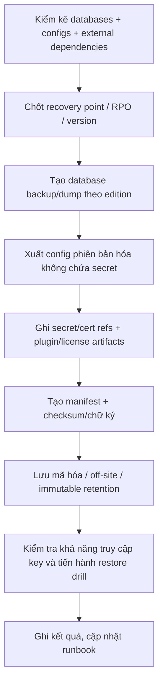

# Bảo vệ cấu hình, bí mật, chứng chỉ và thành phần ngoài tệp dữ liệu khi sao lưu Neo4j

Một bản sao lưu Neo4j có thể chứa **đầy đủ node, relationship, property, index và transaction cần khôi phục database**, nhưng dịch vụ vẫn có thể không hoạt động sau sự cố: cấu hình `neo4j.conf` bị mất, chứng chỉ TLS hết hạn, plugin APOC không còn, Java Driver không tin cậy CA mới, hoặc ứng dụng không lấy được mật khẩu từ secret manager.

Đây là lý do **“khôi phục được database” chưa đồng nghĩa “khôi phục được dịch vụ”**. Kế hoạch phục hồi phải bao gồm cả các thành phần **bên ngoài tệp dữ liệu** và bảo vệ chúng theo mức độ nhạy cảm.

Bài thuộc chương **Sao lưu và phục hồi** của module `DATABASE_ENGINE_GRAPH_NEO4J`. Module sử dụng Neo4j để mô hình hóa property graph, truy vấn liên kết/đường đi bằng Cypher, index, constraint, nhập dữ liệu và tích hợp Java Driver, Spring Data Neo4j. Trọng tâm của bài là kiểm kê, lưu giữ và phục hồi **cấu hình máy chủ, dữ liệu bảo mật, khóa/chứng chỉ, plugin, license và các phụ thuộc ngoài Neo4j**, sao cho sau khi phục hồi graph, ứng dụng vẫn truy vấn đúng và an toàn.

> **Mục tiêu:** tạo được một “recovery set” đủ thành phần, bảo vệ bí mật khỏi rò rỉ, biết thứ tự khôi phục trong môi trường cô lập và có các kiểm tra chấp nhận rõ ràng trước khi mở dịch vụ cho người dùng.

## 1. Hai mục tiêu khác nhau: database recovery và service recovery

Giả sử ứng dụng học trực tuyến lưu trong graph các node `:Student`, `:Course` và relationship `:ENROLLED_IN`. Hệ thống dùng:

- Neo4j Enterprise có nhiều database, bao gồm database người dùng và `system`.
- `neo4j.conf` đặt cổng Bolt, bộ nhớ, TLS và quyền chạy procedure.
- Chứng chỉ TLS cho Bolt; chứng chỉ khác cho liên lạc giữa các thành viên cluster.
- Plugin APOC và một custom procedure được đóng gói dưới dạng JAR.
- Tài khoản ứng dụng trong một secret manager; Spring Data Neo4j đọc URI và credential khi khởi động.
- Hình ảnh khóa học nằm trong object storage, graph chỉ lưu URL hoặc object key.

Sau sự cố mất host, nếu **chỉ restore một user database**, một số lỗi có thể xuất hiện:

| Triệu chứng sau restore | Thành phần có thể đã thiếu |
| --- | --- |
| `MATCH` chạy được trên máy local nhưng ứng dụng không kết nối được | DNS, Bolt routing, cấu hình TLS, chứng chỉ, firewall |
| Đọc graph được nhưng không đăng nhập đúng vai trò | `system` database, phân quyền, nguồn xác thực ngoài |
| `CALL apoc.path.expandConfig(...)` báo procedure không tồn tại | APOC JAR, phiên bản plugin, allowlist/config |
| Query custom procedure lỗi dù các node đã có | JAR phiên bản cũ, Java/JDK không tương thích |
| Java Driver báo certificate validation failed | CA/truststore, DNS/SAN hoặc server certificate |
| Hình ảnh/bài giảng bị mất dù graph vẫn có node | Object storage hoặc dữ liệu ngoài Neo4j |
| CDC xử lý lại sự kiện, tạo quan hệ trùng | Offset/checkpoint ngoài DB, idempotency chưa được đảm bảo |

Vì vậy cần phân biệt:

- **Data recovery:** database ở trạng thái nhất quán và chứa dữ liệu đúng thời điểm.
- **Service recovery:** data recovery **cộng** cấu hình, danh tính, bí mật, TLS, plugin, mạng, tài nguyên, ứng dụng và các phụ thuộc ngoài graph.

Hai mục tiêu liên quan nhưng không thay thế nhau.

## 2. Neo4j backup thực sự bao gồm những gì?

Neo4j cung cấp các cơ chế như `neo4j-admin database backup/restore` và `neo4j-admin database dump/load`. Khả năng áp dụng phụ thuộc **edition và phiên bản Neo4j**:

| Cơ chế | Tình huống chính | Điểm cần nhớ |
| --- | --- | --- |
| Online backup/restore | Neo4j Enterprise tự quản lý, cần sao lưu khi database còn hoạt động | Tạo artifact cho **database cụ thể**, có hỗ trợ chuỗi full/differential theo phiên bản |
| Offline dump/load | Các edition hỗ trợ, database được đưa về trạng thái phù hợp để dump | Phù hợp một số chiến lược sao lưu/di chuyển khi chấp nhận dừng |
| Backup do dịch vụ quản lý | Ví dụ Neo4j Aura | Khả năng tự phục hồi, lịch retention và quyền thao tác phụ thuộc gói/dịch vụ |

**Không dùng thao tác sao chép thư mục data của database đang chạy làm phương pháp backup mặc định.** File copy không đúng cơ chế có thể tạo bản sao thiếu nhất quán. Hãy dùng công cụ/khả năng backup được tài liệu hóa cho bản Neo4j đang vận hành.

### 2.1. User database khác `system` database

Trong Neo4j có database `system` chứa metadata quản trị DBMS, bao gồm **trạng thái cấu hình các database, tài khoản, roles và thông tin bảo mật**. Database người dùng chứa graph và schema của chính database đó.

Do đó, lịch backup phải cân nhắc:

1. **Tất cả database cần phục hồi**, không chỉ database mặc định `neo4j`.
2. **`system` database** hoặc phương án quản lý tài khoản/roles đã được chứng minh phù hợp.
3. **Tính tương ứng về thời điểm** giữa user database, metadata bảo mật và thay đổi cấu hình.

Một số phiên bản Neo4j Enterprise cho phép tùy chọn `--include-metadata` khi backup user database để kèm thông tin users/roles. **Khả năng này có giới hạn phạm vi**, chẳng hạn một số quyền quản trị ở mức DBMS không được đưa vào. **Không coi nó là phương án thay thế hoàn toàn cho việc bảo vệ `system` database** nếu yêu cầu khôi phục toàn DBMS.

### 2.2. Các tệp ngoài database phải sao lưu riêng

Theo Neo4j Operations Manual, cần bảo vệ riêng ít nhất:

- **`neo4j.conf`**; nếu là cluster thì cấu hình của **từng thành viên**.
- **Vật liệu mật mã TLS:** private key, public certificate, thư mục `trusted` và `revoked` ở từng scope/cluster member thích hợp.
- **Custom plugins** và các thành phần đã triển khai trong `plugins/`.
- **License key files** cho các sản phẩm có yêu cầu, ví dụ một số khả năng Enterprise của GDS hoặc Bloom.

Ngoài danh sách tối thiểu này, vận hành thực tế thường có **neo4j-admin.conf, JDK/image, Helm values, systemd unit, Kubernetes Secrets, plugin allowlist, cron/scheduler, dashboard, scripts, cấu hình Java Driver và secret manager**. Chúng không tự trở thành một phần của database backup.

## 3. Ma trận kiểm kê recovery assets

Trước khi thiết lập lịch, liệt kê tất cả tài sản cần phục hồi. Ví dụ:

| Nhóm | Tài sản điển hình | Lưu/khôi phục bằng gì? | Mức nhạy cảm |
| --- | --- | --- | --- |
| Dữ liệu graph | User databases, schema/index, transaction state theo artifact | Neo4j backup hoặc dump đúng phiên bản | **Cao** |
| Quản trị DBMS | `system` database, native users/roles/privileges | Backup DBMS tương ứng, có quy trình khôi phục quản trị | **Rất cao** |
| Config Neo4j | `neo4j.conf`, `neo4j-admin.conf` khi dùng, file cấu hình bổ sung | Git/IaC hoặc archive có version và kiểm soát quyền | Có thể chứa bí mật |
| Runtime/deploy | Image digest, JDK, Helm chart/values, systemd unit, Compose, volume mappings | Git/IaC, registry và artifact repository | Thường nội bộ |
| TLS và trust | `private.key`, `public.crt`, CA chain, `trusted/`, `revoked/` | PKI/Vault hoặc kho lưu mã hóa có quyền chặt | **Rất cao với private key** |
| Xác thực ngoài | LDAP/OIDC/SSO, service accounts, secret references | Secret manager và cấu hình identity provider | **Rất cao** |
| Plugins | APOC, custom procedure/UDF, GDS, dependencies | Artifact repository, checksum, version pin | Nội bộ; có thể nhạy cảm |
| Licenses | GDS/Bloom hoặc sản phẩm tương đương | License vault/secure artifact store | Hạn chế |
| Tích hợp và dữ liệu ngoài | Object storage, CSV nguồn, CDC offsets, queue/scheduler | Backup riêng hệ thống nguồn/đích, ledger/checkpoint | Theo dữ liệu |
| Vận hành | Runbook, job definitions, access policy, alert rules, audit config | Git/IaC và tài liệu được kiểm soát | Nội bộ |
| Khả năng giải mã backup | Encryption key/KMS key, chính sách khôi phục khóa | KMS/HSM có recovery plan độc lập | **Tối quan trọng** |

**Không sao lưu mọi thứ vào một tệp ZIP không mã hóa.** Mỗi nhóm có chủ sở hữu, quyền truy cập và cách xử lý sự cố riêng. Một admin được phép restore database chưa chắc nên được xem hoặc sao chép private key và mật khẩu production.

## 4. Cấu hình Neo4j: không chỉ là một tệp neo4j.conf

### 4.1. Những thông số phải khôi phục đúng ngữ cảnh

Một triển khai có thể cần các nhóm cấu hình:

| Nhóm | Ví dụ | Rủi ro khi quên |
| --- | --- | --- |
| Network/Bolt | `server.bolt.listen_address`, `server.bolt.advertised_address` và các thiết lập liên quan | Client không đến được host/port đã công bố |
| Memory | `server.memory.heap.max_size`, `server.memory.pagecache.size` | OOM hoặc suy giảm hiệu năng sau restore |
| Security/TLS | `dbms.ssl.policy.bolt.*`, `server.bolt.tls_level` | Kết nối không mã hóa hoặc thất bại TLS |
| Cluster | Discovery và advertised addresses, cơ chế seed/routing | Không hội nhập cluster đúng cách |
| Procedures/plugins | Các setting về procedure availability/unrestricted theo phiên bản | APOC/custom procedure không chạy hoặc bị cấp quyền quá rộng |
| Logs/metrics | Log rotation, query log, Prometheus/JMX, audit | Mất giám sát và khả năng điều tra |
| Backup | Backup listener, TLS policy, đường dẫn backup, scheduler | Không tiếp tục được lịch sao lưu sau phục hồi |
| Database paths | Directory overrides, mount/data/logs/import | Đọc/ghi sai volume hoặc thiếu permission |

Không nên bê nguyên `neo4j.conf` từ server cũ sang máy mới nếu hostname, đường dẫn, IP, RAM hoặc phiên bản Neo4j đã thay đổi. Cấu hình phải **được tái tạo theo template đã kiểm soát và đối chiếu môi trường đích**, thay vì restore mù.

### 4.2. Cấu hình có thể nằm ở nhiều nơi

```text
IaC / Git (không chứa bí mật)
       │
       ├── neo4j.conf template
       ├── Docker Compose / Helm values / ConfigMap
       ├── systemd unit / startup flags
       ├── image tag/digest + plugin list
       └── backup job / runbook
                 │
                 ▼
        Neo4j process config
                 ▲
                 │
Secret manager → mounts/env references
                 ▲
                 │
        certificate / credential stores
```

Ở Docker, cấu hình có thể được truyền qua biến môi trường hoặc bind mount `/conf`. Trong Kubernetes, các nguồn thường gồm Helm chart, ConfigMap, Secret, PVC và admission/network policies. **Chỉ lưu bản `neo4j.conf` trong container chưa chắc tái tạo được cấu hình runtime** nếu các biến môi trường và manifest triển khai khác đi.

Một số setting thay đổi **dynamic lúc runtime** nhưng không tự lưu vĩnh viễn vào `neo4j.conf`. Do đó cần đối soát:

- Cấu hình được phê duyệt trong IaC.
- Cấu hình thực tế được áp dụng ở runtime.
- Thay đổi khẩn cấp chưa phản ánh vào repository cấu hình.

### 4.3. Câu Cypher đọc cấu hình có chọn lọc

Khi có đủ quyền trên Neo4j phù hợp:

```cypher
SHOW SETTINGS
YIELD name, value
WHERE name IN [
  'server.memory.heap.max_size',
  'server.memory.pagecache.size',
  'server.bolt.tls_level',
  'dbms.ssl.policy.bolt.enabled'
]
RETURN name, value
ORDER BY name;
```

Đây là ví dụ **đọc một số setting không phải secret**. Không dump toàn bộ `SHOW SETTINGS` ra log hoặc artifact công khai: cấu hình có thể chứa đường dẫn nhạy cảm hoặc thông tin cần hạn chế. Tên setting và quyền xem có thể khác giữa các phiên bản; đối chiếu với Neo4j Operations Manual khi triển khai.

## 5. Bí mật và tài khoản: tách giá trị khỏi tài liệu cấu hình

### 5.1. Những bí mật liên quan đến khả năng phục hồi

Không chỉ có mật khẩu của user `neo4j`:

- Service account dùng bởi Java Driver/Spring Data Neo4j.
- Credential của backup client hoặc tài khoản truy cập object storage.
- LDAP bind password, OIDC client secret, API key tích hợp.
- Password bảo vệ private key/truststore nếu sử dụng.
- Khóa mã hóa backup và quyền decrypt trong KMS/HSM.
- Credential của plugin gọi dịch vụ ngoài, Kafka connector, job scheduler.

**Không** lưu plaintext secret trong Git, runbook, manifest, báo cáo kiểm thử hoặc log. Nếu cần sao lưu khả năng tái tạo, lưu **tham chiếu và phiên bản của secret**, đồng thời bảo đảm secret manager/KMS có cơ chế khôi phục độc lập.

Ví dụ manifest chỉ ghi **tham chiếu**:

```yaml
secrets:
  neo4jApplication:
    store: "secret-manager"
    reference: "prod/graph/app-credential"
    versionRef: "approved-version-id"
  backupArchiveKey:
    store: "kms"
    keyReference: "alias/graph-backup-recovery"
    recoveryProcedure: "security-runbook-id"
```

Đây là **giá trị minh họa**, không phải ID hay đường dẫn thật. Nếu secret manager bị mất và không thể phục hồi secret hoặc key, có manifest vẫn **không đủ** để khôi phục quyền truy cập/giải mã. Vì vậy bài kiểm thử recovery phải bao gồm cả **khả năng truy cập KMS/secret store từ môi trường dự phòng**.

### 5.2. `system` database không thay thế mọi secret bên ngoài

Database `system` có thể chứa native users/roles và metadata bảo mật Neo4j, nhưng **không chứa tất cả thông tin của LDAP, OIDC provider, Kubernetes Secrets hoặc Vault**.

Sau khi restore `system`:

1. Kiểm tra account/role/privilege thuộc phạm vi DBMS.
2. Kiểm tra xác thực ngoài còn kết nối được và mapping danh tính chính xác.
3. Xác minh secret của ứng dụng còn tồn tại, đúng phiên bản và có quyền đọc.
4. Không phát tán bản sao `system` cho người không được phép; nó có dữ liệu quản trị nhạy cảm.
5. Nếu restore từ thời điểm cũ hơn, xem lại thay đổi user/privilege và chính sách vô hiệu hóa credential sau thời điểm backup.

### 5.3. Nếu secret bị lộ trong sự cố

Có hai bài toán khác nhau:

- **Mất máy nhưng không có dấu hiệu rò bí mật:** có thể khôi phục secret từ kho được bảo vệ hoặc phát hành secret mới theo quy trình.
- **Máy bị xâm nhập hoặc private key có thể đã lộ:** không được phục hồi nguyên secret cũ vào hệ thống mới rồi coi là an toàn. Phải **thu hồi/rotate**, cập nhật trust và credential của client, đồng thời điều tra phạm vi ảnh hưởng.

Một bản backup tốt giúp **phục hồi chức năng**, nhưng không tự xử lý **quyết định tin cậy** sau sự cố an ninh.

## 6. TLS: private key, certificate, CA và trust chain là một nhóm phục hồi

Neo4j có nhiều kênh giao tiếp TLS, ví dụ:

- **Bolt:** Java Driver, Spring Data Neo4j và Cypher clients.
- **HTTPS:** giao diện/API khi được bật.
- **Cluster:** liên lạc nội bộ các thành viên.
- **Backup:** giao tiếp backup client/server nếu cấu hình kênh riêng.

Mỗi kênh có thể dùng một chính sách `dbms.ssl.policy.<scope>.*` và đường dẫn chứng chỉ khác nhau. Không giả định có một certificate duy nhất cho mọi kênh.

### 6.1. Cấu trúc file minh họa

```text
<NEO4J_HOME>/
└── certificates/
    ├── bolt/
    │   ├── private.key       [BÍ MẬT]
    │   ├── public.crt
    │   ├── trusted/
    │   └── revoked/
    ├── cluster/
    │   ├── private.key       [BÍ MẬT]
    │   ├── public.crt
    │   ├── trusted/
    │   └── revoked/
    └── backup/
        ├── private.key       [BÍ MẬT]
        ├── public.crt
        ├── trusted/
        └── revoked/
```

Đây là **cấu trúc minh họa**, không phải yêu cầu mọi môi trường đều phải có toàn bộ ba thư mục. Đường dẫn có thể khác khi dùng container, volume hoặc PKI/secret manager. Nếu cluster dùng chứng chỉ riêng trên từng thành viên, **mỗi member cần đúng key/cert của mình** cùng CA/trust policy được phê duyệt.

Một ví dụ cấu hình Bolt trong `neo4j.conf`:

```properties
dbms.ssl.policy.bolt.enabled=true
dbms.ssl.policy.bolt.base_directory=certificates/bolt
dbms.ssl.policy.bolt.private_key=private.key
dbms.ssl.policy.bolt.public_certificate=public.crt
server.bolt.tls_level=REQUIRED
```

Ví dụ không chứa nội dung private key hoặc password. **Không dùng `trust_all=true` hoặc bỏ xác minh chứng chỉ để vượt qua lỗi restore**; điều đó có thể biến một sự cố vận hành thành lỗ hổng bảo mật.

### 6.2. Khác biệt giữa certificate và private key

| Thành phần | Vai trò | Cách bảo vệ |
| --- | --- | --- |
| `public.crt` | Chứng chỉ public, tên host, issuer, thời hạn | Có thể phân phối theo quy trình xác thực |
| `private.key` | Chứng minh sở hữu danh tính TLS | **Mã hóa at rest**, quyền đọc tối thiểu, không đưa vào artifact công khai |
| CA/intermediate chain | Xác lập tin cậy cho client/cluster | Quản lý vòng đời, phân phối đúng nơi |
| `trusted/` | Danh sách CA/certificate được tin cậy | Kiểm soát sửa đổi, chống thêm CA không hợp lệ |
| `revoked/` | Danh sách chứng chỉ bị thu hồi (nếu dùng) | Phải lưu đồng bộ với chính sách trust |
| Hostname/SAN | Cho phép client xác thực đúng máy đích | Reissue cert nếu hostname đích khác |
| Key password | Bảo vệ private key được mã hóa | Secret manager riêng, không lưu plaintext chung config |

Neo4j Operations Manual lưu ý private key chỉ nên được tài khoản chạy Neo4j đọc. Sau khi phục hồi, phải đặt **đúng owner/group và quyền file**, không chmod cả thư mục chứng chỉ thành world-readable để tránh lỗi truy cập.

### 6.3. Kiểm tra cert trước khi mở kết nối

Ví dụ các lệnh chỉ đọc trên **môi trường thử có quyền**:

```bash
# Đọc metadata của public certificate, không in private key.
openssl x509 \
  -in /path/to/certificates/bolt/public.crt \
  -noout -subject -issuer -dates -serial

# Xem owner/group/mode trên Linux.
stat -c '%a %U:%G %n' \
  /path/to/certificates/bolt/private.key
```

Sau khi mở endpoint TLS trên môi trường thử:

```bash
openssl s_client \
  -connect graph-recovery.example.test:7687 \
  -servername graph-recovery.example.test \
  -verify_return_error < /dev/null
```

Lệnh kiểm tra tên host và CA có thể cần thêm truststore/CA của tổ chức; kết quả phụ thuộc cách server/client cấu hình TLS. Nó **không thay thế** kiểm tra bằng Neo4j Java Driver với scheme `neo4j+s://`/`bolt+s://` tương ứng.

Lưu ý:

- Cert **chưa hết hạn** không đảm bảo đúng hostname/SAN hoặc có private key tương ứng.
- Cert đang hợp lệ không đảm bảo Java Driver tin CA; truststore ứng dụng phải được phục hồi/cập nhật.
- Khi tên DNS/host thay đổi sau DR, có thể phải **phát hành lại cert** thay vì phục hồi nguyên bản.
- Với sự cố nghi lộ khóa, ưu tiên **rotate/revoke** rồi cập nhật mọi phía cùng tin cậy theo quy trình PKI.

## 7. Plugins, procedures và licenses là phụ thuộc thực thi

Giả sử graph chứa dữ liệu bình thường, nhưng ứng dụng gọi:

```cypher
MATCH (start:Person {personId: $startId})
CALL apoc.path.expandConfig(start, {
  relationshipFilter: 'FOLLOWS>',
  minLevel: 1,
  maxLevel: 3
})
YIELD path
RETURN length(path);
```

Nếu APOC không được cài/cho phép trên server đích, Cypher này thất bại **dù database đã khôi phục đầy đủ**.

Kiểm kê tối thiểu cho mỗi plugin:

| Thuộc tính | Ví dụ cần ghi lại |
| --- | --- |
| Tên và loại | APOC Core, custom UDF, custom procedure, GDS |
| Phiên bản artifact | Phiên bản pin tương thích Neo4j và JDK |
| Source | Artifact registry/địa chỉ nội bộ có retention |
| Digest/chữ ký | SHA-256 hoặc chữ ký phát hành đáng tin cậy |
| Cấu hình | Procedure allowlist/unrestricted, feature flags |
| Phụ thuộc | JAR khác, file ngoài, credential, endpoint API |
| License | File/key khi sản phẩm cần giấy phép |
| Kiểm thử | Procedure nào phải xuất hiện và gọi được |

**Không copy mọi JAR cũ sang server Neo4j phiên bản mới rồi mặc định an toàn.** Custom procedure và plugin phụ thuộc API/major Neo4j, JDK và chính sách security. Cần đánh giá tương thích, provenance và quyền. Một plugin không rõ nguồn có thể thực thi mã trong server; backup không phải cái cớ mở rộng unrestricted procedures.

Kiểm tra sau restore:

```cypher
SHOW PROCEDURES
YIELD name
WHERE name IN [
  'apoc.path.expandConfig'
]
RETURN name;
```

Nếu ứng dụng dùng GDS, cũng phải kiểm tra plugin, license và khả năng cần thiết. **Graph projection trong bộ nhớ** của một số thư viện không mặc nhiên là một phần của database backup; nếu quy trình phụ thuộc projection/cache tạm, cần có script tái tạo chúng từ dữ liệu đã phục hồi.

## 8. Thành phần ngoài graph: object storage, import files và CDC

Một node có thể chứa:

```cypher
MATCH (c:Course {courseId: $courseId})
RETURN c.courseId AS id,
       c.coverObjectKey AS coverKey,
       c.contentUrl AS contentUrl;
```

Backup Neo4j giữ những **property tham chiếu** đang được lưu trong database, nhưng **không tự sao lưu nội dung tệp** ở S3/object storage/CDN hoặc ổ đĩa của dịch vụ khác.

Cần thiết kế theo **ranh giới dữ liệu**:

| Phụ thuộc | Nếu thiếu sau restore | Kế hoạch bổ sung |
| --- | --- | --- |
| Object storage chứa ảnh/PDF | Graph tham chiếu tới object không còn | Backup/versioning và quyền đọc object |
| File CSV/JSON dùng cho import/replay | Không thể dựng lại batch hoặc đối soát | Lưu raw/staging có retention và checksum |
| Kafka/broker CDC | Mất sự kiện phát sinh sau recovery point | Quản lý offset/replay window, idempotency |
| External identity provider | Không đăng nhập hoặc mapping role sai | DR của IdP, client secret, cert/CA |
| Cron/job scheduler | Backup/cleanup/CDC không được chạy lại | Khôi phục job definitions và trạng thái |
| Search service/ứng dụng liên quan | API trả link sai hoặc kết quả thiếu | DR cross-service và smoke tests |
| Monitoring/log pipeline | Không phát hiện lỗi mới | Khôi phục exporter, alert rules và endpoint |

**Đặc biệt với CDC:** database graph được phục hồi về thời điểm `T`, còn checkpoint broker ở `T+20 phút` sẽ tạo **khoảng trống sự kiện** nếu worker tiếp tục từ offset mới. Ngược lại, replay từ quá xa có thể nhân relationship nếu pipeline không idempotent. Để khôi phục đúng, cần phối hợp **watermark, offset, transaction/checkpoint và khóa nghiệp vụ**, không chỉ restore file backup.

## 9. Bảo vệ chính các bản sao lưu: mã hóa, quyền và tính bất biến

Một bản backup Neo4j có thể chứa thông tin cá nhân, quan hệ khách hàng, dữ liệu giao dịch và metadata quản trị. Vì vậy **backup là dữ liệu nhạy cảm**, không phải file vận hành thông thường.

### 9.1. Các nguyên tắc bảo vệ

- **Mã hóa khi lưu:** dùng cơ chế mã hóa được tổ chức phê duyệt, quản lý khóa trong KMS/HSM/secret manager với kiểm soát quyền.
- **Mã hóa khi truyền:** ưu tiên TLS/mTLS hoặc kênh truyền an toàn giữa database, backup client và kho lưu trữ.
- **Quyền tối thiểu:** account có quyền tạo backup không nhất thiết có quyền đọc/giải mã mọi bản sao; phân tách nhiệm vụ khi phù hợp.
- **Lưu xa vùng lỗi chung:** lưu ngoài host/volume production, ưu tiên vùng hạ tầng độc lập hoặc off-site.
- **Immutable/versioned retention:** giảm nguy cơ ransomware xóa/sửa toàn bộ backup; chính sách cần được kiểm thử định kỳ.
- **Kiểm tra tính toàn vẹn:** checksum/chữ ký, danh sách artifact và kết quả xác minh phục hồi.
- **Retention có mục đích:** đủ cho RPO/RTO và yêu cầu pháp lý, nhưng không giữ bản sao chứa dữ liệu nhạy cảm vô hạn.
- **Audit:** ai tạo, truy cập, giải mã, phục hồi hoặc xóa artifact phải được ghi nhận ở hệ thống quản lý phù hợp.

Một điểm dễ bị bỏ quên: nếu artifact backup được **mã hóa bằng key trong chính hệ thống bị hỏng**, thì có backup nhưng **không giải mã được**. Recovery plan phải bao gồm khả năng truy cập, phục hồi và phân quyền sử dụng **key** trong tình huống mất site chính.

### 9.2. Không đặt secret cạnh bản config đã version hóa công khai

Phân loại hai kho lưu:

```text
Git/IaC (không secret)              Vault/KMS/PKI (secret)
├── neo4j.conf template            ├── app credentials
├── Helm values references         ├── TLS private keys
├── chart/image/plugin versions    ├── backup encryption keys
├── restore scripts                ├── LDAP/OIDC client secrets
└── artifact manifest *refs*       └── CA/rotation metadata
              │                               │
              └───────────┬───────────────────┘
                          ▼
                 Recovery environment
```

Có thể lưu **reference, secret version ID và hash của public cert** trong manifest, nhưng không lưu mật khẩu, private key hoặc token giải mã.

### 9.3. Backup riêng về mặt vật lý chưa chắc đã độc lập về mặt quyền

Nếu production và backup cùng dùng một identity có quyền **xóa cả dữ liệu và bucket backup**, kẻ tấn công chiếm được identity đó có thể xóa luôn bản khôi phục. Cần phân tách IAM role, deny delete/immutable retention và credential của backup ở mức thích hợp.

Tương tự, backup trong volume khác nhưng **cùng node**, hoặc object storage khác bucket nhưng **cùng quyền admin rộng** có thể không đáp ứng yêu cầu chống sự cố chung.

## 10. Manifest khôi phục: nối các artifact rời thành một recovery set

Một lỗi phổ biến là có đủ file nhưng không biết **file nào thuộc bản backup nào**, phiên bản nào của `neo4j.conf`, cert nào đang dùng khi chụp backup, hoặc plugin JAR nào tương thích.

Lưu một **manifest không chứa secret value**, ví dụ:

```yaml
recoverySetId: "neo4j-prod-20261125T010000Z"
capturedAt: "2026-11-25T01:00:00Z"

source:
  environment: "production"
  neo4jVersion: "VERIFY_FROM_SOURCE"
  neo4jEdition: "Enterprise"
  topology: "cluster"

databaseArtifacts:
  - database: "neo4j"
    artifactRef: "protected-store://backup-set/userdb"
    checkpointRef: "recorded-in-backup-catalog"
  - database: "system"
    artifactRef: "protected-store://backup-set/system"

deployment:
  configGitRevision: "APPROVED_COMMIT_ID"
  imageDigest: "PINNED_IMAGE_DIGEST"
  helmChartVersion: "VERIFIED_CHART_VERSION"
  pluginManifestRef: "artifact-repo://graph/plugins/manifest"
  networkPolicyRevision: "APPROVED_REVISION"

perMemberArtifacts:
  - member: "member-a"
    configRef: "config-store://neo4j/member-a"
    tlsRef: "vault://neo4j/member-a/identity#version"
  - member: "member-b"
    configRef: "config-store://neo4j/member-b"
    tlsRef: "vault://neo4j/member-b/identity#version"

secrets:
  applicationCredentialRef: "vault://neo4j/app#version"
  backupDecryptKeyRef: "kms://neo4j-backup-key"

dependencies:
  objectStorageBackupRef: "protected-store://course-assets/set"
  cdcCheckpointRef: "checkpoint-store://graph/consumer"

verification:
  artifactIntegrity: "TO_BE_VERIFIED"
  restoreDrillId: "MOST_RECENT_DRILL_RECORD"
```

Tất cả chuỗi trên chỉ để **minh họa cấu trúc**, không phải đường dẫn hay ID thật. Manifest nên ghi **SHA-256/chữ ký artifact**, thời điểm dữ liệu, kết quả backup, chủ sở hữu, expiry/retention và tài liệu khôi phục đã kiểm thử; không bắt buộc khớp nguyên mẫu YAML này.

**Đồng bộ version ≠ đồng bộ thời điểm:** nếu một cert được rotate sau `T`, restore backup dữ liệu ở `T` không bắt buộc dùng lại private key cũ. Cần dùng **danh tính TLS được phê duyệt cho môi trường phục hồi**, còn manifest chỉ giúp xác định lịch sử và phụ thuộc.

## 11. Workflow tạo recovery set an toàn



### Bước 1 — Chốt phạm vi và mốc dữ liệu

Liệt kê database thực tế; không chỉ đặt lịch cho `neo4j` mà quên `system` hoặc database nghiệp vụ khác. Ghi phiên bản Neo4j và edition, trạng thái cluster, RPO/RTO của ứng dụng, quyền và công cụ backup theo phiên bản.

Các câu lệnh khảo sát chỉ đọc khi có quyền:

```cypher
SHOW DATABASES
YIELD name, currentStatus
RETURN name, currentStatus
ORDER BY name;
```

```cypher
CALL dbms.components()
YIELD name, versions, edition
RETURN name, versions, edition;
```

Tùy server/edition, trường trả về hoặc quyền quản trị có thể khác. **Không** xuất thông tin bí mật của người dùng hoặc credential sang log chẩn đoán.

### Bước 2 — Sao lưu database bằng công cụ phù hợp

Tùy edition/version, tham khảo các lệnh:

```bash
# Xem cách dùng mà không tạo/restore dữ liệu.
neo4j-admin database backup --help
neo4j-admin database restore --help
neo4j-admin database dump --help
neo4j-admin database load --help
```

Đây là các lệnh **hiển thị trợ giúp**, không thực thi backup/restore. Khi viết job thật, phải tham khảo cú pháp của **bản Neo4j đang triển khai** (online Enterprise, offline dump, backup chain, chính sách SSL), quyền của user chạy `neo4j-admin` và vị trí lưu artifact an toàn.

Không gắn thử command restore vào production như một “bước xác minh”. Việc kiểm thử phải diễn ra trên **môi trường tách biệt**.

### Bước 3 — Chụp cấu hình và manifest ngoài database

- Ghi lại config từ IaC/git revision và đối chiếu các override runtime.
- Lưu `neo4j.conf`, `neo4j-admin.conf` khi dùng, deployment manifests/Helm values, mount paths và các server-specific overrides.
- Kiểm kê private key/cert/CA/trusted/revoked theo **từng TLS scope và từng server**.
- Lưu version/digest của Neo4j image, JDK, APOC, custom JAR và license.
- Ghi các secret references còn truy cập được từ vùng DR, không copy plaintext vào manifest.
- Kiểm kê các phụ thuộc ngoài Neo4j: object storage, CDC, registry, DNS/PKI, alerting.

### Bước 4 — Bảo vệ artifact

Đẩy đến kho encrypted, off-site/versioned/immutable theo chính sách. Xác minh artifact có thể đọc bằng đúng DR identity và có đường khôi phục key. Kiểm tra checksum/chữ ký sau truyền, thời hạn lưu và hạn mức truy cập.

**Không chỉ kiểm tra job trả exit code 0.** Job thành công trên host nhưng artifact không upload được, thiếu `system` database, thiếu key giải mã hoặc manifest trỏ nhầm phiên bản vẫn là một recovery set **không đầy đủ**.

## 12. Restore drill: thứ tự khôi phục trên môi trường cô lập

Khôi phục phải được **diễn tập**, không chỉ mô tả bằng tài liệu. Quy trình tham khảo:

### Pha A — Chuẩn bị môi trường

1. Chọn sandbox/DR namespace không nối trực tiếp vào production; kiểm tra quyền truy cập và network isolation.
2. Chọn Neo4j server version **tương thích với artifact**. Neo4j Operations Manual quy định restore backup sang cùng hoặc phiên bản mới hơn theo điều kiện hỗ trợ, **không hỗ trợ restore ngược về phiên bản cũ**.
3. Provision volumes, DNS nội bộ, user chạy dịch vụ, quyền thư mục, resource limits và network policy.
4. Lấy cấu hình từ revision được phê duyệt; **đổi hostnames, IP, advertised addresses và tài nguyên** cho đúng vùng phục hồi.
5. Triển khai plugin JAR/digest tương thích; đưa cert/secret vào đúng mount qua PKI/secret manager.

### Pha B — Khôi phục database và metadata quản trị

1. Xác minh integrity và quyền giải mã backup trong môi trường recovery.
2. Restore user database và `system` theo **runbook tương ứng phiên bản, standalone hay cluster**. Không giả định thao tác restore một member trong cluster là đủ để toàn cluster phục hồi.
3. Khôi phục/rà soát users, roles, privileges và những thay đổi quản trị sau recovery point.
4. Không cho job CDC, scheduler, hoặc ứng dụng sản xuất kết nối ghi ngay trước khi reconciliation kết thúc.

**Cẩn trọng với `system` database:** nó chứa metadata DBMS và security, nên restore vào môi trường có cấu hình/topology khác phải theo quy trình được tài liệu hóa, không ghi đè hệ thống đang chạy một cách tùy tiện. Với cluster, cần kiểm tra quy trình seed/topology/restore của đúng Neo4j version.

### Pha C — Khôi phục bên ngoài dữ liệu

1. Khôi phục hoặc phát hành mới TLS key/certificate/CA/trust theo chính sách; đặt owner và permission tối thiểu.
2. Khôi phục tham chiếu secret từ Vault/KMS; kiểm tra quyền đọc của dịch vụ và phương án rotate nếu có nguy cơ lộ.
3. Khôi phục plugin/license, script, job scheduler, log/metrics pipeline.
4. Khôi phục object storage hoặc kiểm chứng tài nguyên bên ngoài mà graph tham chiếu còn tồn tại.
5. Xác định offset CDC phù hợp với recovery point để tránh mất hoặc replay sai sự kiện.

### Pha D — Kiểm tra trước khi mở dịch vụ

1. Kiểm tra Neo4j khởi động, database online, không có lỗi plugin/TLS.
2. Dùng **Java Driver/Spring Data Neo4j** từ môi trường ứng dụng thử để kiểm tra routing/TLS và các query quan trọng.
3. Kiểm tra tài khoản/roles theo nguyên tắc quyền tối thiểu.
4. Kiểm tra các query có `CALL apoc...`/custom procedure, constraint/index cần thiết.
5. Kiểm tra tham chiếu tới object storage và quy trình CDC.
6. Đo thời gian khôi phục, RPO/RTO đạt được và ghi bằng chứng vào drill report.
7. Chỉ khi có xác nhận của người chịu trách nhiệm mới mở traffic/ghi dữ liệu.

## 13. Bộ kiểm thử chấp nhận một recovery set

Một restore được xem là **hoàn tất** khi đáp ứng các nhóm kiểm tra sau:

| Kiểm tra | Điều phải đúng |
| --- | --- |
| **Artifact** | Có tất cả user databases và `system` cần thiết; checksum/chữ ký hợp lệ |
| **Version** | Server/image/plugin/JDK tương thích với backup và config |
| **Security** | Secret truy cập được; password/token không lộ; quyền sau restore đúng chính sách |
| **TLS** | Cert còn hạn, đúng hostname/SAN, key pair phù hợp, CA/trust chain hoạt động |
| **Plugin** | APOC/custom procedures được nhận diện, đúng phiên bản và permission |
| **Graph** | Node/relationship/constraint/index và kết quả truy vấn nghiệp vụ đúng |
| **Application** | Java Driver/SDN kết nối qua URI thật, không phải chỉ từ localhost |
| **External assets** | Tệp/ảnh/object referenced còn đọc được từ môi trường phục hồi |
| **CDC** | Offset/replay được đối soát, không bỏ sót sự kiện hoặc nhân đôi dữ liệu |
| **Monitoring** | Query log, error alerts, backup schedule và audit trở lại hoạt động |
| **Operational** | RPO/RTO và thời gian khôi phục được đo, runbook có owner và bằng chứng |

### 13.1. Một vài truy vấn kiểm tra graph

```cypher
// Ví dụ kiểm tra hai loại node nghiệp vụ.
MATCH (c:Course)
RETURN count(c) AS courses;
```

```cypher
MATCH (s:Student)-[e:ENROLLED_IN]->(c:Course)
RETURN count(e) AS enrollments,
       count(DISTINCT s) AS studentsWithEnrollment;
```

```cypher
// Kiểm tra khả năng chạy procedure nếu nghiệp vụ sử dụng APOC.
SHOW PROCEDURES
YIELD name
WHERE name = 'apoc.path.expandConfig'
RETURN count(*) AS apocAvailable;
```

Các con số đúng phải đến từ **recovery manifest và oracle nghiệp vụ đã được xác minh**, không tự lấy từ kết quả sau restore rồi gọi chúng là expected. Ví dụ một graph có 100.000 Course không có nghĩa mọi bản restore phải có 100.000; cần biết **mốc dữ liệu** và bộ lọc dữ liệu tương ứng.

### 13.2. Kiểm thử TLS/ứng dụng không chứa bí mật

- Java Driver dùng URI có xác thực chứng chỉ, ví dụ `neo4j+s://graph-recovery.example.test:7687` khi môi trường hỗ trợ.
- `driver.verifyConnectivity()` thành công với credential do secret manager cấp.
- Truy vấn `RETURN 1 AS ok` hoạt động, sau đó chạy query đường đi hoặc repository mapping thật.
- Test dùng account có quyền đọc/ghi đúng phạm vi, không sử dụng superuser cho mọi request.
- Log/console chỉ in kết quả kiểm thử, **không** in private key, secret value, connection string kèm password hoặc token.

## 14. Những kịch bản lỗi phải có trong diễn tập

| Sự cố | Dấu hiệu | Cách xử lý an toàn |
| --- | --- | --- |
| Có database backup nhưng mất `neo4j.conf` | Không biết các override TLS/cluster/memory | Tái tạo từ IaC revision + kiểm tra config runtime |
| Thiếu `system` database | User/role/DBMS metadata chưa đầy đủ | Khôi phục metadata theo runbook, kiểm tra quyền |
| Secret manager không thể truy cập | Ứng dụng không xác thực/giải mã | Kích hoạt DR path của secret manager/KMS, không hard-code bí mật |
| Private key bị mất | TLS listener không khởi động/không chứng minh danh tính | Lấy từ secure vault hoặc reissue certificate/key |
| Chứng chỉ hết hạn hoặc sai hostname | Java Driver từ chối TLS | Reissue, sửa DNS/trustchain, không bỏ xác minh |
| Certificate/private key bị lộ | Có nguy cơ giả mạo server | Revoke/rotate, cập nhật client trust, điều tra |
| Thiếu APOC JAR | Procedure not found | Deploy đúng JAR/version/config, test allowlist |
| Thừa quyền procedure sau restore | Mất boundary security | So policy và giảm quyền/allowlist |
| Plugin đúng tên nhưng sai major | Classloading/NoSuchMethodError | Kiểm tra Neo4j/JDK/plugin compatibility |
| GDS/Bloom thiếu license | Feature không sẵn sàng | Khôi phục license theo điều khoản/quy trình |
| Object storage không khôi phục | URL có trong graph nhưng file lỗi 404 | Restore/reconcile object backup và IAM |
| Kafka checkpoint mới hơn graph | Bỏ sót một đoạn sự kiện sau restore | Đối chiếu recovery point/offset và replay |
| Chỉ còn encrypted backup, mất KMS key | Không giải mã được archive | KMS/HSM recovery theo quy trình đã kiểm thử |
| Backup nằm cùng host và quyền xóa với production | Sự cố/ransomware xóa cả backup | Off-site immutable backup, tách IAM và vùng lỗi |
| Restore vào bản Neo4j cũ hơn | Restore không hỗ trợ | Dùng server version tương thích, không downgrade |

**Đặc biệt:** sau một vụ xâm nhập, việc đưa toàn bộ mật khẩu/chứng chỉ từ thời điểm cũ về production có thể tái tạo chính lỗ hổng đã bị khai thác. Kế hoạch phục hồi bảo mật phải có bước **đánh giá lại trust và rotation** độc lập với restore dữ liệu.

## 15. RPO, RTO và thay đổi cấu hình ngoài lịch backup

### 15.1. RPO của data và RPO của config có thể khác

- **RPO (Recovery Point Objective):** mức dữ liệu có thể mất chấp nhận được.
- **RTO (Recovery Time Objective):** thời gian phục hồi dịch vụ tối đa chấp nhận được.

Ví dụ đơn hàng cần `RPO ≤ 15 phút`, nhưng cấu hình Neo4j chỉ thay đổi mỗi vài tháng. Điều này **không** có nghĩa backup config mỗi quý là đủ: một lần rotate certificate, thay plugin, đổi endpoint hoặc cập nhật quyền quan trọng **ngay trước sự cố** có thể làm bản cấu hình sao lưu cũ không dùng được.

Vì vậy cần **event-driven protection**:

| Loại thay đổi | Hành động ghi nhận/backup |
| --- | --- |
| Thay đổi `neo4j.conf` hoặc Helm values | Commit/approve revision, test, cập nhật manifest |
| Rotate TLS certificate | Ghi cert serial/expiry, secret version, trust rollout, kiểm tra hồi phục |
| Tạo/sửa secret | Ghi version/reference, đảm bảo DR replication/escrow theo chính sách |
| Nâng Neo4j server/JDK/plugin | Pin image/artifact digest, compatibility tests, rehearsal |
| Thay role/privilege | Bảo vệ `system`/metadata, audit và kiểm thử quyền |
| Đổi CDC checkpoint/retention | Cập nhật replay strategy và recovery window |
| Thay license | Cập nhật secure license storage và quyền |
| Đổi backup encryption key | Kiểm tra các bản backup cũ **vẫn còn khả năng giải mã** |

### 15.2. RTO bị ảnh hưởng bởi thành phần ngoài dữ liệu

Ví dụ restore database mất **25 phút**, nhưng phải chờ cấp lại TLS certificate **90 phút** hoặc xác minh KMS access **60 phút**. Khi đó **RTO thực tế** không phải 25 phút.

Một bảng thời gian drill minh họa:

| Công đoạn | Thời gian giả định |
| --- | ---: |
| Provision hạ tầng và network | 15 phút |
| Lấy config/IaC và pin plugin | 10 phút |
| Lấy/reissue secrets và certificates | 20 phút |
| Restore database và `system` | 30 phút |
| Kiểm tra query, quyền, TLS, external dependencies | 20 phút |
| **Tổng tuần tự** | **95 phút** |

Những con số này **không phải benchmark Neo4j**. Một số công đoạn có thể chạy song song; tổng RTO thực phải đo trong diễn tập với khối lượng và topology đại diện.

## 16. Khác biệt theo mô hình triển khai

### Standalone tự quản lý

- Backup user database và `system` phù hợp.
- Bảo vệ config/SSL/plugins/licensing ngoài thư mục data.
- Khôi phục host, service unit, permissions, storage và Java Driver endpoint.
- Thử startup/restart và khôi phục lịch backup.

### Neo4j cluster tự quản lý

- Backup **theo database**, đồng thời giữ cấu hình/cert **riêng từng member**.
- Ghi topology, discovery/routing, advertised addresses, trust CA và TLS intra-cluster.
- Không restore/chép nguyên database files sang từng member bằng thao tác filesystem không được hỗ trợ.
- Dùng quy trình restore/seed cluster chính thức theo bản server cụ thể.
- Đánh giá việc restore `system` và metadata quản trị khi topology đích khác nguồn.
- Xác minh từ client `neo4j+s://` qua routing và kiểm tra read/write theo vai trò được cấp.

### Docker/Kubernetes

- Không chỉ backup PVC `/data`: cần `/conf`, mounted Secrets/certs, Helm chart/values, image digest, plugins và quyền volume.
- Container image có thể bị thay đổi tag; **pin digest/version** và lưu manifest triển khai trong registry/IaC.
- Kubernetes Secret là một **đối tượng cần cơ chế bảo vệ riêng**, không mặc nhiên tồn tại sau khi mất cluster. Backup/restore Secret phải được bảo vệ bằng mã hóa và IAM phù hợp.
- Namespace, Service, Ingress, DNS và NetworkPolicy có thể ảnh hưởng khả năng kết nối của Neo4j Java Driver.
- Không đưa private key vào ConfigMap hoặc Docker image công khai.

### Neo4j Aura/dịch vụ managed

- Backup cơ sở dữ liệu và quyền restore tùy gói/dịch vụ; không giả định có quyền dùng `neo4j-admin` trên host.
- Khách hàng vẫn phải có DR cho **ứng dụng, secret manager, certificate/trust của phía client, object storage, data pipelines và IaC** mà họ sở hữu.
- Dựa trên SLA/RPO/RTO và khả năng export/restore chính thức của dịch vụ, thay vì suy tính giống self-managed Enterprise.

## 17. Checklist cho một đợt diễn tập

| # | Tiêu chí | Kết quả |
| --- | --- | --- |
| 1 | Có bản backup cho mọi database cần thiết, bao gồm `system` hoặc phương án metadata đủ điều kiện | PASS/FAIL |
| 2 | Database artifact có kiểm tra integrity và được mã hóa | PASS/FAIL |
| 3 | Phục hồi được key giải mã qua DR path độc lập | PASS/FAIL |
| 4 | Tái tạo được `neo4j.conf`/runtime overrides bằng revision đã duyệt | PASS/FAIL |
| 5 | Plugin JAR và license đúng version, có checksum | PASS/FAIL |
| 6 | TLS private key, cert, CA, trusted/revoked được phục hồi/rotate đúng phạm vi | PASS/FAIL |
| 7 | Permission private key chỉ dành cho tài khoản được phép | PASS/FAIL |
| 8 | Native auth/roles và external IdP/secret manager hoạt động | PASS/FAIL |
| 9 | Java Driver/SDN kết nối qua URI routing/TLS thật và chạy query nghiệp vụ | PASS/FAIL |
| 10 | Object storage và các external references không lỗi | PASS/FAIL |
| 11 | CDC offsets/replay được đối soát, không tạo duplicate | PASS/FAIL |
| 12 | Monitoring, audit, backup scheduler hoạt động lại | PASS/FAIL |
| 13 | Restore hoàn thành trong RTO; recovery point đạt RPO | PASS/FAIL |
| 14 | Có drill report, owner, follow-up và bằng chứng kiểm tra | PASS/FAIL |

Khi một hàng **FAIL**, không đánh dấu “khôi phục thành công” chỉ vì Cypher `MATCH (n) RETURN count(n)` trả ra dữ liệu. Khả năng phục hồi phải được đánh giá theo **service contract** của ứng dụng.

## 18. Bài tập tình huống

**Bài 1 — Phạm vi backup.** Một job chỉ sao lưu database `neo4j` và tải file lên object storage. Liệt kê ít nhất sáu thành phần ngoài graph vẫn có thể làm phục hồi thất bại.

**Bài 2 — TLS mất file.** Sau restore, Neo4j mở Bolt nhưng Java Driver báo lỗi certificate. Trình bày thứ tự kiểm tra: DNS/hostname, SAN, public cert, private key, CA/trust, expiry và chế độ URI.

**Bài 3 — Plugin không hoạt động.** Query `CALL apoc.path.expandConfig(...)` từng chạy ở production, nay báo “unknown procedure”. Dữ liệu graph có mất không? Cần kiểm tra những gì?

**Bài 4 — Secret compromise.** Đội bảo mật xác nhận host cũ bị xâm nhập và private key có thể đã lộ. Vì sao không nên dùng nguyên key cũ trong môi trường phục hồi, dù bản backup của nó còn nguyên?

**Bài 5 — Metadata quản trị.** Restore user database xong nhưng tài khoản ứng dụng mất quyền. Vì sao `system` database và tùy chọn users/roles metadata đều đáng kiểm tra, nhưng không được hiểu chúng hoàn toàn tương đương?

**Bài 6 — CDC.** Graph phục hồi về 10:00, checkpoint broker ghi 10:20. Điều gì xảy ra nếu worker tiếp tục từ checkpoint mới mà không đối soát recovery point?

**Bài 7 — Khóa mã hóa backup.** Artifact còn đủ, checksum hợp lệ nhưng KMS key không thể truy cập từ vùng DR. Bản backup này đã đáp ứng yêu cầu phục hồi chưa?

**Bài 8 — RTO.** Vì sao 20 phút restore dữ liệu không có nghĩa RTO của toàn dịch vụ là 20 phút?

**Đáp án gợi ý:** (1) Config, `system`/roles, secrets, TLS key/cert, plugin, license, object storage, CDC checkpoint, network/IaC. (2) Kiểm tra đúng host/SAN, cert còn hạn, key pair, CA và chế độ TLS; không tắt verify. (3) Không nhất thiết mất graph; kiểm tra JAR, version, allowlist/permissions, server/JDK. (4) Key bị lộ phải revoke/rotate để tránh bị giả mạo. (5) `system` chứa metadata rộng hơn, còn metadata user backup có phạm vi/phiên bản riêng. (6) Có thể mất 20 phút sự kiện nếu không replay. (7) Chưa; phải chứng minh khả năng giải mã. (8) Còn config, TLS, KMS, network, plugin, kiểm thử và chuyển traffic.

## 19. Tài liệu tham khảo

- [Neo4j Operations Manual — Backup and restore planning](https://neo4j.com/docs/operations-manual/current/backup-restore/planning/): `system` database, additional files, yêu cầu sao lưu riêng config/cert/plugin/license, retention và bảo vệ backup.
- [Neo4j Operations Manual — Backup and restore](https://neo4j.com/docs/operations-manual/current/backup-restore/): khác biệt giữa online backup và offline dump theo edition.
- [Neo4j Operations Manual — Back up an online database](https://neo4j.com/docs/operations-manual/current/backup-restore/online-backup/): backup artifact, metadata users/roles, mạng và TLS của backup client.
- [Neo4j Operations Manual — Restore a database backup](https://neo4j.com/docs/operations-manual/current/backup-restore/restore-backup/): giới hạn tương thích phiên bản và phương án restore/seed cluster.
- [Neo4j Operations Manual — SSL framework](https://neo4j.com/docs/operations-manual/current/security/ssl-framework/): TLS scope, cấu trúc certificate/private key/trusted/revoked và quyền file.
- [Neo4j Operations Manual — Configuration settings](https://neo4j.com/docs/operations-manual/current/configuration/configuration-settings/): cấu hình server, dynamic settings và hành vi không lưu thay đổi runtime.
- [Neo4j Operations Manual — Docker configuration](https://neo4j.com/docs/operations-manual/current/docker/configuration/): `/conf`, environment variable và tùy chọn image.
- [Neo4j Operations Manual — Kubernetes authentication and authorization](https://neo4j.com/docs/operations-manual/current/kubernetes/authentication-authorization/): Kubernetes Secrets và các phụ thuộc xác thực.

**Ghi nhớ:** backup graph là **một phần** của kế hoạch phục hồi. Để dịch vụ Neo4j hoạt động an toàn sau thảm họa, phải đồng thời bảo vệ **cấu hình theo từng server, `system` metadata, secret/KMS, TLS certificates/private keys, plugin/license và các phụ thuộc bên ngoài database**. Chỉ được coi một recovery set là đáng tin cậy khi nó **có thể được giải mã, tái triển khai, xác thực, kiểm thử ứng dụng và đáp ứng RPO/RTO** trong một cuộc diễn tập thực tế.
