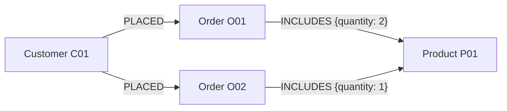
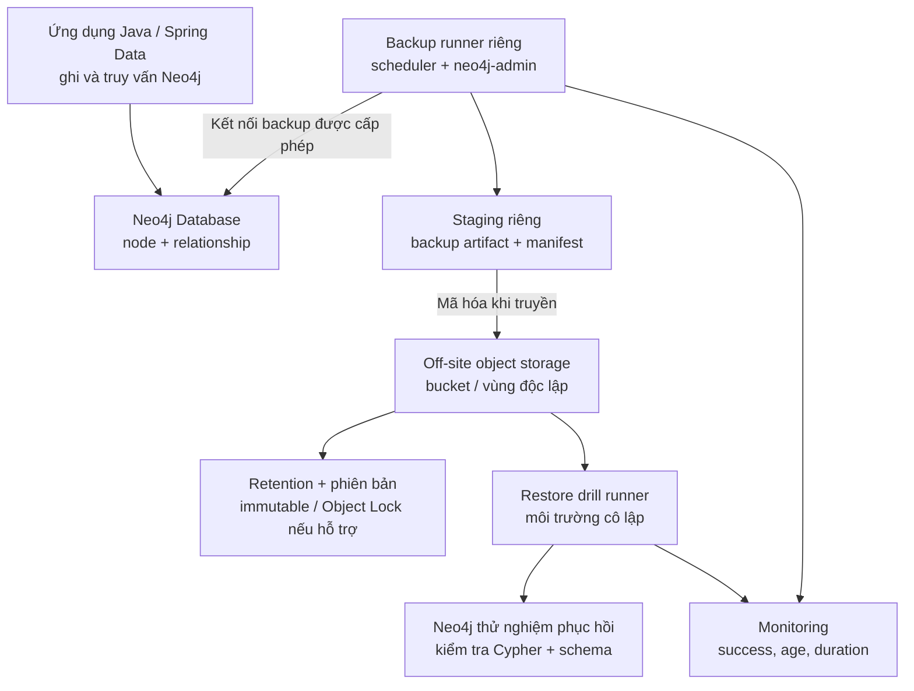
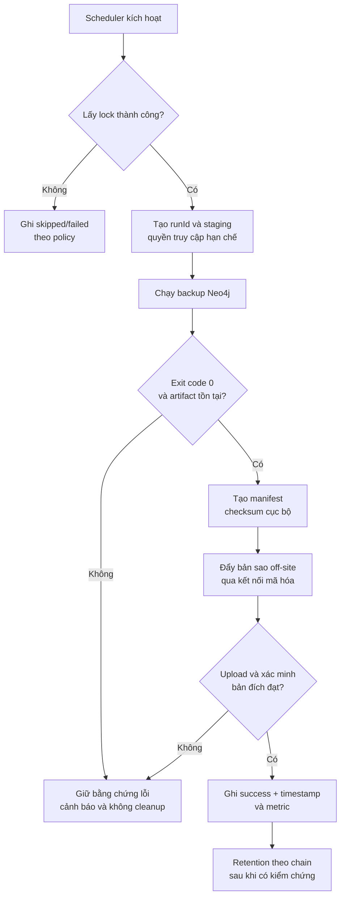
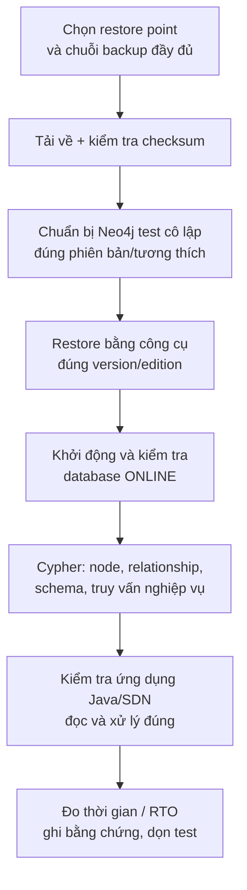

# Tự động hóa lịch sao lưu, lưu trữ ngoài máy chủ và kiểm tra định kỳ

Một hệ thống **Neo4j** có thể mô hình hóa khách hàng, đơn hàng, sản phẩm hoặc tri thức bằng các **node**, **relationship** và thuộc tính, rồi truy vấn bằng **Cypher**, **Neo4j Java Driver** hoặc **Spring Data Neo4j**. Nếu database bị xóa nhầm, ổ đĩa hỏng, ransomware mã hóa máy chủ hoặc một thao tác nhập dữ liệu tạo hàng triệu quan hệ sai, kết quả là **mất dữ liệu và mất khả năng phục vụ**. Việc có một thư mục mang tên `backup` chưa đủ để bảo vệ hệ thống: cần biết bản sao có **đúng thời điểm, có ở nơi độc lập, có thể phục hồi và đã được kiểm chứng** hay không.

Bài thuộc chương **Sao lưu và phục hồi** của module **DATABASE_ENGINE_GRAPH_NEO4J**. Trọng tâm là xây dựng **lịch sao lưu tự động**, **lưu bản sao ngoài máy chủ (off-host/off-site)**, quản lý **retention và bảo mật**, rồi **kiểm tra tính toàn vẹn và diễn tập phục hồi định kỳ**. Ví dụ minh họa hệ thống Neo4j tự quản trị với các khả năng backup phù hợp phiên bản; môi trường **Neo4j Aura/managed**, Community hoặc các phiên bản khác cần đối chiếu tính năng được cung cấp trước khi sử dụng.

> **Quy tắc vận hành:** Một lần backup chỉ thực sự có giá trị khi **có thể restore được dữ liệu và đáp ứng mục tiêu khôi phục**. Backup chạy thành công, file có kích thước lớn hay object storage trả HTTP 200 đều **không thay thế một lần phục hồi thử**.

## 1. Backup bảo vệ điều gì, và điều gì không được bảo đảm?

**Sao lưu** là tạo một bản dữ liệu có thể dùng để khôi phục trạng thái database sau sự cố. Mục tiêu không chỉ là giữ tệp chứa node: các quan hệ, thuộc tính, schema và những yếu tố phụ thuộc cũng cần được xem xét.

Ví dụ hệ thống nghiệp vụ có đồ thị:



Nếu phục hồi chỉ lấy được các node nhưng mất `PLACED` hoặc `INCLUDES`, những truy vấn nghiệp vụ sau có thể trả kết quả sai:

```cypher
MATCH (c:Customer {customerId: $customerId})
      -[:PLACED]->(o:Order)
RETURN o.orderId AS orderId
ORDER BY orderId;
```

Bởi vậy, sau restore phải xác minh **nội dung và cấu trúc đồ thị**, không chỉ số node.

### 1.1. Phân biệt bốn khái niệm

| Khái niệm | Mục đích | Không thể suy ra |
| --- | --- | --- |
| **Backup** | Tạo dữ liệu có thể đưa vào quy trình restore | Chưa chắc phục hồi được nếu chưa thử |
| **Replication/cluster** | Tăng tính sẵn sàng và khả năng chịu lỗi máy chủ | Không tự bảo vệ khỏi lệnh xóa dữ liệu hợp lệ đã được nhân bản |
| **Snapshot lưu trữ** | Chụp trạng thái volume/object theo công nghệ hạ tầng | Không tự bảo đảm tính nhất quán giao dịch của Neo4j |
| **Export CSV/JSON** | Trao đổi hoặc phân tích dữ liệu | Không mặc định là bản sao lưu có thể phục hồi đầy đủ database |
| **Disaster recovery** | Tổ chức khôi phục dịch vụ sau thảm họa | Cần thêm con người, hạ tầng, bảo mật, DNS, ứng dụng và diễn tập |

Một Neo4j cluster có nhiều bản sao vẫn có thể **đồng bộ một thao tác `DETACH DELETE` sai** tới các thành viên. Do đó, cluster và backup giải quyết những lớp rủi ro khác nhau.

### 1.2. Mục tiêu nghiệp vụ trước khi chọn lịch

Hai chỉ tiêu cần thống nhất với chủ hệ thống:

- **RPO — Recovery Point Objective:** lượng dữ liệu/tương đương thời gian thay đổi tối đa có thể chấp nhận mất sau sự cố.
- **RTO — Recovery Time Objective:** khoảng thời gian tối đa chấp nhận để phục hồi khả năng cung cấp dịch vụ.

Ví dụ yêu cầu minh họa:

| Dịch vụ | RPO mục tiêu | RTO mục tiêu | Hệ quả thiết kế |
| --- | --- | --- | --- |
| Đồ thị kiến thức nội bộ cập nhật theo ngày | 24 giờ | 8 giờ | Có thể đánh giá backup hằng đêm |
| Đồ thị đơn hàng vận hành | 1 giờ | 2 giờ | Cần bản phục hồi mới hơn, cơ chế backup phù hợp và restore nhanh |
| Phân tích đồ thị được dựng lại từ nguồn khác | 48 giờ | 12 giờ | Có thể phối hợp backup với quy trình rebuild/đối soát |

Các số trong bảng là **giả định để học**, không phải SLA mặc định của Neo4j.

**Chú ý:** Có backup hằng ngày không đáp ứng một RPO một giờ nếu không có cơ chế lưu thay đổi bổ sung được hỗ trợ và kiểm chứng. Ngược lại, một RPO ngắn không chứng minh RTO đạt: tải bản sao về, phục hồi database, xây lại kết nối và kiểm thử ứng dụng có thể mất nhiều giờ.

## 2. Khả năng backup phụ thuộc phiên bản, edition và mô hình triển khai

Không có một lệnh sao lưu chung cho mọi bản Neo4j.

| Môi trường | Hướng tiếp cận cần đánh giá |
| --- | --- |
| **Neo4j Enterprise tự quản trị** | Có thể sử dụng khả năng **online database backup** theo phiên bản và cấu hình; cần xem cú pháp `neo4j-admin database backup` phù hợp |
| **Neo4j Community** | Không mặc định có tính năng online backup của Enterprise; xem phương án dump/restore được hỗ trợ, quy trình dừng database và khả năng chấp nhận downtime |
| **Neo4j Aura/managed service** | Dùng backup/restore, lịch sử snapshot và mức bảo đảm được chính dịch vụ/gói cung cấp; không giả định được SSH hay chạy `neo4j-admin` trên máy chủ |
| **Neo4j cluster** | Phải hiểu nguồn backup, server thành viên, log/chain, lưu trữ và consistency theo phiên bản; không xem việc có replica là thay thế backup |
| **Docker/Kubernetes tự quản trị** | Container không bảo đảm dữ liệu hay file backup tồn tại sau khi bị thay; cần volume/runner/object store và lịch thích hợp |

**Online backup** được thiết kế để sao lưu database đang hoạt động khi tính năng được hỗ trợ; **offline dump** thường phục vụ một database không hoạt động theo yêu cầu lệnh/phiên bản. Không tự đổi hai thao tác cho nhau.

### 2.1. Xác minh công cụ thực tế trước khi lập lịch

Trên máy có cài công cụ quản trị của đúng phiên bản Neo4j:

```bash
neo4j-admin database backup --help
neo4j-admin database dump --help
neo4j-admin database restore --help
neo4j-admin database load --help
```

Những lệnh `--help` chỉ để **xem cú pháp**. Không phải tất cả các lệnh trên đều khả dụng hoặc có cùng option ở mọi edition/phiên bản. Ký pháp của Neo4j 4.x, 5.x và các bản phát hành mới có thể khác nhau.

Trước khi triển khai online backup cần kiểm tra:

1. Edition/license và tính năng online backup của phiên bản đang dùng.
2. Phiên bản backup client/`neo4j-admin` tương thích Neo4j server.
3. Endpoint và cổng dịch vụ backup theo cấu hình, thường khác cổng **Bolt 7687**.
4. Quyền mạng giữa **backup runner** và máy Neo4j.
5. Khả năng ghi vào thư mục staging và dung lượng đĩa đủ.
6. Có đang backup đúng **database name** và những database cần thiết khác không.
7. Các tùy chọn full/differential, lưu chuỗi backup và restore phù hợp phiên bản.

### 2.2. Trường hợp Neo4j Aura

Trên Aura hoặc dịch vụ managed, người vận hành có thể được cấp backup tự động, restore point hoặc khả năng export theo gói. Nhưng **tần suất, thời hạn giữ, vùng lưu trữ, phạm vi dữ liệu và quyền khôi phục** phụ thuộc dịch vụ/gói tại thời điểm sử dụng.

Không tự áp dụng ví dụ chạy `cron` và `neo4j-admin database backup` lên Neo4j Aura: người dùng thường không có quyền thực thi lệnh hệ thống trên host Neo4j. Nếu RPO/RTO yêu cầu vượt khả năng gói dịch vụ, cần **làm rõ với nhà cung cấp** hoặc thiết kế biện pháp bổ sung được hỗ trợ; export JSON từ ứng dụng không tự tương đương với bản database backup do nhà cung cấp quản lý.

## 3. Kiến trúc: backup runner và bản sao ngoài máy chủ

Một phương án thực hành cho **Neo4j tự quản trị có hỗ trợ online backup**:



**Vì sao phải sao lưu ngoài máy chủ?** Nếu file backup nằm trên cùng ổ đĩa hoặc VM với database, mất máy chủ có thể làm mất cả dữ liệu chính lẫn backup. Một ổ đĩa mount trên cùng máy chủ có thể giải quyết một số lỗi đĩa nhưng **không tự chống lại xóa nhầm, ransomware hoặc mất toàn bộ vùng hạ tầng**.

Phân biệt:

- **Off-host:** bản sao nằm ngoài máy chủ database, chẳng hạn backup server khác.
- **Off-site:** bản sao nằm ngoài cùng miền rủi ro, ví dụ khu vực/địa điểm lưu trữ tách biệt theo thiết kế.
- **Immutable/WORM:** bản sao có cơ chế ngăn sửa/xóa trong thời hạn nhất định, không chỉ là file có quyền read-only ở cấp hệ điều hành.

Một hướng kiểm tra là nguyên tắc **3-2-1**: nhiều bản sao, phân tán môi trường lưu trữ và ít nhất một bản sao ngoài địa điểm. Với đe dọa ransomware, có thể tăng cường bản sao bất biến và xác minh restore; mọi con số chỉ có ích khi ranh giới quyền truy cập và khả năng phục hồi được thiết kế thực chất.

## 4. Xây chính sách backup từ RPO, RTO và trạng thái dữ liệu

Trước khi viết lịch `cron`, lập **inventory**:

| Dữ liệu/đối tượng | Cần kiểm kê |
| --- | --- |
| User databases | Tên và vai trò của mỗi database: `sales`, `knowledge`, ... |
| System database | Tài khoản, role và phần cấu hình/metadata hệ thống cần khôi phục theo phương án phiên bản |
| Schema | Index, unique constraints và các thành phần schema của database |
| External dependencies | File import, cấu hình ứng dụng, plugin/APOC, certificate, secret và job scheduler |
| Cluster topology | Thành viên, routing endpoint, khả năng xây lại và hành vi backup |
| Storage | Kích thước hiện tại, tốc độ tăng, kích thước backup, băng thông |
| Security | Người có quyền tạo, đọc, xóa, restore backup; khóa mã hóa và khả năng xoay vòng |
| Business verification | Những truy vấn Cypher dùng để đối soát node/relationship sau restore |

Không mặc định một backup của database `sales` sẽ tự chứa mọi **cấu hình ứng dụng**, file APOC, secret hoặc dữ liệu của database khác. Khi backup nhiều database, các bản được tạo ở những thời điểm khác nhau **không tự hình thành một snapshot nguyên tử xuyên tất cả database**, càng không bao gồm hệ thống ERP/CRM ở bên ngoài.

### 4.1. Chọn full và differential/incremental

Tùy phiên bản/tính năng:

- **Full backup:** tạo tập dữ liệu đủ để khôi phục một database tại mốc tương ứng.
- **Differential/incremental backup:** chỉ ghi phần thay đổi theo cơ chế được hỗ trợ và phụ thuộc vào **base backup/chuỗi backup** tương thích.
- **AUTO mode** hoặc các lựa chọn tối ưu khác, nếu có, phải được xác minh bằng tài liệu của phiên bản; không giả định mọi phiên bản đều hỗ trợ cùng một chế độ.

Một lịch minh họa cần kiểm chứng thực tế:

| Tác vụ | Chu kỳ giả định | Mục tiêu |
| --- | --- | --- |
| Full backup | Chủ nhật 01:00 | Có điểm nền để phục hồi |
| Backup thay đổi, nếu phiên bản hỗ trợ | Mỗi giờ | Rút ngắn khoảng mất dữ liệu tiềm năng |
| Đẩy off-site | Sau mỗi lô backup thành công | Không để bản mới chỉ tồn tại trên một host |
| Kiểm tra checksum/manifest | Mỗi lần sao lưu và sau upload | Phát hiện lỗi truyền hoặc thay đổi file |
| Restore drill có kiểm tra graph | Hằng tháng | Kiểm chứng bản sao thực sự restore được |
| Diễn tập RTO trên dữ liệu gần production | Hằng quý | Đo thời gian phục hồi dịch vụ end-to-end |

**Cảnh báo về RPO:** Lịch mỗi giờ **không tự bảo đảm RPO 1 giờ** nếu job kéo dài, bị trễ, bản off-site chưa được xác nhận, backup bị lỗi hoặc dữ liệu tại mốc chỉ có thể phục hồi nhờ chuỗi backup chưa đầy đủ. Phải đo **thời điểm khôi phục khả dụng cuối cùng**, không chỉ nhìn lịch chạy.

### 4.2. Full backup hằng đêm có đủ không?

Nếu hệ thống chỉ đổi dữ liệu ít lần trong ngày và RPO cho phép 24 giờ, backup hằng đêm có thể hợp lý. Nhưng cần tính:

- Khoảng cách giữa **hai lần backup đã thành công**, không phải hai lần cron được kích hoạt.
- Thời gian chạy backup và thời điểm bản sao sẵn sàng restore.
- Thời gian đẩy ngoài máy chủ và độ trễ liên vùng.
- Tần suất dữ liệu tăng/giảm đột ngột do nhập dữ liệu theo lô.
- Khi backup đúng thời điểm cao tải, ảnh hưởng lên page cache, I/O và giao dịch đang chạy.

Nếu backup hằng đêm nhiều lần thất bại liên tục, RPO thực tế có thể thành **nhiều ngày** dù lịch cron vẫn đang hoạt động.

## 5. Chuẩn bị backup source và đích trên Neo4j tự quản trị

Trước khi tự động hóa, hãy **thử backup thủ công theo đúng tài liệu phiên bản** trên môi trường test.

Đối với một số phiên bản Neo4j 5.x Enterprise hỗ trợ online backup, cú pháp có thể có dạng:

```bash
# Ví dụ minh họa: đối chiếu neo4j-admin database backup --help.
neo4j-admin database backup \
  --from=neo4j-backup.internal:6362 \
  --to-path=/srv/neo4j-backups/manual \
  sales
```

**Đây không phải lệnh áp dụng vô điều kiện**:

- Địa chỉ `neo4j-backup.internal:6362` chỉ là ví dụ cho **backup endpoint** được cấu hình; không dùng hostname/cổng này như giá trị mặc định bắt buộc.
- `--from`, `--to-path`, tên database và hình thức output phải xác nhận bằng `--help` của phiên bản đang chạy.
- Online backup cần dịch vụ/phân quyền tính năng phù hợp; với Community hoặc Aura, đừng ép áp dụng lệnh.
- Thư mục đích phải nằm trên backup runner/storage được cấp quyền, không phải một thư mục có thể bị xóa cùng database host.
- Đừng gửi backup endpoint công khai ra Internet; dùng mạng riêng/VPN/đường truyền được bảo vệ và quyền tối thiểu.

### 5.1. Cấu hình Neo4j server không phải ứng dụng Java

Backup endpoint và quyền liên quan được kiểm soát ở **phía Neo4j server**, không phải bằng `spring.neo4j.uri` trong Spring Boot. Một số phiên bản dùng các setting thuộc nhóm `server.backup.*`; **tên chính xác và cách bật phải đọc trong tài liệu cấu hình đúng phiên bản**.

Để người vận hành tránh nhầm lẫn:

| Thành phần | Vai trò |
| --- | --- |
| Bolt endpoint, thường `:7687` | Java Driver thực thi Cypher |
| Backup endpoint riêng (nếu có) | Công cụ backup giao tiếp theo cơ chế backup của Neo4j |
| Neo4j `neo4j.conf` | Cấu hình database server và listener |
| Spring `application.yml` | Cấu hình client ứng dụng |
| Backup runner scheduler | Điều phối tần suất, artifact, upload, checksum và cảnh báo |

**Không dùng tài khoản ứng dụng với quyền CRUD làm lý do tự cấp quyền admin cho tất cả backup runner**. Backup và restore là thao tác vận hành nhạy cảm, cần phân quyền và mạng riêng theo khả năng hệ thống.

### 5.2. Offline dump là phương án khác

Ở môi trường không có online backup, một số phiên bản hỗ trợ công cụ:

```bash
neo4j-admin database dump --help
neo4j-admin database load --help
```

Trình tự điển hình là đưa database đích về **trạng thái phù hợp với yêu cầu offline dump**, thực hiện dump, lưu artifact rồi khi phục hồi dùng công cụ load theo đúng phiên bản. Không tự chạy `dump` lên một database đang phục vụ mà chưa kiểm tra điều kiện hỗ trợ; cũng không coi **copy trực tiếp thư mục dữ liệu đang ghi** là bản dump nhất quán.

Nếu dừng database để dump, phải đưa downtime vào RTO/SLO và lịch bảo trì. Nên cân nhắc tách một môi trường riêng theo khả năng kiến trúc thay vì dừng database production hằng giờ.

## 6. Tự động hóa bằng scheduler: thiết kế job chịu lỗi

Một backup job đáng tin không đơn thuần là `neo4j-admin ...` chạy mỗi đêm. Nó phải xử lý **không chồng lấn, mã lần chạy, exit code, artifact đầy đủ, upload, checksum, retention và thông báo lỗi**.



**Cần đánh dấu thành công ở cuối**, sau khi backup đã có trên nơi lưu trữ đáp ứng chính sách. Nếu backup thành công trên ổ tạm nhưng upload thất bại, trạng thái nên là **OFFSITE_FAILED**, không phải “backup hệ thống hoàn tất”.

### 6.1. Mẫu shell script minh họa trên Linux

Ví dụ dưới đây dành cho một **backup runner Linux** có quyền chạy `neo4j-admin`, `flock`, `sha256sum` và AWS CLI, backup source của phiên bản phù hợp, cùng quyền ghi vào object storage. **Phải chỉnh chính sách, endpoint, phiên bản lệnh, IAM và bucket trước khi đưa vào lịch**. Không dùng bản mẫu để thao tác trên production khi chưa thử ở staging.

```bash
#!/usr/bin/env bash
set -Eeuo pipefail
umask 077

# Biến do hệ thống secret/config cấp trước khi chạy.
: "${BACKUP_FROM:?missing backup endpoint}"
: "${BACKUP_ROOT:?missing local staging root}"
: "${BACKUP_BUCKET:?missing offsite bucket}"
: "${BACKUP_KMS_KEY_ID:?missing KMS key identifier}"

DATABASE="sales"
RUN_ID="$(date -u +%Y%m%dT%H%M%SZ)"
RUN_DIR="$BACKUP_ROOT/$DATABASE/$RUN_ID"
S3_URI="s3://$BACKUP_BUCKET/neo4j/$DATABASE/$RUN_ID/"

# Không để hai job cho cùng database chạy chồng lên nhau.
exec 9>"/tmp/neo4j-sales-backup.lock"
if ! flock -n 9; then
    echo "Backup already running" >&2
    exit 75
fi

mkdir -p "$RUN_DIR"

# Ví dụ cú pháp online backup cho môi trường hỗ trợ.
# Đối chiếu --help và chính sách backup chain của bản Neo4j.
neo4j-admin database backup \
    --from="$BACKUP_FROM" \
    --to-path="$RUN_DIR" \
    "$DATABASE"

# Tạo manifest cho tất cả file do backup sinh ra.
(
    cd "$RUN_DIR"
    test -n "$(find . -type f -print -quit)"
    find . -type f ! -name SHA256SUMS -print0 |
        sort -z |
        xargs -0 -r sha256sum > SHA256SUMS
    test -s SHA256SUMS
    sha256sum --check SHA256SUMS
)

# Upload qua HTTPS do AWS CLI sử dụng và SSE-KMS ở bucket.
# Bucket policy, IAM và Object Lock cần cấu hình riêng.
aws s3 cp "$RUN_DIR/" "$S3_URI" \
    --recursive \
    --sse aws:kms \
    --sse-kms-key-id "$BACKUP_KMS_KEY_ID"

# Tín hiệu này chỉ nói lệnh upload báo thành công.
# Cần job độc lập để download/xác minh remote artifact.
echo "BACKUP_UPLOADED database=$DATABASE run=$RUN_ID uri=$S3_URI"
```

**Các điểm quan trọng của script:**

- `set -Eeuo pipefail` làm job dừng khi lệnh/đường ống thất bại, giúp tránh ghi “success” khi backup hoặc upload lỗi.
- `umask 077` hạn chế quyền file được tạo trên runner; các thư mục cha vẫn cần chính sách quyền phù hợp.
- `flock` là cơ chế khóa trên Linux runner; nếu có nhiều runner, cần cơ chế **distributed lock** hoặc bảo đảm scheduler chỉ chạy một job cho cùng database.
- `RUN_ID` duy nhất theo timestamp UTC giúp phân biệt từng bản backup. Nếu có khả năng hai lần chạy cùng giây hoặc nhiều runner, thêm run ID từ scheduler để tránh trùng đích.
- `SHA256SUMS` phát hiện sự thay đổi byte **so với manifest**; nếu cả file và manifest bị thay đổi cùng nhau, checksum tự nó không chứng minh tính xác thực. Cần bảo vệ hoặc ký manifest trong môi trường có nguy cơ tấn công.
- `aws s3 cp` **không tự kích hoạt Object Lock**: cấu hình retention/immutability tại bucket/policy và kiểm tra hiệu lực thực tế.
- Script **không xóa bản cục bộ** và **không thực hiện restore drill**; đây là các bước riêng có kiểm soát.
- Giả định có cơ chế cấp AWS credentials bằng IAM/secret manager, không hard-code access key trong script.
- Không dùng tên bucket, KMS key hoặc endpoint minh họa để suy ra giá trị thật của môi trường.

**Quan trọng:** Việc CLI kết thúc với mã 0 và hash cục bộ đúng chưa xác minh nội dung remote đã tải lại thành công. Với môi trường cần bằng chứng off-site, job xác minh nên tải bản sao vào môi trường riêng, kiểm tra checksum và tiến hành restore theo lịch.

### 6.2. Lịch bằng cron

Nếu backup runner dùng `cron` trên Linux:

```cron
# Chạy hằng ngày lúc 02:00 theo timezone của cron host.
0 2 * * * /usr/local/sbin/neo4j-backup-sales.sh
```

Đây chỉ là ví dụ tần suất. Trong production, hãy quyết định:

- Timezone thực tế của host và việc thay đổi giờ mùa hè nếu áp dụng.
- Lịch trùng job thống kê, reindex, import, ETL hoặc khung cao tải.
- Giới hạn số lần retry và khoảng cách retry; không tạo các backup chồng lấn.
- Giám sát tình huống **cron không chạy**, không chỉ lỗi script sau khi được chạy.
- Khi job quá thời lượng kỳ vọng, cảnh báo và điều tra thay vì tạo thêm bản sao trùng.

Trong Kubernetes, có thể dùng `CronJob` với chiến lược `concurrencyPolicy: Forbid` và Job resource limits thích hợp; trong scheduler doanh nghiệp có thể dùng Airflow hoặc công cụ vận hành tương đương. Tên công cụ không quan trọng bằng **trạng thái, giới hạn đồng thời, audit trail và khả năng retry an toàn**.

### 6.3. Retry không được biến thành backup sai

Nếu backup thất bại vì mất mạng, job có thể retry. Nhưng cần:

1. **Không đánh dấu lần lỗi thành công**.
2. Không ghi đè artifact của lần đã thành công.
3. Xử lý staging dang dở riêng, có đánh dấu `FAILED` và hạn cleanup.
4. Khi dùng differential/incremental, xác minh **base và chain** trước khi retry hoặc bắt đầu vòng mới.
5. Không xóa bản backup tốt gần nhất chỉ vì cần dung lượng cho lần retry.
6. Giữ log kỹ thuật đủ tra cứu nhưng không ghi secret.

## 7. Mã hóa và lưu trữ ngoài máy chủ

Backup của Neo4j có thể chứa toàn bộ thông tin quan hệ nhạy cảm: đơn hàng, cấu trúc tài khoản, nhãn nội bộ, thuộc tính cá nhân và thậm chí metadata để khôi phục quyền tùy đối tượng được sao lưu.

Một chiến lược off-site đáng tin cậy có các lớp:

| Lớp | Biện pháp |
| --- | --- |
| **In transit** | TLS/HTTPS hoặc mạng riêng phù hợp; không truyền bản backup không bảo vệ qua Internet |
| **At rest** | Mã hóa trong object storage hoặc cơ chế mã hóa client-side nếu chính sách yêu cầu |
| **Key management** | KMS/secret manager, giới hạn quyền sử dụng khóa, backup quyền truy cập khóa và quy trình rotation |
| **Access control** | Quyền ghi backup tách khỏi quyền xóa/sửa, giới hạn tài khoản và bucket |
| **Immutability** | Object Lock/WORM/retention lock khi sản phẩm hỗ trợ và đã cấu hình đúng |
| **Geographic separation** | Lưu ngoài host/vùng rủi ro theo RPO/RTO và yêu cầu pháp lý |
| **Integrity** | Manifest hash, kiểm tra tải về và restore drill |
| **Retention** | Vòng đời rõ ràng, không xóa thiếu chuỗi backup |

### 7.1. Off-site không tự đồng nghĩa bất biến

Nếu tài khoản chạy backup có quyền **xóa mọi object** trong bucket, ransomware hoặc người tấn công chiếm được tài khoản đó có thể xóa cả dữ liệu chính lẫn các backup.

Để giảm rủi ro:

- Tài khoản upload chỉ cần quyền **ghi vào prefix được giao**, hạn chế quyền xóa.
- Tách quyền quản trị retention/immutability khỏi quyền ứng dụng và backup runner.
- Bật object versioning, retention lock/Object Lock nếu dịch vụ hỗ trợ; cấu hình phải phù hợp quy định và được thử xóa trái phép trong môi trường an toàn.
- Kiểm soát root/admin credentials, MFA và chính sách KMS; không để “khóa giải mã duy nhất” phụ thuộc một tài khoản không thể khôi phục.
- Đánh giá replication sang vùng/tài khoản độc lập nếu thảm họa toàn vùng nằm trong mô hình rủi ro.

### 7.2. Lưu nhiều bản theo thế hệ

Một ví dụ retention **minh họa**, không phải chính sách bắt buộc:

| Loại bản sao | Số bản/thời gian giữ | Lý do |
| --- | --- | --- |
| Các mốc phục hồi gần đây | 48 giờ | Khôi phục nhanh khi phát hiện lỗi gần thời điểm xảy ra |
| Daily backups | 14 ngày | Có điểm phục hồi gần trong nhiều ngày |
| Weekly backups | 8 tuần | Có mốc trung hạn |
| Monthly backups | 12 tháng | Điều tra hoặc tuân thủ theo yêu cầu |
| Immutable copy | Theo thời hạn đánh giá rủi ro | Chống xóa/sửa trong cửa sổ được khóa |

**Không được xóa full backup nền nếu differential/incremental còn cần nó để restore.** Retention phải hoạt động theo **chuỗi phụ thuộc**, không chỉ theo tuổi từng file. Một bản backup duy nhất còn tồn tại không có giá trị nếu thiếu base hoặc một đoạn thay đổi bắt buộc.

Khi có yêu cầu xóa dữ liệu theo quy định, retention backup cũng phải được đánh giá theo chính sách pháp lý. Không tự giữ bản chứa dữ liệu cá nhân vô thời hạn chỉ vì “để an toàn”.

## 8. Kiểm tra backup: ba cấp độ cần có

Một quy trình đúng nên có **nhiều mức kiểm chứng**.

### 8.1. Cấp 1 — Backup job hoàn tất

Kiểm tra:

- Scheduler đã kích hoạt đúng thời điểm.
- Backup command báo thành công theo exit code/summary.
- Artifact không rỗng và nằm tại vị trí dự kiến.
- Có metadata/mốc ngày, tên database, phiên bản công cụ và trạng thái `COMPLETED`.
- Dung lượng và thời gian thực thi không lệch bất thường với lịch sử.
- Không có lỗi lưu trữ hoặc thiếu disk.

**Hạn chế:** File tồn tại và job exit 0 chưa chứng minh có thể phục hồi.

### 8.2. Cấp 2 — Bản off-site tải lại đúng

Sau khi upload:

1. Xác nhận các artifact cần thiết tồn tại ở **prefix/bucket ngoài máy chủ**.
2. Trên môi trường kiểm tra riêng, **download** bản đã chọn.
3. So SHA-256 của các file với manifest đã được bảo vệ hoặc ký, đúng cấu trúc backup.
4. Kiểm tra chuỗi full + differential/incremental có đủ theo yêu cầu restore.
5. Kiểm tra quyền đọc và **khả năng giải mã** của tài khoản phục hồi thực tế.
6. Ghi lại thời gian tải về và tốc độ thực tế; đây là thành phần của RTO.

Ví dụ khi đã tải bản backup về một thư mục cục bộ với manifest hợp lệ:

```bash
cd /srv/restore-drill/downloaded-backup
sha256sum --check SHA256SUMS
```

Lệnh này kiểm tra **byte integrity** so với manifest. Nó không kiểm tra **tính nhất quán đồ thị hoặc khả năng database khởi động**. Để chống giả mạo cả file và manifest, cần bảo vệ provenance hoặc sử dụng chữ ký/metadata tin cậy.

### 8.3. Cấp 3 — Restore thật trên môi trường cô lập

Đây là kiểm tra quan trọng nhất:



Không phục hồi đè vào database production để “thử nhanh”. Một bản restore test phải có **đường dẫn, tên database, tài khoản và networking cô lập**, đồng thời chính sách không cho ứng dụng test gửi email, thanh toán hoặc webhook ra hệ thống thật.

## 9. Quy trình diễn tập restore trên Neo4j

Với Neo4j tự quản trị, các bước sau là **runbook ở mức thao tác**. Cú pháp `restore`, `load` và các yêu cầu stop/start phải xem ở bản công cụ đang dùng:

### Bước 1 — Chọn mục tiêu phục hồi

Ghi:

- Database: ví dụ `sales`.
- Restore point/mốc backup được chọn.
- Artifact là full hay chuỗi full + differential/incremental.
- Phiên bản Neo4j nguồn/đích.
- Mục tiêu RPO và RTO.
- Người được quyền thực thi khôi phục.

Đừng suy rằng backup từ một bản Neo4j mới có thể restore vào bản server cũ hơn. **Tương thích restore và nâng cấp** phải được xác nhận bằng tài liệu phiên bản và bài diễn tập.

### Bước 2 — Chuẩn bị đích cô lập

- Tạo host/container/VM dành riêng cho restore drill.
- Cấu hình disk, heap/page cache và network phù hợp với kích thước dữ liệu.
- Ngăn truy cập từ các ứng dụng production hoặc job đồng bộ thật.
- Đặt database đích ở trạng thái mà công cụ restore yêu cầu.
- Cấp quyền file/backup cho tài khoản restore, không dùng tài khoản ứng dụng thông thường.

Nếu sản phẩm yêu cầu database dừng hoặc không tồn tại trước khi restore, thực hiện theo quy trình; **không thử ghi đè một database đang phục vụ**.

### Bước 3 — Xác minh artifact và đọc cú pháp đúng phiên bản

```bash
neo4j-admin database restore --help
neo4j-admin database load --help
```

Dùng thao tác **restore** cho backup được tạo bởi cơ chế backup tương ứng, hoặc **load** cho dump nếu đó là loại artifact đã tạo. Hai công cụ có mục đích và format khác nhau; không coi chúng hoán đổi được.

Thực hiện restore theo hướng dẫn chính thức, ghi exit code, thời gian và log của job. Nếu backup có nhiều phần, **phải chuẩn bị đủ base/chain theo quy tắc phiên bản**.

### Bước 4 — Khởi động database và kiểm tra trạng thái

Trên Neo4j thử nghiệm đã khôi phục:

```cypher
SHOW DATABASES;
```

Kiểm tra database mong đợi đã **ONLINE** hoặc trạng thái vận hành tương ứng, có thể thực thi truy vấn đọc và không phát sinh lỗi nghiêm trọng trong server logs. Không dùng việc tiến trình Neo4j có PID để kết luận database đã phục hồi thành công.

### Bước 5 — Đối soát graph và schema

Ví dụ các phép kiểm tra:

```cypher
MATCH (c:Customer)
RETURN count(c) AS customerCount;
```

```cypher
MATCH (o:Order)
RETURN count(o) AS orderCount;
```

```cypher
MATCH (c:Customer)-[r:PLACED]->(o:Order)
RETURN count(r) AS placedRelationshipCount;
```

```cypher
MATCH (o:Order)
WHERE NOT EXISTS {
  MATCH (:Customer)-[:PLACED]->(o)
}
RETURN o.orderId AS orderWithoutCustomer
ORDER BY orderWithoutCustomer
LIMIT 20;
```

Các số **phải được so với mốc dữ liệu nguồn/manifest hoặc kỳ vọng theo restore point**, không tự cho rằng một số cố định luôn đúng. Nếu ứng dụng cho phép order không gắn customer, truy vấn cuối là **báo cáo đối soát** chứ không mặc định là lỗi.

Kiểm tra schema:

```cypher
SHOW CONSTRAINTS
YIELD name, type
RETURN name, type
ORDER BY name;
```

```cypher
SHOW INDEXES
YIELD name, type, state
RETURN name, type, state
ORDER BY name;
```

Quan sát index ở trạng thái phù hợp, kiểm tra constraint cần cho khóa nghiệp vụ. **Số node và relationship bằng nhau chưa đủ**: hai graph có thể có cùng tổng số nhưng liên kết sai cặp. Vì thế kiểm tra thêm những đường đi nghiệp vụ có danh sách kết quả xác định.

### Bước 6 — Kiểm thử ứng dụng và đo RTO

Sau khi restore:

- Chạy một bộ integration test **chỉ đọc** qua Neo4j Java Driver/Spring Data Neo4j trên database thử nghiệm.
- Kiểm tra các truy vấn theo `customerId`, `orderId` và đường đi graph quan trọng.
- Kiểm tra database name/URI, quyền ứng dụng và các cấu hình đi kèm.
- Xác minh những tác vụ phụ thuộc như tìm kiếm, đồng bộ CDC/ETL có thể tiếp tục **từ mốc phù hợp**.
- Đo thời gian từ khi phát động drill đến khi ứng dụng đạt tiêu chí “ready”; ghi kết quả **RTO quan sát được**.
- Xác định timestamp phục hồi cuối cùng và so với dữ liệu nguồn để đánh giá **RPO quan sát được**.

**Không dùng RTO = thời gian chạy lệnh `restore`**. Thời gian tải bản off-site, giải mã, khởi động index, đổi endpoint và xác nhận nghiệp vụ đều có thể nằm trong đường khôi phục thực tế.

## 10. Lịch kiểm tra định kỳ: không chờ đến khi có sự cố

Để không phát hiện backup hỏng vào đúng ngày khôi phục, cần một lịch diễn tập:

| Kiểm tra | Gợi ý tần suất | Kết quả cần lưu |
| --- | --- | --- |
| Job/scheduler và off-site upload | **Mỗi lần chạy** | Exit code, thời điểm, artifact, upload status |
| Manifest/checksum local | **Mỗi lần backup** | SHA-256 kiểm chứng |
| Kiểm tra tải về off-site | **Hằng tuần** hoặc theo rủi ro | Một artifact tải được và khớp hash |
| Restore vào Neo4j cô lập | **Hằng tháng** | Database mở được, Cypher/schema/integrity đạt |
| Diễn tập end-to-end RTO | **Hằng quý** | Biên bản thời gian và sự cố phát hiện |
| Diễn tập mất khóa/role hoặc vùng lưu trữ | Theo yêu cầu rủi ro | Kế hoạch truy cập/đường thoát thay thế |
| Rà soát retention/immutability | Định kỳ và sau đổi cấu hình | Không xóa nhầm base backup, WORM còn hiệu lực |

Tần suất chỉ là **gợi ý để thiết kế**. Hệ thống có RPO vài phút hoặc yêu cầu pháp lý cao có thể cần kiểm tra dày hơn. Đừng để drill trùng với sự kiện production quan trọng nếu các thao tác restore tiêu thụ chung bandwidth hoặc object storage quota.

### 10.1. Báo cáo một lần restore drill

Một biên bản tối thiểu nên có:

```yaml
drillId: DRILL-2026-11
database: sales
restorePoint: "2026-11-24T23:00:00Z"
backupKind: full-plus-changes
sourceLocation: offsite-immutable-store
checksum: PASS
databaseOnline: PASS
constraintsAndIndexes: PASS
nodeRelationshipChecks: PASS
applicationReadChecks: PASS
observedRestoreMinutes: 74
rpoRequirementMinutes: 60
rtoRequirementMinutes: 120
result: REVIEW
```

**Các giá trị chỉ mang tính minh họa, không phải số liệu thực từ Neo4j.** `result: REVIEW` thể hiện có một vấn đề cần xem xét, chẳng hạn không đủ dữ liệu để khẳng định RPO dù RTO thử nghiệm đạt. Đừng tự động đánh dấu toàn bộ drill PASS chỉ vì database mở được.

### 10.2. Không để kết quả kiểm tra chỉ tồn tại trong email

Lưu báo cáo và metric ở hệ thống tập trung:

- Tên và phiên bản của nguồn backup.
- Database, mốc phục hồi và chi tiết chain.
- Hash/manifest và bằng chứng kiểm tra.
- Kết quả Cypher và điều kiện kỳ vọng.
- Thời gian tải, restore, startup, validation, cutover giả lập.
- Lỗi gặp phải, owner và thời hạn khắc phục.
- Kết luận so với RPO/RTO đã thống nhất.

Một bản backup có restore drill **thất bại** cần được coi là rủi ro cần xử lý, dù cron vẫn gửi thông báo “backup success” hằng ngày.

## 11. Giám sát và cảnh báo: nhìn vào bản sao có thể phục hồi

Có thể triển khai exporter, job status API hoặc push metric từ backup runner sang nền tảng giám sát hiện có. Không phụ thuộc tên sản phẩm cụ thể; ưu tiên những tín hiệu sau:

| Metric/sự kiện | Ý nghĩa | Cách dùng cảnh báo |
| --- | --- | --- |
| `backup_job_success` | Lần chạy cuối có hoàn tất? | Báo ngay khi thất bại |
| `last_successful_backup_age_seconds` | Thời gian từ mốc backup thành công cuối | Cảnh báo khi vượt khoảng an toàn RPO |
| `last_offsite_verified_age_seconds` | Tuổi của bản off-site đã được kiểm tra | Phát hiện tình huống local backup tốt nhưng offsite hỏng |
| `backup_duration_seconds` | Job mất bao lâu | Cảnh báo tăng bất thường so với baseline |
| `backup_size_bytes` | Kích thước bản sao | Cảnh báo sụt/tăng đột ngột cần kiểm tra |
| `backup_chain_complete` | Có đủ các phần cần cho restore không? | Cảnh báo thiếu base hoặc đoạn chain |
| `offsite_upload_failed_total` | Số lần upload lỗi | Điều tra quyền, network, storage |
| `restore_drill_last_pass_age_seconds` | Đã bao lâu không có restore drill đạt? | Cảnh báo khi vượt chu kỳ diễn tập |
| `observed_rto_seconds` | Thời gian restore cuối | So với mục tiêu RTO |
| `checksum_failure_total` | Số lần byte integrity thất bại | Cảnh báo nghiêm trọng, tạm ngừng cleanup |

**Không dùng `backup_job_success = 1` như kết luận duy nhất.** Chỉ số đó nên đi cùng **độ mới mốc khôi phục, trạng thái bản off-site và kiểm tra restore định kỳ**.

### 11.1. Ví dụ mức cảnh báo có nguồn gốc từ SLA

Nếu RPO mục tiêu là 60 phút, một chính sách có thể quy định:

- **Warning:** chưa có mốc khôi phục được xác nhận trong khoảng thời gian chuẩn bị dự phòng, ví dụ gần chạm RPO.
- **Critical:** mốc khôi phục khả dụng đã cũ hơn **RPO đã thống nhất**.
- **Critical:** thất bại upload và không còn bản off-site đạt điều kiện khôi phục trong cửa sổ an toàn.
- **Action required:** restore drill gần nhất không đạt hoặc quá hạn theo lịch.

Ngưỡng phải căn cứ **timestamp cuối cùng của dữ liệu có thể phục hồi**, chứ không chỉ thời điểm cron bắt đầu. Phân biệt `job_start_time`, `backup_end_time`, `restore_point_time` và `offsite_verified_time`.

## 12. Các lỗi nguy hiểm và cách ngăn ngừa

| Sai lầm | Hậu quả | Phòng tránh |
| --- | --- | --- |
| Backup nằm cùng ổ đĩa/VM | Mất máy đồng nghĩa mất cả backup | Off-host/off-site thực sự độc lập |
| Chỉ có replica mà không có backup | Lệnh xóa sai có thể lan qua cluster | Có restore point theo thời gian |
| Copy file database đang chạy bằng công cụ thường | Có thể không nhất quán theo giao dịch | Dùng backup/dump/snapshot được Neo4j hỗ trợ |
| Chạy online backup không đúng edition/version | Job thất bại hoặc không tạo artifact hợp lệ | Kiểm tra capability, `--help` và quy trình thử |
| Scheduler ghi “success” trước upload | Off-site chưa có dữ liệu mới | Thành công chỉ sau các bước bắt buộc |
| Giữ quá nhiều bản ở staging | Hết dung lượng, backup tiếp theo thất bại | Retention có kiểm soát, nhưng không xóa bản tốt duy nhất |
| Xóa full backup nền của differential chain | Không thể restore từ các delta còn lại | Quản lý retention theo chain |
| Có checksum nhưng không thử restore | Không phát hiện lỗi format/tương thích | Restore drill thực tế vào database cô lập |
| Có file backup nhưng mất khóa KMS | Không giải mã được bản sao | Kiểm thử quy trình khôi phục quyền/khóa |
| Backup account có quyền xóa mọi object | Có thể bị xóa hoặc mã hóa bởi kẻ tấn công | Tách quyền, immutability/WORM |
| Backup nhiều DB vào các thời điểm khác nhau | State liên database có thể không nhất quán | Thiết kế ranh giới consistency và đối soát |
| Chỉ kiểm tra `count(n)` | Không phát hiện mối quan hệ sai hoặc thuộc tính sai | Kiểm tra node, relationship, schema và truy vấn nghiệp vụ |
| Restore drill trên production | Có thể ghi đè dữ liệu đang phục vụ | Môi trường và credential hoàn toàn cô lập |
| Tin lịch backup là RPO thực tế | Job có thể lỗi/trễ nhiều giờ | Giám sát tuổi restore point đã xác nhận |

## 13. Liên hệ với Java Driver, Spring Data Neo4j và nhập dữ liệu

Ứng dụng Java không thay thế quy trình backup của database:

- `Driver.verifyConnectivity()` chỉ kiểm tra kết nối, không tạo bản sao lưu.
- `@Transactional` của Spring Data Neo4j bảo đảm phạm vi giao dịch ứng dụng, **không tự tạo restore point**.
- `MERGE` có thể tránh tạo node trùng khi nhập dữ liệu lại, nhưng không thể đảo ngược mọi thao tác xóa hoặc cập nhật sai sau khi đã commit.
- `EXPLAIN`/`PROFILE` giúp hiểu plan và chi phí, không phục hồi dữ liệu.
- Các quy trình CDC/ETL có thể hỗ trợ **rebuild từ nguồn sự thật**, nhưng chỉ khi nguồn vẫn giữ đủ lịch sử, khóa nghiệp vụ, quan hệ và thứ tự sự kiện.

### 13.1. Restore database rồi còn phải khôi phục pipeline

Giả sử lúc 10:00 một job CDC đã áp dụng event đến offset `L1000`. Database được restore về mốc 09:00, nhưng consumer lưu checkpoint ngoài Neo4j vẫn ở `L1000`. Nếu consumer tiếp tục từ đó, những event từ 09:00 đến 10:00 có thể bị **bỏ qua** đối với database vừa phục hồi.

Do vậy, kế hoạch DR cần:

1. Xác định restore point của database và **mốc nguồn/CDC tương ứng**.
2. Kiểm tra liệu nguồn sự kiện còn giữ các event cần replay không.
3. Xử lý event bằng logic **idempotent**, version và khóa nghiệp vụ thích hợp.
4. Tránh phát lại các side effect bên ngoài Neo4j, như gửi email/thanh toán.
5. Kiểm tra lại graph sau khi áp dụng phần thay đổi bù và trước khi mở traffic bình thường.

**Backup consistency của một database không tự bảo đảm consistency của một hệ thống phân tán** gồm Neo4j, Kafka, ERP, CRM và object store.

### 13.2. Khôi phục quyền và cấu hình

Ngay cả khi dữ liệu `sales` đã trở lại, ứng dụng có thể vẫn thất bại nếu:

- URI, TLS certificate, DNS hoặc secret không phù hợp endpoint mới.
- User/role không có quyền truy cập database phục hồi.
- APOC/plugin cần cho truy vấn không được cài ở môi trường đích.
- Index chưa ở trạng thái sẵn sàng hoặc migration cần thiết chưa được áp dụng.
- Cấu hình Spring Boot kết nối nhầm database mặc định.
- Các công cụ giám sát/backup mới chưa được kích hoạt lại.

Đây là lý do RTO cần tính đến **phục hồi dịch vụ end-to-end**, không chỉ load file.

## 14. Runbook khi mất database hoặc phát hiện xóa nhầm

Một sự cố thực tế đòi hỏi giảm rủi ro **làm hỏng thêm dữ liệu** trong lúc khôi phục.

### Giai đoạn A — Khoanh vùng

1. Xác nhận database/ứng dụng bị ảnh hưởng và **mốc phát hiện**.
2. Nếu cần, tạm dừng các job ghi, CDC consumer hoặc API mutation theo quy trình incident.
3. Giữ log/chứng cứ liên quan để điều tra nguyên nhân.
4. Xác định restore point **đủ mới nhưng trước thao tác gây lỗi**, không mặc định chọn bản mới nhất.
5. Thông báo chủ hệ thống về đánh đổi RPO và thời gian phục hồi.

### Giai đoạn B — Chọn phương án

| Tình huống | Chiến lược cần cân nhắc |
| --- | --- |
| Mất một máy trong cluster nhưng dữ liệu hợp lệ còn đủ | Khôi phục khả năng phục vụ theo topology; vẫn kiểm tra backup riêng |
| Một lệnh ghi sai đã commit và lan qua replica | Chọn restore point trước sự kiện, hoặc áp dụng quy trình sửa dữ liệu có kiểm chứng |
| Hỏng disk/file | Restore từ backup đủ chain trên môi trường phù hợp |
| Backup off-site có nhưng vùng chính mất | Kích hoạt runbook DR gồm mạng, DNS, khóa và compute dự phòng |
| Dữ liệu mới cần giữ sau mốc restore | Đánh giá khả năng replay event/đối soát, tránh ghi đè mù quáng |

### Giai đoạn C — Phục hồi và xác nhận

1. Cấp quyền truy cập backup/khóa giải mã và chọn môi trường phục hồi.
2. Tải bản off-site, xác minh checksum và chain.
3. Restore đúng loại artifact bằng công cụ tương thích.
4. Khởi động Neo4j; kiểm tra database, index/constraint và server logs.
5. Chạy các truy vấn nghiệp vụ quan trọng; đối soát số liệu với mốc.
6. Cập nhật cấu hình Java Driver/Spring Data Neo4j và routing một cách có kiểm soát.
7. Mở lại traffic theo từng bước, theo dõi error rate, p95 latency và dữ liệu.
8. Ghi thời gian thực tế, phần dữ liệu mất/khôi phục được và bài học incident.

**Không xóa bản backup cũ khi mới phát hiện sự cố**: nó có thể là restore point duy nhất không chứa thao tác sai.

## 15. Checklist trước khi phê duyệt lịch sao lưu tự động

- [ ] Mỗi database có **owner**, RPO và RTO cụ thể.
- [ ] Phương án online backup/offline dump/managed backup đúng **edition và phiên bản Neo4j**.
- [ ] Môi trường backup runner, endpoint, mạng và quyền đã được kiểm tra.
- [ ] Lịch backup phù hợp thời gian chạy và không chồng job.
- [ ] Có cơ chế phát hiện **scheduler không chạy** và job lỗi.
- [ ] Mỗi run có artifact/manifest, mã định danh và trạng thái rõ ràng.
- [ ] Bản sao nằm **ngoài máy chủ** và ngoài miền rủi ro theo yêu cầu.
- [ ] Có mã hóa, kiểm soát KMS/secret, quyền tối thiểu và retention.
- [ ] Có cơ chế bảo vệ khỏi xóa/sửa trái phép khi yêu cầu.
- [ ] Với differential/incremental, retention giữ **đủ chain**.
- [ ] Có kiểm tra tải về và checksum từ **bản off-site**.
- [ ] Có **restore drill thực tế** trên Neo4j cô lập theo lịch.
- [ ] Kiểm tra cả node, relationship, schema và truy vấn nghiệp vụ.
- [ ] Đo **RPO/RTO quan sát được** và lưu biên bản.
- [ ] Runbook tính đến Java Driver, Spring Data, CDC, quyền, DNS và cutover.
- [ ] Log/metric không làm rò rỉ dữ liệu nhạy cảm hoặc khóa backup.

## 16. Bài tập thực hành

### Bài tập 1 — Tính đúng mục tiêu RPO/RTO

Hệ thống có RPO 2 giờ, RTO 4 giờ. Lịch full backup mỗi đêm lúc 01:00, mất 40 phút để hoàn thành và thêm 20 phút upload off-site. Lúc 23:00 xảy ra sự cố. Nếu chỉ có bản đêm trước, kế hoạch có đáp ứng RPO 2 giờ không? Đề xuất lịch bổ sung, lưu ý rằng chỉ thêm cron mỗi giờ chưa đủ nếu job lỗi hoặc bản off-site thiếu.

### Bài tập 2 — Phân biệt backup và replica

Một Neo4j cluster ba server nhân bản một thao tác `DETACH DELETE` sai. Vì sao ba replica không cho phép “quay ngược” về trước sự kiện? Hãy mô tả cách chọn một restore point thích hợp và giữ lại những sự kiện sau mốc khôi phục khi có thể.

### Bài tập 3 — Chọn công cụ theo môi trường

So sánh ba bối cảnh: Neo4j Enterprise tự quản trị, Community tự quản trị và Neo4j Aura. Với mỗi loại, chỉ ra khả năng cần xác minh trước khi thiết kế lịch; vì sao không thể dùng lệnh `neo4j-admin database backup` như công thức chung?

### Bài tập 4 — Lập lịch không chồng lấn

Một job backup hằng giờ thường chạy 35 phút nhưng đôi khi mất 80 phút. Hãy đề xuất chính sách scheduler (lock/concurrency, timeout, retry và alert) để không có hai job cùng ghi vào một backup chain. Những thông tin nào cần ghi vào run ID/manifest?

### Bài tập 5 — Off-site và ransomware

Một bản backup được đẩy lên object storage nhưng backup runner có quyền xóa toàn bộ bucket và dùng chung credential với database host. Nêu ít nhất bốn thay đổi về phân quyền, mã hóa, backup account, vùng lưu trữ và immutable retention để giảm rủi ro mất cả dữ liệu chính lẫn backup.

### Bài tập 6 — Phân biệt checksum và restore validation

Một bản `sales` được download từ bucket, tất cả SHA-256 khớp manifest. Điều này chứng minh những gì và **không chứng minh** điều gì? Đề xuất kế hoạch khởi động Neo4j thử nghiệm, kiểm tra schema, count node/relationship và các đường đi nghiệp vụ.

### Bài tập 7 — Xóa retention đúng cách

Có full backup ngày Chủ nhật và sáu bản differential/incremental của các ngày sau phụ thuộc vào nó. Nếu chính sách xóa mọi file cũ hơn 3 ngày, vấn đề gì có thể xảy ra? Viết quy tắc retention theo chain và cách bảo vệ bản full nền.

### Bài tập 8 — Phục hồi cùng dữ liệu CDC

Neo4j được restore về 09:00 nhưng Kafka consumer checkpoint ở 10:00. Những event nào có nguy cơ bị bỏ sót? Thiết kế quy trình xác định mốc, replay có idempotency và ngăn side effect kép sau phục hồi.

### Bài tập 9 — Đo RTO thực tế

Một lần drill mất 25 phút tải backup, 50 phút restore, 15 phút khởi động database và thêm 30 phút đổi endpoint/kiểm thử ứng dụng. Tính tổng thời gian và xác định nếu RTO là 2 giờ có đạt không. Nêu các yếu tố có thể làm lần DR thật lâu hơn drill.

### Bài tập 10 — Thiết kế giám sát

Hãy thiết kế dashboard với trạng thái backup job, độ mới restore point, kết quả upload off-site, tính toàn vẹn chain, tuổi restore drill và RTO quan sát. Chọn các cảnh báo cần kích hoạt ngay và giải thích vì sao `backup_job_success=1` một mình không đủ.

## 17. Ghi nhớ

**Sao lưu Neo4j hiệu quả là một quy trình liên tục**, không phải một lệnh chạy đơn lẻ. Xác định **RPO/RTO** trước, chọn công cụ phù hợp **phiên bản, edition và hình thức triển khai**, chạy tự động có kiểm soát lỗi, lưu bản sao **off-host/off-site** với mã hóa và quyền tối thiểu, bảo vệ chuỗi backup khỏi việc xóa nhầm hoặc phá hoại.

Cuối cùng, **tải bản sao về và thực hiện restore drill định kỳ trên Neo4j cô lập**. Chỉ khi kiểm tra được database mở, các **node–relationship**, **index–constraint** và luồng **Java Driver/Spring Data Neo4j** hoạt động đúng, ta mới có bằng chứng rằng bản sao thực sự giúp khôi phục dữ liệu đồ thị.
