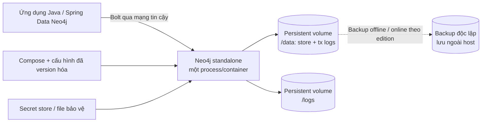

# Triển khai một máy chủ Neo4j với lưu trữ bền vững và cấu hình tái tạo được

Trong quá trình học Cypher, lập trình viên thường khởi chạy Neo4j trên máy cá nhân và có thể chấp nhận việc xóa dữ liệu khi đóng môi trường. Nhưng khi Neo4j phục vụ một ứng dụng Java, **node, relationship, index, constraint, tài khoản, cấu hình và log** phải được quản lý với những kỳ vọng rõ ràng: container có thể bị tạo lại, host có thể khởi động lại, phần mềm cần nâng cấp và hệ thống phải phục hồi được khi mất dữ liệu.

Bài này hướng dẫn triển khai **một máy chủ Neo4j độc lập (*standalone*)** theo ba nguyên tắc:

1. **Dữ liệu được lưu bền vững** trên storage độc lập với vòng đời của container/process.
2. **Cấu hình triển khai được mô tả bằng mã** (ví dụ Docker Compose), kiểm soát phiên bản và có thể dựng lại trên một host mới.
3. **Phục hồi có thể kiểm chứng** nhờ backup, restore, giám sát và quy trình vận hành — không coi volume là bản sao lưu.

Đây là bài thuộc chương **Triển khai** của module **DATABASE_ENGINE_GRAPH_NEO4J**. Trong toàn bộ module, Neo4j được dùng để mô hình hóa property graph, truy vấn node/relationship và đường đi bằng Cypher, sử dụng index/constraint, tối ưu truy vấn, nhập dữ liệu, Java Driver và Spring Data Neo4j, đồng thời vận hành hệ thống đồ thị. Việc triển khai đúng là nền tảng để những kỹ thuật ấy được sử dụng an toàn bên ngoài môi trường học tập.

Sau bài học, bạn sẽ có thể thiết kế layout lưu trữ, soạn Compose manifest có phiên bản cố định, quản lý credential tách biệt, kiểm thử độ bền sau khi tạo lại container, lập kế hoạch backup/restore, xử lý các lỗi vận hành cơ bản và hiểu rõ **giới hạn của mô hình một máy chủ**.

> **Phạm vi ví dụ:** Hướng dẫn chính sử dụng Docker Engine và Docker Compose v2 trên host Linux, Neo4j Community Edition. Image `neo4j:2026.10.2` là **ví dụ một phiên bản cụ thể** có trong tài liệu Neo4j tại thời điểm soạn, không phải yêu cầu phải dùng phiên bản đó mãi mãi. Chọn phiên bản/edition đã kiểm thử với ứng dụng; điều chỉnh cú pháp, yêu cầu tài nguyên và quyền theo môi trường thực tế. Các lệnh Linux shell không nhất thiết chạy nguyên xi trên Windows PowerShell.

## 1. Khi nào mô hình standalone phù hợp?

Một Neo4j standalone là **một instance database trên một máy chủ**. Ứng dụng có thể kết nối tới instance đó bằng Bolt; quản trị viên có thể dùng Neo4j Browser hoặc `cypher-shell`. Đây là cấu hình tốt cho:

- Môi trường học tập, phát triển hoặc kiểm thử tích hợp.
- Hệ thống nội bộ, lưu lượng vừa phải và chấp nhận một khoảng ngừng dịch vụ khi bảo trì.
- Bài toán graph có thể khôi phục từ backup hoặc tái xây dựng từ nguồn chuẩn.
- Giai đoạn đầu sản phẩm khi yêu cầu HA (high availability) chưa đủ lớn để cần cluster.

Sơ đồ logic:



**Giới hạn cốt lõi:** một máy chủ là **một điểm lỗi đơn (*single point of failure*)**. Nếu host, ổ đĩa, kernel hoặc process ngừng hoạt động, ứng dụng có thể mất kết nối. `restart: unless-stopped` chỉ giúp **khởi động lại container trong một số điều kiện**, không tạo bản sao đồng bộ, tự chuyển đổi node chủ hay đảm bảo phục vụ liên tục khi host hỏng.

| Tiêu chí | Standalone | Cluster/HA |
| --- | --- | --- |
| Số instance | Một | Nhiều thành viên theo topology được hỗ trợ |
| Cấu hình/vận hành | Đơn giản hơn | Phức tạp hơn, cần networking/quorum/vận hành |
| Host gặp sự cố | Có downtime | Có thể giảm downtime nếu cấu hình đúng |
| Bảo vệ khi xóa nhầm dữ liệu | Vẫn cần backup | **Vẫn cần backup** |
| Khả năng phục hồi | Restore/rebuild trên host mới | Phụ thuộc cơ chế HA và backup |
| Phù hợp học tập | Rất phù hợp | Không cần thiết trong nhiều bài thực hành |

**Không nhầm availability với durability:** dữ liệu vẫn còn trên ổ đĩa sau khi container chết (*durability*) không có nghĩa ứng dụng vẫn truy vấn được trong lúc server ngừng (*availability*).

## 2. Xác định mục tiêu vận hành trước khi cấu hình

Trước khi chạy lệnh, hãy xác định những giả định của triển khai.

| Câu hỏi | Ví dụ quyết định | Tại sao quan trọng? |
| --- | --- | --- |
| Neo4j là nguồn chuẩn hay bản đọc từ nguồn khác? | Neo4j lưu mạng quan hệ được người dùng trực tiếp sửa | Mất graph có thể không thể tái tạo chỉ bằng import |
| Dung lượng dữ liệu và tốc độ tăng? | 20 GB hiện tại, tăng 3 GB/tháng | Sizing SSD, backup, giữ chỗ cho recovery |
| Dịch vụ được phép ngừng bao lâu? | 1 giờ khi nâng cấp | Quyết định chấp nhận standalone hay cần HA |
| Dữ liệu được phép mất tối đa bao lâu? | 24 giờ hoặc 15 phút | Quyết định tần suất và kiểu backup |
| Ai có quyền truy cập Bolt? | Một API trong private network | Thiết kế firewall, TLS và account |
| Ai quản lý secret? | Secret manager của tổ chức | Tránh password trong Git/manifest |
| Có plugin APOC/GDS không? | Chưa cần cho phiên bản đầu | Không cài plugin ngoài nhu cầu |
| Làm sao khôi phục nếu host mất hoàn toàn? | Backup ngoài host + manifest | Kiểm thử RTO thực tế |

Hai thuật ngữ vận hành:

- **RPO (*Recovery Point Objective*):** mức dữ liệu có thể mất trong kịch bản thảm họa, ví dụ tối đa 1 giờ giao dịch đã phát sinh. Một backup chạy mỗi ngày không đảm bảo RPO 1 giờ.
- **RTO (*Recovery Time Objective*):** thời gian mục tiêu để đưa dịch vụ trở lại, bao gồm cấp host, cấu hình, khôi phục store, kiểm tra và kết nối lại ứng dụng.

Không thể đạt RPO/RTO chỉ bằng việc thêm `restart: always`. Cần backup, bản sao độc lập nếu HA cần thiết, năng lực phục hồi và bài diễn tập.

## 3. Phân biệt dữ liệu, cấu hình, log và backup

Trong Docker image chính thức, các mount point quan trọng:

| Đường dẫn container | Nội dung/ý nghĩa | Chính sách khuyến nghị |
| --- | --- | --- |
| `/data` | Graph store, database metadata và transaction logs theo cấu hình mặc định | **Bắt buộc mount storage bền vững** |
| `/logs` | Log Neo4j phục vụ chẩn đoán | Mount riêng hoặc gửi tới hệ thống log tập trung |
| `/conf` | Các file cấu hình Neo4j và logging | Chỉ mount khi cần quản lý đầy đủ file cấu hình |
| `/plugins` | Plugin/extension như APOC, GDS nếu được phép sử dụng | Pin phiên bản, kiểm soát nguồn và license |
| `/import` | Nguồn CSV phục vụ nhập dữ liệu | Có thể mount read-only và giới hạn truy cập |
| `/ssl` | Chứng chỉ/khóa phục vụ TLS | Đọc-only, quyền truy cập tối thiểu |
| `/metrics` | Một số output metrics tùy edition/cấu hình | Bảo đảm đường thu thập/retention |
| `/backups` | **Đường do ta tự chọn** khi chạy backup | Backup phải được lưu ra khỏi host hoặc miền lỗi tương ứng |

### `/data` chứa những gì?

Neo4j duy trì file lưu node/relationship/index, system database và **transaction log** để khôi phục các thay đổi đã commit. Theo cấu hình mặc định, transaction logs nằm dưới cây dữ liệu của Neo4j, ví dụ `/data/transactions/<database>`.

Khi đặt volume tại `/data`, dữ liệu vẫn nằm trong volume đó dù container được thay thế, miễn là volume và nội dung không bị xóa/hỏng. Nhưng:

- Nếu cùng host mất ổ cứng, volume đặt trên ổ đó cũng mất.
- Nếu mount sai volume sau khi thay container, hệ thống có thể hiện **database mới trống**.
- Nếu dữ liệu đang được ghi mà bị sao chép bằng `cp -r` hoặc `rsync` tùy tiện, bản sao có thể không nhất quán.
- Nếu transaction log cần thiết bị xóa thủ công, khả năng recovery có thể bị phá hủy.
- Một snapshot toàn bộ đĩa không tự đồng nghĩa backup đã được kiểm thử restore.

**Đừng xóa các file trong `/data/transactions` để giải phóng dung lượng.** Neo4j có cơ chế checkpoint và retention/pruning được quản lý bằng cấu hình. Việc xóa log bằng tay là thao tác không được hỗ trợ.

### `/logs` không phải transaction log phục hồi

File trong `/logs` ghi thông tin như hoạt động server, query hoặc lỗi tùy cấu hình. **Transaction log nội bộ** đảm bảo khôi phục dữ liệu sau sự cố là cấu trúc khác. Không thay thế bản backup bằng thư mục log quan sát.

### Named volume và bind mount

| Hình thức | Ví dụ | Ưu điểm | Lưu ý |
| --- | --- | --- | --- |
| **Docker named volume** | `neo4j_standalone_data:/data` | Docker quản lý đường dẫn và vòng đời volume tách khỏi container | Không tự chuyển dữ liệu sang host khác; cần quản lý backup và volume name |
| **Bind mount** | `/srv/neo4j/data:/data` | Dễ biết vị trí file trên host; phù hợp chính sách đĩa riêng | Cần xử lý quyền UID/GID, SELinux/AppArmor và đường dẫn |
| **Container writable layer** | Không mount `/data` | Nhanh cho demo tạm | Có thể mất dữ liệu khi container bị remove/recreate |

Trong bài dùng **named volumes** để giảm sai sót đường dẫn và tập trung vào ý nghĩa lưu trữ. Trên production, lựa chọn loại volume/filesystem/SSD phải được kiểm tra về độ bền, latency, IOPS và hỗ trợ của hạ tầng; không mặc định mọi NFS hoặc mạng share đều thích hợp làm Neo4j store.

## 4. Một triển khai “tái tạo được” gồm những thành phần nào?

Từ “reproducible deployment” thường bị hiểu là “copy một file Compose là có lại toàn bộ hệ thống”. Thực tế cần phân biệt:

| Thành phần | Có thể tái tạo từ mã cấu hình? | Cần phương án riêng? |
| --- | --- | --- |
| Image Neo4j | Có nếu pin tag/digest và biết registry | Kiểm tra availability, supply chain |
| Cổng, memory, restart policy | Có qua Compose/config | Kiểm chứng trong môi trường target |
| Network và volume declaration | Có phần định nghĩa | **Nội dung volume không tự xuất hiện** |
| Mật khẩu và private key | **Không nên** lưu giá trị trong Git | Secret manager/identity |
| Index/constraint và schema migration | Có nếu version hóa script migration | Quản lý thứ tự và tương thích |
| Dữ liệu graph đã phát sinh | Không thể suy ra chỉ từ Compose | Backup/restore hoặc tái nhập từ nguồn chuẩn |
| Account/role trong system database | Không phải chỉ một biến YAML | Backup system DB hoặc quy trình tái tạo quyền |
| Plugin | Có nếu pin version và cách cài | License, compatibility |
| Monitoring và lịch backup | Có thể là IaC/automation | Endpoint, secret và external storage |

Một hệ thống có thể **tái tạo môi trường chạy** trong vài phút nhưng mất nhiều giờ để khôi phục 500 GB dữ liệu. Vì vậy, reproducibility và recoverability phải được thiết kế cùng nhau.

### Pin phiên bản: không dùng `latest` cho hệ thống thật

```yaml
# Không nên cho môi trường cần tính tái lập:
image: neo4j:latest

# Ví dụ tốt hơn: chỉ định chính xác release đã kiểm thử:
image: neo4j:2026.10.2
```

Một tag phiên bản cụ thể giảm nguy cơ thay đổi Neo4j ngoài ý muốn khi chạy `docker compose pull`. Nếu tổ chức đòi hỏi tái lập chính xác **từng byte image**, có thể pin thêm **digest SHA-256 thực tế được xác minh từ registry** theo policy; không tự bịa digest.

Không nâng cấp database bằng cách đổi tag một cách mù quáng. Neo4j có yêu cầu về store format, trình tự upgrade, tính tương thích plugin và khả năng rollback. Mỗi thay đổi phiên bản cần đọc migration/upgrade guide tương ứng.

## 5. Chuẩn bị host Linux

Giả sử có một host Linux dành cho Neo4j; đã cài Docker Engine, Docker Compose plugin và tài khoản có quyền quản lý Docker.

Cấu trúc thư mục minh họa:

```text
neo4j-standalone/
├── compose.yaml                   # Được commit vào Git
├── .gitignore                     # Được commit vào Git
├── secrets/
│   └── neo4j_auth.txt             # KHÔNG commit, chứa bí mật thật
└── docs/
    └── restore-runbook.md         # Có thể quản lý trong repository vận hành
```

Với named volumes, dữ liệu thực tế **không nằm** trong thư mục dự án như một file `data` có thể copy tùy tiện. Docker quản lý volume độc lập.

Các tiền điều kiện:

1. Chọn host/VM có đủ CPU, RAM, IOPS và dung lượng đĩa dự phòng.
2. Lưu dữ liệu trên filesystem và hạ tầng storage được hỗ trợ, ổn định trước mất điện.
3. Có quyền cấu hình firewall: Bolt `7687`, HTTP Browser `7474` chỉ mở đúng phạm vi cần thiết.
4. Đồng bộ thời gian hệ thống (NTP) để log và dấu thời gian vận hành đáng tin.
5. Có cơ chế sao lưu **ngoài host** và chỗ lưu backup được bảo vệ.
6. Có chính sách restart OS/container, cập nhật bảo mật và giám sát dung lượng disk.
7. Dự kiến RPO/RTO và cách cấp host mới khi sự cố.

**Quyền Docker daemon tương đương đặc quyền rất cao trên host.** Không cấp nhóm `docker` cho người dùng không được phép quản trị máy chủ.

### Quyền ghi của Neo4j trong container

Docker image Neo4j mặc định sử dụng user `neo4j` với UID 7474 trong nhiều bản hiện hành. Với bind mount, nếu thư mục host không cho user này đọc/ghi, Neo4j có thể không khởi động hoặc Docker entrypoint phải thay owner. Với named volume, thao tác được Docker quản lý thuận tiện hơn, nhưng vẫn cần kiểm tra quyền.

Không giải quyết lỗi quyền bằng `chmod -R 777` trên dữ liệu hoặc chạy container `--privileged`. Hãy chọn owner/group/ACL phù hợp hoặc tạo volume theo hướng dẫn chính thức.

## 6. Tách bí mật khỏi file triển khai

Neo4j hỗ trợ khai báo xác thực khởi tạo qua `NEO4J_AUTH`. Nếu ghi thẳng `NEO4J_AUTH=neo4j/password` vào Compose, mật khẩu có thể xuất hiện trong Git, file chia sẻ hoặc thông tin inspect.

Với Docker Compose, tài liệu Neo4j mô tả cách dùng **Docker secret file** và biến `NEO4J_AUTH_FILE`.

Tạo một file **chỉ tồn tại trên host triển khai**, theo định dạng:

```text
neo4j/<mat-khau-khoi-tao-duoc-cap-an-toan>
```

Dòng trên là **ký hiệu mô tả định dạng**, không phải mật khẩu dùng thật. Hãy tạo giá trị đủ mạnh bằng công cụ quản lý bí mật; không paste mật khẩu production vào shell history hoặc tài liệu công khai. Có thể tạo file bằng công cụ secret manager/biên tập được bảo vệ thay vì dùng lệnh shell chứa password trong tham số.

Quyền file:

```bash
mkdir -p secrets
chmod 700 secrets

# Tạo secrets/neo4j_auth.txt bằng quy trình cấp bí mật của tổ chức.
# Không viết mật khẩu thật trong lệnh mẫu hoặc source control.
chmod 600 secrets/neo4j_auth.txt
```

Ví dụ `.gitignore`:

```gitignore
secrets/
*.secret
*.key
.env
.env.*
!.env.example
```

**Cảnh báo:** Docker Compose secrets dựa trên file host không tự biến mật khẩu thành dữ liệu được mã hóa trong ổ đĩa. Cần bảo vệ host, quyền đọc file, Docker daemon và backup secret. Khi dùng cloud/production, cân nhắc secret manager/KMS phù hợp.

### Vì sao `NEO4J_AUTH_FILE` không phải cơ chế rotation hoàn chỉnh?

Nó là cách **cấp credential cho cơ chế khởi tạo** của image. Khi Neo4j đã có dữ liệu và tài khoản trong system database, đổi giá trị file secret rồi khởi động container **không mặc nhiên đồng nghĩa password hiện có đã đổi**. Rotation cần sử dụng phương thức quản trị Neo4j phù hợp và cập nhật toàn bộ client, không chỉ sửa file.

## 7. File `compose.yaml` tối thiểu nhưng có tính tái tạo

Ví dụ hoàn chỉnh, chạy **một Neo4j Community Edition**:

```yaml
name: neo4j-standalone

services:
  neo4j:
    image: neo4j:2026.10.2
    restart: unless-stopped
    stop_grace_period: 2m

    ports:
      - "127.0.0.1:7474:7474"
      - "127.0.0.1:7687:7687"

    environment:
      NEO4J_AUTH_FILE: /run/secrets/neo4j_auth
      NEO4J_server_memory_heap_initial__size: "1G"
      NEO4J_server_memory_heap_max__size: "1G"
      NEO4J_server_memory_pagecache_size: "1G"

    volumes:
      - graph_data:/data
      - graph_logs:/logs

    secrets:
      - neo4j_auth

secrets:
  neo4j_auth:
    file: ./secrets/neo4j_auth.txt

volumes:
  graph_data:
    name: neo4j_standalone_data
  graph_logs:
    name: neo4j_standalone_logs
```

### Giải thích từng phần

| Mục | Tác dụng | Lưu ý |
| --- | --- | --- |
| `name: neo4j-standalone` | Đặt tên dự án Compose | Không phải database name |
| `image: neo4j:2026.10.2` | Chọn một Neo4j release cụ thể | Pin digest nếu yêu cầu nghiêm ngặt |
| `restart: unless-stopped` | Tự khởi động lại theo chính sách Docker | Không đảm bảo HA khi mất host |
| `stop_grace_period: 2m` | Cho process thời gian dừng có kiểm soát | Chọn theo workload/checkpoint thực tế |
| `127.0.0.1:7474:7474` | Browser/HTTP chỉ lắng nghe từ loopback host | Không xuất bản công khai mặc định |
| `127.0.0.1:7687:7687` | Bolt chỉ được publish tại host loopback | Remote client cần mạng/SSH/VPN được thiết kế |
| `NEO4J_AUTH_FILE` | Đọc credential khởi tạo từ file secret | Không phải rotation tự động |
| `NEO4J_server_memory_heap_initial__size` | Cấu hình heap ban đầu | Dấu `__` là một underscore của tên setting |
| `NEO4J_server_memory_heap_max__size` | Giới hạn heap | Cần tính cả page cache và overhead |
| `NEO4J_server_memory_pagecache_size` | Kích thước page cache | Không phải cùng vùng với heap |
| `graph_data:/data` | Bảo toàn graph store khi container được thay | Quan trọng nhất cho durability |
| `graph_logs:/logs` | Giữ log tách khỏi container | Quản lý rotation/retention |
| `secrets` | Cấp file bí mật cho container | Bảo vệ file nguồn trên host |
| `name: neo4j_standalone_data` | Cố định tên Docker volume | Giúp xác định chính xác volume khi backup |

**Giới hạn truy cập cố ý:** biểu thức `127.0.0.1:7687:7687` cho phép ứng dụng chạy **trên chính host** truy cập. Nếu ứng dụng ở một container khác trong cùng Compose network, có thể kết nối bằng `bolt://neo4j:7687` qua mạng Docker nội bộ mà không cần publish Bolt ra toàn internet. Nếu ứng dụng nằm ngoài host, phải thiết kế private network/VPN, firewall, chứng chỉ TLS và quyền truy cập; **không đơn giản đổi thành `0.0.0.0:7687:7687` rồi mở Internet**.

### Các con số bộ nhớ chỉ là ví dụ

Heap 1 GiB và page cache 1 GiB là mức để minh họa một host có thêm RAM cho hệ điều hành, bộ nhớ native và transaction. **Không nên áp dụng nguyên xi cho production**. Với graph lớn, cần đo lượng store/index, tập dữ liệu nóng, số giao dịch đồng thời và footprint của ứng dụng khác.

Trong Docker image, giá trị mặc định có thể tối ưu cho việc thử nghiệm nhiều container chứ không thích hợp production. Luôn sizing và theo dõi trước khi tăng tải.

## 8. Hiểu cách chuyển tên setting Neo4j sang biến Docker

Trong `neo4j.conf`, tên setting có dấu chấm và đôi khi có underscore; trong Docker env, Neo4j dùng quy tắc:

1. Thêm tiền tố `NEO4J_`.
2. Thay dấu chấm `.` bằng underscore `_`.
3. Thay underscore `_` của tên setting gốc thành **hai underscore `__`**.

Ví dụ:

| Setting Neo4j | Biến Docker |
| --- | --- |
| `server.memory.heap.initial_size` | `NEO4J_server_memory_heap_initial__size` |
| `server.memory.heap.max_size` | `NEO4J_server_memory_heap_max__size` |
| `server.memory.pagecache.size` | `NEO4J_server_memory_pagecache_size` |
| `server.default_listen_address` | `NEO4J_server_default__listen__address` |
| `db.tx_log.rotation.size` | `NEO4J_db_tx__log_rotation_size` |

**Dễ sai:** `NEO4J_server_memory_heap_max_size` không tương đương `NEO4J_server_memory_heap_max__size`. Sai một underscore có thể khiến cấu hình không được áp dụng hoặc container báo lỗi khi khởi động.

Khi cần cấu hình nhiều setting phức tạp hoặc Log4j XML, có thể version hóa file `neo4j.conf` và mount `/conf` phù hợp. Tuy nhiên, mount thư mục `/conf` có thể **thay thế cấu hình mặc định trong image**; phải đảm bảo đầy đủ file cần thiết, quyền đọc và tương thích khi nâng cấp. Với bài tối thiểu, biến môi trường gọn và dễ theo dõi hơn.

### Cấu hình động và drift

Một số Neo4j setting có thể được thay đổi ở runtime, nhưng thay đổi động **không tự cập nhật** Compose/`neo4j.conf`. Sau lần restart, hệ thống sẽ quay về cấu hình đã khai báo.

Bởi vậy, **cấu hình chuẩn phải được cập nhật trong nguồn version hóa** sau khi thử nghiệm thay đổi động được chấp thuận. Không nên chỉ chỉnh tay runtime rồi giả định triển khai mới sẽ giống server cũ.

## 9. Khởi chạy và kiểm tra

Trong thư mục chứa `compose.yaml`, chuẩn bị secret file theo mục 6, sau đó:

```bash
# Kiểm tra file Compose hợp lệ.
docker compose config --quiet

# Lấy image theo tag đã chọn.
docker compose pull

# Khởi chạy một Neo4j instance.
docker compose up -d

# Xem service/container và log gần nhất.
docker compose ps
docker compose logs --tail=100 neo4j
```

Lệnh `docker compose config` kiểm tra và dựng cấu hình Compose; nếu dùng env chứa secret, **cần thận trọng với việc xuất toàn bộ kết quả ra log CI**. Trong ví dụ này, Compose chỉ giữ đường dẫn tham chiếu secret, không lưu password literal trong env.

**Không lấy việc `docker compose ps` báo `running` làm bằng chứng database đã sẵn sàng nhận query.** Neo4j cần thời gian boot, khôi phục transaction log, khởi tạo database và mở Bolt.

### Kiểm tra qua cypher-shell

```bash
docker compose exec neo4j cypher-shell -u neo4j -d neo4j
```

Đăng nhập bằng credential test đã cấp qua cơ chế tương tác an toàn; **không đưa mật khẩu vào tham số dòng lệnh** nếu shell history/process listing/log có thể lưu lại.

Sau khi vào `cypher-shell`, chạy:

```cypher
RETURN 1 AS ready;
```

Kiểm tra database ở trạng thái online với quyền phù hợp:

```cypher
SHOW DATABASES
YIELD name, currentStatus
RETURN name, currentStatus
ORDER BY name;
```

Nếu dùng Community Edition và không có những chức năng administration nâng cao, cần đối chiếu phiên bản/role hiện tại; một account không đủ quyền quản trị có thể không xem được mọi database hoặc setting.

### Kiểm tra cấu hình thực tế

```cypher
SHOW SETTINGS
YIELD name, value
WHERE name IN [
  'server.memory.heap.initial_size',
  'server.memory.heap.max_size',
  'server.memory.pagecache.size'
]
RETURN name, value
ORDER BY name;
```

Nên kiểm tra kết quả thực tế thay vì chỉ tin rằng mọi biến môi trường trong Compose đã được Neo4j chấp nhận. Khi có cảnh báo về setting bị đổi tên/deprecated, sửa cấu hình theo phiên bản chứ không tắt validation tùy tiện.

### Xem ứng dụng có thật sự kết nối đúng nơi không

- Trên cùng host: `bolt://localhost:7687` cho bài demo.
- Container ứng dụng cùng Compose network: `bolt://neo4j:7687`.
- Môi trường remote: URI phù hợp với TLS, hostname và topology, thường `bolt+s://` hoặc `neo4j+s://` khi server đã được cấu hình chứng chỉ hợp lệ.

**Đừng gửi password qua HTTP Browser không được bảo vệ trên mạng không tin cậy.** Port `7474` trong ví dụ chỉ bind loopback để tránh exposure mặc định.

## 10. Chứng minh lưu trữ bền vững bằng bài thử tạo lại container

Một bài kiểm tra đúng không chỉ là **restart process**, mà là **thay container nhưng giữ volume**. Hãy thực hành trên database dành riêng cho bài học.

### 10.1. Tạo marker trong graph

Khi đã đăng nhập vào Neo4j bằng `cypher-shell` hoặc Neo4j Browser:

```cypher
MERGE (p:DeploymentProbe {probeId: 'persist-demo-001'})
ON CREATE SET p.createdAt = datetime()
RETURN p.probeId AS probeId, p.createdAt AS createdAt;
```

Ghi lại `createdAt`. Đây chỉ là node kiểm tra trong môi trường test, không dùng chung label/khóa với dữ liệu nghiệp vụ.

### 10.2. Dừng và tạo lại container

```bash
# Lệnh này dừng và xóa container/network Compose;
# mặc định KHÔNG xóa named volume.
docker compose down

# Khởi tạo lại từ cùng compose.yaml + cùng named volumes.
docker compose up -d

# Kiểm tra trạng thái và log.
docker compose ps
docker compose logs --tail=100 neo4j
```

**Không thêm `-v`** vào `docker compose down` trong bài kiểm tra này. `down -v` có thể xóa named volumes được quản lý bởi Compose và gây **mất dữ liệu không thể phục hồi nếu chưa có backup**.

### 10.3. Xác minh marker vẫn còn

Kết nối lại, chạy:

```cypher
MATCH (p:DeploymentProbe {probeId: 'persist-demo-001'})
RETURN p.probeId AS probeId,
       p.createdAt AS createdAt;
```

Nếu marker và thời gian tạo ban đầu vẫn còn, triển khai đã chứng minh **dữ liệu sống qua việc tạo lại container với cùng volume**.

Điều bài thử **chưa chứng minh**:

- Backup có thể restore trên host mới hay không.
- Dữ liệu sống được khi **ổ cứng chứa volume bị hỏng**.
- Khi image đổi phiên bản lớn, store vẫn tương thích.
- Hệ thống có khả năng HA khi host không còn.
- Mọi credential/role và plugin đều được tái tạo từ manifest.

Đây là lý do phải có bài kiểm tra restore riêng.

## 11. Các thao tác Docker dễ xóa nhầm dữ liệu

| Lệnh hoặc thao tác | Kỳ vọng cơ bản | Rủi ro cần kiểm tra |
| --- | --- | --- |
| `docker compose stop` | Dừng container, giữ container/volume | Ngừng phục vụ; ứng dụng không truy cập được |
| `docker compose start` | Chạy lại container đã tạo | Không áp dụng các thay đổi Compose như một lần recreate |
| `docker compose restart` | Restart container hiện có | Không phải cách chuẩn để áp dụng image/config mới |
| `docker compose up -d` | Reconcile container theo Compose | Có thể recreate khi thay đổi image/config; cần volume đúng |
| `docker compose down` | Xóa container/network dự án | Mặc định giữ named volumes, nhưng dịch vụ ngừng |
| `docker compose down -v` | **Xóa cả volumes được liên kết** | **Có thể xóa vĩnh viễn dữ liệu graph** |
| `docker volume rm ...` | Xóa named volume được chỉ định | Mất store nếu đúng volume dữ liệu |
| `docker system prune --volumes` | Dọn tài nguyên/volume theo điều kiện Docker | Nguy cơ mất volume không còn được gắn |
| Đổi volume name trong Compose | Container có thể thấy volume trống khác | Dễ hiểu nhầm thành mất dữ liệu |
| Đổi image tag mà chưa đánh giá upgrade | Engine thay đổi, store format có thể thay đổi | Cần backup và quy trình migration |

**Không dùng lệnh dọn volume** trên host vận hành Neo4j nếu chưa xác minh chính xác volume cần giữ và trạng thái backup.

### Kiểm tra volume trước khi thay đổi

```bash
docker volume ls
docker volume inspect neo4j_standalone_data
docker volume inspect neo4j_standalone_logs
```

`docker volume inspect` cho biết metadata/đường dẫn mount, **không chứng minh dữ liệu bên trong đã có backup**. Với Docker Desktop, đường dẫn vật lý của named volume có thể nằm trong VM do Docker quản lý, không nhất thiết có thể mở trực tiếp như một thư mục host bình thường.

## 12. Lưu trữ bền vững khác backup và disaster recovery

Một persistent volume giúp sống qua vòng đời container, nhưng vẫn thuộc một miền lỗi với host/storage của nó. Nếu dữ liệu bị xóa bởi `DETACH DELETE` nhầm, volume **lưu rất bền dữ liệu đã bị xóa**.

Phân biệt:

| Cơ chế | Bảo vệ được gì? | Không giải quyết được gì? |
| --- | --- | --- |
| Named volume `/data` | Recreate container mà giữ store | Mất ổ/host, xóa nhầm, corruption, ransomware |
| Transaction log + crash recovery | Khôi phục các transaction đã commit trong nhiều tình huống crash | Không thay backup ngoài host |
| Checkpoint | Giảm lượng transaction log phải replay khi recovery | Không phải bản copy độc lập |
| Backup offline `dump` | Tạo artifact phục hồi khi database dừng | Yêu cầu downtime và lịch backup |
| Backup online Enterprise | Backup khi database đang hoạt động theo khả năng edition | Vẫn cần quyền, storage, lịch và test restore |
| Copy dữ liệu sang vùng lưu ngoài host | Giảm rủi ro mất một máy/ổ | Cần bảo vệ bí mật, kiểm tra consistency và phục hồi |
| Cluster/replication | Cải thiện tính sẵn sàng khi thành viên lỗi | Không bảo vệ đầy đủ trước xóa nhầm logic |

### 12.1. Neo4j transaction logs và checkpoint

Neo4j dùng transaction log để ghi nhận thay đổi và hỗ trợ crash recovery. Checkpoint đẩy những thay đổi cần thiết xuống store files và tạo mốc phục hồi. Cơ chế retention/pruning được Neo4j quản lý và tùy cấu hình; **không xóa file log bằng tay** để giảm kích thước `/data`.

Một disk đầy có thể khiến Neo4j không tiếp tục xử lý ghi dù container vẫn `running`. Cần theo dõi store, index, transaction logs, log quan sát và backup storage.

### 12.2. Backup phải nằm ngoài miền lỗi

Một thư mục `/backups` trên **cùng ổ cứng với `/data`** có ích cho thao tác khôi phục file cục bộ nhưng **không bảo vệ được khi mất cả ổ**. Sau khi tạo backup, phải chuyển/đồng bộ tới vùng lưu độc lập có kiểm soát quyền, phiên bản và retention; kiểm tra restore ở môi trường tách biệt.

### 12.3. Backup cần thiết kế theo RPO/RTO

Nếu ứng dụng có RPO 15 phút, backup offline mỗi đêm không đáp ứng yêu cầu. Cần đánh giá edition, khả năng backup online/differential hoặc thiết kế dữ liệu nguồn cho phép tái tạo; có thể cần nâng kiến trúc/edition.

RTO cũng phụ thuộc dung lượng dữ liệu: phục hồi 500 GB từ lưu trữ xa mất thời gian hơn rất nhiều so với khởi chạy lại container.

## 13. Backup offline với Community Edition: ví dụ có kiểm soát

Neo4j Community Edition hỗ trợ `neo4j-admin database dump` cho **database offline**. Lệnh này tạo một archive `.dump` mà có thể dùng để load vào môi trường phục hồi tương thích. Với Enterprise Edition còn có giải pháp backup online riêng (`neo4j-admin database backup`).

**Trước khi thực hiện:** chắc chắn đây là database thực hành, đã thông báo downtime, có đủ chỗ chứa backup và không có container khác đang ghi cùng volume.

### 13.1. Dừng database

```bash
docker compose stop neo4j
```

Trong cách làm này, container ngừng hoàn toàn nên không còn process database ghi vào `/data`. Việc tạo bản dump sẽ chạy trong một container công cụ tách biệt.

### 13.2. Tạo volume dành cho backup tạm thời

```bash
docker volume create neo4j_standalone_backups
```

Volume này chỉ là nơi nhận backup ban đầu. Sau đó **phải chuyển artifact sang storage ngoài host** theo chính sách.

### 13.3. Dump database qua image neo4j-admin cùng phiên bản

```bash
docker run --rm \
  --volume neo4j_standalone_data:/data \
  --volume neo4j_standalone_backups:/backups \
  neo4j/neo4j-admin:2026.10.2 \
  neo4j-admin database dump neo4j --to-path=/backups
```

Diễn giải:

- `neo4j_standalone_data` phải là **volume chứa database thực tế** trong Compose mẫu.
- `neo4j_standalone_backups` nhận file dump.
- `neo4j/neo4j-admin:2026.10.2` là image công cụ cùng release ví dụ.
- `neo4j` cuối lệnh là **database name**, không phải tên container.
- Lệnh chạy khi database **offline**; không trộn với ứng dụng vẫn đang ghi graph.

Nếu ứng dụng dùng database khác tên `neo4j`, phải chọn đúng tên. Khi quy trình cần cả **danh tính và quyền**, cần quản lý sao lưu hoặc tái tạo **system database** cùng các thành phần cấu hình/secret tương ứng. Một dump của database nghiệp vụ không tự bao gồm user/role metadata.

### 13.4. Khởi chạy lại và xác nhận

```bash
docker compose start neo4j
docker compose ps
docker compose logs --tail=100 neo4j
```

Kết nối lại để kiểm tra database đã online. Đối chiếu đầu ra lệnh dump, số lượng artifact, kích thước và tính toàn vẹn theo công cụ được hỗ trợ. Không coi exit code bằng 0 **thay thế** cho một bài restore thử.

### Hạn chế của quy trình dump

Trong thời gian dừng database, API sẽ không truy vấn được. Nếu sản phẩm không thể chấp nhận cửa sổ downtime để backup, phải đánh giá tính năng **online backup ở Enterprise Edition** hoặc kiến trúc dịch vụ khác.

Không dùng `cp -r` trên `/data` của database đang chạy như một phương án “sao lưu nhanh” đáng tin cậy. Một bản copy file nhất thời có thể thiếu checkpoint/transaction log cần thiết.

## 14. Khôi phục backup: kiểm thử trên dữ liệu tách biệt

**Restore drill** là bằng chứng thực tế rằng bản backup có thể được dùng khi cần. Không thực hành lệnh overwrite-destination trên volume production.

Một quy trình kiểm thử:

1. Lấy một bản backup đã tạo, kiểm tra nguồn và checksum nếu chính sách có.
2. Chuẩn bị **volume phục hồi mới** và một host/Compose project riêng để tránh lẫn với production.
3. Chọn image công cụ tương thích với định dạng dump.
4. Load dữ liệu vào **volume mới**, không ghi đè dữ liệu production.
5. Khởi chạy **một Neo4j instance độc lập**, dùng cổng và danh tính test khác phù hợp.
6. Chạy các kiểm tra node/relationship/schema và một vài Cypher nghiệp vụ quan trọng.
7. Kiểm tra việc kết nối bằng Java Driver/Spring Data Neo4j.
8. Ghi lại thời gian khôi phục, lỗi cấu hình và bước còn thiếu trong runbook.

Ví dụ tạo volume mới rồi load dump:

```bash
docker volume create neo4j_restore_candidate

docker run --rm \
  --volume neo4j_restore_candidate:/data \
  --volume neo4j_standalone_backups:/backups \
  neo4j/neo4j-admin:2026.10.2 \
  neo4j-admin database load neo4j --from-path=/backups
```

**Lưu ý:** lệnh trên mới **nạp dữ liệu vào volume khôi phục**. Để chứng minh restore thành công, cần một **instance Neo4j test riêng** trỏ `/data` vào `neo4j_restore_candidate`, khởi động nó và kiểm tra qua Cypher. Không trỏ hai process Neo4j đồng thời vào **cùng một data volume**: có nguy cơ khóa file và làm hỏng dữ liệu.

Nếu backup bao gồm `system` hoặc database có user/role đặc thù, cần kiểm thử cách phục hồi danh tính, quyền và mật khẩu tương ứng. Một instance mới với dữ liệu mới được load không mặc nhiên có cấu hình bảo mật giống host cũ.

### Kiểm chứng graph sau restore

Ví dụ một vài câu Cypher:

```cypher
MATCH (p:DeploymentProbe {probeId: 'persist-demo-001'})
RETURN p.probeId AS probeId,
       p.createdAt AS createdAt;
```

```cypher
SHOW CONSTRAINTS
YIELD name, type, labelsOrTypes, properties
RETURN name, type, labelsOrTypes, properties
ORDER BY name;
```

```cypher
MATCH (c:Customer)-[r:PLACED]->(o:Order)
RETURN count(r) AS totalPlacedRelationships;
```

Không dùng một `count(*)` duy nhất để kết luận backup toàn vẹn. Nên kiểm tra định danh nghiệp vụ, thuộc tính quan trọng, chiều relationship, constraints, quyền và một số truy vấn thực tế.

## 15. Nâng cấp và khả năng tái tạo có kiểm soát

Nâng cấp Neo4j phải được xem như một **thay đổi dữ liệu và phần mềm**, không chỉ là chỉnh một dòng YAML.

### 15.1. Kế hoạch nâng cấp

1. Ghi phiên bản image, driver, Spring Data Neo4j, plugin và store hiện tại.
2. Đọc hướng dẫn upgrade/migration đúng release, đặc biệt khi vượt major version hoặc đổi dòng phát hành.
3. Kiểm tra khả năng tương thích của APOC, GDS và custom procedure.
4. Chụp backup có thể restore trước khi thay đổi.
5. Khôi phục một bản dữ liệu **ở staging** và thử nâng cấp trước.
6. Kiểm tra các setting bị đổi tên/deprecated và behavior Cypher có ảnh hưởng ứng dụng.
7. Chọn cửa sổ bảo trì; cập nhật image/config qua manifest đã review.
8. Theo dõi startup/recovery, log, query latency, dữ liệu và driver connection.
9. Nếu lỗi, thực hiện **quy trình phục hồi tương thích** đã diễn tập.

**Không mặc định đổi lại image tag cũ là rollback an toàn.** Database đã được phiên bản mới mở và biến đổi có thể không còn tương thích với phiên bản cũ. Quy trình rollback có thể phải **restore backup trước nâng cấp**.

### 15.2. Tránh cấu hình drift

Những gì cần commit vào Git:

- `compose.yaml` hoặc IaC tương đương.
- Biến cấu hình **không nhạy cảm**, tên database, yêu cầu resource.
- Phiên bản image và plugin đã phê duyệt.
- Schema migration (index, constraint, dữ liệu khởi tạo được phép tái tạo).
- Runbook backup/restore và kiểm tra sau deploy.

Những gì **không** được commit:

- Mật khẩu Neo4j, private key, secret token.
- Dump/backup chứa dữ liệu thật.
- Log có dữ liệu cá nhân, query parameters nhạy cảm.
- File config sinh tại runtime có credential.

Có thể dùng code review và pipeline để so sánh manifest đã duyệt với triển khai thực tế, tránh tình trạng operator sửa container bằng tay mà không cập nhật source of truth.

### 15.3. Vì sao version hóa schema migration quan trọng?

Tái tạo container không tự tạo một index nghiệp vụ mới đã được thêm bằng thao tác tay:

```cypher
CREATE CONSTRAINT customer_business_key IF NOT EXISTS
FOR (c:Customer)
REQUIRE c.customerId IS UNIQUE;
```

Lệnh này nên nằm trong migration có số phiên bản, chạy có kiểm soát với quyền schema phù hợp. Nếu database được restore, constraint có thể đã nằm trong backup; migration cần **nhận biết trạng thái hiện có** để tránh tạo trùng hoặc làm hỏng dữ liệu.

Đừng chạy một loạt `DROP INDEX`/`CREATE CONSTRAINT` vô điều kiện mỗi lần container start. Hãy tách **khởi động server** khỏi **thay đổi schema nghiệp vụ**.

## 16. Kết nối Java Driver và Spring Data Neo4j đúng topology

Với Compose mẫu, host đã publish Bolt chỉ trên loopback, nên ứng dụng Java chạy **cùng host** có thể dùng:

```java
import org.neo4j.driver.AuthTokens;
import org.neo4j.driver.Driver;
import org.neo4j.driver.GraphDatabase;

String uri = System.getenv("NEO4J_URI");
String user = System.getenv("NEO4J_USERNAME");
String password = System.getenv("NEO4J_PASSWORD");

try (Driver driver = GraphDatabase.driver(
        uri, AuthTokens.basic(user, password))) {
    driver.verifyConnectivity();
}
```

Ví dụ giả định biến môi trường đã được cấp và không null. Đối với production, cần xác thực cấu hình trước khi khởi động ứng dụng và không log password. `Driver` thường nên được quản lý theo vòng đời service, sử dụng connection pool chung; không tạo một Driver mới cho từng request.

Với Spring Boot/Spring Data Neo4j, cấu hình có thể là:

```yaml
spring:
  neo4j:
    uri: ${NEO4J_URI}
    authentication:
      username: ${NEO4J_USERNAME}
      password: ${NEO4J_PASSWORD}
  data:
    neo4j:
      database: ${NEO4J_DATABASE:neo4j}
```

Các placeholder `${NEO4J_URI}`, `${NEO4J_USERNAME}`, `${NEO4J_PASSWORD}` được Spring Boot thay bằng giá trị cấu hình môi trường tại runtime. Mật khẩu phải được cấp từ secret manager/biến môi trường, không hard-code vào `application.yml`.

### Nếu ứng dụng cũng chạy trong Docker Compose

Trong cùng Compose network, ứng dụng có thể kết nối bằng service name:

```text
bolt://neo4j:7687
```

Cổng publish trên host không cần được mở công khai cho container trong cùng network. Tuy nhiên, mạng Compose tự động không giải quyết mọi yêu cầu bảo mật: vẫn cần username/password, quyền phù hợp, TLS khi có đường truyền không tin cậy và giới hạn kết nối.

### Khi nào cần `neo4j+s://`?

Với truy cập từ host/ứng dụng ở mạng khác, nên cấu hình TLS với chứng chỉ server đáng tin cậy và dùng URI phù hợp. **Không tự đổi từ `bolt://` sang `neo4j+s://` mà chưa bật/kiểm tra TLS phía Neo4j**; sẽ gặp lỗi xác thực chứng chỉ hoặc handshake.

## 17. Vận hành: memory, disk, log và thời gian dừng

### 17.1. Cân đối heap, page cache và OS

Neo4j dùng:

- **Heap JVM:** object và transaction/query state.
- **Page cache:** vùng bộ nhớ mapping store và các cấu trúc cần thiết để đọc nhanh.
- **Native/off-heap và kernel memory:** ngoài heap/page cache.
- **OS memory:** cho hệ điều hành, Docker và process khác.

Ví dụ một host có 8 GiB RAM **không nên** cấp 7 GiB heap và 3 GiB page cache. Tổng phân bổ vượt khả năng thực tế dẫn tới OOM hoặc hệ thống swap nặng. Hãy đo profile workload và dành **headroom** đủ.

```yaml
environment:
  NEO4J_server_memory_heap_initial__size: "1G"
  NEO4J_server_memory_heap_max__size: "1G"
  NEO4J_server_memory_pagecache_size: "1G"
```

Các con số minh họa, không phải ngưỡng production chuẩn.

### 17.2. Sức khỏe storage

Theo dõi:

- Dung lượng trống của filesystem/volume.
- Tốc độ tăng store, index và transaction logs.
- Latency/IOPS/throughput của đĩa.
- Tỷ lệ page cache hit/miss và page faults.
- Thời gian checkpoint và startup recovery.
- Lỗi I/O, storage read-only, filesystem corruption.
- Mức tăng file backup và log retention.

Nếu `/data` đầy, đừng “chữa tạm” bằng cách xóa file transaction log. Đánh giá tăng volume/dung lượng, chính sách retention được hỗ trợ và nguyên nhân tăng dữ liệu.

### 17.3. Log và mức độ sẵn sàng

`docker compose logs` hữu ích khi khởi động, nhưng log có thể chỉ phản ánh container stdout/stderr chứ không phải mọi file log của database. Khi đã mount `/logs`, quản lý log rotation và retention; không để log chiếm hết đĩa.

Tạo giám sát tối thiểu theo:

| Tín hiệu | Mục đích |
| --- | --- |
| Container/process có chạy không? | Phát hiện crash/restart |
| Query `RETURN 1` qua Bolt có thành công không? | Kiểm tra database thực sự sẵn sàng |
| p95/p99 latency của API graph | Đo trải nghiệm người dùng |
| CPU/heap/GC/page cache | Phân tích tải và memory |
| Storage free/inode/I/O | Tránh mất khả năng ghi |
| Số transaction đang mở/blocked | Phát hiện lock hoặc query kéo dài |
| Tỷ lệ backup thành công, tuổi backup | Bảo đảm dữ liệu có thể khôi phục |
| Thời gian từ lần restore drill cuối | Ngăn backup “có file nhưng chưa ai thử” |

**Liveness** (process còn chạy) không tương đương **readiness** (database sẵn sàng xử lý Cypher), càng không tương đương **durability** hay khả năng phục hồi.

## 18. Một máy chủ cần bảo mật ở nhiều lớp

| Lớp | Việc cần làm |
| --- | --- |
| **Host** | Vá lỗi OS/Docker, giới hạn tài khoản SSH, firewall, audit |
| **Network** | Không expose `7687`/`7474` ra Internet mặc định, ưu tiên private connectivity |
| **Neo4j auth** | User/password mạnh, account ứng dụng riêng, least privilege |
| **Secrets** | Không commit, cấp lúc runtime, rotation và revoke |
| **TLS** | Xác minh hostname và CA khi kết nối qua mạng không tin cậy |
| **Volumes** | Quyền tối thiểu, encryption at rest nếu cần, không mount toàn bộ filesystem host |
| **Backups** | Mã hóa và kiểm soát truy cập; dữ liệu dump có thể chứa dữ liệu thật |
| **Plugins** | Chỉ cài plugin được phép, pin version, rà soát quyền |
| **Operations** | Có audit thao tác restart, restore, thay image và đổi user/role |

Một lỗ hổng thường gặp là mở thẳng Bolt ra Internet rồi giữ mật khẩu mặc định. Trong môi trường triển khai thật, **không dùng `NEO4J_AUTH=none`** cho database có dữ liệu cần bảo vệ.

Nếu ứng dụng có nhiều tenant, role/label của Neo4j hoặc bộ lọc nghiệp vụ phải được thiết kế có chủ đích; tài khoản ứng dụng có quyền đọc database không có nghĩa mọi tenant đều được đọc graph của nhau.

## 19. Sự cố thường gặp và quy trình phân tích

| Dấu hiệu | Nguyên nhân khả dĩ | Cách kiểm tra |
| --- | --- | --- |
| Container khởi động nhưng Neo4j chưa sẵn sàng | Database đang recover, cấu hình lỗi, thiếu RAM | `docker compose logs`, Bolt readiness |
| Container có tên giống cũ nhưng data trống | Mount sang volume khác hoặc volume bị xóa | `docker volume ls/inspect`, Compose hiện tại, backup |
| Permission denied ở `/data` hoặc `/logs` | UID/GID/ACL bind mount sai | Kiểm tra owner, volume và quyền mount |
| Không kết nối được từ máy khác | Chỉ bind `127.0.0.1` hoặc firewall chặn | Kiểm tra topology; không mở công khai tùy tiện |
| Neo4j chạy nhưng API lỗi auth | Password bootstrap khác credential thực tế, user/role thay đổi | Kiểm tra account và secret rotation |
| Sau đổi image Neo4j không mở store | Không tương thích version/format, plugin hoặc cấu hình | Log/migration guide, restore thử |
| Server bất ngờ dừng vì OOM | Heap+page cache+native vượt host/container limit | Metric RAM, kernel OOM log |
| Disk tăng nhanh | Graph/index lớn, transaction log retention hoặc log/backup | Kiểm tra dung lượng từng vùng, không xóa tx log thủ công |
| Backup file có nhưng restore thất bại | Phiên bản/tool không tương thích, artifact lỗi, thiếu system DB | Restore drill trên volume khác |
| Database phục hồi nhưng account không đúng | Secret bootstrap không phải account thực hoặc system DB chưa restore | Kiểm tra quy trình phục hồi danh tính |
| `docker compose up` tạo instance mới bất ngờ | Đổi tên volume/project hay mount | So sánh manifest, xác định volume ID |
| `docker compose down -v` vừa được chạy | Named volume bị xóa | Dừng tác động khác, phục hồi từ backup độc lập |

### Runbook 7 bước khi mất một host

1. **Xác nhận phạm vi:** mất process hay mất host/volume? Dữ liệu trong storage còn nguyên?
2. **Đóng băng thao tác nguy hiểm:** không chạy `docker volume prune` hoặc restore đè khi chưa phân loại.
3. **Xác định RPO/RTO thực tế:** backup cuối cùng, lượng dữ liệu có thể tái nhập và thời gian phục hồi.
4. **Cấp host sạch:** Docker, quyền, mạng, storage và monitoring.
5. **Dựng cấu hình từ Git/IaC:** image pin, Compose, secret runtime, schema/migration strategy.
6. **Restore từ backup đã kiểm tra hoặc gắn volume còn nguyên nếu hợp lệ:** không để hai Neo4j ghi cùng store.
7. **Kiểm tra graph và chuyển traffic:** Bolt readiness, account/role, index, node/relationship count, truy vấn nghiệp vụ; ghi biên bản hậu kiểm.

## 20. Những hiểu lầm cần tránh

| Hiểu lầm | Điều chính xác hơn |
| --- | --- |
| “Dùng Docker là dữ liệu tự bền vững.” | Phải mount `/data` đúng volume và bảo vệ storage |
| “`restart: unless-stopped` tạo HA.” | Chỉ là restart policy của một container |
| “Named volume là backup.” | Nó vẫn ở miền lỗi của host nếu không sao lưu ra ngoài |
| “Container dừng = dữ liệu chắc chắn mất.” | Với volume đúng, dữ liệu có thể tồn tại; mất thường gắn với writable layer bị remove hoặc volume bị xóa |
| “`docker compose down` và `down -v` giống nhau.” | `-v` có thể xóa dữ liệu quan trọng |
| “Chỉ cần commit Compose là tái tạo toàn bộ database.” | Cần secret, backup, migration và dữ liệu nguồn |
| “`image: latest` luôn cập nhật tốt hơn.” | Không tạo bản triển khai tái lập và có thể nâng cấp ngoài ý muốn |
| “Đổi `NEO4J_AUTH_FILE` là rotate mọi password.” | Bootstrap không thay quản lý credential trong database đã tồn tại |
| “Copy live `/data` là backup an toàn.” | Có thể thiếu transaction log/checkpoint nhất quán |
| “Transaction log có thể xóa thủ công khi đầy đĩa.” | Neo4j phải tự quản lý retention/pruning |
| “Backup có file là đã khôi phục được.” | Phải kiểm thử restore thật trên instance tách biệt |
| “`PROFILE` chạy production chỉ để xem plan.” | `PROFILE` thực thi query thật, có thể ghi dữ liệu |
| “Chỉ cần mở cổng 7687 cho cả Internet.” | Cần private network, firewall, auth và TLS |
| “Cấu hình được đổi tay ở runtime sẽ tự theo Compose.” | Có thể mất sau restart; cần commit lại manifest/config |
| “Rollback upgrade chỉ là đổi image tag về phiên bản cũ.” | Store đã nâng cấp có thể cần restore backup trước nâng cấp |

## 21. Bài tập và tiêu chí tự kiểm tra

**Bài 1 — Phân biệt durability và HA.** Một Neo4j container có volume `/data`, restart policy và chạy trên một VM duy nhất. Điều gì xảy ra khi container crash? Khi disk hỏng? Khi VM mất hoàn toàn? Thành phần nào trong thiết kế giúp phục hồi?

**Bài 2 — Compose có lỗi.** Hãy tìm vấn đề trong cấu hình:

```yaml
services:
  neo4j:
    image: neo4j:latest
    environment:
      NEO4J_AUTH: "neo4j/password123"
    ports:
      - "7687:7687"
    restart: always
```

Đề xuất cách sửa để có storage bền vững, secret tách biệt, image được pin và giới hạn truy cập mạng.

**Bài 3 — Kiểm chứng data persistence.** Tạo một node `:DeploymentProbe` với khóa và thời gian tạo, chạy `docker compose down` rồi `up -d`. Kết quả nào chứng minh volume đang được dùng đúng? Tại sao không sử dụng `down -v`?

**Bài 4 — Nhận diện setting Docker.** Chuyển các setting `server.memory.heap.max_size`, `server.memory.pagecache.size` và `db.tx_log.rotation.size` thành biến môi trường Neo4j Docker. Giải thích vì sao dấu underscore trong tên setting gốc phải viết hai lần.

**Bài 5 — Backup.** Với Neo4j Community Edition standalone, tại sao cần đưa database offline để chạy `neo4j-admin database dump`? Vì sao tạo dump vào cùng ổ /data vẫn chưa đủ cho disaster recovery?

**Bài 6 — Restore drill.** Thiết kế kịch bản dùng volume `neo4j_restore_candidate` độc lập để thử load backup. Liệt kê ít nhất năm phép kiểm tra về node, relationship, schema, account và truy vấn Java trước khi kết luận backup dùng được.

**Bài 7 — Cấp quyền.** Ứng dụng chỉ cần đọc graph qua Bolt trên host cùng mạng private. Hãy thiết kế cách bind port, TLS, account và secret. Vì sao không nên dùng user admin mặc định cho mọi request?

**Bài 8 — Upgrade.** Một dự án đang chạy Neo4j release A, muốn sang B. Hãy lập kế hoạch gồm test trên bản sao, backup, kiểm tra plugin, thay image, xác minh sau startup và phương án phục hồi khi B không tương thích.

**Bài 9 — RPO/RTO.** Hệ thống chấp nhận mất tối đa 30 phút dữ liệu và ngừng tối đa 1 giờ. Backup offline mỗi đêm có đáp ứng không? Hãy giải thích sự khác nhau giữa lịch backup và yêu cầu phục hồi.

**Bài 10 — Vận hành.** Sau khi Docker Engine restart, container chạy nhưng API vẫn báo lỗi database. Hãy mô tả đường kiểm tra từ `docker compose ps`, log, `RETURN 1`, cấu hình URI, credential đến tài nguyên RAM/disk.

### Checklist triển khai một máy chủ

- [ ] Có RPO/RTO và quyết định chấp nhận **single point of failure**.
- [ ] Chọn release/edition Neo4j được hỗ trợ và **pin image**.
- [ ] Có storage bền vững tại `/data`; xác định volume name và quyền truy cập.
- [ ] Có chiến lược lưu log, metrics và giám sát dung lượng/IO.
- [ ] Compose/IaC được version hóa; không commit password, private key hoặc backup thật.
- [ ] Credential được cấp qua secret reference; auth và TLS được kiểm soát.
- [ ] Port `7474`/`7687` chỉ mở đúng network cần thiết.
- [ ] Memory heap/page cache được sizing và kiểm chứng bằng setting thực tế.
- [ ] Có schema migration version hóa, không phụ thuộc chỉnh tay.
- [ ] Đã thử **tạo lại container** và xác minh node vẫn tồn tại.
- [ ] Có backup off-host theo RPO và đã **restore drill** thành công.
- [ ] Có runbook upgrade/rollback, khôi phục sau host failure và account migration.
- [ ] Có test kết nối từ Java Driver hoặc Spring Data Neo4j và một query nghiệp vụ.
- [ ] Có cảnh báo process/Bolt availability, disk, memory, query latency và tuổi backup.

## 22. Tài liệu tham khảo

Các tài liệu dưới đây dùng để đối chiếu cú pháp và vận hành theo **phiên bản Neo4j được triển khai**:

- [Neo4j Operations Manual — Docker Compose standalone](https://neo4j.com/docs/operations-manual/current/docker/docker-compose-standalone/): standalone deployment, Docker Compose, secret file.
- [Neo4j Operations Manual — Docker volume mounts](https://neo4j.com/docs/operations-manual/current/docker/mounting-volumes/): `/data`, `/logs`, `/conf`, `/plugins` và quyền truy cập.
- [Neo4j Operations Manual — Docker configuration](https://neo4j.com/docs/operations-manual/current/docker/configuration/): biến môi trường và mount `/conf`.
- [Neo4j Operations Manual — Docker env naming](https://neo4j.com/docs/operations-manual/current/docker/ref-settings/): cách chuyển dấu chấm/underscore của setting.
- [Neo4j Operations Manual — Dump and load offline](https://neo4j.com/docs/operations-manual/current/docker/dump-load/): `neo4j-admin database dump/load` trong container.
- [Neo4j Operations Manual — Backup and restore](https://neo4j.com/docs/operations-manual/current/backup-restore/): phân biệt backup Community/Enterprise, online/offline và restore.
- [Neo4j Operations Manual — Transaction logging](https://neo4j.com/docs/operations-manual/current/database-internals/transaction-logs/): transaction log, checkpoint và retention.
- [Neo4j Operations Manual — Memory configuration](https://neo4j.com/docs/operations-manual/current/performance/memory-configuration/): heap, page cache và sizing.
- [Neo4j Java Driver Manual — Connect](https://neo4j.com/docs/java-manual/current/connect/): URI, credential, TLS và Driver lifecycle.
- [Docker Documentation — Compose files](https://docs.docker.com/compose/compose-file/): volumes, secrets và restart policy trong Compose.

**Ghi nhớ:** đối với Neo4j standalone, **Compose tái tạo cách chạy**, **persistent `/data` volume bảo toàn dữ liệu khi container thay đổi**, còn **backup độc lập và kiểm thử restore** mới giúp phục hồi khi mất host/storage hoặc xóa nhầm. Một triển khai vững chắc kết hợp release cố định, secret tách biệt, giới hạn mạng, cấu hình đã version hóa, sizing đúng, quan sát hệ thống và runbook có thể diễn tập.
