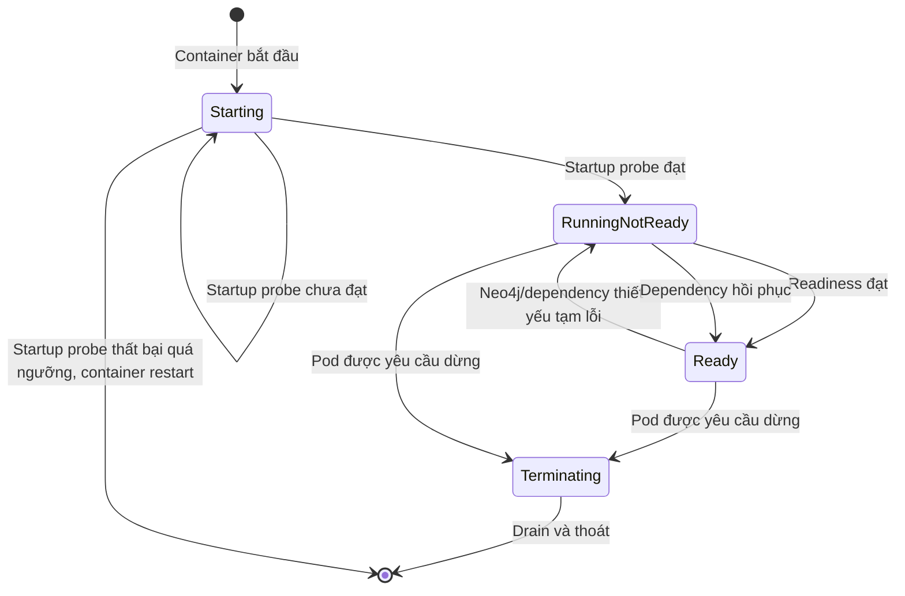
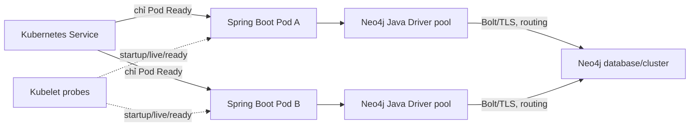
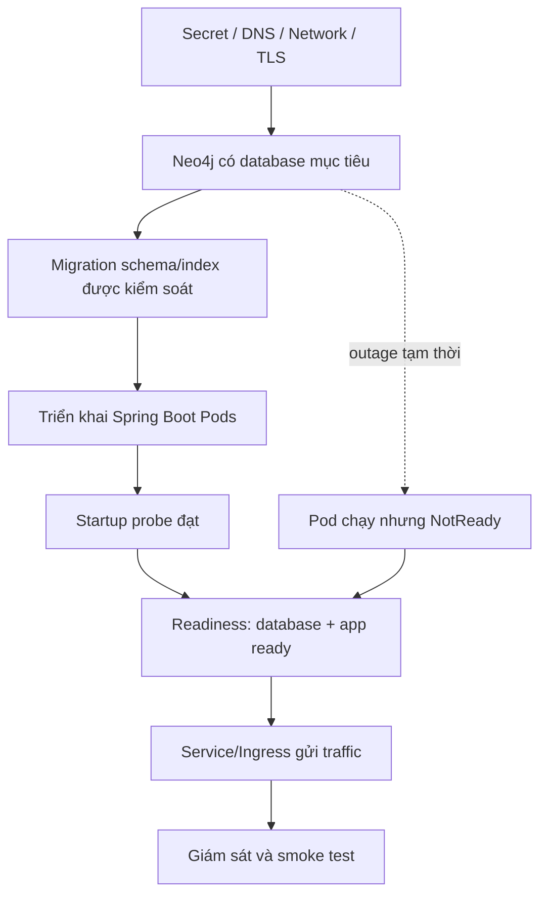
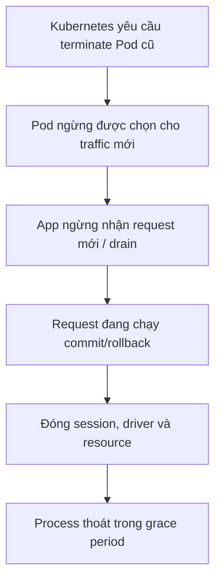
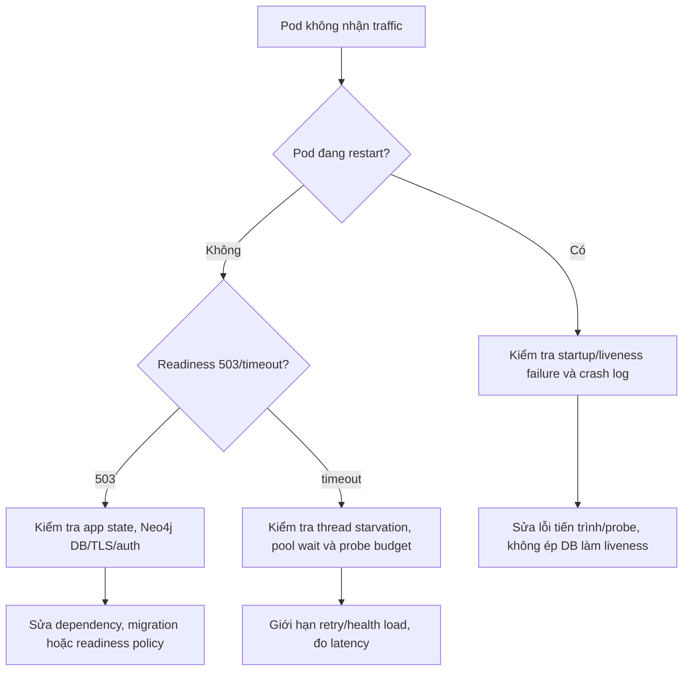

# Kiểm tra readiness, liveness và trình tự khởi động ứng dụng với Neo4j

## 1. Tại sao triển khai thành công chưa có nghĩa ứng dụng sẵn sàng?

Ứng dụng Java dùng **Neo4j** để truy vấn **property graph** gồm node, relationship và property bằng Cypher. Với **Neo4j Java Driver** hoặc **Spring Data Neo4j (SDN)**, container ứng dụng có thể khởi động thành công ngay cả khi chưa truy cập được database. Ngược lại, ứng dụng đang chạy khỏe có thể tạm thời mất kết nối với Neo4j vì rolling upgrade, DNS, routing, chứng chỉ TLS hoặc sự cố mạng.

Nếu Kubernetes chỉ kiểm tra “có tiến trình Java hay không”, nó có thể gửi request tới ứng dụng chưa sẵn sàng. Nếu dùng truy vấn Neo4j làm **liveness**, một sự cố database chung có thể khiến Kubernetes khởi động lại **mọi** replica ứng dụng, làm sự cố trầm trọng hơn.

Bài thuộc chương **Triển khai** của mô-đun `DATABASE_ENGINE_GRAPH_NEO4J`. Trọng tâm là phối hợp **trình tự khởi động**, **startup probe**, **liveness probe**, **readiness probe**, **Spring Boot Actuator**, xác minh kết nối Neo4j và graceful shutdown trong một lần triển khai thực tế.

Sau bài học, bạn có thể:

1. Phân biệt ba loại probe và giải thích tại sao **liveness không nên phụ thuộc trực tiếp vào khả năng truy cập Neo4j**.
2. Chọn mức kiểm tra đúng cho readiness: tiến trình, Bolt, database đích, hoặc yêu cầu nghiệp vụ thật sự.
3. Cấu hình Spring Boot Actuator và một `HealthIndicator` chỉ đọc dùng Java Driver.
4. Viết các probe Kubernetes có thời hạn rõ ràng và tránh vòng restart do dependency gặp sự cố.
5. Sắp xếp việc cấp secret, khởi động Neo4j, migration schema, khởi động ứng dụng, mở traffic và tắt ứng dụng.
6. Kiểm thử các tình huống database chưa sẵn sàng, sai mật khẩu, cluster chuyển vai trò, probe timeout và rolling deployment.

> **Phạm vi phiên bản:** Ví dụ hướng tới Spring Boot 3.x, Java 17+, Spring Data Neo4j/Neo4j Java Driver 5.x, Neo4j 5.x và Kubernetes hiện đại. Những cài đặt và endpoint cụ thể có thể khác theo phiên bản, edition, Neo4j Aura hoặc Helm/Operator. Hãy kiểm chứng trên chính image/phiên bản trước khi dùng cấu hình production.

## 2. Khái niệm: liveness, readiness và startup

### 2.1. Bảng quyết định

| Loại kiểm tra | Câu hỏi cần trả lời | Khi thất bại, Kubernetes thường làm gì? |
| --- | --- | --- |
| **Liveness** | Tiến trình có còn hoạt động và có khả năng tự phục hồi không? | Sau ngưỡng thất bại, khởi động lại container |
| **Readiness** | Instance hiện có nên nhận **lưu lượng mới** hay không? | Đánh dấu Pod **NotReady**, loại khỏi tập endpoint sẵn sàng của Service |
| **Startup** | Ứng dụng đã qua giai đoạn khởi động ban đầu chưa? | Chờ trong ngân sách startup; nếu thất bại quá ngưỡng, restart container |

Đặc tính quan trọng của **startupProbe** trong Kubernetes: nếu được cấu hình, **liveness** và **readiness** không chạy cho tới khi startup probe thành công. Điều này cho ứng dụng Java thời gian khởi động, nạp bean và chuẩn bị hạ tầng nội bộ trước khi liveness bắt đầu phán đoán.

Một vòng đời điển hình:



**Liveness hoạt động song song** khi container đã vượt startup probe. Nếu liveness thất bại đủ số lần, Kubernetes có thể restart container ở trạng thái Ready hoặc NotReady. Không được suy từ sơ đồ rằng “NotReady” tự động dẫn tới restart.

### 2.2. Phân biệt “chết”, “chưa sẵn sàng” và “sự cố hạ tầng”

Ví dụ:

- JVM bị deadlock nghiêm trọng và không thể trả lời ngay cả một health request đơn giản: có thể là vấn đề **liveness**.
- Ứng dụng đã phục vụ HTTP nhưng chưa kết nối được Neo4j: thường là vấn đề **readiness** nếu các endpoint cần database mới hoạt động.
- Chứng chỉ TLS của Neo4j hết hạn: **dependency/database có vấn đề**; không có cơ sở để restart hàng loạt ứng dụng vì liveness.
- Ứng dụng vẫn phục vụ trang tĩnh trong khi database tạm thời mất: có thể thiết kế readiness **theo mức độ suy giảm** và không loại toàn bộ pod, tùy hợp đồng sản phẩm.
- Spring Boot đang nạp cấu hình và bean, chưa mở HTTP port: đây là giai đoạn **startup**, cần ngân sách khởi động phù hợp.

> **Quy tắc:** Liveness nên kiểm tra sự sống của **chính tiến trình**. Readiness kiểm tra những điều kiện **cần thiết để phục vụ request được điều phối tới instance đó**. Không đưa mọi hệ phụ thuộc ngoài ứng dụng vào liveness.

## 3. Kiến trúc thực tế: ứng dụng, pool, Bolt, database



Khi API `GET /products` cần đọc node `:Product` trong database `catalog`:

1. HTTP request được chuyển đến Pod đang Ready theo cơ chế Service/Ingress phù hợp.
2. Service Spring gọi repository hoặc `Neo4jClient`, sử dụng `Driver` đã được Spring Boot quản lý.
3. Driver lấy kết nối từ pool, kết nối qua Bolt/TLS/routing, xác thực và thực thi Cypher.
4. Neo4j trả dữ liệu; ứng dụng ánh xạ thành DTO rồi trả HTTP response.

Probe readiness **không cần** mô phỏng toàn bộ nghiệp vụ ở mỗi lần kiểm tra. Một query nhỏ chứng minh có thể mở session vào database đích đã là tín hiệu có ích, nhưng **không tự chứng minh** quyền ghi, schema/index, toàn bộ cluster hay nội dung graph đúng.

## 4. Chọn cấp độ kiểm tra readiness

### 4.1. Từ kết nối TCP đến khả năng phục vụ nghiệp vụ

| Mức kiểm tra | Thực hiện gì? | Bảo đảm điều gì? | Không bảo đảm điều gì? |
| --- | --- | --- | --- |
| **Process/HTTP** | Endpoint health trả lời | JVM và web stack hoạt động tới mức đáp ứng endpoint | Database truy cập được |
| **Port Bolt** | Có thể mở TCP tới cổng Bolt | Có endpoint nhận kết nối mạng | TLS, đăng nhập, database đích và Cypher |
| **Driver connectivity** | `driver.verifyConnectivity()` | Driver có thể kết nối/xác thực tới hệ Neo4j ở mức được driver kiểm tra | Mọi database, role và truy vấn nghiệp vụ |
| **Database read** | Session chỉ rõ database, chạy `RETURN 1 AS ok` | Có thể thực thi một câu Cypher nhỏ tại database được chọn | Query `MATCH` nghiệp vụ, quyền ghi và schema |
| **Business smoke test** | Đọc mẫu dữ liệu/schema theo hợp đồng | Một phần hành vi thật hoạt động tại thời điểm kiểm thử | Toàn bộ dữ liệu/khả năng ghi dưới tải lớn |

**Không đưa mọi mức vào probe chạy mỗi 5 giây.** Readiness nên **nhẹ, có thời gian chờ hữu hạn, không gây side effect**, còn kiểm tra nghiệp vụ sâu nên đặt trong post-deploy smoke test hoặc job kiểm thử riêng.

### 4.2. Neo4j server có thể sống nhưng database chưa sẵn sàng

Một máy chủ Neo4j có thể đang mở tiến trình, có thể phục vụ một số giao diện quản trị, nhưng database mục tiêu đang offline, chưa được phân bổ, đang phục hồi, hoặc không đủ điều kiện phục vụ vai trò đọc/ghi mong muốn.

Vì vậy:

- **Sống ở mức process Neo4j** khác với **database `catalog` đã online**.
- Kết nối tới **seed/router** thành công khác với mọi địa chỉ được routing quảng bá đều truy cập được.
- `RETURN 1` thành công qua session đọc không bảo đảm luồng `MERGE` ghi sẽ thành công nếu role hoặc database không cho phép.
- Đừng dùng thao tác ghi như `CREATE`/`MERGE` để làm readiness chạy liên tục; nó có thể tạo dữ liệu, khóa hoặc tăng tải.

Khi điều tra ở cấp quản trị, câu lệnh như sau có thể hữu ích nếu phiên bản và quyền cho phép:

```cypher
SHOW DATABASES
YIELD name, currentStatus, requestedStatus
WHERE name = 'catalog'
RETURN name, currentStatus, requestedStatus;
```

Đây là câu lệnh **quan sát vận hành**, không phải API readiness công khai cho mọi tài khoản ứng dụng. Tên cột/quyền phụ thuộc phiên bản. Trong Neo4j Aura hoặc môi trường hạn chế quyền, dùng trang trạng thái và cơ chế được nhà cung cấp hỗ trợ.

### 4.3. Khi nào readiness nên phụ thuộc Neo4j?

Nếu **mọi endpoint** của một dịch vụ catalog đều cần graph database để trả kết quả đúng, xem kết nối tới đúng database là điều kiện readiness hợp lý.

Nếu service có một số endpoint vẫn hoạt động có ích khi Neo4j lỗi (ví dụ trả cache đã được phép, thông báo bảo trì hoặc vận hành luồng độc lập), cần quyết định:

- Trả Pod NotReady để tránh gửi mọi request, **hay**
- Giữ Pod Ready, trả lỗi có kiểm soát ở những route cần Neo4j, dùng circuit breaker/degraded mode và theo dõi riêng.

Không có chính sách giống nhau cho mọi ứng dụng. Nếu **toàn bộ** replica cùng NotReady khi một database chung lỗi, Kubernetes Service có thể không còn endpoint nhận request. Điều đó có thể đúng nếu ứng dụng không phục vụ được gì; nhưng nếu có khả năng phục vụ suy giảm, chính sách quá chặt sẽ làm mất cả phần chức năng còn sống.

## 5. Spring Boot Actuator: tách health groups

### 5.1. Khai báo dependency

Với dự án Spring Boot đã có dependency management, thêm Actuator:

```xml
<dependency>
    <groupId>org.springframework.boot</groupId>
    <artifactId>spring-boot-starter-actuator</artifactId>
</dependency>
```

`spring-boot-starter-data-neo4j` được dùng ở ứng dụng để tạo repository và Java Driver theo cấu hình; Actuator cung cấp các endpoint quan sát trạng thái. Tùy version, Boot có thể tự cấu hình **Neo4j health contributor**, nhưng **không mặc định** contributor nào cũng nằm trong nhóm readiness mà bạn mong muốn. Phải xem danh sách contributor thực tế trước khi phụ thuộc vào tên của nó.

### 5.2. application.yml cho probe

Ví dụ cho Spring Boot 3.x:

```yaml
spring:
  application:
    name: graph-catalog-api

  neo4j:
    uri: ${NEO4J_URI}
    authentication:
      username: ${NEO4J_USERNAME}
      password: ${NEO4J_PASSWORD}
    pool:
      connection-acquisition-timeout: 2s

  data:
    neo4j:
      database: ${NEO4J_DATABASE}

management:
  endpoint:
    health:
      show-details: never
      probes:
        enabled: true
        add-additional-paths: true
      group:
        liveness:
          include: livenessState
        readiness:
          include: readinessState,graphReadiness
  endpoints:
    web:
      exposure:
        include: health,info
```

Đây là **một cấu hình YAML hợp nhất**, không khai báo trùng khóa `management.endpoint.health`. Giá trị `2s` chỉ là ví dụ cho pool acquisition timeout, **không phải** timeout tuyệt đối của toàn health check.

Trong cấu hình hỗ trợ `add-additional-paths: true`, Spring Boot có thể cung cấp các đường dẫn ngắn **`/livez`** và **`/readyz`** trên **cổng ứng dụng chính**, thuận tiện khi liveness/readiness cần xác nhận đúng web server nhận traffic. Các đường dẫn chuẩn khác thường là `/actuator/health/liveness` và `/actuator/health/readiness`. Kiểm tra endpoint thực tế ở bản Boot đang chạy.

| Endpoint | Nội dung mong muốn |
| --- | --- |
| `/livez` hoặc `/actuator/health/liveness` | Chỉ trạng thái liveness của ứng dụng, không gọi Neo4j |
| `/readyz` hoặc `/actuator/health/readiness` | Trạng thái readiness của ứng dụng **và** `graphReadiness` |
| `/actuator/health` | Health tổng hợp theo các contributor được cấu hình; không nhất thiết giống readiness group |

**Security:** Health endpoint chỉ nên trả trạng thái tối thiểu cho kubelet và hệ quan sát. Không trả username/password, connection URI chứa secret, stack trace hoặc dữ liệu nghiệp vụ ở body.

## 6. Readiness HealthIndicator đọc Neo4j, không ghi graph

Để readiness phụ thuộc đúng database, ứng dụng có thể định nghĩa một contributor riêng. Ví dụ Java 17+, Spring Boot 3.x, Neo4j Java Driver 5.x:

```java
import java.time.Duration;
import org.neo4j.driver.Driver;
import org.neo4j.driver.Session;
import org.neo4j.driver.SessionConfig;
import org.neo4j.driver.TransactionConfig;
import org.springframework.beans.factory.annotation.Value;
import org.springframework.boot.actuate.health.Health;
import org.springframework.boot.actuate.health.HealthIndicator;
import org.springframework.context.annotation.Bean;
import org.springframework.context.annotation.Configuration;

@Configuration
public class Neo4jProbeConfiguration {

    @Bean("graphReadiness")
    HealthIndicator graphReadiness(
        Driver driver,
        @Value("${spring.data.neo4j.database}") String database
    ) {
        TransactionConfig config = TransactionConfig.builder()
            .withTimeout(Duration.ofSeconds(2))
            .build();

        return () -> {
            try (Session session =
                     driver.session(SessionConfig.forDatabase(database))) {
                int result = session.executeRead(
                    tx -> tx.run("RETURN 1 AS ok")
                            .single()
                            .get("ok")
                            .asInt(),
                    config
                );

                return result == 1
                    ? Health.up().build()
                    : Health.down()
                        .withDetail("reason", "unexpected_result")
                        .build();
            } catch (Exception ex) {
                // Không trả exception/raw connection details qua endpoint.
                return Health.down()
                    .withDetail("reason", "database_unreachable")
                    .build();
            }
        };
    }
}
```

Khi Boot đăng ký bean `HealthIndicator` tên `graphReadiness`, nhóm readiness có thể tham chiếu contributor ID `graphReadiness` như ở cấu hình. Hãy xác minh ID đăng ký và hành vi health group trên đúng Spring Boot version.

**Giải thích kỹ thuật:**

1. `Driver` được inject từ Spring Boot, tránh tạo connection pool mới cho mỗi lần gọi.
2. `SessionConfig.forDatabase(database)` chọn **database ứng dụng thật sự dùng**, thay vì dựa vào default của tài khoản.
3. `executeRead` thực thi một câu query nhỏ trong managed read transaction; `RETURN 1 AS ok` không sửa node, relationship hoặc schema.
4. `TransactionConfig.withTimeout(2s)` chỉ đặt **ngân sách transaction mỗi attempt**; nó không tự giới hạn toàn bộ thời gian chờ kết nối, routing, pool, retry và xử lý Spring.
5. Lỗi được chuyển thành `Health.down()`, phù hợp với readiness. Không để ngoại lệ chứa hostname, certificate, credential hoặc dữ liệu người dùng đi thẳng vào response.
6. `Health.up()` nghĩa là **bước kiểm tra được định nghĩa** đã thành công, không phải mọi tác vụ đọc/ghi đều được xác nhận.

### 6.1. Vì sao readiness cần deadline thực tế?

Giả sử probe của Kubernetes có `timeoutSeconds: 2` nhưng driver có thể chờ kết nối 10 giây hoặc retry trong một khoảng dài. Kubelet sẽ coi probe bị timeout ở mốc cấu hình, nhưng **công việc health bên trong JVM có thể chưa dừng ngay**, khiến nhiều lời gọi health tồn đọng và tự gây áp lực cho pool.

Khi triển khai:

- Đặt `connection-acquisition-timeout`, connection timeout và retry budget phù hợp **toàn bộ thời gian probe**.
- Giới hạn số health check đồng thời; có thể dùng **poller có cache trạng thái ngắn** nếu hệ thống có hàng trăm replica hoặc Neo4j chịu áp lực.
- Đừng gọi kiểm tra đường đi nhiều hop, đếm hàng triệu node, `SHOW DATABASES` cần quyền quản trị hoặc chạy migration trong readiness.
- Theo dõi duration và số lần lỗi của health check, không chỉ đếm restart.

Đoạn Java trên cố ý tập trung vào **một truy vấn đọc tối thiểu**; chính sách deadline end-to-end và cache phải được tích hợp/kiểm thử thêm theo môi trường triển khai.

### 6.2. Không đặt database check vào liveness group

Nếu cấu hình:

```yaml
management:
  endpoint:
    health:
      group:
        liveness:
          include: livenessState,graphReadiness
```

thì khi Neo4j lỗi, `graphReadiness` trả `DOWN`, liveness cũng `DOWN`, và kubelet có thể **restart container ứng dụng** sau số lần thất bại. Một outage database dùng chung có thể tạo vòng restart đồng loạt, mất cache, mất kết nối đang phục hồi và làm chậm recovery.

Hãy giữ nhóm liveness chỉ chứa **`livenessState`** hoặc những kiểm tra thực sự chứng minh tiến trình cần restart. Đối với lỗi database có khả năng hồi phục, readiness hoặc xử lý request có kiểm soát là đúng lớp hơn.

### 6.3. Khi cần kiểm chứng nghiệp vụ sâu hơn

Readiness đọc `RETURN 1` không chứng minh:

- Constraint/Index đúng hoặc migration đã chạy.
- Tài khoản có quyền `MATCH` trên nhãn thật, hoặc quyền `MERGE`/`CREATE`.
- Routing đảm bảo cả hoạt động đọc và ghi trên toàn bộ cluster.
- Các node/relationship nghiệp vụ hoặc dữ liệu phiên bản mới đã tồn tại.

Đưa kiểm tra này vào **smoke test sau deploy**, ví dụ một truy vấn `MATCH` đọc giới hạn trên nhãn nghiệp vụ, kiểm tra schema version hoặc một transaction ghi thử **trên dữ liệu test riêng** rồi rollback theo quy trình được phê duyệt. Không dùng một thao tác ghi tạo dữ liệu sống làm probe chạy mỗi vài giây.

## 7. Kubernetes Deployment với startup, liveness và readiness

Ví dụ manifest **rút gọn nhưng có cấu trúc** cho ứng dụng Spring Boot:

```yaml
apiVersion: apps/v1
kind: Deployment
metadata:
  name: graph-catalog-api
spec:
  replicas: 3
  selector:
    matchLabels:
      app: graph-catalog-api
  template:
    metadata:
      labels:
        app: graph-catalog-api
    spec:
      terminationGracePeriodSeconds: 40
      containers:
        - name: app
          image: registry.example.com/graph-catalog-api:1.0.0
          ports:
            - name: http
              containerPort: 8080
          env:
            - name: NEO4J_URI
              value: "neo4j+s://graph.prod.example.com:7687"
            - name: NEO4J_DATABASE
              value: "catalog"
            - name: NEO4J_USERNAME
              valueFrom:
                secretKeyRef:
                  name: catalog-neo4j-credentials
                  key: username
            - name: NEO4J_PASSWORD
              valueFrom:
                secretKeyRef:
                  name: catalog-neo4j-credentials
                  key: password

          startupProbe:
            httpGet:
              path: /livez
              port: http
            timeoutSeconds: 2
            periodSeconds: 5
            failureThreshold: 24

          livenessProbe:
            httpGet:
              path: /livez
              port: http
            timeoutSeconds: 2
            periodSeconds: 10
            failureThreshold: 3

          readinessProbe:
            httpGet:
              path: /readyz
              port: http
            timeoutSeconds: 2
            periodSeconds: 5
            failureThreshold: 2
            successThreshold: 1
```

**Giả định của manifest:** Spring Boot đã bật `management.endpoint.health.probes.add-additional-paths=true`, ứng dụng nghe HTTP trên cổng 8080 và cung cấp `/livez`/`/readyz`. Nếu dùng cổng Actuator riêng hoặc phiên bản không có đường dẫn ngắn, điều chỉnh probe cho đúng endpoint thực tế; không sao chép path chưa tồn tại.

Giá trị timeout và threshold là **minh họa**. Phải định cỡ theo thời gian boot, GC, CPU throttling, mạng và budget mong muốn; manifest cũng cần những cấu hình khác cho production như resource requests/limits, securityContext, Service, mạng và lịch rollout.

### 7.1. Đọc các ngưỡng của ví dụ

| Probe | Cấu hình | Ý nghĩa |
| --- | --- | --- |
| Startup | 5 giây/lần, thất bại 24 lần | Cho phép khoảng ngân sách startup theo chu kỳ probe, xấp xỉ 120 giây trước khi restart |
| Liveness | 10 giây/lần, thất bại 3 lần | Restart khi tiến trình liên tục không qua kiểm tra sống sau khi startup thành công |
| Readiness | 5 giây/lần, thất bại 2 lần | Đánh dấu NotReady khi không đáp ứng readiness trong các lần kiểm tra liên tiếp |
| Graceful termination | 40 giây | Kubelet cho container thời gian xử lý shutdown trước khi buộc kết thúc |

Ngân sách “120 giây” là **xấp xỉ**, không phải đồng hồ chính xác tuyệt đối: thời điểm probe đầu tiên, thời gian thực thi, scheduling và hành vi kubelet có thể ảnh hưởng. Nếu ứng dụng có lúc khởi động mất 3 phút do schema migration, hướng tốt hơn thường là **di chuyển migration sang Job riêng**, thay vì tăng startup probe vô hạn.

### 7.2. Tại sao startupProbe nên dùng liveness path?

Startup chỉ cần biết ứng dụng đã hoàn tất giai đoạn khởi tạo nội bộ đủ để chạy. Nếu dùng readiness phụ thuộc Neo4j làm startup probe, **mất kết nối database quá thời gian startup sẽ dẫn tới restart ứng dụng**, dù JVM đang hoạt động khỏe và chờ hồi phục hoàn toàn hợp lý.

Dùng `/livez` cho startup trong ví dụ cho phép:

1. Chờ Spring Boot mở web server và đánh dấu `LivenessState.CORRECT`.
2. Bắt đầu liveness/readiness bình thường sau đó.
3. Nếu Neo4j chưa sẵn sàng, để Pod ở **Running/NotReady** chứ không restart do startup.
4. Khi database phục hồi và readiness thành công, Pod tự được đưa vào tập endpoint sẵn sàng.

Nếu ứng dụng có bootstrap nội bộ thực sự dài mà liveness state chuyển `CORRECT` quá sớm theo một phiên bản/cấu hình đặc thù, có thể thiết kế một **startup indicator riêng**. Vẫn tránh biến lỗi dependency tạm thời thành lý do restart.

### 7.3. Kubelet đánh giá HTTP status thế nào?

Với HTTP probe, Kubernetes coi mã phản hồi trong phạm vi thành công được tài liệu hóa (thông thường 200–399) là probe thành công; lỗi kết nối, timeout hoặc mã 4xx/5xx là thất bại.

Với Spring Boot Actuator, health group `DOWN` thường được ánh xạ sang **HTTP 503**, giúp kubelet đánh dấu NotReady. Nếu có cấu hình status mapping tùy chỉnh, phải kiểm tra rằng **DOWN thực sự tạo HTTP status thất bại**; chỉ trả JSON `{"status":"DOWN"}` với HTTP 200 có thể làm kubelet hiểu sai.

**Không yêu cầu tài khoản/mật khẩu Neo4j từ kubelet.** Kubelet chỉ gọi health endpoint của app; logic kiểm tra Neo4j diễn ra phía ứng dụng với credential đã được cấp trong môi trường. Đồng thời bảo vệ health endpoint khỏi truy cập công khai và trả thông tin nhạy cảm.

## 8. Trình tự khởi động: từ database đến traffic

Thứ tự triển khai an toàn cần phân biệt **phụ thuộc để phục vụ request** với **phụ thuộc bắt buộc để tiến trình có thể bắt đầu**.



Sơ đồ là **trình tự điều phối mong muốn**, không khẳng định tất cả bước là những lệnh blocking phải chạy tuần tự trong một tiến trình. Ví dụ, có thể khởi động ứng dụng trong lúc database chưa sẵn sàng nếu driver và application design hỗ trợ **tự kết nối lại khi dependency phục hồi**.

### 8.1. Giai đoạn trước khi mở traffic

1. **Hạ tầng:** DNS, firewall, routing, TLS CA, certificate, dịch vụ Neo4j và database đích đã được tạo/cấp phát theo cơ chế môi trường.
2. **Tài khoản ứng dụng:** username/password được cấp qua secret manager hoặc Kubernetes Secret; chỉ có quyền cần thiết. Không dùng tài khoản quản trị trong app.
3. **Schema/migration:** xác nhận constraint trên khóa nghiệp vụ, index cần thiết và phiên bản schema mà bản ứng dụng mới yêu cầu.
4. **Triển khai app:** Spring Boot khởi tạo bean, Driver, repository, service và HTTP server.
5. **Startup/liveness:** tiến trình đã đạt trạng thái hoạt động; không chờ một truy vấn Neo4j phức tạp để xác nhận “còn sống”.
6. **Readiness:** database mục tiêu có thể phục vụ phần chức năng thiết yếu theo chính sách.
7. **Traffic và smoke test:** đưa Pod Ready vào Service; kiểm tra một số hành vi đọc/ghi có kiểm soát sau triển khai, rồi theo dõi lỗi và latency.

### 8.2. Dependency không sẵn sàng ngay từ lúc ứng dụng start

Một cách thiếu bền vững là ném exception bắt buộc ở `ApplicationRunner` chỉ vì Neo4j chưa kết nối được trong 2 giây, khiến container crash và restart vô hạn khi database đang được nâng cấp.

Phương án thường tốt hơn:

- Phân biệt **cấu hình không thể phục hồi** (ví dụ URI sai cú pháp, thiếu secret bắt buộc, mapping schema không tương thích) với **lỗi tạm thời** (database chưa mở cổng, chuyển vai trò, DNS/routing chậm).
- Với lỗi cấu hình không thể phục hồi, **fail fast** cùng log an toàn để đội triển khai sửa.
- Với lỗi tạm thời, để tiến trình giữ trạng thái hoạt động nhưng **NotReady** nếu dịch vụ không thể phục vụ request; driver/poller thử lại theo ngân sách hữu hạn và backoff.
- Không tạo tight loop kết nối Neo4j liên tục: nhiều replica có thể tạo bão kết nối ngay khi server phục hồi.
- Khi database sẵn sàng, kiểm tra readiness tự động chuyển lên UP mà không buộc restart.

Trường hợp hệ thống yêu cầu một bước khởi tạo bắt buộc trước khi ứng dụng có thể nhận request (chẳng hạn nạp cấu hình ký số), cần có **startup budget** và trạng thái failure rõ ràng; không đồng nhất mọi dependency transient với lỗi tiến trình.

### 8.3. Migration/index không nên chạy lặp trong mọi readiness

Neo4j có constraint và index giúp `MERGE`, tìm node theo ID và truy vấn relationship hiệu quả. Tạo chúng trong mỗi probe là một thiết kế sai: đòi quyền schema cho app, tăng tải, phát sinh tranh chấp và biến lỗi migration thành liveness/readiness flapping.

Hướng triển khai:

1. Thiết kế migration **versioned** hoặc theo manifest định danh có kiểm soát.
2. Chạy qua **Job/migration pipeline** có quyền phù hợp, trước khi chuyển traffic theo tương thích phiên bản.
3. Với rolling deploy, ưu tiên thay đổi **tương thích ngược** (expand → migrate → contract) để Pod cũ và mới có thể cùng hoạt động trong một khoảng.
4. Xác minh index/constraint đã ở trạng thái phù hợp; việc tạo index có thể cần thời gian population trước khi query hưởng lợi.
5. Chỉ sau khi schema/feature flag đáp ứng, mới đánh dấu version app mới sẵn sàng.

Nếu readiness bắt buộc kiểm tra “schema đã đúng version”, ưu tiên một **trạng thái/cache nhỏ do bộ điều phối cập nhật** hoặc một metadata version được kiểm tra có giới hạn; không chạy `SHOW INDEXES` hoặc quét toàn bộ graph mỗi vài giây trên từng Pod.

## 9. Khởi động Neo4j server khác với khởi động ứng dụng

Đừng sử dụng đúng một bộ probe cho hai loại container:

| Đối tượng | Liveness nên kiểm tra | Readiness nên kiểm tra |
| --- | --- | --- |
| **Spring Boot API** | JVM/web stack còn hoạt động; không phụ thuộc trực tiếp Neo4j | Có thể phục vụ request theo hợp đồng, có thể bao gồm Neo4j database đích |
| **Neo4j database server** | Tiến trình database và cơ chế nền còn hoạt động theo hướng dẫn image/operator | Database/listener/role/capability mà client cần đã sẵn sàng |

Với Neo4j tự quản lý trên Kubernetes, cần xác định:

- Dùng Helm chart, Operator hoặc image/entrypoint nào, tính năng health/probe nào được phiên bản hỗ trợ.
- Có một server độc lập hay một **cluster**; server có thể lên tiến trình trong khi database vẫn recovery hoặc chưa có role thích hợp.
- Persistent volume, transaction logs và storage đã mount đúng trước khi đón lưu lượng.
- Bolt listener, routing và TLS certificate đã thực sự sẵn sàng.
- Readiness của **server** không dùng tài khoản quản trị hoặc command cần secret lộ ra trong process args nếu có phương án tốt hơn.

Không mặc định Neo4j cung cấp một HTTP endpoint `/readyz` giống Spring Boot; đó là **endpoint trong ví dụ ứng dụng Spring**, không phải cam kết của Neo4j server. Hãy dùng probe được image/Helm/Operator chính thức của phiên bản cung cấp hoặc một cơ chế được quản trị kiểm chứng.

### 9.1. Tránh “depends_on là đủ”

Trong Docker Compose, `depends_on` có thể điều phối thứ tự hoặc chờ health condition theo cú pháp được hỗ trợ. Nhưng nó **không thay thế** khả năng ứng dụng tự phục hồi khi Neo4j mất kết nối **sau** khi tất cả container đã khởi động.

Trong Kubernetes, **không có một tổng thứ tự start đảm bảo mọi dependency bên ngoài luôn online**. Mẫu bền vững là kết hợp:

- Cấp dependency và chạy migration theo pipeline phù hợp.
- Startup probe cho thời gian ứng dụng khởi tạo.
- Readiness để kiểm soát **thời điểm đưa instance vào traffic**.
- Driver reconnect, retry có kiểm soát và xử lý lỗi hợp lý ở runtime.

## 10. Rolling update, graceful shutdown và drain traffic

Triển khai không chỉ có khởi động. Khi Pod cũ bị thay, mục tiêu là **ngừng nhận request mới** và cho các thao tác đang chạy kết thúc trong ngân sách hợp lý.

### 10.1. Spring Boot graceful shutdown

Ví dụ cấu hình:

```yaml
server:
  shutdown: graceful

spring:
  lifecycle:
    timeout-per-shutdown-phase: 25s
```

Trong Kubernetes Deployment ở mục 7 có `terminationGracePeriodSeconds: 40`: ý tưởng là kubelet cho container đủ thời gian để Spring Boot dừng nhận request mới và xử lý request đang chạy. Các mốc **25/40 giây chỉ là ví dụ**; cần tính thêm thời gian lifecycle hook, preStop (nếu có), network drain và giới hạn request thực tế.

Đối với Java Driver:

- Không tạo `Driver` riêng cho mỗi request; dùng Driver do Spring quản lý rồi đóng khi application context tắt.
- Không giữ transaction qua nhiều HTTP request hoặc trong thời gian shutdown dài.
- Phân biệt request **đã commit** với request **client chưa nhận phản hồi**: ứng dụng có thể cần idempotency key để retry an toàn khi đường truyền bị ngắt sau commit.
- Các job nhập dữ liệu dài nên có **checkpoint theo batch**; đừng giả định Kubernetes luôn cho phép job chạy tới hết.

### 10.2. Trình tự dừng mong muốn



Khi Pod bị xóa, Kubernetes bắt đầu cơ chế termination và cập nhật endpoint; nhưng **kết nối đã mở, ingress/load balancer và thời gian propagation** có thể khiến request vẫn tới Pod cũ trong chốc lát. Cần kiểm thử hành vi drain thực tế, không xem readiness thay đổi là “mọi kết nối lập tức biến mất”.

Nếu cần `preStop`, dùng một hành động **đã được thiết kế và kiểm thử** để ngừng nhận traffic hoặc chờ propagation; không sao chép một lệnh `sleep 30` tùy tiện khiến hết toàn bộ thời gian graceful mà không xử lý xong request.

### 10.3. RollingUpdate và minimum availability

Ví dụ tùy chọn trong Deployment:

```yaml
spec:
  strategy:
    type: RollingUpdate
    rollingUpdate:
      maxSurge: 1
      maxUnavailable: 0
```

Đây là đoạn **bổ sung dưới `spec` của Deployment**, không phải toàn bộ manifest riêng. Với replica phù hợp và cluster còn tài nguyên, thiết lập hướng tới giữ số replica Ready trong rollout. Nếu Pod mới **không bao giờ Ready** vì Neo4j hoặc schema chưa phù hợp, rollout có thể bị chặn; đó là tín hiệu cần điều tra/rollback, không phải lý do bắt buộc bỏ readiness check.

Khi deploy nhiều instance cùng lúc, kết hợp `readiness` với `progressDeadlineSeconds`, quy trình xác minh và rollback theo nền tảng đang dùng.

## 11. Các lỗi thường gặp trong quá trình khởi động

| Triệu chứng | Lý do có thể | Việc cần kiểm tra |
| --- | --- | --- |
| `CrashLoopBackOff` khi Neo4j down | Ứng dụng fail startup với dependency transient, hoặc startup/liveness gắn DB | Xem probe nào kích restart; tách liveness khỏi DB, bổ sung retry hợp lý |
| Pod `Running` nhưng `0/1 Ready` | Readiness chưa đạt hoặc endpoint trả 503 | Kiểm tra health group, database URI, auth, TLS và logs an toàn |
| `/readyz` trả 404 | Spring Boot chưa bật additional paths hoặc cổng/path sai | Kiểm tra Actuator/probes, main port vs management port |
| Probe HTTP 200 dù trạng thái `DOWN` | Status mapping tùy chỉnh chưa phản ánh down thành lỗi HTTP | Kiểm tra HTTP status thực tế, không chỉ JSON |
| Liveness restart app khi DB mất 30 giây | `graphReadiness` bị thêm vào liveness | Đưa dependency check ra readiness |
| App báo UP nhưng query thật lỗi | `RETURN 1` không kiểm tra schema/quyền/logic nghiệp vụ | Thêm post-deploy smoke test, không biến thành liveness |
| Readiness lặp lại rất chậm | Driver retry/pool/connect budget dài hơn probe timeout | Giới hạn deadline và đo health duration, cân nhắc cached check |
| Mọi Pod NotReady cùng lúc | Dependency chung lỗi, readiness quá chặt cho mô hình degraded mode | Xác định hợp đồng dịch vụ, route-level fallback và phương án điều phối |
| Rollout mới không Ready | Migration chưa chạy, sai database, secret/TLS hoặc route | Kiểm tra readiness condition, migration status, config và rollback |
| Read-only operation OK nhưng ghi thất bại | Neo4j role/quyền ghi/routing không phù hợp | Smoke test ghi có kiểm soát và phân quyền riêng |
| Đang terminate mà request mất kết quả | Drain/grace period quá ngắn, job không checkpoint | Điều chỉnh graceful shutdown, idempotency, retry và kiểm thử termination |
| Neo4j server process UP nhưng DB offline | Database đang recovery/không phục vụ | Xem database status với quyền vận hành, không chỉ port |

## 12. Quan sát probe và xử lý sự cố

### 12.1. Lệnh Kubernetes mang tính quan sát

Trên môi trường được phép truy cập:

```bash
kubectl get pods -l app=graph-catalog-api
kubectl describe pod <pod-name>
kubectl get endpointslices \
  -l kubernetes.io/service-name=graph-catalog-api
kubectl logs deployment/graph-catalog-api --since=10m
```

`<pod-name>` là placeholder cần thay bằng tên Pod thật. Trình tự trên giúp xem trạng thái Pod, sự kiện probe thất bại, endpoint Ready và log gần đây. **Không** dùng lệnh dump toàn bộ environment/Secret ra terminal để tìm lỗi xác thực.

Nếu có quyền chẩn đoán mạng/endpoint:

```bash
# Chạy từ môi trường được phép kiểm tra app.
curl -i http://localhost:8080/livez
curl -i http://localhost:8080/readyz
```

Các lệnh `curl` dùng địa chỉ **của ứng dụng Spring**, không phải Bolt port của Neo4j. Trong Kubernetes, `localhost` chỉ đúng khi chạy trong container/port-forward phù hợp; từ laptop bên ngoài cần kênh truy cập có kiểm soát. Nếu app dùng HTTPS, điều chỉnh URL và trust policy; không tắt xác minh TLS trong môi trường production.

### 12.2. Metric và log nên có

| Lớp | Tín hiệu | Mục đích |
| --- | --- | --- |
| Kubernetes | restart count, liveness failures, readiness failures, thời gian NotReady | Phân biệt restart với việc bị loại khỏi traffic |
| Spring Boot | startup duration, readiness state, health-check duration, HTTP 5xx/p95 | Xác định tình trạng của app và trải nghiệm người dùng |
| Java Driver | pool acquisition wait, active connections, connect/retry failures | Xác định nghẽn kết nối và lỗi tạm thời |
| Neo4j | Bolt connection, transaction, lock wait, query duration, DB status | Điều tra sức khỏe và khả năng phục vụ database |
| Dependency/config | TLS expiry, DNS/routing failures, secret rotation, migration state | Tìm nguyên nhân làm readiness không lên |

Không đưa `username`, `password`, thông tin khách hàng hoặc toàn bộ query parameter vào health response, metric label và log. Sử dụng operation ID như `health.readiness`, tên database được phép công bố và correlation ID trong log có kiểm soát.

### 12.3. Một cây quyết định đơn giản



Không dùng duy nhất log `Application started` để kết luận Pod đã được Service chọn nhận traffic. Cần thấy readiness hiện tại và endpoint thực tế.

## 13. Kiểm thử các trường hợp âm tính trước khi production

### 13.1. Ma trận kiểm thử

| Kịch bản | Liveness kỳ vọng | Readiness kỳ vọng | Điều cần kiểm tra |
| --- | --- | --- | --- |
| Ứng dụng vừa khởi động, chưa qua startup | Chưa được kích hoạt nếu có startupProbe | Chưa được kích hoạt nếu có startupProbe | Startup budget đủ cho thời gian khởi tạo |
| Spring Boot chạy bình thường, Neo4j sẵn sàng | UP | UP | Pod được đưa vào Service |
| Neo4j dừng 1 phút, app bắt buộc cần DB | **UP** | **DOWN** | Pod không restart chỉ do dependency lỗi |
| Neo4j phục hồi | UP | Chuyển lại UP | Pod sẵn sàng **không cần restart** |
| Sai password | Tiến trình có thể sống nếu cấu hình không làm crash startup | DOWN | Báo lỗi an toàn; phát hiện cấu hình không thể phục hồi |
| TLS CA/SAN sai | Tiến trình còn hoạt động trong thiết kế hồi phục | DOWN | Không hạ cấp TLS; kiểm tra trust/hostname |
| Database `catalog` offline nhưng server online | UP | DOWN | Health query chọn đúng database |
| Một endpoint routing hỏng | UP nếu app còn sống | Tùy mức tác động và khả năng phục vụ | Kiểm tra routing read/write và load balancing |
| Readiness query bị chậm hơn budget | UP | Probe có thể fail do timeout | Không để health request tồn đọng, đo pool/retry |
| JVM deadlock không phục hồi | Có thể fail | Có thể fail | Liveness restart theo ngưỡng, tránh false positive khi GC dài |
| Pod bị terminate khi request đang chạy | Không phải tiêu chí quyết định restart | Bị rút khỏi traffic theo quá trình termination | Drain và commit/rollback trong grace period |

**Không phá hủy database production để làm các bài test trên.** Dùng môi trường test/staging, fault injection có kiểm soát, tài khoản thử nghiệm và data test riêng.

### 13.2. Test cụ thể với Spring Data Neo4j

Ví dụ các kiểm thử tích hợp nên có:

1. **Readiness happy path:** với Neo4j test đã chạy, `/readyz` trả HTTP 200 và `UP`.
2. **Neo4j unavailable:** tắt/chặn kết nối tới test database, `/readyz` trở thành không sẵn sàng, trong khi `/livez` vẫn thành công.
3. **Recovery:** mở lại kết nối, readiness chuyển `UP` mà không cần restart Pod/app context.
4. **Wrong database:** trỏ `NEO4J_DATABASE` sang database không tồn tại hoặc không được phép, readiness không được báo UP.
5. **Wrong auth/TLS:** xác thực sai hoặc certificate không tin cậy phải làm check thất bại mà **không** log secret.
6. **Migration incompatible:** app không được nhận traffic trước khi phiên bản schema đáp ứng hợp đồng, nếu schema là dependency bắt buộc.
7. **Graceful termination:** request dài đang chạy được xử lý trong grace period hoặc kết thúc có lỗi rõ ràng; không phát sinh ghi trùng khi retry.

Nếu test dùng Testcontainers Neo4j không TLS, đó chỉ là test **logic startup/readiness**. Cần một bài test riêng với endpoint TLS/routing tương ứng production để xác minh certificate, hostname và thành viên cluster.

## 14. Những sai lầm thiết kế thường gặp

| Sai lầm | Hậu quả | Cách sửa |
| --- | --- | --- |
| Dùng `driver.verifyConnectivity()` trong liveness | Database outage gây restart hàng loạt app | Chuyển dependency check sang readiness |
| Readiness chỉ trả HTTP 200 tĩnh | Pod nhận traffic khi database chưa dùng được | Thêm contributor phù hợp với dependency thiết yếu |
| Readiness chạy `MATCH`/`count(*)` trên graph lớn | Probe thành workload tốn tài nguyên | Query nhỏ, cache/throttle hoặc dùng smoke test riêng |
| Coi `RETURN 1` là đủ chứng nhận nghiệp vụ | Thiếu schema/quyền ghi vẫn lên Ready | Kết hợp migration gate và post-deploy smoke test |
| Bỏ startupProbe với JVM có thời gian boot dao động | False liveness failure và restart trong startup | Đặt ngân sách startup phù hợp |
| StartupProbe phụ thuộc Neo4j tạm thời | Dependency outage gây vòng restart | Probe startup trên trạng thái tiến trình |
| Không giới hạn retry/timeout của health call | Các lời gọi readiness chồng chéo chiếm pool | Deadline end-to-end, backoff, concurrency limit |
| Đặt Actuator trên port khác nhưng probe nhắm port web sai | Probe 404/connection refused | Dùng đúng đường dẫn/cổng hoặc additional paths trên main port |
| Bật health details công khai | Rò rỉ hostname, thông tin hạ tầng/exception | Chỉ công khai status tối thiểu, kiểm soát access |
| Mỗi Pod tự chạy DDL migration khi start | Race, quyền quá cao, startup chậm | Job/migration pipeline tách biệt |
| Chỉ dùng `depends_on` để bảo đảm database luôn online | Ứng dụng không tự hồi phục sau outage | Readiness + driver reconnect/backoff |
| Không có graceful shutdown | Mất request, commit outcome không rõ | Drain, shutdown budget và idempotency |
| Không kiểm tra Service endpoints | Nghĩ Pod Running nghĩa là có traffic | Kiểm tra Pod Ready và EndpointSlice |
| Đưa mật khẩu Neo4j vào manifest | Secret bị lưu trong Git/CI | Dùng secretKeyRef hoặc secret manager |

## 15. Bài tập thực hành

### Bài 1 — Phân loại ba loại probe

Ứng dụng mất Neo4j trong hai phút nhưng HTTP vẫn chạy. Một đồng nghiệp đề xuất cho `liveness` gọi `MATCH` và restart pod nếu không có kết quả trong 10 giây.

**Câu hỏi:** đề xuất có điểm gì sai? Probe nào nên phản ánh lỗi?

**Gợi ý:** lỗi Neo4j là **dependency** có thể phục hồi, không chứng minh JVM chết. Nếu mọi API cần Neo4j, readiness nên xuống DOWN và lên lại khi dependency hồi phục; liveness giữ độc lập với Neo4j.

### Bài 2 — Phân tích thời gian startup

Một ứng dụng Java khởi động chậm nhất 85 giây khi node CPU bị hạn chế. Probe startup chạy mỗi 5 giây với `failureThreshold: 10`.

**Câu hỏi:** cấu hình có đủ không?

**Gợi ý:** ngân sách gần 50 giây là không đủ cho startup có thể mất 85 giây; nguy cơ restart trước khi hoàn tất. Cần đo phân phối startup thực tế và đặt ngân sách có khoảng dự phòng, đồng thời tìm nguyên nhân boot chậm thay vì chỉ tăng ngưỡng.

### Bài 3 — Kiểm tra database hay chỉ kiểm tra server?

Neo4j chấp nhận Bolt connection nhưng database `catalog` đang offline. Health check dùng một TCP probe tới port 7687 vẫn thành công.

**Câu hỏi:** tại sao readiness app có thể sai? Hãy đề xuất mức kiểm tra khác.

**Gợi ý:** TCP probe chỉ xác nhận có endpoint chấp nhận kết nối, không chứng minh database `catalog` có thể thực thi Cypher. Hãy dùng session chỉ rõ `catalog` và query nhỏ, có timeout và auth phù hợp.

### Bài 4 — Rolling deployment và migration

Release mới yêu cầu constraint trên `(:Product {tenantId, sku})`. Ba pod release cũ đang phục vụ traffic, ba pod mới được triển khai và đều chạy `CREATE CONSTRAINT` khi start.

**Câu hỏi:** điều gì có thể xảy ra và nên đổi trình tự thế nào?

**Gợi ý:** các pod có thể tranh quyền/schema, startup chậm và fail nếu tài khoản app không có quyền quản trị. Nên đưa migration vào bước Job/pipeline riêng, kiểm tra tương thích ngược với release cũ, sau đó cho rollout pod mới và xác minh readiness/smoke test.

### Bài 5 — Health 200 nhưng database ghi lỗi

`/readyz` trả UP, vì HealthIndicator chạy `RETURN 1` thành công. Tuy nhiên endpoint tạo đơn hàng bằng `MERGE` gặp lỗi permission.

**Câu hỏi:** readiness có “sai” hoàn toàn không?

**Gợi ý:** readiness đã kiểm chứng **đúng phạm vi của nó**, là read connectivity, nhưng không đủ chứng minh quyền ghi. Cần thiết kế smoke test ghi có kiểm soát hoặc kiểm tra role theo quy trình deploy; cân nhắc readiness sâu hơn nếu chức năng ghi là điều kiện bắt buộc, nhưng tránh ghi dữ liệu trong probe lặp.

### Bài 6 — Phân biệt crash và NotReady

Kubernetes hiển thị Pod `Running`, `Ready=false`, container restart count bằng 0. Một người nói “ứng dụng đang crash liên tục”.

**Gợi ý:** chưa có bằng chứng crash; Pod có thể đang chạy bình thường nhưng readiness không đạt. Xem endpoint/readiness events và lý do DOWN, không mặc định lỗi liveness/startup.

### Bài 7 — Thiết kế test phục hồi

Hãy mô tả thử nghiệm khi Neo4j tạm dừng 60 giây, sau đó hoạt động trở lại. Bạn sẽ đo những chỉ số nào để chứng minh chiến lược triển khai đúng?

**Gợi ý:** restart count không tăng do DB outage, `/livez` duy trì UP, `/readyz` DOWN rồi UP khi hồi phục, EndpointSlice cập nhật, không có bão retry, connection pool phục hồi, API trả mã lỗi đúng khi unavailable và thời gian đưa traffic trở lại nằm trong ngưỡng chấp nhận.

## 16. Checklist trước khi đưa vào production

- [ ] Phân biệt rõ **startup**, **liveness** và **readiness** trong hợp đồng triển khai.
- [ ] Liveness không phụ thuộc trực tiếp Neo4j hoặc dịch vụ ngoài có thể tạm thời lỗi.
- [ ] Readiness chỉ kiểm tra điều kiện thiết yếu để phục vụ traffic, có chính sách degraded mode nếu cần.
- [ ] Có startupProbe/budget đủ cho thời gian boot của Spring Boot trong điều kiện CPU/memory giới hạn.
- [ ] Endpoint probe tồn tại trên đúng port; xác minh HTTP status, không chỉ JSON body.
- [ ] Readiness chọn đúng database, dùng query đọc nhỏ và quyền ứng dụng tối thiểu.
- [ ] Driver pool/connect/transaction/retry có deadline phù hợp thời gian probe.
- [ ] Health check không chạy DDL, mutation, path traversal lớn hoặc query tốn tài nguyên.
- [ ] Spring Boot Actuator health groups và contributor ID đã được kiểm tra theo phiên bản.
- [ ] Secret Neo4j lấy từ nguồn an toàn; health body/log không lộ password, URI nhạy cảm.
- [ ] TLS, DNS, routing và các địa chỉ quảng bá trong cluster được kiểm thử.
- [ ] Migration/schema version có quy trình độc lập, có tương thích rolling deployment.
- [ ] Lúc database outage, ứng dụng không rơi vào restart storm và có thể tự hồi phục.
- [ ] Có graceful shutdown, termination grace và kiểm thử drain request.
- [ ] Job import có checkpoint/idempotency để an toàn nếu bị dừng giữa các batch.
- [ ] Có dashboard cho readiness/liveness failures, restart count, pool wait và Neo4j health.
- [ ] Đã kiểm thử wrong auth, wrong database, TLS fail, pool timeout, recovery và rollout bị chặn.
- [ ] Đã xác minh Service/EndpointSlice chỉ gửi traffic đến instance phù hợp.

## Kết luận

**Readiness, liveness và startup giải quyết ba câu hỏi khác nhau.** Startup cho ứng dụng thời gian khởi tạo; liveness quyết định có cần restart tiến trình; readiness quyết định instance có được nhận lưu lượng mới hay không. Với Neo4j, một lỗi Bolt/TLS/database thường là **vấn đề dependency/readiness**, không phải bằng chứng JVM cần restart. Thiết kế triển khai bền vững kết hợp **Spring Boot Actuator, một kiểm tra database nhỏ trên đúng tên database, Kubernetes probes, migration tách biệt, routing an toàn và graceful shutdown**. Cuối cùng, hãy kiểm thử cả **mất kết nối lẫn phục hồi**, vì khả năng tự trở lại Ready mà không restart hàng loạt pod quan trọng không kém thành công của lần khởi động đầu tiên.

### Tài liệu tham khảo

- [Spring Boot Reference — Kubernetes Probes](https://docs.spring.io/spring-boot/reference/actuator/endpoints.html#actuator.endpoints.kubernetes-probes)
- [Spring Boot Reference — Application Availability](https://docs.spring.io/spring-boot/reference/features/spring-application.html#features.spring-application.application-availability)
- [Spring Boot Reference — Graceful Shutdown](https://docs.spring.io/spring-boot/reference/web/graceful-shutdown.html)
- [Kubernetes — Configure Liveness, Readiness and Startup Probes](https://kubernetes.io/docs/tasks/configure-pod-container/configure-liveness-readiness-startup-probes/)
- [Kubernetes — Pod Lifecycle and Termination](https://kubernetes.io/docs/concepts/workloads/pods/pod-lifecycle/)
- [Neo4j Java Driver Manual — Connect to the database](https://neo4j.com/docs/java-manual/current/connect/)
- [Neo4j Java Driver Manual — Transactions](https://neo4j.com/docs/java-manual/current/transactions/)
- [Neo4j Operations Manual — Monitoring](https://neo4j.com/docs/operations-manual/current/monitoring/)
- [Spring Data Neo4j Reference](https://docs.spring.io/spring-data/neo4j/reference/)
