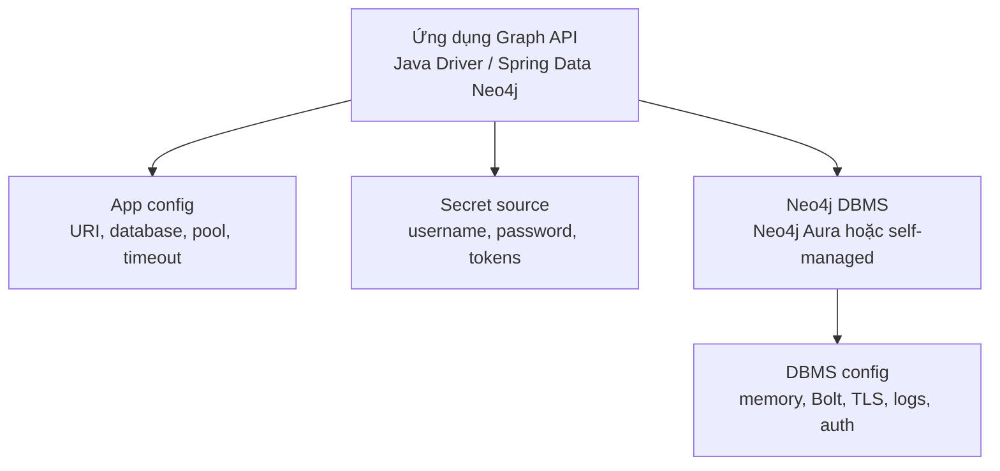
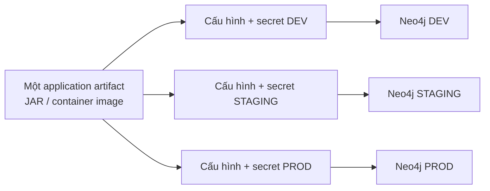
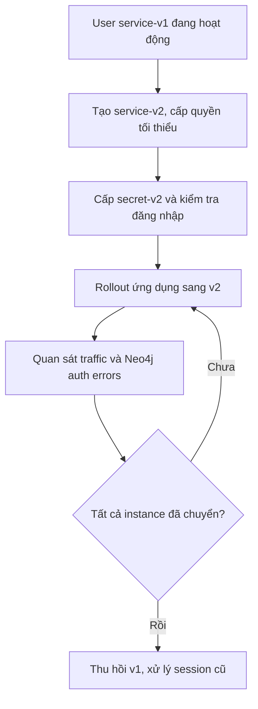
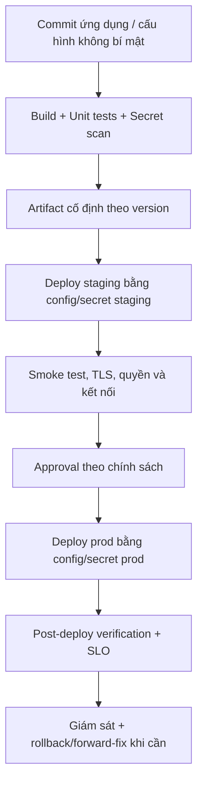

# Quản lý cấu hình và bí mật theo từng môi trường trong Neo4j

Một ứng dụng chạy đúng với Neo4j trên laptop chưa chắc triển khai an toàn lên staging hoặc production. Kết nối có thể trỏ nhầm database, URI có thể không được mã hóa, mật khẩu có thể vô tình nằm trong Git, hoặc một đợt đổi secret có thể làm toàn bộ connection pool của ứng dụng bị từ chối. **Quản lý cấu hình theo môi trường** không chỉ là đổi tên host: đó là quy trình kiểm soát **giá trị cấu hình, danh tính truy cập, bí mật, quyền, cách triển khai và kiểm chứng**.

Bài thuộc chương **Triển khai** của module **DATABASE_ENGINE_GRAPH_NEO4J**. Module này dùng Neo4j để mô hình hóa **property graph**, truy vấn node, relationship và đường đi bằng **Cypher**, cùng các thành phần **Neo4j Java Driver** và **Spring Data Neo4j**. Khi vận hành, cần tách bạch các lớp cấu hình để chức năng ứng dụng có thể chuyển từ dev sang staging rồi production mà không mang theo mật khẩu hoặc quyền nguy hiểm.

Sau bài học, bạn có thể:

- Phân biệt cấu hình **Neo4j DBMS**, cấu hình **ứng dụng kết nối Neo4j** và **secret**.
- Xây dựng ma trận dev/staging/production với URI, database, TLS, quyền, tài nguyên và nguồn bí mật riêng.
- Sử dụng **Spring Boot property placeholders**, profile, biến môi trường và secret manager đúng mục đích.
- Hiểu cách cấu hình Neo4j self-managed qua `neo4j.conf`, Docker, Kubernetes và giới hạn khi dùng Aura.
- Lên kế hoạch **cấp phát, luân chuyển, thu hồi secret**, xác minh kết nối và rollback an toàn.
- Thiết lập kiểm soát CI/CD để ngăn đưa mật khẩu thật hoặc cấu hình môi trường sai vào bản triển khai.

> **Phạm vi thực hành:** Những giá trị host, kích thước bộ nhớ và policy trong bài chỉ để minh họa. Tên setting, cách cấu hình và khả năng quản lý tài khoản phụ thuộc **phiên bản, edition Neo4j và loại dịch vụ**. Các ví dụ giả định bạn có quyền hợp lệ trên môi trường thử nghiệm. Không sao chép nguyên tham số demo lên production mà chưa kiểm tra yêu cầu vận hành và bảo mật.

## 1. Ba lớp cấu hình phải được quản lý độc lập



| Lớp | Ví dụ giá trị | Ai quản lý? | Có phải bí mật? |
| --- | --- | --- | --- |
| **Cấu hình ứng dụng** | `NEO4J_URI`, `NEO4J_DATABASE`, pool size, timeout | Nhóm phát triển/vận hành ứng dụng | Thường không, nhưng có thể lộ topology |
| **Thông tin xác thực** | Password, auth token, private key | IAM/secret manager, chủ sở hữu tài khoản | **Có** |
| **Cấu hình Neo4j DBMS** | `server.memory.heap.max_size`, page cache, Bolt/TLS, logging | Nhóm vận hành database hoặc nhà cung cấp dịch vụ | Phần lớn không; một số mục nhạy cảm |
| **Quyền tài khoản** | Quyền đọc/ghi graph, tạo index, quản lý user | Database administrator/identity team | Không phải password, nhưng là chính sách bảo mật |
| **Cấu hình triển khai** | Port, container image, network policy, volume, node class | Platform/DevOps | Một số metadata phải được bảo vệ |

**Không coi tên biến môi trường là bằng chứng bảo mật.** `NEO4J_PASSWORD` là một tên hợp lý, nhưng nếu giá trị thật được đưa vào file Compose đã commit, log CI/CD hoặc command line thì bí mật vẫn bị lộ.

Hai ví dụ cần phân biệt:

- Đổi `spring.neo4j.uri` trong ứng dụng **không** đổi địa chỉ mà Neo4j DBMS lắng nghe.
- Đổi mật khẩu user trong Neo4j **không** khiến mọi Driver và connection pool đã chạy tự động lấy credential mới.

## 2. Tạo ma trận cấu hình cho dev, staging và production

Ma trận giúp nhóm biết **điểm nào phải khác** và **điểm nào phải nhất quán** khi kiểm thử:

| Thuộc tính | Development | Staging | Production |
| --- | --- | --- | --- |
| **Neo4j instance** | Local/container dành riêng | Instance/cluster thử nghiệm tách biệt | Instance/cluster chính thức |
| **Database** | `neo4j` hoặc database dev | Database staging | Database production đã chỉ định |
| **URI** | Ví dụ `bolt://127.0.0.1:7687` | URI nội bộ có TLS phù hợp | URI được cấp với TLS và xác minh chứng chỉ |
| **Tài khoản ứng dụng** | Credential dev | Credential staging riêng | Credential prod riêng, ít quyền |
| **Secret source** | Secret dev ngoài Git | Kho secret staging | Kho secret prod có RBAC/audit |
| **Dữ liệu** | Dữ liệu tổng hợp/mẫu | Dữ liệu giả lập hoặc đã khử nhạy cảm | Dữ liệu nghiệp vụ thật |
| **Logging** | Có thể chi tiết hơn nhưng không chứa secret | Đủ để thử lỗi và đo hiệu năng | Theo chính sách log/audit, không lộ dữ liệu |
| **Backup/restore** | Có thể tái tạo | Diễn tập khôi phục | Chính sách RPO/RTO và kiểm chứng định kỳ |
| **Quyền quản trị** | Chỉ nhân sự được phép | Chỉ nhóm vận hành staging | Quản lý đặc quyền nghiêm ngặt |

**Những điều không nên sao chép giữa các môi trường:**

- Password production vào máy lập trình viên.
- Snapshot production chứa dữ liệu cá nhân nguyên trạng vào staging.
- Tài khoản admin production cho job test hoặc CI.
- URI production trong profile dev hoặc cấu hình mặc định.
- Quyền tạo/xóa database để chạy các request chỉ đọc.

Với **Neo4j Community**, khả năng RBAC chi tiết không giống Enterprise. Nếu production yêu cầu role chỉ đọc/chỉ ghi theo node, relationship hay database, cần xác minh edition/gói hỗ trợ thay vì chỉ tạo một username có chữ `reader`.

### 2.1. Cấu hình chung và cấu hình riêng

Cùng một bản build ứng dụng có thể chạy ở nhiều môi trường nếu dữ liệu cấu hình được cung cấp **khi triển khai**:



Điều này giảm rủi ro “mã ở staging khác mã production”. **Cùng artifact không có nghĩa cùng user, secret, URI hoặc database**.

## 3. Lập hợp đồng cấu hình ứng dụng rõ ràng

Trước khi viết file YAML, thống nhất một **configuration contract**:

| Biến/hạng mục | Bắt buộc? | Ví dụ không nhạy cảm | Validation |
| --- | --- | --- | --- |
| `NEO4J_URI` | Có | `neo4j+s://graph.prod.example` | Scheme đúng, host thuộc allowlist triển khai |
| `NEO4J_DATABASE` | Có | `commerce` | Tên database được cấp quyền; không trỏ nhầm môi trường |
| `NEO4J_USERNAME` | Theo phương án auth | `graph_api_reader` | Tài khoản đúng service và môi trường |
| `NEO4J_PASSWORD` | Với basic auth | **Không cung cấp ví dụ password thật** | Không rỗng, lấy từ secret store, không log |
| `NEO4J_CONNECT_TIMEOUT` | Theo thiết kế | Ví dụ vài giây | Giá trị dương, vừa ngân sách API |
| `NEO4J_POOL_SIZE` | Theo tải | Ví dụ 40 | Có trần, không vượt tài nguyên DB |
| `SPRING_PROFILES_ACTIVE` | Theo ứng dụng | `staging`, `prod` | Chọn đúng môi trường; không thay thế kiểm soát secret |

**Fail-fast** là nguyên tắc quan trọng: ở production, thiếu `NEO4J_URI` hoặc password không nên khiến ứng dụng âm thầm quay về `localhost`, dùng credential dev hoặc kết nối tới database mặc định.

Không cho HTTP client tùy ý chọn `NEO4J_URI`, username, database hoặc profile để truy vấn database khác. Đây là cấu hình **phía server**, không phải input nghiệp vụ.

### Phân loại mức nhạy cảm

- **Có thể version-control:** cấu trúc YAML, tên key, giới hạn connection pool, giá trị mặc định an toàn, cấu hình logging không chứa secret.
- **Cần kiểm soát truy cập:** URI production, topology, network allowlist, policy role, account inventory.
- **Phải bảo vệ như secret:** mật khẩu, token, private key, signing key, thông tin xác thực backup.
- **Phải tuân thủ phân loại dữ liệu:** dump, snapshot, log query và bản sao dữ liệu graph thật; chúng có thể nhạy cảm dù không chứa password.

**Không cố “mã hóa bằng Base64” rồi coi là bảo vệ secret.** Base64 chỉ là biểu diễn, có thể giải mã dễ dàng.

## 4. Spring Boot và Spring Data Neo4j: placeholder thay vì mật khẩu trong Git

Một file `application.yml` chung có thể ghi **tên biến cấu hình**, không chứa giá trị bí mật:

```yaml
# src/main/resources/application.yml
spring:
  neo4j:
    uri: ${NEO4J_URI}
    authentication:
      username: ${NEO4J_USERNAME}
      password: ${NEO4J_PASSWORD}
  data:
    neo4j:
      database: ${NEO4J_DATABASE}
```

Đây là cú pháp **Spring property placeholder**. Giá trị được lấy từ cấu hình ứng dụng và các property sources được môi trường triển khai cung cấp. Khi sử dụng Spring Boot, kiểm tra đúng **phiên bản auto-configuration** và tên property tương ứng.

Trong thiết kế này:

- `spring.neo4j.uri` cấu hình kết nối Neo4j.
- `spring.neo4j.authentication.username/password` cấu hình basic auth.
- `spring.data.neo4j.database` xác định database ứng dụng truy cập.
- Secret thật không xuất hiện trong tệp YAML đã commit.

Nếu ứng dụng dùng cơ chế OIDC/token khác, cấu hình auth phải được điều chỉnh theo provider; **không buộc mọi triển khai dùng basic password** chỉ vì ví dụ có username/password.

### 4.1. Sử dụng profile để chọn hành vi, không để nhúng secret

Ví dụ `application-local.yml` có thể chứa cấu hình chỉ dành cho môi trường cục bộ:

```yaml
# src/main/resources/application-local.yml
spring:
  neo4j:
    uri: bolt://127.0.0.1:7687
  data:
    neo4j:
      database: neo4j
```

Ứng dụng local vẫn cần credential local được cấp qua kênh phù hợp. **Không đặt `password: neo4j` trong file profile và commit vào Git**.

Ở staging/prod, `SPRING_PROFILES_ACTIVE` có thể được đặt thành `staging` hoặc `prod`, nhưng profile **không phải biên giới bảo mật**. Rủi ro vẫn tồn tại nếu một pod production nhận nhầm `NEO4J_URI` staging hoặc secret khác môi trường.

### 4.2. Thứ tự ưu tiên cấu hình cần được kiểm chứng

Spring Boot có nhiều nguồn cấu hình: file `application.yml`, profile-specific files, environment variables, system properties, command-line arguments và config import. **Nguồn có ưu tiên cao có thể ghi đè nguồn thấp hơn**; thứ tự chính xác phụ thuộc cách chạy và phiên bản Boot.

Đặc biệt lưu ý:

- Một option dòng lệnh có thể ghi đè URI được đặt trong file.
- Secret manager injection có thể không có hiệu lực nếu application dùng nguồn khác ưu tiên cao hơn.
- Biến bị thiếu có thể gây lỗi startup; nên giữ hành vi fail-fast ở production.
- Công cụ quan sát như Spring Actuator `/env` có thể phơi bày cấu hình nếu thiếu hạn chế. Không công khai endpoint quản trị hoặc hiển thị secret trong log.

**Không chỉ đọc file cấu hình để kết luận giá trị thực tế.** Cần kiểm tra giá trị hiệu lực một cách an toàn: URI/database/profile đã chọn, nhưng **không in password/token ra log**.

## 5. Neo4j Java Driver: đưa cấu hình vào, không gắn cứng trong mã

Với ứng dụng không dùng auto-configuration của Spring, Driver có thể nhận cấu hình từ môi trường hoặc một đối tượng cấu hình đã được validate.

```java
import java.util.Objects;

import org.neo4j.driver.AuthTokens;
import org.neo4j.driver.Driver;
import org.neo4j.driver.GraphDatabase;
import org.neo4j.driver.Session;
import org.neo4j.driver.SessionConfig;

public final class GraphConnectivity {

    public static void main(String[] args) {
        String uri = Objects.requireNonNull(
            System.getenv("NEO4J_URI"), "Missing NEO4J_URI");
        String database = Objects.requireNonNull(
            System.getenv("NEO4J_DATABASE"), "Missing NEO4J_DATABASE");
        String username = Objects.requireNonNull(
            System.getenv("NEO4J_USERNAME"), "Missing NEO4J_USERNAME");
        String password = Objects.requireNonNull(
            System.getenv("NEO4J_PASSWORD"), "Missing NEO4J_PASSWORD");

        if (uri.isBlank() || database.isBlank()
                || username.isBlank() || password.isBlank()) {
            throw new IllegalArgumentException(
                "Missing required Neo4j configuration");
        }

        try (Driver driver = GraphDatabase.driver(
                uri, AuthTokens.basic(username, password))) {
            driver.verifyConnectivity();

            try (Session session = driver.session(
                    SessionConfig.forDatabase(database))) {

                long ok = session.executeRead(tx ->
                    tx.run("RETURN 1 AS ok")
                      .single()
                      .get("ok")
                      .asLong()
                );

                System.out.println("Query check: " + (ok == 1));
            }
        }
    }
}
```

**Điều ví dụ cho thấy:**

1. `Driver` được cấu hình từ đầu vào phía **deployment**, không nhận trực tiếp URI/password từ người dùng cuối.
2. `Objects.requireNonNull` và kiểm tra `isBlank()` giúp thất bại sớm nếu thiếu cấu hình.
3. `SessionConfig.forDatabase(database)` tránh dựa vào default database của user khi môi trường có nhiều database.
4. `verifyConnectivity()` kiểm tra kết nối/xác thực; `RETURN 1` kiểm tra đường truy vấn, **không chứng minh** user có đủ quyền cho nghiệp vụ.
5. Trong web application, `Driver` thường được tạo và dùng lại suốt vòng đời service, không tạo một Driver mới cho mỗi request.

Biến môi trường là cách truyền cấu hình phổ biến, **không phải nơi lưu bí mật an toàn nhất theo mặc định**: process env có thể hiện trong diagnostic, crash dump hoặc console vận hành nếu kiểm soát không tốt. Production nên dùng secret manager và cơ chế inject/reload phù hợp.

### 5.1. Không log toàn bộ cấu hình

Sai:

```java
// KHÔNG NÊN: có thể làm lộ password hoặc token.
System.out.println(System.getenv());
```

Nên log những trường đã phân loại không nhạy cảm:

```java
System.out.println("Neo4j database configured: " + database);
// Không in username nếu chính sách vận hành coi account inventory là nhạy cảm.
// Không in URI nếu log có phạm vi công khai.
// Không in password, token, auth header hoặc private key.
```

Khi cần debug, phân biệt lỗi URI, TLS, thiếu quyền và sai secret bằng **mã lỗi/thông điệp đã được kiểm soát**.

## 6. Quản lý cấu hình Neo4j self-managed qua `neo4j.conf`

Cấu hình **server** khác với cấu hình Java/Spring. Trên self-managed, tệp `neo4j.conf` chứa các setting của tiến trình Neo4j. Ví dụ:

```properties
# neo4j.conf -- các giá trị minh họa, không phải sizing production.
dbms.security.auth_enabled=true
server.memory.heap.initial_size=1G
server.memory.heap.max_size=1G
server.memory.pagecache.size=512M
```

Ý nghĩa:

- `dbms.security.auth_enabled` kiểm soát khả năng bật native auth. **Không tắt auth** trên môi trường mở truy cập không tin cậy.
- Heap và page cache là cấu hình tài nguyên của Neo4j, cần sizing theo RAM máy, graph, query, transaction và hệ điều hành.
- Không dùng cấu hình tài nguyên local cho production chỉ vì cùng container image.
- Một số setting cần **restart** mới có hiệu lực, số khác có thể được thay đổi khi runtime hỗ trợ.

Khi có quyền phù hợp, truy vấn kiểm tra cấu hình hiệu lực:

```cypher
SHOW SETTINGS
YIELD name, value
WHERE name IN [
  'dbms.security.auth_enabled',
  'server.memory.heap.max_size',
  'server.memory.pagecache.size'
]
RETURN name, value
ORDER BY name;
```

`SHOW SETTINGS` có thể cần quyền xem setting. **Không log toàn bộ giá trị setting** khi có thể chứa thông tin nhạy cảm; chọn cụ thể những key cần xác minh.

### 6.1. Không nhầm cấu hình của DBMS với cấu hình của ứng dụng

| Nhu cầu | Vị trí thay đổi đúng |
| --- | --- |
| App đang kết nối nhầm database | `spring.data.neo4j.database` hoặc `SessionConfig.forDatabase(...)` |
| App sử dụng sai password | Secret store / auth token / user Neo4j |
| Neo4j cần nhiều page cache hơn | `server.memory.pagecache.size` trên self-managed |
| API timeout quá dài | Timeout tại tầng API/transaction Driver hoặc Spring |
| Port Bolt không được phép qua mạng | Network policy/firewall, listener Neo4j, TLS |
| Credential DBMS bị lộ | Thu hồi/rotation user, secret store, session/connection |
| Neo4j Aura cần thay RAM hoặc cấu hình hệ thống | Quy trình/tùy chọn của gói Aura; không sửa `neo4j.conf` trực tiếp |

Một thay đổi ở tầng sai có thể không giải quyết sự cố, hoặc tạo rủi ro lớn hơn. Ví dụ nới quyền user lên admin không phải cách chữa đúng cho lỗi host DNS.

## 7. Docker: tách cấu hình container và dữ liệu bền vững

Với Neo4j tự chạy bằng Docker, có ít nhất bốn thứ cần quản lý:

1. **Image** và phiên bản Neo4j.
2. **Environment variables** của container.
3. **Volume dữ liệu** như `/data`, tệp import và backup.
4. **Port/network** mà client được phép truy cập.

Ví dụ Compose cho **môi trường phát triển trên một máy**, chỉ xuất port trên loopback:

```yaml
services:
  neo4j:
    image: neo4j:5
    restart: unless-stopped
    ports:
      - "127.0.0.1:7474:7474"
      - "127.0.0.1:7687:7687"
    environment:
      NEO4J_AUTH: ${NEO4J_AUTH:?Supply development credential}
      NEO4J_server_memory_heap_initial__size: 512m
      NEO4J_server_memory_heap_max__size: 1G
      NEO4J_server_memory_pagecache_size: 512m
    volumes:
      - graph_data:/data
      - ./import:/import:ro

volumes:
  graph_data:
```

Trong image Neo4j Docker, cấu hình dạng `NEO4J_...` có quy tắc ánh xạ tên setting: dấu chấm thành một underscore, underscore có sẵn trong tên setting thành **hai underscore**. Vì vậy `server.memory.heap.max_size` được biểu diễn thành `NEO4J_server_memory_heap_max__size`.

**Giới hạn của ví dụ:**

- `neo4j:5` là tag minh họa. Production phải pin phiên bản được hỗ trợ, theo chính sách cập nhật và có kế hoạch rollback/migration.
- `NEO4J_AUTH` là cơ chế **khởi tạo tài khoản/mật khẩu ban đầu** trong trường hợp phù hợp. Trên volume `/data` đã có database, đổi `NEO4J_AUTH` không phải quy trình chung để **luân chuyển mật khẩu native của user hiện hữu**.
- Cú pháp Compose `${...}` đưa credential qua **environment**; dù không nằm trực tiếp trong file, giá trị được cung cấp lúc chạy có thể bị thấy bởi các công cụ quan sát container như inspect. Không xem đây là mô hình lưu secret production an toàn chỉ vì dùng `.env`.
- `./import:/import:ro` chỉ dành cho việc đọc CSV ở môi trường dev; thư mục import **không** phải nơi để lưu password hoặc token.
- Cần backup volume `/data` và hiểu trạng thái data/schema/credential trước khi thay image; xóa container không đồng nghĩa xóa mọi volume.

**Đối với production**, ưu tiên secret management được nền tảng hỗ trợ và phương án tích hợp với phiên bản image Neo4j cụ thể. Không mặc định mọi biến `NEO4J_*` đều hỗ trợ hậu tố `_FILE`; phải kiểm tra tài liệu image/cơ chế secret của đúng phiên bản trước khi dùng.

## 8. Kubernetes: ConfigMap không giống Secret

Trong Kubernetes:

- **ConfigMap** thường dành cho giá trị cấu hình không bí mật (URI, database name, feature flag).
- **Secret** là object riêng cho dữ liệu cần kiểm soát truy cập.
- **Deployment/StatefulSet** tham chiếu các object này để đưa cấu hình vào container.
- Nếu chạy chính Neo4j trên Kubernetes, phải tính thêm persistent volume, storage, routing, chứng chỉ, resource requests/limits và quản trị cluster; không coi đó là bài toán ứng dụng stateless thông thường.

Ví dụ **trích đoạn** cấu hình môi trường cho container ứng dụng Java (không phải manifest Deployment đầy đủ):

```yaml
env:
  - name: NEO4J_URI
    valueFrom:
      configMapKeyRef:
        name: graph-app-config
        key: uri
  - name: NEO4J_DATABASE
    valueFrom:
      configMapKeyRef:
        name: graph-app-config
        key: database
  - name: NEO4J_USERNAME
    valueFrom:
      secretKeyRef:
        name: graph-app-credentials
        key: username
  - name: NEO4J_PASSWORD
    valueFrom:
      secretKeyRef:
        name: graph-app-credentials
        key: password
```

**Không hiểu sai về Kubernetes Secret:**

- Dữ liệu Kubernetes Secret biểu diễn bằng Base64 **không đồng nghĩa được mã hóa an toàn ở trạng thái lưu**. Cần quyền Kubernetes RBAC, encryption at rest cho etcd khi phù hợp, kiểm soát audit và chính sách backup.
- Nếu secret được inject qua **environment variable**, thay Secret object **không tự thay giá trị env** của process đang chạy. Cần rollout/restart hoặc cơ chế refresh được thiết kế.
- Với mounted secret volume, tệp có thể được cập nhật theo cơ chế Kubernetes, nhưng **ứng dụng vẫn phải đọc lại credential và làm mới Driver**.
- Không cho phép service account Kubernetes bất kỳ đọc tất cả Secret trên namespace.
- Không đặt password thật vào Helm values đã commit, manifest log CI hoặc `kubectl` command được ghi lịch sử nếu chưa có kiểm soát.

Với production, có thể dùng external secret manager/CSI/integration được tổ chức hỗ trợ. Chọn giải pháp dựa trên chính sách an ninh, độ sẵn sàng và khả năng rotation, không chỉ dựa vào việc secret có được “ẩn” trên giao diện hay không.

## 9. Aura: tài nguyên và cấu hình hệ thống do dịch vụ quản lý

**Neo4j Aura** khác self-managed ở chỗ nhà cung cấp quản lý nhiều thành phần của database service. Ứng dụng vẫn cần cấu hình:

- **Connection URI** do Aura cung cấp, với TLS và xác minh chứng chỉ phù hợp.
- **Database name** được cấp cho instance.
- **Credential/identity** đúng gói hỗ trợ, được lưu trong secret manager.
- **Quyền truy cập mạng** theo kết nối và tính năng của gói.
- **Timeout, pool size và retry policy** ở ứng dụng, phù hợp tải thực tế.

Không mặc định có thể áp dụng:

```properties
# Những setting self-managed sau không phải cấu hình mà
# ứng dụng được tự sửa trực tiếp trong Aura.
server.memory.heap.max_size=...
server.memory.pagecache.size=...
```

Với Aura, thay đổi kích thước/tài nguyên, quản lý credential và các lựa chọn backup, metrics, SSO/RBAC phụ thuộc dịch vụ/gói cụ thể. **Không cố truyền file `neo4j.conf` vào Aura** hoặc thay host setting chỉ vì một tutorial Docker dùng cách đó.

### 9.1. Không dùng chung secret giữa Aura dev và Aura prod

Ngay cả khi hai instance Aura cùng có URI `neo4j+s://`, không dùng chung user/password hoặc sao chép cấu hình env không kiểm soát. Một bản staging đã vô tình kết nối tới prod có thể tạo node, sửa relationship hoặc xóa dữ liệu nếu tài khoản được cấp quyền rộng.

**Cách phòng vệ:** tách instance, tách identity, phân quyền và pipeline deploy, kèm preflight xác minh database/URI dự kiến trước khi chạy migration hoặc backfill.

## 10. Quản lý secret: nguồn cấp, phân quyền và giám sát

Một secret manager thích hợp thường cung cấp:

- Lưu secret bên ngoài source code và image.
- Kiểm soát **ai/service nào** có thể đọc từng secret.
- Audit các lần đọc/thay đổi theo khả năng nền tảng.
- Versioning và cơ chế rotation.
- Mã hóa dữ liệu ở trạng thái lưu và trên đường truyền.
- Khả năng thu hồi hoặc thay credential khi bị lộ.

Ví dụ loại nguồn có thể dùng: secret manager của cloud provider, Vault hoặc dịch vụ quản lý danh tính được tổ chức phê duyệt. **Không có một công cụ duy nhất đúng cho mọi nơi**; điều quan trọng là kiểm soát quyền, vòng đời và cách tích hợp với ứng dụng.

### 10.1. Quy tắc đặt tên và phạm vi

Một cấu trúc bí mật theo môi trường có thể được quy ước như sau (chỉ là **đường dẫn logic**, không chứa giá trị thực):

```text
team-graph/dev/api/neo4j-password
team-graph/staging/api/neo4j-password
team-graph/prod/api/neo4j-password
team-graph/prod/import-worker/neo4j-password
```

Các key trên cần owner rõ ràng, chính sách đọc riêng và lịch rotation. User API production không nên có quyền đọc password của tài khoản backup hoặc tài khoản quản trị.

### 10.2. Secret có thể lộ ở những vị trí nào?

| Nơi xuất hiện | Nguy cơ | Cách giảm rủi ro |
| --- | --- | --- |
| Git / pull request | Lịch sử commit lưu vết lâu dài | Secret scanning, không commit; rotate ngay nếu lộ |
| `.env` trong thư mục dự án | Bị sao lưu/đính kèm/đẩy lên Git | `.gitignore`, giới hạn quyền, dùng secret manager |
| CI/CD logs | In biến môi trường hoặc command line | Masking, không echo secret, quyền log tối thiểu |
| Docker/Kubernetes metadata | Người có quyền inspect có thể thấy env | Hạn chế quyền, chọn cơ chế secrets phù hợp |
| Application logs | Ghi nguyên cấu hình hoặc URL chứa token | Redaction và log theo allowlist |
| APM/tracing | Attribute chứa auth header, query parameters | Không đưa secret vào span, lọc dữ liệu nhạy cảm |
| Backup / snapshot | Mang cả dữ liệu và credential/metadata nhạy cảm | Mã hóa, quyền, retention, thử khôi phục |
| IaC state | Secret có thể được ghi vào Terraform state | Bảo vệ backend state, phân quyền, mã hóa |

**Một secret từng bị commit** vẫn cần được thay ngay cả khi xóa nó khỏi file ở commit mới; Git history và bản clone cũ có thể vẫn chứa giá trị đó.

## 11. Quyền Neo4j: xác thực đúng nhưng vẫn phải có least privilege

Không dùng một tài khoản `neo4j` có quyền admin cho mọi ứng dụng, job import, báo cáo và thao tác schema. Một danh tính riêng giúp giới hạn rủi ro và theo dõi ai đang thay đổi graph.

| Danh tính | Mục đích | Phạm vi quyền khuyến nghị |
| --- | --- | --- |
| `graph_api_reader` | Truy vấn node/relationship cho API | Đọc đúng database/graph cần thiết |
| `graph_importer` | Ghi dữ liệu từ CSV/Kafka | Ghi những nhãn/loại quan hệ phù hợp |
| `schema_migrator` | Tạo constraint/index | Quyền schema riêng trong thời gian deploy |
| `graph_admin` | Quản trị database/user | Chỉ nhóm có thẩm quyền, dùng có kiểm soát |

Trên **Neo4j Enterprise**, RBAC cho phép thiết kế quyền chi tiết; cách cấp cụ thể phụ thuộc phiên bản. Trên **Community**, mô hình role/privilege không tương đương Enterprise, nên không thể chỉ đặt username `graph_api_reader` mà mặc định chặn được mọi thao tác ghi.

**Không đưa credential admin vào runtime của ứng dụng** chỉ để ứng dụng “tự tạo constraint khi khởi động”. Thay vào đó, cân nhắc migration có quản lý và account tách biệt để giảm quyền runtime.

### 11.1. Xác minh user đang chạy

Trong môi trường cho phép, có thể kiểm tra:

```cypher
SHOW CURRENT USER;
```

Nếu có quyền quản trị thích hợp:

```cypher
SHOW USERS;
```

Để kiểm tra data-plane connectivity từ ứng dụng:

```cypher
RETURN 1 AS ok;
```

**Câu `RETURN 1` không xác minh đủ quyền ghi nghiệp vụ**; cần kiểm thử quyền đọc/ghi cần thiết với dữ liệu thử phù hợp và không chạy thao tác phá hủy trên production.

## 12. TLS và quản lý chứng chỉ theo môi trường

Mật khẩu mạnh không bảo vệ credential nếu kết nối qua mạng không được mã hóa hoặc client không xác minh server.

| Tình huống | Ví dụ | Lựa chọn |
| --- | --- | --- |
| Local dev trên loopback | `bolt://127.0.0.1:7687` | Chỉ phù hợp nếu máy/mạng được cô lập |
| Self-managed có TLS hợp lệ | `neo4j+s://graph.internal.example` | Xác minh chứng chỉ CA đáng tin |
| Môi trường dùng CA nội bộ | TLS với trust chain do tổ chức quản lý | Cấu hình trust phù hợp, không bỏ xác minh tùy tiện |
| Aura | URI TLS do dịch vụ cung cấp | Dùng endpoint/chứng chỉ đúng theo hướng dẫn dịch vụ |

Đối với phiên bản Driver hiện hành, `neo4j+s://` dùng TLS với chứng chỉ được xác thực theo trust của client. URI/routing có thể khác tùy topology. Không đổi `neo4j+s://` sang dạng không kiểm tra chứng chỉ chỉ để vượt lỗi TLS; hãy sửa certificate, hostname hoặc trust chain.

### 12.1. Certificate cũng có vòng đời

Ngoài password/token, cần theo dõi:

1. **Thời hạn chứng chỉ** và cảnh báo trước khi hết hạn.
2. **Issuer/CA** và trust store của ứng dụng.
3. **Hostname** phải khớp với kết nối.
4. **Rotation** certificate có kế hoạch chuyển đổi và kiểm thử.
5. Các instance Java còn chạy với trust store/certificate cũ.

Một certificate có hiệu lực khi neo4j server được khởi động không có nghĩa sẽ còn hợp lệ cho mãi mãi; cấu hình TLS phải có runbook đổi mới tương tự credential.

## 13. Luân chuyển credential mà không gây gián đoạn ngoài ý muốn

Giả sử `graph_api_reader` là native user đang được nhiều instance Java sử dụng. Nếu admin thay password nhưng các instance vẫn giữ auth token cũ, kết nối mới có thể thất bại.

### 13.1. Quy trình rotation với một danh tính

1. **Lập inventory:** những service, job, connector và secret version nào đang tham chiếu user.
2. **Chuẩn bị secret mới** trong kho bí mật, kiểm tra quyền đọc và cơ chế cung cấp.
3. **Chọn chiến lược cập nhật**: Driver refresh token nếu API/phiên bản hỗ trợ hoặc thay Driver/rollout instance.
4. **Thay credential phía Neo4j** bằng công cụ quản trị hợp lệ.
5. **Chuyển ứng dụng** sang secret mới, kiểm tra các kết nối mới.
6. **Quan sát lỗi auth, pool và request SLO** trước khi xác nhận rotation hoàn tất.
7. **Thu hồi secret cũ** trong vault, CI/CD, image, config và xử lý các phiên còn hoạt động theo chính sách.

Một native user thường có một password có hiệu lực. Nếu không có phương án chuyển đổi, thao tác tại DBMS và thay secret ở app **không thể được coi là atomic**, có thể có cửa sổ lỗi kết nối.

### 13.2. Blue/green identity cho trường hợp cần độ sẵn sàng cao

Nếu tổ chức và edition hỗ trợ, có thể sử dụng user thay thế với cùng phạm vi quyền cần thiết:



Cách này tránh việc ứng dụng đồng loạt dùng password cũ đã hết hiệu lực trong lúc cập nhật, nhưng đòi hỏi quản lý tạm thời **hai danh tính** và xác minh quyền của v2 đúng phạm vi. Nó không tự terminate các transaction mở từ v1.

### 13.3. Rollback code không đồng nghĩa rollback secret

Nếu vừa cập nhật ứng dụng rồi gặp lỗi:

- **Rollback container image** có thể đưa code về cũ, nhưng code đó có thể không hiểu cách inject credential mới.
- **Rollback cấu hình** có thể trỏ lại URI staging hoặc secret đã thu hồi.
- **Rollback mật khẩu** không nên thực hiện tùy tiện; phải có kế hoạch chống gián đoạn và chống lộ lại bí mật cũ.

Mọi đợt rotation/migration nên có **kịch bản rollback hoặc forward-fix** được thử trên staging trước, kèm người phê duyệt và thời điểm xử lý.

## 14. CI/CD và GitOps: kiểm tra cấu hình trước khi triển khai

Pipeline tốt không chỉ build thành công mà còn ngăn triển khai **đúng code nhưng sai database**.



### 14.1. Những kiểm soát nên đặt trong pipeline

- **Secret scanning** ở source code, file YAML, `.env`, log và artifact.
- **Tách quyền CI** theo môi trường; runner build không tự có quyền đọc prod secrets.
- **Không render secret vào build artifact**; inject secret tại runtime/deployment được kiểm soát.
- **Approval** cho thay đổi quyền hoặc đích database production.
- **Pin phiên bản Neo4j image/Driver** và kiểm tra tính tương thích khi nâng cấp.
- **Không dùng dữ liệu production chưa khử nhạy cảm** để chạy integration test trên staging.
- **Smoke test** sau deploy bằng credential của ứng dụng, không phải account admin.
- **Rollback có kiểm soát**, không tái sử dụng secret đã thu hồi chỉ để đẩy bản cũ lên.

### 14.2. Cấu hình cũng phải có phiên bản

Tài liệu vận hành nên ghi nhận:

```text
application version: graph-api 2.x
environment: production
neo4j deployment type: Aura / self-managed
neo4j database: commerce
config revision: config-r17
secret reference: team-graph/prod/api/neo4j-password@v4
schema migration revision: 2026-11-25-01
```

Đây là **metadata minh họa**, không phải cách lưu password. Secret reference có thể hữu ích cho audit, nhưng không ghi giá trị secret hoặc URL chứa token vào tài liệu công khai.

**Đừng chỉ so file `application.yml` để xác minh production.** Phải biết profile, env, override, secret version và database thực tế mà process đã dùng.

## 15. Kiểm thử deployment với Neo4j, Java Driver và SDN

Một checklist kiểm thử nên tách rõ **connectivity**, **authentication**, **authorization**, **business data** và **resilience**.

### 15.1. Preflight trước khi nhận traffic

1. Xác nhận `NEO4J_URI` và `NEO4J_DATABASE` thuộc **môi trường đích**.
2. Kiểm tra TLS/certificate/hostname đúng.
3. Xác minh secret đã được inject và không trống; tuyệt đối không echo giá trị.
4. Khởi tạo Driver theo cấu hình và gọi `verifyConnectivity()`.
5. Kiểm tra một query đọc tối thiểu bằng quyền của **ứng dụng**, không dùng admin.
6. Với service ghi, chạy **bài test ghi/rollback** trên dữ liệu thử được chỉ định nếu môi trường cho phép.
7. Xác nhận schema/constraint/index mà ứng dụng yêu cầu đã được deploy bằng migration riêng.
8. Kiểm tra health, pool metrics, lỗi auth, retry và response latency.
9. Với staging/prod, xác minh không có kết nối chéo môi trường hoặc lỗi route tới database không mong muốn.

### 15.2. Kiểm tra bằng Cypher

```cypher
// Kiểm tra identity của người đang kết nối.
SHOW CURRENT USER;
```

```cypher
// Kiểm tra Cypher endpoint hoạt động.
RETURN 1 AS ok;
```

```cypher
// Ví dụ kiểm tra constraint trong database đích,
// chỉ chạy khi tài khoản có quyền xem schema.
SHOW CONSTRAINTS
YIELD name, type, entityType
RETURN name, type, entityType
ORDER BY name;
```

Một số lệnh `SHOW` cần quyền phù hợp; không phải account ứng dụng chỉ đọc nào cũng được phép xem user/setting/schema. Nếu thiếu quyền, dùng công cụ quản trị có thẩm quyền để kiểm chứng, **không cấp admin cho app**.

### 15.3. Ma trận test tối thiểu

| Trường hợp | Kết quả kỳ vọng |
| --- | --- |
| Thiếu `NEO4J_URI` ở prod | Khởi động fail-fast, không fallback local |
| Password sai | Báo lỗi auth đã được phân loại, không log secret |
| TLS hostname sai | Kết nối bị từ chối đúng cách, không bypass validation |
| Database name sai | Không chuyển âm thầm sang database khác |
| User không có quyền ghi | Lệnh ghi bị từ chối; app không tự dùng admin |
| Secret mới được phát hành | App chuyển sang credential mới theo runbook |
| Rollout/restart app | Driver được đóng/mở đúng, không rò kết nối |
| Neo4j tạm không sẵn sàng | Retry bounded, timeout và cảnh báo theo SLO |
| Staging chạy test | Không sửa production graph |
| Nâng phiên bản Neo4j/Driver | Kiểm tra syntax/schema, TLS, auth và metric |

## 16. Chẩn đoán lỗi cấu hình theo triệu chứng

| Triệu chứng | Nguyên nhân thường gặp | Hướng kiểm tra |
| --- | --- | --- |
| `ServiceUnavailable` | URI/port sai, DNS/firewall, database chưa sẵn sàng | Xác minh endpoint và network route từ ứng dụng |
| `Unauthorized` | User/password sai, secret cũ, provider khác | Xem cấu hình identity, secret version; không in password |
| `Forbidden` | Đăng nhập đúng nhưng không có privilege | Kiểm tra role/edition, không reset password vô cớ |
| TLS handshake/certificate failure | Chứng chỉ không tin cậy, hostname sai, hết hạn | Cập nhật CA/hostname/certificate, không tắt xác minh |
| App kết nối local khi chạy prod | Profile/override/fallback sai | Kiểm tra cấu hình hiệu lực và fail-fast |
| Docker dev khởi động với password cũ | Volume `/data` đã có dữ liệu; `NEO4J_AUTH` chỉ phục vụ bootstrap phù hợp | Rotation user bằng cơ chế quản trị Neo4j |
| App không nhận secret mới | Environment injection cố định hoặc Driver giữ token cũ | Rollout/reload, auth manager hoặc tạo Driver mới |
| Timeout/pool exhausted | Pool size, concurrency, query chậm, Neo4j overload | Quan sát driver pool, query plan, SLO và tài nguyên |
| Aura từ chối setting DBMS | Không được quyền sửa host-managed config | Dùng Aura Console và tính năng đúng gói |
| Lộ secret trong log | Logger in env/exception/request metadata | Redact, giới hạn log, rotate secret đã lộ |
| Backup được restore nhưng app lỗi | Database/credential/hostname/schema sau restore khác kỳ vọng | Kiểm tra runbook restore và cấu hình môi trường mới |

### Không “chữa nhanh” bằng cách phá lớp bảo mật

Tránh những phản ứng sai:

- Tắt `dbms.security.auth_enabled` để ứng dụng khỏi báo password sai.
- Thay `neo4j+s://` bằng URI bỏ xác minh chứng chỉ chỉ để chạy được.
- Gán admin cho toàn bộ service vì không rõ role nào thiếu.
- Sao chép credential production sang staging để “test giống thật”.
- Commit file `.env` có secret lên repo riêng nhưng vẫn cho nhiều người truy cập.
- In `System.getenv()` ra log để tìm một biến chưa được inject.
- Restart toàn bộ Neo4j trước khi phân biệt lỗi DB với lỗi Driver/pool.

Cần xác định **tầng lỗi** rồi sửa đúng cấu hình/secret/quyền tương ứng.

## 17. Tình huống thực tế: một bản deploy trỏ nhầm production

Giả sử nhóm đang kiểm thử công việc import `(:Customer)-[:PLACED]->(:Order)` trong staging. Pipeline deploy ứng dụng staging nhưng biến `NEO4J_URI` được lấy từ kho secret production.

Hậu quả có thể xảy ra:

- Import tạo node/relationship trong graph production.
- Dữ liệu thử phá uniqueness constraint hoặc làm sai kết quả báo cáo.
- Ghi log/metric của staging chứa thông tin giao dịch production.
- Team tưởng đã test staging thành công rồi chạy migration tiếp trên môi trường sai.

**Chuỗi phòng vệ nên có:**

1. Service account **staging** không có quyền truy cập Neo4j production.
2. Kho secret **staging** và **production** có IAM policy tách biệt.
3. Kết nối production có network rule dành riêng cho workload được phép.
4. Deployment yêu cầu kiểm tra **URI + database + identity** đúng môi trường.
5. Migration/schema change production phải được phê duyệt riêng.
6. Tác vụ import có **dry-run/validation** và business key/constraint.
7. Monitoring theo dõi thay đổi graph bất thường, đặc biệt những batch không dự kiến.

Một biến môi trường bị nhầm không nên đủ để một workload staging có thể sửa production.

## 18. Câu hỏi tự kiểm tra

**Câu 1.** Có nên lưu mật khẩu Neo4j vào `application-prod.yml` rồi chỉ đưa file đó vào private Git repository không?

<details>
<summary>Đáp án gợi ý</summary>

Không. Secret vẫn tồn tại trong lịch sử Git, bản clone, CI và artifact. Nên lưu giá trị trong secret manager có RBAC/audit, chỉ commit key/placeholder. Nếu secret đã từng lộ trong Git, cần rotate ngay cả khi xóa khỏi commit mới.

</details>

**Câu 2.** Đổi `spring.neo4j.uri` trong Spring Boot có làm Neo4j Server tự đổi cổng Bolt đang lắng nghe không?

<details>
<summary>Đáp án gợi ý</summary>

Không. `spring.neo4j.uri` là cấu hình **client**. Listener của Neo4j self-managed được cấu hình riêng ở DBMS; firewall/network/TLS cũng phải được quản lý đúng tầng.

</details>

**Câu 3.** Docker Compose đã thay `NEO4J_AUTH` nhưng user của database trên volume `/data` cũ vẫn dùng password trước đó. Tại sao?

<details>
<summary>Đáp án gợi ý</summary>

`NEO4J_AUTH` phục vụ thiết lập auth lúc khởi tạo theo cơ chế image, không phải phương án reset/rotate password của database đã có dữ liệu. Cần đổi credential của user bằng thao tác quản trị Neo4j thích hợp, rồi cập nhật ứng dụng.

</details>

**Câu 4.** Kubernetes Secret đã đổi giá trị password, liệu process Java dùng biến môi trường `NEO4J_PASSWORD` có tự nhận secret mới ngay không?

<details>
<summary>Đáp án gợi ý</summary>

Không. Env variable của process không tự được Kubernetes cập nhật khi Secret object thay đổi. Cần rollout/restart hoặc cơ chế cập nhật auth riêng. Nếu mount secret file, ứng dụng vẫn phải đọc lại và làm mới Driver.

</details>

**Câu 5.** Vì sao Base64 trong Kubernetes Secret chưa đủ bảo vệ thông tin đăng nhập?

<details>
<summary>Đáp án gợi ý</summary>

Base64 chỉ là encoding, không phải encryption. Cần RBAC, encryption at rest khi phù hợp, audit, bảo mật etcd/backup và quyền đọc secret tối thiểu.

</details>

**Câu 6.** Ứng dụng có thể chạy `RETURN 1 AS ok` thành công. Đã đủ chứng minh có thể ghi `(:Order)` và tạo constraint chưa?

<details>
<summary>Đáp án gợi ý</summary>

Chưa. `RETURN 1` chỉ kiểm chứng endpoint và truy vấn cơ bản. Quyền ghi graph, schema hoặc quản trị là quyền khác; phải kiểm thử riêng bằng danh tính/DB phù hợp trong môi trường an toàn.

</details>

**Câu 7.** Tại sao đổi password ở Neo4j không đảm bảo Driver đã chạy sẽ lập tức dùng mật khẩu mới?

<details>
<summary>Đáp án gợi ý</summary>

Driver/pool có thể giữ auth token từ lúc khởi tạo. Cần cơ chế auth rotation được Driver hỗ trợ hoặc tạo Driver mới, cập nhật secret source và kiểm tra các kết nối mới.

</details>

**Câu 8.** Nếu ứng dụng staging và production dùng cùng image, có nhất thiết phải dùng chung username, password và database không?

<details>
<summary>Đáp án gợi ý</summary>

Không. Một image có thể dùng nhiều cấu hình triển khai; môi trường phải tách URI, database, user, secret, network policy và quyền. Cùng artifact giúp kiểm thử code nhất quán, không phải lý do dùng chung bí mật.

</details>

**Câu 9.** Khi backup Neo4j production để test restore trên staging, vì sao không được giữ nguyên dữ liệu thật và credential production mà không kiểm soát?

<details>
<summary>Đáp án gợi ý</summary>

Backup có thể chứa dữ liệu khách hàng và thông tin hệ thống nhạy cảm. Cần chính sách mã hóa, kiểm soát truy cập, khử nhạy cảm/ẩn danh dữ liệu theo yêu cầu và tách danh tính/secret của staging khỏi production.

</details>

## Ghi nhớ

- **Cấu hình Neo4j DBMS**, **cấu hình ứng dụng** và **credential** là ba lớp khác nhau, có owner và quy trình thay đổi riêng.
- **Dev, staging và production** cần tách instance/database, user, secret, network và quyền; không sao chép password production sang môi trường thử nghiệm.
- Spring Boot dùng **property placeholders và profiles**; giá trị bí mật được inject từ nguồn ngoài, không commit vào Git.
- Docker `NEO4J_AUTH` phục vụ bootstrap thích hợp; thay biến môi trường không tự rotate password trên volume database đã tồn tại.
- Kubernetes Secret cần **RBAC, encryption at rest và chiến lược cập nhật ứng dụng**; Base64 không phải mã hóa.
- **Neo4j Aura** là dịch vụ quản lý, không chỉnh `neo4j.conf` trực tiếp như self-managed.
- **Rotation secret** phải phối hợp database, secret manager, Driver/pool, các instance và kiểm soát phiên đang chạy.
- **TLS, least privilege, secret scanning, kiểm chứng môi trường và runbook rollback** là những yêu cầu cốt lõi của quy trình deployment an toàn.

### Tài liệu tham khảo

- [Neo4j Operations Manual — Configuration settings](https://neo4j.com/docs/operations-manual/current/configuration/configuration-settings/)
- [Neo4j Operations Manual — Docker and configuration](https://neo4j.com/docs/operations-manual/current/docker/ref-settings/)
- [Neo4j Operations Manual — Authentication and authorization](https://neo4j.com/docs/operations-manual/current/authentication-authorization/)
- [Neo4j Java Driver Manual — Connect to the database](https://neo4j.com/docs/java-manual/current/connect/)
- [Neo4j Java Driver Manual — Performance recommendations](https://neo4j.com/docs/java-manual/current/performance/)
- [Spring Boot — Externalized Configuration](https://docs.spring.io/spring-boot/reference/features/external-config.html)
- [Spring Data Neo4j — Reference](https://docs.spring.io/spring-data/neo4j/reference/)
- [Kubernetes — Secrets](https://kubernetes.io/docs/concepts/configuration/secret/)
- [OWASP — Secrets Management Cheat Sheet](https://cheatsheetseries.owasp.org/cheatsheets/Secrets_Management_Cheat_Sheet.html)
