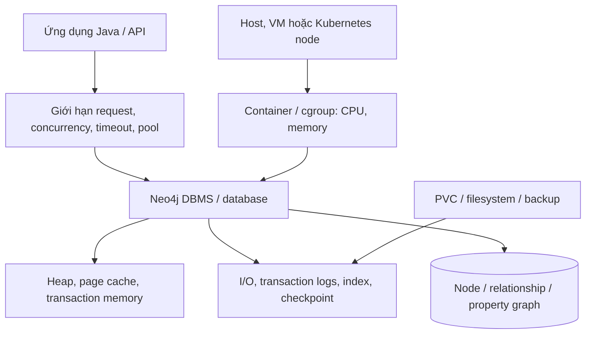
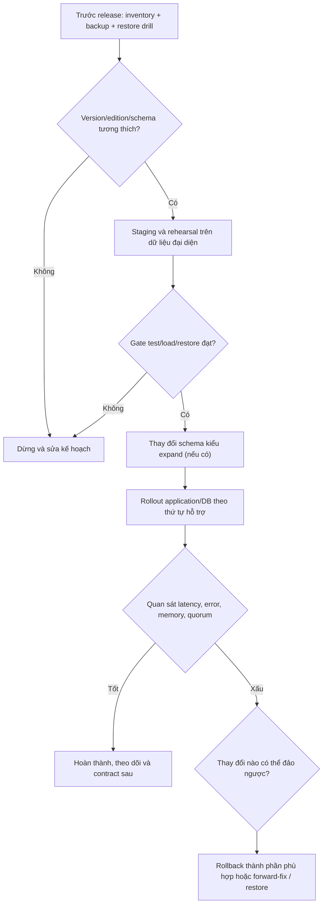
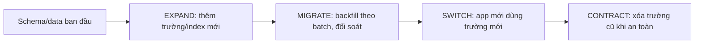

# Giới hạn tài nguyên, cập nhật an toàn và kế hoạch quay lui khi triển khai Neo4j

## 1. Vì sao triển khai database đồ thị cần kế hoạch riêng?

Neo4j lưu dữ liệu ứng dụng dưới dạng **property graph** gồm node, relationship và property. Các dịch vụ dùng **Cypher**, **Neo4j Java Driver** hoặc **Spring Data Neo4j** để ghi đơn hàng, truy vấn liên kết hay duyệt đường đi. Khi triển khai hệ thống thật, thay đổi không chỉ nằm ở binary hoặc container: một bản phát hành có thể đồng thời thay **schema index/constraint, cấu hình RAM, dữ liệu đã ghi, phiên bản Neo4j và hành vi của client**.

Giả sử dịch vụ gợi ý sản phẩm bắt đầu dùng truy vấn duyệt thêm hai hop. API vẫn chạy, nhưng số relationship trung gian tăng rất mạnh; heap hoặc transaction memory bị đẩy lên cao, latency tăng, connection pool cạn và pod Neo4j có thể bị OOM-kill. Nếu vội tăng giới hạn RAM mà không tính page cache và giới hạn máy chủ, tình hình có thể tệ hơn. Ngược lại, nếu một migration đã xóa property cũ, **quay lại image ứng dụng trước đó** có thể không khôi phục được chức năng.

Bài thuộc chương **Triển khai** của module `DATABASE_ENGINE_GRAPH_NEO4J`, tập trung vào ba trụ cột liên quan chặt chẽ:

1. **Giới hạn tài nguyên** — xác định ngân sách CPU, RAM, lưu trữ, kết nối, transaction và truy vấn.
2. **Cập nhật an toàn** — thay đổi có thứ tự, giữ tính tương thích, theo dõi tín hiệu và kiểm tra điểm dừng.
3. **Kế hoạch quay lui** — biết chính xác thành phần nào có thể đảo ngược, lúc nào phải *forward-fix* hoặc khôi phục dữ liệu từ bản sao lưu.

### Kết quả học tập

Sau bài này, bạn có thể:

- Lập ngân sách tài nguyên Neo4j theo workload và giới hạn của máy/container.
- Phân biệt `requests` và `limits` trong Kubernetes với các giới hạn tài nguyên bên trong Neo4j.
- Xác định điều kiện trước khi rolling update, triển khai cluster hoặc đổi cấu hình.
- Thiết kế migration dữ liệu và Cypher theo hướng **expand → migrate → switch → contract**.
- Viết runbook có bước kiểm tra trước, trong, sau release và các **rollback gates**.
- Phân biệt rollback ứng dụng, cấu hình, schema, binary database và **phục hồi dữ liệu**.
- Tổ chức thử nghiệm tải, lỗi và khôi phục mà không mạo hiểm với production.

> **Giới hạn phiên bản:** Neo4j 5.x, các bản phát hành mới hơn, Enterprise cluster, Community, Aura và Kubernetes/Helm không có cùng tập tính năng và quy trình upgrade. Mọi mẫu YAML, thông số bộ nhớ, lệnh và thứ tự triển khai dưới đây là **minh họa có điều kiện**, không phải một runbook áp dụng nguyên xi. Đặc biệt, tính năng rolling upgrade và khả năng downgrade phải được xác nhận với **phiên bản nguồn/đích, edition, store format và tài liệu chính thức**.

## 2. Ba phạm vi quản trị tài nguyên không được đánh đồng



| Phạm vi | Ví dụ giới hạn | Đơn vị bị tác động | Điều không được suy ra |
| --- | --- | --- | --- |
| Ứng dụng | Request concurrency, Driver pool, query deadline | Số request đẩy vào Neo4j | Pool lớn đồng nghĩa server xử lý nhanh hơn |
| Neo4j runtime | JVM heap, page cache, transaction memory | Bộ nhớ truy vấn, bộ nhớ lưu cache | Cấu hình page cache bằng tổng RAM là an toàn |
| Container/VM | Memory limit, CPU quota, CPU request | Trần/sức chứa tài nguyên tiến trình | Pod đang chạy nghĩa là database đã sẵn sàng |
| Storage | PVC dung lượng/IOPS, logs, backup | Khả năng lưu và phục hồi dữ liệu | PVC còn chỗ nghĩa là không có nghẽn I/O |
| Cluster | Primary/secondary, quorum, placement | Khả năng chịu lỗi và phân bổ tải | Có replica tức là có backup để quay về quá khứ |

**Quy tắc nền:** Mọi giới hạn phải gắn với **đơn vị đo, nơi áp dụng, phiên bản, tải đo được và hậu quả khi chạm ngưỡng**. Ghi `memory: 32Gi` trong manifest mà không biết các cấu phần bên trong đang dùng bao nhiêu sẽ không đủ để bảo vệ hệ thống.

## 3. Chia ngân sách RAM: heap, page cache, native và hệ điều hành

### 3.1. Công thức lập kế hoạch

Một cách dự toán theo giới hạn bộ nhớ container:

\[
M_{\mathrm{container}}\;\geq\;
M_{\mathrm{heap,max}}+
M_{\mathrm{pagecache}}+
M_{\mathrm{native}}+
M_{\mathrm{OS/filecache}}+
M_{\mathrm{plugins}}+
M_{\mathrm{headroom}}
\]

Đây là công thức **ngân sách đỉnh và dự phòng**, không phải mọi thành phần luôn được sử dụng đồng thời đúng con số cấp phát. Cần tránh cộng **heap initial và heap max** như hai vùng riêng: chúng là hai mức của **cùng một heap**.

Các thành phần:

- **JVM heap:** cấu trúc truy vấn, object Java, bộ nhớ trung gian và một số hoạt động transaction.
- **Neo4j page cache:** giữ các trang store và các index phù hợp để giảm đọc disk.
- **Native/direct memory:** bộ đệm và cấp phát ngoài heap, network, runtime.
- **OS filesystem cache:** đặc biệt quan trọng với các index Lucene-backed như full-text/vector tùy phiên bản; không phải mọi index đều được cache bằng page cache.
- **Plugin/thuật toán:** APOC, GDS hoặc phần mở rộng có thể tạo tải và vùng bộ nhớ bổ sung.
- **Headroom:** sai số peak, GC, compaction, checkpoint, hoạt động vận hành và nhiễu tải.

### 3.2. Ví dụ với một container có giới hạn 32 GiB

| Khoản mục | Ngân sách *minh họa* |
| --- | ---: |
| JVM heap tối đa | 8 GiB |
| Neo4j page cache | 14 GiB |
| Native/OS/filesystem cache/plugin | 6 GiB |
| Headroom chưa cam kết | 4 GiB |
| **Tổng** | **32 GiB** |

Đây **không phải** đề xuất mặc định cho mọi môi trường. Nếu cần vector index hoặc GDS, phần 6 GiB kia có thể không đủ; nếu query `collect()` lượng lớn, heap 8 GiB có thể nhỏ; nếu database nóng lớn, page cache 14 GiB có thể không phù hợp.

Ví dụ cú pháp `neo4j.conf` cho **một workload đã được thử tải**:

```properties
server.memory.heap.initial_size=8g
server.memory.heap.max_size=8g
server.memory.pagecache.size=14g
```

Trong Neo4j 5.x, các khóa thuộc nhóm `server.memory.*` được dùng phổ biến; tên/ý nghĩa phải đối chiếu theo version. Các số `8g` và `14g` chỉ có ý nghĩa cùng một **giới hạn tài nguyên thật** trên môi trường chạy.

### 3.3. Vì sao OOM-kill khác OutOfMemoryError của JVM?

| Triệu chứng | Nguyên nhân có thể | Hướng điều tra |
| --- | --- | --- |
| JVM báo `OutOfMemoryError` | Heap hoặc vùng nhớ liên quan cạn | Heap/GC, memory profile, query, transaction |
| Container bị `OOMKilled` | Tổng memory chịu tính trong cgroup vượt giới hạn | Heap + page cache + native + filesystem cache + plugin |
| GC pause tăng mạnh | Áp lực heap, cấp phát dày đặc | Query kế hoạch xấu, kết quả lớn, concurrency |
| Page cache fault tăng | Working set không đủ cache hoặc warm-up | Truy vấn, store/index, I/O, page cache |
| RAM đủ nhưng disk I/O nghẽn | Storage latency/IOPS thấp, scan lớn | `PROFILE`, index, volume throughput |

**Không chữa OOMKilled chỉ bằng cách tăng `-Xmx`.** Tăng heap làm giảm phần bộ nhớ còn lại cho cache và native allocations, đôi khi khiến pod bị kill nhanh hơn.

## 4. CPU, transaction concurrency và connection pool

### 4.1. CPU request khác CPU limit

Trên Kubernetes:

- `resources.requests.cpu` ảnh hưởng scheduling và tài nguyên được dành theo chính sách cluster.
- `resources.limits.cpu` là hạn mức sử dụng CPU chịu cơ chế quota/throttling.
- Thêm nhiều core hoặc tăng CPU limit chỉ hữu ích khi workload thực sự có thể tận dụng, và không bị nghẽn lock/I/O/heap.

Một truy vấn duyệt quá nhiều relationship có thể tiêu thụ CPU dù kết quả cuối chỉ một vài hàng. Khi CPU throttling cao, thời gian chạy query tăng, **connection bị giữ lâu hơn** và hàng đợi tại Java Driver có thể phình ra. Vì vậy cần kết hợp tài nguyên CPU với **tối ưu Cypher**.

### 4.2. Số request đồng thời không được suy từ số CPU một cách tuyến tính

Giả sử:

- 120 request/giây gọi Neo4j.
- Mỗi query giữ connection trung bình 250 ms trong tải đo được.

Ước lượng số connection đang dùng trung bình:

\[
\lambda \times W =
120\ \text{request/s}\times0{,}25\ \text{s}
=30
\]

Nếu query tăng lên 1 giây vì I/O/lock contention, con số trung bình trở thành **120** dù QPS không đổi. Đây là phép ước lượng theo nguyên lý hàng đợi, **không phải công thức chọn pool size chính xác**.

Ở phía Java Driver, xem xét:

- `withMaxConnectionPoolSize`: giới hạn pool theo đích kết nối; khi cluster có nhiều member và ứng dụng nhiều pod, tổng pool có thể nhân lên.
- `withConnectionAcquisitionTimeout`: thời gian đợi connection khả dụng.
- `TransactionConfig.withTimeout`: giới hạn thời gian transaction trên server theo cấu hình/phiên bản.
- `withMaxTransactionRetryTime`: ngân sách tự retry của managed transaction.
- `withFetchSize`: kích thước đợt fetch, **không** giới hạn tổng record.

**Giới hạn pool Java không phải giới hạn tài nguyên toàn cluster.** 10 pod, mỗi pod cho phép 50 connection đến một đích, có thể tạo áp lực tới 500 connection tiềm năng ở đích đó. Điều chỉnh pool và số pod phải cân đối với Neo4j Bolt, RAM và số query đang chạy.

### 4.3. Backpressure trước khi truy cập database

Nếu API có thể nhận 10.000 request nhưng Neo4j chỉ xử lý ổn định một phần nhỏ, đừng để tất cả thread chờ pool đến timeout. Áp dụng:

- Admission control hoặc semaphore có giới hạn theo use case.
- Queue có độ dài và thời hạn xác định; từ chối có chủ đích khi quá tải.
- Rate limit theo tenant/actor khi phù hợp.
- Timeout có ngân sách từ gateway → service → Driver → transaction.
- Retry có backoff và jitter; **không** để nhiều tầng cùng retry vô hạn.

Khi request lỗi trong quá trình commit, không thể mặc định dữ liệu đã rollback. Các thao tác tạo node/relationship quan trọng cần **idempotency key, unique constraint và quy tắc xử lý payload trùng khóa**.

## 5. Đĩa, transaction logs và vùng trống dành cho nâng cấp

### 5.1. Dự toán volume hoạt động

Neo4j cần lưu:

1. Graph store gồm node, relationship, property.
2. Schema indexes, constraint-backed indexes, dữ liệu tìm kiếm.
3. Transaction logs, checkpoint và metadata.
4. Vùng tạm cho import, index build, restore hoặc migration theo loại thao tác.
5. Khoảng trống dự phòng trước khi chạm ngưỡng vận hành.

Ví dụ **một** PVC 500 GiB theo số liệu đo minh họa:

| Khoản mục | Dung lượng |
| --- | ---: |
| Graph store | 280 GiB |
| Index files không nằm trong số store ở hàng trên | 45 GiB |
| Transaction logs ở đỉnh quan sát | 35 GiB |
| Vùng trống cho thao tác bảo trì | 50 GiB |
| Dự phòng tăng trưởng/sai số | 90 GiB |
| **Tổng ngân sách** | **500 GiB** |

Những số này là **giả định** để luyện phương pháp, không phải footprint chính thức của Neo4j. Nếu hệ thống thực dùng volume **riêng** cho store và transaction logs, phải tính theo từng volume; không cộng trùng khi thu thập số đo filesystem.

### 5.2. Điều gì xảy ra khi volume gần đầy?

- Transaction mới có thể thất bại vì không ghi được log hoặc file dữ liệu.
- Checkpoint, log rotation hoặc backup bị ảnh hưởng.
- Index population/upgrade có thể thiếu không gian tạm.
- Khôi phục sau một lần restart có thể khó hơn khi không còn chỗ trống.

**Không xóa thủ công transaction logs hoặc file index để «cứu disk».** Phải xử lý bằng cơ chế retention/pruning/backup/volume expansion được Neo4j hỗ trợ, với runbook và điều kiện an toàn rõ ràng.

### 5.3. Dung lượng không phải toàn bộ năng lực storage

Số GiB đủ nhưng IOPS/bandwidth thấp vẫn khiến:

- Random traversal chậm khi page cache miss.
- Checkpoint hoặc import tranh chấp I/O với query online.
- Backup/restore vượt RTO.
- Page cache warm-up sau restart kéo dài.

Vì vậy cần đo **latency, throughput, IOPS, queue depth và page faults**, không chỉ phần trăm dung lượng volume.

## 6. Docker và Kubernetes: đặt giới hạn thực tế ở đâu?

### 6.1. Ví dụ Kubernetes `resources`

Đoạn sau chỉ minh họa **một phần pod template**, không phải manifest Neo4j cluster hoàn chỉnh:

```yaml
spec:
  template:
    spec:
      terminationGracePeriodSeconds: 120
      containers:
        - name: neo4j
          image: neo4j:5.26
          resources:
            requests:
              cpu: "2"
              memory: 24Gi
              ephemeral-storage: 2Gi
            limits:
              cpu: "4"
              memory: 32Gi
              ephemeral-storage: 8Gi
          volumeMounts:
            - name: data
              mountPath: /data
```

Mẫu này **không thể tự vận hành thành cluster production**: còn thiếu StatefulSet metadata, PV/PVC, network/routing, credentials/TLS, probes, quản lý initial members, edition và các phần của chart chính thức. Image tag và giá trị được cố định để làm ví dụ; **không nên dùng tag trôi nổi `latest`** cho database có trạng thái.

Ý nghĩa:

- Memory limit của container là **trần tổng** các vùng bộ nhớ chịu cgroup, không chỉ JVM heap.
- Memory request khác memory limit; không tự coi khoảng chênh là RAM luôn có sẵn.
- CPU limit thấp có thể gây throttling; CPU request chủ yếu phục vụ scheduling.
- `ephemeral-storage` không thay thế dung lượng PVC dùng để lưu dữ liệu.
- Mount `/data` vào volume bền vững theo hướng dẫn container/Helm của Neo4j.

### 6.2. StatefulSet và PersistentVolume

Neo4j lưu state; quy trình restart/recreate phải **giữ đúng volume, metadata và danh tính instance** phù hợp topology.

- PVC phải có StorageClass, access mode và IOPS phù hợp; không giả định mọi storage cho phép cùng một volume được mount ghi bởi nhiều pod.
- Nếu pod bị thay, dữ liệu quan trọng phải còn trên PV, không nằm chỉ trong writable layer của container.
- Kiểm tra reclaim policy và hành vi cleanup khi xóa Helm release/StatefulSet: **không được vô tình xóa PVC/PV chứa dữ liệu production**.
- Với cluster, nên dùng **Helm chart/operator và runbook được Neo4j hỗ trợ** theo version thay vì tự sao chép một Pod manifest mẫu rồi scale lên ba bản.

### 6.3. Readiness, liveness và startup

| Kiểm tra | Mục đích | Bẫy triển khai |
| --- | --- | --- |
| Startup probe | Cho database đủ thời gian khởi động/recovery | Ngưỡng quá ngắn có thể restart vòng lặp |
| Readiness probe | Chỉ nhận lưu lượng khi instance sẵn sàng | TCP port mở chưa chắc database/route cần dùng đã hoạt động |
| Liveness probe | Phát hiện trạng thái cần restart | Probe quá nhạy có thể giết pod đang GC hoặc recover |
| Ứng dụng smoke query | Xác nhận truy vấn nghiệp vụ và quyền | `RETURN 1` không kiểm tra đầy đủ Cypher/schema/RBAC |

Nên phân biệt **process alive**, **DBMS online**, **database cần dùng online** và **sẵn sàng phục vụ ghi/đọc đúng vai trò**. Cơ chế probe phải phù hợp Neo4j version, TLS và cluster, không tạo thêm tải lớn ở mỗi lần kiểm tra.

### 6.4. PodDisruptionBudget không thay thế điều kiện quorum

Một PodDisruptionBudget (PDB) có thể hạn chế một số đợt **eviction tự nguyện** khi Kubernetes bảo trì node, nhưng:

- PDB không chặn mất điện hoặc lỗi node bất ngờ.
- `minAvailable` không tự hiểu database nào có bao nhiêu primary.
- Kubernetes có thể coi pod `Ready` trong khi database đó chưa đủ quorum/khả năng ghi.

Do đó PDB cần đi kèm **topology, anti-affinity/zone placement, kiểm tra server/database status và thứ tự update hợp lệ**.

## 7. Đặt ngân sách tài nguyên từ workload trước khi chọn số cấu hình

### 7.1. Bộ dữ liệu đo cơ sở

Trước release, cần ít nhất:

| Nhóm | Metric/câu hỏi |
| --- | --- |
| Dữ liệu | Node, relationship, kích thước property/index, degree P95/P99, tốc độ tăng |
| Query | P50/P95/P99, DB Hits, Rows, heap/query memory, số lần timeout |
| Transaction | Transaction active, thời gian giữ lock, retry, deadlock |
| Java Driver | Pool acquisition delay, lỗi kết nối, active/idle/waiting nếu quan sát được |
| Runtime | CPU usage/throttling, heap/GC, page cache hits/faults, native/OS memory |
| Storage | Free GiB, IOPS, latency, log growth, checkpoint, thời gian backup |
| HA | Routing/failover, trạng thái database, primary allocations, lag theo vai trò |

Không nên chỉ lấy trung bình. Release cần nhìn **tail latency, thời điểm cao điểm và tốc độ tăng theo phút/giờ**. Một query rất đắt mới xuất hiện trong 1% request vẫn có thể làm cạn pool và ảnh hưởng các request khác.

### 7.2. Cách xác định điểm bắt đầu

1. Xác nhận **database version/edition/store format**.
2. Thu thập tải hiện tại và dự báo tăng trưởng.
3. Dùng `neo4j-admin server memory-recommendation` làm **heuristic** cho RAM nguồn thật nếu triển khai tự quản lý.
4. Đặt ngân sách heap/page cache/native/OS/plug-in trong giới hạn container hoặc VM.
5. Chạy workload đại diện ở dữ liệu đủ lớn.
6. Tăng tải dần, đo mức xuất hiện timeout, CPU throttling, page cache faults và I/O saturation.
7. Chọn mức có **dự phòng** thay vì điểm QPS cực đại trong vài phút.

Ví dụ công cụ tư vấn:

```bash
neo4j-admin server memory-recommendation --memory=32g
```

Lệnh là công cụ lập kế hoạch, không phải phép đo thay cho load test. Với container, ngân sách truyền vào phải phù hợp **giới hạn thực sự**, không nhầm với tổng RAM của host.

## 8. Phân loại thay đổi trước khi thiết kế rollout

Một release có thể gồm nhiều loại thay đổi, với khả năng quay lui khác nhau:

| Loại | Ví dụ | Rủi ro nổi bật | Chiến lược chung |
| --- | --- | --- | --- |
| Client application | Thêm query GraphQL/REST, đổi mapping SDN | Query cũ/mới không tương thích, pool tăng | Canary app, backward-compatible API |
| Cypher/query | Tăng hop, thêm aggregation | CPU/heap/I/O, fan-out, timeout | `EXPLAIN`/`PROFILE` và load test |
| Schema | Tạo range index, unique constraint | Index population, dữ liệu trùng, tải ghi | Chuẩn bị schema trước, đo trạng thái |
| Data migration | Đổi ID, thêm property, thay relationship | Ghi sai hàng loạt, mất dữ liệu gốc | Batch nhỏ, idempotent, audit/checkpoint |
| Neo4j configuration | Heap, page cache, timeout, Bolt setting | OOM, restart, thay behavior | Soát budget, rollout có quan sát |
| Neo4j binary/version | Bản vá, minor/major upgrade | Store format, protocol, plugin, cluster compatibility | Đường nâng cấp được vendor hỗ trợ |
| Cluster topology | Thêm/bớt server hoặc primary | Quorum, routing, replication, reallocation | Kế hoạch phân bổ và failover riêng |

**Đừng gộp thay đổi lớn vào một bước không thể phân tích.** Nếu cùng lúc tăng Java Driver pool, giảm memory limit, đổi Neo4j image và chạy migration xóa property, rất khó truy ra nguyên nhân khi P99 tăng hoặc dữ liệu bị lỗi.

## 9. Quy trình phát hành an toàn theo từng cổng kiểm tra



### 9.1. Gate 0: khóa phạm vi và rủi ro

Trước khi triển khai, ghi trong change record:

- Phạm vi: tên database, cluster, các service Java, chart/image version.
- **Baseline**: dữ liệu, query latency, CPU/RAM, disk, failure rate, backup age.
- Tính tương thích: Neo4j Server ↔ Java Driver ↔ SDN ↔ APOC/GDS ↔ plugins.
- Dự kiến downtime, ảnh hưởng read/write, lịch freeze thay đổi.
- **RPO/RTO**, backup gần nhất và kết quả restore thử.
- Người phụ trách quyết định dừng/rollback, kênh liên lạc và giờ theo dõi.

### 9.2. Gate 1: thử nghiệm trên môi trường tương đồng

Môi trường staging nên có **cấu trúc node/relationship, index, degree và tần suất ghi** gần production. Một graph 100 node không thể phát hiện fan-out bùng nổ ở supernode hàng triệu cạnh.

Kiểm tra:

1. Test query/schema/constraint và các use case có transaction.
2. Test migration cùng batch size dự định.
3. Load test cả read/write, burst, timeout và retry.
4. Thử restart pod/server, kiểm tra recovery và readiness.
5. Khôi phục một backup vào môi trường tách biệt để chắc rằng runbook hoạt động.

### 9.3. Gate 2: triển khai có điểm dừng

- Triển khai schema theo hướng tương thích trước nếu app mới cần.
- Rollout app hoặc database theo chiến lược thích hợp, **không lẫn hai kiểu chiến lược**.
- Chỉ tiếp tục khi instance/database phục vụ đúng vai trò, query smoke chạy được và metric ổn định.
- Nếu có cảnh báo nguy hiểm, **dừng mở rộng phạm vi** trước khi quyết định biện pháp xử lý.

### 9.4. Gate 3: xác minh sau release

Nên đọc cả **sức khỏe vận hành** và **tính đúng của graph**:

```cypher
SHOW DATABASES;
```

Ở môi trường có quyền phù hợp và API hỗ trợ:

```cypher
SHOW SERVERS;
```

Tính sẵn sàng về mặt DBMS không thay cho truy vấn nghiệp vụ. Ví dụ:

```cypher
MATCH (c:DeployCustomer {tenantId: $tenantId, customerId: $id})
RETURN c.customerId AS customerId,
       c.status AS status;
```

Trong rollout, kiểm tra thêm:

- Các request ghi/đọc hoàn thành với quyền đúng.
- Schema/index cần thiết đang sẵn sàng.
- Tỷ lệ error, timeout, retry, driver acquisition wait.
- CPU throttling, heap, GC, page cache faults và storage.
- Không có batch migration bị chạy hai lần hoặc có nhiều dòng lỗi bị bỏ qua.

## 10. Migration an toàn: mở rộng trước, phá bỏ sau

**Expand → migrate → switch → contract** là một nguyên tắc tốt cho thay đổi dữ liệu mà phiên bản cũ và mới của ứng dụng phải sống cùng lúc.



### 10.1. Ví dụ chuyển từ `state` sang `status`

Giả sử node `:DeployCustomer` hiện có property `state` với giá trị `ACTIVE`/`SUSPENDED`. Ứng dụng mới muốn dùng `status` và cần tra cứu theo tenant + status.

**Bước A — Expand schema:** thêm index, chưa xóa trường cũ.

```cypher
CREATE RANGE INDEX deploy_customer_tenant_status IF NOT EXISTS
FOR (c:DeployCustomer)
ON (c.tenantId, c.status);
```

Chờ index được tạo xong, kiểm tra:

```cypher
SHOW INDEXES
YIELD name, type, state, labelsOrTypes, properties
WHERE name = 'deploy_customer_tenant_status'
RETURN name, type, state, labelsOrTypes, properties;
```

Đừng suy ra việc lệnh tạo index trả về thành công nghĩa là index đã **ONLINE** ngay lập tức với database lớn.

**Bước B — Migrate theo batch:** trong giai đoạn chuyển tiếp, ứng dụng mới có thể đọc `coalesce(c.status,c.state)` nếu quy tắc tương thích cho phép; writer phải được thiết kế **dual-write** hoặc có cơ chế kiểm soát thay đổi để không tạo dữ liệu bị lệch.

Một câu cập nhật theo lô:

```cypher
MATCH (c:DeployCustomer)
WHERE c.status IS NULL
  AND c.state IS NOT NULL
WITH c
LIMIT $batchSize
SET c.status = c.state
RETURN count(c) AS updated;
```

Chạy lại có kiểm soát cho tới khi số bản ghi còn thiếu `status` về 0; `$batchSize` cần giới hạn tại tầng job. Trong hệ thống nhiều writer, phải quyết định xử lý dữ liệu mới phát sinh **giữa các đợt backfill**; một lần quét xong không tự chứng minh dữ liệu luôn đồng bộ.

**Bước C — Switch:** app mới chuyển sang ưu tiên `status` khi:

- Chất lượng dữ liệu đã được đối soát.
- Query plan trên index mới đạt tiêu chí.
- Các writer cũ không còn tạo dữ liệu thiếu trường mới hoặc còn compatibility code.
- Canaries và error budget đạt yêu cầu.

**Bước D — Contract:** chỉ xóa `state` và index/schema cũ sau khi xác nhận **không còn code/consumer nào cần** và đã hết thời hạn rollback app cũ.

```cypher
// CHỈ để minh họa thao tác phá bỏ sau giai đoạn bảo đảm:
// MATCH (c:DeployCustomer) REMOVE c.state;
```

Không chạy thao tác contract phá hủy trong lần rollout đầu tiên; nếu thực hiện, cần kế hoạch phục hồi dữ liệu chi tiết thay vì chỉ quay lại image cũ.

### 10.2. Unique constraint và dữ liệu không đạt điều kiện

Trước khi tạo uniqueness constraint mới:

- Kiểm tra có **khóa trùng** theo miền dữ liệu không.
- Tính đến node thiếu property: unique constraint khác property existence/key constraint.
- Tách bước làm sạch dữ liệu và tạo constraint.
- Thử cạnh tranh hai transaction sau khi index/constraint sẵn sàng.

Ví dụ constraint trên khóa tenant + ID:

```cypher
CREATE CONSTRAINT deploy_customer_business_key IF NOT EXISTS
FOR (c:DeployCustomer)
REQUIRE (c.tenantId, c.customerId) IS UNIQUE;
```

Không tự gộp những khách hàng chỉ vì họ trùng tên/email nếu quy tắc danh tính của ứng dụng không xác định như vậy.

## 11. Java Driver và Spring Data Neo4j khi rollout hai phiên bản app

### 11.1. Tương thích trong lúc canary

Trong quá trình rollout, **app cũ và app mới có thể chạy đồng thời**. Do đó:

| Tác vụ | Điều kiện tương thích |
| --- | --- |
| Đọc property mới | Có fallback trong giai đoạn backfill hoặc chờ dữ liệu đầy đủ |
| Ghi relationship mới | App cũ không được hiểu nhầm hoặc xóa relationship đó khi save aggregate |
| Đổi label/type | Cần có giai đoạn hỗ trợ cả mô hình cũ và mới |
| Thêm constraint | Writer cũ không tiếp tục tạo bản ghi vi phạm |
| Thay đổi query | Kế hoạch trên dữ liệu/index mới phải được đo |
| Đổi Driver/SDN | Server và Bolt compatibility theo matrix chính thức |

Trong **Spring Data Neo4j**, không nên giả định mỗi lệnh `save()` chỉ cập nhật đúng property mà DTO đang thay đổi: mapping và relationship aggregate có thể ảnh hưởng graph. Với thay đổi cạnh cụ thể, cân nhắc Cypher tường minh và integration tests trên dữ liệu thực.

### 11.2. Timeout và retry có thể thay đổi kết quả rollout

Một release có query chậm hơn có thể kéo dài thời gian giữ connection. Nếu API và Driver cùng retry, tải thực có thể tăng đột biến:

```text
1 request
  -> gateway retry 2 lần
      -> service retry 2 lần
          -> Driver retry managed transaction
```

Không nên biến các tầng này thành một **retry storm**. Cần một ngân sách end-to-end và phân biệt lỗi transient với lỗi data/constraint/syntax. Với ghi dữ liệu, phải có idempotency để không nhân node/relationship khi mất kết nối quanh commit.

### 11.3. Canary application không phải canary database

Có thể đưa 5% lưu lượng tới app mới rồi tăng dần nếu vẫn dùng **cùng schema tương thích**. Nhưng database là một hệ thống trạng thái chung: khi một migration đã xóa dữ liệu hoặc thay store format, tỷ lệ 5% traffic **không cô lập được ảnh hưởng** của thay đổi đó.

Do đó, hãy xử lý **schema/data change có thể đảo ngược** trước, và chỉ dùng app canary để xác minh hiệu ứng ở tầng dịch vụ.

## 12. Cập nhật Neo4j Server và cluster: khác triển khai ứng dụng stateless

### 12.1. Standalone

Với một instance standalone, cần lên lịch:

1. Ghi inventory phiên bản, edition, plugin, config và database.
2. Kiểm tra đường nâng cấp được **Neo4j hỗ trợ** (bao gồm store format và JDK yêu cầu).
3. Tạo backup/dump theo khả năng edition; xác nhận có thể restore.
4. Dừng ghi/thu hẹp maintenance window nếu quá trình đòi dừng DB.
5. Thay binary/image/config theo đúng trình tự trong upgrade manual.
6. Khởi động, kiểm tra recovery, index, DB online và query nghiệp vụ.
7. Theo dõi sau release và chỉ mở hoàn toàn traffic khi đạt gate.

Nếu upgrade thay đổi **store format**, việc thay image về bản cũ có thể **không đọc được database nữa**. Kế hoạch hồi phục phải nêu rõ backup trước upgrade và bước dựng môi trường phù hợp, không hứa «Helm rollback là xong».

### 12.2. Cluster

Đối với cluster nhiều primary, nguy cơ gồm:

- Mất quorum khi nhiều primary bị dừng hoặc nâng cấp cùng lúc.
- Member còn lại không tương thích protocol/version với member đã upgrade.
- Primary/secondary, routing và thành viên đang host từng database khác nhau.
- Reallocation/replication kéo dài hoặc thiếu disk khi thành viên gia nhập lại.

**Rolling upgrade chỉ dùng khi chính xác cặp phiên bản và topology được Neo4j hỗ trợ.** Có những đường major upgrade đòi các bước đặc biệt hoặc downtime. Không áp dụng một luật «luôn update secondary trước rồi mỗi primary một lần» như chân lý cho mọi phiên bản.

Quy trình có điều kiện:

1. Kiểm tra compatibility matrix và yêu cầu chuyển phiên bản theo manual.
2. Đảm bảo đủ quorum/dung lượng và backup trước thay đổi.
3. Tạm dừng mọi automation có thể tự di chuyển/phá vỡ thành viên ngoài kế hoạch.
4. Thay từng thành viên **theo thứ tự được tài liệu của phiên bản xác nhận**, quan sát quá trình rời/nhập cluster.
5. Chỉ sang thành viên kế tiếp sau khi kiểm tra **database allocations, roles, sync, query read/write và độ ổn định cluster**.
6. Đảm bảo plugin/Driver tương thích, hoàn tất các bước post-upgrade và theo dõi.

### 12.3. Không cho Kubernetes tự xóa mọi Pod cùng lúc

Một automation cập nhật tất cả instance có thể gây mất quorum. StatefulSet rolling update **không tự hiểu tất cả điều kiện bầu chọn hoặc vai trò của Neo4j**. Cần cấu hình strategy và phối hợp theo hướng dẫn chart/operator chính thức, cùng PDB/anti-affinity/zone placement và người điều hành rõ ràng.

Đặc biệt tránh thử nâng cấp database bằng cách:

```bash
# Ví dụ ĐIỀU KHÔNG NÊN LÀM trên production:
# kubectl delete pods --all -l app=neo4j
```

Lệnh trên được ghi dưới dạng comment cảnh báo, **không phải bước thao tác**. Việc xóa đồng thời có thể phá hủy khả năng phục vụ ghi/đọc trong lúc cluster chưa ổn định.

## 13. Điểm dừng tự động và tín hiệu kích hoạt rollback

### 13.1. Định nghĩa gate trước khi bắt đầu

Một mẫu **minh họa** của release acceptance:

| Signal | Trước release | Điều kiện tiếp tục |
| --- | --- | --- |
| HTTP 5xx | Baseline hiện tại | Không tăng quá ngưỡng đã thỏa thuận |
| P95/P99 query/API | Baseline theo giờ cao điểm | Không vượt error budget/SLO |
| Database status | Online/role đúng | Không có database critical offline bất thường |
| Cluster quorum | Đáp ứng yêu cầu cấu hình | Không mất khả năng ghi |
| CPU throttling | Không quá tải | Không tăng kéo dài |
| Heap/GC/OOM | Ổn định | Không có OOM/restart loop; GC không tăng mạnh |
| Page cache/I/O | Trong giới hạn | Không có bão page faults/storage saturation |
| Disk free | Đủ cho logs/upgrade/recovery | Không xuống dưới ngưỡng an toàn |
| Correctness | Invariant và kiểm tra hợp đồng API | Không có sai dữ liệu/vi phạm tenant |

**Ngưỡng cụ thể phải dựa trên SLO, tải và môi trường**, không chọn tùy ý «P99 tăng 10% thì luôn rollback». Một lỗi toàn vẹn dữ liệu có thể yêu cầu dừng lập tức, dù latency vẫn đẹp.

### 13.2. Ba loại phản ứng

1. **Pause rollout:** dừng phát hành tiếp, giữ hệ thống ở trạng thái hiện tại để điều tra.
2. **Rollback thành phần có thể đảo ngược:** hoàn lại config hoặc ứng dụng khi schema/dữ liệu vẫn tương thích.
3. **Forward-fix hoặc restore:** áp dụng thay đổi sửa lỗi về phía trước, hoặc khôi phục dữ liệu từ điểm phục hồi đã kiểm chứng sau khi kiểm soát writer.

Phải định nghĩa ai được thực hiện từng quyết định, trạng thái dữ liệu cần chụp lại và cách thông báo cho các dịch vụ đang kết nối.

## 14. Kế hoạch quay lui: chính xác quay lui cái gì?

| Thành phần | Có thể làm gì? | Điều kiện/giới hạn |
| --- | --- | --- |
| Ứng dụng Java | Redeploy image trước, chuyển traffic ngược | Schema/API/dữ liệu vẫn backward-compatible |
| Feature flag | Tắt tính năng/query mới | Tắt code không tự khôi phục những ghi đã commit |
| Cấu hình Neo4j | Trở về cấu hình cũ và restart theo hướng dẫn | Phải còn trong giới hạn tài nguyên; có thể cần maintenance |
| Index mới | Giữ hoặc gỡ sau khi xác nhận không cần | Gỡ index có thể làm query chậm; không khôi phục dữ liệu |
| Constraint mới | Chỉ điều chỉnh nếu an toàn về nghiệp vụ | Bỏ constraint làm yếu bảo vệ dữ liệu, không nên phản ứng máy móc |
| Data backfill không phá hủy | Có thể đọc lại property cũ hoặc forward-fix | Ghi dữ liệu đã đổi phải có audit và mốc |
| Migration xóa property/node/relationship | Thường **không có undo tự nhiên** | Restore dữ liệu, tái dựng từ log sự kiện hoặc forward-fix |
| Neo4j binary/store format | Có thể cần đường khôi phục đặc biệt | Downgrade trực tiếp có thể không được hỗ trợ |
| Cluster topology | Tái phân bổ server/roles theo quy trình | Không được làm mất quorum hoặc tự ý xóa state |

### 14.1. Rollback ứng dụng ≠ rollback database

Giả sử bản app mới viết `status` và bỏ `state`. Nếu ngay sau đó rollout thêm bước xóa `state`, đưa app cũ trở lại có thể khiến nó nhận `null` và thất bại. Vì vậy **thời hạn có thể rollback ứng dụng** cần được phản ánh trong kế hoạch `contract`: đừng xóa dữ liệu cũ cho đến khi hết cửa sổ quay lui được phê duyệt.

### 14.2. Khôi phục backup có thể làm mất các ghi hợp lệ mới

Một bản backup ở 10:00 được dùng restore khi sự cố xảy ra 10:17 có thể **bỏ qua các transaction hợp lệ sau 10:00**. Trước khi restore production:

- Khoanh vùng thời điểm bắt đầu lỗi và **điểm khôi phục mục tiêu**.
- Tạm dừng/đóng băng các writer liên quan và ghi nhận trạng thái khi có thể.
- Đánh giá **RPO và phạm vi ghi bị mất**; thông báo nghiệp vụ.
- Kiểm tra backup chain, dung lượng, thời gian restore và tính nhất quán.
- Lập kế hoạch replay hoặc đối soát những event/đơn hàng còn lưu ở hệ khác.
- Dùng môi trường phục hồi cách ly để xác minh trước khi chuyển client.

Một replica HA là **bản dữ liệu đang sống**, không phải mốc lịch sử; lỗi ghi đã commit thường đã lan sang replica. Không thể thay việc restore bằng «chọn server secondary có dữ liệu cũ» nếu không có cơ chế bảo đảm và kế hoạch chính thức.

### 14.3. Quay lui binary khi store đã được nâng cấp

Đừng nhầm `helm rollback` hoặc đổi `image: neo4j:old` với việc hoàn nguyên store. Quá trình nâng cấp có thể thay **store format, metadata và trạng thái hệ thống**. Quay lại binary cũ không bảo đảm đọc được dữ liệu mới, và thử trực tiếp trên volume production có thể tăng nguy cơ.

Khi đường downgrade không được vendor hỗ trợ, lựa chọn an toàn có thể là **fix-forward**, hoặc dựng instance/cluster với phiên bản tương thích và restore từ bản backup trước nâng cấp theo quy trình được kiểm chứng.

## 15. Runbook triển khai mẫu theo từng bước

### 15.1. Chuẩn bị trước thời điểm thay đổi

| Bước | Người/phần chịu trách nhiệm | Bằng chứng hoàn tất |
| --- | --- | --- |
| 1. Kiểm kê phiên bản/cluster/config | DB platform team | Inventory có thời điểm và phiên bản |
| 2. Kiểm tra tương thích app/Driver/SDN/Neo4j | Tech lead | Compatibility checklist |
| 3. Backup và restore drill | DB operations | Artifact + log restore thành công |
| 4. Kiểm tra PVC free, page cache, heap/CPU | SRE | Dashboard baseline và headroom |
| 5. Xác nhận query migration & index | Data/DB engineer | Staging run + `PROFILE`/đếm rows |
| 6. Đặt gate, người phê duyệt, lịch bảo trì | Release manager | Change record và kế hoạch thông báo |

### 15.2. Thực hiện

1. Đặt marker thời điểm bắt đầu release, giảm các tác vụ ETL/batch có thể tranh chấp.
2. Triển khai **expand schema** an toàn; chờ index/constraint sẵn sàng.
3. Thực hiện backfill theo transaction nhỏ, có `batchId` và checkpoint; kiểm tra row count theo từng đợt.
4. Rollout ứng dụng canary hoặc Neo4j Server theo chiến lược **được hỗ trợ cho từng loại**.
5. Sau mỗi bước, xác nhận database online, app smoke test, latency và error rate.
6. Nếu gate thất bại, **pause**, xác định thành phần gây lỗi và áp dụng nhánh xử lý đã chọn.
7. Giữ compatibility code/schema trong cửa sổ rollback.
8. Đến khi ổn định, đóng release và lập lịch **contract** vào một thay đổi có kiểm soát khác.

### 15.3. Sau release

Ghi lại:

- Image/chart/config version đang chạy.
- Thời gian, database/cluster affected, backup artifact.
- Các migration job và checkpoint được chấp nhận.
- Baseline/after metrics: P99, CPU/GC, page cache, index status, disk.
- Kết quả smoke test, invariant, lỗi còn tồn và ticket xử lý.
- Thời điểm kết thúc cửa sổ rollback ứng dụng.

Nếu bị lỗi, postmortem nên nêu **điều kiện bảo vệ nào không hoạt động** và cách thêm test hoặc gate, thay vì chỉ viết «rollback đã thành công».

## 16. Ba tình huống sự cố mẫu

### Tình huống A — OOMKilled sau khi giảm memory limit

**Bối cảnh:** Trước release, pod có limit 32 GiB, heap tối đa 8 GiB, page cache 14 GiB. Bản mới giảm limit còn 20 GiB nhưng giữ nguyên cấu hình Neo4j.

**Triệu chứng:** pod bị OOMKilled khi tải tăng, API timeout và Bolt connection liên tục bị mất.

**Phân tích:** Chỉ riêng heap + page cache đã là **22 GiB**; còn native/OS/plugin. Mức limit 20 GiB không thể đáp ứng ngân sách tối thiểu trong kịch bản này.

**Hành động:** Dừng rollout, khôi phục mức limit/config tương thích với nguồn lực host nếu được phép, kiểm tra trạng thái database sau restart và quan sát load. Sau đó **điều chỉnh ngân sách bộ nhớ có đo đạc**, không tăng ngẫu nhiên cả heap và page cache.

### Tình huống B — Query mới làm quá tải sau app canary

**Bối cảnh:** Một API mới dùng pattern `(u)-[:FOLLOWS*1..6]->(v)` trên graph có supernode lớn, không giới hạn điểm bắt đầu.

**Triệu chứng:** P99 tăng, CPU cao, Driver acquisition timeout, dù RAM vẫn chưa đầy.

**Hành động:** Tắt feature flag/canary, đánh giá query bằng `EXPLAIN`/`PROFILE` trên dữ liệu đại diện, thu hẹp anchor, giới hạn path và kết quả. Chỉ đổi pool size sau khi đã xử lý nguyên nhân query nặng.

```cypher
// Ví dụ tập trung vào một user thay vì mở rộng từ mọi node:
MATCH (u:DeployUser {userId: $userId})
MATCH p = (u)-[:FOLLOWS*1..3]->(v:DeployUser)
RETURN v.userId AS connectedId, length(p) AS hops
LIMIT 100;
```

Đoạn trên vẫn có thể tốn tài nguyên nếu fan-out rất cao; `LIMIT` hạn chế số kết quả trả về, **không bảo đảm giới hạn mọi bước mở rộng trung gian**. Cần đo đúng workload và cân nhắc chỉ trả boolean/shortest path theo use case.

### Tình huống C — Backfill xóa nhầm property cũ

**Bối cảnh:** Migration đã xóa `state` trước khi app cũ ngừng dùng nó. Khi quay lại image app cũ, một phần request lỗi do thiếu property.

**Hành động:** Không chỉ redeploy image. Giữ writer an toàn, xác định dữ liệu còn có thể tái dựng từ `status`, mốc backup, log nghiệp vụ; chọn forward-fix hoặc restore theo RPO được duyệt. Bổ sung giai đoạn dual-read/dual-write và trì hoãn `contract` trong release tiếp theo.

## 17. Kiểm thử trước release và diễn tập rollback

### 17.1. Các loại test cần có

| Test | Mục tiêu | Mức ưu tiên |
| --- | --- | --- |
| Query correctness | Không sai node/relationship/tenant | Bắt buộc |
| Migration idempotency | Chạy lại không nhân bản hoặc ghi đè sai | Bắt buộc |
| Concurrency + constraint | Không tạo trùng khi hai writer | Bắt buộc cho dữ liệu quan trọng |
| Rollback app compatibility | App cũ vẫn dùng được khi schema expand | Bắt buộc nếu có cửa sổ rollback |
| Load test | P95/P99, resource, pool/timeout | Cao |
| Pod restart/recovery | Database quay lại online đúng quy trình | Cao |
| Cluster failover/quorum | Thử mất một member theo topology | Cao ở Enterprise HA |
| Backup restore drill | Có thể lấy lại dữ liệu và quyền | Bắt buộc cho production |
| Upgrade rehearsal | Tương thích binary/store/config/plugin | Bắt buộc trước nâng cấp DB |

### 17.2. Một test migration có thể chạy lại

Với batch `state → status`, sau hai lần chạy:

```cypher
MATCH (c:DeployCustomer)
WHERE c.state IS NOT NULL
  AND (c.status IS NULL OR c.status <> c.state)
RETURN count(c) AS mismatched;
```

Đây là kiểm tra **một bất biến chuyển tiếp** khi `state` và `status` vẫn phải đồng bộ. Nó không phù hợp sau khi nghiệp vụ cho phép hai trường có ý nghĩa khác nhau hoặc đã hoàn tất contract.

### 17.3. Diễn tập dừng release và khôi phục

Thử trên staging:

1. Tạo backup rồi phục hồi vào môi trường mới, xác minh identity/relationship/constraint.
2. Chạy migration với lỗi có kiểm soát giữa batch; kiểm tra checkpoint và resume.
3. Triển khai app mới, sau đó rollback app khi schema đã expand: app cũ còn hoạt động không?
4. Giả lập lỗi sau một thay đổi **không thể đảo ngược**, thực hành quy trình **forward-fix** hoặc restore, ghi lại RPO/RTO thực tế.
5. Xác nhận không còn job cũ ghi vào database đích sau cutover.

Không tiến hành thử phá hoại (xóa database, cắt mọi pod, restore đè) trên production khi chưa có kế hoạch được cấp quyền và kiểm chứng.

## 18. Lỗi thiết kế và cách sửa

| Cách làm sai | Hậu quả | Cách làm đúng |
| --- | --- | --- |
| Giới hạn RAM container bằng heap + page cache | Native/OS hết chỗ, OOMKilled | Chừa RAM cho mọi vùng bộ nhớ và headroom |
| Tăng pool Java để bù query chậm | Đẩy nghẽn sang DB server | Tối ưu Cypher, giới hạn concurrency, đo lại |
| Chỉ theo dõi CPU trung bình | Bỏ lỡ throttling, GC và P99 | Theo dõi tail latency và saturation |
| Không lưu data trên PVC | Mất state khi pod thay | Dùng storage bền vững và quy tắc PV/PVC rõ ràng |
| Probe TCP là điều kiện «write ready» | Nhận traffic khi DB chưa online/quorum | Phối hợp readiness với database status và smoke query |
| Xóa đồng thời nhiều primary khi update | Mất quorum, downtime | Tuân thủ thứ tự upgrade được Neo4j hỗ trợ |
| Luôn rolling upgrade mọi major version | Có thể sai compatibility/store format | Kiểm tra upgrade path và điều kiện downtime |
| Thêm index rồi lập tức dùng trong app | Index chưa ONLINE | Chờ population, kiểm tra query plan |
| Xóa property cũ trong release đầu | App cũ không thể rollback | Expand/migrate/switch, contract sau |
| Tin `helm rollback` khôi phục store | Binary cũ có thể không đọc store đã nâng cấp | Restore/fix-forward theo manual |
| Có replica nên bỏ backup | Xóa nhầm có thể lan sang mọi bản | Backup độc lập và restore drill |
| Retry callback có gọi API ngoài | Side effect lặp dù transaction rollback | Idempotency/outbox, phân tách transaction |
| Backup có nhưng chưa thử restore | Không biết chain/RBAC/khả năng phục hồi | Diễn tập recovery với dữ liệu đại diện |
| Đo rollout theo pod Ready duy nhất | Có thể còn lỗi nghiệp vụ | Health + query + schema + correctness gates |

## 19. Bài tập thực hành và lời giải

### Bài 1. Ngân sách RAM

Pod Neo4j có memory limit 24 GiB, heap max 10 GiB, page cache 12 GiB. Đội vận hành báo «còn 2 GiB nên an toàn». Nhận xét.

**Đáp án:** Chưa đủ căn cứ. Vẫn cần RAM cho native/direct memory, filesystem cache, OS/container, plugin và headroom; tổng có thể vượt 24 GiB khi tải lên. Phải đo thực và điều chỉnh trước khi triển khai.

### Bài 2. Tính sơ bộ connection concurrency

Một dịch vụ có 200 request/giây, mỗi query giữ Bolt connection trung bình 150 ms. Ước lượng mức đồng thời trung bình là bao nhiêu? Nếu query tăng lên 750 ms thì sao?

**Đáp án:** Ban đầu `200 × 0,15 = 30`, sau đó `200 × 0,75 = 150`. Đây chỉ là ước lượng queue/concurrency; không tự suy ra nên đặt pool 150 vì còn nhiều pod, server/member và điều kiện tải.

### Bài 3. Schema không tương thích

Bản ứng dụng mới chuyển sang property `status`. Có nên xóa property `state` cùng lần canary 5% khi 95% traffic vẫn chạy app cũ?

**Đáp án:** Không. App cũ có thể vẫn đọc `state`; cần expand, migrate, switch với compatibility code, và contract sau cửa sổ rollback.

### Bài 4. Rolling upgrade cluster

Một cluster Enterprise có ba primary và một secondary. Đội vận hành muốn thay cả ba primary cùng lúc vì «Kubernetes sẽ tự khởi động lại». Tại sao rủi ro?

**Đáp án:** Có thể mất quorum, định tuyến/replication bị gián đoạn và gặp lỗi mixed-version. Thứ tự nâng cấp phải dựa trên tài liệu của **cặp phiên bản/edition** và kiểm tra trạng thái từng database sau mỗi bước.

### Bài 5. Giới hạn disk

PVC 500 GiB có graph store 280, index 45, transaction logs đỉnh 35 và không gian tạm 50 GiB. Còn bao nhiêu để dành tăng trưởng/headroom trong ví dụ?

**Đáp án:** `500 - 280 - 45 - 35 - 50 = 90 GiB`. Cần giữ biên an toàn trong vận hành, không chờ volume đầy mới xử lý.

### Bài 6. Có thể rollback bằng Helm không?

Sau khi nâng cấp Neo4j DBMS, store format được nâng cấp và plugin mới cũng đã ghi metadata. Có thể bảo đảm chạy `helm rollback` về image cũ là database phục hồi hoàn toàn không?

**Đáp án:** Không. Binary cũ có thể không hỗ trợ store mới; phải dùng rollback/restore path đúng phiên bản, hoặc forward-fix. Trước nâng cấp phải có backup, restore rehearsal và compatibility check.

### Bài 7. Quyết định giữa pause, rollback và restore

Một migration đổi `status` đang chạy chậm nhưng không sai dữ liệu; một migration khác đã xóa nhầm 5% relationship. Hai trường hợp xử lý giống nhau không?

**Đáp án:** Không. Trường hợp chậm có thể pause để đánh giá tải, chia batch và tối ưu; trường hợp xóa nhầm là sự cố dữ liệu, cần kiểm soát writer, đối chiếu audit/backup, cân nhắc forward-fix hoặc khôi phục theo RPO/RTO.

### Bài 8. Rollout gate

Ứng dụng báo 0% lỗi HTTP nhưng P99 tăng gấp ba, page cache faults và acquisition timeout tăng. Có nên tiếp tục tăng canary từ 10% lên 100%?

**Đáp án:** Không nên chỉ dựa vào HTTP 5xx. Cần pause, điều tra query plan, CPU/I/O/cache, thời gian giữ connection và pool; chỉ tiếp tục khi tín hiệu đã đạt gate được duyệt.

## 20. Checklist cuối trước khi triển khai production

- [ ] Inventory rõ **Neo4j version, edition, store format, plugin, Driver/SDN, cluster topology**.
- [ ] Có số đo baseline: query P95/P99, CPU throttling, heap/GC, page cache faults, disk, transaction logs và pool.
- [ ] Giới hạn RAM container lớn hơn ngân sách heap + page cache + native/OS + headroom.
- [ ] CPU requests/limits được thử tải với workload thực.
- [ ] PV/PVC được cấu hình theo chính sách bền vững; có khoảng trống cho index/backup/upgrade.
- [ ] Health probes, startup/recovery và điều kiện database online có kiểm thử.
- [ ] Backup/dump theo edition và **restore drill** đã thành công.
- [ ] Schema/index/constraint và Cypher tương thích giữa app cũ/mới.
- [ ] Migration chạy theo batch, idempotent, có audit/checkpoint và đối soát.
- [ ] Có giới hạn query/path fan-out, connection pool và retry end-to-end.
- [ ] Cặp phiên bản Neo4j và cách rolling upgrade được tài liệu chính thức hỗ trợ.
- [ ] Với cluster, từng bước giữ quorum và theo dõi database/server roles.
- [ ] Có canary/gate, người chịu trách nhiệm pause và báo động theo SLO.
- [ ] Kế hoạch rollback phân biệt app, config, schema, store format và dữ liệu.
- [ ] Không dùng Helm/image rollback như lời hứa khôi phục dữ liệu đã xóa hoặc store đã đổi.
- [ ] Có người phê duyệt phục hồi dữ liệu và kế hoạch RPO/RTO, ngăn writer kép khi cutover.
- [ ] Có post-release monitoring, log quyết định và thời hạn kết thúc compatibility window.

## 21. Tổng kết

**Giới hạn tài nguyên** của Neo4j phải được thiết kế xuyên suốt từ ứng dụng Java, connection pool và Cypher đến JVM heap, page cache, OS/native memory, CPU và PVC. Giới hạn tại một tầng không thay thế phép đo ở tầng khác. Một query duyệt nhiều relationship, một transaction dài hoặc một thay đổi pool không kiểm soát đều có thể gây quá tải dù số node chưa tăng.

**Cập nhật an toàn** đòi hỏi dữ liệu/schema tương thích, triển khai có giai đoạn và gate quan sát rõ ràng. Với Neo4j cluster, thay đổi database có trạng thái phải tuân thủ điều kiện quorum, version/edition và nâng cấp được hỗ trợ — không thể áp dụng nguyên mẫu rollout của ứng dụng stateless.

**Kế hoạch quay lui** phải mô tả cụ thể quay lui thành phần nào. Đưa app về image cũ không tự khôi phục node, relationship hay property đã bị xóa, và có thể không tương thích với store format sau upgrade. Vì thế, một release có trách nhiệm cần kết hợp **backup được kiểm chứng, expand/migrate/switch/contract, rollback gates, forward-fix khi thích hợp và diễn tập khôi phục dữ liệu**.

### Tài liệu tham khảo

- [Neo4j Operations Manual – Memory configuration](https://neo4j.com/docs/operations-manual/current/performance/memory-configuration/)
- [Neo4j Operations Manual – Neo4j on Kubernetes](https://neo4j.com/docs/operations-manual/current/kubernetes/)
- [Neo4j Operations Manual – Docker deployment](https://neo4j.com/docs/operations-manual/current/docker/)
- [Neo4j Operations Manual – Upgrade and migration](https://neo4j.com/docs/operations-manual/current/upgrade/)
- [Neo4j Operations Manual – Clustering](https://neo4j.com/docs/operations-manual/current/clustering/)
- [Neo4j Operations Manual – Backup and restore](https://neo4j.com/docs/operations-manual/current/backup-restore/)
- [Neo4j Cypher Manual – Indexes](https://neo4j.com/docs/cypher-manual/current/indexes/)
- [Neo4j Cypher Manual – Query tuning](https://neo4j.com/docs/cypher-manual/current/planning-and-tuning/)
- [Neo4j Java Driver Manual – Advanced connection](https://neo4j.com/docs/java-manual/current/connect-advanced/)
- [Spring Data Neo4j Reference](https://docs.spring.io/spring-data/neo4j/reference/)
