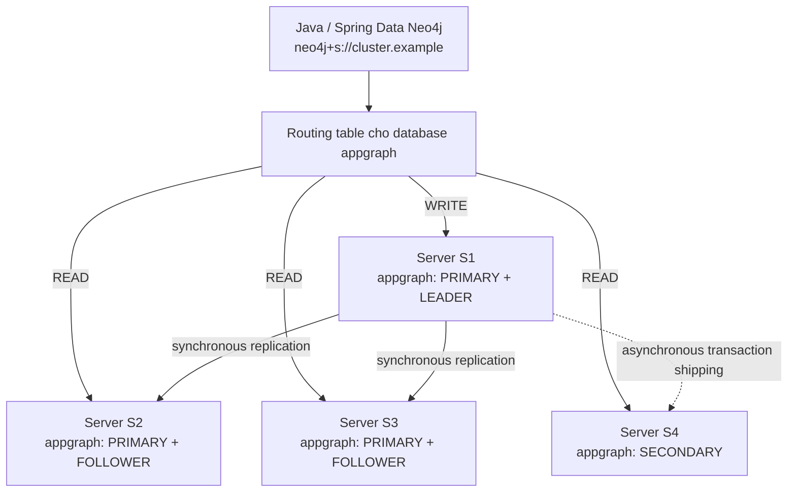
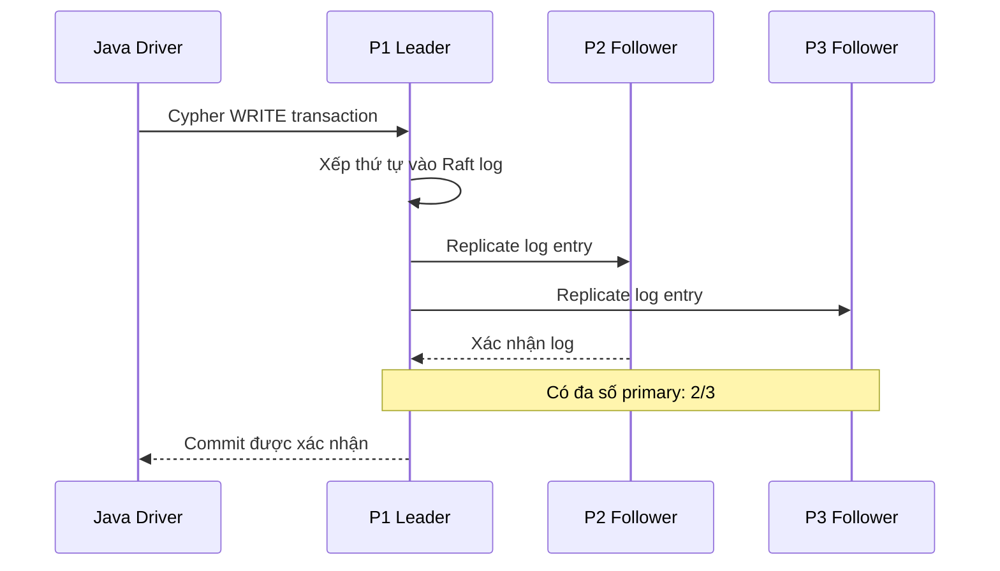
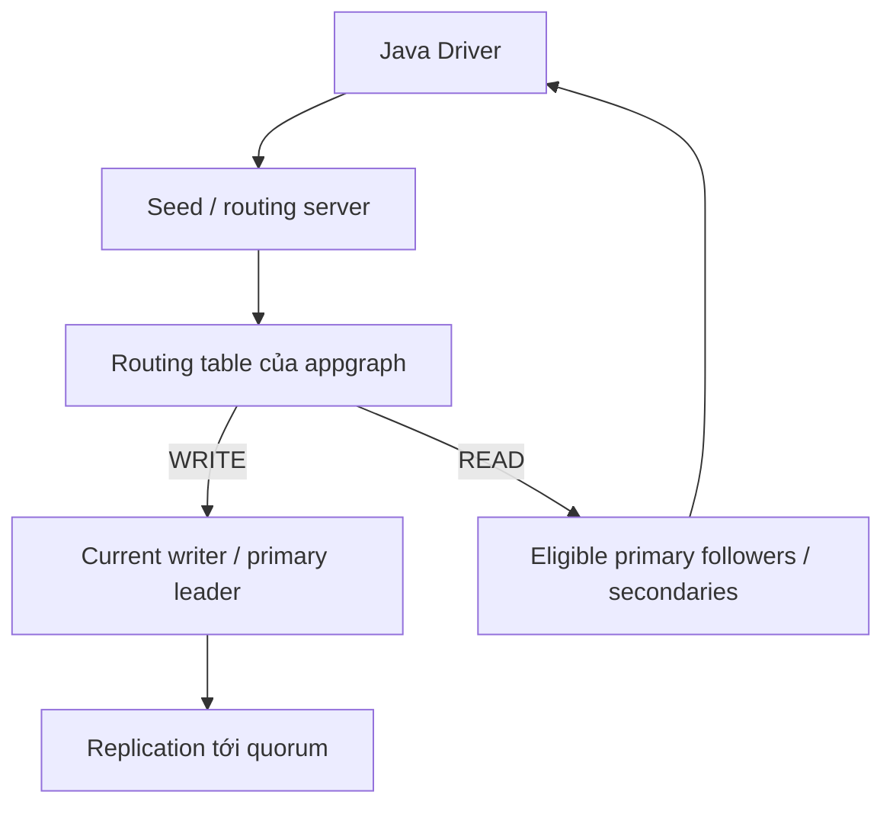

# Vai trò máy chủ, cơ chế đồng thuận và quyền ghi dữ liệu trong cụm Neo4j

## 1. Vì sao phải phân biệt máy chủ, bản sao database và người được phép ghi?

Neo4j lưu dữ liệu dưới dạng **property graph**: node biểu diễn thực thể, relationship biểu diễn liên kết có hướng, label/type và property giúp tổ chức dữ liệu. Cypher cho phép tạo và truy vấn graph; Java Driver và Spring Data Neo4j đưa các giao dịch đó từ ứng dụng vào database.

Khi một ứng dụng tăng tải hoặc đòi hỏi tính sẵn sàng cao, Neo4j **Enterprise Edition** có thể chạy nhiều máy chủ thành một **cluster**. Tuy nhiên, “có năm máy” không đồng nghĩa “năm máy đều có thể tự ghi vào cùng một database”. Cần phân biệt:

1. **Server:** tiến trình Neo4j với CPU, RAM, disk, endpoint và khả năng host nhiều database.
2. **Database allocation/copy:** một bản sao của **một database cụ thể** được đặt trên một server, có vai trò *primary* hoặc *secondary*.
3. **Leader/writer:** một **primary** được chọn làm đầu mối sắp thứ tự và xử lý các transaction ghi cho database đó.
4. **Consensus/quorum:** tập primary cần đủ đa số để xác nhận ghi đã bền vững và an toàn.
5. **Database access/RBAC:** ngay cả khi có writer, database có thể đang ở chế độ read-only hoặc **tài khoản ứng dụng không có quyền WRITE**.

**Nguyên tắc cốt lõi:** vai trò `PRIMARY`/`SECONDARY` thuộc **bản sao database**, không phải nhãn cố định của server. Với nhiều database, cùng một server có thể là primary của database A, secondary của B, leader của A và follower của C. <https://neo4j.com/docs/operations-manual/current/clustering/introduction/>

### 1.1. Mô hình khái niệm



Hình vẽ giản lược trường hợp một database có ba primary và một secondary. Tất cả các bản sao cùng lưu một database logic, **không phải bốn graph nghiệp vụ độc lập**. Tùy routing policy, truy vấn đọc cũng có thể đi tới những primary khác hoặc cả writer.

### 1.2. Phạm vi và điều kiện triển khai

- Bài tập trung vào **Neo4j Enterprise clustering** với bản sao primary/secondary của *standard database*. Community Edition không có mô hình Enterprise cluster tương ứng.
- Với **Neo4j Aura**, dịch vụ quản lý topology và quy trình vận hành; ứng dụng vẫn cần hiểu routing, read/write và consistency nhưng không tùy ý chạy lệnh điều phối máy chủ như ở self-managed.
- Neo4j mới còn có **sharded databases** và replica giữa các cluster ở những phiên bản/tier nhất định. **Không nhầm** primary/secondary replica của **một standard database** trong bài này với phân vùng dữ liệu (*sharding*) hoặc cơ chế CDC.
- Cú pháp quản trị ví dụ dành cho Enterprise và chỉ được chạy bởi người có quyền trong **database `system`** trên môi trường đã được phê duyệt.

## 2. Vai trò của một bản sao database

| Loại bản sao | Tham gia đa số ghi? | Có thể là writer/leader? | Có thể phục vụ đọc? | Cách nhận cập nhật |
| --- | --- | --- | --- | --- |
| **Primary đang là leader** | Có | **Đang là writer** | Có, tùy routing policy | Nhận transaction, đặt thứ tự, replicate tới primary khác |
| **Primary đang là follower** | Có | Có thể được bầu làm writer sau này | Có | Đồng bộ log với leader và xác nhận theo Raft |
| **Secondary** | **Không** | **Không** | Có, dùng để mở rộng tải đọc | Nhận transaction log **bất đồng bộ** từ upstream |

### 2.1. Primary không đồng nghĩa tất cả đều ghi độc lập

Mỗi bản sao primary có quyền **tham gia xử lý ghi** và có thể được bầu làm leader. Nhưng tại một thời điểm chỉ có **một writer** cho mỗi database logic. Những primary không phải leader đóng vai trò follower và cung cấp khả năng chịu lỗi.

Ví dụ:

```text
Database appgraph:
   S1  PRIMARY / LEADER / writer=true
   S2  PRIMARY / FOLLOWER / writer=false
   S3  PRIMARY / FOLLOWER / writer=false
   S4  SECONDARY          / writer=false
```

Khi ứng dụng gửi một giao dịch ghi, giao dịch phải được thực thi theo đường dẫn writer phù hợp. Các primary follower **không đồng thời tự chấp nhận một chuỗi commit độc lập** cho appgraph.

### 2.2. Secondary mở rộng khả năng đọc, không tạo thêm quorum

Secondary là bản sao nhận các transaction đã được commit từ primary bằng cơ chế bất đồng bộ. Nó thích hợp cho báo cáo, dashboard, read-heavy workload hoặc giảm áp lực đọc lên primary.

Hệ quả:

- Secondary có thể **trễ** so với dữ liệu mới nhất của writer.
- Thêm nhiều secondary có thể tăng thông lượng **truy vấn đọc** khi đúng tải và routing; không làm tăng số phiếu Raft của primary.
- Secondary bị mất không trực tiếp làm mất quorum ghi, nhưng giảm khả năng phục vụ đọc và có thể tăng tải lên các bản sao còn lại.
- Nếu không còn writer/quorum mà một secondary vẫn có bản sao, nó có thể còn phục vụ một số **đọc**, nhưng không được dùng để “bầu” writer mới của standard database.

Không cho phép nghiệp vụ “đọc trên secondary rồi luôn thấy ngay dữ liệu vừa ghi” nếu chưa có chính sách **causal consistency/bookmark** thích hợp.

### 2.3. Vai trò của database `system`

Neo4j lưu metadata DBMS, database topology và nhiều thông tin quản trị ở database **`system`**. Bản sao `system` cũng có primary/secondary và cơ chế đồng thuận riêng, nhưng cách đặt mode khác standard database:

```properties
# Chỉ là ví dụ cấu hình cho server dự kiến host system primary.
server.cluster.system_database_mode=PRIMARY
```

Không dùng `ALTER DATABASE system SET TOPOLOGY ...` như với user database. Cần thiết kế topology của `system` ngay từ kiến trúc cluster: nếu `system` thiếu quorum, các thao tác quản trị topology có thể bị ảnh hưởng ngay cả khi một số truy vấn vào user database còn chạy được.

## 3. Raft: tại sao chỉ một leader được quyết định thứ tự ghi?

**Raft** là giao thức đồng thuận mà các primary sử dụng để nhất quán thứ tự các transaction. Mỗi standard database có **Raft group riêng** trong phạm vi tập các primary đang host database đó.

### 3.1. Các vai trò Raft

Một primary có thể tham gia vào một trong các vai trò:

| Vai trò Raft | Mô tả |
| --- | --- |
| **Follower** | Nhận heartbeat và log entries từ leader, tham gia bỏ phiếu; không tự điều phối commit |
| **Candidate** | Khi không nghe được leader đủ lâu, yêu cầu bỏ phiếu để tranh vai trò leader |
| **Leader** | Làm điểm sắp thứ tự các thao tác ghi và điều phối replication/commit |

Một server có thể là leader của database `appgraph` nhưng là follower của database `analytics`. Vì thế “cluster có một leader duy nhất” là **sai** nếu DBMS chứa nhiều database.

### 3.2. Một transaction ghi đi qua cluster



Trong topology ba primary, leader cần **bản thân nó và ít nhất một follower** để đạt đa số. Một follower có thể phản hồi chậm hoặc tạm mất kết nối; nếu leader vẫn có đa số hợp lệ, cluster có thể tiếp tục commit.

Quá trình đầy đủ còn gồm kiểm tra transaction, ghi log, apply vào store và gửi kết quả cho client. Không suy luận rằng **mọi** secondary hay **cả ba** primary đã apply cùng transaction ngay khi driver nhận kết quả commit; điều kiện bắt buộc là quorum tương ứng với Raft và durability.

### 3.3. Khi mất leader: election

Nếu follower không còn nhận heartbeat hợp lệ từ leader:

1. Sau election timeout, một follower có thể chuyển thành **candidate**.
2. Candidate xin phiếu từ các primary khác trong cùng Raft group.
3. Primary không bỏ phiếu cho candidate có log cũ hơn tiêu chuẩn an toàn của Raft.
4. Candidate được **đa số** đồng ý sẽ trở thành leader mới và đảm nhiệm ghi.
5. Routing table của driver được làm mới để trỏ ghi về writer hiện tại.

Trong khoảng chuyển vai trò có thể có lỗi tạm thời, retry và độ trễ tăng. **Không mặc định bầu leader mới là ngay lập tức** hoặc mọi transaction đang bay đều thành công. Ứng dụng phải sẵn sàng xử lý transient error, timeout và trường hợp chưa rõ commit đã xảy ra hay chưa.

### 3.4. Vì sao Raft ngăn split-brain ghi?

Hai nhóm mạng bị tách có thể đều **nghĩ** server của mình là leader trong một khoảng thời gian, nhưng chúng không thể **cùng đạt hai đa số không giao nhau** của cùng tập primary. Chỉ phần đủ quorum có thể tiếp tục xác nhận commit hợp lệ, giúp tránh hai nhánh dữ liệu ghi trái ngược được chấp nhận như hai nguồn chân lý của một database.

Sự an toàn đó đi kèm đánh đổi: **một nhóm mất đa số phải ngừng chấp nhận ghi**. Đừng dùng cách mở “emergency write” trên minority để né quorum trong một cluster tiêu chuẩn; nếu cố ép phục hồi topology không đúng quy trình, có thể làm mất dữ liệu hoặc phá tính nhất quán.

## 4. Quorum và khả năng chịu lỗi

Với `N` primary được phân bổ cho một database:

\[
\text{quorum}(N) = \left\lfloor \frac{N}{2} \right\rfloor + 1
\]

Số primary có thể ngừng hoạt động mà vẫn giữ được write quorum về mặt số lượng là:

\[
F_{\max}=N-\text{quorum}(N)
\]

| Số primary N | Quorum cần | Chịu được tối đa số primary mất kết nối | Diễn giải |
| ---: | ---: | ---: | --- |
| 1 | 1 | 0 | Không chịu lỗi ghi |
| 2 | 2 | 0 | Mất một primary là mất quorum |
| 3 | 2 | 1 | Mẫu HA phổ biến |
| 4 | 3 | 1 | Tăng chi phí so với 3 nhưng không tăng số lỗi chịu được |
| 5 | 3 | 2 | Chịu được hai primary hỏng |
| 7 | 4 | 3 | Chịu lỗi hơn nhưng tốn tài nguyên/latency |

Trong thiết kế primary **số lẻ** 3 hoặc 5 thường hiệu quả hơn số chẵn gần đó cho khả năng chịu lỗi. Công thức quen thuộc:

\[
N=2F+1
\]

cho biết muốn chịu `F` lỗi primary mà không mất khả năng ghi thì thường cần `2F+1` bản sao primary. Đây là điều kiện liên quan **số lượng và khả năng liên lạc được**; phân bố lỗi theo vùng, độ trễ mạng và quá tải vẫn ảnh hưởng hoạt động thực tế.

### 4.1. Kịch bản ba primary và hai secondary

```text
appgraph = 3 PRIMARY + 2 SECONDARY
P1 leader, P2/P3 follower; S1/S2 secondary
Quorum = 2 primary
```

| Sự cố | Đủ quorum? | Khả năng ghi | Khả năng đọc |
| --- | --- | --- | --- |
| Mất một secondary | Có, 3 primary | Tiếp tục | Giảm năng lực đọc |
| Mất P3, P1/P2 còn liên lạc | Có, 2/3 | Có thể tiếp tục | Từ bản sao còn khỏe |
| Mất P1 leader, P2/P3 còn liên lạc | Có, 2/3 | Tạm ngắt để bầu leader, sau đó có thể tiếp tục | Tùy role, lag và routing |
| Mất P2 và P3, chỉ P1 còn | **Không**, 1/3 | **Không** nhận commit mới | Có thể còn đọc từ bản sao sẵn có nhưng không bảo đảm dữ liệu mới |
| Mất cả ba primary, S1/S2 còn | Không | **Không** | Secondary có thể giữ các dữ liệu đã nhận; cần runbook khôi phục |

**Secondary không được cộng vào mẫu số/quorum**. Trong trường hợp còn P1 và hai secondary, tổng ba server sống vẫn **không đủ** để ghi vì chỉ còn **1/3 primary**.

### 4.2. Cluster nhiều vùng địa lý

Ba primary đặt ở ba vùng khác nhau có thể chịu mất một vùng. Nhưng transaction cần chờ một quorum primary, nên độ trễ mạng giữa các vùng có thể tăng write latency. Chỉ đặt primary phân tán khi độ tin cậy kết nối và yêu cầu latency cho phép.

Một thiết kế “2 primary ở vùng A, 1 ở vùng B” có thể **mất write quorum nếu vùng A hỏng**, dù vùng B vẫn có một primary sống. Hãy tính quorum **theo kịch bản mất vùng**, không chỉ theo tổng số server.

Nếu mục tiêu chính là scale read tại vùng xa, secondary có thể hữu ích hơn việc thêm nhiều primary ở xa. Tuy vậy secondary có **replication lag**, cần cân nhắc mức độ mới của dữ liệu và tính nhất quán khi đọc.

## 5. Phân biệt ba ý nghĩa của “được phép ghi”

Một câu Cypher `CREATE` hoặc `MERGE` chỉ thành công nếu **cả ba tầng** cho phép:

| Tầng | Câu hỏi | Ví dụ chặn ghi |
| --- | --- | --- |
| **Cluster/quorum** | Database có writer hợp lệ và đủ đa số primary? | Mất 2/3 primary, election chưa hoàn tất |
| **Database access mode** | Database hiện là `read-write` hay bị đặt `read-only`? | `ALTER DATABASE appgraph SET ACCESS READ ONLY` |
| **Authorization của user/role** | Tài khoản có `ACCESS` và quyền tạo/sửa node, relationship, property? | Role chỉ có quyền `MATCH` |

Ngoài ra còn **quyền truy cập mạng**, TLS, xác thực và các lỗi nghiệp vụ như constraint, lock hoặc transaction timeout. “Database có leader” **không đồng nghĩa** mọi người dùng được phép ghi.

### 5.1. Quyền ghi do Raft quyết định

Nếu `SHOW DATABASES` thể hiện một primary `writer = true`, đó là **thông tin topology hiện tại** cho biết bản sao đang chấp nhận ghi. Cột `writer` **không đại diện** cho quyền của tài khoản `app_writer`.

Follower có thể xử lý read transaction, tham gia replication và có thể thành leader sau bầu cử. Secondary không được bầu làm writer. Khi một người dùng gửi yêu cầu vào server không phải writer, client routing hoặc server-side routing có thể điều phối đến writer tùy cấu hình. Không nên buộc backend gửi tất cả câu ghi đến một IP cố định.

### 5.2. Quyền ghi ở database access mode

Trên **Neo4j Enterprise tự quản lý**, người vận hành có thể chuyển một standard database sang chế độ chỉ đọc:

```cypher
// Chỉ chạy trên database system, tài khoản được cấp quyền DBA.
ALTER DATABASE appgraph SET ACCESS READ ONLY;
```

Để khôi phục quyền truy cập đọc–ghi ở tầng cấu hình:

```cypher
ALTER DATABASE appgraph SET ACCESS READ WRITE;
```

Hai lệnh trên chỉ là **ví dụ quản trị**, không dùng tùy tiện trên production. `SET ACCESS READ WRITE` **không tạo quorum**, **không gỡ quyền từ chối user**, và có thể bị thiết lập cấu hình server `server.databases.read_only` hoặc tương đương ghi đè theo nguyên tắc chế độ chặt hơn thắng.

Với Aura, các thao tác quản trị access mode có giới hạn khác so với self-managed, không giả định tùy ý dùng các lệnh `ALTER DATABASE ... SET ACCESS` trên mọi tier.

### 5.3. Quyền ghi theo RBAC

Trong Enterprise, quyền database và quyền graph được cấp cho **role**; một user có thể nhận nhiều role. Ví dụ chỉ để minh họa cú pháp, được chạy trên `system` bởi DBA:

```cypher
GRANT ACCESS ON DATABASE appgraph TO app_readers;
GRANT MATCH {*} ON GRAPH appgraph TO app_readers;

GRANT ACCESS ON DATABASE appgraph TO app_writers;
GRANT MATCH {*} ON GRAPH appgraph TO app_writers;
GRANT WRITE ON GRAPH appgraph TO app_writers;
```

Giả định hai role `app_readers` và `app_writers` **đã được tạo**, database `appgraph` tồn tại và DBA đã thiết lập đúng các quyền khác cần thiết. `WRITE` cho phép các thao tác ghi trên graph nhưng không tự bao gồm tất cả loại quyền **schema/token management**; nếu ứng dụng tạo label/type/property chưa tồn tại, có thể cần quyền tạo token hoặc cần DBA khởi tạo schema trước.

Không cấp `admin` cho backend chỉ để `MERGE` một node. Có thể giới hạn quyền theo label/type/property khi nghiệp vụ cho phép. Vai trò cluster **primary** không liên quan tới role bảo mật có tên `app_writers`.

### 5.4. Read access mode của Java Driver không phải cơ chế bảo mật

`session.executeRead(...)` và `AccessMode.READ` là tín hiệu **routing/performance**: Driver chọn endpoint đọc phù hợp. Chúng **không phải** cơ chế kiểm soát quyền; đừng nghĩ một client có token/role ghi sẽ bị chặn an toàn chỉ vì gọi `executeRead`. Bảo mật thực sự nằm ở Neo4j RBAC, secret và các kiểm soát mạng.

## 6. Mỗi database có topology riêng

Một cluster Neo4j Enterprise là tập tài nguyên máy chủ, không phải mỗi server chỉ có một database. Ví dụ:

| Server | `appgraph` | `analytics` | `system` |
| --- | --- | --- | --- |
| S1 | Primary **leader** | Primary follower | Primary |
| S2 | Primary follower | Primary **leader** | Primary |
| S3 | Primary follower | Secondary | Primary |
| S4 | Secondary | Primary follower | Secondary |
| S5 | Secondary | Không host | Không host |

Mỗi user database có **leader, quorum, replication và read scaling riêng**. Nếu `appgraph` mất quorum còn `analytics` đủ primary, việc ghi lên hai database có thể có trạng thái khác nhau. Vì thế không diễn giải “cluster health = tốt” như một bảo đảm **mọi database** có writer hoạt động.

### 6.1. Server-level constraint không phải database writer role

Một server có thể đặt lựa chọn phân bổ:

```cypher
// Ví dụ quản trị, không chạy trên production nếu chưa có kế hoạch.
ENABLE SERVER 'server-uuid' OPTIONS {modeConstraint: 'SECONDARY'};
```

Tùy trạng thái server, `modeConstraint: 'SECONDARY'` giới hạn database allocations được đặt trên server đó. Nó **không biến** server thành leader của database nào, cũng không cho phép secondary tự ghi. Có thể dùng giá trị `PRIMARY` hoặc `NONE` khi phù hợp với vai trò và năng lực server.

Việc thêm server, thay modeConstraint hoặc cordon/deallocate có thể dẫn tới tái phân bố database và ảnh hưởng hiệu năng. **Phân biệt** quản lý vòng đời server với điều chỉnh topology của từng user database.

### 6.2. Tạo topology cho một database

Trên môi trường thử nghiệm Enterprise có đủ máy chủ đã enable và tài nguyên, DBA ở `system` có thể tạo:

```cypher
CREATE DATABASE appgraph
SET TOPOLOGY 3 PRIMARIES 2 SECONDARIES
WAIT;
```

Để đổi phân bố khi database đã tồn tại:

```cypher
ALTER DATABASE appgraph
SET TOPOLOGY 3 PRIMARIES 2 SECONDARIES
WAIT;
```

`WAIT` giúp chờ kết quả điều phối theo timeout phù hợp nhưng **không thay thế** việc kiểm tra trạng thái thực sau lệnh. Lệnh có thể lỗi nếu thiếu server đủ điều kiện/tài nguyên, đang mất quorum metadata hoặc có ràng buộc placement. Không đổi topology lúc hệ thống không ổn định chỉ để thử cú pháp.

**Không tăng primary chỉ để tăng số write/giây.** Một database chuẩn vẫn có **một writer**; thêm primary chủ yếu tăng fault tolerance và khả năng chịu failure, nhưng ghi còn phải replicate tới quorum. Với workload read-heavy, thêm secondary và tối ưu Cypher/index/routing thường là bước khác biệt.

## 7. Quan sát topology và xác định writer đang hoạt động

### 7.1. `SHOW SERVERS`: xem trạng thái server, không suy luận writer

Từ database `system` của cluster Enterprise:

```cypher
SHOW SERVERS
YIELD name, address, state, health, hosting
RETURN name, address, state, health, hosting
ORDER BY name;
```

Giải thích:

- `state`: trạng thái quản lý của **server** (ví dụ `Free`, `Enabled`, `Cordoned`, `Deallocating`).
- `health`: tình trạng khả dụng hiện tại theo cơ chế giám sát.
- `hosting`: danh sách database mà server đang host.
- `address`: endpoint Bolt mà quản trị viên có thể dùng để tra cứu/truy cập.

Một server ở `Enabled` hoặc `health=Available` không có nghĩa nó là writer cho database bất kỳ. Phải xem **bản sao database cụ thể** trong `SHOW DATABASES`.

### 7.2. `SHOW DATABASES`: primary/secondary và cột `writer`

```cypher
SHOW DATABASES
YIELD name, serverID, address, role, writer, access, currentStatus
WHERE name = 'appgraph'
RETURN name, serverID, address, role,
       writer, access, currentStatus
ORDER BY writer DESC, role, serverID;
```

Ví dụ **kết quả giả định** của một cluster 3P+2S:

| name | serverID | role | writer | access | currentStatus |
| --- | --- | --- | --- | --- | --- |
| appgraph | S1 | primary | true | read-write | online |
| appgraph | S2 | primary | false | read-write | online |
| appgraph | S3 | primary | false | read-write | online |
| appgraph | S4 | secondary | false | read-write | online |
| appgraph | S5 | secondary | false | read-write | online |

Mỗi dòng đại diện cho một **database allocation** trên một server, không phải năm database logic tên `appgraph`. Cột `access=read-write` là **chính sách database chung**, không có nghĩa secondary được ghi. Một secondary có thể hiện `access=read-write` nhưng vẫn `writer=false`.

**Không suy luận writer vĩnh viễn:** `S1` có thể thành follower và `S2` thành writer sau failover hoặc leadership balancing. Nếu ứng dụng lưu cứng `S1` làm điểm ghi, nó có thể lỗi ở những lần election tiếp theo.

### 7.3. Kiểm tra số bản sao và replication lag

Tài liệu vận hành hiện hành cung cấp thêm trường `currentPrimariesCount`, `currentSecondariesCount`, `requestedPrimariesCount`, `requestedSecondariesCount`, `lastCommittedTxn` và `replicationLag`:

```cypher
SHOW DATABASES
YIELD name, serverID, role, writer,
      currentPrimariesCount, requestedPrimariesCount,
      currentSecondariesCount, requestedSecondariesCount,
      lastCommittedTxn, replicationLag
WHERE name = 'appgraph'
RETURN name, serverID, role, writer,
       currentPrimariesCount, requestedPrimariesCount,
       currentSecondariesCount, requestedSecondariesCount,
       lastCommittedTxn, replicationLag
ORDER BY role, serverID;
```

`replicationLag` là chênh lệch **số transaction** so với writer theo trạng thái quan sát; không đồng nghĩa số mili-giây trễ. Secondary có thể có lag lớn khi upstream bận, mạng chậm hoặc vừa khởi động lại. Hai chỉ số `current...Count` và `requested...Count` lệch nhau có thể là giai đoạn đang phân bổ, nhưng nếu kéo dài cần điều tra.

Khi phân tích lag, cần biết:

1. Xem **database nào**, server nào, đúng thời điểm nào.
2. Theo dõi xu hướng nhiều mẫu, không dựa vào một lần `SHOW DATABASES`.
3. Phân biệt lag của secondary, follower primary và sự cố không có writer.
4. Đối chiếu với logs, network, disk và tải query; không dùng lag một mình để quyết định xóa/reallocate dữ liệu.

### 7.4. Kiểm tra quyền và access mode

Khi người dùng nói “không thể ghi”, hãy hỏi:

```cypher
// Trên system: database có thể chấp nhận ghi về mặt topology?
SHOW DATABASES
YIELD name, role, writer, access, currentStatus
WHERE name = 'appgraph'
RETURN name, role, writer, access, currentStatus;
```

Nếu có một `writer=true`, `access=read-write` và `currentStatus=online`, topology có thể bình thường. Khi đó lỗi Cypher vẫn có thể do RBAC, constraint, dữ liệu, lock, timeout hoặc ứng dụng chọn sai database. Dùng thông báo lỗi thực tế và tài khoản kiểm thử **đúng role** để xác định nguyên nhân; không cấp quyền admin ngay.

## 8. Driver routing: ghi về leader, đọc theo chính sách

### 8.1. Chọn URI phù hợp cluster

Với driver hỗ trợ routing, dùng schema `neo4j://` hoặc `neo4j+s://`. Trong môi trường production cần TLS xác minh danh tính server, thường chọn:

```text
neo4j+s://graph-cluster.internal.example:7687
```

Đây là URI **minh họa**, phải thay bằng endpoint/trust settings thật. `neo4j+s://` không có nghĩa mọi traffic chỉ đi tới một máy: Driver lấy **routing table** chứa `writers`, `readers` và `routers` cho **database được chọn**.

Quy trình khái niệm:



- Driver có thể **làm mới** routing table sau TTL hoặc khi phát hiện writer không còn hợp lệ.
- Hệ thống phải cho client truy cập DNS, cổng Bolt và certificate của **những member được quảng bá**, không chỉ endpoint seed.
- Dùng `bolt+s://` là kết nối **trực tiếp** tới một server, không có client-side routing; có trường hợp cần direct nhưng phải hiểu hạn chế failover và load balancing.
- Server-side routing cũng tồn tại tùy cấu hình, nhưng khuyến nghị cho ứng dụng cluster là dùng **Neo4j Driver có hỗ trợ routing** thay vì tự quản lý địa chỉ leader.

**Quan trọng:** mặc dù một câu truy vấn `MATCH` có thể chạy trên writer, ta thường không muốn mọi read-heavy query cạnh tranh CPU, IO và cache với write log/commit. Có thể điều chỉnh routing policies để ưu tiên secondaries hoặc non-writer primaries theo yêu cầu.

### 8.2. `executeWrite` và `executeRead` đúng vai trò

Ví dụ sau giả định ứng dụng có database `appgraph`, dữ liệu người dùng có uniqueness constraint trên `AppUser.userId` và Neo4j Java Driver hiện hành:

```java
import java.util.Map;
import org.neo4j.driver.AuthTokens;
import org.neo4j.driver.Driver;
import org.neo4j.driver.GraphDatabase;
import org.neo4j.driver.Session;
import org.neo4j.driver.SessionConfig;

public final class ClusterWriteRead {
    public static void main(String[] args) {
        String uri = System.getenv("NEO4J_URI");
        String user = System.getenv("NEO4J_USERNAME");
        String password = System.getenv("NEO4J_PASSWORD");

        // Môi trường thực tế phải kiểm tra các biến trên không rỗng.
        // URI ví dụ: neo4j+s://graph-cluster.internal.example:7687
        try (Driver driver = GraphDatabase.driver(
                uri, AuthTokens.basic(user, password))) {
            driver.verifyConnectivity();

            try (Session session = driver.session(
                    SessionConfig.forDatabase("appgraph"))) {
                session.executeWrite(tx -> {
                    tx.run("""
                        MERGE (u:AppUser {userId: $userId})
                        SET u.displayName = $name
                        """,
                        Map.of("userId", "u-101", "name", "Lan")
                    ).consume();
                    return null;
                });

                String name = session.executeRead(tx ->
                    tx.run("""
                        MATCH (u:AppUser {userId: $userId})
                        RETURN u.displayName AS displayName
                        """, Map.of("userId", "u-101"))
                      .single()
                      .get("displayName")
                      .asString()
                );
                System.out.println("Tên sau commit: " + name);
            }
        }
    }
}
```

Giải thích:

- `Driver` nên được **tái sử dụng** cho nhiều request; `Session` ngắn hạn và không dùng chung giữa các thread.
- `SessionConfig.forDatabase("appgraph")` chọn đúng database. Không nên dựa vào default/home database khi một cluster có nhiều database.
- `executeWrite(...)` tạo managed write transaction để Driver **route tới writer**. Callback có thể được chạy lại với transient error.
- `executeRead(...)` tạo read transaction và có thể được điều phối đến primary follower/secondary.
- Các transaction trong **cùng một session** được driver quản lý bookmark theo thứ tự, giúp truy vấn đọc sau giao dịch ghi đạt **causal consistency**.
- `.consume()` bảo đảm câu ghi được thực thi/tiêu thụ kết quả trong transaction trước khi callback hoàn tất.

Đoạn mã giả định đã khởi tạo schema phù hợp và không thay thế cách quản lý secret của hệ thống. Với ứng dụng cần atomic update nhiều node/relationship, nhóm các câu Cypher có liên hệ vào **một managed transaction** thay vì gọi nhiều transaction rời.

### 8.3. Callback retry và tác dụng bên ngoài

Nếu writer chuyển leader hoặc mạng gián đoạn giữa giao dịch, Driver có thể tự retry khi lỗi được phân loại transient. Vì vậy:

- Viết logic callback **idempotent về kết quả nghiệp vụ** và tránh trạng thái mutable dùng chung.
- Không gửi email, charge thẻ hay publish sự kiện **không kiểm soát trùng** ngay trong callback, vì một callback có thể được gọi lại.
- Dùng uniqueness constraint và khóa nghiệp vụ để giảm nguy cơ tạo trùng khi request được lặp.
- Nếu kết nối đứt ngay quanh commit, client có thể **không biết chắc** transaction đã commit hay chưa. Có thiết kế kiểm tra trạng thái bằng business ID, request ID/outbox và cơ chế retry phù hợp.
- Lỗi do mất quorum kéo dài không thể được “chữa” bằng việc retry vô hạn; cần timeout, circuit breaker/health check, thông báo phù hợp và kế hoạch phục hồi cluster.

### 8.4. Bookmarks khi tách hai session

Secondary cập nhật bất đồng bộ, nên hai session độc lập có thể thấy dữ liệu mới ở những thời điểm khác nhau. Khi cần **read-your-writes qua session khác**, truyền bookmark:

```java
import java.util.Set;
import org.neo4j.driver.Bookmark;
import org.neo4j.driver.SessionConfig;

Set<Bookmark> bookmarks;

try (var writeSession = driver.session(
        SessionConfig.forDatabase("appgraph"))) {
    writeSession.executeWriteWithoutResult(tx ->
        tx.run("""
            MATCH (u:AppUser {userId: $id})
            SET u.status = 'ACTIVE'
            """, Map.of("id", "u-101")).consume()
    );
    bookmarks = writeSession.lastBookmarks();
}

try (var readSession = driver.session(
        SessionConfig.builder()
            .withDatabase("appgraph")
            .withBookmarks(bookmarks)
            .build())) {
    String status = readSession.executeRead(tx ->
        tx.run("""
            MATCH (u:AppUser {userId: $id})
            RETURN u.status AS status
            """, Map.of("id", "u-101"))
          .single().get("status").asString()
    );
    // Kỳ vọng status = "ACTIVE" sau commit trước đó.
}
```

Đoạn trên minh họa phần thân code trong một method có biến `driver` và `Map` đã khai báo. Bookmark giúp read transaction chờ tới khi server đọc đủ trạng thái chứa giao dịch đã biết. Nó **không biến mọi secondary thành đồng bộ tuyệt đối**, không bảo đảm query đọc ở hai nơi không liên quan thấy cùng snapshot và có thể tăng latency khi secondary đang lag.

Nếu dùng API `driver.executableQuery(...)` hiện hành, bookmark manager có thể quản lý chaining cho các lời gọi tiếp theo. Khi app sử dụng nhiều process/service, cần cơ chế truyền bookmark hoặc một chiến lược consistency khác nếu nghiệp vụ yêu cầu.

## 9. Spring Data Neo4j và transaction khi cluster failover

Spring Data Neo4j (SDN) hoạt động trên **Neo4j Java Driver**. Repository hoặc `Neo4jClient` sử dụng metadata mapping để chuyển object Java thành node/relationship; cơ chế Raft và writer vẫn nằm trong database cluster chứ không phải trong repository.

Ví dụ service cập nhật user:

```java
import org.springframework.stereotype.Service;
import org.springframework.transaction.annotation.Transactional;
import org.springframework.data.neo4j.core.Neo4jClient;

@Service
public class UserStatusService {
    private final Neo4jClient neo4jClient;

    public UserStatusService(Neo4jClient neo4jClient) {
        this.neo4jClient = neo4jClient;
    }

    @Transactional
    public void activate(String userId) {
        neo4jClient.query("""
            MATCH (u:AppUser {userId: $id})
            SET u.status = 'ACTIVE'
            """)
            .bind(userId).to("id")
            .run();
    }
}
```

Ý nghĩa:

- `@Transactional` quản lý transaction của service theo Spring transaction manager nếu cấu hình SDN đúng, nhưng **không tự thay thế** routing/consensus của Driver.
- Việc dùng URI `neo4j+s://...` và cấu hình đúng database cho SDN rất quan trọng nếu cluster chứa nhiều database.
- Nếu database mất quorum hoặc access mode là read-only, `@Transactional` không “ép” được transaction commit.
- Nếu muốn retry ở lớp Spring, cần hiểu ngoại lệ và idempotency: không mặc nhiên tất cả method được gọi lại an toàn hay transaction đã rollback ở thời điểm network timeout.
- Repository save theo object graph có thể tác động nhiều relationship; dùng constraint/schema và transaction unit phù hợp, không chia một nghiệp vụ cần atomicity thành nhiều commit độc lập.

Một cấu hình ứng dụng Spring Boot thường dùng:

```yaml
spring:
  neo4j:
    uri: PLACEHOLDER_NEO4J_URI
    authentication:
      username: PLACEHOLDER_NEO4J_USERNAME
      password: PLACEHOLDER_NEO4J_PASSWORD
  data:
    neo4j:
      database: appgraph
```

Trong dự án thật, thay các placeholder bằng cú pháp biến môi trường Spring tương ứng; dùng endpoint TLS có hostname được certificate bao phủ, quản lý secret bên ngoài repository, và kiểm tra đúng tài khoản có quyền trên `appgraph`. **Không** kết nối database trực tiếp từ frontend/browser của người dùng với credential ứng dụng.

## 10. Kịch bản sự cố và chiến lược ứng xử

### 10.1. Leader mất nhưng quorum còn

Giả sử 3 primary, leader P1 ngừng hoạt động, P2/P3 vẫn trao đổi:

1. Cluster phát hiện mất heartbeat và tiến hành election.
2. P2 hoặc P3 trở thành leader mới nếu đáp ứng điều kiện Raft và nhận đủ phiếu.
3. Routing table của Driver được làm mới sau khi phát hiện writer thay đổi.
4. Một số request đang chạy có thể lỗi tạm thời; managed transactions được retry theo chính sách Driver.
5. Ứng dụng xác minh commit thông qua kết quả transaction hoặc khóa nghiệp vụ, không tự động gửi lại thao tác có side effect không idempotent.

Đây là **failover**, không phải bằng chứng dữ liệu sẽ luôn sẵn sàng trong 0 ms. RTO của ứng dụng bao gồm election, cập nhật routing, connection pool, retry và các yêu cầu SLA.

### 10.2. Mất hai trong ba primary

Quorum đòi 2/3; khi chỉ còn một primary hoạt động:

- Không có tập primary đủ lớn để xác nhận commit mới. Database mất khả năng **ghi** cho tới khi quorum được phục hồi hoặc xử lý theo runbook.
- Các bản sao còn sống có thể vẫn phản hồi **read** ở một số điều kiện, nhưng kết quả có thể không phải trạng thái mới nhất, nhất là secondary.
- Không “tạm mở quyền WRITE” bằng GRANT hoặc đổi `SET ACCESS READ WRITE`: quyền user và read/write access mode **không giải quyết sự thiếu quorum**.
- Điều tra sức khỏe hai primary mất kết nối, mạng cluster, disk, CPU và trạng thái phân bổ. Khôi phục thành viên/cluster theo tài liệu, không tạo nhánh ghi riêng trên minority.

### 10.3. Secondary bị chậm vài nghìn transaction

Biểu hiện: dashboard trên secondary cũ hơn ứng dụng vừa cập nhật user bằng writer.

- Xem `replicationLag` và `lastCommittedTxn` của server đó, so với writer; kiểm tra trend.
- Đánh giá mạng tới upstream, disk IO, tốc độ apply log và tải query đọc.
- Khi cần **read-your-writes**, dùng bookmark giữa các transaction/session, hoặc route loại query đó theo yêu cầu consistency.
- Không xem secondary lag thành “mất dữ liệu đã commit” nếu quorum primary vẫn ổn định; tuy nhiên không cam kết secondary luôn đã áp dụng mọi transaction mới.

### 10.4. Còn writer nhưng một tài khoản không ghi được

Nếu `SHOW DATABASES` có `writer=true` mà service vẫn bị từ chối:

1. Kiểm tra URI, database được chọn và session routing.
2. Xem `access`, `currentStatus` và read-only settings của database.
3. Đối chiếu user/role, privilege `ACCESS`, `MATCH`, `WRITE`, name/token privileges.
4. Kiểm tra lỗi constraint, lock hoặc transaction timeout.
5. Chạy thử bằng cùng identity trên database thử nghiệm; không chuyển ngay sang tài khoản admin.

Không đổ mọi lỗi “write forbidden” cho Raft. Phải phân biệt lỗi **cluster**, **database access**, **RBAC** và **business query**.

## 11. Monitoring và chỉ số cần có trong dashboard

| Chỉ số / dấu hiệu | Vì sao quan trọng | Tín hiệu cảnh báo |
| --- | --- | --- |
| `writer` theo từng database | Có primary leader đang chấp nhận ghi không? | Không có writer trên database cần ghi |
| `currentPrimariesCount` so với `requestedPrimariesCount` | Quorum dự kiến có đủ allocation chạy? | Số lượng giảm dưới đa số hoặc lệch kéo dài |
| `currentSecondariesCount` | Có đủ năng lực read scaling không? | Secondary mất hàng loạt |
| `replicationLag` | Secondary/follower có theo kịp log không? | Lag tăng liên tục hoặc không hạ |
| `lastCommittedTxn` | Mốc transaction quan sát ở các bản sao | Các bản sao lệch bất thường |
| Lượng leader election/leadership transfer | Cluster có ổn định không? | Re-election thường xuyên làm gián đoạn transaction |
| Write commit latency / transaction failures | Phản ánh chi phí Raft, network và IO | Tăng đột biến so với baseline |
| Read latency/CPU/heap/page cache | Đánh giá read scaling | Một server bị nóng không đều, GC hoặc queue tăng |
| DNS/routing table/member reachability | Driver có thể đi tới endpoint writer/readers? | Kết nối seed được nhưng member khác timeout |
| Network latency giữa primary members | Quorum write cần giao tiếp giữa máy | Độ trễ/cắt mạng tăng |
| `system` database health | Khả năng điều phối DBMS | Mất quorum hoặc topology quản trị lỗi |

Đặt cảnh báo **theo database**, không chỉ theo tổng server sống. Một DBMS có mười server vẫn có thể mất writer cho một database chỉ phân bổ trên ba primary, trong khi database khác bình thường.

Lưu ý `SHOW DATABASES` và `SHOW SERVERS` cần **quyền quản trị tương ứng**; ứng dụng thường không nên giữ quyền đó. Hệ thống monitoring có thể dùng identity chuyên dụng và các metrics/log được hỗ trợ. Đừng cho frontend lấy trực tiếp cluster topology vì thông tin endpoint nội bộ có thể nhạy cảm.

## 12. Những nhầm lẫn dễ làm hỏng kiến trúc

| Nhầm lẫn | Cách hiểu đúng |
| --- | --- |
| “Năm server nghĩa là có năm writer.” | Mỗi **database** thường có **một** primary leader/writer ở một thời điểm |
| “Một server luôn là primary hoặc secondary.” | Vai trò primary/secondary thuộc **allocation của mỗi database**, không cố định cho server |
| “Primary follower là read-only như secondary.” | Follower là thành viên **quorum ghi**, có thể trở thành leader; secondary không tham gia quorum |
| “Thêm secondary giúp chịu thêm một lỗi primary.” | Quorum chỉ đếm primary |
| “Hai primary chịu được hỏng một.” | Quorum 2/2 nên mất một là không còn ghi được |
| “Mất quorum thì chỉ cần GRANT WRITE.” | Raft mất quorum không thể giải quyết bằng quyền user |
| “Read-write access mode bảo đảm app ghi được.” | Cần cả writer/quorum, user privilege, network và transaction hợp lệ |
| “Cứ thêm primary là tăng thông lượng ghi tuyến tính.” | Ghi vẫn đi qua một writer và replication tới đa số |
| “Secondary luôn có dữ liệu mới nhất.” | Replication bất đồng bộ có thể có lag |
| “Driver vừa ghi xong, session bất kỳ sẽ đọc được ngay.” | Cần hiểu bookmarks/causal consistency nếu tách session |
| “`executeRead` là biện pháp cấm ghi.” | Đây là API định hướng routing, **không** thay RBAC |
| “Mất leader chắc chắn mất dữ liệu đã commit.” | Với quorum và durability đúng, leader mới kế thừa log commit hợp lệ; ứng dụng vẫn cần xử lý retry |
| “Server `Enabled` là writer của tất cả database.” | Phải xem cột `writer` theo **database** |
| “`SET ACCESS READ WRITE` tạo lại quorum.” | Chỉ đổi access mode; không bầu leader hoặc phục hồi primary |
| “Cluster thay thế backup.” | Replication cũng truyền thao tác xóa sai; cần backup/restore riêng |
| “Chỉ cần Bolt tới seed.” | Driver routing có thể kết nối các member được quảng bá |

## 13. Bài thực hành không phá hủy cluster

Những bài dưới đây dành cho **Neo4j Enterprise cluster thử nghiệm** do người học có quyền sử dụng. Không stop primary, sửa topology hoặc đổi access mode trên production chỉ để luyện.

### Bài 1 — Xác định đúng vai trò

Cho một cluster có server S1, S2, S3, S4. Database A có ba primary trên S1/S2/S3, database B có một primary trên S2 và ba secondary trên S1/S3/S4.

- Server S2 có thể là **writer của cả A và B** cùng lúc không?
- Nếu S1, S3 bị hỏng, A còn write quorum không? B có còn writer nếu S2 khỏe không?
- Tại sao việc hỏi “S3 có phải secondary không?” là câu hỏi **thiếu tên database**?

*Gợi ý:* phân tích theo database allocation và Raft group, không gom toàn cluster thành một tập primary duy nhất.

### Bài 2 — Tính quorum

Với N primary lần lượt là 1, 2, 3, 4, 5, 7:

- Tính quorum theo `floor(N/2) + 1`.
- Tính số primary có thể mất mà vẫn ghi.
- Chỉ ra vì sao thêm primary thứ tư vào topology ba primary không tăng số lỗi primary chịu được.
- Nếu một vùng chứa 3/5 primary bị cô lập, vùng còn lại có duy trì khả năng ghi không?

### Bài 3 — Đọc bảng monitoring

Trên cluster test có sẵn, chạy:

```cypher
SHOW SERVERS;
```

```cypher
SHOW DATABASES
YIELD name, serverID, role, writer, currentStatus, access
RETURN name, serverID, role, writer, currentStatus, access
ORDER BY name, writer DESC, serverID;
```

Hãy phân loại mỗi dòng theo database/role, đếm primary/secondary, xác định writer. Nếu cùng server hiển thị hai role khác nhau trên hai database, giải thích tại sao điều đó hợp lệ.

### Bài 4 — Quan sát read-your-writes

Trong môi trường có secondary, tạo node demo bằng `executeWrite` và lập tức đọc trong **cùng session** bằng `executeRead`. Sau đó thử đọc trong một session khác:

- Có nên chỉ dựa vào thời gian chờ vài mili-giây để bảo đảm đọc thấy cập nhật?
- Bookmarks giải quyết vấn đề gì?
- Nếu secondary trễ nhiều transaction, việc chờ bookmark có thể tác động latency ra sao?

### Bài 5 — Lỗi ghi: phân biệt ba tầng

Đối với một request ghi thất bại, phân loại nguyên nhân:

1. `SHOW DATABASES` cho thấy không có writer, chỉ một trong ba primary hoạt động.
2. Có writer và quorum, nhưng `access=read-only`.
3. Có writer, `read-write`, nhưng user chỉ có quyền `MATCH`.
4. Có writer và quyền đủ, nhưng `MERGE` vi phạm uniqueness constraint.

Hãy nêu **biện pháp xử lý khác nhau** cho bốn trường hợp. Không dùng một lệnh `GRANT WRITE` để xử lý tất cả.

### Bài 6 — Thiết kế mở rộng đọc

Workload có 90% query đọc, dashboard báo cáo làm primary writer thường xuyên CPU cao; yêu cầu ghi vẫn chịu được mất một server bất kỳ.

- Topology 1 primary + 4 secondary có đáp ứng HA ghi không?
- Vì sao 3 primary + một số secondary phù hợp hơn với yêu cầu trên?
- Có cần thêm 5 primary để tăng tốc ghi không, hay nên ưu tiên tối ưu Cypher, index và routing?
- Xác định cách đo replication lag, read latency và tác động lên write latency.

**Tiêu chí hoàn thành:** người học phân biệt server và allocation, xác định leader/writer theo từng database, tính được quorum, hiểu giới hạn secondary, cấu hình read/write routing và bookmarks, đọc `SHOW DATABASES`/`SHOW SERVERS` và biết tại sao chỉ có writer chưa đủ để tài khoản được phép ghi.

## 14. Tài liệu tham khảo chính thức

- [Neo4j Operations Manual — Introduction: clustering architecture](https://neo4j.com/docs/operations-manual/current/clustering/introduction/): primary/secondary của database, quorum, system database, fault tolerance và read scaling.
- [Neo4j Operations Manual — Clustering glossary](https://neo4j.com/docs/operations-manual/current/clustering/glossary/): khái niệm Raft group, leader, follower và secondary.
- [Neo4j Operations Manual — Elections, leadership, routing](https://neo4j.com/docs/operations-manual/current/clustering/setup/routing/): election và cách Driver tìm writer/readers.
- [Neo4j Operations Manual — Managing databases in cluster](https://neo4j.com/docs/operations-manual/current/clustering/databases/): database topology và lệnh điều phối.
- [Neo4j Operations Manual — Managing servers](https://neo4j.com/docs/operations-manual/current/clustering/servers/): `ENABLE SERVER`, `modeConstraint`, trạng thái server.
- [Neo4j Operations Manual — Monitor databases](https://neo4j.com/docs/operations-manual/current/clustering/monitoring/show-databases-monitoring/): `SHOW DATABASES`, `writer`, `role` và `replicationLag`.
- [Neo4j Operations Manual — Monitor servers](https://neo4j.com/docs/operations-manual/current/clustering/monitoring/show-servers-monitoring/): `SHOW SERVERS`, health và hosting.
- [Neo4j Operations Manual — Alter databases](https://neo4j.com/docs/operations-manual/current/database-administration/standard-databases/alter-databases/): `SET TOPOLOGY` và `SET ACCESS`.
- [Neo4j Operations Manual — Write privileges](https://neo4j.com/docs/operations-manual/current/authentication-authorization/privileges-writes/): quyền graph WRITE/MERGE và giới hạn quyền token.
- [Neo4j Java Driver Manual — Run transactions](https://neo4j.com/docs/java-manual/current/transactions/): `executeRead`/`executeWrite`, retries và hướng routing.
- [Neo4j Java Driver Manual — Coordinate parallel transactions](https://neo4j.com/docs/java-manual/current/bookmarks/): bookmarks, causal consistency giữa các session.
