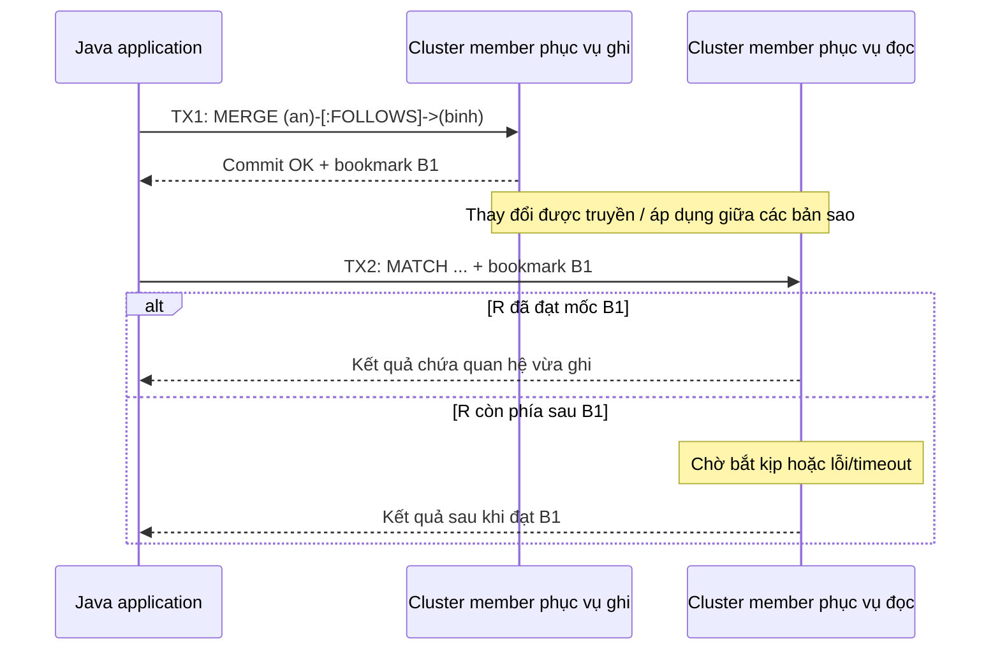
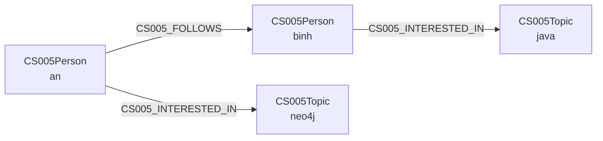
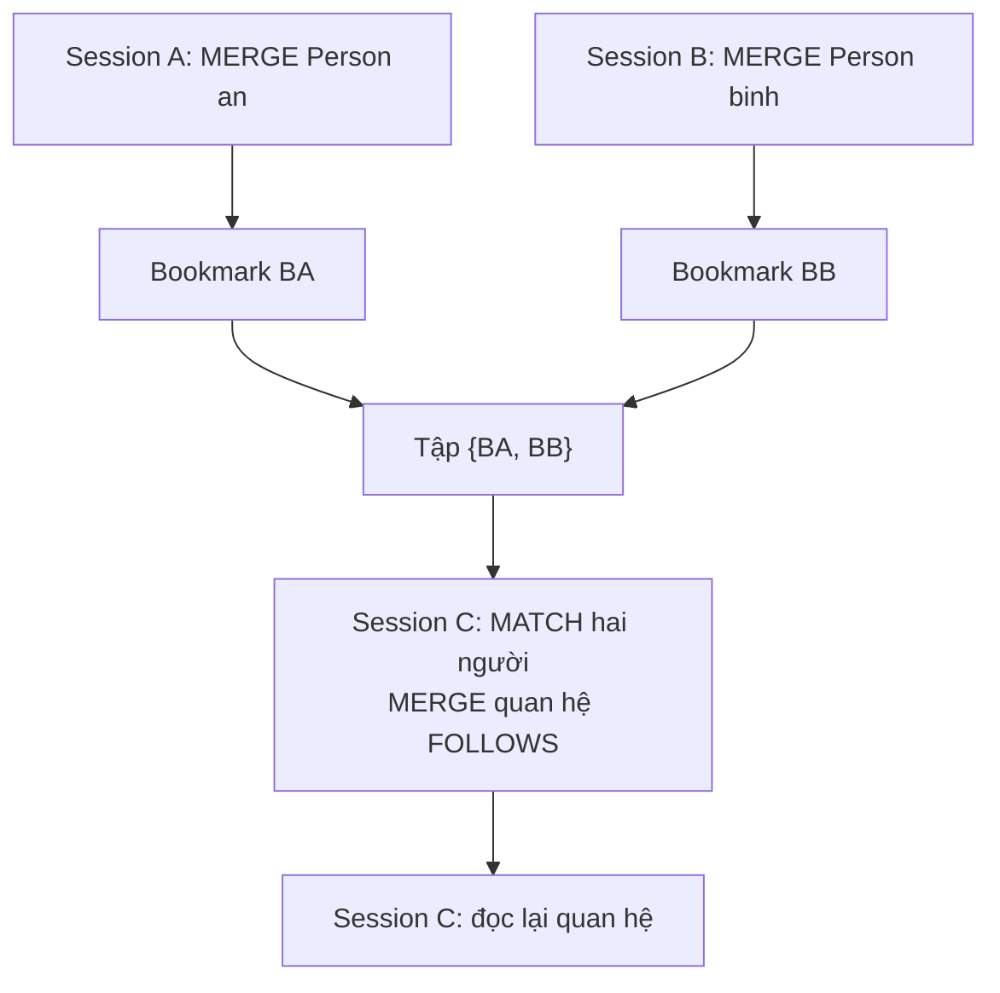
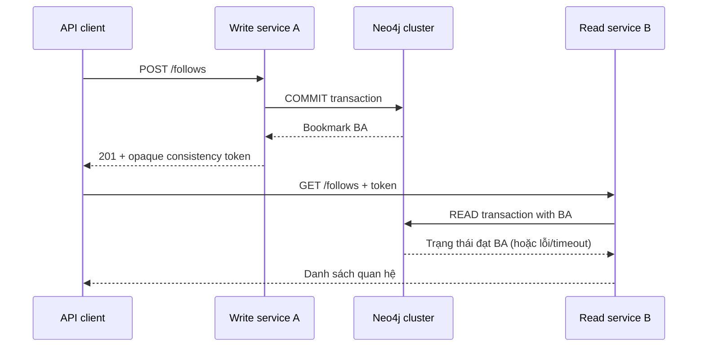

# Bookmarks và nhất quán nhân quả trong ứng dụng có nhiều phiên

## 1. Vấn đề: vừa ghi xong nhưng phiên đọc chưa thấy dữ liệu

Neo4j lưu dữ liệu theo mô hình **property graph**: node, relationship và thuộc tính. Khi một ứng dụng Java Driver hoặc Spring Data Neo4j ghi một node, cập nhật relationship hoặc tạo đường đi bằng Cypher, ứng dụng thường muốn lần đọc kế tiếp **thấy được thay đổi vừa hoàn tất**.

Điều này tưởng như hiển nhiên trên một database đơn, nhưng cần xem xét kỹ khi Neo4j được triển khai thành **cluster**. Một giao dịch ghi có thể được phục vụ bởi thành viên phù hợp để ghi; yêu cầu đọc kế tiếp có thể được định tuyến tới thành viên khác, nơi cần thời gian để áp dụng các thay đổi đã xác nhận. Nếu hai yêu cầu thuộc **hai session độc lập** hoặc hai instance ứng dụng khác nhau, không thể chỉ dựa vào việc thao tác ghi trả thành công để suy rằng phiên đọc được điều phối theo đúng quan hệ trước–sau.

Ví dụ nghiệp vụ:

1. API `POST /people/an/follow/binh` tạo quan hệ `An -[:FOLLOWS]-> Bình`.
2. API `GET /people/an/friends` được gọi ngay trên một request khác.
3. Người dùng yêu cầu danh sách có **Bình** vì hành động follow đã thành công.

Để bảo đảm trình tự quan sát khi đổi session/server, Neo4j sử dụng **bookmark**: một token biểu thị mốc trạng thái của database. Giao dịch đọc nhận bookmark của giao dịch ghi sẽ **không được thực thi trước khi thành viên phục vụ truy vấn đạt ít nhất mốc đó**. Đây là cơ chế của **causal consistency – nhất quán nhân quả**. Nó giải quyết thứ tự phụ thuộc, không phải mọi vấn đề nhất quán hay mọi yêu cầu mở rộng.

Bài học thuộc chương **Cụm và mở rộng** trong module `DATABASE_ENGINE_GRAPH_NEO4J`. Ta sẽ thực hành với Java Driver, Cypher, node/relationship, uniqueness constraint; đồng thời giải thích việc tích hợp Spring Data Neo4j, cluster routing và đo chi phí chờ bookmark.

**Kết quả học tập:**

- Phân biệt **eventual consistency**, **causal consistency**, **read-your-writes** và **snapshot**.
- Biết khi nào session tự quản bookmark và khi nào ứng dụng phải truyền giữa các session.
- Dùng đúng API Java Driver hiện hành: `Session.lastBookmarks()`, `SessionConfig.withBookmarks(...)` và `BookmarkManager`.
- Gom bookmark từ **nhiều nhánh giao dịch độc lập** trước một thao tác phụ thuộc.
- Không nhầm bookmark với lệnh commit, credential, transaction ID toàn cục hoặc cơ chế phân tán transaction qua nhiều database.
- Thiết kế kiểm thử, timeout, giám sát và xử lý lỗi cho luồng đọc sau ghi trên cluster.

## 2. Mô hình tư duy: một giao dịch tạo mốc cho giao dịch sau



### 2.1. So sánh các mức bảo đảm

| Khái niệm | Điều được bảo đảm / đặc điểm | Điều **không** được tự suy ra |
|---|---|---|
| **Eventual consistency** | Bản sao cuối cùng có thể bắt kịp khi hệ thống hoạt động bình thường | Một lần đọc bất kỳ ngay sau ghi sẽ thấy dữ liệu mới |
| **Read-your-writes** | Một chuỗi thao tác có quan hệ phụ thuộc thấy các thay đổi mà chính chuỗi đó đã ghi | Mọi user độc lập đều tức thì nhìn thấy cùng một trạng thái |
| **Causal consistency** | Giao dịch phụ thuộc được thực thi sau mốc thay đổi mà nó cần thấy | Có một snapshot cố định xuyên suốt nhiều request |
| **Bookmark B1** | Mốc trạng thái được server phát sau một giao dịch; có thể dùng để ràng buộc giao dịch sau | Dữ liệu snapshot, token quyền truy cập hay con số transaction để ứng dụng tự cộng/trừ |
| **ACID transaction** | Các thay đổi thuộc **một transaction** commit hoặc rollback cùng nhau | Nhiều transaction ở nhiều session được gộp thành một atomic transaction |

Nếu transaction `T2` bắt đầu bằng bookmark của `T1`, `T2` được yêu cầu nhìn thấy một database ít nhất cập nhật đến `T1`. Nó **có thể thấy cả thay đổi của các transaction khác xảy ra sau T1**; bookmark **không đóng băng thời gian**. Do đó không dùng bookmark để giả lập tính nhất quán snapshot cho pagination lâu dài, báo cáo tài chính tại một mốc cố định hoặc nhiều database độc lập.

### 2.2. Vì sao định tuyến có liên quan?

Trên một cluster Neo4j, Java Driver thường dùng URI dạng `neo4j://` hoặc `neo4j+s://` để nhận thông tin định tuyến. `executeWrite(...)` được định tuyến tới thành viên phù hợp với ghi, còn `executeRead(...)` có thể được phục vụ bởi thành viên đọc theo routing table. Bookmark giúp thành viên được chọn biết **mốc tối thiểu** phải đạt.

Ngược lại, URI `bolt://`/`bolt+s://` chủ yếu trỏ tới một server cụ thể, không cung cấp cùng cơ chế khám phá và định tuyến cụm ở phía driver. Trong cluster, sử dụng URI do quản trị viên cung cấp, kiểm tra TLS và không hard-code một máy đơn nếu cần failover.

**Chú ý:** đọc trên thành viên phù hợp để ghi cũng không thay thế thiết kế các quan hệ nhân quả giữa session. Routing mode là lựa chọn tuyến; bookmark là **điều kiện về trạng thái database**. `AccessMode.READ` cũng **không** phải một cơ chế phân quyền RBAC.

## 3. Chuẩn bị dữ liệu đồ thị thực hành

Các nhãn dùng tiền tố `CS005` để tránh va chạm với bài khác. Thực hiện lệnh ghi bên dưới trên **database học tập** (ví dụ `neo4j`). Lab chạy được trên một instance Neo4j đơn để kiểm tra API; muốn quan sát tác động của replication lag phải có cluster được cấu hình và cho phép kiểm thử.



### 3.1. Tạo uniqueness constraint

```cypher
CREATE CONSTRAINT cs005_person_id IF NOT EXISTS
FOR (p:CS005Person)
REQUIRE p.id IS UNIQUE;
```

```cypher
CREATE CONSTRAINT cs005_topic_code IF NOT EXISTS
FOR (t:CS005Topic)
REQUIRE t.code IS UNIQUE;
```

`@Id` trong Spring Data Neo4j hoặc một property `id` thông thường **không tự tạo constraint** trong mọi hệ thống. Constraint giúp `MERGE` theo khóa nghiệp vụ tránh trùng node khi có ghi đồng thời; bookmark không thay thế constraint.

### 3.2. Khởi tạo các chủ đề dùng chung

```cypher
UNWIND ['neo4j', 'java'] AS code
MERGE (:CS005Topic {code: code});
```

**Chưa tạo person ngay tại bước này** để Java Driver ở mục sau minh họa hai session ghi các person độc lập. Nếu bạn đã thực hành bài trước và graph có các person cùng nhãn/ID, `MERGE` vẫn giữ đúng định danh nhưng phép đo "node được tạo" sẽ khác.

Kiểm tra:

```cypher
MATCH (t:CS005Topic)
RETURN t.code AS code
ORDER BY code;
```

Kết quả kỳ vọng: `java` và `neo4j`.

## 4. Ba cấp độ chuyển bookmark trong Java Driver

**Java Driver 6.x** có các API sau:

| Phạm vi thực hiện | Ai quản lý bookmark? | Lựa chọn nên dùng |
|---|---|---|
| Nhiều transaction **cùng một `Session`** | Driver tự chuyển bookmark giữa các transaction | Không cần mã quản lý bookmark riêng |
| Các lệnh `Driver.executableQuery()` sử dụng cùng driver và manager mặc định | Driver tự quản lý chuỗi bookmark cho các lệnh này | Tiện cho query độc lập, không cần nhiều câu lệnh trong một transaction |
| **Hai hay nhiều session riêng** dùng `session.run/executeRead/executeWrite` | Mặc định **không** cùng chia sẻ bookmark giữa các session | Dùng `lastBookmarks()` + `withBookmarks(...)`, hoặc cùng `BookmarkManager` |
| **Hai instance ứng dụng / hai process** | Mỗi process có memory và driver riêng | Cần chuyển mốc qua kênh được thiết kế hoặc có tầng điều phối, không tự động |

Trong Java Driver 6.x:

- `Session.lastBookmarks()` trả `Set<Bookmark>`.
- `SessionConfig.Builder.withBookmarks(Iterable<Bookmark>)` nhận một hoặc nhiều bookmark.
- `Bookmark.value()` là giá trị opaque có thể cần lưu/di chuyển; `Bookmark.from(String)` tạo lại object từ giá trị đã có.
- `Session.lastBookmark()` dạng số ít là API cũ, đã bị **loại bỏ trong Java Driver 6.0**. Không sao chép ví dụ cũ dùng `lastBookmark()` vào mã 6.x.
- Không tự cắt chuỗi, giải mã hoặc tăng/giảm giá trị bookmark như một số đếm; **server/driver sở hữu ngữ nghĩa của token**.

## 5. Trường hợp đơn giản: nhiều transaction trong cùng một session

Trong một session, Driver tự động chuyển bookmark của transaction đã hoàn tất sang transaction tiếp theo. Đây là cách đơn giản nhất nếu logic nghiệp vụ nằm trong cùng một request hoặc đơn vị công việc tuần tự.

```java
import java.util.Map;
import org.neo4j.driver.Driver;
import org.neo4j.driver.SessionConfig;

public final class SameSessionDemo {
    public static boolean createThenRead(Driver driver, String id) {
        var config = SessionConfig.builder()
            .withDatabase("neo4j")
            .build();

        try (var session = driver.session(config)) {
            session.executeWriteWithoutResult(tx -> {
                tx.run("""
                    MERGE (p:CS005Person {id: $id})
                    SET p.name = $name
                    """, Map.of("id", id, "name", "An")).consume();
            });

            return session.executeRead(tx ->
                tx.run("""
                    MATCH (p:CS005Person {id: $id})
                    RETURN count(p) AS count
                    """, Map.of("id", id))
                  .single().get("count").asLong() == 1L
            );
        }
    }
}
```

Nếu gọi `createThenRead(driver, "an")`, kỳ vọng trả `true`. Giao dịch ghi phải **commit thành công** trước giao dịch đọc; `executeWriteWithoutResult` và `executeRead` do driver quản lý transaction và có thể retry lỗi transient theo cấu hình. Callback transaction phải an toàn khi chạy lại: không gửi email, ack message hoặc tạo side effect không-idempotent trong callback.

**Không nhầm với một transaction:** hai lần `executeWrite/executeRead` là **hai transaction** riêng, dù cùng session. Nếu nghiệp vụ yêu cầu đọc–kiểm tra–ghi phải nguyên tử, hãy thực hiện các bước trong **một transaction** với ràng buộc/khóa thích hợp; bookmark không thể thay thế.

## 6. Hai session: truyền bookmark tường minh để đọc sau ghi

Giả sử service ghi xong rồi đóng session; service đọc mở **session mới**. Đoạn code dưới đây minh họa `lastBookmarks()` và `withBookmarks(...)` đúng cú pháp Java Driver 6.x:

```java
import java.util.Map;
import java.util.Set;
import org.neo4j.driver.Bookmark;
import org.neo4j.driver.Driver;
import org.neo4j.driver.SessionConfig;

public final class CausalReadDemo {
    public static String writeThenRead(Driver driver) {
        Set<Bookmark> afterWrite;

        // Session A: ghi và nhận bookmark sau commit.
        try (var writer = driver.session(SessionConfig.builder()
                .withDatabase("neo4j")
                .build())) {
            writer.executeWriteWithoutResult(tx -> {
                tx.run("""
                    MERGE (p:CS005Person {id: $id})
                    SET p.name = $name
                    """, Map.of("id", "an", "name", "An")).consume();
            });
            afterWrite = writer.lastBookmarks();
        }

        // Session B: phụ thuộc kết quả ghi của A.
        try (var reader = driver.session(SessionConfig.builder()
                .withDatabase("neo4j")
                .withBookmarks(afterWrite)
                .build())) {
            return reader.executeRead(tx ->
                tx.run("""
                    MATCH (p:CS005Person {id: $id})
                    RETURN p.name AS name
                    """, Map.of("id", "an"))
                  .single().get("name").asString()
            );
        }
    }
}
```

Kỳ vọng `writeThenRead(driver)` trả `"An"`. Trình tự:

1. Session A thực hiện transaction ghi; sau khi lời gọi thành công, driver có mốc từ server.
2. `writer.lastBookmarks()` lấy **bộ** bookmark mới nhất sau công việc trong A.
3. Session B được mở với bộ bookmark đó. Giao dịch đầu tiên trong B yêu cầu member phục vụ **đạt ít nhất mốc của A**.
4. Query `MATCH` trong B trả dữ liệu đã ghi nếu hoạt động thành công. Nếu member không bắt kịp trong thời gian hợp lệ, có thể chờ hoặc báo lỗi/timeout.

`lastBookmarks()` có thể trả rỗng nếu session chưa thực hiện công việc có bookmark. **Không** coi một tập rỗng là bằng chứng ghi thành công; thành công của transaction phải được xác định bởi kết quả thực thi và hành vi lỗi/commit.

### 6.1. Vì sao phải tiêu thụ Result trong transaction?

Truy vấn `tx.run(...)` trả con trỏ `Result`. Trong các callback ở trên, gọi `consume()` để hoàn tất xử lý kết quả ghi trước khi callback kết thúc. Điều này khiến trình tự **run → consume → transaction commit → lastBookmarks** rõ ràng.

Với auto-commit `session.run(...)`, chỉ sau khi result được tiêu thụ đầy đủ mới có thể bảo đảm transaction hoàn tất. **Không lấy bookmark quá sớm** rồi phát yêu cầu đọc phụ thuộc trong lúc ghi còn kết quả chưa tiêu thụ hoặc chưa chắc commit.

## 7. Hai nhánh độc lập: gom bookmarks trước khi tạo relationship

Tình huống phức tạp hơn: hai worker tạo người dùng `an` và `binh` trong hai session độc lập; một worker khác cần nối hai node sau khi **cả hai** hoàn tất.



Sau khi fixture ở mục 3 đã có `CS005Topic`, code minh họa:

```java
import java.util.HashSet;
import java.util.Map;
import java.util.Set;
import org.neo4j.driver.Bookmark;
import org.neo4j.driver.Driver;
import org.neo4j.driver.SessionConfig;

public final class FanInBookmarks {
    public static long connect(Driver driver) {
        Set<Bookmark> prerequisites = new HashSet<>();

        // Nhánh A không phụ thuộc nhánh B.
        try (var a = driver.session(SessionConfig.forDatabase("neo4j"))) {
            a.executeWriteWithoutResult(tx -> {
                tx.run("""
                    MERGE (p:CS005Person {id: 'an'})
                    SET p.name = 'An'
                    """).consume();
            });
            prerequisites.addAll(a.lastBookmarks());
        }

        // Nhánh B có thể được chạy song song ở worker khác.
        try (var b = driver.session(SessionConfig.forDatabase("neo4j"))) {
            b.executeWriteWithoutResult(tx -> {
                tx.run("""
                    MERGE (p:CS005Person {id: 'binh'})
                    SET p.name = 'Bình'
                    """).consume();
            });
            prerequisites.addAll(b.lastBookmarks());
        }

        // Chỉ mở C khi cả A và B đã commit thành công.
        try (var c = driver.session(SessionConfig.builder()
                .withDatabase("neo4j")
                .withBookmarks(prerequisites)
                .build())) {
            c.executeWriteWithoutResult(tx -> {
                tx.run("""
                    MATCH (an:CS005Person {id: 'an'})
                    MATCH (binh:CS005Person {id: 'binh'})
                    MERGE (an)-[:CS005_FOLLOWS]->(binh)
                    """).consume();
            });

            return c.executeRead(tx ->
                tx.run("""
                    MATCH (:CS005Person {id: 'an'})
                          -[:CS005_FOLLOWS]->
                          (:CS005Person {id: 'binh'})
                    RETURN count(*) AS relationships
                    """)
                  .single().get("relationships").asLong()
            );
        }
    }
}
```

Kỳ vọng `connect(driver)` trả `1` trên fixture không có cạnh trùng trước đó. Ví dụ thực thi A rồi B **tuần tự cho dễ đọc**; trong hệ thống thật, hai job có thể chạy song song, nhưng **phải chờ cả hai báo commit thành công** rồi mới gom bookmarks và phát C. Nếu một job thất bại, không nên tạo C và mặc định mọi tiền điều kiện đã tồn tại.

**Tại sao cần nhiều bookmark?** C phụ thuộc **cả hai nhánh**. Chỉ truyền BA không thể khẳng định member phục vụ C đã đạt mốc của B; chỉ truyền BB cũng tương tự. API `withBookmarks(Iterable<Bookmark>)` nhận tập nhiều mốc, giúp transaction đầu trong C chờ các mốc cần thiết.

**Không phải distributed transaction:** A có thể đã commit trong khi B lỗi; gom bookmark không rollback A. Nếu nghiệp vụ cần toàn bộ ba thao tác cùng thành công, cân nhắc gộp vào **một transaction Neo4j** hoặc triển khai workflow bù trừ, idempotency và trạng thái job rõ ràng.

## 8. Driver.executableQuery(): bookmark manager tự động

Trong Java Driver 6.x, `Driver.executableQuery()` quản lý bookmark thông qua **bookmark manager mặc định** của driver. Các lệnh `executableQuery().execute()` nối tiếp nhau sử dụng cùng driver có thể đọc các thay đổi trước đó mà không cần tự lấy/set bookmark thủ công.

```java
import java.util.Map;
import org.neo4j.driver.Driver;
import org.neo4j.driver.QueryConfig;
import org.neo4j.driver.RoutingControl;

public final class ExecutableQueryDemo {
    public static String upsertAndRead(Driver driver) {
        var writeCfg = QueryConfig.builder()
            .withDatabase("neo4j")
            .build();

        driver.executableQuery("""
            MERGE (p:CS005Person {id: $id})
            SET p.name = $name
            """)
            .withParameters(Map.of("id", "an", "name", "An"))
            .withConfig(writeCfg)
            .execute();

        var readCfg = QueryConfig.builder()
            .withDatabase("neo4j")
            .withRouting(RoutingControl.READ)
            .build();

        return driver.executableQuery("""
            MATCH (p:CS005Person {id: $id})
            RETURN p.name AS name
            """)
            .withParameters(Map.of("id", "an"))
            .withConfig(readCfg)
            .execute()
            .records().get(0).get("name").asString();
    }
}
```

Kỳ vọng trả `An`. `execute()` tiêu thụ kết quả của lệnh, nên sau khi hàm kết thúc thành công, manager có thể cập nhật mốc tương ứng. Hai lời gọi trong ví dụ **được chờ tuần tự**; nếu tạo nhiều tác vụ `executableQuery` chạy song song, không được xem chúng có quan hệ trước–sau cho tới khi orchestration chờ và xác định phụ thuộc đúng cách.

**Giới hạn:** Manager mặc định của `executableQuery` thuộc phạm vi **Driver instance**, không tự chia sẻ mốc với một driver ở process khác. Ngoài ra, các session tạo bởi `driver.session()` **không tự động dùng manager này**; phải nối chúng có chủ đích nếu muốn một luồng nhân quả chung.

### 8.1. Trộn executableQuery và session bằng cùng BookmarkManager

```java
import java.util.Map;
import org.neo4j.driver.Driver;
import org.neo4j.driver.QueryConfig;
import org.neo4j.driver.SessionConfig;

public final class MixedApiDemo {
    public static long run(Driver driver) {
        driver.executableQuery("""
            MERGE (p:CS005Person {id: $id})
            SET p.name = 'An'
            """)
            .withConfig(QueryConfig.builder()
                .withDatabase("neo4j")
                .build())
            .withParameters(Map.of("id", "an"))
            .execute();

        try (var session = driver.session(SessionConfig.builder()
                .withDatabase("neo4j")
                .withBookmarkManager(
                    driver.executableQueryBookmarkManager()
                )
                .build())) {
            session.executeWriteWithoutResult(tx -> {
                tx.run("""
                    MATCH (p:CS005Person {id: 'an'})
                    MERGE (t:CS005Topic {code: 'neo4j'})
                    MERGE (p)-[:CS005_INTERESTED_IN]->(t)
                    """).consume();
            });
        }

        return driver.executableQuery("""
            MATCH (:CS005Person {id: 'an'})
                  -[:CS005_INTERESTED_IN]->
                  (:CS005Topic {code: 'neo4j'})
            RETURN count(*) AS relationships
            """)
            .withConfig(QueryConfig.builder()
                .withDatabase("neo4j")
                .build())
            .execute()
            .records().get(0).get("relationships").asLong();
    }
}
```

Manager chung có thể truyền **mốc của executableQuery sang session**, rồi **mốc mới từ session về executableQuery**. Với dữ liệu mẫu, kết quả mong đợi là `1`. Việc dùng `MERGE` cho node/relationship giúp tránh tạo trùng khi gọi ví dụ nhiều lần, nhưng vẫn cần uniqueness constraint và thiết kế concurrency đúng cho hệ thống ghi song song.

### 8.2. Khi nào không nên dùng manager chung?

`BookmarkManager` có thể khiến **các truy vấn độc lập** vô tình phải chờ mốc gần nhất của những request không liên quan nếu mọi luồng cùng dùng chung một manager. Điều này tăng độ trễ và tạo coupling giữa tenant/đơn vị công việc.

Hãy xác định **phạm vi causal chain**:

- Với workflow tuần tự **cùng một session**, không cần manager riêng.
- Với nhiều session thuộc **một request/job**, có thể truyền bookmark tường minh.
- Với các truy vấn liên quan cùng **một driver**, `executableQuery()`/manager chung thuận tiện.
- Với **nhiều tenant, workload không phụ thuộc**, tránh gom tất cả vào một mốc toàn cục khi không cần, và không chia sẻ bookmark giữa các database.

Để tắt manager khi thực sự chấp nhận thiếu sự ràng buộc nhân quả ở một lần `executableQuery`, Neo4j hỗ trợ `QueryConfig.builder().withBookmarkManager(null)`; đây là lựa chọn về consistency/performance **phải được quyết định có chủ đích**, không phải "tối ưu" mặc định.

## 9. Giao tiếp giữa request, worker và process: chuyển bookmark như thế nào?

Giả sử microservice A nhận request ghi từ mobile, microservice B xử lý yêu cầu đọc ngay sau đó. Hai service có `Driver` riêng, nên bookmark **không tự xuất hiện ở B**. Nếu hợp đồng đòi hỏi read-your-writes giữa hai request, ta phải có kênh chuyển mốc.



**Cách chuyển là quyết định kiến trúc**, có thể qua trusted internal message metadata, request context hay một kho điều phối theo user/aggregate. Nếu gửi token tới client, coi nó là **dữ liệu không đáng tin cậy**: phải giới hạn chiều dài, xác nhận database/tenant, xác thực tính toàn vẹn và đánh giá nguy cơ lạm dụng. Bookmark **không phải** credential và **không cấp** quyền đọc node nào; Neo4j vẫn kiểm tra RBAC theo principal của transaction.

### 9.1. Serialize và khôi phục bookmark trong Java 6.x

Một ví dụ **minh họa ở tầng dịch vụ tin cậy**:

```java
import java.util.List;
import java.util.Set;
import org.neo4j.driver.Bookmark;
import org.neo4j.driver.SessionConfig;

// Sau khi giao dịch trong session writer hoàn tất:
Set<Bookmark> current = writer.lastBookmarks();

// Chỉ lưu và truyền qua kênh nội bộ có kiểm soát.
List<String> encoded = current.stream()
    .map(Bookmark::value)
    .toList();

// Tại service tiếp nhận, sau khi đã kiểm tra token và phạm vi:
List<Bookmark> restored = encoded.stream()
    .map(Bookmark::from)
    .toList();

var config = SessionConfig.builder()
    .withDatabase("neo4j")
    .withBookmarks(restored)
    .build();
```

Ví dụ mã giả định biến `writer` là một `Session` **vẫn tồn tại sau commit**. Token thực tế có thể chứa ký tự đặc biệt và có nhiều bookmark; **không** tự chuyển thành `long`, không parse các thành phần nội bộ. Đoạn trên chỉ là chuyển giá trị; **chưa phải** cơ chế xác minh chữ ký, hết hạn hoặc cấp quyền của HTTP API.

### 9.2. Những ranh giới không được vượt qua

| Ranh giới | Quy tắc |
|---|---|
| **Database** | Chỉ chuyển bookmark giữa những session cùng database; không lấy bookmark từ `neo4j` rồi gán bừa cho `tenant_b` hoặc `system`. Các ngoại lệ đặc biệt dành cho quản trị DB phải theo tài liệu phiên bản |
| **Cluster / lifecycle** | Không mặc định bookmark từ một bản sao/cluster khác hoặc từ database đã bị thay thế/restore sẽ còn hợp lệ |
| **Tenant và user** | Token không đại diện quyền; phải xác thực actor, tenant và quyền truy vấn ở service và Neo4j |
| **Thời gian** | Một bookmark cũ không phải bản snapshot cũ; chỉ là mốc tối thiểu. Không sử dụng token để đọc lịch sử như cơ sở dữ liệu temporal |
| **Kích thước và lưu trữ** | Không tích lũy vô hạn mọi bookmark lịch sử trong header, cache hay database; cần chính sách vòng đời và giới hạn |
| **Lỗi kết nối/commit** | Không bịa bookmark khi chưa biết commit thành công; với trạng thái ghi không chắc chắn, tra cứu operation ID/idempotency trước |

**Bảo mật:** Không log toàn bộ bookmark một cách tràn lan hoặc trao nó giữa tenant. Mặc dù bookmark không cho quyền dữ liệu, nó có thể tiết lộ metadata hoạt động và bị dùng để tạo tải chờ không cần thiết nếu ứng dụng tiếp nhận mốc từ nguồn không tin cậy.

## 10. Spring Data Neo4j: khi nào framework tự xử lý?

Khi dùng **Spring Data Neo4j (SDN)**, tầng framework thường quản lý transaction và bookmark theo cơ chế nội bộ để các transaction tuần tự trong **cùng thread hoặc reactive stream** có thể đọc được những thay đổi trước đó. Với ứng dụng Spring Boot/SDN chuẩn, không cần tự nối bookmark cho mọi lời gọi `repository.save(...)` rồi `repository.findById(...)` trong cùng workflow.

Ví dụ:

```java
import org.springframework.stereotype.Service;
import org.springframework.transaction.annotation.Transactional;

@Service
public class PersonLookupService {
    private final PersonRepository repository;

    public PersonLookupService(PersonRepository repository) {
        this.repository = repository;
    }

    @Transactional(readOnly = true)
    public boolean exists(String id) {
        return repository.findById(id).isPresent();
    }
}
```

Ở đây `PersonRepository` là repository mà ứng dụng định nghĩa cho `CS005Person`; ví dụ minh họa **transaction đọc**, không phải mã hoàn chỉnh của entity/repository. SDN xử lý kết nối và mapping theo phiên bản Spring Data đang dùng.

**Điểm quan trọng:**

- `@Transactional` quy định ranh giới transaction tại service; nếu ghi và đọc cần là một thao tác nguyên tử, hãy cân nhắc thực hiện trong **cùng transaction**.
- Khi chuyển từ HTTP request này sang HTTP request khác hoặc từ process này sang process khác, **thread context/transaction context không tự đi theo**. Đừng tuyên bố mọi yêu cầu đều có read-your-writes xuyên service chỉ vì dùng SDN.
- Nếu dùng `Neo4jClient`, `Neo4jRepository` và **Java Driver trực tiếp** hỗn hợp, kiểm tra cách transaction manager và bookmark manager được chia sẻ. Tránh mở session Driver độc lập rồi giả định tự nhận bookmark của SDN.
- Với reactive SDN, cần tôn trọng **reactive context**; chuyển sang scheduler hay tự subscribe ngoài chuỗi có thể phá vỡ cấu trúc điều phối mà ứng dụng kỳ vọng.
- Quyền truy cập vẫn được kiểm soát bằng **Neo4j RBAC**, không phải bookmark hay `@Transactional(readOnly=true)`.

Khi cần causal consistency **xuyên nhiều service**, hãy xác định contract ở tầng HTTP/event (bookmark hoặc cơ chế đồng bộ phù hợp), thay vì tin framework tự truyền một token mà nó không biết.

## 11. Bookmarks không giải quyết những gì?

### 11.1. Không bảo đảm snapshot cố định qua nhiều trang

Giả sử trang 1 lấy 20 tài liệu, trang 2 được lấy sau khi có thêm node mới. Cùng một bookmark không bảo đảm hai trang nhìn một snapshot bất biến, vì giao dịch mới **có thể thấy trạng thái mới hơn bookmark**. Muốn snapshot có tính nguyên tử trong một đoạn xử lý ngắn, cần transaction phù hợp; với báo cáo/pagination dài, thiết kế cursor theo khóa ổn định và version/time boundary, không chỉ bookmark.

```cypher
MATCH (p:CS005Person)
RETURN p.id AS id
ORDER BY id
SKIP $offset
LIMIT $pageSize;
```

`ORDER BY` giúp thứ tự rõ ràng; nhưng thêm/xóa node trong khi phân trang bằng `SKIP` có thể vẫn làm dòng bị lặp/bỏ sót. Bookmark không phải giải pháp thay thế cho pagination ổn định.

### 11.2. Không thay thế atomic transaction hoặc constraint

Nếu ứng dụng cần tạo hai node và quan hệ gắn chúng mà **tất cả cùng commit hoặc rollback**, đặt ba `MERGE` trong **một managed transaction** có thể phù hợp hơn tách thành A, B rồi C như bài minh họa. Bookmarks chỉ **điều phối thứ tự quan sát**, không tự cho rollback xuyên nhiều giao dịch đã commit.

```cypher
MERGE (a:CS005Person {id: $aId})
MERGE (b:CS005Person {id: $bId})
MERGE (a)-[:CS005_FOLLOWS]->(b);
```

Với tải ghi đồng thời, `MERGE` quan hệ không tự thay thế việc thiết kế uniqueness/locking theo nghiệp vụ; dữ liệu có cạnh song song cần quy tắc idempotency rõ ràng.

### 11.3. Không phải cơ chế eventual/causal giữa nhiều database hoặc cache

Bookmark của Neo4j không tự bảo đảm dữ liệu đã được gửi tới **Elasticsearch, Redis, Kafka, CDC consumer, warehouse hoặc database khác**. Nếu UI lấy dữ liệu từ cache đã cũ, truyền bookmark tới Neo4j trong một query không làm cache bắt kịp. Cần giải quyết riêng bằng outbox/CDC offset, invalidation, watermark hoặc workflow điều phối.

## 12. Tốc độ và độ trễ: chỉ trả giá chờ khi có phụ thuộc

Một bookmark buộc giao dịch bắt đầu ở thành viên đã đạt **ít nhất mốc yêu cầu**. Nếu member phục vụ đọc còn phía sau, truy vấn có thể phải **chờ bắt kịp**, phát sinh độ trễ và có thể hết timeout. Vì vậy, việc tự động gom bookmark mọi request có thể làm giảm lợi ích **scale-out read traffic**.

| Workload | Có nên ràng buộc bookmark? | Lý do |
|---|---|---|
| Ghi follow rồi đọc danh sách ngay sau | **Có**, nếu read-your-writes là hợp đồng | Lần đọc phụ thuộc giao dịch ghi vừa commit |
| Hai worker tạo node rồi worker khác tạo cạnh | **Có**: gom mốc cả hai nhánh | Worker nối quan hệ phụ thuộc hai đầu |
| Trang tin công khai không phụ thuộc request ghi nào | Thường **không cần bookmark liên-request** | Tránh chờ các mốc không liên quan |
| Báo cáo theo snapshot tại một mốc thời gian | Bookmark **không đủ** | Cần thiết kế snapshot/versioning riêng |
| Đọc ở service khác sau HTTP write | **Có nếu cần** và có kênh chuyển mốc đáng tin | Manager của driver không tự vượt process |
| Cache/local replica ngoài Neo4j | Bookmark Neo4j **không đủ** | Cần consistency contract riêng giữa các hệ thống |

### 12.1. Đo A/B đúng cách

Tạo hai nhóm trên cùng workload và mức tải:

- **Nhóm A:** write → read ở session mới không mang bookmark, cho workload **chấp nhận tính nhất quán cuối cùng**.
- **Nhóm B:** write → read ở session mới có bookmark, yêu cầu **read-your-writes**.

Đo riêng:

| Metric | Điều cần quan sát |
|---|---|
| `p50/p95/p99` của read-after-write | Phần latency tail khi member phải chờ replication/catch-up |
| Tỷ lệ read-after-write vi phạm kỳ vọng | Chênh lệch ở A; ở B chỉ tính thành công nếu thấy dữ liệu hoặc báo lỗi rõ ràng |
| Retry, bookmark wait timeout | Hệ thống đang chờ quá lâu hay không bắt kịp |
| QPS, CPU, memory, pool wait | Ảnh hưởng lên năng lực phục vụ nhiều request |
| Lag giữa thành viên / trạng thái cluster | Nguyên nhân đọc chậm khi replica phía sau |
| Kết quả Cypher/DB Hits | Phân biệt query đắt do planner và chờ bookmark do replication |

**Không nên dùng một lần `PROFILE` rồi kết luận chi phí bookmark:** `PROFILE` chủ yếu đo công việc thực thi toán tử Cypher; thời gian chờ một thành viên bắt kịp có thể nằm ngoài phần chi phí của toán tử. Cần đo **thời gian ứng dụng**, log/metric của cluster và kiểm tra routing để quy nguyên nhân.

### 12.2. Bảng kết quả ví dụ để luyện quyết định

Các số sau là **giả định**, không phải benchmark Neo4j thực:

| Biến thể | p95 đọc (ms) | Tỷ lệ không thấy ghi vừa commit | Timeout | Kết luận nghiệp vụ |
|---|---:|---:|---:|---|
| Session mới, không bookmark | 35 | 1,2% trong kịch bản lag | 0% | Nhanh nhưng **không đạt** read-your-writes |
| Session mới, có bookmark | 72 | 0% ở yêu cầu thành công | 0,1% | Đáp ứng yêu cầu, phải xử lý chờ/timeout |
| Đọc ngay trong cùng transaction ghi | 48 | 0% với dữ liệu trong transaction | 0% | Hợp lý khi cùng một đơn vị công việc |

Đừng coi 0% trong bảng giả định là cam kết chung: khi cluster không bắt kịp hoặc xảy ra lỗi, request có thể **thất bại** thay vì trả dữ liệu cũ. Việc người dùng đòi hỏi tính nhất quán phải được đưa vào **SLO correctness và timeout**, không chỉ SLO latency.

## 13. Timeout, lỗi, retry và trạng thái commit chưa rõ

### 13.1. Khi mốc bookmark chưa thể đáp ứng

Ví dụ một member được route để đọc còn ở phía sau mốc mà session yêu cầu. Có ba khả năng vận hành cần chuẩn bị:

1. Member bắt kịp trong thời gian cho phép; transaction bắt đầu và query trả đúng mốc.
2. Driver/cluster tìm tuyến khác phù hợp theo cơ chế routing và retry.
3. Không thể đáp ứng kịp; yêu cầu hết timeout hoặc báo lỗi. **Không trả dữ liệu cũ dưới dạng kết quả nhất quán thành công**.

Cấu hình `TransactionConfig.withTimeout(...)` giúp giới hạn thời gian transaction phía server; nó **không thay thế deadline tổng của API**, connection acquisition timeout hoặc retry budget của driver. Trong service, phải có cả thời gian chờ pool, phần retry và trả response.

Ví dụ:

```java
import java.time.Duration;
import org.neo4j.driver.SessionConfig;
import org.neo4j.driver.TransactionConfig;

var txConfig = TransactionConfig.builder()
    .withTimeout(Duration.ofSeconds(2))
    .build();

try (var session = driver.session(SessionConfig.builder()
        .withDatabase("neo4j")
        .withBookmarks(prerequisites)
        .build())) {
    long count = session.executeRead(tx ->
        tx.run("""
            MATCH (p:CS005Person)
            RETURN count(p) AS count
            """).single().get("count").asLong(),
        txConfig
    );
    System.out.println(count);
}
```

`driver` và `prerequisites` là các biến đã có từ ví dụ trước; ở hệ thống thật, `Duration.ofSeconds(2)` chỉ là số minh họa, cần đo theo SLO và mức replication lag.

### 13.2. Retry không phải lúc nào cũng an toàn

Các transaction callback `executeRead/executeWrite` có thể được driver chạy lại khi gặp lỗi transient. **Không đặt side effect ngoài Neo4j trong callback**, chẳng hạn trừ tiền ở API ngoài, gửi email hoặc ack message. Với nghiệp vụ ghi, cần idempotency key, uniqueness constraint và kiểm tra tình trạng commit nếu mất ACK.

Nếu server đã commit nhưng đường truyền trả kết quả bị đứt, ứng dụng có thể không biết commit đã thành công; trong trường hợp đó **không được tự chế bookmark** hay coi việc không nhận bookmark là chắc chắn rollback. Hãy thiết kế **operation ID** để đối soát trạng thái trước khi retry không-idempotent.

`Bookmark` là mốc **sau transaction thành công**, không phải bằng chứng nguyên tử rằng một tác vụ ngoài Neo4j (HTTP, queue, cache) cũng đã commit.

## 14. Kiểm thử đúng ở cả single instance và cluster

### 14.1. Kiểm thử logic trên một Neo4j

Một instance đơn vẫn cho phép kiểm chứng:

1. Tạo constraint, topic và hai node qua Java.
2. Lấy `lastBookmarks()` sau khi transaction ghi commit.
3. Mở session mới với `withBookmarks(...)` để đọc hoặc tạo relationship.
4. Xác nhận số node/cạnh, hướng quan hệ và truy vấn kết quả.
5. Chạy lại mã idempotent và xác nhận không tạo thêm node trùng.

Các query kiểm chứng độc lập:

```cypher
MATCH (p:CS005Person)
RETURN p.id AS id, p.name AS name
ORDER BY id;
```

Kỳ vọng sau bài thực hành Java: `an` và `binh`.

```cypher
MATCH (:CS005Person {id: 'an'})-[r:CS005_FOLLOWS]->
      (:CS005Person {id: 'binh'})
RETURN count(r) AS followsCount;
```

Kỳ vọng `followsCount = 1`.

```cypher
MATCH (:CS005Person {id: 'an'})-[r:CS005_INTERESTED_IN]->
      (:CS005Topic {code: 'neo4j'})
RETURN count(r) AS interestedInCount;
```

Sau khi gọi ví dụ `MixedApiDemo.run()`, kỳ vọng `interestedInCount = 1`.

### 14.2. Những gì single instance **không** chứng minh

Trên một database đơn, session đọc thường không gặp tình huống **bản sao bị trễ**. Vì thế bài test thành công ở single instance **không chứng minh**:

- Rằng routing URI thực sự đưa read sang member khác.
- Rằng transaction với bookmark sẽ chờ bản sao đang chậm trong cluster.
- Rằng hệ thống có thể failover mà vẫn đạt các SLO.
- Rằng nhiều ứng dụng ở process/host khác nhau truyền bookmark đúng.

Nếu tổ chức có cluster Neo4j Enterprise thử nghiệm:

1. Dùng `neo4j://`/`neo4j+s://` và tài khoản ít quyền trên database riêng.
2. Quan sát topology/routing bằng công cụ quản trị được phê duyệt; xác nhận có member đọc khác member ghi.
3. Chạy chuỗi write → read ở **session mới** với và không bookmark dưới tải đo kiểm soát.
4. Dùng mô phỏng lag/failover theo quy trình thử nghiệm, không gây sự cố trực tiếp ở production.
5. Ghi p95/p99, timeout, số lần retry, trạng thái mốc và correctness sau mỗi yêu cầu.

**Không dùng `Thread.sleep(...)` hay chờ cố định 100 ms như cơ chế nhất quán nhân quả.** Một sleep có thể quá ngắn khi cluster chậm và lãng phí khi cluster nhanh; bookmark biểu diễn **điều kiện trạng thái**, không phải thời gian phỏng đoán.

## 15. Lỗi thiết kế phổ biến

| Sai lầm | Hậu quả | Cách sửa |
|---|---|---|
| Ghi ở session A, đọc ở session B, không mang bookmark | Có thể không thấy ghi khi member đọc chưa bắt kịp | Truyền `lastBookmarks()` sang `withBookmarks(...)` |
| Lấy bookmark trước khi transaction đã commit | Không có mốc mới chắc chắn | Chờ callback/transaction và tiêu thụ result hoàn tất |
| Gọi `lastBookmark()` trong Driver 6.x | API không tồn tại | Dùng `lastBookmarks()` và `Set<Bookmark>` |
| Trộn `executableQuery` và session thủ công nhưng không dùng chung manager | Causal chain bị tách | Dùng `driver.executableQueryBookmarkManager()` |
| Dùng một bookmark toàn cục cho mọi tenant/unrelated request | Latency chờ tăng, coupling workload | Quản lý mốc theo đơn vị công việc và database |
| Dùng bookmark từ database khác | Không có bảo đảm causal chain hợp lệ | Gắn token với database/cluster và kiểm tra scope |
| Coi bookmark là snapshot/pagination cursor | Trang sau vẫn có thể thấy thay đổi mới | Cần version/cursor/snapshot strategy riêng |
| Dùng `bolt://` tới một server khi kỳ vọng routing cluster | Mất cơ chế routing mà ứng dụng trông đợi | Dùng connection URI thích hợp do cluster cung cấp |
| Quên timeout khi member không bắt kịp | Request chờ dài, pool/worker có thể bị chiếm | Đặt transaction timeout, API deadline, retry budget |
| Log hoặc chấp nhận bookmark tùy ý từ client | Lộ metadata, lạm dụng chờ hoặc sai scope | Xác thực token và giới hạn, không coi token là quyền |
| Coi bookmark thay thế uniqueness/idempotency | Ghi song song vẫn có thể sinh trùng/lost update | Constraint, transaction, version và operation ID |
| Chỉ kiểm thử trên single instance | Không tái hiện replica lag hoặc failover | Test cluster tách biệt với tải và lỗi chủ đích |

## 16. Bài tập tự luyện

1. **Causal timeline:** vẽ T1 ghi node tại member A, T2 đọc tại member B. Nêu điều kiện T2 phải thỏa để thấy node và giải thích bookmark hoạt động khác `sleep(100)` thế nào.
2. **Session tự quản:** dùng `SameSessionDemo`, tạo `an` và đọc lại trong cùng session. Có cần gọi `lastBookmarks()` thủ công không? Vì sao?
3. **Hai session:** chạy `CausalReadDemo`. In `lastBookmarks().size()` ở phía writer (không in toàn bộ token lên log dùng chung), xác minh reader thấy `An`.
4. **Fan-in:** cho hai công việc A/B tạo `an`/`binh` rồi C tạo quan hệ. Nếu chỉ truyền bookmark của A, còn thiếu bảo đảm gì?
5. **Trộn API:** dùng `driver.executableQueryBookmarkManager()` khi tạo session; xác minh rằng query bằng `executableQuery()` sau đó thấy relationship vừa ghi.
6. **Đồng thời:** thực thi A và B trên hai worker và chỉ tạo C sau khi cả hai futures hoàn thành **thành công**. Nếu B thất bại, xử lý A đã commit như thế nào?
7. **Multi-tenant:** thiết kế một API truyền consistency token giữa hai service. Nêu cách ràng buộc token với tenant/database/user và tránh token bị sửa.
8. **Read-your-writes và cache:** sau ghi Neo4j thành công, request đọc lấy từ Redis cache cũ. Bookmark Neo4j có sửa được kết quả Redis không? Cần cơ chế nào?
9. **Pagination:** thử hai lần phân trang graph theo `SKIP/LIMIT` trong hai transaction, giữa chúng tạo một person mới. Chứng minh bookmark không phải snapshot cố định.
10. **Benchmark:** đề xuất chỉ số A/B để đo trade-off giữa bookmark wait và độ trễ, phân biệt thời gian chờ bản sao với công việc Cypher `DB Hits`.
11. **Lỗi commit:** mô phỏng mất ACK sau transaction ghi. Có thể lấy bookmark mới từ client bằng cách suy đoán không? Hãy xây cách kiểm tra bằng operation ID.
12. **Nâng cấp Driver:** một codebase cũ dùng `lastBookmark()`. Mô tả thay đổi API Java Driver 6.x và cách giữ hỗ trợ nhiều bookmark.

**Tiêu chí đạt:** người học đọc–ghi đúng theo causal chain trong cùng session và qua nhiều session; biết gom nhiều mốc khi có fan-in; không dùng bookmark như quyền, snapshot hoặc distributed transaction; và có kế hoạch kiểm thử/monitor độ trễ chờ trên cluster.

## 17. Dọn dữ liệu thực hành

**Chỉ thực hiện trên database học tập có dữ liệu tiền tố `CS005`.** Không áp dụng `DETACH DELETE` lên database nghiệp vụ:

```cypher
MATCH (p:CS005Person)
DETACH DELETE p;
```

```cypher
MATCH (t:CS005Topic)
DETACH DELETE t;
```

```cypher
DROP CONSTRAINT cs005_person_id IF EXISTS;
```

```cypher
DROP CONSTRAINT cs005_topic_code IF EXISTS;
```

## 18. Tài liệu tham khảo chính thức

- [Neo4j Java Driver Manual — Coordinate parallel transactions](https://neo4j.com/docs/java-manual/current/bookmarks/): `Session.lastBookmarks()`, `withBookmarks(...)`, `executableQuery` và cách chia sẻ bookmark manager.
- [Neo4j Java Driver Manual — Transactions](https://neo4j.com/docs/java-manual/current/transactions/): vòng đời session/transaction, retry và routing mode.
- [Neo4j Java Driver Manual — Query the database](https://neo4j.com/docs/java-manual/current/query-simple/): `Driver.executableQuery()`, cấu hình database và tham số.
- [Neo4j Java Driver Manual — Upgrade from older versions](https://neo4j.com/docs/java-manual/current/upgrade/): khác biệt `lastBookmark` → `lastBookmarks` ở Java Driver 6.
- [Neo4j Java Driver API — Bookmark](https://neo4j.com/docs/api/java-driver/current/org.neo4j.driver/org/neo4j/driver/Bookmark.html): `value()` và `from(String)`.
- [Neo4j Java Driver API — SessionConfig.Builder](https://neo4j.com/docs/api/java-driver/current/org.neo4j.driver/org/neo4j/driver/SessionConfig.Builder.html): `withBookmarks(...)`, `withBookmarkManager(...)` và `withDatabase(...)`.
- [Neo4j Operations Manual — Clustering glossary](https://neo4j.com/docs/operations-manual/current/clustering/glossary/): định nghĩa causal consistency và cơ chế chờ bản sao bắt kịp.
- [Neo4j Java Driver Manual — Advanced connection information](https://neo4j.com/docs/java-manual/current/connect-advanced/): `neo4j://` routing và `bolt://` trực tiếp.
- [Spring Data Neo4j Reference — FAQ](https://docs.spring.io/spring-data/neo4j/reference/faq.html): tương tác của SDN với cluster bookmarks và transaction.
- [Neo4j Query API — Coordinate transactions and enforce causal consistency](https://neo4j.com/docs/query-api/current/bookmarks/): bookmarks khi giao tiếp qua Query API ngoài Java Driver.
