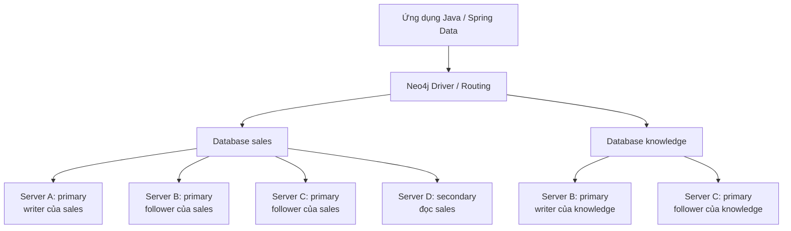
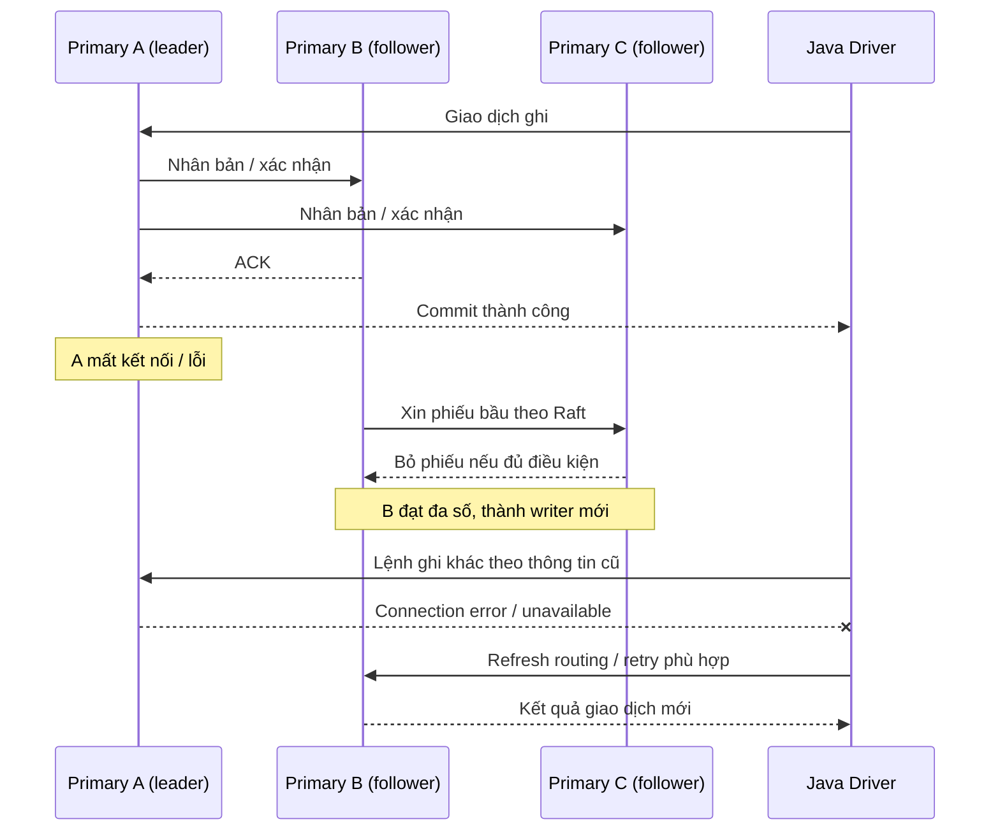
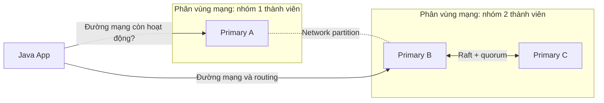
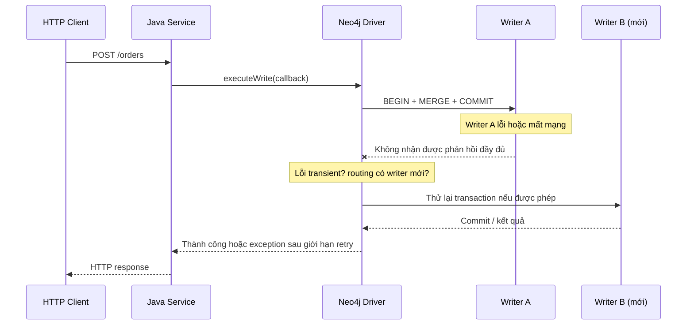
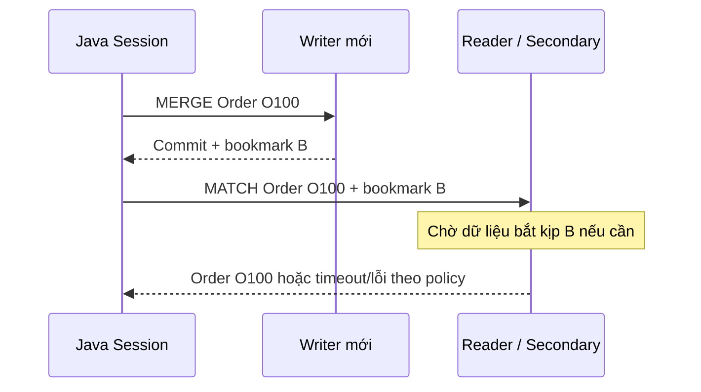
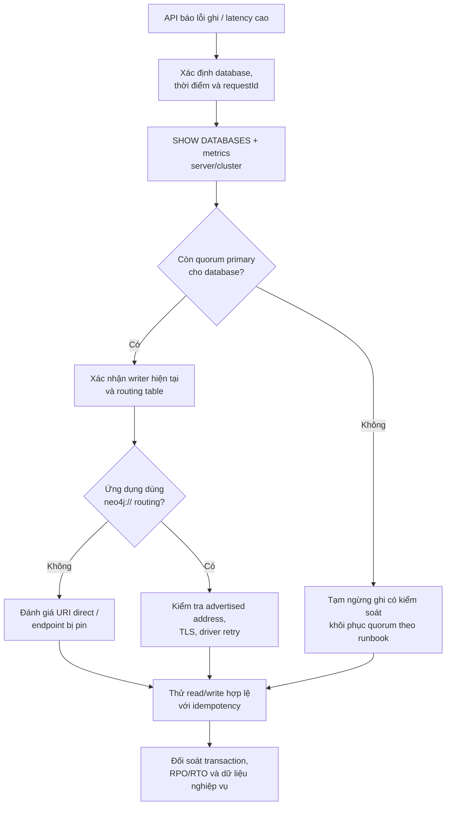

# Lỗi máy chủ, bầu chọn và hành vi kết nối khi chuyển vai trò

Một cụm **Neo4j (cluster)** không chỉ là nhiều máy chủ cùng chứa đồ thị. Đối với từng database, một số bản sao tham gia xác nhận giao dịch ghi; một bản sao giữ vai trò **leader/writer**, những bản sao khác nhận dữ liệu được nhân bản. Khi một máy chủ tắt, mất mạng hoặc bị quá tải, hệ thống phải quyết định **có đủ thành viên để tiếp tục ghi hay không**, **ai có thể trở thành leader mới** và **ứng dụng Java kết nối đến đâu**.

Bài thuộc chương **Cụm và mở rộng** của module **DATABASE_ENGINE_GRAPH_NEO4J**, chuyên về dùng Neo4j để mô hình hóa node, relationship, truy vấn Cypher, tối ưu index/constraint, tích hợp Java Driver và Spring Data Neo4j. Trọng tâm là **lỗi máy chủ, cơ chế bầu chọn của Raft và hành vi kết nối khi vai trò leader thay đổi**. Kiến thức dưới đây lấy mô hình **Neo4j Enterprise cluster hiện đại** làm cơ sở; tên vai trò, lệnh quản trị, khả năng triển khai và API chi tiết cần đối chiếu với **phiên bản/edition** đang sử dụng. Một Neo4j Community đơn lẻ hoặc một instance managed không mặc nhiên cho phép điều khiển cluster giống mô hình tự quản trị.

> **Tư duy cốt lõi:** Cluster có thể tự bầu lại leader và Java Driver có thể định tuyến lại **những thao tác đủ điều kiện retry**. Điều này **không có nghĩa** mọi transaction đang chạy đều tiếp tục không gián đoạn, mọi request đều thành công hoặc ứng dụng không cần idempotency.

## 1. Đơn vị quan trọng là database, không chỉ là server

Một cụm Neo4j có thể phục vụ nhiều database. Mỗi database có cấu hình **primary allocations** và **secondary allocations** riêng. Một máy chủ có thể là primary của database này, secondary của database khác hoặc không chứa một database cụ thể.



**Phân biệt các vai trò:**

| Thuật ngữ | Ý nghĩa | Có thể bầu làm writer? |
| --- | --- | --- |
| **Server** | Máy/process Neo4j cung cấp tài nguyên cho một hoặc nhiều database | Không phải vai trò bầu chọn của chính nó |
| **Primary allocation** | Bản sao database tham gia nhóm Raft và xác nhận dữ liệu ghi | Có, trong nhóm primary đủ điều kiện |
| **Leader / writer** | Một primary đang sắp thứ tự các giao dịch ghi cho database đó | Là writer hiện tại |
| **Follower** | Primary khác leader, tham gia nhân bản/xác nhận log | Có thể thành ứng viên mới |
| **Secondary allocation** | Bản sao cập nhật từ primary, thường dùng để tăng khả năng phục vụ đọc | **Không** bầu làm writer trong nhóm primary |
| **Raft group** | Nhóm primary tham gia đồng thuận cho **một database** | Bầu một leader riêng cho database đó |

Trong cụm nhiều database, **không có một leader toàn cục duy nhất chịu trách nhiệm ghi cho mọi database**. Ví dụ Server A có thể là writer của `sales`, còn Server B là writer của `knowledge`. Nếu A lỗi, việc bầu lại cho `sales` không có nghĩa `knowledge` bắt buộc đổi writer.

### 1.1. Primary và secondary không có cùng nhiệm vụ

- **Primary** tham gia quá trình ghi có tính đồng thuận. Với nhiều primary, một writer gửi thay đổi tới các primary còn lại và cần xác nhận đủ đa số theo giao thức trước khi giao dịch được coi là commit.
- **Secondary** nhận thay đổi bất đồng bộ theo cơ chế nhân bản thích hợp, giúp phân tán tải **đọc**; nó không đóng góp một phiếu Raft thay thế cho primary bị mất và không tự biến thành leader trong lần bầu chọn thông thường.
- Thêm **secondary** thường tăng sức phục vụ truy vấn đọc; không tăng số phiếu để chịu thêm lỗi primary cho các giao dịch ghi.
- Thêm **primary** là thay đổi topology và chi phí đồng thuận, không chỉ “thêm máy để query nào cũng nhanh hơn”.

Không đồng nhất **primary** với một database nhất định luôn được phép nhận ghi trực tiếp từ client: trong cấu hình nhiều primary, **chỉ primary đang giữ writer role** là đích ghi của database tương ứng.

### 1.2. Quorum thuộc từng database

Trong mô hình Raft có `n` primary đang là thành viên của nhóm, số phiếu đa số là:

\[
\operatorname{majority}(n)=\left\lfloor\frac{n}{2}\right\rfloor+1
\]

Đối với cấu hình điển hình có số primary lẻ:

| Số primary | Đa số cần thiết | Số primary có thể mất mà vẫn giữ đa số |
| ---: | ---: | ---: |
| 1 | 1 | 0 |
| 3 | 2 | 1 |
| 5 | 3 | 2 |

Bảng này nói về **quorum của các bản sao primary cho database**, không nói rằng mất các máy ấy luôn không gây gián đoạn dịch vụ. Ví dụ với ba primary, mất writer có thể làm các transaction ghi thất bại **trong khoảng chuyển vai trò**, dù hai primary còn lại có thể bầu writer mới.

Nếu các primary được đặt trên cùng một host hoặc cùng một miền lỗi, bảng không phản ánh đúng khả năng chịu sự cố hạ tầng. Thiết kế HA cần xem **failure domain**: host, rack, availability zone, mạng, nguồn điện và lưu trữ.

## 2. Raft bầu chọn leader như thế nào?

Neo4j sử dụng cơ chế **Raft** cho các primary của một database để bảo đảm các giao dịch ghi có thứ tự nhất quán. Mô tả giản lược:

1. Khi đang hoạt động bình thường, một primary là **leader**; các primary còn lại là **followers**.
2. Leader gửi tín hiệu hoạt động và nhân bản log tới followers.
3. Khi follower không nghe từ leader trong một khoảng thời gian theo cấu hình/giao thức, nó có thể bắt đầu bầu cử và trở thành **candidate**.
4. Candidate xin phiếu từ các primary khác; chỉ có thể trở thành leader khi có **đa số phiếu** và đáp ứng điều kiện về tính cập nhật của log.
5. Sau khi được bầu, leader mới nhận vai trò writer; Driver và routing layer cần cập nhật thông tin để gửi giao dịch ghi tới đúng nơi.
6. Nếu không có đa số, **không được tự ý tạo ra một writer độc lập** trên phía thiểu số.



Đây là **luồng minh họa**, không cam kết chính xác thời gian bầu hoặc thứ tự các gói tin ở mọi phiên bản. Thời gian phát hiện lỗi chịu ảnh hưởng **network timeout, tải hệ thống, GC pause, tình trạng máy chủ và cài đặt cluster**.

### 2.1. Vì sao cần leader?

Nếu hai primary độc lập đều cho phép ghi với thứ tự khác nhau khi mạng bị chia đôi, đồ thị có thể phát triển thành hai trạng thái mâu thuẫn. Raft đặt mục tiêu chỉ có một chuỗi commit hợp lệ dựa trên **đa số**, từ đó tránh kiểu **split-brain writer** trong phạm vi nhóm đồng thuận đang được bảo vệ.

Đối với database `sales`, điều này quan trọng khi hai yêu cầu cùng cập nhật quan hệ:

```cypher
MATCH (c:Customer {customerId: $customerId})
MATCH (o:Order {orderId: $orderId})
MERGE (c)-[:PLACED]->(o);
```

Giao dịch ghi được xác nhận theo cơ chế cluster, nhưng **quorum không thay thế unique constraint, transaction logic hoặc kiểm soát optimistic locking**. Đồng thuận giữ log commit nhất quán giữa các primary; nó không tự sửa một câu Cypher nghiệp vụ sai.

### 2.2. Leader thay đổi không đồng nghĩa mất dữ liệu đã commit

Một giao dịch đã được **commit và xác nhận thành công** theo cơ chế của cluster nhiều primary được thiết kế để duy trì tính bền vững qua lỗi trong giới hạn chịu lỗi. Candidate có log lỗi thời không thể đơn giản giành writer role và bỏ qua các commit đã được đồng thuận.

Tuy nhiên, hãy phân biệt:

- **Đã nhận phản hồi commit thành công:** có căn cứ để xem giao dịch đã hoàn tất theo cơ chế của database.
- **Đã gửi lệnh nhưng kết nối đứt trước phản hồi:** phía client **không thể chỉ dựa vào lỗi mạng** để biết server đã commit hay chưa.
- **Giao dịch đang chạy và chưa commit:** có thể bị rollback hoặc phải thực hiện lại toàn bộ khi leader lỗi.
- **Replica secondary đang trễ:** có thể chưa thấy cập nhật mới ngay lúc đó; cần hiểu cơ chế bookmark khi yêu cầu read-your-writes.

Quy tắc xử lý phản hồi **không chắc chắn** đặc biệt quan trọng đối với `CREATE`, `MERGE`, `SET`, tăng/giảm số lượng và tích hợp hệ thống ngoài.

## 3. Khi một server lỗi, điều gì xảy ra?

Không phải mọi lỗi đều kích hoạt cùng một hành vi.

| Sự cố | Quorum primary của database | Hành vi thường gặp |
| --- | --- | --- |
| Secondary bị mất | Không đổi số phiếu primary | Đọc có thể mất một đích; không cần bầu writer vì secondary không tham gia Raft election |
| Follower primary bị mất, vẫn còn đa số | Còn đủ | Writer hiện tại có thể tiếp tục ghi, nhưng giảm mức chịu lỗi tiếp theo |
| Writer/leader primary bị mất, còn đa số | Còn đủ | Có khoảng gián đoạn ghi; primary còn lại có thể bầu leader mới |
| Mất quá nhiều primary, không còn đa số | **Không đủ** | Không thể tiếp tục commit ghi hợp lệ theo cơ chế đồng thuận |
| Mạng chia thành nhóm đa số và thiểu số | Chỉ nhóm đa số có quorum | Nhóm đa số có thể duy trì bầu/ghi, nhóm thiểu số không được tự commit độc lập |
| Server vẫn chạy nhưng Bolt không truy cập được từ Java | Có thể vẫn khỏe ở tầng cluster | Ứng dụng có thể lỗi kết nối/routing dù Raft không lỗi |
| Server quá tải, GC pause, I/O kéo dài | Tùy mức ảnh hưởng | Có thể xảy ra timeout, election lặp, tăng latency dù host chưa tắt |

**Đọc trong tình trạng mất quorum** phụ thuộc nơi bản sao còn tồn tại, trạng thái database, routing, quyền, version và mức nhất quán yêu cầu; **không cam kết** mọi câu đọc vẫn hoạt động khi write quorum mất.

### 3.1. Ví dụ ba primary: A, B, C

Ban đầu:

```text
Database sales
  A = PRIMARY, writer = true
  B = PRIMARY, writer = false
  C = PRIMARY, writer = false
Majority = 2/3
```

Tình huống A hỏng hoàn toàn:

1. Những transaction gắn với A có thể bị gián đoạn.
2. B và C vẫn có **2/3 phiếu**.
3. Một trong B hoặc C có thể được bầu làm leader mới khi đáp ứng điều kiện Raft.
4. Routing table của Driver cần hướng giao dịch ghi tới writer mới.
5. Ứng dụng dùng managed transaction có cơ hội tự retry lỗi tạm thời; lỗi không thuộc diện retry hoặc hết thời hạn vẫn phải được xử lý.

Tình huống A và B cùng hỏng:

- C một mình chỉ có **1/3** phiếu.
- Không thể tự bầu một writer hợp lệ để tiếp tục ghi theo cấu hình đồng thuận ban đầu.
- Thêm một **secondary** đang hoạt động không biến `1/3` thành `2/3`.
- Phải khôi phục primary/cấu hình theo **runbook chính thức**, không “bật chế độ ghi” thủ công vào C để né quorum.

### 3.2. Mất mạng khác với mất tiến trình

Khi network partition xảy ra, một primary vẫn có thể chạy bình thường nhưng không liên lạc được với đủ thành viên. Nhìn bằng `ping` hoặc process status đơn thuần không chứng minh thành viên đang ở phía đa số hoặc đủ khả năng phục vụ ghi.



Nếu A là leader cũ nhưng bị cô lập, client còn kết nối được đến A **không có nghĩa A tiếp tục commit được ghi mới**. Ở phía B–C, thành viên đủ điều kiện có thể bầu writer mới. Khi mạng hồi phục, cluster cần hội tụ về topology hợp lệ.

Không tự đặt một IP tĩnh duy nhất làm đích ghi chỉ vì server ấy từng là leader.

## 4. Writer và routing có thể khác nhau theo từng database

Giả sử cụm có hai database:

| Server | `sales` | `knowledge` |
| --- | --- | --- |
| A | Primary — writer | Primary — follower |
| B | Primary — follower | Primary — writer |
| C | Primary — follower | Primary — follower |
| D | Secondary — read | Không chứa |

Nếu A lỗi:

- `sales` cần đánh giá quorum và có thể bầu writer trên B hoặc C.
- `knowledge` có thể vẫn giữ B làm writer, nếu quorum của chính database đó còn đủ.
- D đang là secondary của `sales` nên không trở thành ứng viên writer.
- Một request Java tới database `sales` không thể coi việc `knowledge` hoạt động tốt là bằng chứng `sales` đã phục hồi.

**Vì thế giám sát cluster phải theo chiều database × server × role**, không chỉ metric “cluster có mấy máy đang chạy”.

## 5. Routing của Neo4j Java Driver khi chuyển leader

Ứng dụng Java thường sử dụng một URI do quản trị viên cấp, không hard-code writer hiện tại.

| URI scheme | Cách dùng trong cluster | Lưu ý |
| --- | --- | --- |
| `neo4j://host:7687` | Kết nối có **routing**; Driver nhận routing table để biết reader/writer/router | Dùng khi endpoint và topology hỗ trợ routing |
| `neo4j+s://host:7687` | Routing qua TLS và kiểm tra chứng chỉ phù hợp | Thường gặp trong dịch vụ managed như Aura |
| `neo4j+ssc://host:7687` | Routing qua TLS với cơ chế chứng chỉ tự ký theo scheme | Chỉ dùng khi chính sách/chứng chỉ yêu cầu, không là cách sửa lỗi TLS tùy tiện |
| `bolt://host:7687` | **Direct** tới một máy chủ | Không tự khám phá writer mới bằng routing table |
| `bolt+s://...` / `bolt+ssc://...` | Direct với cấu hình TLS tương ứng | Vẫn gắn với server cụ thể |

Khi dùng `neo4j://`, Driver lấy danh sách các server có thể làm **ROUTE, READ, WRITE** từ routing metadata của Neo4j, và cập nhật khi cần. Nhờ đó, Driver có thể chuyển hướng các **transaction mới hoặc transaction được retry** sang writer mới.

Tuy nhiên, không có bảo đảm rằng:

- Một transaction đang thực hiện trên writer lỗi được “di chuyển” nguyên trạng sang writer khác.
- Mọi query đọc/ghi đều được retry mãi mãi tới khi thành công.
- Routing table được cập nhật **ngay lập tức, không có cửa sổ lỗi**.
- Endpoint seed vẫn truy cập được nếu chỉ cấu hình một địa chỉ và server đó chết.
- Mọi thành viên được trả về đều truy cập được từ môi trường ứng dụng.

### 5.1. Vấn đề endpoint khám phá

Một cụm có thể hoạt động tốt nội bộ nhưng ứng dụng **không truy cập được địa chỉ các thành viên** do cấu hình advertised address, DNS, firewall, Kubernetes service hoặc NAT sai.

Ví dụ:

```text
Java client -> neo4j://cluster.example.internal:7687
              -> routing table nhận từ cluster
                 READ  = db-b.internal:7687, db-c.internal:7687
                 WRITE = db-a.internal:7687
```

Nếu client không phân giải được `db-b.internal`, các lệnh đọc có thể thất bại dù endpoint `cluster.example.internal` kết nối được. Với routing, **không chỉ kiểm tra địa chỉ đầu tiên**; phải kiểm tra các địa chỉ server được giới thiệu thực sự có thể kết nối từ vùng mạng client.

Đối với triển khai qua load balancer/proxy, cần dùng phương án routing và endpoint được Neo4j hỗ trợ; không mặc định một TCP load balancer đơn giản có thể thay mọi cơ chế discovery và phân biệt read/write.

### 5.2. Vì sao direct bolt:// có thể thất bại sau failover?

Giả sử ứng dụng dùng:

```text
bolt://server-a.internal:7687
```

A là writer của `sales`. Khi A hỏng, ứng dụng bị ràng buộc vào A, dù B đã được bầu leader. Driver dùng direct scheme **không có cơ chế tự tìm B qua cluster routing như khi dùng `neo4j://`**.

Ngay cả khi A còn hoạt động nhưng không còn writer, truy vấn ghi theo đường direct có thể báo lỗi vì server đó không nhận ghi cho database. Đối với ứng dụng yêu cầu HA, ưu tiên **routing URI được kiến trúc cung cấp** thay vì pin vào một thành viên chỉ vì nó đang là writer hôm nay.

## 6. Hành vi phiên giao dịch khi failover

**Một lần chuyển vai trò** cần nhìn ở mức request, transaction và socket:



Sơ đồ chỉ minh họa **trường hợp được retry**. Trên thực tế, nếu commit phía A đã thành công nhưng phản hồi bị mất, ứng dụng có thể nhận trạng thái **không xác định**. Retry cùng ý định nghiệp vụ mà không có idempotency có thể tạo tác động lần hai.

### 6.1. Những kết quả mà client phải phân biệt

| Tình huống | Client biết chắc điều gì? | Hướng xử lý |
| --- | --- | --- |
| Commit ACK đã nhận | Giao dịch đã được xác nhận thành công | Trả kết quả; kiểm tra nghiệp vụ nếu cần |
| Lỗi trước khi bắt đầu gửi Cypher | Chưa thực hiện transaction dự kiến | Có thể thử lại theo chính sách |
| Lỗi trong transaction chưa commit | Có thể rollback, nhưng phải xác định ngữ nghĩa từng lỗi | Retry transaction từ đầu nếu retryable, không tái dùng session/tx hỏng |
| Mất kết nối **ngay lúc COMMIT** | **Chưa chắc** giao dịch đã commit hay chưa | Dựa vào idempotency key/đối soát nghiệp vụ, không đoán là rollback |
| Không còn WRITE endpoint/quorum | Không thể ghi ở thời điểm đó | Báo tạm không sẵn sàng, queue hoặc retry có giới hạn |
| READ endpoint tạm lỗi | Có thể còn reader khác | Driver refresh routing / retry nếu thao tác phù hợp |

**Không ghép tất cả lỗi vào “cứ thử lại một lần”**. Phải hiểu loại lỗi, thời điểm, thời hạn retry và việc request tạo ra tác động ngoài database hay không.

### 6.2. Managed transaction và explicit transaction

Trong Neo4j Java Driver, hai cách thường gặp:

- `session.executeRead(...)` / `session.executeWrite(...)` là **managed transaction**: Driver có thể tự thực thi lại callback khi gặp lỗi tạm thời theo chính sách retry.
- `session.beginTransaction()` tạo **explicit transaction**: ứng dụng tự quyết định bắt đầu, commit, rollback và xử lý trường hợp cần thử lại; không được giả định Driver tự retry toàn bộ khối logic.

Sau khi một transaction đã lỗi, **không tiếp tục dùng object transaction đó** để ghi tiếp như thể chưa có sự cố. Khi retry, sử dụng transaction mới; callback phải được thiết kế không có side effect không kiểm soát.

## 7. Ví dụ Java Driver: READ/WRITE và chuyển vai trò

Ví dụ Java Driver 5.x nhận URI/database và credentials từ biến môi trường. `NEO4J_URI` phải là URI routing được **môi trường cluster cung cấp**, chẳng hạn `neo4j+s://cluster.example.internal:7687` nếu TLS được yêu cầu.

### 7.1. Chuẩn bị constraint trong môi trường thử nghiệm

Dùng Cypher với quyền phù hợp trên **database test**:

```cypher
CREATE CONSTRAINT order_business_key IF NOT EXISTS
FOR (o:Order)
REQUIRE (o.tenantId, o.orderId) IS UNIQUE;
```

Khóa nghiệp vụ tổng hợp giúp các lệnh `MERGE` được gọi lặp lại theo cùng `(tenantId, orderId)` không tạo thêm node trùng. Nó cũng bảo vệ chống tranh chấp tạo trùng node trong những giao dịch đồng thời theo quy tắc constraint. **Đây không phải giấy phép retry mọi kiểu cập nhật**: thao tác `SET x = x + 1` vẫn có thể tăng hai lần.

### 7.2. Lưu Order và đọc lại qua routing Driver

```java
import java.util.List;
import java.util.Map;

import org.neo4j.driver.AuthTokens;
import org.neo4j.driver.Driver;
import org.neo4j.driver.GraphDatabase;
import org.neo4j.driver.Session;
import org.neo4j.driver.SessionConfig;

public final class ClusterOrderExample {

    private static String requiredEnv(String name) {
        String value = System.getenv(name);
        if (value == null || value.isBlank()) {
            throw new IllegalArgumentException(
                "Missing environment variable: " + name);
        }
        return value;
    }

    public static void main(String[] args) {
        String uri = requiredEnv("NEO4J_URI");
        String user = requiredEnv("NEO4J_USER");
        String password = requiredEnv("NEO4J_PASSWORD");
        String database = requiredEnv("NEO4J_DATABASE");

        Map<String, Object> params = Map.of(
            "tenantId", "TENANT-A",
            "orderId", "O100",
            "status", "CREATED"
        );

        try (Driver driver = GraphDatabase.driver(
                uri, AuthTokens.basic(user, password))) {

            driver.verifyConnectivity();

            try (Session session = driver.session(
                    SessionConfig.forDatabase(database))) {

                // Ghi qua writer cho database đã chọn.
                session.executeWrite(tx -> {
                    tx.run("""
                        MERGE (o:Order {
                          tenantId: $tenantId,
                          orderId: $orderId
                        })
                        SET o.status = $status
                        """, params).consume();
                    return null;
                });

                // Đọc sau ghi trong cùng session:
                // bookmark/session giúp giữ causal consistency.
                List<String> statuses = session.executeRead(tx ->
                    tx.run("""
                        MATCH (o:Order {
                          tenantId: $tenantId,
                          orderId: $orderId
                        })
                        RETURN o.status AS status
                        """, Map.of(
                            "tenantId", "TENANT-A",
                            "orderId", "O100"
                        ))
                      .list(rec -> rec.get("status").asString())
                );

                System.out.println(statuses);
            }
        }
    }
}
```

Những điểm cần chú ý:

1. `Driver` được tạo **một lần** và quản lý connection pool/routing. Trong ứng dụng server, đưa nó vào lifecycle thay vì tạo một Driver cho mỗi request.
2. `SessionConfig.forDatabase(database)` chỉ định **database đích**; routing/writer là theo database, không theo toàn cluster.
3. `executeWrite` yêu cầu giao dịch ghi; `executeRead` yêu cầu giao dịch đọc, giúp Driver đưa công việc đến vai trò phù hợp.
4. Khi leader chuyển, các managed transactions gặp lỗi tạm thời có thể được **Driver retry** theo chính sách, nhưng vẫn có thể ném exception khi hết hạn hoặc lỗi không retryable.
5. `MERGE` theo khóa duy nhất và `SET` đến giá trị xác định giúp **khởi tạo/trạng thái** có tính chạy lại an toàn hơn; không bao quát mọi trường hợp nghiệp vụ.
6. Ghi và đọc trong **cùng session** giúp duy trì chuỗi bookmark phục vụ **read-your-writes** trên cluster khi ứng dụng dùng các API theo quy tắc này.
7. Ví dụ không tạo email, payment hoặc job ngoài Neo4j bên trong callback; những tác động đó cần cơ chế riêng để không lặp khi retry.

### 7.3. READ mode là lựa chọn routing, không phải quyền truy cập

Nếu ứng dụng dùng `executeRead(...)`, đó là **chỉ dẫn truy vấn đọc/định tuyến**, không thay thế quyền truy cập tại Neo4j. Không dùng read mode làm biện pháp ngăn một tài khoản có quyền ghi khi cấu trúc truy vấn không được kiểm soát; hãy **cấp quyền Neo4j phù hợp**.

Ngược lại, không gửi truy vấn đọc thuần qua `executeWrite(...)` theo thói quen vì nó có thể dồn nhiều tải lên writer thay vì khai thác khả năng read scaling.

## 8. Idempotency: bài toán khó nhất khi mất phản hồi commit

Giả sử người dùng tạo đơn hàng một lần. API gửi request, Neo4j có thể đã commit, nhưng đường mạng đứt trước khi ứng dụng nhận ACK. Sau đó client hoặc Driver gửi lại yêu cầu.

### 8.1. Tác động mong muốn

Cùng một ý định nghiệp vụ:

```json
{
  "tenantId": "TENANT-A",
  "orderId": "O100",
  "status": "CREATED",
  "requestId": "REQ-9842"
}
```

Nếu câu ghi là:

```cypher
CREATE (o:Order {
  tenantId: $tenantId,
  orderId: $orderId,
  status: $status
});
```

thì chạy lại có thể tạo node trùng (hoặc lỗi constraint khi đã có), không phù hợp nếu API phải chấp nhận retry bình thường. Câu ghi idempotent hơn:

```cypher
MERGE (o:Order {
  tenantId: $tenantId,
  orderId: $orderId
})
SET o.status = $status
RETURN o.orderId AS orderId;
```

Giả định cùng request luôn có **trạng thái mục tiêu đã xác định** và khóa `(tenantId, orderId)` không đổi. Khi retry, câu này tiến đến cùng một trạng thái. Tuy nhiên nếu có yêu cầu khác đã cập nhật trạng thái `SHIPPED` sau lần đầu, replay câu `CREATED` có thể **lùi trạng thái**. Do đó, trong production cần bổ sung **version/event ordering, kiểm tra chuyển trạng thái hợp lệ** hoặc idempotency receipt.

### 8.2. Trường hợp nguy hiểm: tăng số đếm

```cypher
MATCH (c:Customer {customerId: $customerId})
SET c.rewardPoints = coalesce(c.rewardPoints, 0) + $points;
```

Nếu cùng request chạy hai lần sau lỗi commit không rõ kết quả, `rewardPoints` có thể cộng gấp đôi. `MERGE` một nút không giải quyết tác động nhân đôi này.

Các cách phòng ngừa ở tầng nghiệp vụ:

- Gắn **idempotency key** hoặc `requestId` duy nhất cho thao tác.
- Lưu receipt/trạng thái đã áp dụng **trong cùng transaction** với cập nhật điểm hoặc đơn hàng, với **unique constraint** phù hợp.
- Khi nhận request lặp, trả kết quả đã xử lý thay vì cộng tiếp.
- Với workflow nhiều bước, dùng **outbox/event processing** và dedupe để tránh side effect ngoài Neo4j bị lặp.
- Trước khi retry sau tình huống commit không rõ, **tra cứu trạng thái theo business key/requestId** nếu hợp đồng nghiệp vụ cho phép.

Một mô hình receipt có thể là:

```cypher
CREATE CONSTRAINT command_receipt_key IF NOT EXISTS
FOR (r:CommandReceipt)
REQUIRE (r.tenantId, r.requestId) IS UNIQUE;
```

Với logic thực thi, không chỉ `MERGE` receipt rồi **vô điều kiện** tăng điểm. Phải kiểm tra receipt đã áp dụng hay chưa và giữ thao tác cập nhật + đánh dấu receipt **nguyên tử trong cùng transaction**, kèm chiến lược xử lý concurrency đã kiểm chứng. Unique constraint ngăn hai receipt cùng khóa; nó không tự biến lệnh cộng điểm thành idempotent.

### 8.3. Retry và sự kiện ngoài database

Không đặt các side effect như:

- Gửi email xác nhận;
- Trừ tiền qua payment gateway;
- Gửi message vào broker;
- Tạo file hoặc gọi HTTP API ngoài;

trực tiếp vào callback `executeWrite(...)` với giả định callback chạy đúng một lần. Driver có thể thực thi lại callback. Hãy dùng **transactional outbox, idempotency key hoặc workflow riêng** theo khả năng hệ thống.

## 9. Bookmark và đọc nhất quán sau khi leader đổi

Secondary nhận thay đổi bất đồng bộ và có thể **trễ** so với primary. Một thao tác đọc được route tới replica đang trễ có thể không thấy ngay sự thay đổi vừa commit nếu không dùng bảo đảm về **causal consistency**.

### 9.1. Causal consistency trong một session



**Bookmark** biểu diễn một mốc tiến trình database để các giao dịch sau có thể đợi bản sao đích theo kịp mốc đã biết. Trong **cùng session** được quản lý đúng, Driver duy trì chuỗi bookmark để hỗ trợ read-your-writes.

Không được hiểu bookmark là cơ chế đảm bảo mọi reader luôn cập nhật tức thời:

- Một bản sao có thể phải chờ đến khi nhận đủ thay đổi.
- Nếu replica không thể bắt kịp trong thời gian phù hợp, query có thể lỗi/timeout.
- Bookmarks giúp định nghĩa **điều kiện quan sát**, không làm thay đổi tính bất đồng bộ của nhân bản secondary.
- Các request dùng **những session độc lập** không tự có cùng ngữ cảnh causal trừ khi ứng dụng dùng bookmark management phù hợp.
- `Driver.executableQuery(...)` có cơ chế quản lý bookmark riêng theo API hiện đại; cần kiểm tra phiên bản và phạm vi sử dụng.

### 9.2. Hệ thống nhiều request và session khác nhau

Ví dụ một request HTTP ghi Order, request tiếp theo mở Session mới để đọc. Nếu nghiệp vụ bắt buộc đọc thấy ghi trước đó, cần thiết kế truyền/điều phối bookmark ở tầng ứng dụng hoặc sử dụng API có cơ chế bookmark manager phù hợp. Không mặc định “hai request cùng dùng một Driver” luôn mang đủ causal ordering giữa mọi luồng bất đồng bộ.

Khi tính nhất quán quan trọng, **đừng giải quyết bằng cách sleep 200 ms rồi đọc lại**: độ trễ replication thay đổi theo tải và mạng. Chọn ràng buộc causal thích hợp và xử lý timeout.

## 10. Spring Data Neo4j và trạng thái failover

Ứng dụng Spring Boot/Spring Data Neo4j thường lấy connection từ Java Driver do framework quản lý. Cấu hình ví dụ:

```yaml
spring:
  neo4j:
    uri: ${NEO4J_URI}
    authentication:
      username: ${NEO4J_USER}
      password: ${NEO4J_PASSWORD}
```

**Lưu ý:** đoạn YAML này dùng cú pháp Spring property placeholder thông thường. URI phải là **routing endpoint do môi trường cấp** và phải đáp ứng chính sách TLS.

Trong Spring Data Neo4j:

- Repository hoặc `Neo4jClient` chạy qua Driver; ứng dụng không nên tạo hàng chục Driver/pool riêng cho từng service.
- Các phương thức transaction có thể bị lỗi khi leader thay đổi, dù client vẫn kết nối được đến cluster.
- `@Transactional` **không đảm bảo tự động retry** toàn bộ nghiệp vụ khi transaction bị rollback; nếu cần, dùng retry policy ở **bên ngoài** transaction, tạo transaction mới và chỉ retry thao tác an toàn.
- `@Version` giúp phát hiện cập nhật stale khi dùng cơ chế mapping của Spring Data, nhưng không thay thế idempotency cho API request bị gửi lại.
- Không bắt mọi `DataAccessException` rồi trả thành công; chỉ retry lỗi được phân loại phù hợp, có giới hạn số lần/thời gian.

### 10.1. Phân biệt timeout, conflict và retry

| Tình huống | Nguyên nhân | Hướng xử lý |
| --- | --- | --- |
| Temporary unavailable / leader switch | Writer tạm không sẵn hoặc routing chưa cập nhật | Managed retry hoặc policy ngoài transaction |
| Optimistic locking conflict | Entity đã đổi version bởi transaction khác | Conflict nghiệp vụ; đọc lại, không retry ghi đè mù quáng |
| Unique constraint violation | Trùng khóa nghiệp vụ hoặc race tạo entity | Kiểm tra idempotency key và logic tạo |
| Transaction timeout | Chờ khóa, overload, mạng hoặc query nặng | Đo và điều tra; xác định trạng thái commit nếu không rõ |
| Authentication/authorization error | Credential hoặc quyền không hợp lệ | Không retry vô hạn; sửa cấu hình/quyền |
| DNS/TLS/certificate error | Kết nối hạ tầng sai | Khắc phục mạng/CA, không tắt TLS tùy tiện |

**Managed transaction retry và Spring Retry là hai lớp khác nhau**. Nếu bọc retry ở cả hai nơi mà không xét điều kiện, một request có thể lặp quá nhiều lần và kéo dài vượt SLA.

## 11. Kiểm tra trạng thái vai trò bằng Cypher quản trị

Trên Neo4j Enterprise phiên bản hỗ trợ và tài khoản có quyền, người vận hành có thể dùng `SHOW DATABASES` để kiểm tra trạng thái:

```cypher
SHOW DATABASES
YIELD name, address, role, writer,
      currentStatus, requestedStatus, statusMessage
RETURN name, address, role, writer,
       currentStatus, requestedStatus, statusMessage
ORDER BY name, address;
```

Ở những phiên bản hỗ trợ, có thể lọc theo một database:

```cypher
SHOW DATABASE sales
YIELD name, address, role, writer, currentStatus, statusMessage
RETURN name, address, role, writer, currentStatus, statusMessage
ORDER BY address;
```

Thực hiện trong ngữ cảnh quản trị phù hợp (chẳng hạn database `system` khi yêu cầu), theo quyền và cú pháp của phiên bản. **Không chạy lệnh quản trị từ tài khoản ứng dụng chỉ có quyền CRUD**.

### 11.1. Cách hiểu kết quả

| Trường | Ý nghĩa |
| --- | --- |
| `name` | Database đang được quan sát |
| `address` | Địa chỉ server liên quan, có thể trống khi server không sẵn |
| `role` | **primary/secondary/unknown** của bản sao database, không phải nhãn leader/follower |
| `writer` | `true` đối với bản sao đang nhận ghi cho database khi trạng thái phù hợp |
| `currentStatus` | Trạng thái thực tế như `online`, `starting`, `offline` hoặc trạng thái lỗi khác |
| `requestedStatus` | Trạng thái mong muốn do quản trị yêu cầu |
| `statusMessage` | Thông tin chi tiết nếu có chênh lệch/lỗi |

**Dễ nhầm:** `role = 'primary'` **không** có nghĩa server đó đang là leader. Trong cụm có ba primary, thường chỉ một row của database có `writer = true` tại một thời điểm nhất quán; hai row primary còn lại là follower.

Kết quả `SHOW DATABASES` có thể có **nhiều dòng cho cùng database**, tương ứng các server đang chứa bản sao. Khi có lỗi, các hàng có thể chưa ổn định hoặc ở trạng thái chuyển tiếp; phải quan sát qua thời gian, không kết luận dựa trên một ảnh chụp tức thời.

### 11.2. Quan sát và chỉ số vận hành cần có

| Nhóm | Câu hỏi |
| --- | --- |
| Database availability | Database mục tiêu có `online` không? Có writer không? |
| Quorum và election | Có bao nhiêu primary đang khỏe? Election có xảy ra liên tục? |
| Topology | Database được đặt trên những failure domain nào? |
| Replication/catch-up | Follower/secondary có trễ hoặc đang copy store không? |
| Java Driver | Tần suất routing refresh, connection errors, retry exhausted? |
| Request | p95/p99 latency, HTTP 5xx/503, timeout và tỷ lệ thành công? |
| Transaction | Số transaction đang chạy, chờ khóa, deadlock hoặc lỗi commit? |
| Network | DNS, TLS, advertised addresses, packet loss, inter-node latency? |
| Resources | CPU, heap, GC pause, page cache, disk I/O, disk space? |
| Security | Role/credential, quyền database và chứng chỉ có còn hợp lệ? |

Một số metric/status endpoint có thể khác nhau giữa các phiên bản Enterprise và dịch vụ managed. Khi thiết kế dashboard, xác định **đúng tên metric được hệ thống thực tế cung cấp**, không tự đoán tên Raft metric rồi coi là đã giám sát được quorum.

## 12. Runbook: phát hiện lỗi máy chủ và đổi writer



### Bước 1 — Khoanh vùng

Ghi nhận:

- Database bị ảnh hưởng: `sales` hay `knowledge`.
- Chức năng nào lỗi: READ, WRITE, hay cả hai?
- Thời điểm, timezone, request ID/trace ID, số lượng request chịu tác động.
- URI scheme và phiên bản Java Driver/Spring Data Neo4j.
- Server nào bị mất/không thể kết nối, server nào giữ primary/secondary cho database.
- Có đang bảo trì, nâng cấp, thay certificate, DNS, firewall hoặc scheduler không.

Không chỉ nói “cụm còn hai máy nên chắc đủ”: phải biết **database có hai primary còn hoạt động** hay hai server đó chỉ chứa secondary.

### Bước 2 — Xác nhận quorum và writer

Dùng command/status/metrics được phiên bản và quyền cho phép. Với database ba primary, xem đủ **ít nhất hai primary khỏe** có thể giao tiếp để đạt đa số. Quan sát writer hiện tại qua `SHOW DATABASES` và tình trạng online của bản sao tương ứng.

Nếu không đủ quorum, **không cố thực hiện thao tác ghi vào phía thiểu số**. Ưu tiên khôi phục thành viên/mạng hoặc kích hoạt quy trình DR do nhóm vận hành phê duyệt.

### Bước 3 — Kiểm tra đường kết nối từ Java

- URI có phải `neo4j://` hoặc `neo4j+s://` theo kiến trúc không?
- Initial router còn truy cập được không? Có phương án entrypoint dự phòng không?
- Các địa chỉ được routing table trả về có thể phân giải và kết nối từ ứng dụng không?
- TLS/certificate có đúng hostname và CA không?
- Ứng dụng có đang pin vào writer cũ bằng `bolt://` không?
- Driver có dùng managed transaction phù hợp với thao tác hay không?
- Callback có side effect ngoài Neo4j có thể bị lặp không?

### Bước 4 — Khôi phục phục vụ và đối soát

Chỉ mở lại luồng ghi bình thường khi:

1. Database có writer/quorum ổn định theo khả năng phiên bản.
2. Một query ghi **idempotent** và query đọc kiểm chứng chạy thành công trên database test/canary thích hợp.
3. Các request đang ở trạng thái commit không rõ được đối soát bằng requestId/business key.
4. Các job CDC/import không vô tình phát lại hoặc bỏ qua thay đổi.
5. Metric latency, retry và lỗi kết nối hồi phục về ngưỡng chấp nhận được.
6. Đã kiểm tra data integrity quan trọng: node, relationship, constraint và những bất biến nghiệp vụ.

### 12.1. Những hành động rủi ro cần tránh

- **Đừng ép một primary thiểu số thành writer** chỉ để tiếp tục nhận ghi.
- Đừng xóa database/cluster metadata hoặc đổi topology không có kế hoạch.
- Đừng đồng loạt restart mọi primary để “làm sạch trạng thái”.
- Đừng cho rằng một replica secondary là bản backup có thể khôi phục mọi lỗi logic.
- Đừng chuyển sang `bolt://` pin vào một server nếu chưa đánh giá failover.
- Đừng tăng max retry time vô hạn, gây treo HTTP requests và dồn tải khi sự cố kéo dài.
- Đừng tự thay `neo4j+s://` bằng `neo4j+ssc://` để bỏ qua lỗi certificate production.
- Đừng tự động retry giao dịch không idempotent mà không có chứng cứ/khóa yêu cầu.

## 13. Chuyển vai trò có kế hoạch khác với sự cố bất ngờ

**Planned maintenance** và **unplanned failover** có mục tiêu và quyền điều khiển khác nhau:

| Tình huống | Cách tiếp cận |
| --- | --- |
| Bảo trì một primary | Kiểm tra trước phần còn lại có quorum, caught-up và đủ khả năng chịu lỗi |
| Nâng cấp rolling | Dùng tài liệu nâng cấp/cluster status của đúng phiên bản để xác định thứ tự an toàn |
| Chuyển leadership có chủ đích | Dùng thao tác được hệ thống hỗ trợ; không tự sửa log/metadata Raft |
| Lỗi server bất ngờ | Để election tự hoạt động khi có quorum, tập trung điều tra và phục hồi |
| Mất nhiều primary/quorum | Kích hoạt runbook khôi phục/DR, không giả định election sẽ tự hoàn tất |
| Thay đổi topology | Đánh giá replication, allocation, đặc điểm database và dữ liệu đang lưu |

Với một database có **ba primary**, nếu muốn dừng một thành viên, cần chắc hai primary còn lại khỏe và có thông tin đủ mới. Nếu vừa dừng một primary để bảo trì vừa có một primary khác mất mạng, database có thể mất quorum.

**Thao tác dừng server không đồng nghĩa chỉ dừng một database**: server có thể chứa nhiều primary allocations, mỗi database một nhóm Raft độc lập. Phải kiểm tra ảnh hưởng lên **tất cả** những database đặt trên server đó.

## 14. Kiểm thử failover an toàn trong staging

Không thử nghiệm bằng cách dừng ngẫu nhiên production writer để “xem cluster có tự hồi phục không” nếu chưa có kế hoạch thay đổi, thông báo, phục hồi và giới hạn tác động.

### 14.1. Bộ thử nghiệm mô phỏng

Chuẩn bị môi trường **Neo4j Enterprise staging** có topology giống mục tiêu đủ mức đại diện, ví dụ ba primary của `sales` trên các failure domain tách biệt.

Fixture:

```cypher
CREATE CONSTRAINT customer_key IF NOT EXISTS
FOR (c:Customer)
REQUIRE (c.tenantId, c.customerId) IS UNIQUE;

CREATE CONSTRAINT order_key IF NOT EXISTS
FOR (o:Order)
REQUIRE (o.tenantId, o.orderId) IS UNIQUE;
```

Truy vấn tạo dữ liệu idempotent cho test:

```cypher
MERGE (c:Customer {
  tenantId: $tenantId,
  customerId: $customerId
})
MERGE (o:Order {
  tenantId: $tenantId,
  orderId: $orderId
})
SET o.status = 'CREATED'
MERGE (c)-[:PLACED]->(o);
```

Sau mỗi lần chạy, kiểm tra một cặp node/quan hệ:

```cypher
MATCH (c:Customer {
  tenantId: $tenantId,
  customerId: $customerId
})-[r:PLACED]->(o:Order {
  tenantId: $tenantId,
  orderId: $orderId
})
RETURN count(r) AS placedRelations,
       collect(o.status) AS statuses;
```

Với dữ liệu sạch và một quan hệ nghiệp vụ cho mỗi cặp, kỳ vọng `placedRelations = 1` và trạng thái `CREATED`. Nếu hai transaction concurrent cùng tạo một cạnh chưa có, cần xem xét thêm phương án khóa/đồng thời của ứng dụng; **không suy duy nhất toàn cầu của relationship chỉ từ MERGE**.

### 14.2. Các kịch bản nên thử

1. **Mất một secondary:** quan sát read capacity, read routing, writer không cần đổi.
2. **Mất một follower primary:** kiểm tra ghi còn tiếp tục, nhưng mức chịu lỗi giảm.
3. **Mất writer primary:** ghi nhận thời gian phát hiện, election, routing refresh, retry và lượng HTTP lỗi.
4. **Mất hai primary trong nhóm ba:** xác nhận ghi không tiếp tục khi không đủ quorum; không cưỡng bức tạo writer.
5. **Network partition 2+1:** xác nhận phía thiểu số không được commit ghi độc lập.
6. **Lỗi advertised address:** routing metadata có nhưng client không truy cập được reader/writer; kiểm tra DNS và mạng từ bên ngoài cluster.
7. **Commit ACK bị mất:** mô phỏng kết nối bị ngắt ở thời điểm nhạy cảm và kiểm chứng idempotency của API request.
8. **Đọc ngay sau ghi qua secondary:** dùng bookmark để xác định read-your-writes, đồng thời quan sát khả năng chờ/timeout.
9. **Hai database trên cùng server:** lỗi một server ảnh hưởng những database nào và có cùng writer switch không?
10. **Khôi phục server đã hỏng:** quan sát trạng thái replica catch-up/store copying trước khi coi nó hoàn toàn khỏe.

### 14.3. Tiêu chí chấp nhận

| Chỉ tiêu | Cách đánh giá |
| --- | --- |
| **Write availability** | Tỷ lệ thao tác ghi thành công trước/trong/sau lỗi; lỗi được phản hồi rõ |
| **Election duration** | Khoảng từ lúc writer không khả dụng đến khi có writer mới nhận giao dịch |
| **Driver recovery** | Routing/retry hoạt động đúng, không loop vô hạn |
| **Commit correctness** | Không mất giao dịch đã được xác nhận và không có tác động nhân đôi khi client retry |
| **Causal reads** | Truy vấn đọc có bookmark nhìn thấy các ghi đã cam kết hoặc thất bại theo timeout rõ |
| **Graph integrity** | Node, relationship, constraint và bất biến dữ liệu đúng |
| **Recovery behavior** | Node trở lại theo kịp log, không làm cluster mất ổn định |
| **Observability** | Có log/metric/trace đủ điều tra từ request tới database và server |
| **RTO/SLO** | Đối chiếu thời gian gián đoạn và tỷ lệ lỗi với mục tiêu nghiệp vụ |

**Không tự ghi “zero downtime”** nếu thực nghiệm vẫn có một số request lỗi trong giai đoạn bầu chọn. HA có thể giảm thời gian gián đoạn, không biến mọi transaction đang chạy thành bất tử.

## 15. Khi nào cluster vẫn không giải quyết được sự cố?

Những giới hạn cần nhớ:

- **Lệnh ghi sai hợp lệ:** `DETACH DELETE` có thể được đồng thuận và nhân bản tới tất cả primary; cluster không thay thế backup/restore.
- **Ransomware hoặc mất cả vùng hạ tầng:** nếu các thành viên cùng failure domain, redundancy logic không đủ.
- **Ứng dụng truy vấn sai:** quorum đảm bảo đồng thuận, không đảm bảo câu Cypher đúng nghiệp vụ.
- **Thiếu unique constraint:** vẫn có rủi ro tạo trùng khóa nghiệp vụ theo các đường ghi.
- **Đường mạng client → cluster sai:** server có thể khỏe nhưng client không đến được.
- **Secondary trễ:** read scaling không đồng nghĩa mọi reader luôn mới tức thời.
- **Commit phản hồi không rõ:** Driver có thể retry nhưng API vẫn cần idempotency để ngăn tác động kép.
- **Cluster nhiều database:** database này online không chứng minh database khác có quorum.

Một kiến trúc production thường cần **cluster + backup/DR + monitoring + idempotent APIs + index/constraint + kiểm thử failover**. Không có một công nghệ đơn lẻ thay thế tất cả các thành phần.

## 16. Bài tập thực hành

### Bài tập 1 — Xác định quorum

Một database có ba primary A/B/C. A là writer. Nếu A dừng, nhóm còn bao nhiêu phiếu? Điều kiện nào để B hoặc C trở thành writer mới? Nếu tiếp tục mất B, vì sao C không thể tự nhận ghi? Trả lời theo **quorum của database**, không chỉ số máy đang chạy.

### Bài tập 2 — Secondary và độ sẵn sàng

Một database có ba primary và hai secondary. Sau khi một primary bị mất, hai secondary vẫn chạy tốt. Hai secondary có bù được phiếu Raft đã mất không? Điều gì có thể xảy ra với khả năng phục vụ đọc và lượng tải lên các server còn lại?

### Bài tập 3 — Leader theo từng database

A là writer của `sales`, B là writer của `knowledge`. A hỏng, B/C còn đủ đa số ở `sales`. Database nào cần đánh giá bầu writer? Vì sao không thể kết luận cả cluster có một leader duy nhất?

### Bài tập 4 — URI routing so với direct

So sánh hành vi của `neo4j://router.internal:7687` và `bolt://server-a.internal:7687` khi A từ writer trở thành follower. Cần kiểm tra những gì về **advertised addresses, DNS, TLS và routing table** khi dùng URI routing?

### Bài tập 5 — Read/Write với Java Driver

Từ ví dụ `ClusterOrderExample`, giải thích vai trò của `executeWrite`, `executeRead`, `SessionConfig.forDatabase` và lifecycle Driver/Session. Điều gì có thể xảy ra nếu ứng dụng luôn chạy truy vấn đọc bằng transaction WRITE?

### Bài tập 6 — Commit không rõ kết quả

Client gửi lệnh cộng 100 điểm thưởng. Server có thể đã commit nhưng đường mạng đứt trước ACK. Vì sao retry cùng lệnh `SET points = points + 100` có rủi ro? Đề xuất cách dùng **requestId, receipt, unique constraint và transaction** để tránh nhân đôi.

### Bài tập 7 — Read-your-writes

Một request tạo Order O100 thành công, sau đó session đọc ngay từ secondary đang trễ. Vì sao có thể chưa thấy đơn nếu không có causal context? Bookmark giúp gì? Nếu secondary chưa theo kịp bookmark trong thời hạn cho phép, ứng dụng nên xử lý ra sao?

### Bài tập 8 — Giám sát writer

Viết truy vấn `SHOW DATABASE sales` để lấy `name, address, role, writer, currentStatus`. Vì sao `role = 'primary'` chưa đủ khẳng định server đang là leader? Nếu các dòng tạm ở trạng thái `starting`, cần xem thêm thông tin nào trước khi cảnh báo?

### Bài tập 9 — Network partition

Trong nhóm ba primary, A bị tách mạng khỏi B/C. A vẫn chạy process và ứng dụng cũ vẫn mở được socket tới A. A có được tiếp tục commit ghi riêng không? Tại sao việc cưỡng ép leader ở phía thiểu số lại nguy hiểm?

### Bài tập 10 — Diễn tập failover

Thiết kế test staging: tạo ba primary, chạy một API ghi idempotent, dừng writer, chờ election, xác minh routing phục hồi, đọc qua bookmark và đối soát graph. Định nghĩa **thời gian chuyển vai trò, retry rate, dữ liệu không nhân đôi và tỷ lệ lỗi HTTP** làm chỉ số chấp nhận.

### Bài tập 11 — Phân biệt lỗi

Phân loại: mất quorum, DNS sai, TLS certificate hết hạn, optimistic lock conflict, unique constraint violation và mất kết nối lúc commit. Trường hợp nào cần xử lý ở hạ tầng, trường hợp nào là conflict nghiệp vụ, và trường hợp nào cần điều tra trạng thái request trước khi retry?

## 17. Ghi nhớ

Trong **Neo4j Enterprise cluster**, các **primary allocations** của **từng database** tạo thành một nhóm đồng thuận kiểu **Raft**. Khi writer lỗi, các primary còn lại chỉ có thể bầu writer mới nếu đạt **đa số** và đáp ứng điều kiện log hợp lệ. **Secondary** mở rộng khả năng đọc, không bổ sung phiếu bầu cho writer. Mất quorum có thể làm các giao dịch ghi không khả dụng dù một số server vẫn chạy.

**Neo4j Java Driver** với URI **`neo4j://`/`neo4j+s://`** hỗ trợ routing giữa reader và writer và có thể retry **managed transactions** gặp lỗi tạm thời. Nhưng **transaction đang chạy không được di chuyển nguyên vẹn**, lỗi lúc commit có thể không cho client biết kết quả cuối, và callback có thể được chạy lại. Vì vậy phải kết hợp **khóa nghiệp vụ, constraint, idempotency, transaction scope, bookmarks, giám sát và thử nghiệm failover**. Một cluster khỏe là cluster có khả năng phục hồi đã được **đo và kiểm chứng**, không phải chỉ có nhiều máy chủ đang bật.

## Tài liệu tham khảo chính thức

- [Neo4j Operations Manual — Clustering architecture](https://neo4j.com/docs/operations-manual/current/clustering/introduction/): primary, secondary, quorum và độ sẵn sàng.
- [Neo4j Operations Manual — Leadership, routing, load balancing](https://neo4j.com/docs/operations-manual/current/clustering/setup/routing/): Raft, election và writer routing.
- [Neo4j Operations Manual — Monitor databases](https://neo4j.com/docs/operations-manual/current/clustering/monitoring/show-databases-monitoring/): `SHOW DATABASES`, vai trò và trạng thái server/database.
- [Neo4j Java Driver Manual — Connection](https://neo4j.com/docs/java-manual/current/connect-advanced/): URI routing/direct, TLS và kết nối.
- [Neo4j Java Driver Manual — Managed transactions](https://neo4j.com/docs/java-manual/current/transactions/): retry, transaction và session.
- [Neo4j Java Driver Manual — Bookmarks](https://neo4j.com/docs/java-manual/current/bookmarks/): causal consistency và read-your-writes.

**Lưu ý về phiên bản:** Đường dẫn tài liệu `current` trỏ đến tài liệu mới nhất tại thời điểm truy cập; khi triển khai, phải chọn phiên bản tài liệu khớp phiên bản **Neo4j server, Java Driver và Spring Data Neo4j** đang sử dụng.
