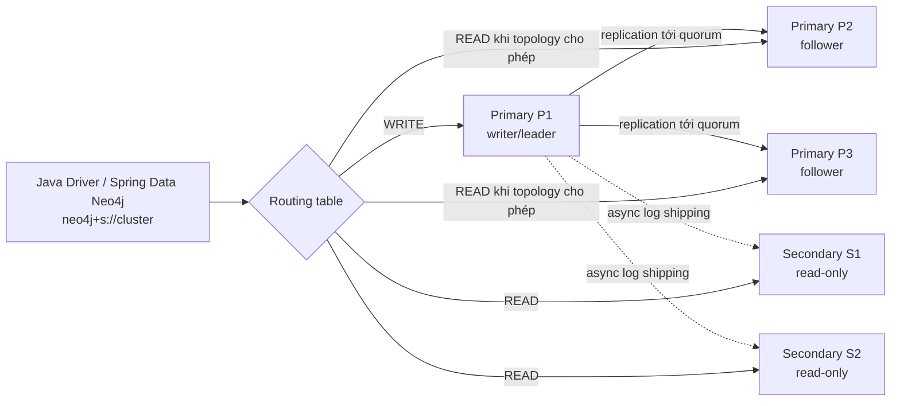
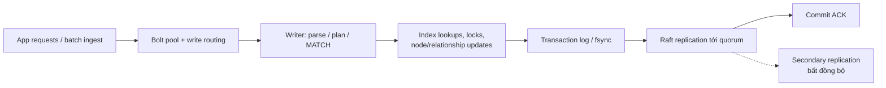

# Mở rộng khả năng đọc và nhận diện nút thắt ở đường ghi trong Neo4j

Khi hệ thống đồ thị phát triển, lượng truy vấn tra cứu quan hệ, gợi ý bạn bè, tìm đường đi và xem hồ sơ có thể tăng nhanh hơn khả năng của một máy Neo4j. Thêm các bản sao để **phân phối truy vấn đọc** là một giải pháp quan trọng. Nhưng nếu yêu cầu chủ yếu là tạo node, cập nhật relationship và ghi transaction, thêm nhiều máy **không tự biến một database thành nhiều nơi ghi độc lập**.

Đây là sự khác nhau giữa **read scaling** và **write scaling**. Trong một Neo4j cluster có database với nhiều primary, **tại một thời điểm chỉ có một primary đóng vai trò writer (leader) cho database đó**. Các primary khác tham gia sao chép/đảm bảo tính sẵn sàng; secondary chủ yếu phục vụ truy vấn đọc và nhận cập nhật bất đồng bộ. Do đó, nếu nút thắt là một transaction ghi lớn hoặc nhiều request cùng tranh chấp một node, bổ sung secondary có thể không làm throughput ghi tăng.

Bài thuộc chương **Cụm và mở rộng** của module `DATABASE_ENGINE_GRAPH_NEO4J`. Nội dung vận dụng property graph, Cypher, index/constraint, Java Driver và Spring Data Neo4j để phân biệt **tắc nghẽn ở tuyến đọc** với **tắc nghẽn ở tuyến ghi**, lựa chọn topology, định tuyến truy vấn, giám sát độ trễ đồng bộ và xây dựng phương án mở rộng có đo lường.

**Kết quả mong đợi:** sau bài này bạn có thể giải thích vì sao thêm secondary giúp đọc nhiều hơn, vì sao thêm primary không tạo thêm writer cho cùng database, biết dùng routing/bookmark để giữ tính nhất quán cần thiết và có một runbook tìm bottleneck trước khi mua thêm máy.

## 1. Xác định bài toán hiệu năng trước khi mở rộng

Hai hệ thống cùng xử lý 10.000 request/phút có thể cần topology hoàn toàn khác nhau:

| Đặc trưng workload | Hệ thống A: tra cứu đồ thị | Hệ thống B: ghi hoạt động liên tục |
| --- | --- | --- |
| Phần lớn truy vấn | `MATCH`, thống kê, gợi ý, xem path | `MERGE`, `CREATE`, `SET`, `DELETE` |
| Đường đi dữ liệu | Đọc từ node và relationship/index | Kiểm tra khóa, khóa ghi, commit và replication |
| Rủi ro chính | CPU query, page cache, I/O đọc, kết quả quá lớn | Writer quá tải, lock contention, transaction log, quorum/network |
| Cách mở rộng khả thi | Thêm secondary, tối ưu read routing và câu truy vấn | Tối ưu transaction/index, giảm tranh chấp, batch/concurrency; không tự tăng writer bằng secondary |
| Kiểm tra cần thiết | Read p95/p99, throughput, page faults, read routing | Write p95/p99, commit latency, lock wait, replication lag, retry |

Đặt SLO trước khi chọn số máy:

- **Throughput:** bao nhiêu read transaction/giây và write transaction/giây ở giờ cao điểm?
- **Độ trễ:** p95/p99 đọc và ghi tối đa chấp nhận được là bao nhiêu?
- **Tính nhất quán:** sau khi một request ghi xong, request đọc kế tiếp có bắt buộc thấy thay đổi đó không?
- **Khả dụng:** được phép mất một primary mà vẫn ghi không, hay cần chịu hai lỗi?
- **Quy mô dữ liệu:** tổng graph/index, working set nóng, tốc độ tăng và kích thước bản ghi trả về?
- **Hạn mức:** CPU, RAM/page cache, IOPS, băng thông, latency giữa các member và tài nguyên client?

Không thể quyết định “thêm hai node Neo4j” chỉ từ số lượng node của graph. **Tỷ lệ đọc/ghi, cấu trúc query, độ phân nhánh và đồng thời mới quyết định nút thắt thực tế.**

## 2. Kiến trúc cluster: primary, writer và secondary

Trong Neo4j Enterprise clustering, **vai trò primary/secondary gắn với bản sao của từng database**, không phải cố định một server luôn là primary cho toàn bộ cluster. Một server có thể chứa primary của database A nhưng secondary của database B, nếu mode constraint và phân bổ cho phép.

Sơ đồ minh họa database `learning` có **ba primary** và **hai secondary**:



Sơ đồ giúp hiểu luồng, không có nghĩa secondary luôn kéo log trực tiếp từ writer: Neo4j có thể chọn một primary/upstream phù hợp để secondary đồng bộ.

### 2.1. Primary để ghi có tính chịu lỗi

Một primary có thể đọc và, nếu được bầu làm writer, xử lý ghi. Các primary tham gia cơ chế đồng thuận để bảo vệ việc commit. Khi database có ba primary, ghi được coi là commit sau khi được xác nhận bởi **đa số primary (quorum)** theo cơ chế replication của Neo4j.

Trong điều kiện thông thường:

- **Một primary**: không có khả năng duy trì ghi khi chính primary đó mất.
- **Ba primary**: thường chịu được **một lỗi primary** mà vẫn duy trì khả năng ghi.
- **Năm primary**: thường chịu được **hai lỗi primary** nếu phần còn lại và mạng vẫn tạo được quorum.

Mô hình quen thuộc để chịu `F` lỗi là `2F + 1` primary. Đây là **lựa chọn độ sẵn sàng ghi**, không phải công thức đảm bảo throughput ghi tăng theo số primary. Thêm primary có thể làm tăng chi phí liên lạc và replication cho mỗi commit.

### 2.2. Secondary để mở rộng đọc

Secondary là bản sao của database, nhận cập nhật **bất đồng bộ** từ hệ thống primary. Nó có thể thực thi các truy vấn **chỉ đọc**, giúp phân phối CPU, page cache và I/O của workload đọc sang nhiều máy.

Tác dụng mong đợi:

- Giảm số truy vấn đọc chạy trên primary, đặc biệt là writer.
- Tăng tổng tài nguyên CPU/RAM/page cache phục vụ đọc.
- Giảm cạnh tranh giữa read-heavy analytics với giao dịch ghi trên primary.
- Giữ một số khả năng đọc khi một server khác gặp sự cố, tùy topology và khả năng định tuyến.

Giới hạn:

- Secondary **không trở thành writer** của database chỉ vì ứng dụng dùng nhiều kết nối.
- Secondary có thể **chưa thấy transaction vừa commit** vì replication bất đồng bộ.
- Tăng số secondary cũng tăng chi phí lưu bản sao, nhận/apply transaction log, network, monitoring và quản trị.
- Một câu Cypher chậm vì traversal quá rộng vẫn có thể chậm trên **từng** secondary; phân tán chỉ giảm mức cạnh tranh giữa request.

### 2.3. Cẩn thận với thuật ngữ “leader”

Trong tài liệu Neo4j, thuật ngữ **writer/leader** nhấn mạnh nơi nhận write của một database. Có thể xảy ra failover và **writer mới được bầu**. Java Driver với routing URI có nhiệm vụ học lại topology khi cần; không nên hard-code hostname của writer hiện tại trong business code.

## 3. Một ví dụ nhận diện giới hạn mở rộng

Giả sử tại giờ cao điểm một ứng dụng xử lý:

| Loại | Tải giả định | Độ trễ mục tiêu |
| --- | ---: | --- |
| Đọc hồ sơ/quan hệ | 900 request/giây | p95 dưới 100 ms |
| Cập nhật lượt tương tác | 100 transaction/giây | p95 dưới 150 ms |
| Mỗi truy vấn đọc chạy đơn lẻ | 20 ms | — |
| Mỗi commit ghi chạy đơn lẻ | 15 ms | — |

Đây là **số liệu minh họa**, không phải benchmark hoặc năng lực mặc định của Neo4j.

Giả sử benchmark trước/sau cho thấy CPU ở writer bị tiêu thụ phần lớn bởi 900 đọc/giây và commit latency tăng. Thêm một hoặc hai secondary và định tuyến đọc tới chúng có thể **giải phóng CPU/page cache trên writer**, làm cả read p95 và write p95 cải thiện.

Nhưng giả sử nguyên nhân chính khác: **100 transaction ghi/giây đều cập nhật cùng node `:Counter {id: 'global'}`**. Các transaction tranh chấp lock ngay cả khi **không còn truy vấn đọc**. Trong tình huống này, thêm secondary không xử lý nút thắt khóa ghi.

**Bài học:** cải thiện đường ghi do **giảm tải đọc trên writer** khác hoàn toàn với **tăng số writer**. Một database thông thường vẫn có một writer tại một thời điểm.

## 4. Điều kiện để mở rộng đọc có hiệu quả

Trước khi bổ sung secondary, kiểm tra lần lượt:

1. **Query đọc có thực sự được định tuyến tới node đọc?** Nếu mọi request vẫn gửi ở chế độ WRITE, secondary sẽ không gánh tải như kỳ vọng.
2. **Reader có bị chậm vì Cypher không chọn lọc?** Label scan, Cartesian product hoặc expansion tạo hàng triệu kết quả vẫn phải sửa.
3. **Dữ liệu có fit vào page cache phù hợp không?** Mỗi secondary có cache riêng; thêm bản sao không đồng nghĩa mỗi request không cần I/O.
4. **Quá nhiều dữ liệu trả về?** Trả toàn bộ `path`, `collect(node)` hoặc `RETURN *` vẫn làm network/Driver/application tốn tài nguyên.
5. **Có yêu cầu read-after-write không?** Nếu nhiều truy vấn đọc phải chờ secondary bắt kịp bookmark, throughput có thể thấp hơn kỳ vọng.
6. **Mạng/routing ổn không?** DNS, TLS, advertised addresses, driver routing table và connection pool đều phải hoạt động.
7. **Secondary có bắt kịp replication không?** Nếu replication lag liên tục lớn, thêm secondary chưa chắc cải thiện trải nghiệm người dùng.

### 4.1. Đừng thêm secondary để che một truy vấn sai

Ví dụ không chọn lọc:

```cypher
// Có thể mở rộng quá nhiều quan hệ trước khi chọn top-k.
MATCH (u:User)-[:FOLLOWS*1..5]->(friend:User)
RETURN u.userId AS userId,
       collect(DISTINCT friend) AS allReachable;
```

Ví dụ sử dụng cú pháp quan hệ biến độ dài quen thuộc của **Cypher 5**; với Cypher 25, đối chiếu cú pháp quantified path pattern phù hợp. Với graph có nhiều nhánh, kết quả trung gian có thể bùng nổ. Nếu nghiệp vụ chỉ cần **10 gợi ý gần nhất cho một người**, truy vấn nên bắt đầu từ `$userId` cụ thể, giới hạn số bước, lọc ứng viên đúng yêu cầu, chọn số kết quả và chỉ trả các trường cần thiết. Không tự ý thêm `LIMIT 10` ở cuối rồi kết luận mọi expansion đã bị giới hạn.

Một truy vấn đọc có phạm vi nhỏ hơn:

```cypher
MATCH (u:User {userId: $userId})
MATCH (u)-[:FOLLOWS]->(f:User)
RETURN f.userId AS userId,
       f.displayName AS name
ORDER BY f.userId
LIMIT $pageSize;
```

Câu thứ hai chỉ lấy **người được theo dõi trực tiếp**, không tương đương với tìm tất cả bạn trong năm bước. Chỉ thay query khi **ngữ nghĩa nghiệp vụ phù hợp**.

**Kết luận:** scale-out đọc giải quyết **phân phối tải**, còn query tuning giải quyết **chi phí mỗi yêu cầu**. Thường cần cả hai khi graph lớn.

## 5. Routing đúng cách với Neo4j Java Driver

### 5.1. URI routing khác kết nối trực tiếp

| URI | Tính chất | Khi sử dụng |
| --- | --- | --- |
| `neo4j://host:7687` | Driver dùng cơ chế routing để khám phá member thích hợp | Cluster, môi trường cho phép driver routing |
| `neo4j+s://host:7687` | Routing và TLS kiểm tra chứng chỉ | Cluster có TLS/CA đáng tin cậy |
| `bolt://host:7687` | Kết nối trực tiếp đến endpoint | Standalone hoặc kịch bản được quản trị chủ đích |
| `bolt+s://host:7687` | Kết nối Bolt trực tiếp với TLS xác minh cert | Direct connection yêu cầu TLS |

Nếu dùng `bolt://` tới một primary cụ thể, không thể kỳ vọng Driver tự phân phối truy vấn tới secondary như khi sử dụng routing topology. Trong cluster, luôn dùng URI/hostname và chính sách TLS do hệ thống triển khai cung cấp.

### 5.2. Truy vấn READ phải khai báo rõ mục đích

Ví dụ với **Neo4j Java Driver hiện đại** và một `Driver driver` được khởi tạo, quản lý theo vòng đời ứng dụng:

```java
import org.neo4j.driver.QueryConfig;
import org.neo4j.driver.RoutingControl;

// Chỉ đọc: driver có thể chọn reader theo routing table.
var readResult = driver.executableQuery("""
        MATCH (c:Course {courseId: $courseId})
        RETURN c.title AS title
        """)
    .withParameters(java.util.Map.of("courseId", "C101"))
    .withConfig(QueryConfig.builder()
        .withDatabase("learning")
        .withRouting(RoutingControl.READ)
        .build())
    .execute();
```

Khi dùng `Driver.executableQuery()`, đường gọi mặc định có thể được xử lý như WRITE routing; muốn scale đọc nên khai báo `RoutingControl.READ` cho truy vấn chỉ đọc. API và tên method cần đối chiếu **version Java Driver** thật sự được dự án resolve.

Không xem `RoutingControl.READ` là cơ chế phân quyền: ứng dụng vẫn phải dùng tài khoản có privilege phù hợp, và ngữ nghĩa truy vấn phải thực sự là read-only.

### 5.3. Session, executeRead và executeWrite

Với `Session`, `executeRead()` và `executeWrite()` biểu đạt mục đích transaction và giúp Driver định tuyến/ retry một số lỗi tạm thời phù hợp:

```java
import java.util.List;
import java.util.Map;
import org.neo4j.driver.Driver;
import org.neo4j.driver.Session;
import org.neo4j.driver.SessionConfig;

// Giả sử Driver driver được tạo một lần tại ứng dụng.
try (Session session = driver.session(
        SessionConfig.forDatabase("learning"))) {

    List<String> ids = session.executeRead(tx ->
        tx.run("""
            MATCH (c:Course)
            WHERE c.published = true
            RETURN c.courseId AS id
            ORDER BY id
            LIMIT $limit
            """, Map.of("limit", 20))
          .list(record -> record.get("id").asString())
    );

    System.out.println(ids);
}
```

Đoạn code trên **không ghi dữ liệu**, nên phù hợp khi thử read routing. Trong hệ thống thật, đặt thêm `WHERE` theo khóa/tenant, cursor pagination và chỉ lấy đúng DTO mà API cần.

Với truy vấn ghi, dùng `executeWrite()`. Callback có thể được Driver retry khi xảy ra lỗi tạm thời, nên không thực hiện side effect không idempotent như gửi email, thu tiền hoặc cập nhật hệ thống khác bên trong callback.

### 5.4. Spring Data Neo4j

Với Spring Data Neo4j:

- Repository sử dụng Driver và transaction manager do Spring quản lý.
- Dịch vụ chỉ đọc nên biểu đạt ngữ nghĩa `@Transactional(readOnly = true)` theo cách framework/phiên bản hỗ trợ.
- Cần **kiểm tra routing thực tế** bằng metrics, log của Driver/cluster và integration test; không suy rằng mọi repository method tự động chạy trên secondary.
- Việc gọi custom `@Query` có thao tác ghi, hoặc thay đổi transaction boundary, có thể làm đường gọi không còn read-only.
- Không tạo hai Driver bean/pool độc lập nếu không có yêu cầu rõ và đã tính chi phí.

**Tối ưu routing là công việc kết hợp giữa deployment, Java Driver, Spring transaction và quyền database**, không chỉ là đổi hostname trong `application.yml`.

## 6. Read-after-write: secondary có thể chậm nhưng dữ liệu vẫn phải đúng

Vì secondary nhận transaction bất đồng bộ, một request có thể ghi xong trên writer rồi ngay sau đó đọc từ secondary **trước khi secondary apply transaction mới**.

Ví dụ luồng:

```text
T0: POST /enroll
    WRITE: (:Student {id:'S01'})-[:ENROLLED_IN]->(:Course {id:'C101'})
    → Writer commit thành công.

T1: GET /my-courses
    READ được route tới secondary chưa áp dụng transaction T0.

T2: Secondary nhận và apply transaction T0.
```

Nếu GET ở T1 trả về chưa có `C101`, ứng dụng có thể gây trải nghiệm không nhất quán.

### 6.1. Bookmark và causal consistency

Neo4j Java Driver hỗ trợ **bookmark**: token biểu diễn trạng thái transaction đã commit. Khi một transaction đọc được chạy với bookmark phụ thuộc giao dịch ghi, cluster đảm bảo node phục vụ truy vấn đã thấy trạng thái được yêu cầu trước khi thực thi.

Cách dùng dễ hiểu là thực hiện **ghi rồi đọc trong cùng Session**:

```java
import java.util.Map;
import org.neo4j.driver.Driver;
import org.neo4j.driver.Session;
import org.neo4j.driver.SessionConfig;

try (Session session = driver.session(
        SessionConfig.forDatabase("learning"))) {

    // Thực sự ghi: chỉ chạy trên database thử nghiệm.
    session.executeWrite(tx -> {
        tx.run("""
            MERGE (s:Student {studentId: $studentId})
            MERGE (c:Course {courseId: $courseId})
            MERGE (s)-[:ENROLLED_IN]->(c)
            """, Map.of(
                "studentId", "S01",
                "courseId", "C101"
            )).consume();
        return null;
    });

    long enrolled = session.executeRead(tx ->
        tx.run("""
            MATCH (:Student {studentId: $studentId})
                  -[r:ENROLLED_IN]->
                  (:Course {courseId: $courseId})
            RETURN count(r) AS n
            """, Map.of(
                "studentId", "S01",
                "courseId", "C101"
            )).single().get("n").asLong()
    );

    System.out.println("Quan hệ đã nhìn thấy: " + enrolled);
}
```

Driver quản lý bookmark tự động trong **cùng Session**, nên đọc theo chuỗi causal có thể chờ member được chọn bắt kịp dữ liệu. Trong ví dụ lý tưởng không có cạnh song song, kết quả là `1`. Để bảo đảm idempotency khi nhiều writer cạnh tranh, cần schema/constraint và chiến lược xử lý đồng thời phù hợp; `MERGE` **không thay thế mọi ràng buộc uniqueness ở relationship**.

Khi ghi và đọc nằm ở **hai session khác nhau** (hoặc hai service khác nhau), phải thiết kế truyền bookmark hoặc dùng `BookmarkManager` theo Driver hiện hành nếu cần đảm bảo read-your-writes giữa chúng. Với `driver.executableQuery()`, Driver có thể quản lý bookmark mặc định cho chuỗi query; kiểm tra đúng phiên bản và cách cấu hình đang dùng.

**Đổi lại:** nếu secondary bị replication lag, request có bookmark có thể **phải chờ**. Vì vậy đừng áp causal chain cho mọi analytics độc lập nếu sản phẩm chấp nhận dữ liệu trễ vài giây. Tính nhất quán và throughput/latency có đánh đổi.

### 6.2. Phân loại truy vấn theo yêu cầu nhất quán

| Chức năng | Read-after-write cần nghiêm ngặt? | Gợi ý định tuyến |
| --- | --- | --- |
| Màn hình xác nhận vừa đăng ký học | **Có**, phải thấy quan hệ mới | Cùng session/bookmark hoặc đọc writer theo nghiệp vụ |
| Danh sách khóa học phổ biến cập nhật mỗi phút | Có thể chấp nhận lag ngắn | Read routing tới secondary |
| Đọc trạng thái giao dịch vừa thanh toán | **Cần nhất quán cao** | Causal consistency và thiết kế transaction đúng |
| Báo cáo tổng hợp theo ngày | Thường chấp nhận trễ theo SLA | Secondary nếu không ảnh hưởng writer |
| Truy vấn admin đối soát sau migration | Tùy yêu cầu tính đúng và mốc dữ liệu | Bookmark, writer hoặc tạm dừng pipeline theo quy trình |

Không đánh đồng **causal consistency** với “mọi read luôn thấy trạng thái mới nhất tuyệt đối trên mọi máy ở mọi thời điểm”. Bookmarks tạo quan hệ nhân quả với transaction đã biết; một giao dịch của người khác mới commit nhưng không nằm trong chuỗi causal không tự trở thành bắt buộc đối với mọi reader.

## 7. Thay đổi topology khi cần tăng read capacity

Giả sử database `learning` đang có ba primary và một secondary, và đã có thêm server đủ điều kiện. Khi nhu cầu đọc tăng, người quản trị có thể thay đổi **số bản sao secondary được yêu cầu**.

**Các câu Cypher dưới đây thuộc quyền quản trị, chỉ xem xét trên môi trường thử hoặc theo change procedure production. Không chạy tùy tiện trên hệ thống đang hoạt động.**

Kiểm tra trạng thái:

```cypher
// Kết nối database system với account có quyền xem.
SHOW DATABASE learning
YIELD name, address, role, writer, currentStatus
RETURN name, address, role, writer, currentStatus
ORDER BY role, address;
```

Một số phiên bản hỗ trợ thêm `replicationLag` trong `YIELD`. Nếu câu lệnh không hiện nhiều bản sao như mong đợi, kiểm tra phiên bản, quyền, status từng member và cách database được phân bổ.

Để yêu cầu topology mới (ví dụ tăng lên **hai secondary**):

```cypher
// THAY ĐỔI TOPOLOGY: yêu cầu quyền quản trị và capacity.
ALTER DATABASE learning
SET TOPOLOGY 3 PRIMARIES 2 SECONDARIES;
```

Điều kiện:

- Cluster có **đủ server được ENABLED** và phù hợp `modeConstraint` để nhận các bản sao được yêu cầu.
- Tài nguyên mỗi member đủ disk/RAM/CPU và bandwidth cho việc đồng bộ database.
- Quá trình cấp phát có thể cần thời gian để database copy đạt `online` và bắt kịp.
- Nếu không thỏa topology, lệnh có thể báo lỗi; **không** tự tạo server mới chỉ bằng `ALTER DATABASE`.
- Một database có thể không được phép tự động chuyển từ nhiều primary sang **một** primary theo một số quy tắc Neo4j; không dùng thay đổi topology để “giảm quorum cho nhanh” khi chưa đọc đúng hướng dẫn.

Kiểm tra lại sau khi thay đổi:

```cypher
SHOW DATABASE learning
YIELD name, address, role, writer,
      currentStatus, replicationLag
RETURN name, address, role, writer,
       currentStatus, replicationLag
ORDER BY role, address;
```

`replicationLag` là chỉ số theo đơn vị transaction so với writer (trên các phiên bản hỗ trợ), **không phải số mili-giây độ trễ request**. Nếu cần quan sát thật sự copy mới đã “bắt kịp”, hãy theo dõi nhiều mẫu và workload, không chỉ một hàng `currentStatus = 'online'`.

### 7.1. Trước khi dùng ALTER DATABASE

Quy trình an toàn:

1. Đo workload và baseline; xác nhận read saturation là vấn đề thực sự.
2. Xác minh backup/recovery và khả năng rollback topology theo quy trình.
3. Chuẩn bị server, tài nguyên và mạng, version tương thích.
4. Kiểm tra `SHOW SERVERS`, current/requested allocations và mode constraints.
5. Chỉ thay đổi topology trong maintenance/change window phù hợp.
6. Quan sát tốc độ catch-up, lag, page cache warmup, lỗi routing, CPU/disk/network.
7. Chạy lại load test và so p95/p99, throughput, chi phí cluster.
8. Nếu không hiệu quả, xem query/routing chứ không tiếp tục thêm secondary vô hạn.

Khi cluster phân bổ nhiều database, một server có thể đang quá tải vì **tổng các database khác**. “Database learning có hai secondary” không có nghĩa tài nguyên của hai server hoàn toàn được dành riêng cho learning.

## 8. Nhận diện nút thắt đường ghi

Một database có một writer đang hoạt động; việc commit phụ thuộc xử lý giao dịch ở writer và replication/quorum theo topology. Khi write p95/p99 tăng, nguyên nhân có thể xuất hiện ở nhiều khâu khác nhau.



Sơ đồ thể hiện **các nhóm chi phí**. Trình tự nội bộ của kernel, transaction log và replication có thể khác theo phiên bản; không dùng sơ đồ này để khẳng định một thứ tự chính xác của mọi lời gọi I/O.

### 8.1. Writer thiếu CPU hoặc heap

Dấu hiệu:

- CPU writer duy trì ở mức cao khi write throughput tăng.
- Heap/GC pressure tăng, transaction memory gần limit.
- Một truy vấn `MERGE` làm quá nhiều việc vì thiếu index hoặc cardinality lớn.
- Cùng lúc writer còn phải chạy nhiều truy vấn đọc nặng.

Xử lý:

- Dùng index/constraint cho business key khi `MERGE`.
- Dùng `EXPLAIN` xem plan, kiểm tra `NodeIndexSeek` so với `NodeByLabelScan`.
- Giảm số hàng trung gian, thay `collect()` lớn bằng tính toán phù hợp.
- Chia batch và giới hạn concurrency ở tầng ingestion.
- Chuyển truy vấn đọc độc lập sang secondary nếu workload cho phép.

### 8.2. Lock contention trên “hot node”

Ví dụ mọi request cập nhật cùng node tổng:

```cypher
// Anti-pattern khi rất nhiều worker cùng ghi một node.
MATCH (c:DailyCounter {day: $day})
SET c.total = c.total + 1
RETURN c.total AS total;
```

Các transaction phải phối hợp quyền ghi cùng node. Khi nhiều worker chạy đồng thời, throughput có thể giảm do chờ khóa dù writer còn CPU trống.

Một số thay đổi có thể cân nhắc:

- Không cập nhật counter toàn cục cho **mỗi event** nếu không bắt buộc realtime.
- Lưu event/thao tác theo khóa riêng, tổng hợp theo chu kỳ hoặc ở đường đọc khi hợp lý.
- Phân vùng counter theo tenant/shard/time bucket **nếu nghiệp vụ cho phép**, rồi tổng hợp lại.
- Giảm thời gian transaction giữ lock; tránh chạy query nặng khác trong cùng transaction.
- Bảo đảm các worker lấy khóa theo thứ tự thống nhất để giảm deadlock khi cập nhật nhiều thực thể.

**Cẩn trọng:** phân vùng counter hoặc tổng hợp bất đồng bộ thay đổi ngữ nghĩa nhất quán. Không áp dụng cho số dư tài khoản, hạn mức hoặc nghiệp vụ yêu cầu cập nhật tức thời/đúng tuyệt đối mà không có thiết kế giao dịch thay thế.

### 8.3. Transaction quá lớn

Batch nhập hàng trăm nghìn relationship trong một transaction có thể gây:

- Heap/transaction memory lớn.
- Thời gian giữ lock dài.
- Transaction log và replication burst.
- Rollback/retry tốn kém nếu có lỗi giữa chừng.
- Tăng độ trễ các transaction nhỏ đang chạy cùng lúc.

Ví dụ khung nạp theo `UNWIND`:

```cypher
// $rows đã được kiểm tra khóa, không trùng và chia batch ở ứng dụng.
UNWIND $rows AS row
MATCH (s:Student {studentId: row.studentId})
MATCH (c:Course {courseId: row.courseId})
MERGE (s)-[:ENROLLED_IN]->(c);
```

Chọn batch size bằng thử nghiệm, ví dụ khởi đầu một vài trăm hàng nếu relationship nặng, rồi tăng/giảm theo độ trễ, GC, transaction memory và lock wait. **Không có batch size tối ưu cố định**. Truy vấn có thể bỏ qua hàng khi `MATCH` không tìm được Student/Course, nên pipeline phải đối soát số bản ghi nguồn và kết quả thực tế.

Với cùng khóa được ghi từ nhiều worker, `MERGE` và index giúp giảm trùng node, nhưng không tự giải quyết toàn bộ conflict hay uniqueness của relationship song song nếu mô hình cho phép chúng.

### 8.4. Transaction log, fsync và storage latency

Neo4j cần ghi transaction log và duy trì tính bền vững. Khi volume ghi có **write await/latency** cao, commit có thể chậm ngay cả khi CPU writer còn dư.

Xem:

- Disk write IOPS/throughput và latency ở đúng volume database/transaction log.
- Checkpoint/flush activity và mức sử dụng disk.
- Mức độ cạnh tranh I/O với backup, index population hoặc workload khác.
- Tần suất/độ lớn của các transaction ghi.

**Không** kết luận tăng page cache là đủ để xử lý mọi commit chậm: fsync và log durability là một vấn đề khác với read page faults.

### 8.5. Quorum và mạng giữa primary

Các primary cần phối hợp cho commit; một primary chậm hoặc mạng giữa member có latency cao có thể kéo dài thời gian chờ phản hồi cần thiết cho quorum.

Dấu hiệu:

- Write latency tăng sau khi thêm primary/đổi vị trí địa lý member.
- Network RTT, packet loss, retransmission hoặc queue tăng.
- Raft replication/append/commit metrics bất thường.
- Một member có disk/CPU chậm ảnh hưởng việc xử lý log.
- Failover/leader election hoặc topology đang thay đổi.

Thêm primary từ ba lên năm để “tăng tốc ghi” có thể **làm ngược lại**: quorum cần nhiều thành viên hơn và có thể tăng chi phí commit. Đổi lại, khả năng chịu lỗi primary được nâng cao. Phải chọn số primary vì **yêu cầu resilience** và benchmark cụ thể.

## 9. EXPLAIN, PROFILE và phân biệt query cost với cluster cost

Một truy vấn ghi chậm có thể bị nhầm thành vấn đề cluster. Ví dụ:

```cypher
EXPLAIN
MATCH (s:Student {studentId: $studentId})
MATCH (c:Course {courseId: $courseId})
MERGE (s)-[:ENROLLED_IN]->(c);
```

`EXPLAIN` tạo kế hoạch nhưng **không chạy thao tác ghi**. Nó giúp xem Neo4j tìm Student/Course theo index hay quét label, số hàng ước lượng và các operator liên quan.

`PROFILE` **thực sự thực thi** query. Với `MERGE` hoặc `CREATE`, chạy `PROFILE` đồng nghĩa **có thể thay đổi dữ liệu**. Chỉ đo truy vấn ghi trong môi trường thử có kiểm soát.

Các bước phân tích:

1. **Kiểm tra số bản ghi đầu vào:** một request định tạo một quan hệ có thực sự chỉ khớp hai endpoint?
2. **Kiểm tra index/constraint:** tìm node bằng `studentId`/`courseId` có index phù hợp không?
3. **Đọc `Rows` và `DB Hits`:** có mở rộng/nhân hàng không cần thiết trước ghi không?
4. **Kiểm tra lock/cạnh tranh:** cùng Student/Course có bị nhiều transaction đồng thời cập nhật?
5. **Kiểm tra chi phí commit ngoài plan:** transaction log, quorum/replication, disk/network.
6. **Phân biệt database latency và end-to-end latency:** Java Driver có thể chờ pool, retry hoặc client xử lý payload.

Khi chuyển workload read-only ra secondary và write p95 giảm, cần xác định giảm vì **CPU/I/O cạnh tranh ít hơn**, không diễn giải rằng Neo4j đã có nhiều writer.

## 10. Chỉ số giám sát read scaling và write bottleneck

### 10.1. Đo theo từng member và từng database

Một biểu đồ “CPU cluster trung bình 40%” có thể che writer CPU 95% trong khi secondary chỉ 10%. Mọi dashboard cần nhãn **database, server/instance, role và writer flag** (theo khả năng exporter).

| Chỉ số | Ý nghĩa | Dấu hiệu cần điều tra |
| --- | --- | --- |
| Read transactions/giây trên từng member | Xem routing thực tế | Read gần như toàn bộ trên writer dù đã có secondary |
| Read p95/p99 latency | Tác động ứng dụng | Tăng cùng CPU/page faults của reader |
| Write transactions/giây và p95/p99 commit | Sức khỏe đường ghi | Latency tăng nhưng throughput không tăng |
| Writer CPU, heap, GC | Khả năng xử lý query và transaction | Writer quá tải trong khi reader rảnh |
| Page cache hit/fault, disk read | Working set và I/O đọc | Secondary chưa warm hoặc cache thiếu |
| Disk write IOPS/await | Log/checkpoint/storage ghi | Commit chậm cùng write latency |
| Lock wait/deadlock/retry | Tranh chấp transaction | Tăng khi nhiều worker ghi cùng khóa |
| Raft leader/append/commit/applied | Quorum, replication primary | Leader không ổn, apply/commit gap tăng |
| Secondary replication lag | Độ mới bản sao đọc | Lag kéo dài hoặc tăng đều |
| Bolt pool wait, timeout, routing errors | Nghẽn phía client hoặc mạng | App chậm dù query đơn lẻ nhanh |

### 10.2. Quan sát topology từ Cypher

Kết nối database `system` bằng account có đủ quyền:

```cypher
SHOW SERVERS
YIELD name, address, state, health, modeConstraint
RETURN name, address, state, health, modeConstraint
ORDER BY name;
```

Để xem bản sao database và writer hiện hành:

```cypher
SHOW DATABASE learning
YIELD name, address, role, writer,
      currentStatus, replicationLag
RETURN name, address, role, writer,
       currentStatus, replicationLag
ORDER BY role, address;
```

Các cột phụ thuộc phiên bản và quyền. `replicationLag` không phải độ trễ tính bằng giây; nó có thể biểu diễn **độ lệch transaction number** giữa bản sao và writer. Một giá trị tạm tăng trong lúc đồng bộ chưa chắc là sự cố; **xu hướng kéo dài** mới đáng chú ý.

### 10.3. Nhìn Raft metrics đúng ngữ nghĩa

Tùy Neo4j version/edition/exporter, có các metrics liên quan:

- `cluster.raft.is_leader`: member có đang là leader của database không.
- `cluster.raft.append_index`, `commit_index` và `applied_index`: vị trí log được đề xuất, commit và đã apply.
- `cluster.raft.message_processing_delay` hoặc các metric tương tự: độ trễ xử lý thông điệp.
- Transaction last committed / replication lag ở mức database.

Nếu `commit_index` tiến nhưng `applied_index` của một primary theo sau lâu, member đó có thể đang chậm apply. Không dùng các số Raft giữa **hai database khác nhau** để kết luận lag: index được hiểu trong ngữ cảnh nhóm Raft/database cụ thể.

Secondary replication lag cần quan sát theo **metric phù hợp cho secondary**, không giả định mọi secondary có cùng Raft role/metric như primary. Tên time series thực tế và prefix có thể thay đổi; xem metric catalog của **server đang chạy**.

## 11. Khả năng chịu lỗi không đồng nghĩa khả năng mở rộng ghi

| Topology minh họa | Mục tiêu chính | Điều không được suy ra |
| --- | --- | --- |
| 1 primary | Đơn giản, giảm replication overhead | Không chịu lỗi writer, không có read scaling độc lập |
| 3 primaries | Chịu được một primary lỗi trong điều kiện quorum còn | **Không** có ba writer cùng lúc cho cùng database |
| 3 primaries + 2 secondaries | Tăng khả năng phục vụ đọc, giữ HA của primary | **Không** tăng write throughput tuyến tính theo 5 máy |
| 5 primaries + secondaries | Chịu được hai lỗi primary và mở rộng đọc | Write latency không tự tốt hơn topology ba primary |
| Nhiều database, phân bổ trên cluster | Phân tách workload và quota/tài nguyên theo database | Không tự có transaction ACID xuyên các database |

Khi workload được phân vùng thành **các database độc lập**, mỗi database có writer của **chính nó**. Điều này có thể giúp phân tán tổng lượng ghi trên toàn hệ thống nếu nghiệp vụ thực sự tách được dữ liệu và tránh transaction xuyên database. Nhưng chuyển từ một graph thống nhất sang nhiều database/shard là **quyết định mô hình dữ liệu và ứng dụng**, không chỉ là thay topology. Các truy vấn đường đi xuyên tập dữ liệu có thể khó hơn hoặc cần mô hình federation/Composite database phù hợp; không tự có ACID transaction xuyên toàn bộ hệ thống.

## 12. Giới hạn thực tế của read scaling

Thêm secondary không tạo read capacity vô hạn. Một số chi phí tăng theo số bản sao:

- **Storage:** mỗi bản sao giữ dữ liệu graph, index và log cần thiết.
- **Memory/page cache:** mỗi server có cache riêng; cần làm ấm từ workload thực.
- **Network:** secondary phải theo kịp transaction updates, driver cần routing metadata.
- **Write amplification gián tiếp:** write-heavy workload tạo nhiều thay đổi phải được apply trên secondary.
- **Operational complexity:** thêm TLS, monitor, backup policies, patch/upgrade và failover drills.
- **Replica lag:** reader chậm có thể trả dữ liệu cũ nếu không dùng bookmark.
- **Query fan-out ngoài ý muốn:** ứng dụng tạo quá nhiều truy vấn độc lập hoặc N+1 mapping vẫn có thể đẩy mọi reader quá tải.

Ví dụ: khi số lượng secondary tăng từ 1 lên 3 nhưng throughput tổng chỉ tăng 10%, có thể:

1. Driver không định tuyến phần lớn read tới secondary.
2. Read query tốn CPU đơn luồng lớn và vẫn chậm ở từng server.
3. API bị nghẽn ở network serialization hoặc Java Driver pool.
4. Secondary có page faults cao do cache lạnh.
5. Write rate tạo replication/apply pressure đáng kể ở mỗi secondary.
6. Workload bị khóa bởi một tài nguyên ngoài Neo4j như API gateway.

Phải đo **throughput, p95/p99, số lỗi và chi phí mỗi bản sao**, không chỉ đếm tổng máy.

## 13. Load test có thể chứng minh hiệu quả mở rộng

Một phép thử đáng tin cậy cần giữ **cùng dữ liệu, cùng query, cùng concurrency policy** và ghi rõ thay đổi topology/routing.

### 13.1. Hai nhóm thử riêng

**Thử tải đọc:**

- Một tập `MATCH`/traversal/aggregation giống sản phẩm.
- Các client dùng `RoutingControl.READ` hoặc `executeRead()`.
- Đo throughput, read p95/p99, CPU/page cache từng member, network và replication lag.
- Lặp lại với **0, 1, 2 secondary** khi cấu hình cho phép, sau khi cache warm.

**Thử tải ghi:**

- Giao dịch `MERGE` node/relationship và `SET` property đại diện.
- Có ca **độc lập theo khóa** và ca **đụng cùng hot node**.
- Đo write p95/p99, throughput, lock waits, retry, log I/O và Raft metrics.
- Giữ đúng số primary và thử tăng secondary để biết phần cải thiện nào do offload đọc.
- Không test tải ghi trên dữ liệu production với lệnh `CREATE`/`DELETE`.

### 13.2. Bảng số liệu giả định

| Kịch bản | Throughput đọc | Read p95 | Write p95 | Diễn giải |
| --- | ---: | ---: | ---: | --- |
| 3 primary, 0 secondary, read+write | 700/s | 180 ms | 240 ms | Writer/primary còn phải gánh đọc |
| 3 primary, 2 secondary, read+write | 1.100/s | 95 ms | 170 ms | Có thể đã giảm cạnh tranh read trên primary |
| 3 primary, 2 secondary, chỉ ghi vào hot counter | — | — | 650 ms | Lock contention vẫn tồn tại |
| 5 primary, 2 secondary, chỉ ghi vào hot counter | — | — | 700 ms | Tăng primary không giúp nút thắt hot key |

**Toàn bộ số là giả định** để minh họa cách diễn giải, không phải benchmark Neo4j. Kết quả thực tế phụ thuộc data, index, volume, hardware, config, JVM, network và query. Không được trích bảng như một cam kết rằng hai secondary làm tăng throughput đúng một tỷ lệ nhất định.

### 13.3. Bắt buộc test tính đúng

Ngoài hiệu năng, cần bảo đảm:

- Read API trả đúng số node/relationship theo scope và tenant.
- Session/Bookmark đảm bảo các luồng vừa ghi vừa đọc thấy thay đổi theo yêu cầu.
- Failover writer không làm transaction nửa vời hoặc tạo duplicate do retry.
- Batch ingest idempotent; lỗi kết nối không khiến gọi lại callback tạo side effect ngoài Neo4j.
- Query trên secondary không cần ghi và không dựa vào tính năng không có trên member đó.
- Khi secondary lag/fail, hành vi routing/fallback phù hợp SLO và chính sách nhất quán.

## 14. Runbook tìm bottleneck trước khi mở rộng cluster

### Bước 1 — Chốt triệu chứng

Độ trễ tăng ở **đọc**, **ghi**, hay cả hai? Đây là p95/p99 từ API, query execution hay commit? Có tăng lỗi/timeout/retry không?

### Bước 2 — So writer và reader trên cùng trục thời gian

Kiểm tra CPU/GC/page cache/I/O của writer, primary follower và secondary theo database. Nếu writer CPU 95% nhưng secondary CPU 20%, có thể do routing hoặc workload ghi. Nếu mọi reader cùng page fault/CPU cao, query/data access có thể là nút thắt chung.

### Bước 3 — Xác minh routing

Kiểm tra URI `neo4j://`/`neo4j+s://`, Driver read mode, Spring transaction, routing table, DNS/TLS và trạng thái member. Không thêm secondary khi tất cả request vẫn đến writer.

### Bước 4 — Kiểm tra kế hoạch Cypher

Dùng `EXPLAIN` để xem index/scan/cardinality. Với truy vấn chỉ đọc và môi trường cho phép, dùng `PROFILE` để xem Rows, DB Hits, Sort/Aggregation/Expand. Với truy vấn ghi, đo `PROFILE` **chỉ trên môi trường thử**.

### Bước 5 — Kiểm tra transaction và commit

Nếu ghi chậm: xem hot nodes, lock wait, batch size, transaction memory, write I/O, network RTT, quorum/Raft và retry. Phân biệt **chậm trước commit** và **chậm khi commit** bằng logs/metrics thực tế.

### Bước 6 — Kiểm tra độ mới của secondary

Xem `replicationLag`, transaction last committed và bookmark wait. Có thể tăng số reader nhưng không đạt SLO nếu mọi request phải chờ replica bắt kịp.

### Bước 7 — Thay đổi có kiểm soát

Ưu tiên:

1. Sửa query sai hoặc index thiếu.
2. Giảm payload, batch, N+1 và concurrency dư thừa.
3. Điều chỉnh routing cho read-only.
4. Bổ sung secondary khi đã chứng minh read saturation và còn capacity.
5. Tăng tài nguyên writer/storage/network nếu write bottleneck cần thiết.
6. Cân nhắc phân vùng nghiệp vụ thành nhiều database chỉ khi mô hình dữ liệu cho phép.

### Bước 8 — Đo lại và lưu quyết định

Ghi topology/phiên bản cũ–mới, baseline, workload, p95/p99, throughput, lỗi, lag, CPU, GC, disk I/O và chi phí. Có kế hoạch rollback nếu truy vấn đọc sai consistency, chi phí tăng mà hiệu quả không tương xứng hoặc replication không ổn định.

## 15. Các nhầm lẫn thường gặp

| Nhầm lẫn | Cách hiểu đúng |
| --- | --- |
| “Có ba primary nghĩa là ba writer.” | Một database chỉ có **một writer/leader** được bầu tại một thời điểm. |
| “Thêm secondary giúp tăng write throughput trực tiếp.” | Secondary phục vụ **đọc**, có thể cải thiện ghi **gián tiếp** nhờ offload đọc. |
| “Secondary luôn thấy bản ghi ngay khi writer commit.” | Replication secondary **bất đồng bộ**; dùng bookmark khi cần read-after-write. |
| “Thêm primary càng nhiều thì commit càng nhanh.” | Nhiều primary tăng khả năng chịu lỗi nhưng cũng có thể tăng chi phí quorum/replication. |
| “READ mode là cơ chế phân quyền.” | READ mode chỉ giúp routing; phải kiểm soát privilege riêng. |
| “`bolt://writer` tự phân phối truy vấn đọc.” | Direct URI không thay thế cluster routing URI. |
| “Có bookmark thì mọi đọc đều tức thời.” | Reader có thể phải chờ transaction được apply, làm tăng latency. |
| “Tăng replica là khắc phục được Cartesian product.” | Mỗi replica vẫn thực thi query sai; phải tối ưu Cypher. |
| “`SHOW DATABASE` online nghĩa là replica không lag.” | Online và replication lag là hai thông tin khác nhau. |
| “Failover không ảnh hưởng request nào.” | Có thể có lỗi tạm thời/retry và thời gian bầu writer mới. |
| “Scale-out đọc luôn giúp p99.” | Có thể bị network, client pool, cache cold, query cost hoặc consistency wait chi phối. |
| “Quorum thay thế backup.” | Replication/HA không thay thế chiến lược backup và recovery. |

## 16. Bài tập tự kiểm tra

**Câu 1.** Một database có ba primary và bốn secondary. Tại một thời điểm có bao nhiêu primary writer tự động được bầu? Thêm một secondary có làm tăng con số đó không?

**Câu 2.** Hệ thống có write p95 cao trong khi read p95 thấp. 90% write transaction đều cập nhật cùng `DailyCounter`. Nêu ba chỉ số nên đo trước khi mua thêm secondary.

**Câu 3.** Tại sao topology ba primary thường chịu được một lỗi primary mà vẫn ghi được, nhưng hai primary không có cùng mức chịu lỗi ghi khi một primary mất?

**Câu 4.** Người dùng đăng ký khóa học trên writer, sau đó đọc danh sách khóa học từ secondary. Vì sao có thể chưa thấy đăng ký và phải làm gì khi nghiệp vụ yêu cầu read-your-writes?

**Câu 5.** Java Driver sử dụng `bolt://server-1` và mọi read chạy trên server-1. Cluster đã có hai secondary nhưng CPU ở chúng rất thấp. Hãy đề xuất thay đổi kết nối/routing.

**Câu 6.** Sau khi thêm secondary, throughput đọc tăng nhưng write p95 không giảm. Nêu hai giải thích hợp lý mà không kết luận ngay deployment sai.

**Câu 7.** Khi `replicationLag = 120`, con số này có nhất thiết bằng 120 mili-giây không? Cần quan sát thêm điều gì?

**Câu 8.** Vì sao tăng từ ba lên năm primary không tự động là giải pháp tốt cho commit latency cao? Điều gì thực sự được cải thiện trong mô hình chịu lỗi?

**Câu 9.** Một query `PROFILE MERGE` chạy trên production có thể gây hậu quả gì? Nên dùng công cụ nào để xem plan mà không thực thi?

**Câu 10.** Nếu một đồ thị đang chứa quan hệ xuyên tenant, liệu tách thành nhiều database để tăng write scale chỉ là thay topology? Nêu ít nhất hai đánh đổi ở mức ứng dụng.

**Đáp án gợi ý:**

1. Một writer cho database; secondary không làm tăng số writer.
2. Lock waits, write latency/throughput, hot-key distribution, writer CPU, disk log và retry.
3. Ba primary còn hai thành viên tạo quorum; hai primary mất một thì không còn majority.
4. Secondary đồng bộ bất đồng bộ; dùng bookmark/causal session hoặc đọc writer phù hợp.
5. Dùng URI routing `neo4j://`/`neo4j+s://` và READ routing/`executeRead()`.
6. Nút thắt hot node hoặc write log/quorum; cũng có thể primary không chịu tải đọc đáng kể từ đầu.
7. Không, lag có thể tính theo transaction number; xem xu hướng, tốc độ apply và ảnh hưởng tới causal read.
8. Chi phí replication/quorum có thể tăng; ưu điểm chính là chịu được thêm một lỗi primary.
9. `PROFILE` thực sự thực thi lệnh ghi; dùng `EXPLAIN` để chỉ xem plan.
10. Phải phân vùng dữ liệu, chỉnh khóa/query, giải quyết cross-database traversal và ranh giới transaction/consistency.

## 17. Tài liệu tham khảo

- [Neo4j Operations Manual — Introduction to clustering](https://neo4j.com/docs/operations-manual/current/clustering/introduction/): vai trò primary/secondary, một writer cho mỗi database, quorum, read scaling, causal consistency và failover.
- [Neo4j Operations Manual — Managing databases in a cluster](https://neo4j.com/docs/operations-manual/current/clustering/databases/): cấu hình topology bằng `CREATE DATABASE`/`ALTER DATABASE` và ràng buộc server.
- [Neo4j Operations Manual — Monitor databases](https://neo4j.com/docs/operations-manual/current/clustering/monitoring/show-databases-monitoring/): xem role, writer, replication lag, số primary/secondary.
- [Neo4j Operations Manual — Metrics reference](https://neo4j.com/docs/operations-manual/current/monitoring/metrics/reference/): Raft metrics, CPU/GC/page cache và transaction monitoring.
- [Neo4j Java Driver Manual — Query the database](https://neo4j.com/docs/java-manual/current/query-simple/): `RoutingControl.READ` và `ExecutableQuery`.
- [Neo4j Java Driver Manual — Run transactions](https://neo4j.com/docs/java-manual/current/transactions/): `Session`, `executeRead` và `executeWrite`.
- [Neo4j Java Driver Manual — Coordinate parallel transactions](https://neo4j.com/docs/java-manual/current/bookmarks/): bookmarks, read-after-write và giới hạn đồng bộ hóa.
- [Neo4j Cypher Manual — Execution plans](https://neo4j.com/docs/cypher-manual/current/planning-and-tuning/execution-plans/): `EXPLAIN`, `PROFILE`, `Rows` và `DB Hits`.

**Ghi nhớ:** Neo4j có thể **mở rộng đọc bằng secondary**, nhưng cùng một database vẫn có **một writer** ở một thời điểm; primary chủ yếu giúp chịu lỗi ghi, còn mỗi commit cần tính tới quorum. Trước khi mở rộng, hãy xác minh read routing, replica lag, yêu cầu causal consistency và chi phí từng truy vấn. Khi đường ghi nghẽn, ưu tiên nhận diện **hot node/lock, batch transaction, index, transaction log, network và replication**, thay vì mặc định thêm cluster member sẽ làm ghi nhanh hơn.
