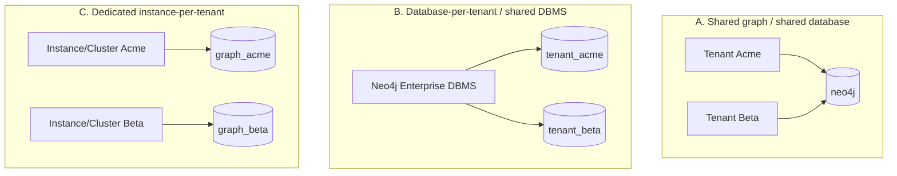
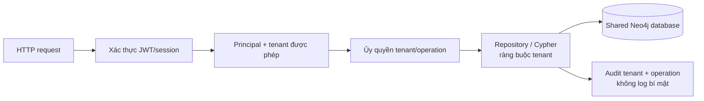
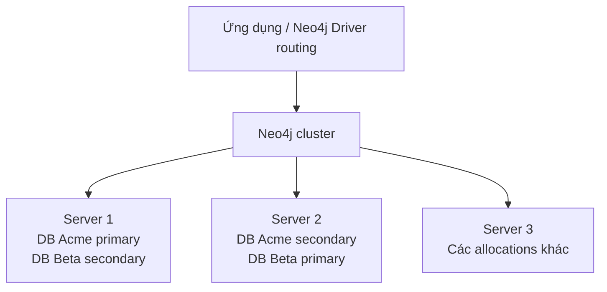
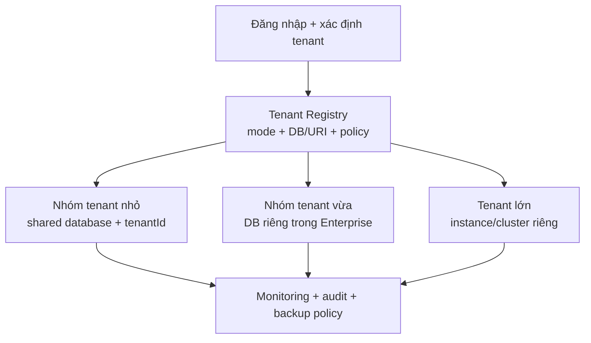

# Đánh giá đa cơ sở dữ liệu và cách ly khách hàng theo khả năng hỗ trợ của Neo4j

Một sản phẩm SaaS sử dụng Neo4j thường phục vụ **nhiều khách hàng/tổ chức độc lập** (*tenant*). Mỗi tenant có người dùng, đơn hàng, sản phẩm, giao dịch và mạng quan hệ riêng. Bài toán không chỉ là chọn nơi lưu node và relationship, mà còn phải trả lời:

- Dữ liệu của tenant A có thể bị truy vấn, sửa hoặc duyệt đường đi từ tenant B không?
- Khi một tenant chạy truy vấn graph rất nặng, những tenant khác có bị chậm không?
- Có thể sao lưu, khôi phục, xóa dữ liệu và quản lý quyền **riêng** cho từng tenant không?
- Neo4j Community, Enterprise và các gói Aura hỗ trợ bao nhiêu database, quyền ở cấp database, cluster hoặc isolation thực tế?
- Chi phí của một nghìn tenant nhỏ khác gì với mười tenant doanh nghiệp lớn?

Bài thuộc chương **Cụm và mở rộng** của module **DATABASE_ENGINE_GRAPH_NEO4J**. Module này sử dụng Neo4j để mô hình hóa property graph, truy vấn node/relationship/đường đi bằng Cypher, quản lý index và constraint, tối ưu truy vấn, nhập dữ liệu, tích hợp Java Driver/Spring Data Neo4j và vận hành hệ thống đồ thị. Trọng tâm ở đây là **đánh giá đa cơ sở dữ liệu và cách ly khách hàng theo khả năng Neo4j thật sự hỗ trợ**, không mặc định mọi edition/plan đều có cùng tính năng.

Sau bài này, bạn sẽ biết cách chọn một trong các mô hình **shared graph**, **database-per-tenant** hoặc **dedicated instance**, hiểu ranh giới transaction và phân quyền, viết Cypher an toàn theo tenant, lựa chọn database bằng Driver, kiểm thử truy cập chéo tenant và xây quy trình di chuyển khi hệ thống lớn lên.

> **Bối cảnh phiên bản:** Nội dung dựa trên Neo4j hiện hành tới tháng 11/2026 và các tài liệu chính thức được dẫn ở cuối bài. Neo4j có nhiều edition, gói Aura và tính năng mới theo phiên bản; **hãy kiểm tra phiên bản, edition, license, plan và giới hạn cụ thể của môi trường trước khi áp dụng**. Các câu lệnh tạo nhiều database và cấp quyền chi tiết là ví dụ dành cho phiên bản hỗ trợ, **không chạy được nguyên xi trong Community Edition**.

## 1. Các khái niệm cần tách bạch

| Khái niệm | Ý nghĩa | Ví dụ |
| --- | --- | --- |
| **Tenant** | Khách hàng/tổ chức cần phân tách dữ liệu và quyền | Công ty Acme, công ty Beta |
| **Node / relationship** | Thành phần dữ liệu trong property graph | `(:Customer)-[:PLACED]->(:Order)` |
| **Standard database** | Một database lưu graph và là ranh giới transaction thông thường | `tenant_acme` |
| **DBMS / Neo4j instance** | Hệ quản trị chứa database và quản lý metadata/hệ thống | Một tiến trình Neo4j Enterprise |
| **`system` database** | Lưu metadata quản trị, user/role và thông tin DBMS | Không phải graph tenant nghiệp vụ |
| **Cluster** | Nhiều server tham gia vận hành database theo topology được hỗ trợ | Các primary/secondary allocations |
| **Database alias** | Tên tham chiếu để định tuyến tới database | Alias ứng dụng cho database thật |
| **Home database** | Database mặc định của user khi client không chọn | `tenant_acme` |
| **Isolated instance** | Tenant có runtime/compute/DBMS tách riêng | Một Neo4j deployment cho Acme |

**Đa database không đồng nghĩa đa instance.** Một DBMS Enterprise có thể quản lý nhiều standard database, nhưng chúng vẫn có thể cùng chạy trên **một máy/cluster, chia sẻ CPU, RAM, ổ đĩa và thành phần vận hành**.

**Đa tenant không đồng nghĩa đa database.** Một database có thể chứa dữ liệu nhiều tenant nếu mọi node, relationship và thao tác được thiết kế kiểm soát tenant đúng cách.

**Một database không phải một namespace label.** Trong một shared database, label `:Customer` được dùng chung; muốn tách tenant bằng property, ứng dụng phải thể hiện ranh giới trong khóa và truy vấn.

### 1.1. Phân biệt data plane và control plane

- **Data plane:** những câu `MATCH`, `MERGE`, `SET`, giao dịch và đường đi được thực thi trên dữ liệu graph.
- **Control plane:** tạo/xóa database, quản lý account/role, phân bổ database lên cluster, backup và monitoring.

Trong Neo4j, database `system` gắn với control plane. Dữ liệu nghiệp vụ thường ở standard database. Không dùng `system` để lưu node khách hàng chỉ vì nó có mặt trong mọi cài đặt.

## 2. Khả năng đa database phụ thuộc edition và gói dịch vụ

Không thể thiết kế `CREATE DATABASE tenant_a` mà chưa biết đang chạy Neo4j bản nào.

| Môi trường | Khả năng nhiều standard database người dùng | Cách hiểu thực tế |
| --- | --- | --- |
| **Neo4j Community Edition** | **Chỉ một standard database** cho dữ liệu người dùng | Không dùng database-per-tenant trong *cùng instance Community* |
| **Neo4j Enterprise Edition self-managed** | **Nhiều standard database** | Bị chi phối bởi `dbms.max_databases`, tài nguyên, license và giới hạn môi trường |
| **AuraDB Business Critical** | Hỗ trợ nhiều database trong một instance theo tính năng/gói được bật | Database dùng chung compute/memory instance và có giới hạn theo RAM/plan |
| **AuraDB Virtual Dedicated Cloud** | Hỗ trợ nhiều database trong một instance theo tính năng/gói được bật | Có giới hạn instance và điều kiện dịch vụ riêng |
| **Các gói Aura khác** | **Không tự giả định** có multiple databases | Xem khả năng và giới hạn công bố cho gói đang dùng |

Theo tài liệu Neo4j Operations Manual hiện hành, Community Edition có **đúng một standard database**; Enterprise Edition quản lý được nhiều standard database. Enterprise có setting `dbms.max_databases`, mặc định hiện hành là **100** (bao gồm database online/offline trong giới hạn cấu hình), nhưng đây không phải lời hứa rằng một server có đủ tài nguyên để chạy 100 database nặng.

Ở AuraDB, tài liệu multiple databases hiện nêu **Business Critical** và **Virtual Dedicated Cloud**. Giới hạn hiện tại phụ thuộc RAM, mặc định tối đa **5 database/GB RAM**, với mức trần gói tương ứng **100** và **250** database. Đây là **giới hạn sản phẩm tại thời điểm đối chiếu**, không phải công thức capacity planning hoặc quota bảo đảm hiệu năng cho mỗi tenant. Khi tạo instance cần xác minh tính năng đã bật và điều kiện plan.

**Đừng nhầm phiên bản cú pháp với khả năng sản phẩm.** Một bài viết có lệnh `CREATE DATABASE` không có nghĩa tài khoản Community/Free của bạn chạy được lệnh ấy.

### 2.1. Kiểm tra môi trường trước khi chọn thiết kế

Một checklist thực tế:

1. Phiên bản Neo4j, Community hay Enterprise, self-managed hay Aura?
2. Có được phép tạo/xóa standard database không?
3. Số database tối đa, giới hạn RAM/CPU và số lượng người dùng thực tế?
4. Có **RBAC** và database-scoped privileges không?
5. Cách cấp quyền thông qua native user, SSO hay identity provider?
6. Có backup/restore độc lập từng database không?
7. Có cluster topology/allocations và tính năng routing tương ứng không?
8. Có composite database hoặc loại database khác, và chúng có hỗ trợ use case không?
9. Chi phí của mỗi database/instance, plugin/GDS và vận hành như thế nào?

Câu lệnh quan sát cơ bản với tài khoản có quyền phù hợp:

```cypher
SHOW DATABASES
YIELD name, type, currentStatus, requestedStatus, access
RETURN name, type, currentStatus, requestedStatus, access
ORDER BY name;
```

Kết quả hiển thị phụ thuộc quyền của user; một user chỉ được cấp quyền tenant A có thể không thấy tất cả database khác. **Không thấy tenant B trong danh sách không chứng minh mọi cách truy cập sang B đều đã bị chặn**: cần kiểm thử truy cập thực.

## 3. Năm lớp “cách ly” cần đánh giá

Người thiết kế thường nói “dữ liệu đã cách ly” nhưng mỗi bên đang nói tới một điều khác nhau.

| Lớp | Câu hỏi đánh giá | Shared database | Database riêng trong cùng DBMS | Instance riêng |
| --- | --- | --- | --- | --- |
| **Cách ly logic** | Query có nhìn thấy node tenant khác không? | Phụ thuộc bộ lọc/chính sách | Có ranh giới database rõ hơn | Rõ hơn theo instance |
| **Cách ly quyền** | Identity tenant A có được đọc/ghi B không? | App/RBAC tùy capability | Database-scoped RBAC khi hỗ trợ | Credential/instance riêng |
| **Cách ly transaction** | Một transaction có ghi cả hai tenant không? | **Có thể**, nếu code cho phép | Không có transaction thông thường xuyên nhiều standard database | Không có transaction xuyên instance |
| **Cách ly tài nguyên** | Query nặng của A có chiếm CPU/RAM B không? | Có nguy cơ lớn | **Vẫn chia sẻ** instance/cluster | Cách ly mạnh hơn khi compute riêng |
| **Cách ly vận hành** | Có backup/restore/upgrade riêng không? | Phức tạp; dữ liệu trộn | Thuận tiện hơn ở cấp database | Dễ tách lịch, nhưng vận hành nhiều instance |

Database riêng trong cùng DBMS là **ranh giới dữ liệu/transaction tốt hơn** một field `tenantId` được kiểm soát bằng code, nhưng **không phải ranh giới compute cứng**. Một câu truy vấn mở rộng quá nhiều relationship vẫn có thể gây áp lực heap/page cache và CPU chung.

Đối với môi trường chịu yêu cầu pháp lý, cần kiểm tra cả **mã hóa khóa theo tenant, backup, region residency, quyền quản trị host và operator**. Database-per-tenant có thể không đáp ứng yêu cầu “mỗi khách hàng có môi trường và khóa mã hóa riêng”.

## 4. Ba kiến trúc multi-tenant phổ biến



### A — Cùng một graph, phân biệt bằng `tenantId`

Tất cả dữ liệu nằm trong một standard database. Node có `tenantId`; query và khóa phải ràng buộc tenant.

**Ưu điểm:**
- Hoạt động trong Community Edition và các gói chỉ cho một user database.
- Không tăng số database tương ứng số tenant.
- Dễ chia sẻ cùng cấu trúc index, constraint và migration.
- Phù hợp với **rất nhiều tenant nhỏ**, workload tương đồng, quy trình vận hành tập trung.

**Hạn chế:**
- Bỏ sót một bộ lọc ở query có thể gây **lộ dữ liệu xuyên tenant**.
- Một transaction có thể vô tình tạo relationship nối hai tenant.
- Khó restore “chỉ dữ liệu tenant A” bằng thao tác database-level.
- Backup, page cache, log và tài nguyên thường dùng chung.
- Một phép `MATCH` mở rộng đường đi có thể đi qua node tenant khác nếu không kiểm soát toàn bộ path.

### B — Mỗi tenant một standard database trong cùng DBMS

Ví dụ `tenant_acme`, `tenant_beta` là hai database do Neo4j Enterprise quản lý. Client phải **chọn database đúng**; RBAC chỉ cho tài khoản phù hợp truy cập database được cấp.

**Ưu điểm:**
- Ranh giới database rõ, giảm rủi ro query bình thường đọc lẫn dữ liệu.
- Index/constraint độc lập mỗi database; dễ đặt schema lifecycle theo tenant hơn.
- Backup/restore, theo dõi và xử lý sự cố có thể gắn với database cụ thể.
- Transaction thông thường không ghi hai standard database cùng lúc.
- Không cần tạo nhiều Neo4j process riêng như dedicated instances.

**Hạn chế:**
- Cần edition/plan hỗ trợ.
- Tenant vẫn cạnh tranh CPU, memory, disk, network và năng lực cluster.
- Nhiều database kéo theo overhead metadata, store, index, backup, migration và monitoring.
- Các truy vấn liên kết graph **xuyên tenant** trở nên khó hơn vì relationship không thể nối trực tiếp node thuộc hai standard database khác nhau.
- Ứng dụng phải kiểm soát mapping `tenantId -> database` và giữ nó nhất quán qua transaction.

### C — Mỗi tenant một instance/cluster riêng

Mỗi tenant có runtime, storage, identity và topology riêng; có thể đặt tenant có tải nặng trên hạ tầng riêng.

**Ưu điểm:**
- Cách ly tài nguyên và quyền quản trị tốt hơn khi network/host/compute được tách thực sự.
- Dễ điều chỉnh cấu hình, nâng cấp, lịch backup và region theo khách hàng.
- Phù hợp tenant lớn, yêu cầu hợp đồng cao hoặc có compliance đặc thù.

**Hạn chế:**
- Nhiều instance/cluster phải patch, monitor, backup, rotate secrets và vận hành.
- Tài nguyên nhàn rỗi và chi phí có thể tăng mạnh với hàng nghìn tenant nhỏ.
- Phân tích xuyên instance và di chuyển tenant phức tạp.
- Dedicated instance **vẫn cần HA/backup** nếu yêu cầu availability cao; một standalone riêng không tự thành HA.

## 5. Bảng đánh đổi theo quy mô tenant

| Tiêu chí | Shared graph | Database-per-tenant | Instance-per-tenant |
| --- | --- | --- | --- |
| Khả năng dùng Community cùng instance | **Có** | **Không** | Có thể dựng nhiều instance Community riêng, cần đánh giá license/vận hành |
| Số tenant nhỏ | Rất phù hợp khi code bảo vệ tốt | Overhead tăng theo số database | Overhead cao |
| Dữ liệu/schema khác nhau theo tenant | Khó hơn | Dễ quản lý khác biệt hơn | Linh hoạt nhất |
| Cách ly dữ liệu do database | Không | Có | Có |
| Cách ly compute cứng | Không | Không mặc định | Có thể, nếu cấp hạ tầng riêng |
| Cross-tenant relationship trực tiếp | Có thể có (cần chính sách) | Không có cạnh trực tiếp xuyên DB | Không có cạnh trực tiếp xuyên instance |
| Backup riêng tenant | Cần export/filter hoặc pipeline riêng | Theo khả năng backup DB | Theo instance |
| Truy cập bằng Java Driver | Một database, lọc `tenantId` | Chọn `withDatabase` mỗi session | Chọn URI/Driver theo tenant |
| Migrating schema | Một schema dùng chung | Chạy migration từng database | Chạy migration từng deployment |
| Rủi ro query thiếu filter | Cao nếu không kiểm soát | Thấp hơn trong đúng DB; mapping DB vẫn có thể sai | Mapping endpoint vẫn có thể sai |
| Noisy-neighbor | Cao | Còn hiện hữu | Có thể giảm mạnh |

**Không chọn phương án theo một thông số duy nhất** như “bao nhiêu tenant”. Còn phải xét kích thước graph, fan-out, kiểu truy vấn GDS, tenant có quyền tự tạo Cypher không, luật dữ liệu và mức độ có thể tự động hóa provisioning.

## 6. Thiết kế shared graph an toàn với khóa theo tenant

Xét một SaaS bán hàng. Hai tenant đều có mã khách hàng `C-101` và đơn hàng `O-901`. Nếu chỉ `MERGE (c:Customer {customerId:'C-101'})`, hệ thống có thể **gộp nhầm hai khách hàng của hai tổ chức**.

### 6.1. Khóa nghiệp vụ kết hợp

```cypher
CREATE CONSTRAINT customer_per_tenant IF NOT EXISTS
FOR (c:Customer)
REQUIRE (c.tenantId, c.customerId) IS UNIQUE;

CREATE CONSTRAINT order_per_tenant IF NOT EXISTS
FOR (o:Order)
REQUIRE (o.tenantId, o.orderId) IS UNIQUE;
```

Điểm cần hiểu:

- Khóa `(tenantId, customerId)` định danh một khách hàng **trong phạm vi tenant**.
- Uniqueness constraint trên một bộ property ngăn hai node có cùng bộ giá trị khi được cung cấp đầy đủ.
- **Uniqueness không mặc nhiên bảo đảm tất cả property đều phải tồn tại**. Cần validate dữ liệu và, nếu edition hỗ trợ, cân nhắc constraint tồn tại/node key tương ứng.
- Nếu nhiều loại thực thể cùng dùng một mã, cần label và khóa phù hợp cho từng loại.

### 6.2. Upsert an toàn khi tạo node

```cypher
MERGE (c:Customer {
  tenantId: $tenantId,
  customerId: $customerId
})
ON CREATE SET c.createdAt = datetime()
SET c.fullName = $fullName
RETURN c.tenantId AS tenantId,
       c.customerId AS customerId;
```

`$tenantId` phải được dịch vụ backend suy ra từ **principal đã được xác thực và được ủy quyền**, không tin trực tiếp một trường tenantId do client HTTP gửi.

Ví dụ nguy hiểm:

```cypher
// KHÔNG dùng nếu customerId không duy nhất toàn hệ thống.
MERGE (c:Customer {customerId: $customerId})
SET c.fullName = $fullName;
```

Nếu tenant Acme và Beta đều có `C-101`, câu sai có thể cập nhật nhầm node. Vì vậy **tenant phải nằm trong identity và trong mọi truy vấn quan trọng**, không chỉ trong header API.

### 6.3. Tạo relationship chỉ khi cả hai đầu mút thuộc cùng tenant

```cypher
MATCH (c:Customer {
  tenantId: $tenantId,
  customerId: $customerId
})
MATCH (o:Order {
  tenantId: $tenantId,
  orderId: $orderId
})
MERGE (c)-[:PLACED]->(o);
```

Nếu mã order hoặc customer không tồn tại trong tenant đang truy vấn, `MATCH` không trả hàng, nên quan hệ không được tạo. Đây là **chính sách fail-closed** tốt hơn việc tự sinh node không rõ nguồn.

**Cảnh báo:** `MERGE (c)-[:PLACED]->(o)` giúp thực hiện lại trên cùng mẫu trong nhiều trường hợp, nhưng **không tự giải quyết mọi race giữa writer đồng thời** khi chưa có chiến lược unique relationship/idempotency thích hợp. Với event stream, cần version/ordering và kiểm thử concurrency.

### 6.4. Truy vấn đường đi phải kiểm tra **mọi node trung gian**

Một lỗi tinh vi:

```cypher
// Sai nếu graph có khả năng tồn tại cạnh xuyên tenant:
// chỉ kiểm tra điểm bắt đầu và đích, bỏ qua node trung gian.
MATCH p =
  (a:Customer {tenantId: $tenantId, customerId: $customerId})
  -[:KNOWS*1..3]-
  (b:Customer {tenantId: $tenantId})
RETURN b.customerId;
```

Ví dụ path `Acme:A -> Beta:X -> Acme:B` vẫn có thể được trả nếu chỉ điểm đầu và cuối có tenant Acme.

Bổ sung điều kiện mọi node trong path:

```cypher
MATCH p =
  (a:Customer {tenantId: $tenantId, customerId: $customerId})
  -[:KNOWS*1..3]-
  (b:Customer)
WHERE all(n IN nodes(p) WHERE n.tenantId = $tenantId)
RETURN DISTINCT b.customerId AS relatedCustomer
LIMIT 100;
```

Điều kiện trên giữ kết quả path trong tenant. Nhưng **giới hạn depth và lọc sau khi mở rộng** không bảo đảm truy vấn luôn rẻ trên graph bậc lớn. Phòng ngừa tốt nhất là **không tạo các relationship xuyên tenant khi nghiệp vụ không cho phép**, đồng thời bổ sung điều kiện và test ở tầng truy vấn.

### 6.5. Nếu thật sự có liên kết xuyên tenant?

Một số mạng B2B có quan hệ giữa doanh nghiệp, sản phẩm hoặc giao dịch của hai khách hàng. Khi đó không thể đơn giản áp “mọi cạnh có hai đầu cùng tenant” cho toàn bộ domain.

Cần tách rõ:

- **Quan hệ nội bộ tenant:** được phép duyệt trong quyền của một tenant.
- **Quan hệ đã được chia sẻ:** có chính sách đồng ý, phạm vi tiết lộ và ủy quyền cụ thể.
- **Đối tượng công khai/toàn cục:** có danh tính và quyền truy cập riêng.
- **Cross-tenant analytics:** xử lý bằng dữ liệu đã được cho phép, có thể tách graph phân tích riêng.

Một query có thể nhìn thấy quan hệ toàn cục **không có nghĩa được phép đọc tất cả property của các tenant liên quan**.

## 7. Tầng ứng dụng là nơi thực thi quyền tenant khi dùng shared database

Trong mô hình shared graph, filtering trong code phải là một **bất biến an toàn**, không phải lời nhắc “nhớ thêm WHERE”.



Quy tắc gợi ý:

1. Xác thực người dùng hoặc workload, **không tin vào tenantId nguyên văn từ request**.
2. Tra danh sách tenant principal có quyền truy cập; nếu có “chuyển workspace”, kiểm tra quyền trước khi đổi tenant ngữ cảnh.
3. Truyền tenantId dưới dạng tham số Cypher **từ server-side authorization context**.
4. Dùng một layer chung để áp policy; review **mọi custom Cypher** đặc biệt là query path, `CALL`, import và job phân tích.
5. Kiểm tra trước khi tạo/move relationship, tránh liên kết chéo không mong muốn.
6. Phân biệt tài khoản admin vận hành với account API; không cấp quyền DBMS cho API.
7. Dùng audit log với mã tenant/operation và actor, không lưu token, mật khẩu hoặc dữ liệu nhạy cảm.

### “`WHERE c.tenantId = $tenantId`” có đủ không?

Không. Một truy vấn có thể bắt đầu ở node được lọc rồi đi qua relationship tới node không được lọc:

```cypher
MATCH (c:Customer {tenantId: $tenantId})
      -[:PLACED]->(o:Order)
RETURN o;
```

Nếu dữ liệu có relationship gắn sai, query vẫn có thể trả Order khác tenant. Cần bảo đảm cả **node đích**, **node trung gian** và **cạnh/điểm nối** tuân theo policy.

Ví dụ sửa:

```cypher
MATCH (c:Customer {tenantId: $tenantId})
      -[:PLACED]->(o:Order {tenantId: $tenantId})
RETURN o.orderId AS orderId,
       o.status AS status;
```

Tuy nhiên, phần an toàn nhất vẫn là **kết hợp validation trước khi ghi, query đúng và kiểm thử truy cập trái phép**, không chỉ đặt thêm một điều kiện ở màn hình báo cáo.

### Có nên dùng graph privileges để lọc tenant trong shared DB?

Neo4j Enterprise và các tier được hỗ trợ có **fine-grained RBAC** ở mức database, graph, label, relationship type và một số điều kiện dựa trên property (*property-based access control*). Có thể tận dụng để tăng cường lớp bảo vệ, nhưng:

- Kiểm tra chính xác **edition/plan và ngữ nghĩa privilege** trước khi thiết kế.
- Quyền đọc theo label/property không đồng nghĩa tự động có một policy tenant hoàn chỉnh cho mọi thao tác ghi, GDS/procedure hoặc service.
- Dữ liệu và thuộc tính có thể bị thay đổi, quyền cấp chồng chéo có thể tạo tác dụng không mong muốn.
- Với Community, không nên giả định có custom role và property-level policies như Enterprise.

Vì vậy, **RBAC là lớp phòng vệ bổ sung**, còn policy và ownership vẫn phải được kiểm thử ở tầng ứng dụng.

## 8. Thực hành nhiều database trên Enterprise Edition

Phần này **chỉ thực hành trên Neo4j Enterprise self-managed** (hoặc môi trường được xác nhận hỗ trợ tương đương); không dùng cho Community hoặc tự động suy ra từ các gói Aura.

### 8.1. Tạo hai database trong DBMS

Bằng tài khoản quản trị được cấp quyền, dùng Cypher administration:

```cypher
CREATE DATABASE tenant_acme IF NOT EXISTS;
CREATE DATABASE tenant_beta IF NOT EXISTS;
```

Các lệnh quản trị database được thực thi trong **ngữ cảnh `system` database** và thường được Bolt tự định tuyến phù hợp. Trong môi trường tool/client không hỗ trợ tự chuyển, chọn `system` làm database quản trị theo tài liệu.

Xem trạng thái:

```cypher
SHOW DATABASES
YIELD name, type, currentStatus, requestedStatus
WHERE name IN ['tenant_acme', 'tenant_beta']
RETURN name, type, currentStatus, requestedStatus
ORDER BY name;
```

Kỳ vọng từng database có `currentStatus = 'online'` trước khi bắt đầu truy vấn nghiệp vụ. Việc tạo database có thể có bước thực hiện bất đồng bộ; **đừng coi lệnh trả về mà chưa kiểm tra status là đã hoàn tất**.

**Rất nguy hiểm:** `CREATE OR REPLACE DATABASE tenant_acme` có thể **xóa database hiện có và tạo mới**, kéo theo mất dữ liệu/schema. Đừng dùng `OR REPLACE` để “idempotent” hóa script provisioning. `IF NOT EXISTS` là lựa chọn phù hợp hơn khi không muốn thay thế.

### 8.2. Dữ liệu ở từng database là độc lập

Chọn database `tenant_acme` ở client, sau đó:

```cypher
CREATE CONSTRAINT customer_id IF NOT EXISTS
FOR (c:Customer)
REQUIRE c.customerId IS UNIQUE;
```

```cypher
MERGE (c:Customer {customerId: 'C-101'})
SET c.fullName = 'Mai - Acme'
RETURN c.customerId, c.fullName;
```

Chuyển sang `tenant_beta`, tạo constraint cùng tên rồi thêm node cùng mã:

```cypher
CREATE CONSTRAINT customer_id IF NOT EXISTS
FOR (c:Customer)
REQUIRE c.customerId IS UNIQUE;
```

```cypher
MERGE (c:Customer {customerId: 'C-101'})
SET c.fullName = 'Mai - Beta'
RETURN c.customerId, c.fullName;
```

Hai node có cùng `customerId` nhưng nằm trong **hai database riêng**. Constraint cùng tên ở hai database không xung đột vì schema của từng standard database độc lập.

**Không phải database name là một phần của node property**. Khi database-per-tenant được thực hiện đúng, query thông thường không cần `tenantId` trên mọi node chỉ để phân tách dữ liệu; nhưng hệ thống vẫn nên lưu audit/ownership ở một **control-plane registry** và giữ mapping chính xác.

### 8.3. Cách chọn database khi thử thủ công

Trong `cypher-shell` có thể chỉ định database bằng tùy chọn `-d` khi kết nối. Neo4j Browser có lệnh chọn database theo UI/command của Browser, ví dụ `:use tenant_acme` trong phiên bản hỗ trợ. **`:use` là lệnh của công cụ Browser, không phải câu Cypher dùng trong Java Driver.**

Để tránh nhầm, khi chạy từng đoạn Cypher trên, xác minh database client đang kết nối **trước khi thêm dữ liệu**. Nếu để mặc định `neo4j`, có thể tạo node vào database mặc định và sau đó hiểu nhầm multi-tenancy đã hoạt động.

## 9. RBAC ở cấp database: ranh giới bảo mật rõ ràng hơn

Trên Enterprise hoặc tier Aura hỗ trợ, có thể gắn quyền truy cập riêng cho từng database.

Ví dụ quản trị trong môi trường **test**:

```cypher
CREATE ROLE acme_reader IF NOT EXISTS;

GRANT ACCESS
ON DATABASE tenant_acme
TO acme_reader;

GRANT MATCH {*}
ON GRAPH tenant_acme
TO acme_reader;
```

Ý nghĩa:

- `ACCESS` cho phép role kết nối với database.
- `MATCH {*}` cấp khả năng duyệt và đọc property trong phạm vi graph được chỉ định.
- Chưa cấp quyền ghi, thao tác user hoặc tạo database.
- Đây là **ví dụ về hai privilege**, không phải chính sách RBAC hoàn chỉnh.

### Rà soát quyền hiệu lực là bắt buộc

Một user có thể nhận **nhiều role** cùng lúc, bao gồm role mặc định hoặc role đã được gán trước đó. Nếu user Acme còn giữ role có quyền đọc `tenant_beta`, việc chỉ tạo `acme_reader` không tự xóa quyền cũ.

Cần:

1. Dùng user/service identity riêng theo tenant hoặc nhóm quyền.
2. Xem các role và privilege hiện có.
3. Loại bỏ quyền không cần thiết ở database khác.
4. Kiểm tra rõ **kết nối thành công tới tenant_acme nhưng thất bại tới tenant_beta**.
5. Thử cả thao tác đọc và ghi trái phép.
6. Phân biệt quyền quản trị DBMS/`system` và quyền dữ liệu thường ngày.
7. Đảm bảo secret của tenant không bị cấp nhầm cho workload khác.

Ví dụ kiểm tra quyền trong môi trường được phép:

```cypher
SHOW ROLE acme_reader PRIVILEGES AS COMMANDS;
```

**Không coi home database là bảo mật:** một user có `HOME DATABASE tenant_acme` chỉ được chọn database mặc định; nếu họ vẫn có quyền sang `tenant_beta` thì họ có thể kết nối bằng cách chọn database ấy.

### Quyền cấp theo database khác với quyền cấp theo tenantId

Trong mô hình database-per-tenant, role `acme_reader` có thể bị giới hạn vào database `tenant_acme`. Với shared database, một role có `ACCESS ON DATABASE neo4j` **không tự ngăn** truy vấn node chứa `tenantId='beta'`. Hai mô hình bảo vệ theo hai ranh giới khác nhau.

## 10. Java Driver: chọn đúng database theo tenant

Neo4j Java Driver hỗ trợ **database selection ở cấp session**. Hãy chọn database **tường minh** để tránh bị phụ thuộc vào default/home database của user và giúp routing hiệu quả hơn.

### 10.1. Resolver ánh xạ tenant → database

Dùng một registry được kiểm soát bởi server:

```java
import java.util.Map;

public final class TenantDatabaseRegistry {

    private final Map<String, String> allowedDatabases = Map.of(
        "acme", "tenant_acme",
        "beta", "tenant_beta"
    );

    public String databaseForAuthorizedTenant(String tenantId) {
        String database = allowedDatabases.get(tenantId);
        if (database == null) {
            throw new IllegalArgumentException("Unknown tenant");
        }
        return database;
    }
}
```

Đây là ví dụ tĩnh để dễ hiểu. Trong hệ thống thật, mapping thường nằm ở registry/control-plane có quyền quản trị, version và audit. **Không nhận trực tiếp tên database do request HTTP truyền** nếu chưa kiểm tra tenant principal có quyền truy cập.

### 10.2. Đọc một khách hàng từ database được chọn

```java
import java.util.List;
import java.util.Map;

import org.neo4j.driver.Driver;
import org.neo4j.driver.Session;
import org.neo4j.driver.SessionConfig;

public final class CustomerGraphService {

    private final Driver driver;
    private final TenantDatabaseRegistry registry;

    public CustomerGraphService(
        Driver driver,
        TenantDatabaseRegistry registry
    ) {
        this.driver = driver;
        this.registry = registry;
    }

    public List<String> findCustomerIds(
        String authorizedTenantId
    ) {
        // authorizedTenantId đã được xác nhận từ security context.
        String db = registry.databaseForAuthorizedTenant(
            authorizedTenantId
        );

        SessionConfig config = SessionConfig.builder()
            .withDatabase(db)
            .build();

        try (Session session = driver.session(config)) {
            return session.executeRead(tx ->
                tx.run("""
                    MATCH (c:Customer)
                    RETURN c.customerId AS customerId
                    ORDER BY customerId
                    LIMIT 100
                    """).list(record ->
                        record.get("customerId").asString()
                    )
            );
        }
    }
}
```

Những bảo đảm và giới hạn:

- `SessionConfig.withDatabase(db)` chọn standard database; không ghép database vào Cypher `MATCH`.
- `executeRead` dùng managed transaction có cơ chế xử lý lỗi transient phù hợp; với cluster, Driver có thể route đọc theo cấu hình.
- `Driver` được quản lý chung theo vòng đời ứng dụng, `Session` ngắn và không chia sẻ đồng thời giữa các luồng.
- `db` phải đến từ **registry được ủy quyền**, không từ payload tùy ý của client.
- Ví dụ không bao gồm authentication HTTP/tenant authorization; đây là tiền điều kiện cần thiết, **không phải tính năng Driver tự có**.
- **Cấp quyền database ở server vẫn là lớp bảo vệ quan trọng** nếu code resolver gặp lỗi.

Nếu dùng URI tới cluster, khả năng định tuyến còn phụ thuộc địa chỉ, cơ chế routing, read/write mode và edition. Không chỉ thay đổi `withDatabase` rồi nghĩ query sẽ được tự động chuyển đến một máy vật lý dành riêng cho tenant.

### Khi xử lý nhiều tenant trong một request

Một HTTP request được phép tổng hợp dữ liệu nhiều tenant không nên mở một transaction rồi cố gọi nhiều database. Thay vào đó, cần thiết kế **nhiều session/transaction** riêng, gom kết quả tại service hoặc cơ chế federated query được hỗ trợ.

Việc tổng hợp có thể có **độ mới và rủi ro partial failure**: tenant A đã cập nhật, tenant B chưa. Không có transaction ACID toàn cục mặc định giữa nhiều standard database.

## 11. Spring Data Neo4j: chọn database theo use case

Với ứng dụng chỉ phục vụ một database, Spring Boot thường cấu hình:

```yaml
spring:
  data:
    neo4j:
      database: tenant_acme
```

Trong môi trường nhiều tenant, SDN có interface **`DatabaseSelectionProvider`**, cho phép cung cấp tên database mà repository/template sẽ sử dụng. Tuy nhiên, cần thận trọng:

- Giá trị provider có thể được hỏi **trước mỗi tương tác** với repository/template.
- Nếu tenant context thay đổi giữa hai lời gọi trong cùng nghiệp vụ, data có thể được đọc/ghi vào **hai database khác nhau**.
- Thread-local đơn giản có thể không đúng với mã bất đồng bộ/reactive hoặc xử lý đa luồng.
- Một `@Transactional` cần ranh giới tenant/database **ổn định**, không chuyển tenant giữa transaction.
- Khi làm việc với nhiều database trong một workflow, cân nhắc chọn session/transaction tường minh ở tầng Driver/client thích hợp.

Pseudo-code ý tưởng (không phải cấu hình production hoàn chỉnh):

```java
import java.util.Optional;
import org.springframework.data.neo4j.core.DatabaseSelectionProvider;

// Provider phải được nối tới resolver thực sự gắn với security context.
// Không dùng một biến static toàn cục thay đổi theo request.
DatabaseSelectionProvider provider = () ->
    Optional.of(authorizedTenantDatabaseResolver.currentDatabase());
```

Trong ví dụ, `authorizedTenantDatabaseResolver` là **phụ thuộc do ứng dụng xây dựng**, không phải class có sẵn của SDN. Phải triển khai và đăng ký bean theo tài liệu SDN đúng phiên bản; đồng thời kiểm thử concurrency, reactive context và rollback khi có nhiều tenant.

**Điểm thiết kế:** Repository tiện cho object–graph mapping, nhưng không thay thế bộ điều phối tenant. Nếu use case có truy vấn path, báo cáo hoặc GDS phức tạp, `Neo4jClient`/Java Driver với database tường minh có thể phù hợp hơn.

## 12. Cluster và multi-database: phân bổ không đồng nghĩa tách tài nguyên

Một cluster Enterprise có nhiều server, mỗi database có các **allocations** được phân bổ theo topology: primary/secondary theo phiên bản và cấu hình cluster. Một DBMS/cluster có thể chứa nhiều database với vị trí hoạt động khác nhau.



Sơ đồ chỉ mô tả trực giác: topology thực phải được chỉ định bằng lệnh quản trị và xác minh theo edition/version, không phải một cấu hình cluster chuẩn áp dụng cho mọi deployment.

### 12.1. Điều gì được cải thiện?

- Phân bổ một database lên nhiều server có thể tăng khả năng sẵn sàng theo mô hình cluster.
- Một database có thể có nhiều bản sao/role để phục vụ đọc hoặc chịu failover theo topology được hỗ trợ.
- Có thể tổ chức placement khác nhau cho các database.
- Driver dùng routing URI `neo4j://` hoặc `neo4j+s://` và chế độ đọc/ghi thích hợp để chọn server theo thông tin cluster.

### 12.2. Điều gì **không** được bảo đảm?

- Nhiều database **không tự động tạo mỗi tenant một máy**.
- Cùng server có allocations của nhiều tenant thì họ **vẫn tranh CPU/RAM/I/O**.
- Một database chưa tự động bị sharding thành nhiều mảnh chỉ vì có primary/secondary.
- Secondary/copy không đồng nghĩa tất cả thao tác ghi đều được thực hiện ở mọi replica.
- Cluster không tự bảo vệ trước xóa nhầm logic; thay đổi đã commit có thể được nhân bản — **vẫn cần backup**.
- Số server tăng không bảo đảm query graph đơn lẻ bất kỳ chạy nhanh tương ứng.
- Việc thêm database không biến những query xuyên database thành một transaction ACID.

Vì thế **clustering** là một vấn đề về availability/routing/placement/scale; **multi-tenancy** là vấn đề về quyền, dữ liệu, tài nguyên và lifecycle. Hai vấn đề có giao điểm nhưng không thay thế nhau.

## 13. “Noisy neighbor”: tài nguyên dùng chung giữa các database

Trong cùng một instance/cluster, các database có thể chia sẻ:

- CPU và bộ lập lịch truy vấn.
- Heap JVM, page cache và native memory.
- I/O của ổ đĩa và network.
- Connection pool ở phía ứng dụng nếu dùng chung Driver và hạ tầng.
- Các job backup, import, GDS, migration hoặc full-text index.
- Quy trình restart và nâng cấp của server.

Giả sử tenant Acme chạy một query `MATCH p = ...*1..10` trên graph có bậc cao, trả nhiều path. Dù Beta ở database riêng, Acme vẫn có thể làm CPU/heap trên cùng server tăng, khiến Beta chậm.

### Chọn biện pháp theo bằng chứng

| Triệu chứng | Giải pháp xem xét | Không nên làm |
| --- | --- | --- |
| Query path nặng | Index cho điểm bắt đầu, giới hạn phạm vi, tối ưu Cypher/GDS | Coi database-per-tenant là đủ để giảm CPU |
| Batch nhập quá lớn | Chia batch, lập lịch, điều tiết concurrency | Tăng timeout vô hạn |
| Một tenant có tải cao liên tục | Chuyển tenant sang instance/cluster riêng | Giữ tất cả trên cùng host rồi hứa SLA cách ly cứng |
| Nhiều DB nhỏ gây overhead | Gom tenant nhỏ vào shared DB theo chính sách | Tạo một database cho từng trial user không cân nhắc |
| Backup đồng thời gây I/O | Lập lịch, giới hạn concurrency và storage phù hợp | Chạy backup mọi database một lúc không giám sát |
| GDS projection chiếm RAM | Giới hạn projection, quota/job scheduling theo kiến trúc | Coi named graph GDS là cách ly vật lý theo database |

### Capacity planning theo tổng workload, không theo “số database”

Gọi:

- `N` là số tenant.
- `G_i` là dung lượng graph+index của tenant `i`.
- `Q_i` là tải truy vấn/giây và độ nặng trung bình của tenant `i`.
- `P_i` là đỉnh tải đồng thời.
- `M_db` là overhead vận hành, metadata và bộ nhớ cho mỗi database.
- `B_i` là dung lượng/tần suất backup.

Một ước lượng tư duy:

\[
\text{Tổng nhu cầu lưu trữ}
\approx \sum_{i=1}^{N} G_i
+ \text{index/log/headroom/backup staging}
\]

\[
\text{Rủi ro contention}
\propto \text{tổng các đỉnh workload trùng thời điểm}
\]

Hai công thức là **mô hình tư duy**, không phải công thức sizing chính thức của Neo4j. Không nên quy đổi `N=100` thành “100 database chắc chắn chạy tốt”. Phải đo workload đại diện, graph bậc lớn, query plan và các trường hợp peak.

## 14. Backup, restore và xóa dữ liệu theo tenant

Khác biệt lớn giữa hai mô hình xuất hiện khi vận hành sự cố.

### 14.1. Shared database

Một backup database thường chứa **dữ liệu tất cả tenant**. Muốn phục hồi riêng tenant A về trạng thái ngày hôm qua:

- Có thể cần restore backup trên **instance tạm độc lập**.
- Trích xuất/chuyển dữ liệu tenant A theo khóa hợp lệ.
- Đối chiếu constraint, quan hệ, quyền chia sẻ và dữ liệu đã bị thay đổi sau thời điểm backup.
- Dùng quy trình import/reconciliation có idempotency.
- Tránh ghi đè dữ liệu mới hợp lệ của tenant khác.

**Không có câu `RESTORE TENANT A` mặc định** chỉ vì node có property `tenantId`.

### 14.2. Database-per-tenant

Có thể lập kế hoạch backup/restore theo **database cụ thể**, tùy edition/plan và công cụ hỗ trợ. Điều này đơn giản hơn cho những tenant cần RPO/RTO khác nhau, nhưng vẫn cần:

- Quản lý cả user/role và metadata quan trọng trong `system` DBMS.
- Kiểm tra quyền sau restore; data store và account/role không phải lúc nào được khôi phục trong cùng một artifact.
- Biết database nào ở server nào nếu dùng cluster.
- Bảo đảm backup/restore không ghi đè nhầm database tenant khác.
- Kiểm chứng compatibility của Neo4j và plugin.
- Kiểm tra chi phí storage khi số database và lịch backup tăng.

Với Aura multiple databases, khả năng backup/export/restore riêng từng database và giới hạn phụ thuộc gói. Không áp dụng nguyên xi lệnh `neo4j-admin` self-managed vào Aura nếu dịch vụ managed không cho truy cập file/store.

### 14.3. Không có một transaction nguyên tử xuyên standard database

Ví dụ hệ thống muốn chuyển một quyền sở hữu tài sản từ `tenant_acme` sang `tenant_beta`. Nếu ghi trong hai database:

1. Transaction A ghi/xóa trạng thái ở Acme.
2. Transaction B ghi/truy cập trạng thái ở Beta.

Nếu A commit và B thất bại, dữ liệu **tạm không nhất quán**. Không thể mặc định dùng một `@Transactional` hoặc một Cypher request để tạo transaction ACID gồm hai standard database.

Cần một **workflow phân tán**: sự kiện nghiệp vụ, outbox, idempotency, retry và đối soát; hoặc thiết kế dữ liệu sở hữu ở một hệ thống chuẩn rồi đồng bộ sang các graph đọc. Cách này đặc biệt quan trọng với thanh toán, quyền sở hữu, hạn mức hay dữ liệu phải audit.

## 15. Dữ liệu dùng chung và truy vấn xuyên database

Khi có một database riêng cho từng tenant, một node trong `tenant_acme` không thể tạo `:FOLLOWS` trực tiếp sang node nằm ở `tenant_beta` như một cạnh nội bộ cùng graph. Database là ranh giới graph/transaction.

Những lựa chọn:

| Nhu cầu | Cách tiếp cận |
| --- | --- |
| Dữ liệu dùng chung chỉ đọc như danh mục toàn cục | Replicate/sync bản read-only được kiểm soát, hoặc service danh mục chuẩn |
| Báo cáo tổng hợp giữa tenant | Query từng database rồi tổng hợp ở application/analytics layer |
| Duyệt quan hệ giữa hai tenant đã được phép | Thiết kế graph liên kết riêng hoặc shared graph được kiểm soát |
| Cần khóa định danh dùng chung | Dùng external/business ID, không dùng `elementId()` làm khóa xuyên DB |
| Cần JOIN graph đa database | Xem composite database/federation **nếu edition/plan hỗ trợ** |
| Cần ghi nguyên tử xuyên hai tenant | Xem lại ranh giới nghiệp vụ; không kỳ vọng atomic transaction xuyên DB |

### Composite database có giải quyết hết không?

Neo4j hỗ trợ **composite database** trong những môi trường phù hợp: một lớp truy vấn logic tham chiếu nhiều graph qua constituent aliases và `USE`. Có thể dùng để tổng hợp những kết quả được phép giữa các database.

Tuy nhiên:

- Composite database **không phải thao tác gộp physically toàn bộ node** vào một standard database.
- Composite query có giới hạn về ngữ nghĩa và graph-accessing operations.
- **Ghi vào nhiều constituent database trong cùng transaction không được phép** theo ngữ nghĩa hiện hành.
- Quyền truy cập, alias, identity và routing phải được cấu hình riêng.
- Không nên chọn composite chỉ để tránh thiết kế authorization giữa tenant.

Một ví dụ ý tưởng đọc tổng hợp có **phạm vi do hệ thống quản trị cấp**:

```cypher
// Ví dụ minh họa dạng composite/federated; chỉ chạy
// sau khi đã cấu hình constituents, aliases và quyền.
CALL {
  USE tenant_catalog.acme
  MATCH (c:Customer)
  RETURN count(c) AS customerCount
}
RETURN customerCount;
```

Ví dụ trên là **một constituent graph**, không phải truy vấn tự động qua mọi tenant. Tên constituent alias và quy tắc `USE` phải đúng với composite database đã cấu hình. Khi muốn tổng hợp nhiều graph, cần thiết kế các subquery và quyền được cấp; không cho client tự đặt graph name mà không được ủy quyền.

### Database aliases có phải ranh giới bảo mật không?

**Không.** Alias giúp quản lý tên/định tuyến, ví dụ chuyển từ database vật lý cũ sang mới mà giảm ảnh hưởng ứng dụng. Nhưng quyền **ACCESS** lên alias/database, kiểm tra mapping tenant và RBAC vẫn phải được giữ đúng. Alias không phải một cách miễn phí để cấp hoặc ẩn quyền tenant.

## 16. Khi nào chọn shared graph, khi nào tách database?

Không nhất thiết bắt đầu bằng database-per-tenant ngay ngày đầu.

### Phương án shared graph thường hợp lý khi:

- Có nhiều tenant nhỏ, cấu trúc graph giống nhau.
- Chi phí provisioning/vận hành cho một database mỗi tenant quá cao.
- Môi trường đang dùng Community hoặc gói chỉ một database.
- Khả năng lọc tenant được kiểm thử chặt, dữ liệu không thuộc nhóm bắt buộc cô lập vật lý.
- Không có yêu cầu restore riêng từng tenant với SLA rất khắt khe.

### Phương án database-per-tenant thường hợp lý khi:

- Enterprise/Aura tier hỗ trợ và chi phí được chấp nhận.
- Khách hàng cần ranh giới dữ liệu, quyền và backup rõ ràng hơn.
- Có thể tự động tạo DB, schema, account, secret và monitoring từng tenant.
- Các tenant không cần đường graph trực tiếp xuyên DB, hoặc quan hệ chia sẻ đã có mô hình riêng.
- Workload chia sẻ compute vẫn đáp ứng SLO.

### Dedicated instance/cluster thường hợp lý khi:

- Một vài tenant lớn có tải đặc thù, thường xuyên tranh tài nguyên với nhóm còn lại.
- Cần vùng địa lý, khóa mã hóa, cấu hình, mạng hoặc lịch nâng cấp riêng.
- Yêu cầu compliance hoặc hợp đồng đòi isolation mạnh hơn logical database.
- Có ngân sách và năng lực vận hành nhiều môi trường.
- Cần SLA/HA có cấu hình riêng và kiểm chứng độc lập.

### Hybrid: tenant nhỏ dùng chung, tenant lớn tách ra

Một kiến trúc thực tế:



Registry phải là **nguồn đáng tin** và được version hóa. Một sai sót trong mapping có thể đưa request đúng danh tính tới database của tenant khác; vì thế cần kiểm soát quyền ở cả service và database/instance.

Đừng xây quá nhiều chế độ multi-tenancy nếu đội ngũ chưa có năng lực test và vận hành chúng; hybrid tăng độ phức tạp routing, migration và incident response.

## 17. Di chuyển tenant từ shared graph sang database riêng

Khi tenant phát triển, có thể cần chuyển dữ liệu từ mô hình A sang B. Quy trình không chỉ là copy các node có `tenantId` đúng; relationship, khóa và sự kiện cập nhật trong quá trình chuyển cũng cần được xử lý.

### 17.1. Quy trình từng bước

1. **Kiểm kê:** label, relationship type, property, schema, tenantId, số node/cạnh, dữ liệu dùng chung.
2. **Đánh giá quyền:** xác định actor/service đang đọc/ghi tenant và nguồn dữ liệu chuẩn.
3. **Tạo database đích:** ví dụ `tenant_acme`, user/role và constraint/index riêng; giữ nguyên external IDs.
4. **Chụp mốc dữ liệu:** snapshot hoặc checkpoint/CDC có thể đối chiếu; không tạo khoảng trống sự kiện.
5. **Export/transform:** chỉ node được phép của tenant, chỉ cạnh hợp lệ, dữ liệu shared theo chính sách.
6. **Import vào database đích:** dùng khóa nghiệp vụ và `MERGE`/batch có kiểm soát; ghi version nguồn.
7. **Bắt kịp cập nhật mới:** replay sự kiện sau checkpoint, chống trùng/out-of-order.
8. **Đối soát:** số node, số cạnh, property quan trọng, unique constraints, truy vấn đường đi mẫu.
9. **Kiểm tra quyền:** user Acme đọc/ghi đúng DB; user Beta không truy cập được DB Acme.
10. **Cutover có kiểm soát:** cập nhật tenant registry, drain hoặc điều phối các request đang chạy.
11. **Quan sát và rollback plan:** giám sát lỗi, data drift, latency; nếu rollback phải có chiến lược dữ liệu phát sinh sau cutover.
12. **Decommission an toàn:** chỉ xóa dữ liệu tenant khỏi shared graph sau khi xác nhận đường phục hồi, retention và các nghĩa vụ hợp đồng.

### 17.2. Các rủi ro thường gặp

| Rủi ro | Biểu hiện | Phòng ngừa |
| --- | --- | --- |
| Thiếu node đầu mút | Import cạnh thất bại hoặc tạo placeholder sai | Node-first import, pending-link reconciliation |
| Cạnh nối ngoài tenant | Data leak hoặc mất liên hệ được phép | Chính sách shared/global graph rõ ràng |
| Trùng khóa | `MERGE` tạo node sai / constraint lỗi | Khóa nghiệp vụ chuẩn, uniqueness |
| Event trong lúc export | Database đích cũ hơn nguồn | Snapshot + CDC/checkpoint + replay |
| Hai nơi cùng nhận write | Dữ liệu khác nhau sau cutover | Single writer/epoch và quyền ghi được điều phối |
| Quyền DB đích chưa đúng | Tenant bị từ chối hoặc đọc nhầm | Negative tests và audit privileges |
| App giữ session cũ | Request vẫn ghi shared graph | Drain connection/session, chuyển registry có version |
| Rollback chỉ đổi mapping | Mất các write phát sinh sau cutover | Kế hoạch reverse-sync/reconciliation |
| Dữ liệu bị xóa quá sớm | Không có đường khôi phục | Backup + retention + phê duyệt xóa |

**Không dùng `elementId()` hoặc ID nội bộ store làm khóa để ghép thực thể khi chuyển sang DB mới**. Dùng business ID ổn định; một node có thể được Neo4j cấp ID nội bộ khác sau khi import/restore.

## 18. Onboarding, offboarding và vận hành theo tenant

### 18.1. Onboarding tenant mới

Với shared graph:

1. Tạo bản ghi tenant trong registry.
2. Cấp identity/role ở tầng ứng dụng.
3. Xác định default data và quyền chia sẻ.
4. Thực thi các thao tác khởi tạo node/cạnh với `tenantId` chính xác.
5. Chạy test truy cập chéo tenant trước khi mở cho người dùng.

Với database-per-tenant:

1. Kiểm tra quota/giới hạn số database và capacity.
2. Tạo DB, đợi `online`.
3. Chạy migration schema cho DB mới.
4. Tạo user/role/secret và grant quyền tối thiểu.
5. Ghi mapping tenant→database trong registry.
6. Kiểm tra connectivity và truy vấn mẫu.
7. Thiết lập backup/retention/metrics.
8. Mở phục vụ và kiểm tra negative authorization.

**Không cấp account admin DBMS cho service onboarding nếu có thể dùng job được kiểm soát**. Công việc tạo/xóa database cần đặc quyền cao, nên tách khỏi request handler thường ngày.

### 18.2. Offboarding và yêu cầu xóa dữ liệu

- **Shared graph:** tìm toàn bộ node/cạnh thuộc tenant, dữ liệu shared, bảng ánh xạ, cache, log, backups và tuân thủ retention. `DETACH DELETE` không tự xử lý dữ liệu đã copy sang downstream.
- **Database-per-tenant:** `DROP DATABASE` giúp xóa phạm vi DB rõ hơn nhưng là thao tác **phá hủy dữ liệu**; cần xác minh đúng tenant, phê duyệt, backup/retention và xóa account/alias liên quan.
- **Instance-per-tenant:** xóa deployment/volume/secret/network theo quy trình, tránh tạo orphan resources.

Trong production, không nên có API nhận `tenantId` rồi chạy `DROP DATABASE` trực tiếp. Dùng workflow nhiều bước, hai lần kiểm tra ID, audit, retention và khả năng khôi phục.

### 18.3. Tổ chức backup và observability

Mọi tenant cần metadata như:

| Thuộc tính registry | Ví dụ | Mục đích |
| --- | --- | --- |
| `tenantId` | `acme` | Khóa nghiệp vụ ổn định |
| `deploymentMode` | `SHARED_DB` / `MULTI_DB` / `DEDICATED` | Chọn chiến lược routing |
| `databaseName` | `tenant_acme` | Chọn database đúng |
| `instanceRef` | `cluster-east-01` | Chọn endpoint/Driver |
| `status` | `ACTIVE` / `MIGRATING` / `SUSPENDED` | Chặn route sai trong migration |
| `schemaVersion` | `12` | Theo dõi migration |
| `dataEpoch` | `7` | Phát hiện stale routing giữa các lần cutover |
| `backupPolicy` | `daily / 7d retention` | RPO và retention |
| `region` | `ap-southeast-1` | Residency và vận hành |
| `owner` | Nhóm vận hành | Trách nhiệm xử lý sự cố |

Registry có thể nằm ngoài Neo4j hoặc trong một control-plane service chuyên dụng. Nếu nằm trong Neo4j, phải bảo vệ khỏi việc tenant tự sửa mapping của chính mình.

## 19. Kiểm thử cách ly tenant bằng negative tests

**Một test truy cập thành công không đủ để chứng minh isolation.** Cần chứng minh những điều **không được phép** đã bị từ chối hoặc không trả dữ liệu.

### 19.1. Bộ dữ liệu test mẫu

- Tenant Acme có `Customer {customerId:'C-101'}` và Order `O-901`.
- Tenant Beta có **cùng** mã `C-101` và `O-901`, nhưng thuộc tính khác.
- Mỗi tenant có một đường đi nội bộ.
- Một fixture cố tình tạo **cạnh nối sai tenant** (chỉ trong test) để phát hiện query thiếu kiểm tra.
- Một user Acme chỉ có quyền thuộc tenant Acme.
- Một user quản trị test có thể kiểm tra cả hai để đối soát.

### 19.2. Ma trận kiểm thử

| Test | Shared graph | Database-per-tenant |
| --- | --- | --- |
| Acme đọc Customer C-101 | Chỉ nhận node `tenantId=acme` | Chỉ nhận node ở `tenant_acme` |
| Acme yêu cầu Beta qua body/header | Bị từ chối ở authorization | Registry/role không cho chọn DB Beta |
| Acme cập nhật Order Beta | 0 hàng hoặc lỗi quyền; Beta không đổi | Đọc/ghi sang `tenant_beta` phải bị từ chối |
| Duyệt path chứa node Beta | Không trả path trái phép | Không có path xuyên standard DB |
| Import event sai tenant | Validate và từ chối, không sinh cạnh | Kiểm tra mapping event→DB; không nhập sang DB khác |
| Người dùng có nhiều role | Kiểm tra quyền thực tế và policy | Kiểm tra grant/deny ở mọi database |
| Tài khoản app thử `CREATE DATABASE` | Không được phép | Không có DBMS privilege |
| Query nặng của Acme | Theo dõi noisy-neighbor | Kiểm tra vẫn có contention nếu cùng instance |
| Backup/restore tenant | Phải có quy trình lọc/đối soát | Thử restore đúng DB riêng |
| Cache và log | Cache key có tenant, log tránh lộ | Cache key có tenant+database, log an toàn |

### 19.3. Ví dụ assertion qua Java Driver cho DB riêng

```java
// Hai kết nối từ cùng user test Acme; tài khoản phải được
// cấu hình không có quyền ACCESS tới tenant_beta.
try (Session acme = driver.session(
        SessionConfig.builder()
            .withDatabase("tenant_acme")
            .build())) {

    long count = acme.executeRead(tx ->
        tx.run("MATCH (c:Customer) RETURN count(c) AS n")
          .single().get("n").asLong()
    );

    // Assert count theo fixture của Acme.
}

// Negative test: mở session tới tenant_beta với user Acme
// và assert lỗi authorization khi thực thi query.
// Không chỉ assert session() ném lỗi: Driver có thể
// kết nối/lấy metadata muộn tại lần run đầu tiên.
```

Đoạn trên là **minh họa test**, giả định đã import `Session`, `SessionConfig`, có `Driver` và JUnit assertions. Không cung cấp mật khẩu thật vào mã test.

**Với user có nhiều role, cần kiểm thử bằng đúng credential production-equivalent đã được cấp**, không dùng admin account rồi suy ra bảo mật của application user.

## 20. Hạn chế của privilege, không gian tên và tính năng mới

### 20.1. Không gian tên và quyền truy cập

- Database name chọn nơi truy vấn; nó **không phải tenant authorization claim**.
- Home database chỉ xác định default; không thay thế RBAC.
- Alias định tuyến; không thay thế ranh giới quyền.
- Label/relationship type không phải namespace tenant an toàn mặc định.
- Graph property-based policy chỉ hoạt động theo khả năng được edition/plan hỗ trợ, và cần kiểm chứng ngữ nghĩa với truy vấn thực tế.
- Mỗi user chỉ nên có quyền đúng workload; tài khoản admin không phải account API.

### 20.2. Một DBMS nhiều database không phải “một cluster cho mỗi tenant”

Một lệnh `CREATE DATABASE` tạo database mới theo khả năng sản phẩm, nhưng không tự cấp thêm host hoặc thêm CPU. Topology của database trong cluster có thể được cấu hình, nhưng phải xác minh server allocations và tình trạng tài nguyên.

### 20.3. Composite, sharding và replication là những khả năng khác

Các phiên bản Neo4j mới có thêm những mô hình như composite database, sharded property database và cross-cluster replica. **Không đánh đồng** các mô hình này với việc đặt mỗi tenant vào một standard database:

- Composite hỗ trợ truy cập nhiều graph theo kiểu federated, không tạo giao dịch ghi đa database nguyên tử.
- Sharding giải quyết một số vấn đề phân bổ dữ liệu của **một database** theo mô hình sản phẩm hỗ trợ, không tự sinh tenant isolation.
- Cross-cluster replica là cơ chế đọc/nhân bản giữa cluster trong phiên bản tương ứng, không phải thay cho backup hoặc tenant-level authorization.

Chỉ chọn các tính năng đó khi môi trường cụ thể hỗ trợ và yêu cầu thực tế cần. Đừng xây kiến trúc production trên feature mới mà chưa xác minh license, giới hạn và khả năng vận hành.

## 21. Một bảng quyết định thực tế

Giả sử nền tảng có ba nhóm khách hàng:

| Nhóm tenant | Đặc điểm | Phương án cân nhắc |
| --- | --- | --- |
| 2.000 tenant cá nhân/nhóm nhỏ | Mỗi tenant vài nghìn node, truy vấn tương tự | Shared DB + tenantId, kiểm soát truy cập nghiêm ngặt |
| 60 doanh nghiệp vừa | Graph riêng, cần backup/reconciliation từng tenant | Enterprise database-per-tenant, nếu RAM/limits phù hợp |
| 3 tổ chức lớn | Graph rất lớn, workload nặng, yêu cầu SLA/data residency riêng | Dedicated instance/cluster |

Đây là **tình huống minh họa**, không phải quy tắc Neo4j chính thức cho ngưỡng 2.000/60/3. Nếu 2.000 tenant nhỏ đều chạy thuật toán toàn graph đồng thời, shared DB có thể không đáp ứng. Nếu 60 doanh nghiệp có tải rất nhẹ, chi phí multi-DB có thể chưa hợp lý.

**Quy trình ra quyết định đề xuất:**

1. Chọn mức isolation về **an ninh, dữ liệu, tài nguyên và vận hành** mà hợp đồng yêu cầu.
2. Xác minh edition/plan Neo4j có cung cấp mức isolation đó không.
3. Định lượng graph size, write rate, độ dài path, peak concurrency và GDS memory.
4. Ước lượng chi phí DBMS, storage, backup, schema migrations, secrets và nhân sự vận hành.
5. Thiết kế tenant registry và authorization context.
6. Chạy proof-of-concept có **negative security tests**.
7. Đo p95/p99 và noisy-neighbor khi nhiều tenant hoạt động đồng thời.
8. Thử backup/restore riêng tenant và tenant migration.
9. Chọn một phương án với **điều kiện chuyển cấp** được định nghĩa trước.
10. Đánh giá lại khi workload, compliance, edition hoặc giá dịch vụ thay đổi.

## 22. Những sai lầm thường gặp

| Sai lầm | Hậu quả | Cách xử lý |
| --- | --- | --- |
| “Community tạo được nhiều DB vì có database `system`.” | Nhầm system DB với user DB | Community chỉ một standard database người dùng |
| “Mỗi tenant một database = cách ly CPU hoàn toàn.” | Noisy-neighbor, SLA sai | Đo tài nguyên chung; tách instance cho workload lớn |
| “Chỉ cần `@Transactional` để cập nhật hai database.” | Partial commit khi DB thứ hai lỗi | Thiết kế workflow phân tán/idempotency |
| “`CREATE OR REPLACE DATABASE` an toàn khi provisioning.” | Có thể xóa dữ liệu hiện có | Dùng `IF NOT EXISTS` và xác minh trạng thái |
| “Database name từ request là đáng tin.” | Route sang DB tenant khác | Resolver từ principal đã được ủy quyền |
| “User có home database A thì không truy cập B được.” | User vẫn có thể có role B | Kiểm tra quyền hiệu lực, test kết nối B |
| “Có `tenantId` trên node đầu/cuối là đủ.” | Path có thể đi qua node tenant khác | Kiểm tra toàn path và ngăn cạnh sai |
| “Uniqueness trên `customerId` bảo vệ shared graph.” | Gộp node của hai tenant có mã trùng | Composite key `(tenantId, customerId)` |
| “Không cần backup vì có cluster replica.” | Xóa nhầm/corruption có thể lan tới replica | Backup và restore drill |
| “Mọi gói Aura đều có multi-DB.” | Thiết kế không triển khai được | Kiểm tra plan/tính năng/tier |
| “Mỗi database có mặc định limit CPU/RAM riêng.” | Hiểu sai tài nguyên chia sẻ | Sizing theo instance và workload |
| “Composite cho phép ACID write xuyên tenant.” | Giả định transaction không tồn tại | Không có write đa database một transaction |
| “Di chuyển tenant chỉ là copy các node có tenantId.” | Mất cạnh, sai nguồn, bỏ sót event | Snapshot+CDC, kiểm tra cạnh, cutover |
| “Role grant mới tự vô hiệu quyền cũ.” | User còn nhiều role khác | Rà soát tất cả privilege và negative tests |
| “ID nội bộ Neo4j có thể dùng làm khóa xuyên DB.” | Không ổn định qua import/restore | Dùng business ID |
| “Xóa database là đã xóa hết mọi bản sao.” | Log, backup, cache và export còn dữ liệu | Offboarding có retention và audit |

## 23. Bài tập áp dụng

**Bài 1 — Nhận diện edition.** Một hệ thống đang dùng Neo4j Community có user database `neo4j` và database `system`. Có thể tạo thêm `tenant_beta` trong cùng DBMS không? Nếu muốn cô lập dữ liệu của hai tenant, nêu ít nhất hai kiến trúc thay thế.

**Bài 2 — Khóa theo tenant.** Acme và Beta cùng có `customerId='C-101'`. Hãy viết constraint và `MERGE` tránh gộp hai node. Giải thích vì sao chỉ dùng `customerId` là chưa đủ.

**Bài 3 — Đường đi xuyên tenant.** Graph có `A(acme)-[:KNOWS]->X(beta)-[:KNOWS]->B(acme)`. Một query chỉ lọc A và B bằng `tenantId='acme'` có trả B không? Viết điều kiện kiểm tra **mọi node trong path**.

**Bài 4 — Database-per-tenant.** Trên Enterprise, tạo `tenant_acme` và `tenant_beta`, sau đó viết các câu `SHOW DATABASES` kiểm tra trạng thái và câu lệnh cấp quyền đọc cho role của Acme. Nêu các kiểm thử âm cần chạy trước khi tuyên bố cách ly thành công.

**Bài 5 — Java Driver.** Viết một hàm resolver chuyển `tenantId` đã được xác thực thành database name từ registry cho phép, sau đó mở session với `SessionConfig.withDatabase`. Vì sao không lấy thẳng database name từ header HTTP?

**Bài 6 — Spring Data Neo4j.** Phân tích rủi ro khi một `DatabaseSelectionProvider` được điều khiển bởi biến static thay đổi theo request. Đề xuất cách giữ tenant/database ổn định trong transaction và với code bất đồng bộ.

**Bài 7 — Noisy-neighbor.** Hai database nằm trên cùng một Neo4j instance. Tenant A chạy query path nặng, tenant B có p99 tăng mạnh. Vì sao tách database chưa đủ? Đề xuất phép đo và phương án khắc phục.

**Bài 8 — Cross-database atomicity.** Một giao dịch nghiệp vụ muốn cập nhật dữ liệu trong Acme và Beta cùng lúc. Vì sao không thể mặc định đặt cả hai trong một transaction ACID? Thiết kế ý tưởng retry/idempotency/compensation.

**Bài 9 — Backup.** Tenant Acme cần restore dữ liệu riêng mà không tác động Beta. So sánh quy trình trên shared DB và database-per-tenant; nhắc đến `system` database, privileges và quyền backup.

**Bài 10 — Quy mô.** Với 1.000 tenant nhỏ và 5 tenant rất lớn, đề xuất mô hình shared, multi-DB hoặc dedicated. Điều kiện nào khiến bạn phải chuyển một tenant từ shared DB sang instance riêng?

**Bài 11 — Migration.** Phác thảo cách chuyển tenant Acme từ shared graph sang database riêng mà không làm mất thay đổi phát sinh trong lúc import. Tại sao việc chỉ copy snapshot là chưa đủ?

**Bài 12 — Tenant lifecycle.** Khi tenant yêu cầu xóa dữ liệu, những nơi nào ngoài graph store cần được kiểm tra? Làm thế nào để đảm bảo không xóa nhầm database của tenant khác?

### Checklist khi lựa chọn kiến trúc

- [ ] Đã xác định Neo4j edition, plan, license và giới hạn database hiện tại.
- [ ] Đã phân biệt **data isolation**, **authorization**, **transaction isolation**, **resource isolation** và **operational isolation**.
- [ ] Nếu shared DB, mọi node cần phân tách có khóa tenant đúng và composite constraints.
- [ ] Mọi query đường đi và relationship được kiểm tra tránh vượt tenant trái phép.
- [ ] TenantId được lấy từ identity đã ủy quyền, không tin input tự khai báo.
- [ ] Nếu multi-DB, app chọn database tường minh, role được cấp đúng database.
- [ ] Đã chạy negative tests với user chỉ có quyền của một tenant.
- [ ] Ranh giới transaction không dựa vào giả định ACID xuyên database.
- [ ] Đã đo noisy-neighbor theo CPU, memory, I/O và p95/p99.
- [ ] Backup, restore, migration và offboarding được thiết kế theo tenant.
- [ ] Có registry ánh xạ tenant→mode→database/instance an toàn và version hóa.
- [ ] Có kế hoạch tenant lớn chuyển sang dedicated instance/cluster khi cần.
- [ ] Không dùng `CREATE OR REPLACE DATABASE` hoặc `DROP DATABASE` như thao tác khởi tạo thông thường.
- [ ] Đã kiểm tra lại khả năng/giới hạn theo phiên bản trước khi triển khai thực tế.

## 24. Tài liệu đối chiếu

Các nguồn chính thức giúp xác minh cú pháp và khả năng theo **edition, version và plan Neo4j tại thời điểm triển khai**:

- [Neo4j Operations Manual — Database administration](https://neo4j.com/docs/operations-manual/current/database-administration/): standard database, `system` database, giới hạn Community/Enterprise và ranh giới transaction.
- [Neo4j Operations Manual — Create databases](https://neo4j.com/docs/operations-manual/current/database-administration/standard-databases/create-databases/): `CREATE DATABASE`, `IF NOT EXISTS`, cảnh báo `OR REPLACE`.
- [Neo4j Operations Manual — Show databases](https://neo4j.com/docs/operations-manual/current/database-administration/standard-databases/listing-databases/): trạng thái, database allocations và phạm vi nhìn thấy theo quyền.
- [Neo4j Operations Manual — Database privileges](https://neo4j.com/docs/operations-manual/current/authentication-authorization/database-administration/): `GRANT ACCESS` và các quyền ở cấp database.
- [Neo4j Operations Manual — Read privileges](https://neo4j.com/docs/operations-manual/current/authentication-authorization/privileges-reads/): `TRAVERSE`, `READ`, `MATCH` và property-based access control theo edition.
- [Neo4j Operations Manual — Clustering databases](https://neo4j.com/docs/operations-manual/current/clustering/databases/): primary/secondary allocations và phân bổ database trong cluster.
- [Neo4j Operations Manual — Configuration settings](https://neo4j.com/docs/operations-manual/current/configuration/configuration-settings/): setting `dbms.max_databases` và các cấu hình vận hành.
- [Neo4j Aura — Multiple databases](https://neo4j.com/docs/aura/managing-instances/multiple-databases/): tier được hỗ trợ, giới hạn theo RAM, cách quản lý và backup/restore.
- [Neo4j Java Driver Manual — Transactions and database selection](https://neo4j.com/docs/java-manual/current/transactions/): `SessionConfig.withDatabase` và managed transactions.
- [Spring Data Neo4j — DatabaseSelectionProvider API](https://docs.spring.io/spring-data/neo4j/docs/current/api/org/springframework/data/neo4j/core/DatabaseSelectionProvider.html): chọn database cho repository/template và các lưu ý về context.
- [Neo4j Operations Manual — Composite database queries](https://neo4j.com/docs/operations-manual/current/scalability/composite-databases/querying-composite-databases/): federated queries và giới hạn cập nhật đa graph.

**Ghi nhớ:** không có một cách “mỗi khách hàng một graph” phù hợp cho mọi Neo4j edition và workload. **Community** thường yêu cầu chia sẻ một database hoặc vận hành các instance riêng; **Enterprise và các gói Aura hỗ trợ** cho phép database-per-tenant nhưng vẫn chia sẻ tài nguyên ở cấp instance; còn **dedicated instance/cluster** tăng mức cách ly với chi phí vận hành cao hơn. Thiết kế tốt phải đồng thời bảo vệ **danh tính tenant**, **đường đi Cypher**, **quyền DB**, **ranh giới transaction**, **tài nguyên và khả năng khôi phục**.
