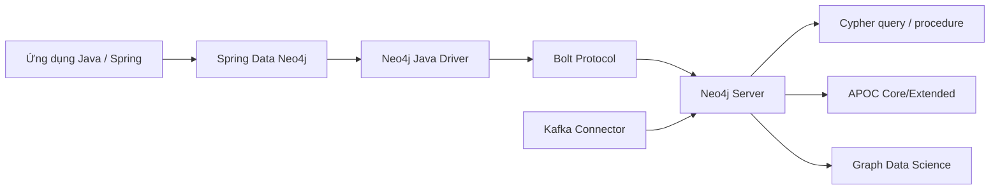
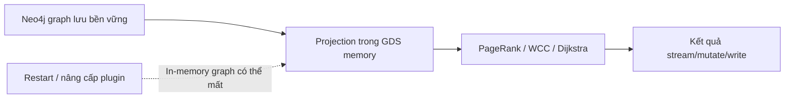
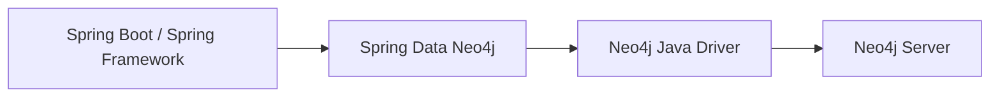
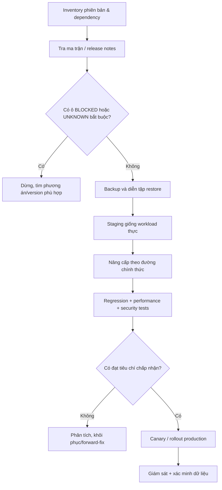

# Đọc ma trận tương thích máy chủ, driver, Cypher và phần mở rộng trong Neo4j

Khi nâng cấp Neo4j, câu hỏi “server mới có chạy được ứng dụng cũ không?” thường **không có một đáp án có/không duy nhất**. Kết nối Bolt có thể thành công nhưng một câu Cypher cũ bị thay đổi cú pháp; Java Driver có thể hoạt động với server mới nhưng phiên bản Java runtime không đáp ứng yêu cầu; hoặc APOC, Graph Data Science (GDS) chưa có bản tương thích với Neo4j đang định triển khai.

Bài thuộc chương **Nâng cấp và di trú** của module **DATABASE_ENGINE_GRAPH_NEO4J**. Module sử dụng Neo4j để mô hình hóa **property graph**, truy vấn node, relationship và đường đi bằng **Cypher**, đồng thời tích hợp **Neo4j Java Driver**, **Spring Data Neo4j** và những thành phần mở rộng. Mục tiêu của bài là biết **đọc, đối chiếu và ghi nhận bằng chứng từ nhiều ma trận tương thích** trước khi đổi phiên bản một hệ thống graph đang phục vụ người dùng.

> **Nguyên tắc quan trọng:** Không suy đoán rằng các thành phần cùng mang số major, ví dụ “5.x”, đương nhiên tương thích. Các tài liệu hỗ trợ thay đổi theo bản phát hành, edition và mô hình triển khai. Bài này hướng dẫn **phương pháp tra và xác minh**, không tự lập bảng khẳng định tất cả cặp phiên bản cụ thể đều được nhà sản xuất hỗ trợ.

Sau bài học, bạn có thể:

- Phân biệt **khả năng kết nối**, **hỗ trợ chính thức**, **tương thích cú pháp** và **tương thích hành vi**.
- Đọc ma trận cho **Neo4j Server**, **Bolt/Java Driver**, **Cypher**, **APOC/GDS** và các framework/connector liên quan.
- Thu thập phiên bản runtime và nhận diện dependency thực tế của ứng dụng.
- Lập bảng `current → target` với bằng chứng, điều kiện edition và trạng thái kiểm thử.
- Thiết kế thử nghiệm trên staging, nâng cấp theo đường đi được hỗ trợ và phương án khôi phục.
- Chẩn đoán lỗi sau nâng cấp mà không tự động quy mọi sự cố về “Neo4j không tương thích”.

## 1. Vì sao không có một “ma trận duy nhất”?

Một hệ thống Neo4j production có thể có nhiều lớp:



Mỗi đường kết nối có câu hỏi tương thích riêng:

| Cặp cần kiểm tra | Câu hỏi chính | Nguồn thông tin ưu tiên |
| --- | --- | --- |
| **Server cũ → server mới** | Có đường nâng cấp trực tiếp? Có thay đổi store format, backup, clustering? | Neo4j Operations Manual, upgrade guide, release notes |
| **Java Driver ↔ Server/Bolt** | Driver có hỗ trợ server và tính năng giao thức cần dùng? | Driver compatibility/installation/upgrade docs |
| **JDK ↔ Java Driver/SDN** | Runtime Java có đáp ứng yêu cầu của thư viện? | Driver release requirements, Spring Data/Boot requirements |
| **Cypher query ↔ Server/Cypher version** | Query có parse, chạy và giữ đúng kết quả/ngữ nghĩa? | Cypher Manual, deprecations/removals, query migration guide |
| **APOC ↔ Neo4j** | JAR và procedure/function có phù hợp Neo4j đích? | APOC installation/version compatibility docs |
| **GDS ↔ Neo4j** | Phiên bản GDS hỗ trợ server, edition, Java và thuật toán đang dùng? | GDS installation/compatibility/algorithm docs |
| **Spring Data Neo4j ↔ Driver/Neo4j** | Bộ phiên bản framework/driver và Spring Boot có được hỗ trợ cùng nhau? | SDN reference, Spring Boot dependency management |
| **Kafka Connector ↔ Kafka Connect/Neo4j** | Connector, runtime Kafka Connect và Neo4j đích có khớp yêu cầu? | Tài liệu connector của đúng bản phát hành |

Với hệ thống dùng **Aura**, không mặc định mọi APOC procedure hoặc khả năng cài GDS đều giống self-managed. **Edition, gói dịch vụ và mô hình vận hành** là những chiều khác của ma trận.

## 2. Bốn mức độ tương thích phải phân biệt

Dù hai thành phần kết nối thành công, chúng chưa chắc đáp ứng cùng một mức độ tương thích.

| Mức | Ý nghĩa | Ví dụ |
| --- | --- | --- |
| **Supported** | Nhà cung cấp tài liệu hóa cặp phiên bản/đường nâng cấp được hỗ trợ | Driver nằm trong dải server được ghi rõ trong tài liệu phiên bản |
| **Protocol-compatible** | Hai đầu có thể bắt tay và giao tiếp qua Bolt | `verifyConnectivity()` thành công |
| **Feature-compatible** | Những cú pháp, procedure, thuật toán và transaction option cần dùng thực sự có | Query chạy được, `gds.*` có procedure tương ứng |
| **Behavior-compatible** | Kết quả, thứ tự, ràng buộc, hiệu năng và transaction semantics còn đúng nghiệp vụ | Cùng một query trả đúng các node/relationship mong đợi |

**Không được suy ra supported từ việc “test một query thấy chạy được”.** Một cặp phiên bản có thể chạy trong thử nghiệm nhưng nằm ngoài phạm vi hỗ trợ chính thức, thiếu sửa lỗi bảo mật hoặc gặp sự cố khi retry/routing trong cluster.

Tương tự, một cặp được công bố hỗ trợ **không bảo đảm** mọi query ứng dụng tự tương thích: query có thể dùng API đã deprecated hoặc procedure của plugin khác.

### Một tình huống dễ nhầm

- Ứng dụng gọi `driver.verifyConnectivity()` → thành công.
- Sau đó gọi `CALL gds.pageRank.stream('customers')` → thất bại vì GDS chưa được cài, bị vô hiệu hóa hoặc không khớp phiên bản.
- Kết luận đúng: **đường kết nối Driver–Server hoạt động**, nhưng **khả năng plugin/thuật toán chưa sẵn sàng**. Không nên tự động đổi driver chỉ vì thấy lỗi `gds.*`.

## 3. Cách đọc một ma trận phiên bản chính thức

Trước khi điền “tương thích”, hãy xác định bảng tài liệu đang nói về **thành phần nào** và **phạm vi hỗ trợ nào**.

### 3.1. Các cột cần đọc kỹ

| Trường trong tài liệu | Cách hiểu |
| --- | --- |
| **Component/version** | Sản phẩm và phiên bản được nói tới, có thể là dòng 5.x hoặc bản phát hành theo năm/tháng |
| **Compatible with** | Dải phiên bản đối tác được phép kết hợp, đôi khi có giới hạn patch |
| **Required minimum** | Phiên bản thấp nhất cần dùng, không phải phiên bản được khuyến nghị nhất trong mọi trường hợp |
| **Tested/verified** | Tổ hợp đã được kiểm thử theo tuyên bố tài liệu; chưa chắc mọi tổ hợp khác đều không chạy |
| **Deprecated** | Có thể còn dùng được nhưng được khuyến cáo chuyển đổi trước khi bị loại bỏ |
| **Removed/unsupported** | Không được dùng trong phiên bản đích theo đặc tả |
| **Edition/licensing** | Cần Enterprise, plugin license hoặc gói dịch vụ cụ thể |
| **Prerequisites** | JDK, hệ điều hành, store format, cấu hình cluster, thủ tục bổ trợ |
| **Upgrade path** | Có thể cần qua một hoặc nhiều phiên bản trung gian, backup/restore hoặc rebuild |
| **Release date/end of support** | Giai đoạn còn được duy trì/hỗ trợ; cần xem chính sách support của tổ chức |

Nếu cột chỉ ghi “latest”, thông tin đó **không đủ tái hiện quyết định sau sáu tháng**. Hãy ghi **số phiên bản cụ thể**, đường dẫn tài liệu chính thức, ngày truy cập và các ghi chú điều kiện.

### 3.2. Luôn xác minh phiên bản nguồn và đích

Đường nâng cấp là quan hệ có hướng:

```text
Phiên bản đang chạy (source) --> phiên bản dự định (target)
```

Không mặc định hỗ trợ nâng cấp từ `A → B` đồng nghĩa có thể **hạ cấp từ `B → A`**. Sau khi server mới đã chuyển đổi dữ liệu trên đĩa, thư viện, schema hoặc cấu trúc nội bộ có thể không tương thích ngược.

Phương án rollback thường phải dựa trên **backup/snapshot hợp lệ được tạo trước nâng cấp và quy trình restore đã được thử nghiệm**, không phải thay container image về phiên bản cũ rồi mở lại volume đã được phiên bản mới sử dụng.

### 3.3. Một ô trống không phải “tương thích”

Nếu bảng docs không nhắc tới cặp `Driver D` và `Server S`, hãy đánh dấu **CHƯA XÁC MINH**, không tự điền **PASS**. Tương tự, nếu docs của plugin chỉ ghi dải server mà không ghi runtime Java, cần kiểm tra requirement Java ở một nguồn khác.

## 4. Thu thập inventory phiên bản đang chạy

Trước khi đọc compatibility matrix, cần biết hệ thống **thực tế đang chạy gì**, không chỉ dựa vào file khai báo.

### 4.1. Neo4j Server và edition

Khi có quyền chạy thủ tục phù hợp:

```cypher
CALL dbms.components()
YIELD name, versions, edition
RETURN name, versions, edition;
```

Kết quả cho biết thành phần DBMS, danh sách phiên bản và edition. **Tên trường/cơ chế quyền phụ thuộc phiên bản**; với một số môi trường quản lý, cách xem phiên bản có thể qua console/driver metadata thay vì procedure tự do.

Kiểm tra database đích khi có quyền:

```cypher
SHOW DATABASES
YIELD name, currentStatus, requestedStatus
RETURN name, currentStatus, requestedStatus
ORDER BY name;
```

Không mặc định account chỉ đọc ứng dụng có quyền liệt kê database khác. Với môi trường đa database, cần ghi rõ **database mà app thực sự truy cập**, không chỉ phiên bản server.

### 4.2. APOC và GDS thực sự có mặt không?

Để xem một số procedure được hệ thống công bố:

```cypher
SHOW PROCEDURES
YIELD name, signature
WHERE name STARTS WITH 'apoc.'
RETURN name, signature
ORDER BY name
LIMIT 30;
```

```cypher
SHOW PROCEDURES
YIELD name, signature
WHERE name STARTS WITH 'gds.'
RETURN name, signature
ORDER BY name
LIMIT 30;
```

Với những function được cài:

```cypher
SHOW FUNCTIONS
YIELD name
WHERE name STARTS WITH 'apoc.'
   OR name STARTS WITH 'gds.'
RETURN name
ORDER BY name
LIMIT 30;
```

**Diễn giải đúng:**

- Không có kết quả có thể do **chưa cài**, **không được phép sử dụng**, **function/procedure không có ở phiên bản đó**, hoặc môi trường quản lý chỉ cho dùng tập con.
- `SHOW PROCEDURES` không bảo đảm mọi API đều **hoạt động đúng** với workload. Cần thử procedure cụ thể và xác minh parameter/return schema.
- Ở những bản có các function version tương ứng, `RETURN gds.version()` hoặc `RETURN apoc.version()` có thể giúp đối chiếu; chỉ gọi sau khi xác nhận function tồn tại và tài khoản có quyền.

Không dùng các procedure quản trị cũ bị deprecated/removed từ ví dụ trên Internet để thay thế kết quả inventory của chính hệ thống.

### 4.3. Java Driver, Spring và JDK

Trong dự án Java, cần xác định **phiên bản thực tế trên runtime classpath**:

- `org.neo4j.driver:neo4j-java-driver`.
- `org.springframework.data:spring-data-neo4j` nếu dùng SDN.
- Phiên bản **Spring Boot** và Java runtime (JDK).
- Các dependency chuyển tiếp khác có thể quản lý/ghi đè Driver.
- Phiên bản Kafka connector, GDS client hoặc thư viện APOC invocation nếu có.

Ví dụ những lệnh chỉ dùng để **kiểm tra dependency tại repo của chính ứng dụng** (không chạy trong workflow viết bài này):

```bash
# Maven: xem dependency tree và driver thực sự được resolve.
mvn dependency:tree -Dincludes=org.neo4j.driver:neo4j-java-driver

# Gradle: xem dependency theo runtime classpath.
./gradlew dependencies --configuration runtimeClasspath

# Java runtime đang chạy ứng dụng.
java -version
```

Một pom/Gradle declaration không nhất thiết là phiên bản cuối khi framework BOM, dependency management hoặc constraint đã can thiệp. **Runtime classpath và dependency lockfile** mới là nguồn kiểm chứng tốt cho thư viện đang dùng.

### 4.4. Bảng inventory mẫu

| Lớp | Current | Target | Bằng chứng cần thu |
| --- | --- | --- | --- |
| Server | Phiên bản thực chạy | Bản đề xuất | `dbms.components()`/console + release notes |
| Edition/deployment | Community/Enterprise/Aura | Giữ hay thay đổi | License/gói, quyền, feature availability |
| Java runtime | Phiên bản JDK triển khai | JDK mục tiêu | Runtime/manifest, yêu cầu của Driver/SDN |
| Java Driver | Bản resolved trong app | Bản dự kiến | Dependency tree, driver manual |
| Cypher | Cú pháp đang dùng | Mục tiêu truy vấn | Query inventory và Cypher Manual |
| APOC | Core/Extended + bản JAR | Bản plugin đích | Installation matrix, plugins thực tế |
| GDS | Version, thuật toán dùng | Version đích | Compatibility + license/memory |
| Spring Data | SDN + Boot | Bộ version đích | Support matrix của Spring |
| Kafka Connector | Bản connector & worker | Bản đích | Connector docs + Kafka runtime |

Chỉ sau khi inventory có bằng chứng mới tiến hành điền kết quả tương thích.

## 5. Đọc ma trận Neo4j Server và đường nâng cấp

Server migration không đơn thuần là thay image tag. Tùy phiên bản nguồn và đích, có thể thay đổi:

- **Format/metadata lưu trữ** của database.
- **Cấu hình** `neo4j.conf` và tên setting.
- **Schema/index/constraint** và thủ tục quản trị.
- **Cypher parser/planner/runtime** và các trường hợp cú pháp bị loại bỏ.
- **Cluster topology** và quy tắc rolling upgrade.
- **Compatibility của backup/dump**, yêu cầu restore hoặc migration tool.
- **Phiên bản JVM và hệ điều hành** được hỗ trợ.
- **Plugin load path, license và security policy**.

Đọc **upgrade guide đúng source/target**, không chỉ changelog của bản target. Nếu tài liệu yêu cầu đi qua bản trung gian, phải làm đúng hoặc thay đổi kiến trúc migration (chẳng hạn export/import theo tài liệu phù hợp).

### 5.1. Ba cách thay đổi hệ thống

| Phương án | Bản chất | Cần kiểm tra |
| --- | --- | --- |
| **In-place upgrade** | Thay Neo4j trên cùng môi trường lưu trữ | Store compatibility, downtime, backup, config/plugin |
| **Rolling upgrade cluster** | Thay dần thành viên theo thứ tự được hỗ trợ | Compatibility giữa member tạm thời, quorum, routing, thứ tự |
| **Side-by-side migration** | Dựng hệ mới, chuyển dữ liệu/traffic | Đồng bộ thay đổi, cutover, kiểm tra nhất quán, rollback dữ liệu |

**Không tự coi rolling upgrade luôn được hỗ trợ** giữa mọi major version. Neo4j có quy tắc riêng cho từng dải version và topology; nếu tài liệu không cho phép kết hợp member version ở trạng thái chuyển tiếp, kế hoạch cần thay đổi.

### 5.2. Lưu ý về format và rollback

Giả sử nguồn có backup trước khi upgrade. Một quy trình an toàn phải trả lời:

1. Backup được tạo bằng **công cụ và định dạng tương thích** với nguồn/đích nào?
2. Backup có chứa database cùng schema/constraints và dữ liệu cần thiết không?
3. Đã **thực sự restore** bản backup trên môi trường thử chưa?
4. Nếu ứng dụng đã ghi thêm dữ liệu sau cutover, rollback sẽ mất bao nhiêu thay đổi? RPO có chấp nhận không?
5. Có cần giải pháp **forward-fix** thay vì hạ cấp server không?

**Backup tồn tại** khác với **khả năng khôi phục đã được chứng minh**.

## 6. Driver và Bolt: “kết nối được” chưa đủ

**Bolt** là giao thức kết nối giữa driver và Neo4j. Java Driver có thể thương lượng khả năng giao thức theo tập mà nó và server cùng hỗ trợ; nhưng **khả năng thương lượng không tự đồng nghĩa** mọi tính năng được driver/framework hỗ trợ với server đích.

Đọc ma trận Neo4j Java Driver cần phân biệt:

| Chiều tương thích | Vấn đề cần xác minh |
| --- | --- |
| Driver ↔ Server | Dải phiên bản được hỗ trợ, khả năng Bolt và giới hạn tính năng |
| Driver ↔ Java Runtime | JDK tối thiểu, phiên bản JDK được kiểm thử |
| Driver ↔ Cluster/Routing | URI routing, discovery, bookmark, read/write session |
| Driver ↔ Transaction | Managed transactions, retry, timeout, error handling |
| Driver ↔ Data types | Chuyển đổi `DATE`, `DATETIME`, vector/kiểu dữ liệu mới |
| Driver ↔ App framework | API signature và dependency được Spring Data hoặc framework sử dụng |

**Đừng dùng quy tắc “server và driver phải trùng major” như tiêu chuẩn duy nhất.** Những cặp khác major có thể được hỗ trợ, trong khi một cặp cùng major vẫn không phù hợp vì patch, JDK, tính năng hoặc chính sách support.

### 6.1. Smoke test thực sự bằng Java Driver

Đoạn mã sau minh họa **bản kiểm tra tối thiểu**, không phải bộ kiểm thử compatibility đầy đủ:

```java
import org.neo4j.driver.AuthTokens;
import org.neo4j.driver.Driver;
import org.neo4j.driver.GraphDatabase;
import org.neo4j.driver.Session;
import org.neo4j.driver.SessionConfig;

import java.util.List;

public final class ServerVersionProbe {
    public record Component(
        String name, List<String> versions, String edition) {}

    public static List<Component> inspect(
            Driver driver, String database) {

        try (Session session = driver.session(
                SessionConfig.forDatabase(database))) {

            return session.executeRead(tx ->
                tx.run("""
                    CALL dbms.components()
                    YIELD name, versions, edition
                    RETURN name, versions, edition
                    """)
                  .list(record -> new Component(
                      record.get("name").asString(),
                      record.get("versions")
                          .asList(v -> v.asString()),
                      record.get("edition").asString()
                  ))
            );
        }
    }

    public static void main(String[] args) {
        String uri = System.getenv("NEO4J_URI");
        String username = System.getenv("NEO4J_USERNAME");
        String password = System.getenv("NEO4J_PASSWORD");
        String database = System.getenv("NEO4J_DATABASE");

        try (Driver driver = GraphDatabase.driver(
                uri, AuthTokens.basic(username, password))) {

            driver.verifyConnectivity();
            for (Component c : inspect(driver, database)) {
                System.out.println(c.name() + ": " + c.versions());
            }
        }
    }
}
```

**Lưu ý sử dụng:** chương trình giả định cấu hình môi trường đầy đủ và user có quyền thực thi procedure kiểm tra; production nên validate biến trước khi tạo driver và tránh log secret. Với ứng dụng web, Driver cần được giữ xuyên suốt vòng đời app, không tạo mới trên mỗi request.

`verifyConnectivity()` kiểm tra đường kết nối; `dbms.components()` thu phiên bản. Bước tiếp theo phải thực thi **truy vấn nghiệp vụ thật** và test các transaction quan trọng, đặc biệt khi ứng dụng dùng routing/cluster.

### 6.2. Kiểm thử transaction và lỗi mạng

Một driver cũ có thể thực thi `MATCH` đơn giản nhưng gặp vấn đề ở tính năng ứng dụng cần dùng, ví dụ:

- Transaction retry hoặc nhận diện transient error.
- Timeouts và session routing.
- Mapping của property/temporal type mới.
- Xử lý bookmark khi có nhiều database/cluster member.
- Phạm vi bảo mật TLS và chứng chỉ.

Do đó, test nên bao gồm **read/write** theo đúng workload, không dừng lại ở `RETURN 1`.

## 7. Cypher compatibility: parser, ngữ nghĩa và execution plan

Cypher là ngôn ngữ truy vấn của Neo4j, nhưng cú pháp và ngữ nghĩa có thể được mở rộng, deprecated hoặc loại bỏ khi server thay đổi.

### 7.1. Các loại rủi ro

| Rủi ro | Ví dụ cần xem lại |
| --- | --- |
| **Cú pháp mới không có trên server cũ** | Dynamic label/type, clause mới hoặc phiên bản Cypher được khai báo tường minh |
| **Cú pháp cũ bị deprecated/removed** | Một số lệnh quản trị và procedure cũ |
| **Ngữ nghĩa thay đổi** | Xử lý null, coercion, biểu thức, variable scope hoặc cách so khớp path |
| **Schema/DDL thay đổi** | Cú pháp tạo index, constraint, show schema |
| **Hàm/procedure thay đổi** | Tên, số/kiểu tham số, return columns |
| **Planner/runtime thay đổi** | Query vẫn đúng kết quả nhưng hiệu năng khác |
| **Phạm vi hỗ trợ GQL/Cypher version** | Một tính năng chỉ có khi chọn dialect/version nhất định |

### 7.2. Cypher 5 và Cypher 25

Trong các dòng Neo4j hiện đại có hỗ trợ nhiều **Cypher version**, người học có thể gặp **Cypher 5** và **Cypher 25**. Cách chọn phiên bản truy vấn và tính năng khả dụng phải được kiểm tra theo **server release**; không được mặc định Neo4j 5.x cũ hỗ trợ mọi cú pháp mới.

Ví dụ cú pháp chỉ có ý nghĩa **nếu server đích hỗ trợ chọn phiên bản như vậy**:

```cypher
CYPHER 5
MATCH (p:Product)
RETURN p.productId AS id
LIMIT 5;
```

```cypher
CYPHER 25
MATCH (p:Product)
RETURN p.productId AS id
LIMIT 5;
```

**Hai dòng trên không phải một lời hứa rằng cả hai đều chạy trên mọi server.** Hãy xem Cypher Manual của phiên bản đích để biết cách chọn version, cú pháp nào bị bỏ và phiên bản mặc định đang được dùng.

**Không nhầm ba con số sau:**

1. Phiên bản sản phẩm **Neo4j Server**.
2. Phiên bản ngôn ngữ **Cypher** được engine hỗ trợ.
3. Phiên bản **Java Driver** sử dụng Bolt.

Chúng có **vòng đời phát hành độc lập** và không phải lúc nào cùng số.

### 7.3. Định danh node/relationship và API cũ

Một lớp code từng dùng `id(n)` hoặc internal numeric IDs để lưu tham chiếu dài hạn có thể gặp rủi ro khi tính năng bị deprecated, ý nghĩa identifier thay đổi hoặc dữ liệu được export/import.

```cypher
// Không nên dùng internal ID làm business key lâu dài.
MATCH (n:Customer)
RETURN id(n) AS internalId;
```

```cypher
// Nên dùng business key có tính duy nhất và bền vững.
MATCH (n:Customer)
RETURN n.customerId AS customerId;
```

`elementId(n)` cũng là định danh kỹ thuật, không tự bảo đảm ổn định xuyên mọi lần import/migration/khôi phục. Với ứng dụng cần định danh lâu dài, hãy dùng property như `customerId` cùng **uniqueness constraint**.

### 7.4. Dùng EXPLAIN và PROFILE để kiểm tra kế hoạch

Câu query có thể tiếp tục trả dữ liệu đúng nhưng chậm hơn sau khi planner/runtime thay đổi:

```cypher
EXPLAIN
MATCH (c:Customer {customerId: $customerId})
      -[:PLACED]->(o:Order)
RETURN o.orderId AS orderId, o.createdAt AS createdAt
ORDER BY createdAt DESC
LIMIT 20;
```

```cypher
PROFILE
MATCH (c:Customer {customerId: $customerId})
      -[:PLACED]->(o:Order)
RETURN o.orderId AS orderId, o.createdAt AS createdAt
ORDER BY createdAt DESC
LIMIT 20;
```

`EXPLAIN` không chạy query, còn `PROFILE` **thực thi query** để cung cấp số liệu thực tế. Với query ghi, chỉ dùng PROFILE có kiểm soát trong môi trường thử. So sánh `Rows`, `DB Hits`, `Estimated Rows`, index seek, expand, sort, memory và latency trên **dữ liệu đại diện**, tránh kết luận dựa trên một query với vài node.

Nếu một index đổi tên/không tồn tại hoặc statistics khác sau migration, plan có thể thay đổi. **Execution plan khác không tự là lỗi tương thích**, nhưng cần đánh giá hiệu năng so với SLO.

## 8. APOC: Core, Extended và quyền thực thi

**APOC** cung cấp procedure/function bổ sung cho Cypher, chẳng hạn thao tác dữ liệu, tiện ích nhập hoặc xử lý graph. Tùy phiên bản và hình thức triển khai, APOC được chia thành những gói như **Core** và **Extended**.

Các câu hỏi trước khi nâng cấp:

1. Ứng dụng sử dụng những procedure/function `apoc.*` nào?
2. Chúng thuộc gói Core hay Extended và bản đang dùng?
3. JAR plugin đích có tương thích chính xác với Neo4j Server đích theo tài liệu APOC không?
4. Có thay đổi chữ ký tham số, kết quả trả về hoặc cơ chế bảo mật procedure không?
5. Có cần cấu hình `apoc.conf` hoặc allowlist/unrestricted procedures theo tài liệu mới không?
6. Deployment có cho phép cài plugin hay chỉ cung cấp tập con managed, ví dụ Aura?

### 8.1. “Có JAR” chưa đồng nghĩa “dùng được”

Một plugin không khớp server có thể:

- Không được nạp khi DBMS khởi động.
- Bị báo lỗi class/method không tồn tại.
- Có tên procedure nhưng không cho gọi vì quyền/cấu hình.
- Có signature thay đổi khiến query của ứng dụng lỗi.
- Chạy được nhưng có hành vi/chi phí khác phiên bản cũ.

Sau khi triển khai, kiểm tra bằng `SHOW PROCEDURES`/`SHOW FUNCTIONS` rồi chạy **smoke test một procedure thực tế** của ứng dụng. Không tự mở `unrestricted` cho toàn bộ APOC để “chữa nhanh” lỗi thiếu quyền; cần tuân thủ least privilege và danh sách cho phép cụ thể.

### 8.2. Ví dụ dependency inventory

```text
Server: phiên bản thực tế A
Plugin: APOC Core bản X
APOC Extended: có / không
Used procedures:
  - apoc.<procedure-1>
  - apoc.<procedure-2>
Permissions/config:
  - procedure execution privileges
  - allowlist/unrestricted policy
Status for target B:
  - PASS / BLOCKED / UNKNOWN
```

Đây là **form inventory**, không phải câu lệnh cài đặt. Không ghi số phiên bản tùy ý như thể đã được Neo4j xác nhận hỗ trợ.

## 9. GDS: tương thích phiên bản và vòng đời graph trong bộ nhớ

**Graph Data Science (GDS)** có ma trận tương thích riêng với Neo4j và yêu cầu tài nguyên/edition/license tùy bản phát hành. Dù driver kết nối được, thuật toán GDS vẫn có thể thất bại nếu plugin không phù hợp.

Checklist:

| Vấn đề | Điều cần xác minh |
| --- | --- |
| Neo4j server version | Dải Neo4j mà **bản GDS cụ thể** hỗ trợ |
| Runtime/JDK | Điều kiện Java và môi trường triển khai |
| Edition/license | Plugin/tính năng thuật toán có được phép sử dụng không |
| Graph projection API | Native/Cypher projection và tham số có thay đổi không |
| Thuật toán | Tên procedure, mode `stream`/`mutate`/`write`, option và output |
| Memory | Projection và thuật toán có đủ RAM theo workload mới không |
| Graph catalog | Cách quản lý graph name, session/user, drop, refresh |
| Aura vs self-managed | Khả năng cài/chạy GDS trên gói dịch vụ mục tiêu |

Ví dụ một query phụ thuộc thuật toán:

```cypher
CALL gds.pageRank.stream('customerGraph')
YIELD nodeId, score
RETURN nodeId, score
ORDER BY score DESC
LIMIT 10;
```

Nó chỉ chạy nếu **GDS tương thích và có graph `customerGraph` trong catalog**. Một server mới sau restart có thể không còn in-memory projection dù dữ liệu Neo4j trên đĩa vẫn tồn tại.

### Sau nâng cấp GDS, phải chuẩn bị projection lại



Với job phụ thuộc GDS, phải có **quy trình project lại graph**, kiểm tra node/relationship count, property schema và thuật toán trước khi khôi phục traffic hoặc lịch batch.

Phân biệt `write` (có thể ghi dữ liệu về Neo4j) với `mutate` (thay đổi graph trong bộ nhớ) và `stream` (trả kết quả); đừng coi các kết quả này tương đương khi kiểm thử migration.

## 10. Spring Data Neo4j, Spring Boot và Kafka connector

Một ứng dụng thường không gọi Neo4j Java Driver trực tiếp ở mọi nơi. Nó có thể đi qua **Spring Data Neo4j (SDN)**, và SDN được quản lý bởi **Spring Boot** hoặc dependency BOM.

### 10.1. Cặp framework và driver



Không chỉ hỏi “Driver D hỗ trợ Neo4j S không?” mà còn:

- **SDN version** này yêu cầu/hỗ trợ **Driver version** nào?
- **Spring Boot version** hiện tại có quản lý một bản SDN khác với bản developer khai báo không?
- **JDK** mà Spring Boot/SDN yêu cầu có sẵn trên runtime mới không?
- Repository mapping, `@Transactional`, `Neo4jClient` hoặc converter data type có bị thay đổi behavior?
- Nếu ứng dụng tự khai báo Driver mới hơn bản BOM, điều đó có tạo **dependency conflict** hoặc rơi ngoài tổ hợp được Spring kiểm thử không?

**Đừng ép nâng driver major độc lập** trong ứng dụng Spring rồi cho rằng Spring Data Neo4j chắc chắn tương thích nhờ các API có tên giống nhau. Xác minh BOM/dependency tree và tài liệu SDN của bản sử dụng.

### 10.2. Kafka Connector và các thành phần tích hợp

Nếu pipeline nhập sự kiện dùng **Neo4j Connector for Apache Kafka**, còn có:

- Kafka Connect worker/runtime và converter/plugin.
- Neo4j Connector cụ thể.
- Neo4j target server/version và schema.
- Phạm vi tính năng source/sink của connector.
- Chiến lược ghi Cypher, authentication/TLS và retry/DLQ.
- Tương thích với JSON/Avro/Protobuf schema của event.

Một connector đã khởi động không chứng minh **mọi message được áp dụng đúng**. Sau khi nâng cấp, phải kiểm tra idempotency, offset/ack, duplicate/out-of-order và dữ liệu graph đầu ra.

Nếu không sử dụng Kafka, **không thêm connector vào checklist triển khai chỉ vì module có nhắc tới nó**. Ma trận cần phản ánh dependency thực sự của hệ thống.

## 11. Ma trận triển khai tổng hợp: mẫu điền có bằng chứng

Dưới đây là **mẫu quản trị**, không phải bảng phiên bản hỗ trợ thật. Dùng nó với một hệ thống cụ thể sau khi đã tra tài liệu chính thức.

| ID | Cặp cần xác minh | Current | Target | Bằng chứng | Trạng thái |
| --- | --- | --- | --- | --- | --- |
| M1 | Neo4j Server → Server | Server A | Server B | Upgrade guide A→B | **UNKNOWN** |
| M2 | Java Driver ↔ Server B | Driver D1 | Driver D2 | Driver support matrix | **UNKNOWN** |
| M3 | JDK ↔ Driver D2 | JDK J1 | JDK J2 | Driver requirements | **UNKNOWN** |
| M4 | Spring Data ↔ Driver D2 | SDN S1 | SDN S2 | SDN/Boot dependency docs | **UNKNOWN** |
| M5 | Cypher queries ↔ Server B | Query set Q1 | Query set Q2 | Cypher deprecations + tests | **UNKNOWN** |
| M6 | APOC ↔ Server B | APOC P1 | APOC P2 | APOC install docs | **UNKNOWN** |
| M7 | GDS ↔ Server B | GDS G1 | GDS G2 | GDS compatibility docs | **UNKNOWN** |
| M8 | Kafka Connector ↔ Server B | Connector K1 | K2 nếu có dùng | Kafka/Neo4j docs | **UNKNOWN / N/A** |
| M9 | Edition/managed feature | Deployment E1 | Deployment E2 | License/Aura features | **UNKNOWN** |
| M10 | Backup/restore path | Backup type B1 | Recovery target | Operations backup docs + restore test | **UNKNOWN** |

Một ô chỉ đổi sang **PASS** khi có **bằng chứng tài liệu phù hợp và kiểm thử thực tế đủ cho môi trường đó**. Có thể định nghĩa:

- **PASS:** được nhà cung cấp hỗ trợ và các test quan trọng đã đạt.
- **DOC_PASS_TEST_PENDING:** tài liệu phù hợp nhưng chưa chạy staging tests.
- **BLOCKED:** không được hỗ trợ hoặc có lỗi ngăn triển khai.
- **UNKNOWN:** chưa có đủ bằng chứng.
- **N/A:** thành phần không có trong hệ thống.

Ở thời điểm quyết định production, không để **UNKNOWN** tại bất kỳ ô **dependency bắt buộc** nào.

### Mẫu ghi nhận bằng chứng cho một ô

```text
Matrix row: M6 (APOC -> target Neo4j)
Target Neo4j: <exact-version>
Target APOC Core: <exact-version>
Edition/deployment: <Enterprise/self-managed/Aura/...>
Official documentation: <URL, release tag, access date>
Supported in docs: YES / NO / UNCLEAR
Observed procedure: <name + signature>
Staging test: PASS / FAIL / NOT_RUN
Owner: <team>
Decision: PASS / BLOCKED / UNKNOWN
```

Không chỉ đính kèm ảnh chụp màn hình “đã connect thành công”. Bằng chứng phải gắn với **phiên bản chính xác, điều kiện vận hành và kiểm thử có thể lặp lại**.

## 12. Các nguồn tham khảo nên đọc theo thứ tự

Với một đợt thay đổi phiên bản, cách đọc có thể theo thứ tự:

1. **Neo4j Operations Manual — Upgrade:** xác định đường nâng cấp hợp lệ, định dạng store và điều kiện backup/cluster.
2. **Neo4j release notes/deprecations:** những API, setting và hành vi đã thay đổi.
3. **Neo4j Java Driver Manual — Installation/Upgrade:** server range, JDK, thay đổi API và Bolt.
4. **Cypher Manual:** phiên bản ngôn ngữ, thay đổi cú pháp, chức năng đã deprecated/removed.
5. **APOC installation/release notes:** JAR, Core/Extended, procedure signature, configuration.
6. **Graph Data Science installation/upgrade:** server compatibility, thuật toán và API projection.
7. **Spring Data Neo4j/Boot:** dependency management, JDK, mapping/transaction.
8. **Kafka Connector docs** hoặc plugin khác nếu hệ thống thực sự đang dùng.
9. **Tài liệu deployment:** Enterprise/Community/Aura và các quyền/tính năng của gói.
10. **Tài liệu dự án và test trên staging:** hoàn thiện điều kiện nghiệp vụ không có trong tài liệu nhà cung cấp.

**Ưu tiên tài liệu của bản đích** thay vì các bài blog cũ. Khi nhiều hướng dẫn mâu thuẫn, ghi rõ phiên bản, ngày phát hành, loại deployment và kiểm chứng bằng test; không tổng hợp bằng cách lấy mỗi nơi một đoạn cấu hình.

## 13. Một quy trình nâng cấp có kiểm soát



### Bước 1 — Chốt inventory

Lưu lại Server/edition, Driver, JDK, SDN/Boot, APOC, GDS, connector và bản cấu hình Neo4j. Kiểm tra database, số node/relationship, index/constraint và các query quan trọng.

### Bước 2 — Chốt đường nâng cấp được hỗ trợ

Không tự ý nhảy qua nhiều major hoặc đổi từ Community sang Enterprise/Aura mà bỏ qua điều kiện chuyển dữ liệu, giấy phép và cấu hình bảo mật.

### Bước 3 — Backup và kiểm thử restore

Đo thời gian khôi phục, xác minh đủ dữ liệu và schema. Nếu dùng side-by-side migration, phải có kế hoạch xử lý những thay đổi ghi xảy ra giữa lúc snapshot và lúc chuyển traffic.

### Bước 4 — Nâng staging và chạy regression

Ít nhất kiểm tra:

- Driver kết nối qua TLS/routing, quyền đọc/ghi theo role.
- Cypher DDL và query nghiệp vụ có tham số.
- CRUD node/relationship, uniqueness constraint và transaction rollback.
- Các APOC/GDS procedure/function ứng dụng gọi.
- Các Java/SDN mapping, temporal values, retries và timeouts.
- Kafka/CDC backfill, idempotency và lag nếu có.
- Query plan, p95/p99, DB Hits, heap/page cache và latency ở tải đại diện.

### Bước 5 — Cutover production có tiêu chí dừng rõ

Một kế hoạch tốt nói rõ **khi nào phải dừng**, không chỉ khi nào bắt đầu. Ví dụ:

| Tín hiệu | Điều kiện dừng minh họa |
| --- | --- |
| Compatibility | Một dependency bắt buộc có trạng thái `BLOCKED` hoặc `UNKNOWN` |
| Dữ liệu | Mất node/relationship nghiệp vụ, constraint vi phạm hoặc đối chiếu không khớp |
| API | SLO thành công/độ trễ bị vi phạm rõ rệt trong canary |
| Plugin | Procedure quan trọng bị mất hoặc kết quả sai |
| Security | Role không còn đủ/chứa quá nhiều quyền, TLS không hợp lệ |
| Recovery | Không thể thực hiện restore theo RTO/RPO đã thống nhất |

Con số ngưỡng SLO phải được định nghĩa từ hệ thống thật; bảng này chỉ cho thấy **loại điều kiện** cần xác lập.

### Bước 6 — Giám sát sau nâng cấp

Theo dõi theo mốc trước–sau: error rate, query p95/p99, Bolt errors, transaction rollbacks, GC/page cache, import lag, GDS projection và lỗi procedure. Không chỉ quan sát database `ONLINE`; cần xác minh **độ đúng dữ liệu và hành vi API**.

## 14. Checklist riêng cho dữ liệu, schema và truy vấn

Khi chuyển giữa các bản server hoặc di trú giữa instance:

| Hạng mục | Điều cần đối chiếu |
| --- | --- |
| Node/relationship | Số lượng theo label/type, business keys và quan hệ quan trọng |
| Property types | Integer/float/string, temporal, spatial, list và các type mới nếu có |
| Constraint | Unique, existence/key theo edition và cú pháp hỗ trợ |
| Index | Loại index, thuộc tính, thứ tự thuộc tính, trạng thái population |
| Query plan | Index seek, expand, sort, estimated/actual rows |
| Procedures/functions | Tên, chữ ký, quyền, kết quả |
| Data import | CSV, LOAD CSV, CDC, Kafka, retry/idempotency |
| Java Driver | Connection, session, transactions, Value/Record mapping |
| SDN | Entity mapping, relationship lifecycle, @Transactional |
| GDS | Projection, catalog, thuật toán, memory |
| Backup/restore | Dữ liệu, schema, account/config theo quy trình đích |
| Security | User/role, TLS, auth provider, password rotation |

Đừng kết luận “migration thành công” chỉ vì số node bằng nhau. Hai graph có thể cùng node count nhưng **khác relationship, property, constraint hoặc trạng thái dữ liệu nghiệp vụ**.

### Ví dụ Cypher đối chiếu sau nâng cấp

```cypher
MATCH (c:Customer)
RETURN count(c) AS customerCount;
```

```cypher
MATCH (:Customer)-[r:PLACED]->(:Order)
RETURN count(r) AS placedRelationshipCount;
```

```cypher
SHOW CONSTRAINTS
YIELD name, type, entityType
RETURN name, type, entityType
ORDER BY name;
```

Các lệnh này chỉ là **kiểm tra sơ bộ**; cần bổ sung đối chiếu theo business key và các trường quan trọng. `SHOW CONSTRAINTS` đòi quyền xem schema phù hợp.

## 15. Các lỗi tương thích thường gặp và cách khoanh vùng

| Triệu chứng | Khả năng cần kiểm tra | Bước xác minh |
| --- | --- | --- |
| Driver không kết nối được | Bolt/protocol, TLS, routing, credential | Compatibility Driver–Server, network, certificate |
| Driver kết nối được nhưng một query lỗi cú pháp | Cypher version/deprecation | Cypher Manual đích, thử query nhỏ nhất |
| `Unknown procedure/function` | APOC/GDS không có hoặc API đổi | `SHOW PROCEDURES`/`SHOW FUNCTIONS`, plugin manifest |
| Plugin không nạp khi startup | JAR không khớp server, classpath/config | Plugin compatibility, startup log |
| Query trả kết quả khác trước | Thay đổi ngữ nghĩa hoặc dữ liệu migration | So sánh dữ liệu đầu vào, Cypher version, regression |
| Query chậm hơn | Planner/index/statistics, cache hoặc data skew | `EXPLAIN`/`PROFILE`, index, p95/p99 |
| Spring khởi động lỗi class/method | SDN/Driver/Boot/JDK dependency mismatch | Runtime dependency tree, Spring support docs |
| GDS graph không tồn tại sau restart | In-memory catalog chưa được project lại | Reproject và kiểm tra schema/count |
| Kafka sink ghi trùng hoặc mất quan hệ | Mapping, retry/offset/idempotency, schema | Kiểm tra eventId, DLQ, reconciliation |
| Backup load thất bại | Định dạng/version/edition không hỗ trợ | Quy trình restore trong Operations Manual |
| User thiếu quyền sau di trú | RBAC/edition/auth provider khác | `SHOW CURRENT USER`, role/privilege |
| Cluster chưa sẵn sàng | Upgrade order/quorum/routing | Upgrade guide topology, cluster metrics |

**Không sửa bằng cách mở toàn bộ quyền hoặc vô hiệu hóa authentication** chỉ để vượt lỗi sau nâng cấp. Cần tách **protocol**, **Cypher**, **plugin**, **framework** và **authorization** trước khi thay đổi.

## 16. Bài tập tự kiểm tra

**Câu 1.** Java Driver gọi `verifyConnectivity()` thành công với Neo4j mới. Có thể kết luận GDS, APOC và toàn bộ Cypher query đã tương thích chưa?

<details>
<summary>Đáp án gợi ý</summary>

Chưa. Kết nối chỉ xác nhận một phần giao thức/xác thực. Cần kiểm tra procedure/function, signature, quyền, Cypher syntax, semantics và test truy vấn/thuật toán thật.

</details>

**Câu 2.** Driver và server cùng mang số “5.x”. Đây có phải bằng chứng đủ để đánh dấu `SUPPORTED` không?

<details>
<summary>Đáp án gợi ý</summary>

Không. Cần đọc support matrix chính thức của đúng bản Driver và Server, kiểm tra JDK, tính năng cần dùng và chính sách support; cùng major không thay thế bằng chứng.

</details>

**Câu 3.** Một bảng compatibility không liệt kê cặp APOC–Neo4j dự kiến. Nên điền `PASS` hay `UNKNOWN`?

<details>
<summary>Đáp án gợi ý</summary>

Điền `UNKNOWN` và tiếp tục tra cứu tài liệu chính thức hoặc đổi phiên bản mục tiêu. Việc JAR có thể được copy vào thư mục plugins chưa chứng minh cặp đó được hỗ trợ.

</details>

**Câu 4.** Tại sao không mặc định có thể downgrade server bằng cách khôi phục image Neo4j cũ sau khi đã chạy bản mới trên cùng volume?

<details>
<summary>Đáp án gợi ý</summary>

Store format/schema/metadata có thể được phiên bản mới chuyển đổi và không tương thích ngược. Rollback phải dựa vào đường khôi phục được nhà cung cấp hỗ trợ, thường cần backup/snapshot trước nâng cấp và restore đã thử nghiệm.

</details>

**Câu 5.** Một query có `CYPHER 25` chạy trên môi trường thử mới. Có chắc chạy trên mọi Neo4j 5.x cũ không?

<details>
<summary>Đáp án gợi ý</summary>

Không. Cú pháp chọn version và tính năng Cypher phụ thuộc server release. Cần đối chiếu Cypher Manual phiên bản đích, không nhầm Cypher language version với số major của Server hoặc Driver.

</details>

**Câu 6.** Spring Boot nâng BOM khiến runtime dùng Driver khác bản khai báo trực tiếp. Phải kiểm tra gì?

<details>
<summary>Đáp án gợi ý</summary>

Kiểm tra dependency tree/runtime classpath, support của Spring Data Neo4j với Driver và JDK, cùng support matrix của Driver với Neo4j Server. Không chỉ nhìn `pom.xml` mà bỏ qua dependency management.

</details>

**Câu 7.** Sau restart, query `gds.pageRank.stream('graphA')` báo graph không tồn tại nhưng dữ liệu Neo4j vẫn còn. Có phải mất node nguồn không?

<details>
<summary>Đáp án gợi ý</summary>

Không nhất thiết. Graph catalog GDS ở bộ nhớ, projection có thể mất sau restart/upgrade. Cần kiểm tra GDS plugin và chạy lại projection theo dữ liệu nguồn; xác minh nodeCount, relationshipCount, schema.

</details>

**Câu 8.** Vì sao `PROFILE` có ích dù Cypher chạy không báo lỗi sau upgrade?

<details>
<summary>Đáp án gợi ý</summary>

Vì parser và kết quả đúng không bảo đảm hiệu năng không đổi. Planner/runtime/index có thể khiến rows, DB Hits, sort hoặc latency tăng. PROFILE trên dữ liệu đại diện giúp kiểm chứng performance regression; chú ý PROFILE thực thi truy vấn.

</details>

**Câu 9.** Khi di trú server, hai database có cùng `count(:Customer)`. Có đủ kết luận dữ liệu graph tương đương không?

<details>
<summary>Đáp án gợi ý</summary>

Không. Cần đối chiếu relationship theo loại và business key, thuộc tính, constraint/index và quy tắc nghiệp vụ. Hai graph có thể có cùng số node nhưng liên kết hoặc dữ liệu sai.

</details>

**Câu 10.** Vì sao một ô `UNKNOWN` trong ma trận dependency bắt buộc là lý do dừng triển khai production?

<details>
<summary>Đáp án gợi ý</summary>

Vì không có đủ bằng chứng về support/feature và kiểm thử để đánh giá rủi ro. Cần tra tài liệu hoặc thay version, rồi xác minh trên staging trước khi quyết định nâng production.

</details>

## Ghi nhớ

- **Ma trận tương thích là quan hệ nhiều chiều**, không phải chỉ kiểm tra phiên bản Neo4j Server.
- Phân biệt **supported**, **protocol-compatible**, **feature-compatible** và **behavior-compatible**.
- Ghi **current/target chính xác, edition/deployment, tài liệu chính thức, ngày tra và kết quả staging test** cho từng cặp.
- Server, Java Driver/Bolt, Cypher 5/25, APOC, GDS, SDN/Spring Boot, JDK và Kafka Connector có **lịch phát hành/điều kiện khác nhau**.
- **Driver kết nối được không chứng minh Cypher/plugin tương thích**; phải chạy query, procedure, transaction và mapping thật.
- Nâng server có thể làm thay đổi **store format**, schema và query plan; không giả định có thể downgrade trên volume đã nâng cấp.
- **Backup + restore rehearsal**, regression tests và tiêu chí dừng triển khai quan trọng ngang với việc đọc tài liệu.
- Chỉ đánh dấu **PASS** khi tổ hợp được hỗ trợ và đã vượt qua kiểm thử cần thiết; không biến ô **UNKNOWN** thành “có lẽ chạy được”.

### Tài liệu tham khảo chính thức

- [Neo4j Operations Manual — Upgrade](https://neo4j.com/docs/operations-manual/current/upgrade/)
- [Neo4j Operations Manual — Backup and restore](https://neo4j.com/docs/operations-manual/current/backup-restore/)
- [Neo4j Java Driver Manual](https://neo4j.com/docs/java-manual/current/)
- [Neo4j Cypher Manual](https://neo4j.com/docs/cypher-manual/current/)
- [APOC — Installation](https://neo4j.com/docs/apoc/current/installation/)
- [Graph Data Science — Installation](https://neo4j.com/docs/graph-data-science/current/installation/)
- [Graph Data Science — Upgrade](https://neo4j.com/docs/graph-data-science/current/installation/upgrade/)
- [Spring Data Neo4j — Reference](https://docs.spring.io/spring-data/neo4j/reference/)
- [Spring Boot — Dependency Versions](https://docs.spring.io/spring-boot/appendix/dependency-versions/)
- [Neo4j Connector for Apache Kafka](https://neo4j.com/docs/kafka/)
