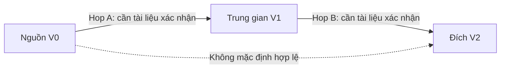
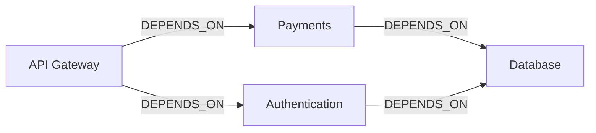
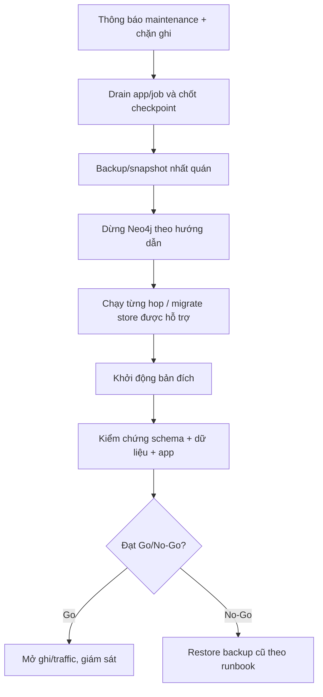
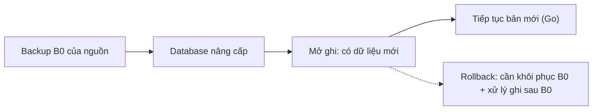

# Lập kế hoạch nâng cấp theo đường đi được nhà cung cấp hỗ trợ trong Neo4j

## 1. Bối cảnh: nâng cấp Neo4j là thay đổi của cả hệ thống

Một ứng dụng dùng **Neo4j** để quản lý **property graph** thường có nhiều thành phần liên quan: dữ liệu node và relationship, index/constraint, truy vấn **Cypher**, **Neo4j Java Driver**, **Spring Data Neo4j**, plugin như **APOC** và **Graph Data Science (GDS)**, cơ chế sao lưu, cấu hình TLS và topology máy chủ. Khi thay đổi phiên bản database, không thể chỉ tải image mới rồi kỳ vọng toàn bộ hệ thống vẫn tương thích.

Đặc biệt, một phiên bản Neo4j có thể thay đổi định dạng lưu trữ, các thiết lập `neo4j.conf`, các hàm/procedure, quy tắc tương thích driver và phương thức nâng cấp cluster. Nếu chuyển qua một bước mà nhà cung cấp **không hỗ trợ**, hệ thống có thể không mở được database, không thể rollback về bản cũ hoặc gặp lỗi nghiệp vụ sau khi ứng dụng đã nhận lưu lượng ghi.

Bài thuộc chương **Nâng cấp và di trú** của mô-đun `DATABASE_ENGINE_GRAPH_NEO4J`. Chủ đề trực tiếp là **lập kế hoạch theo đường đi nâng cấp được nhà cung cấp công bố và hỗ trợ**, không phải hướng dẫn chạy một lệnh nâng cấp cố định áp dụng cho mọi hệ thống.

Sau bài học, bạn có thể:

1. Xác định **phiên bản nguồn, phiên bản đích và từng bước trung gian** bằng tài liệu chính thức đúng phiên bản.
2. Lập bảng tương thích cho database, store format, edition, cluster, Java/JDK, Driver, SDN, APOC và GDS.
3. Kiểm kê dữ liệu, schema, quyền, backup, cấu hình và truy vấn trước khi thay đổi.
4. Xây dựng thử nghiệm nâng cấp trên bản sao dữ liệu, kiểm tra tính đúng của node/relationship, index và hành vi Cypher.
5. Chọn phương án offline/rolling/managed upgrade **chỉ khi được hỗ trợ** và xác định điều kiện mở traffic.
6. Xây dựng kế hoạch rollback thực tế khi **downgrade store không được hỗ trợ**, bao gồm rủi ro mất các ghi sau cutover.
7. Viết tiêu chí Go/No-Go, checklist vận hành và báo cáo kết quả nâng cấp có thể kiểm toán.

> **Giới hạn phiên bản:** Ví dụ mô tả cách lập kế hoạch cho họ Neo4j 4.x/5.x và những bản phát hành mới hơn. **Không** khẳng định rằng một cặp phiên bản cụ thể (ví dụ bất kỳ bản 4.x → bất kỳ bản mới nào) đều có thể nâng cấp trực tiếp. Chính sách hỗ trợ, yêu cầu phiên bản trung gian, phiên bản Java và lệnh migration thay đổi theo release, edition và hình thức triển khai. Người triển khai phải xác minh **Upgrade and Migration Guide/Operations Manual chính thức của đúng phiên bản đích** tại thời điểm thực hiện.

## 2. “Đường đi được hỗ trợ” nghĩa là gì?

### 2.1. Không phải mọi mũi tên phiên bản đều hợp lệ

Giả sử một nhóm ghi:

```text
Đang chạy: V0
Muốn đến: V2
```

Điều đó **không đủ** để quyết định có thể nâng cấp trực tiếp `V0 → V2`. Có thể nhà cung cấp yêu cầu một phiên bản trung gian `V1`, hoặc yêu cầu áp dụng bản vá cuối của một nhánh trước, hoặc hạn chế chuyển đổi theo store format/edition.

Sơ đồ khái niệm:



`V0`, `V1` và `V2` là **ký hiệu**, không phải tên phiên bản thật. Chỉ khi tài liệu nhà cung cấp xác nhận **Hop A** và **Hop B** thì chuỗi đó mới trở thành một đường đi có cơ sở. Nếu nguồn và đích được nhà cung cấp cho phép nâng cấp trực tiếp, không cần tự thêm bước trung gian.

### 2.2. Một cạnh “được hỗ trợ” phải có bằng chứng cụ thể

Với **mỗi hop**, cần trả lời:

| Câu hỏi | Bằng chứng cần lưu |
| --- | --- |
| Phiên bản nguồn có được hỗ trợ để nâng cấp lên bản đích không? | Link tài liệu chính thức, bản/revision và ngày kiểm tra |
| Có yêu cầu mức patch tối thiểu của nguồn/trung gian không? | Điều kiện phiên bản cụ thể trong tài liệu |
| Phải **migrate store** hay chỉ nâng binary/rolling restart? | Quy trình được vendor mô tả, dữ liệu cần dừng/khóa |
| Edition và topology có cho phép quy trình này không? | Community/Enterprise, single instance/cluster, managed service |
| Có yêu cầu backup, free disk hoặc downtime không? | Precondition và ước lượng trên dữ liệu thực |
| Trước/sau nâng cấp phải kiểm tra điều gì? | Post-upgrade checks, schema/index, cấu hình, query/runtime |
| Có được rollback bằng binary cũ không? | **Điều kiện rollback do vendor nêu**; nếu không có, thiết kế restore |
| Java/Driver/APOC/GDS và ứng dụng có tương thích không? | Ma trận tương thích riêng của từng sản phẩm |

Định nghĩa thực dụng:

> **Đường đi nâng cấp hợp lệ = chuỗi các hop được tài liệu hóa, mỗi hop thỏa điều kiện phiên bản + định dạng dữ liệu + triển khai + phụ thuộc và đã qua thử nghiệm trên môi trường đại diện.**

“Máy test đã khởi động được sau khi thay image” **không phải** bằng chứng thay thế cho chính sách hỗ trợ của nhà cung cấp.

### 2.3. Đừng trộn ba khái niệm

1. **Supported:** Neo4j công bố một phương thức/cặp phiên bản được hỗ trợ trong điều kiện xác định.
2. **Technically boots:** chương trình tình cờ chạy hoặc mở được store sau thao tác nào đó.
3. **Operationally safe:** trên chính workload của tổ chức, dữ liệu đúng, plugin tương thích, có backup, hiệu năng chấp nhận được và rollback thực thi được.

Để **Go Live**, cần cả **(1)** và **(3)**; mục (2) riêng lẻ là chưa đủ.

## 3. Xây bản đồ nâng cấp trước khi sửa một file nào

### 3.1. Thu thập phiên bản chính xác

Không lập kế hoạch chỉ từ “chúng tôi dùng Neo4j 5” hoặc nhãn Docker `latest`. Ghi chính xác:

- Phiên bản server ở từng node máy chủ và từng database, bao gồm mức patch.
- Edition, chế độ standalone/cluster, số thành viên, môi trường on-prem, VM, Docker/Kubernetes hay dịch vụ quản lý.
- Loại và phiên bản storage, trạng thái database, tình trạng index, các lỗi startup/transaction hiện có.
- Phiên bản Docker image/Helm chart/Operator nếu dùng, cách mount dữ liệu và cấu hình.
- Neo4j Java Driver của từng dịch vụ, Spring Boot/SDN/JDK, APOC Core/Extended, GDS và custom procedure.
- Nguồn backup, số lần restore đã thử, thời gian phục hồi và điểm khôi phục dữ liệu mong muốn.

Với Neo4j có quyền phù hợp, có thể đọc thông tin phiên bản:

```cypher
CALL dbms.components()
YIELD name, versions, edition
RETURN name, versions, edition;
```

Lệnh trên là bước **khởi đầu**, không phải báo cáo toàn bộ topology hay store format. Trong cluster, cần đối chiếu trạng thái của **các thành viên** theo công cụ vận hành được phiên bản hỗ trợ. Với Aura, dùng thông tin phiên bản/khả năng thay đổi do dịch vụ quản lý cung cấp.

### 3.2. Bảng minh họa kiểm kê

| Nhóm | Giá trị phải ghi lại | Vì sao ảnh hưởng đường nâng cấp? |
| --- | --- | --- |
| Neo4j server | Version/patch, edition, system DB, user DB | Điều kiện supported hop và database migration |
| Cluster | Thành viên, vai trò, routing, nơi lưu data | Rolling/offline và khả năng duy trì quorum |
| Store | Format, kích thước, transaction logs, free disk | Công cụ/không gian cần cho migration |
| Schema | Unique/key constraints, index, population state | Tính đúng `MERGE`, hiệu năng sau nâng cấp |
| Cypher | Các query quan trọng, syntax cũ, planner hints | Khả năng tương thích ngôn ngữ/query plan |
| Plugin | APOC/GDS/custom procedures và JAR | Có cần bản plugin mới/biên dịch lại không? |
| Ứng dụng | Spring Boot, SDN, Java Driver, JDK | Tương thích protocol, APIs, runtime |
| Bảo mật | TLS, cert SAN, roles, databases, secrets | Kết nối và quyền sau thay đổi |
| Vận hành | Backup/restore, alert, metrics, dashboards | Quan sát, rollback và quyết định Go/No-Go |

Không lưu mật khẩu, token, private key hay full connection URI chứa credential vào bảng kiểm kê. Nếu cần liệt kê secrets, ghi **tên tham chiếu** trong secret manager, owner và thời hạn rotation.

### 3.3. Kiểm tra database và schema hiện có

Ở một bản Neo4j có hỗ trợ các lệnh này, và với tài khoản đủ quyền:

```cypher
SHOW DATABASES
YIELD name, currentStatus, requestedStatus
RETURN name, currentStatus, requestedStatus
ORDER BY name;
```

```cypher
SHOW INDEXES
YIELD name, type, state, populationPercent
RETURN name, type, state, populationPercent
ORDER BY name;
```

```cypher
SHOW CONSTRAINTS
YIELD name, type, labelsOrTypes, properties
RETURN name, type, labelsOrTypes, properties
ORDER BY name;
```

Các câu lệnh này giúp tạo **baseline** trước khi nâng cấp. Chúng không sửa graph. Tên cột/quyền có thể khác theo phiên bản: nếu đang ở Neo4j 4.x, dùng cú pháp/công cụ tương ứng **phiên bản nguồn** để thu thập dữ liệu, không cố ép câu lệnh của bản đích.

Trong môi trường có nhiều database, lập bản ghi cho từng database, bao gồm **system database** và dữ liệu quản trị liên quan theo quy trình backup/migration mà nhà cung cấp mô tả. Không giả định rằng sao lưu mỗi database nghiệp vụ là đủ để phục hồi toàn bộ người dùng, role hoặc cấu hình.

## 4. Tra cứu tài liệu chính thức và chốt từng hop

### 4.1. Các nguồn cần kiểm chứng

Ưu tiên nguồn theo thứ tự:

1. **Neo4j Operations Manual — Upgrade/Migration** của phiên bản đích.
2. **Release notes / breaking changes** cho từng phiên bản trung gian và phiên bản đích.
3. Tài liệu về **backup, restore, store migration** và topology cho edition đang dùng.
4. Ma trận tương thích **Neo4j Java Driver** và ngôn ngữ Cypher.
5. Release notes và compatibility docs của **Spring Boot / Spring Data Neo4j**, **APOC** và **GDS**.
6. Tài liệu **Helm/Operator/Aura** nếu việc điều phối nâng cấp thuộc nhà cung cấp hoặc nền tảng triển khai.

Nội dung Internet tìm được không có số phiên bản hoặc là ví dụ từ blog cũ **không đủ** để chứng minh một hop được hỗ trợ.

### 4.2. Ma trận quyết định nâng cấp

Tạo bảng sau **trước** cửa sổ triển khai:

| Hop | Nguồn → Đích | Tài liệu xác nhận | Precondition | Cách làm | Trạng thái |
| --- | --- | --- | --- | --- | --- |
| A | `V0 → V1` | Link + mục + ngày tra cứu | Patch tối thiểu, backup, disk | Offline/rolling theo tài liệu | Chưa/đã xác minh |
| B | `V1 → V2` | Link + mục + ngày tra cứu | Migration/plugin/JDK | Offline/rolling theo tài liệu | Chưa/đã xác minh |
| Ứng dụng | `Driver/SDN old → new` | Compatibility matrix | API/Cypher test | Rolling ứng dụng theo hợp đồng | Chưa/đã xác minh |

Đây là **mẫu quản lý**, không chứa một đường đi thật đã được vendor xác nhận. Chỉ điền `SUPPORTED` khi đọc được tài liệu phù hợp **đúng cặp nguồn/đích**, không dựa trên suy luận “nhiều khả năng tương thích”.

**Quy tắc Go/No-Go:** Một hop bị đánh dấu `UNKNOWN` hoặc `UNSUPPORTED` phải dừng kế hoạch thực thi. Có thể mở yêu cầu hỗ trợ nhà cung cấp hoặc thiết kế một đường chuyển dữ liệu khác được phê duyệt (ví dụ export/import), nhưng không tự gắn nhãn supported.

### 4.3. Ví dụ 4.x, 5.x và những bản phát hành mới

Đối với hệ đang dùng **4.x**, một số tài liệu nâng cấp có yêu cầu ở **nhánh nguồn cụ thể** trước khi tiến tới **5.x**; các bản mới hơn có quy tắc riêng. Không thể viết một lệnh chung “4.0 → 5.latest” rồi coi đúng với mọi 4.x, cũng không tự áp một chuỗi “5.x → bản theo năm” khi chưa kiểm chứng.

Những điều có thể thay đổi theo hop:

- Bản patch nguồn bắt buộc.
- Công cụ và lúc thực hiện **store migration**.
- Định dạng backup được version đích chấp nhận.
- Quy định offline/rolling cho cluster.
- Cấu hình, runtime Cypher và hàm/procedure đã bị loại bỏ.
- Plugin/driver tương thích, Java runtime được yêu cầu.

Ví dụ tiêu chí hợp lệ: “Tài liệu đích xác nhận có thể đi từ **bản vá nguồn được yêu cầu của V0** sang `V1` trong chế độ standalone, sau khi chạy một lệnh migration được chỉ định; đã thử restore và chạy kiểm chứng.” Trong ví dụ, `V0` và `V1` chỉ là **ký hiệu phiên bản cần chốt**, không phải tên release thật.

## 5. Phạm vi tương thích không chỉ nằm ở Neo4j server

### 5.1. Tầng database và store format

Neo4j giữ cấu trúc dữ liệu trên disk, transaction logs và metadata cần thiết để mở database. Bước nâng cấp có thể yêu cầu chuyển định dạng store. Một store **đã được migration** cho phiên bản mới **không mặc định đọc được bằng binary cũ**.

Kế hoạch cần xác định:

- Có cần dừng database để migration không; ở bước nào?
- Có tạo thêm data file, index hoặc transaction log khi chuyển đổi không?
- Cần bao nhiêu disk **tạm thời** ngoài tổng kích thước store?
- Dung lượng backup và thời gian restore đã đo trên dữ liệu thật?
- Có cần chạy migration trên **bản sao** hoặc theo thứ tự từng database không?
- Sau nâng cấp, index phải chờ population hoặc rebuild theo hướng dẫn vendor không?
- Khi thất bại, dùng **backup/snapshot cũ** để khôi phục hay có công cụ rollback được hỗ trợ?

**Không thử “hạ cấp” bằng cách gắn binary cũ vào data directory đã nâng cấp** nếu tài liệu không cho phép. Cách đó có thể thất bại hoặc gây hỏng dữ liệu.

### 5.2. Cypher, schema, index và constraint

Một ứng dụng graph có thể phụ thuộc các chức năng dễ thay đổi:

- `MATCH`, `OPTIONAL MATCH`, variable-length patterns và shortest-path syntax.
- `MERGE` trên khóa nghiệp vụ cần unique constraint/index.
- `CALL { ... }`, `CALL { ... } IN TRANSACTIONS` hoặc thủ tục phân lô tương ứng.
- Index providers, full-text/vector indexes và các loại constraint theo edition.
- Query planner hints hoặc API trả về định danh node/relationship.

Trong những bản Neo4j mới, có thể tồn tại các **Cypher language versions** hoặc khác biệt về default query runtime. Hãy kiểm tra **chế độ ngôn ngữ Cypher mà ứng dụng thực sự chạy** và thay đổi mặc định theo release notes, thay vì chỉ xác nhận query không báo lỗi cú pháp.

Đối với truy vấn trọng yếu:

1. Lưu query template/parameter mẫu **đã khử dữ liệu nhạy cảm**.
2. Chạy thử trên phiên bản đích với data đại diện.
3. So kết quả node/relationship, ordering, null semantics và cardinality.
4. Dùng `EXPLAIN`/`PROFILE` **an toàn** để xem index seek/scan, DB Hits và rows.
5. So p95/p99, CPU, lock và memory; một query **đúng kết quả** vẫn có thể bị regression hiệu năng.

`PROFILE` thực thi query; không dùng nó cho câu ghi dữ liệu trên production chỉ để khảo sát kế hoạch.

### 5.3. Java Driver, Spring Data Neo4j và Spring Boot

Tương thích ở đây gồm ít nhất **bốn phiên bản**:

```text
Java Runtime (JDK)
     │
Spring Boot / Spring Data Neo4j
     │
Neo4j Java Driver
     │
Neo4j Server / Bolt / Cypher
```

Không suy ra rằng nếu driver kết nối được thì mọi API của SDN đang dùng đều hoạt động. Hãy kiểm tra:

- Phiên bản **JDK** được hỗ trợ cho Boot, driver, plugin và server.
- Phiên bản driver được Boot/SDN quản lý, khả năng kết nối tới Neo4j nguồn/đích trong giai đoạn chuyển tiếp.
- Hành vi session, bookmark, transaction timeout, retry và routing.
- Mapping `@Node`, `@Relationship`, `@Id`, các truy vấn `@Query` và DTO.
- Cơ chế migration repository/mapper khi Spring Data Neo4j thay API hoặc mặc định.
- Connection pool, TLS trust, role và lựa chọn database.

**Chiến lược tương thích hai phía:** nếu bản ứng dụng sẽ chạy cùng **database cũ và mới** trong một giai đoạn rolling, dependency và truy vấn của ứng dụng phải được vendor/nhóm phát triển chứng minh tương thích **với cả hai**. Nếu không bảo đảm được, chọn kế hoạch có thời gian bảo trì và chặn lưu lượng phù hợp.

### 5.4. APOC, GDS và custom procedures

APOC, GDS và procedure/plugin tự viết có **vòng đời phiên bản riêng**.

```cypher
SHOW PROCEDURES
YIELD name, signature
WHERE name STARTS WITH 'apoc.'
   OR name STARTS WITH 'gds.'
RETURN name, signature
ORDER BY name;
```

```cypher
SHOW FUNCTIONS
YIELD name, signature
WHERE name STARTS WITH 'apoc.'
   OR name STARTS WITH 'gds.'
RETURN name, signature
ORDER BY name;
```

Đây là cách kiểm tra **những chức năng đang được đăng ký và được quyền xem**, không phải báo cáo đầy đủ phiên bản JAR/plugin. Cần tra metadata cài đặt và tài liệu plugin theo hình thức triển khai.

Khi nâng cấp:

1. Lập danh sách procedure/function thực sự được gọi trong ứng dụng và job ETL.
2. Kiểm tra plugin version có **hỗ trợ Neo4j đích** không; cập nhật JAR/plugin theo hướng dẫn.
3. Với custom Java procedures, xem binary/API compatibility và yêu cầu compile/test lại.
4. Kiểm tra quyền `EXECUTE PROCEDURE`, unrestricted/load configuration; không nới quyền tùy tiện.
5. Với GDS, **named graph projection trong bộ nhớ không tự là dữ liệu bền vững cần migrate**. Sau restart/nâng cấp, thường phải lập kế hoạch **tạo lại projection**, kiểm tra thuật toán và score; không xem việc backup store là đã backup mọi trạng thái trong bộ nhớ của GDS.

Nếu một plugin bắt buộc chưa có phiên bản tương thích cho đích, đó có thể là **No-Go blocker**, dù core Neo4j đã có đường nâng cấp được hỗ trợ.

## 6. Đo dữ liệu gốc bằng baseline độc lập

Để xác nhận không mất hoặc đổi sai dữ liệu node/relationship, cần có **baseline trước khi nâng cấp**.

### 6.1. Ví dụ bài toán dịch vụ phụ thuộc

Một graph nghiệp vụ mô tả:



Nếu query quản lý dependency sau nâng cấp không trả ra cạnh `Payments → Database` vì sai relationship type, ứng dụng có thể đánh giá sai tuyến ảnh hưởng khi một dịch vụ gặp lỗi. Do đó, ngoài số lượng node, phải so **đầu mút và hướng relationship**.

Ví dụ Cypher chỉ đọc:

```cypher
MATCH (s:Service)
RETURN count(s) AS totalServices;
```

```cypher
MATCH (a:Service)-[r:DEPENDS_ON]->(b:Service)
RETURN count(r) AS dependencyRelationships;
```

```cypher
MATCH (a:Service)-[:DEPENDS_ON]->(b:Service)
RETURN a.id AS callerId, b.id AS dependencyId
ORDER BY callerId, dependencyId
LIMIT 100;
```

**Các nhãn và property ở trên là ví dụ về schema nghiệp vụ**, không bảo đảm tồn tại trong database của bạn. Thay bằng schema thực tế. Đối với hàng tỷ relationship, tránh quét toàn bộ ngay giữa giờ cao điểm; tạo baseline trong môi trường sao chép hoặc thời gian đã được lên lịch và dùng phương pháp đếm/hash được kiểm toán.

### 6.2. Vì sao tổng đếm là chưa đủ?

Hai graph có thể cùng **1 triệu node và 2 triệu relationship**, nhưng một relationship đã bị đổi hướng hoặc sai tenant. Vì vậy kiểm chứng cần nhiều tầng:

| Tầng | Kiểm tra |
| --- | --- |
| **Topology** | Số node/relationship theo label/type; đầu mút, chiều cạnh, self-loop/parallel edge |
| **Định danh** | Unique business keys, số key null/trùng và cách ánh xạ tenant |
| **Property** | Kiểu dữ liệu, giá trị bắt buộc, checksum trên mẫu/batch |
| **Schema** | Constraint/index, trạng thái index ONLINE, full-text/vector index khi có |
| **Query** | Tập kết quả, tổng hợp, phân trang, ordering và số đường đi quan trọng |
| **Ứng dụng** | DTO từ SDN, Java Driver, thông điệp lỗi, quyền truy cập và transaction |
| **Vận hành** | Backup/restore, login, TLS, metrics và các dashboard |

Nếu dữ liệu có nhiều bản ghi bị thay đổi **trong suốt quá trình thử**, không thể so trực tiếp các bản snapshot lấy ở hai thời điểm khác nhau rồi kết luận migration làm sai. Phải chốt **snapshot/LSN/bookmark tương ứng**, hoặc thiết kế các phép đối soát có ghi nhận thời điểm.

### 6.3. Lưu baseline có thể tái lập

Một manifest baseline có thể chứa:

```yaml
baseline:
  sourceVersion: "V0-exact-version"
  snapshotId: "backup-or-snapshot-id"
  capturedAtUtc: "2026-10-01T00:00:00Z"
  databases:
    - name: catalog
      nodeCount: 1500000
      relationshipCount: 3600000
      indexesOnline: 8
      constraints: 5
  checks:
    - name: unique-service-ids
      expected: "no duplicates"
    - name: authorized-tenant-paths
      expected: "matches baseline"
```

Đây là **số liệu giả định cho bài thực hành**, không phải dữ liệu của hệ thống thực. `capturedAtUtc` chỉ là một chuỗi timestamp minh họa. Trong dự án thật, lưu thêm phiên bản schema, địa chỉ lưu backup, checksum và người ký xác nhận.

## 7. Backup, restore và thử khôi phục trước khi đổi phiên bản

### 7.1. “Có file backup” khác với “phục hồi được”

Một phương án rollback chỉ đáng tin nếu đội vận hành đã **khôi phục thành công bản backup tương ứng bằng quy trình được hỗ trợ**. Không dựa vào việc một thư mục backup có kích thước khác 0 hoặc đã được upload lên object storage.

Phải phân biệt:

- **Online backup:** chức năng backup database đang chạy, điều kiện edition/tính năng theo phiên bản.
- **Offline dump/export:** lấy bản sao logic/binary khi database đã ở trạng thái phù hợp theo lệnh/hướng dẫn; không đồng nghĩa thao tác backup online.
- **Filesystem/volume snapshot:** chỉ là bản sao file; tính nhất quán phụ thuộc cách chụp, trạng thái database và quy trình được vendor hỗ trợ.
- **Logical export/import:** trích xuất và tái tạo dữ liệu; có thể mất metadata/tính chất đặc thù nếu không thiết kế đầy đủ, không mặc định tương đương binary restore.

Lệnh `neo4j-admin database dump`, `backup`, `load`, `restore`, hoặc `migrate` có **cú pháp, tiền điều kiện, edition và phiên bản riêng**. Bài này **không** cung cấp lệnh copy/paste phá hủy data directory; cần lấy đúng câu lệnh từ runbook vendor theo phiên bản nguồn/đích.

### 7.2. Checklist trước khi cho phép nâng cấp

- Backup/dump thành công theo cơ chế hỗ trợ **phiên bản nguồn**.
- Đối với hệ nhiều database, xác định cách backup **database nghiệp vụ**, `system` và những metadata/role cần phục hồi.
- Ghi checksum, thời điểm, mức dữ liệu bao phủ và nơi lưu bản sao.
- Lưu ít nhất một bản **bất biến, ngoài phạm vi lỗi** của cluster hoặc volume đang nâng cấp.
- Thử restore trên môi trường cô lập, kiểm tra mở database và chạy query đối soát.
- Đo thời gian restore và so với **RTO** (thời gian phục hồi cho phép).
- Xác định **RPO** (mức mất dữ liệu cho phép) trong trường hợp ghi sau cutover.
- Xác minh khả năng đọc backup nguồn bằng **công cụ/binary phù hợp**; không giả định bản backup cũ luôn tương thích đích hoặc ngược lại.

**Điểm quan trọng:** Nếu nâng cấp làm store không tương thích với phiên bản cũ, “đổi image về bản cũ” **không phải rollback**. Rollback thực tế thường là **khôi phục bản sao trước nâng cấp** vào hệ chạy phiên bản cũ, sau đó xử lý những ghi phát sinh sau điểm chụp.

### 7.3. RPO và ghi phát sinh sau thời điểm chụp

Giả sử:

```text
10:00  Chụp backup B0
10:15  Nâng database và mở traffic ghi
10:30  Phát hiện lỗi nghiêm trọng
```

Nếu restore B0 vào database phiên bản cũ lúc 10:30, các ghi từ 10:15–10:30 **không tự xuất hiện** trong B0. Bạn phải có phương án hợp lệ:

1. **Dừng ghi** trong toàn cửa sổ nâng cấp, đến khi quyết định Go/No-Go hoàn tất.
2. Có **change log/replay** hoặc event log đủ tin cậy, đã thử phục hồi đúng thứ tự, chống ghi trùng.
3. Hoặc chấp nhận mức mất dữ liệu được nghiệp vụ phê duyệt (RPO khác 0).

Không ghi “rollback trong 5 phút, không mất dữ liệu” khi chưa chứng minh cả việc **phục hồi store lẫn dữ liệu phát sinh sau cutover**.

## 8. Chọn hình thức nâng cấp: offline, rolling hay do dịch vụ quản lý thực hiện

### 8.1. Offline upgrade

Phương án này có thể phù hợp khi:

- Vendor yêu cầu migration store ở trạng thái offline hoặc topology không hỗ trợ rolling.
- Hệ thống có cửa sổ bảo trì được chấp nhận.
- Cần đảm bảo **không có writer** trong khi snapshot/migrate/validate.

Luồng khái niệm:



Các thao tác trong sơ đồ **không phải một chuỗi shell command**. Thứ tự chi tiết cho mỗi hop do Operations Manual quyết định. Nếu cần nhiều hop, có thể phải lặp bước backup/validate ở các điểm trung gian hoặc chuẩn bị bản sao riêng.

### 8.2. Rolling upgrade chỉ khi được hỗ trợ

Trên cluster, rolling upgrade nhằm tránh dừng toàn bộ dịch vụ, nhưng **không thể tự suy** rằng cứ thay image từng Pod là an toàn. Cần chứng minh:

- Vendor hỗ trợ **mixed-version cluster** cho cặp phiên bản nguồn/đích **đúng khoảng thời gian và thứ tự**.
- Thành viên có thể tham gia/ra khỏi cluster mà vẫn giữ quorum và vai trò cần thiết.
- Routing/driver xử lý server đọc/ghi khi một số thành viên đang nâng cấp.
- Định dạng store và dữ liệu replicated tương thích trong giai đoạn chuyển tiếp.
- Application/plugin/Cypher tương thích cả trước và sau từng bước.
- Có đủ capacity để đáp ứng tải khi giảm số server khả dụng.
- Có điểm dừng và cách khôi phục nếu thành viên mới không tham gia lại.

**Nếu tài liệu không nói rõ đường rolling được hỗ trợ, không gọi nó là zero-downtime.** Có thể cần offline migration hoặc kế hoạch thay cluster bằng phương pháp được nhà cung cấp cho phép.

### 8.3. Aura hoặc managed Neo4j

Trong dịch vụ quản lý, nhà cung cấp có thể điều phối version, maintenance window, backup và các bước vận hành phía server. Ứng dụng vẫn phải:

- Theo dõi thông báo về release/maintenance và thời điểm thay đổi.
- Kiểm tra compatibility của driver, SDN, APOC/GDS và query.
- Đo hiệu năng trước/sau, chuẩn bị retry và graceful degradation.
- Xác định ai chịu trách nhiệm backup/restore và các giới hạn RPO/RTO.

**Không** giả định có quyền chạy `neo4j-admin`, sửa `neo4j.conf` hoặc can thiệp từng Pod database trong một dịch vụ managed.

## 9. Tổ chức rehearsal: thử nâng cấp trên bản sao trước production

### 9.1. Môi trường rehearsal phải đại diện

Ít nhất cần:

- **Data snapshot** từ nguồn với dữ liệu đã được kiểm soát quyền hoặc đã ẩn danh phù hợp.
- Schema, database count, index, constraint, user/role tương đương mức test cần thiết.
- Topology gần production: standalone/cluster, routing, TLS, storage và memory.
- Java Driver/SDN/API phiên bản ứng dụng thật.
- APOC/GDS/custom procedures trong cấu hình được phép.
- Workload tiêu biểu: đọc graph sâu, `MERGE` ghi, import batch và các query API quan trọng.

Nếu rehearsal trên 1.000 node trong khi production có 500 triệu relationship, nó **không đủ** để ước lượng thời gian migrate/index population hay p99 query. Có thể dùng môi trường nhỏ cho test logic, nhưng **sizing và downtime** cần đo trên tập đại diện.

### 9.2. Thực hiện từng hop có kiểm chứng

Với mỗi hop đã được vendor xác nhận:

1. Xác minh phiên bản nguồn, snapshot ID và bản sao dữ liệu đã sẵn sàng.
2. Chạy bước chuẩn bị theo tài liệu (version patch, format, config, backup).
3. Thực hiện migration/rolling theo đúng phương thức được phép.
4. Chờ database, schema/index và các thành viên cluster đạt trạng thái yêu cầu.
5. Chạy kiểm tra node/relationship, constraint, plugin, quyền và Cypher.
6. Chạy workload/API smoke test cùng timeout và cấu hình TLS thực tế.
7. Ghi duration, memory, disk, error và các cảnh báo phát sinh.
8. **Chỉ chuyển sang hop kế tiếp** khi điều kiện chấp nhận của hop hiện tại đạt.

Không biến một kế hoạch nhiều hop thành câu lệnh “đổi tất cả image sang bản đích”, vì sẽ mất cơ hội xác nhận trạng thái trung gian mà vendor yêu cầu.

### 9.3. Kết quả kiểm thử phải có tiêu chí định lượng

Ví dụ bảng quyết định, **các ngưỡng là minh họa để đội dự án tự phê duyệt**:

| Hạng mục | Điều kiện Go minh họa | Bằng chứng |
| --- | --- | --- |
| Dữ liệu | 100% invariant nghiệp vụ quan trọng đúng | Kết quả test/checksum/đối soát |
| Schema | Constraint cần thiết tồn tại; index quan trọng ONLINE | `SHOW INDEXES`/`SHOW CONSTRAINTS` |
| Ứng dụng | 100% smoke test critical pass | Kết quả test API/Driver/SDN |
| Tương thích | Không có plugin/procedure bắt buộc bị thiếu | Catalog procedure, test GDS/APOC |
| Hiệu năng | p95 các API trọng yếu không tăng quá ngưỡng đã phê duyệt | Kết quả benchmark cùng tải |
| Ổn định | Không phát sinh timeout/rollback bất thường | Dashboard + logs |
| Backup | Restore rehearsal đã thành công trong RTO mục tiêu | Biên bản restore |
| Cluster | Số thành viên, role, routing đúng theo design | Thông tin vận hành cụm |
| Bảo mật | TLS, đăng nhập, role, tenant isolation đạt | Security integration tests |

Không dùng một metric tổng hợp như “CPU dưới 70%” để bỏ qua lỗi mất relationship hoặc kết quả Cypher sai. **Tính đúng dữ liệu là điều kiện chặn**.

## 10. Lập ngân sách downtime, disk và nhân sự

### 10.1. Ước lượng thời gian từ rehearsal

Với phương án offline, cửa sổ bảo trì có thể được mô hình hóa:

```text
DowntimeBudget ≈
  DrainAndFreezeWrites
  + ConsistentBackupOrCheckpoint
  + StopAndMigrate
  + StartAndRecover
  + ValidateCriticalWorkflows
  + ReopenTraffic
  + SafetyBuffer
```

Ví dụ **giả định**:

| Bước | Thời lượng rehearsal |
| --- | ---: |
| Drain và dừng job ghi | 5 phút |
| Chốt snapshot/backup nhất quán | 15 phút |
| Migration từng hop | 20 phút |
| Mở database và hoàn tất recovery/index cần thiết | 10 phút |
| Smoke test và so invariant | 10 phút |
| Mở traffic | 5 phút |
| **Tổng chưa có buffer** | **65 phút** |

Nếu đội dự án đặt thêm buffer 30 phút, cửa sổ dự trù sẽ là **95 phút**. Các con số chỉ mô phỏng cách tính; không dùng làm cam kết cho một cơ sở dữ liệu Neo4j bất kỳ.

**Lưu ý:** một số bước kiểm chứng có thể chạy trong lúc database chưa nhận traffic; một số backup có thể chụp trước bảo trì theo cơ chế được hỗ trợ. Công thức cần điều chỉnh theo **luồng thực tế**, tránh cộng hai lần những bước có thể chạy song song hoặc bỏ sót checkpoint/đồng bộ.

### 10.2. Disk và bộ nhớ

Không chỉ lấy `store size` làm dung lượng ổ đĩa cần thiết. Có thể còn:

- Backup/dump tạm thời và các bản snapshot.
- Không gian migration/rewrite, index population và transaction logs.
- WAL/log hệ thống, filesystem overhead và monitoring.
- Storage của từng thành viên cluster hoặc staging copy.

Hãy lấy yêu cầu tối thiểu từ tài liệu vendor, sau đó **đo đỉnh sử dụng trên rehearsal** và cộng phần dự phòng theo chính sách. Đồng thời xem heap, page cache, native/off-heap memory và giới hạn container nếu Neo4j chạy trong Kubernetes.

### 10.3. Ai quyết định ở từng thời điểm?

Một lần nâng cấp cần rõ:

| Vai trò | Quyết định/trách nhiệm |
| --- | --- |
| DBA/Neo4j operator | Xác minh đường supported, backup/restore, migration, trạng thái cluster/schema |
| Backend owner | Driver/SDN/APOC/GDS compatibility, API smoke tests, transaction handling |
| SRE/Platform | DNS/TLS, Kubernetes, routing, capacity, alerts, rollback orchestration |
| QA/Data owner | Invariant node/relationship, nghiệp vụ, dữ liệu kiểm chứng |
| Security | Roles, cert/secret và quyền sau nâng cấp |
| Change approver | Phê duyệt cửa sổ, chốt Go/No-Go và RPO/RTO |

Một checklist không có **người chịu trách nhiệm ký xác nhận** rất dễ trở thành tập hợp câu “đã kiểm tra” không có bằng chứng.

## 11. Cutover: chặn ghi, chuyển traffic và điểm không thể quay lui

### 11.1. Quy trình trước giờ cutover

1. Gửi thông báo bảo trì, chọn thời điểm ít tải và dừng các job/import background có thể ghi.
2. Đưa API vào chế độ maintenance hoặc khóa đường ghi theo cơ chế được kiểm soát.
3. Đợi transaction đang chạy commit/rollback và chốt bookmark/checkpoint theo thiết kế.
4. Xác nhận **không còn writer trái phép**: batch queue, cron, ETL, admin scripts và kết nối trực tiếp.
5. Tạo/kiểm tra bản sao dữ liệu nhất quán và điểm rollback.
6. Ghi lại source version, snapshot ID, config, log mốc giờ bắt đầu.
7. Thực hiện từng hop đúng tài liệu vendor, ghi trạng thái sau mỗi bước.

Tránh phương án “mở một endpoint admin để đổi trạng thái nâng cấp” mà vẫn để các job bên ngoài ghi trực tiếp vào Neo4j. Nếu có nhiều đường ghi, cần một **freeze protocol** chung.

### 11.2. Quy trình kiểm chứng trước mở ghi

Trong môi trường đã nâng cấp:

```cypher
CALL dbms.components()
YIELD name, versions, edition
RETURN name, versions, edition;
```

```cypher
SHOW DATABASES
YIELD name, currentStatus
RETURN name, currentStatus
ORDER BY name;
```

Sau đó:

- Đối soát dữ liệu và schema theo manifest baseline **cùng snapshot**.
- Kiểm tra login với **tài khoản ứng dụng**, database và quyền ít nhất.
- Kiểm tra TLS, DNS, routing, query đọc và ghi thử có kiểm soát.
- Xác minh procedure/function bắt buộc, GDS projections/job và các API đã được cập nhật.
- Chạy smoke test, đánh giá latency/timeout, xem logs.
- Người phụ trách quyết định **Go** mới mở ghi và traffic.

**Không** dùng `RETURN 1` thành công làm bằng chứng đủ để mở production: đó chỉ là một kiểm tra kết nối đơn giản.

### 11.3. Điểm không thể quay lui thường là khi ghi vào hệ mới

Trước khi mở writer, rollback có thể tương đối đơn giản nếu còn nguyên **bản snapshot nguồn** và chưa có ghi mới. Sau khi mở writer, dữ liệu bắt đầu phân nhánh giữa hệ cũ và hệ mới.



Muốn có **zero-data-loss rollback**, phải thiết kế một cơ chế đồng bộ/replay/đối soát được chấp thuận và thử nghiệm. **Không tự coi dual-write** vào hai phiên bản là giải pháp dễ dàng: giao dịch phân tán, thứ tự sự kiện, retry/idempotency và schema khác nhau có thể tạo lệch dữ liệu.

Nếu không chứng minh được đồng bộ hai chiều, cách bảo thủ là **giữ read/write freeze tới khi đạt Go/No-Go** hoặc chấp nhận một RPO đã được bên nghiệp vụ phê duyệt.

## 12. Trình tự triển khai ứng dụng để tránh incompatible schema

Với một release ứng dụng mới cùng phiên bản Neo4j mới, không nên thay server và mọi ứng dụng cùng lúc nếu có thể tách nguyên nhân lỗi.

### 12.1. Expand → migrate → contract

Một cách quản lý thay đổi schema ứng dụng:

1. **Expand:** thêm constraint/index/thuộc tính mới theo cách vẫn tương thích với ứng dụng cũ, nếu hệ phiên bản hỗ trợ.
2. **Migrate:** chuyển dữ liệu theo batch có checkpoint, bảo vệ idempotency; đảm bảo hai kiểu dữ liệu cùng tồn tại trong giai đoạn chuyển tiếp nếu cần.
3. **Switch application:** triển khai code đọc/ghi theo hợp đồng mới; chặn những phiên bản không còn tương thích.
4. **Contract:** dọn thuộc tính/relationship/index cũ sau khi đã xác minh không còn consumer dùng.

Ví dụ nếu dịch vụ chuyển từ chỉ dùng `Product.sku` sang khóa ghép `(tenantId, sku)`, phải lập kế hoạch kiểm tra trùng ID theo tenant, backfill property, constraint và mã repository. Không nên chỉ tạo một unique constraint rồi kỳ vọng dữ liệu lỗi cũ tự trở thành hợp lệ.

### 12.2. Connection và transaction khi đổi server

Neo4j Java Driver và SDN cần được kiểm thử:

- `neo4j+s://` hoặc `bolt+s://`, CA và hostname SAN của endpoint mới.
- Routing table khi server thay vai trò hoặc địa chỉ được quảng bá.
- Connection pool tạo connection mới sau restart/failover; không phụ thuộc session cũ còn tồn tại.
- Retry logic với transient errors: không lặp side effect ngoài transaction, không ghi trùng do mất phản hồi commit.
- Ranh giới `@Transactional`, callback `executeRead`/`executeWrite`, bookmarks và explicit database selection.

Không giữ transaction dài trong lúc thay đổi server hoặc thay cấu hình routing. Với batch import, có checkpoint theo lô và khả năng resume.

## 13. Kiểm tra bằng Java Driver sau nâng cấp

Ví dụ một chương trình nhỏ (Java 17+, Java Driver 5.x) kiểm tra **TLS-verified URI**, database đích và một câu Cypher chỉ đọc:

```java
import java.net.URI;
import java.util.Set;
import org.neo4j.driver.AuthTokens;
import org.neo4j.driver.Driver;
import org.neo4j.driver.GraphDatabase;
import org.neo4j.driver.Session;
import org.neo4j.driver.SessionConfig;

public final class GraphUpgradeSmokeCheck {
    private static String requireEnv(String key) {
        String value = System.getenv(key);
        if (value == null || value.isBlank()) {
            throw new IllegalStateException(
                "Missing required configuration: " + key
            );
        }
        return value;
    }

    public static void main(String[] args) {
        String uriText = requireEnv("NEO4J_URI");
        String username = requireEnv("NEO4J_USERNAME");
        String password = requireEnv("NEO4J_PASSWORD");
        String database = requireEnv("NEO4J_DATABASE");

        URI uri = URI.create(uriText);
        if (!Set.of("neo4j+s", "bolt+s")
                .contains(uri.getScheme())
            || uri.getUserInfo() != null) {
            throw new IllegalArgumentException(
                "A verified TLS URI without embedded credentials is required"
            );
        }

        try (Driver driver = GraphDatabase.driver(
                 uriText, AuthTokens.basic(username, password))) {
            driver.verifyConnectivity();

            try (Session session =
                     driver.session(SessionConfig.forDatabase(database))) {
                int value = session.executeRead(tx ->
                    tx.run("RETURN 1 AS ok")
                      .single()
                      .get("ok")
                      .asInt()
                );
                if (value != 1) {
                    throw new IllegalStateException(
                        "Unexpected database response"
                    );
                }
            }
            System.out.println("Connectivity check passed");
        }
    }
}
```

**Giới hạn của kiểm tra:**

- Nó xác nhận khả năng kết nối cơ bản và thực thi query đọc trên database được chỉ rõ.
- Nó **không** xác nhận constraint/index, số node/relationship, tương thích APOC/GDS, tốc độ `MERGE`, hoặc kết nối tới mọi thành viên cluster.
- Việc yêu cầu `+s` là chính sách mẫu cho **production**, không phải lời khẳng định môi trường test chỉ có một scheme hợp lệ.
- Không in password, AuthToken hoặc full environment vào log.
- Với Spring Data Neo4j, có thể xây smoke test ứng dụng qua `Neo4jClient`/repository và kiểm tra DTO, transaction, quyền đọc/ghi thực, thay vì chỉ kiểm tra `Driver`.

Nếu chương trình fail, cần phân loại TLS, DNS, routing, authentication, database không tồn tại/không online hay lỗi transaction; **không** khắc phục bằng cách dùng tài khoản administrator hoặc tắt TLS.

## 14. Ma trận Go/No-Go và rollback

### 14.1. Điều kiện dừng bắt buộc

| Tín hiệu | Quyết định đề xuất |
| --- | --- |
| Không xác minh được một hop trong tài liệu vendor | **No-Go:** chưa có đường supported |
| Chưa restore thử backup trên môi trường cô lập | **No-Go:** rollback chưa được chứng minh |
| Plugin bắt buộc không tương thích bản đích | **No-Go** hoặc sửa phạm vi/kiến trúc và thử lại |
| Dữ liệu node/relationship không đạt invariant | **No-Go**, giữ đóng ghi, điều tra |
| Index cần thiết không online và query trọng yếu quá chậm | **No-Go** cho mở traffic phụ thuộc index |
| TLS/role/database sai | **No-Go**, không hạ bảo mật |
| Smoke test quan trọng thất bại | **No-Go**, quay về bước khắc phục |
| p95 tăng vượt ngưỡng được phê duyệt | Điều tra/đánh giá capacity trước Go |
| Tất cả điều kiện đạt, người có thẩm quyền ký | **Go**, mở traffic theo kế hoạch |

Phân biệt **rollback database** và **rollback ứng dụng**: đôi khi chỉ cần đưa bản ứng dụng tương thích quay lại; đôi khi store format buộc phải restore database từ backup. Quyết định dựa trên mức thay đổi đã thực hiện và tài liệu vendor.

### 14.2. Runbook rollback cần nêu rõ

1. **Trigger:** các lỗi nào bắt buộc rollback thay vì hotfix.
2. **Cutoff:** thời điểm dừng traffic và ghi; ngăn writer phát sinh thêm dữ liệu.
3. **Source of truth:** backup/snapshot nào đủ tin cậy, bản Neo4j nào đọc được nó.
4. **Restore:** công cụ/phiên bản/edition và trình tự khôi phục được hỗ trợ.
5. **Data after backup:** xử lý sự kiện/ghi phát sinh sau snapshot theo RPO phê duyệt.
6. **Application:** bản app/driver/SDN tương thích với DB đã khôi phục.
7. **Validation:** đối soát dữ liệu, schema, quyền, routing/TLS, smoke test, p95.
8. **Reopen:** ai có quyền mở traffic và ký xác nhận.

**Không** được ghi “rollback = deploy lại Docker image cũ” nếu database đã migration sang store format mà image cũ không thể đọc.

### 14.3. Khi không thể rollback trong RTO

Nếu rehearsal chỉ ra rằng restore toàn bộ graph mất lâu hơn RTO, đội dự án cần quyết định **trước khi nâng cấp**, chẳng hạn:

- Thay đổi chiến lược backup/snapshot để rút ngắn restore theo cơ chế được hỗ trợ.
- Dùng một **cụm song song** và chiến lược cutover được vendor cho phép, đã thử đồng bộ/đối soát.
- Chọn cửa sổ bảo trì dài hơn và phê duyệt RTO/RPO khác.
- Hoãn nâng cấp đến khi hạ tầng có đủ disk/capacity.

Không coi mong muốn “không downtime” là bằng chứng rằng cluster rolling và downgrade đều được hỗ trợ.

## 15. Giám sát sau nâng cấp và giai đoạn ổn định

Sau khi mở traffic, cần theo dõi ít nhất một giai đoạn ổn định được định nghĩa trước:

| Lớp | Chỉ số |
| --- | --- |
| API/Spring Boot | HTTP throughput, 4xx/5xx, p95/p99, readiness, restart count |
| Java Driver | connection pool pending, retry, timeouts, routing/TLS errors |
| Neo4j transaction | active/commit/rollback, lock waits, transaction timeout |
| Cypher | slow queries, DB Hits, row cardinality, index scans, planner changes |
| JVM/storage | CPU, heap/GC, page cache hits/faults, disk latency, free space |
| Dữ liệu | Số node/cạnh theo scope, schema state, event replay lag, validation errors |
| Plugin | Lỗi procedure/function, thời gian GDS job, trạng thái projection |

Chỉ số trước/sau phải được so trên **cùng nhóm API, cùng mức tải và dữ liệu tương đương**. Một p95 giảm trong lúc người dùng nghỉ lễ không tự chứng minh bản Neo4j mới nhanh hơn.

### 15.1. Phân loại lỗi sau nâng cấp

| Hiện tượng | Giả thuyết cần kiểm tra |
| --- | --- |
| App kết nối được nhưng `MATCH` fail | Quyền, database, schema hoặc thay đổi Cypher |
| `MERGE` chậm hơn | Constraint/index chưa online, query plan, lock contention |
| APOC procedure không tồn tại | Chưa cài plugin phiên bản phù hợp hoặc đổi tên/chữ ký/quyền |
| GDS job không tìm thấy named graph | Projection trong bộ nhớ chưa được tạo lại |
| Một số Pod lỗi routing | Advertised address, TLS SAN, driver, cluster topology |
| Lỗi sau khi đổi Driver/SDN | API/mapping/transaction semantics không tương thích |
| OOM/đĩa đầy khi mở index | Sizing, migration temporary space, page cache/heap |
| Dữ liệu business key trùng | Thiếu constraint hoặc nguồn dữ liệu đã lỗi trước migration |
| Chỉ một loại query chậm | Planner statistics/index/data skew, không phải toàn DB |

Không thay đổi đồng thời một loạt setting, plugin và query để chữa sự cố, nếu có thể cô lập biến. Khi điều tra, gắn mỗi thay đổi với timeline và lần đo rõ ràng.

## 16. Bài tập thực hành có lời giải

### Bài 1 — Đường nâng cấp “đẹp” nhưng không được xác nhận

Nhóm phát triển ghi kế hoạch `V0 → V2` vì “V2 cao hơn V0”. Tài liệu chính thức chỉ xác nhận `V0 → V1`, còn chưa tìm được điều kiện `V1 → V2`.

**Câu hỏi:** có được triển khai không?

**Đáp án:** **No-Go**. Cần xác minh Hop B bằng tài liệu vendor đúng phiên bản, preconditions, cơ chế migration và tương thích phụ thuộc; nếu không có, không tự biến nó thành đường supported.

### Bài 2 — Backup không khôi phục được

Đội vận hành đã tạo file backup 300 GB nhưng chưa thử restore. Cutover dự kiến sau 6 giờ.

**Câu hỏi:** điều kiện nào còn thiếu?

**Đáp án:** chưa chứng minh backup **phục hồi được** theo tool/edition/version phù hợp, thời gian restore đáp ứng RTO, dữ liệu/schema khớp baseline và có phương án cho ghi phát sinh sau cutover. Nên hoãn hoặc chạy rehearsal/restore trước khi Go.

### Bài 3 — Plugin tương thích không được bỏ qua

Neo4j đích được vendor cho phép nhưng một custom procedure dùng bởi 30% API chưa được biên dịch/test với phiên bản mới.

**Đáp án:** chưa đủ điều kiện Go. Cần đánh giá API compatibility của procedure, test behavior/chữ ký/quyền trên đích và có bản build phù hợp. Core database được hỗ trợ không đồng nghĩa mọi plugin của ứng dụng được hỗ trợ.

### Bài 4 — Rollback sau khi đã mở ghi

Backup B0 chụp lúc 10:00. Database mới mở ghi lúc 10:15. Lúc 11:00 nhóm muốn restore B0 và khẳng định không mất dữ liệu.

**Đáp án:** không thể khẳng định. Các ghi sau 10:00 có thể không tồn tại trong B0. Cần nhật ký sự kiện/replay được thử nghiệm và đối soát, hoặc sự chấp thuận RPO mất dữ liệu phù hợp. Đổi binary về bản cũ cũng có thể không được hỗ trợ khi store đã migrate.

### Bài 5 — Rolling upgrade có thực sự “zero downtime”?

Cluster có 3 thành viên. Nhóm đề xuất lần lượt thay image cho từng thành viên mà chưa kiểm tra yêu cầu quorum, version-mixing, routing hoặc store migration.

**Đáp án:** chưa thể gọi là đường rolling được hỗ trợ. Phải xem tài liệu cho **cặp version cụ thể, edition/topology**, thứ tự, capacity và cơ chế recovery; rehearsal dưới tải trước. Nếu không được hỗ trợ, chọn offline/khác theo hướng dẫn nhà cung cấp.

### Bài 6 — Lập kế hoạch đầy đủ

Một ứng dụng có Neo4j server, Java Driver, Spring Data Neo4j, APOC và GDS; 8 database, 2 TB dữ liệu graph, 5 job ETL và API phụ thuộc index. Hãy viết bảng kiểm trước khi nâng cấp:

1. Các **nguồn tài liệu** để xác minh từng hop.
2. Các **bản kiểm kê** cần chụp trước: version, schema, data invariants, plugin.
3. Điều kiện **restore/rollback** phải thử.
4. Kịch bản **cutover/ghi mới** và cách bảo đảm RPO.
5. Smoke test, p95/p99, lỗi plugin, schema và tenant isolation.

**Gợi ý:** dùng bảng mục 4, 6, 7, 9 và 14 của bài; người quản trị ký xác nhận từng gate. Không đặt downtime từ ước lượng của một hệ graph nhỏ; đo rehearsal trên dữ liệu và topology đại diện.

## 17. Checklist triển khai theo đường đi được hỗ trợ

- [ ] Có **source version + target version chính xác**, patch và edition.
- [ ] Đã đối chiếu Operations Manual/Upgrade Guide chính thức **cho từng hop**.
- [ ] Không có hop `UNKNOWN` hoặc `UNSUPPORTED`; mọi điều kiện patch/store/topology rõ ràng.
- [ ] Xác minh single server/cluster/Aura và cơ chế offline/rolling thực sự được hỗ trợ.
- [ ] Kiểm kê database, system metadata, schema, index, unique constraints và kích thước data/log.
- [ ] Đã ghi baseline node/relationship/property, khóa nghiệp vụ, tenant và các invariant quan trọng.
- [ ] Đã xác minh Java/JDK, Neo4j Driver, Spring Boot/SDN, APOC, GDS, custom procedures.
- [ ] Có danh sách Cypher quan trọng và test hành vi/plan trên phiên bản đích.
- [ ] Có kế hoạch tạo lại GDS projections và cập nhật API/procedure cần thiết.
- [ ] Backup/snapshot nguồn **đã restore thử**, được giữ bất biến và đáp ứng RTO/RPO.
- [ ] Tính toán free disk, heap, page cache, transaction logs và dung lượng migration.
- [ ] Đã chạy rehearsal từng hop trên snapshot/topology đại diện; đo downtime và rollback.
- [ ] Có kịch bản freeze ghi, dừng ETL, drain transaction và checkpoint.
- [ ] Có bước migration/schema/index tách khỏi request API và readiness lặp.
- [ ] Có người duyệt Go/No-Go và điều kiện dừng rõ ràng sau từng hop.
- [ ] Có runbook rollback từ backup cũ, không dựa vào downgrade store nếu chưa được hỗ trợ.
- [ ] Có phương án xử lý dữ liệu phát sinh sau cutover, replay hoặc RPO được phê duyệt.
- [ ] Smoke test kiểm tra database, TLS/role, Cypher, node/edge, constraint, plugin, Java/SDN.
- [ ] Đã kiểm tra p95/p99, transaction/lock, pool, page cache, CPU, disk và các alerts sau nâng cấp.
- [ ] Có kế hoạch truyền thông, maintenance window, owner và timeline kiểm toán.
- [ ] Không mở rộng traffic cho tới khi tất cả **critical gates** đạt và được ký xác nhận.

## Kết luận

**Một bản nâng cấp Neo4j an toàn không bắt đầu bằng lệnh đổi image, mà bắt đầu bằng việc chứng minh đường đi được hỗ trợ.** Mỗi bước từ phiên bản nguồn đến đích phải có bằng chứng vendor, điều kiện preflight, phương pháp migration được phép và kết quả rehearsal. Không thể bỏ qua những phụ thuộc bên ngoài core database: Cypher, index/constraint, Java Driver, Spring Data Neo4j, APOC, GDS, cluster routing, TLS và dữ liệu nghiệp vụ. Quan trọng nhất, **backup phải khôi phục được** và rollback phải tính đến khả năng store đã đổi định dạng cũng như những ghi sau cutover. Khi có baseline, từng gate Go/No-Go, thử nghiệm trên dữ liệu đại diện và giám sát sau triển khai, kế hoạch nâng cấp mới trở thành một thay đổi có thể kiểm soát và kiểm toán.

### Tài liệu tham khảo

- [Neo4j Operations Manual — Upgrade and migration](https://neo4j.com/docs/operations-manual/current/upgrade/)
- [Neo4j Operations Manual — Backup and restore](https://neo4j.com/docs/operations-manual/current/backup-restore/)
- [Neo4j Operations Manual — Configuration](https://neo4j.com/docs/operations-manual/current/configuration/)
- [Neo4j Cypher Manual](https://neo4j.com/docs/cypher-manual/current/)
- [Neo4j Java Driver Manual](https://neo4j.com/docs/java-manual/current/)
- [Neo4j APOC Documentation](https://neo4j.com/docs/apoc/current/)
- [Neo4j Graph Data Science Documentation](https://neo4j.com/docs/graph-data-science/current/)
- [Spring Data Neo4j Reference](https://docs.spring.io/spring-data/neo4j/reference/)
- [Spring Boot Reference](https://docs.spring.io/spring-boot/reference/)
