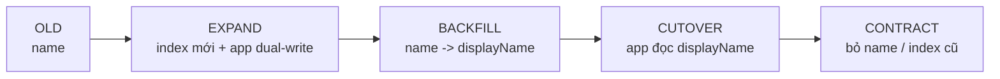
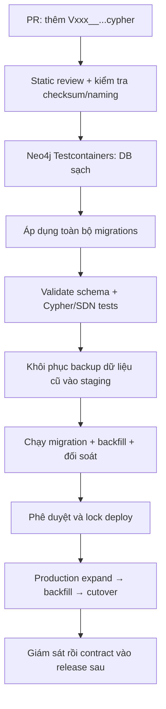

# Quản lý thay đổi mô hình bằng tập lệnh có phiên bản trong Neo4j

## 1. Vì sao graph cũng cần migration?

Neo4j sử dụng mô hình **property graph**: node có label và property, relationship có type, hướng và property. Không giống database quan hệ có bảng và cột cố định, Neo4j cho phép những node cùng label mang các property khác nhau. Điều đó tạo sự linh hoạt, nhưng **không có nghĩa mô hình dữ liệu có thể thay đổi tùy ý mà không quản lý phiên bản**.

Giả sử một ứng dụng Java/Spring Data Neo4j đang sử dụng:

```text
(:AppUser {userId: 'u-101', name: 'Lan'})
  -[:MEMBER_OF {role: 'DEV'}]->
(:Project {projectId: 'p-001', title: 'Graph Platform'})
```

Nhóm phát triển muốn đổi property `name` thành `displayName`, thêm index tra cứu, và sau này đổi relationship type `MEMBER_OF` thành `PARTICIPATES_IN`. Những thay đổi tưởng nhỏ này ảnh hưởng đồng thời:

- Các câu Cypher `MATCH`, `MERGE`, `SET` và `RETURN`.
- `@Node`, `@Property`, `@Relationship`, `@Id` của Spring Data Neo4j.
- Index, constraint và khóa nghiệp vụ dùng để tìm/gộp node.
- Dữ liệu cũ trong database production và dữ liệu mới được ghi trong lúc triển khai.
- Query đọc từ dashboard, worker nhập dữ liệu, API và hệ thống tích hợp.
- Quy trình rollback khi một phiên bản ứng dụng mới có lỗi.

Nếu mỗi lập trình viên tự chạy Cypher trên máy mình rồi “nhớ” sửa production, mô hình giữa các môi trường nhanh chóng lệch nhau. **Versioned migration** giải quyết vấn đề đó bằng cách lưu lịch sử thay đổi dưới dạng **tệp được quản lý trong Git**, thực hiện theo thứ tự, có cơ chế đánh dấu đã áp dụng và kiểm tra sai lệch.

### 1.1. Phân biệt ba loại thay đổi

| Loại thay đổi | Ví dụ | Tính chất |
| --- | --- | --- |
| **Schema/index/constraint** | `CREATE CONSTRAINT`, `CREATE INDEX`, `DROP INDEX` | Thay đổi cấu trúc ràng buộc, khả năng tìm kiếm |
| **Data migration** | Sao chép `u.name` sang `u.displayName` | Đụng tới dữ liệu hiện hữu; có thể rất lớn |
| **Graph refactoring** | Đổi label, relationship type/hướng, tách/gộp node | Thay đổi topology và ý nghĩa truy vấn |

Trong Neo4j, nhiều “thay đổi mô hình” là **chuyển đổi dữ liệu** chứ không chỉ sửa metadata. Ví dụ đổi tên relationship type không phải chỉ đổi một cột catalog: thực tế có thể phải tạo relationship mới, chuyển property, kiểm chứng hướng rồi mới xóa relationship cũ.

### 1.2. Migration của dữ liệu khác upgrade phiên bản server

**Model migration** thay đổi label, type, property, schema và các mẫu truy vấn của một ứng dụng. **DBMS upgrade** thay đổi phiên bản Neo4j, store format, Cypher/API và các thành phần vận hành. Có thể thực hiện cả hai trong một chương trình nâng cấp nhưng nên **tách kế hoạch, kiểm thử và mốc rollback**.

Từ Neo4j 2025.01, Neo4j Server dùng định dạng phiên bản theo năm/tháng (*CalVer*). Khi viết Cypher migration, cần đối chiếu cú pháp hỗ trợ trên **Neo4j/Cypher version đích**, không mặc nhiên dùng script kiểu Neo4j 4.x (`ON ... ASSERT ...`) trên hệ thống mới (`FOR ... REQUIRE ...`).

## 2. Những nguyên tắc của tập lệnh có phiên bản

Mỗi thay đổi được biểu diễn bằng một **migration** có danh tính duy nhất, được lưu cùng mã nguồn và review như thay đổi ứng dụng.

```text
src/main/resources/neo4j/migrations/
    V001__Create_app_user_id_constraint.cypher
    V002__Create_display_name_index.cypher
    V003__Enforce_display_name_presence.cypher
```

Đây là mẫu tên theo công cụ **Neo4j-Migrations**. Với một cơ chế runner khác, quy tắc đặt tên có thể khác; quan trọng là có **thứ tự và định danh ổn định**.

Một hệ thống migration có kiểm soát nên giữ metadata:

| Trường | Vai trò |
| --- | --- |
| `version` | Mốc tuần tự, ví dụ `001`, `002`, `003` |
| `description` | Lý do và nội dung thay đổi |
| `checksum` | Phát hiện nội dung script đã áp dụng bị sửa |
| `appliedAt` | Thời điểm chạy hoàn tất |
| `status` / lỗi | Đã áp dụng, đang chạy, thất bại hoặc cần can thiệp |
| `target database` | Database mà thay đổi tác động, ví dụ `appgraph` |
| `tool version` | Hữu ích khi kiểm tra tương thích, xử lý sự cố |

Một số trường do migration tool quản lý; chúng **không nhất thiết là property có đúng tên trên** trong database. Không tự giả định có bảng SQL tên `schema_history`: Neo4j-Migrations lưu lịch sử dưới dạng **subgraph** trong database quản lý schema, có thể là cùng database đích hoặc một database khác.

### 2.1. Versioned migration: chỉ áp dụng một lần

Đối với file `V002__Create_display_name_index.cypher`:

1. Runner phát hiện file chưa từng áp dụng vào database đích.
2. Runner kiểm tra trạng thái/phiên bản trước đó.
3. Chạy Cypher với transaction mode đã cấu hình.
4. Ghi nhận kết quả và checksum khi thành công.
5. Lần sau **bỏ qua** bản đã ghi trong history, không chạy lại tùy ý.

**Không sửa file V002 đã chạy trên bất kỳ môi trường chung nào.** Nếu muốn thay đổi index hoặc điều kiện nghiệp vụ, hãy tạo `V004__...`. Việc chỉnh nội dung V002 rồi deploy thường dẫn đến **checksum mismatch**, và đây là cảnh báo đúng, không phải lỗi cần bỏ qua bằng cách xóa history.

### 2.2. Repeatable migration khác versioned migration

Một số công cụ có **repeatable migration**: script có thể chạy lại khi checksum thay đổi. Chỉ dùng cho những thao tác thực sự an toàn khi chạy lại (ví dụ dựng lại một cấu hình dẫn xuất không phá dữ liệu) và khi hiểu rõ thứ tự với migration có phiên bản.

Không đưa vào repeatable script các lệnh:

- `CREATE (n:...)` không có khóa tránh trùng.
- `SET n.counter = n.counter + 1`.
- `DELETE`/`DETACH DELETE` không có điều kiện chặt.
- Tự động chuyển/đổi quan hệ có thể làm mất property hoặc tạo cạnh trùng.

Trong ví dụ của bài, **tất cả migration quan trọng đều là versioned**. Repeatable không thay thế logic idempotent hay review tác động.

### 2.3. Chỉ có một tác nhân điều phối migration tại một thời điểm

Nếu ba bản Spring Boot cùng khởi động và đều cố chạy `V003`, có thể có xung đột DDL, duplicate data migration, timeouts và lệch history. Cần:

- Một **migration tool có cơ chế lock/coordination** được kiểm chứng trên đúng phiên bản.
- Hoặc một **job migration riêng trong CI/CD** với deploy lock, hoàn tất trước khi rollout app.
- Không tự chế một Cypher `MERGE (:MigrationLock)` rồi cho rằng đã có distributed lock an toàn nếu chưa giải quyết transaction, lease, crash recovery và retries.

**History đúng không đồng nghĩa concurrency đúng**: cả cơ chế ghi history lẫn thực thi thay đổi đều phải được điều phối. Khi cluster thay leader giữa quá trình, runner cần xử lý trạng thái commit không rõ và kiểm tra history trước khi retry.

## 3. Đánh giá mô hình hiện tại trước khi thiết kế script

Giả định database ứng dụng `appgraph` đang chứa các node:

```cypher
MERGE (u:AppUser {userId: 'u-101'})
SET u.name = 'Lan'
MERGE (p:Project {projectId: 'p-001'})
SET p.title = 'Graph Platform'
MERGE (u)-[m:MEMBER_OF]->(p)
SET m.role = 'DEV';
```

**Chỉ chạy fixture trên database thử nghiệm**; không tạo/dọn dữ liệu demo trong production. Trong production, thay vào đó hãy dùng các truy vấn **chỉ đọc** để đánh giá dữ liệu thật:

```cypher
MATCH (u:AppUser)
RETURN count(u) AS totalUsers,
       count(u.userId) AS hasBusinessId,
       count(u.name) AS hasOldName,
       count(u.displayName) AS hasNewName;
```

Đọc đúng `count(property)`: nó **bỏ qua null**, khác `count(*)` hoặc `count(u)`. Để tìm khóa business thiếu:

```cypher
MATCH (u:AppUser)
WHERE u.userId IS NULL
RETURN count(u) AS missingUserIds;
```

Để tìm business ID trùng:

```cypher
MATCH (u:AppUser)
WHERE u.userId IS NOT NULL
WITH u.userId AS businessId, count(*) AS occurrences
WHERE occurrences > 1
RETURN businessId, occurrences
ORDER BY occurrences DESC, businessId
LIMIT 20;
```

Truy vấn sau xem mức độ trùng cạnh cũ theo một cặp node:

```cypher
MATCH (u:AppUser)-[r:MEMBER_OF]->(p:Project)
WITH u.userId AS userId,
     p.projectId AS projectId,
     count(r) AS relationships
WHERE relationships > 1
RETURN userId, projectId, relationships
ORDER BY relationships DESC, userId, projectId;
```

Nếu một cặp user-project có **nhiều** quan hệ `MEMBER_OF` hợp lệ với ý nghĩa khác nhau (ví dụ nhiều kỳ tham gia), câu `MERGE (u)-[:PARTICIPATES_IN]->(p)` có thể **gộp nhầm** các sự kiện khi migrate. Cần quyết định khóa relationship ổn định hoặc chuyển chúng thành node membership có ID riêng trước khi viết script.

### 3.1. Kiểm kê schema hiện có

```cypher
SHOW CONSTRAINTS
YIELD name, type, entityType, labelsOrTypes, properties
RETURN name, type, entityType, labelsOrTypes, properties
ORDER BY name;
```

```cypher
SHOW INDEXES
YIELD name, type, entityType, labelsOrTypes,
      properties, state, populationPercent
RETURN name, type, entityType,
       labelsOrTypes, properties, state, populationPercent
ORDER BY name;
```

Đây là câu Cypher quản trị; cần quyền tương ứng. **Không xem `@Id` của Spring Data Neo4j là một uniqueness constraint đã tồn tại**. Annotation Java quyết định mapping entity, còn constraint/index là đối tượng thực được Neo4j engine kiểm tra.

Trong mô hình production nên ghi nhận:

- Khóa định danh của node và relationship, kể cả từ hệ thống nguồn.
- Các label/type được API và pipeline sử dụng.
- Constraint hiện có và tên index/constraint thật (kể cả index do constraint sở hữu).
- Dung lượng dữ liệu cần backfill, độ phân bố node bậc cao và tốc độ ghi hiện tại.
- Phiên bản Neo4j, Cypher 5/25, APOC, Java Driver, Spring Data Neo4j và migration runner.

## 4. DDL migration đầu tiên: khóa nghiệp vụ và index

### 4.1. V001 — đảm bảo `userId` duy nhất

Nội dung file `V001__Create_app_user_id_constraint.cypher`:

```cypher
CREATE CONSTRAINT app_user_id_unique IF NOT EXISTS
FOR (u:AppUser)
REQUIRE u.userId IS UNIQUE;
```

Constraint uniqueness của node là loại được Neo4j hỗ trợ rộng rãi; trên các phiên bản hiện hành, nó có **range index hỗ trợ**. Trước khi tạo, cần kiểm tra trùng khóa và sửa dữ liệu vi phạm.

**Không hiểu nhầm `IF NOT EXISTS`:**

- Nếu constraint tương đương đã có, lệnh có thể không làm gì.
- Nếu đối tượng index hoặc constraint có tên xung đột, dữ liệu đã trùng, hay schema không tương thích, vẫn có thể báo lỗi.
- Nó **không hợp nhất node trùng**, không tự cấp `userId` cho node thiếu ID.
- Uniqueness không tương đương yêu cầu property phải tồn tại ở mọi node. Muốn ràng buộc **vừa có giá trị vừa duy nhất**, cần đánh giá **node key constraint** (Enterprise) và độ sạch dữ liệu.

Trên Neo4j Enterprise có thể cân nhắc:

```cypher
// Ví dụ thay thế trong trường hợp cần cả tồn tại và duy nhất.
// Không tạo song song vô thức với constraint cùng schema.
CREATE CONSTRAINT app_user_id_key IF NOT EXISTS
FOR (u:AppUser)
REQUIRE u.userId IS NODE KEY;
```

Lựa chọn uniqueness **hoặc** key constraint phải dựa trên phiên bản/edition, dữ liệu hiện có, quyền DDL và mô hình nghiệp vụ; không copy cả hai lệnh cho cùng một schema mà không kiểm tra tương tác.

### 4.2. V002 — tạo index cho property mới trước khi chuyển đọc

Nội dung file `V002__Create_display_name_index.cypher`:

```cypher
CREATE RANGE INDEX app_user_display_name_idx IF NOT EXISTS
FOR (u:AppUser)
ON (u.displayName);
```

Điểm quan trọng:

- Index có thể được tạo **trước khi** dữ liệu mới được backfill. Nó bắt đầu phục vụ các node có property được index theo quy tắc index.
- Lệnh tạo index có thể trả quyền điều khiển trước khi index hoàn tất population. Để ứng dụng/query mới phụ thuộc index, cần kiểm tra `state = 'ONLINE'`.
- Index cải thiện tìm kiếm phù hợp nhưng tạo chi phí ghi thêm trong giai đoạn dual-write/backfill.

Xác minh index:

```cypher
SHOW INDEXES
YIELD name, type, state, populationPercent
WHERE name = 'app_user_display_name_idx'
RETURN name, type, state, populationPercent;
```

Chờ index `ONLINE` rồi mới benchmark/rollout truy vấn cần nó. Không mặc định mọi query `WHERE u.displayName = $value` đều chắc chắn dùng index: Cypher planner cân nhắc cardinality và điều kiện khác; kiểm tra bằng `EXPLAIN`/`PROFILE`.

### 4.3. Schema operation không tự sửa dữ liệu hiện có

`CREATE INDEX` không tự sao chép `u.name` thành `u.displayName`. Cũng không có lệnh “RENAME COLUMN” chung cho mọi node property như SQL. Migration model cần bước **backfill dữ liệu**, có kế hoạch kiểm tra những node thiếu/null và ứng dụng nào đang ghi schema cũ.

## 5. Zero-downtime model migration: expand → backfill → cutover → contract

Một thay đổi có thể triển khai theo các pha:



### 5.1. EXPAND — thêm cấu trúc mới mà chưa phá cái cũ

Triển khai `V001`/`V002`, sau đó đưa ứng dụng vào chế độ **tương thích cả hai property**:

```cypher
// Ví dụ query đọc trong giai đoạn chuyển đổi.
MATCH (u:AppUser {userId: $userId})
RETURN u.userId AS userId,
       coalesce(u.displayName, u.name) AS displayName;
```

Khi ghi một user:

```cypher
MATCH (u:AppUser {userId: $userId})
SET u.name = $newName,
    u.displayName = $newName
RETURN u.userId AS userId;
```

Tại sao cần **dual-write**? Vì trong thời gian rolling deploy, có instance ứng dụng cũ chỉ đọc `name` còn instance mới đọc `displayName`. Nếu version mới chỉ ghi field mới, version cũ có thể không thấy cập nhật; nếu version cũ chỉ ghi field cũ sau backfill, field mới lại **lỗi thời**.

**Cảnh báo:** để đạt zero-downtime thật, phải quản lý thời điểm dừng writer cũ hoặc đồng bộ liên tục cả hai property. Một lần backfill **không thể** ngăn một instance cũ tiếp tục thay đổi `name` sau đó. Với Spring Data Neo4j, chỉ đổi annotation `@Property("name")` thành `@Property("displayName")` **không tự tạo dual-write**; cần custom query/converter/service có chủ đích.

### 5.2. BACKFILL — chuyển dữ liệu đang tồn tại

Với dữ liệu nhỏ, một transaction Cypher có thể đủ:

```cypher
MATCH (u:AppUser)
WHERE u.displayName IS NULL AND u.name IS NOT NULL
SET u.displayName = u.name;
```

Đây là phép sao chép **không phá field cũ**. Chạy lại sau lỗi vẫn an toàn theo logic “chỉ lấp nếu thiếu”, nhưng nó **không đồng bộ** được một `displayName` đã khác `name` sau khi application cũ ghi lại field cũ. Vì vậy cần dual-write/đóng băng writer cũ và cơ chế đối soát trước khi cutover.

Với dữ liệu lớn (hàng triệu node), chia theo batch nhằm giới hạn bộ nhớ và lock:

```cypher
MATCH (u:AppUser)
WHERE u.displayName IS NULL AND u.name IS NOT NULL
CALL (u) {
  SET u.displayName = u.name
} IN TRANSACTIONS OF 1000 ROWS;
```

**Đây là job backfill vận hành riêng, không đặt nguyên câu này vào file V003 chạy bằng runner mặc định.** Neo4j chỉ cho `CALL { ... } IN TRANSACTIONS` chạy trong **implicit transaction**. Các runner phiên bản thông thường thực thi script migration bên trong explicit transaction, vì vậy việc trộn lẫn có thể báo lỗi. Với Neo4j Browser dùng `:auto`; với Java Driver, một câu Cypher qua `session.run(...)` implicit và gọi `consume()` để chờ hoàn tất; **không** gọi query này bên trong `executeWrite(tx -> ...)`.

Sau khi một batch đã commit, các batch trước đó **không bị rollback** nếu batch sau lỗi. Cần:

- Một job/run ID, mốc tiến độ (*checkpoint*) và người chịu trách nhiệm.
- Logic idempotent, có khả năng chạy lại các node chưa hoàn thành.
- Kiểm tra tổng số node đã xử lý, chưa xử lý và số lỗi.
- Giới hạn số transaction đồng thời để tránh lock contention, replication lag và overload.
- Giới hạn snapshot của query/mốc dữ liệu nguồn nếu tính nhất quán đòi hỏi một trạng thái không đổi.

Nếu query quét lại toàn bộ graph qua nhiều giờ, kế hoạch batch và index/partition phù hợp sẽ quan trọng hơn việc cố tăng `1000` lên một con số ngẫu nhiên.

### 5.3. CUTOVER — chuyển người đọc sang schema mới

Sau khi backfill kết thúc, xác minh:

```cypher
MATCH (u:AppUser)
WHERE u.name IS NOT NULL AND u.displayName IS NULL
RETURN count(u) AS missingNewName;
```

Với mọi node có `name` gốc mà nghiệp vụ yêu cầu chuyển, kỳ vọng `missingNewName = 0`.

Kiểm tra các giá trị khác nhau (trong cửa sổ ứng dụng đã đồng bộ cả hai trường):

```cypher
MATCH (u:AppUser)
WHERE u.name IS NOT NULL
  AND u.displayName IS NOT NULL
  AND u.name <> u.displayName
RETURN count(u) AS inconsistentNames;
```

Kỳ vọng `inconsistentNames = 0` nếu nghiệp vụ yêu cầu hai property đồng nhất. Nếu doanh nghiệp cố tình dùng `displayName` khác `name`, **không** sử dụng tiêu chí này; xác định lại transform và expected state theo domain.

Khi các phép đo đạt, triển khai code mới:

```cypher
MATCH (u:AppUser {userId: $userId})
RETURN u.displayName AS displayName;
```

Giữ dual-write một thời gian để rollback phiên bản ứng dụng nếu cần. Theo dõi số writer cũ, số node thiếu field, latency, tỷ lệ lỗi và query plan. Với hệ thống có API/mobile sử dụng trực tiếp data model hoặc pipeline ngoài, phải cập nhật **tất cả consumer**.

### 5.4. CONTRACT — loại schema cũ một cách có kiểm soát

Chỉ sau khi mọi reader/writer đã chuyển sang `displayName` và thời hạn rollback ứng dụng đã hết, mới xóa property `name`:

```cypher
// Chỉ minh họa trên bản sao thử nghiệm hoặc sau khi duyệt kế hoạch.
MATCH (u:AppUser)
WHERE u.name IS NOT NULL
REMOVE u.name;
```

Nếu dữ liệu lớn, đây cũng phải là một batch job riêng có checkpoint. **Xóa property là mất dữ liệu gốc**; rollback bằng cách deploy lại app cũ sẽ không tái tạo `name`. Trước khi chạy cần backup/PITR hoặc khả năng dựng lại từ `displayName` đã được xác minh và lưu vết phê duyệt.

Khi index cũ có tên riêng và không còn query dùng:

```cypher
DROP INDEX app_user_old_name_idx IF EXISTS;
```

**Không chạy lệnh DROP nếu không xác minh index tên đó đúng là đối tượng cần xóa.** Index backing cho uniqueness/node key constraint **thuộc constraint**, phải quản lý bằng `DROP CONSTRAINT` tương ứng nếu muốn thay, không coi là index rời có thể drop tùy tiện.

### 5.5. Khi nào mới tạo ràng buộc bắt buộc cho property mới?

Trên Neo4j **Enterprise**, nếu nghiệp vụ yêu cầu tất cả `:AppUser` có `displayName`:

```cypher
CREATE CONSTRAINT app_user_display_name_exists IF NOT EXISTS
FOR (u:AppUser)
REQUIRE u.displayName IS NOT NULL;
```

Đây là một ví dụ thích hợp cho `V003__Enforce_display_name_presence.cypher` **chỉ khi**:

1. Backfill đã hoàn thành.
2. Không còn writer tạo node thiếu `displayName`.
3. Những node thiếu không hợp lệ đã được sửa.
4. Version/edition hỗ trợ loại constraint này.

Nếu không thỏa, `CREATE CONSTRAINT` sẽ thất bại do dữ liệu cũ vi phạm. Không “chữa” bằng cách xóa node không hợp lệ khi chưa có chính sách dữ liệu. Constraint cũng có thể tạo chi phí xác minh quét dữ liệu khi thêm mới, cần đưa vào cửa sổ vận hành.

## 6. Đổi relationship type là di trú topology, không chỉ đổi tên Java field

Một thay đổi khác: dịch vụ muốn chuyển từ:

```text
(u:AppUser)-[:MEMBER_OF {role: 'DEV'}]->(p:Project)
```

sang:

```text
(u:AppUser)-[:PARTICIPATES_IN {role: 'DEV'}]->(p:Project)
```

Không có lệnh Cypher tổng quát kiểu `RENAME RELATIONSHIP TYPE` áp dụng tự động cho mọi mối quan hệ của graph. Ta thường **tạo quan hệ mới, chuyển property, chuyển các consumer và xóa quan hệ cũ**.

### 6.1. Chuẩn bị quy tắc mapping

Trước hết cần xác nhận:

| Điều kiện | Câu hỏi |
| --- | --- |
| Định danh | Một cặp `(u,p)` chỉ có **một** membership hay có nhiều bản theo thời gian? |
| Hướng | `AppUser -> Project` có giữ nguyên hay phải đảo chiều? |
| Thuộc tính | Có `role`, `createdAt`, `sourceId`, `validFrom/validTo` nào cần giữ? |
| Trùng lặp | Cùng một cặp có nhiều relationship cũ với property khác nhau không? |
| Consumer | Có query, GDS projection, báo cáo hoặc APOC procedure nào lọc type cũ? |
| Rollback | Khi ứng dụng cũ vẫn chạy, có cần cả type cũ và type mới không? |

Nếu dữ liệu có lịch sử nhiều membership giữa cùng hai node, **không** áp dụng `MERGE` theo endpoints mà không bổ sung khóa riêng. Ví dụ này chỉ đúng khi nghiệp vụ **mỗi cặp user-project có tối đa một membership**.

### 6.2. Tạo quan hệ mới, giữ quan hệ cũ

Trong database thử nghiệm đã kiểm tra uniqueness và chính sách một quan hệ cho mỗi cặp:

```cypher
MATCH (u:AppUser)-[old:MEMBER_OF]->(p:Project)
MERGE (u)-[new:PARTICIPATES_IN]->(p)
ON CREATE SET new = properties(old);
```

Ý nghĩa:

- `MATCH` đọc mọi quan hệ `MEMBER_OF` cũ.
- `MERGE` bảo đảm tồn tại quan hệ mới cho cặp node trong phạm vi pattern được tìm.
- `ON CREATE SET new = properties(old)` copy property khi **vừa tạo** quan hệ mới.
- **Không xóa** `old`: ứng dụng phiên bản cũ tiếp tục có thể hoạt động ở pha expand/backfill.

**Giới hạn quan trọng:** nếu `new` đã tồn tại nhưng property chưa đúng thì `ON CREATE SET` không sửa; cần query đối soát hoặc chính sách merge property. Nếu nhiều `old` cùng cặp, câu trên có thể làm mất sự khác biệt nghiệp vụ hoặc chọn dữ liệu không như mong muốn. Không kết luận chính xác chỉ vì tổng số relationship bằng nhau.

### 6.3. Kiểm tra graph sau di trú

```cypher
MATCH (:AppUser)-[r:MEMBER_OF]->(:Project)
RETURN count(r) AS oldCount;
```

```cypher
MATCH (:AppUser)-[r:PARTICIPATES_IN]->(:Project)
RETURN count(r) AS newCount;
```

Với một quan hệ cho mỗi cặp node và phạm vi mapping không đổi, hai số đếm cần bằng nhau. Kiểm tra cả các cặp chỉ có kiểu cũ:

```cypher
MATCH (u:AppUser)-[old:MEMBER_OF]->(p:Project)
WHERE NOT EXISTS {
  MATCH (u)-[:PARTICIPATES_IN]->(p)
}
RETURN u.userId AS userId,
       p.projectId AS projectId,
       old.role AS oldRole
ORDER BY userId, projectId
LIMIT 100;
```

Kỳ vọng **0 dòng**. Cần đối chiếu `role` và các property khác theo quy tắc domain; không chỉ đếm quan hệ.

Một truy vấn phát hiện bản mới khác thuộc tính:

```cypher
MATCH (u:AppUser)-[old:MEMBER_OF]->(p:Project)
MATCH (u)-[new:PARTICIPATES_IN]->(p)
WHERE old.role <> new.role
RETURN u.userId AS userId,
       p.projectId AS projectId,
       old.role AS oldRole,
       new.role AS newRole;
```

Lưu ý so sánh `<>` khi một vế `null` sẽ không trả `true`. Nếu `role` có thể null, dùng quy tắc đối chiếu null rõ ràng (ví dụ kiểm tra `old.role IS NULL` khác `new.role IS NULL`). Nếu muốn so **tất cả** property, cần chuẩn hóa map/khóa rồi so sánh ở tầng phù hợp.

### 6.4. Chuyển code và loại bỏ quan hệ cũ

Trong pha tương thích, có thể đọc cả hai type:

```cypher
MATCH (u:AppUser {userId: $userId})
      -[r:MEMBER_OF|PARTICIPATES_IN]->
      (p:Project)
RETURN DISTINCT p.projectId AS projectId
ORDER BY projectId;
```

`DISTINCT` cần thiết nếu cả hai loại quan hệ đồng thời tồn tại: nếu không, một project có thể xuất hiện hai lần. Tuy nhiên, không lạm dụng `DISTINCT` để che các quan hệ trùng đáng ngờ: ở các truy vấn đếm membership hoặc xử lý sự kiện, phải xác định rõ có đang đếm **người tham gia** hay **số relationship**.

Sau khi tất cả consumer đã chuyển, dual-write ở tầng app được ngừng có kiểm soát, và backup/phương án rollback đã sẵn sàng:

```cypher
// CHỈ chạy sau phê duyệt; ví dụ đối tượng đã được migrate.
MATCH (:AppUser)-[old:MEMBER_OF]->(:Project)
DELETE old;
```

Với số quan hệ lớn, phải chạy **batch job**, không đưa một lệnh xóa toàn bộ graph vào request ứng dụng. Nếu node đầu/cuối được dùng bởi quan hệ khác, chỉ `DELETE old` để không xóa node; **không dùng `DETACH DELETE`** cho thao tác đổi type.

### 6.5. Đổi node label cũng cần hai bước tương thích

Giả sử node đang mang label cũ `:LegacyUser` và cần chuyển sang `:AppUser`. Trong pha expand/backfill, có thể **thêm** label mới, giữ label cũ:

```cypher
MATCH (u:LegacyUser)
SET u:AppUser;
```

Một node có **hai label** vẫn là cùng một node, không sinh bản sao. Cần kiểm tra các constraint/index của label `AppUser` trước khi áp dụng rộng: dữ liệu mới có thể trùng `userId` với node `AppUser` đã tồn tại, khiến transaction gắn label bị từ chối bởi constraint.

Khi tất cả ứng dụng, query, import và GDS projection đã chuyển sang label mới, mới cân nhắc:

```cypher
// Chỉ chạy sau kiểm chứng trên môi trường thử nghiệm.
MATCH (u:LegacyUser:AppUser)
REMOVE u:LegacyUser;
```

Trên graph lớn, cả hai lệnh cần chia batch và quản lý checkpoint. Không chạy `DELETE u` để “xóa label cũ”, vì thao tác đó xóa **node cùng mọi dữ liệu/quan hệ liên quan**, không phải đổi tên label. Tương tự với quan hệ, việc đổi label chỉ bằng annotation `@Node("AppUser")` trong Java **không tự đổi dữ liệu đã lưu**.

## 7. Chọn công cụ thực thi: Neo4j-Migrations, Liquibase hay runner nội bộ?

### 7.1. Neo4j-Migrations là gì?

**Neo4j-Migrations** là một dự án trong hệ sinh thái Neo4j Labs, lấy cảm hứng từ Flyway nhưng làm việc với **Neo4j Java Driver/Bolt**. Nó không phải lệnh `neo4j-admin` tích hợp sẵn trong mọi Neo4j server và **không phải** tính năng mặc định của Spring Data Neo4j.

Công cụ có các thành phần:

- **CLI** cho việc áp dụng/xem trạng thái từ pipeline hoặc máy vận hành.
- **Core Java API** cho tích hợp và migration đặc biệt.
- **Spring Boot starter** và **Maven plugin** theo phiên bản công cụ tương thích.
- **Cypher script** theo tên version, cùng một số dạng migration khác.
- **Migration history** với checksum và cơ chế kiểm soát chạy đồng thời.

Tài liệu Neo4j Labs phiên bản 2.0 mô tả mặc định tìm migration ở `classpath:neo4j/migrations` với Java/Spring integrations; CLI yêu cầu chỉ định nơi tìm tương ứng. Trước khi cài, chọn **bản Neo4j-Migrations thực tế tương thích với Neo4j Server, Java và Spring Boot**; không sao chép dependency version cũ chỉ vì một ví dụ trên web.

### 7.2. Quy ước tên file và thứ tự

```text
src/main/resources/neo4j/migrations/
  V001__Create_app_user_id_constraint.cypher
  V002__Create_display_name_index.cypher
  V003__Enforce_display_name_presence.cypher
  V004__Create_participation_indexes.cypher
```

Theo quy ước Neo4j-Migrations:

- `V` đánh dấu **versioned migration**.
- Phần số dùng để sắp thứ tự có kiểm soát (ví dụ `001`, `002` hoặc một version phân đoạn).
- `__` là **hai dấu gạch dưới** giữa version và mô tả.
- `.cypher` là đuôi của file Cypher migration.
- Tên mô tả nói rõ một nhóm thay đổi có ý nghĩa.

Đặt version **không trùng**, không sửa file đã áp dụng; review nội dung script và điều kiện tiền đề của từng migration. Nếu hai nhánh Git cùng sinh `V004` khác nội dung, phải **giải quyết xung đột version trước khi merge**.

**Chú ý:** `V003` chỉ có thể được áp dụng sau backfill và xác minh; nếu pipeline triển khai tự chạy mọi file V ngay khi startup, nó có thể thực thi quá sớm. Các giai đoạn cần được tách theo release hoặc có migration location/flag đã điều phối phù hợp. **Đặt tất cả V001–V004 vào cùng một release không tự tạo ra zero-downtime.**

### 7.3. Các lệnh CLI thường gặp

Ví dụ cú pháp (CLI version tương thích đã được cài, endpoint và user chỉ là mẫu):

```bash
# Xem hướng dẫn đúng version được cài.
neo4j-migrations --help

# Liệt kê migration đã chạy/chờ chạy.
neo4j-migrations \
  --address neo4j+s://graph.internal.example:7687 \
  --username migration_runner \
  --database appgraph \
  --location file:./migrations \
  info

# Kiểm tra history và checksum.
neo4j-migrations \
  --address neo4j+s://graph.internal.example:7687 \
  --username migration_runner \
  --database appgraph \
  --location file:./migrations \
  validate

# Áp dụng các migration còn thiếu (trên môi trường được phê duyệt).
neo4j-migrations \
  --address neo4j+s://graph.internal.example:7687 \
  --username migration_runner \
  --database appgraph \
  --location file:./migrations \
  migrate
```

Không đưa mật khẩu thật vào command line hoặc source control; cách truyền secret phụ thuộc **CLI/runtime/CI secret manager**. Mẫu lệnh có thể yêu cầu thêm xác thực hoặc prompt trước khi kết nối. Không chạy những lệnh này trong thư mục bài học: chúng minh họa một **pipeline được DBA cấp quyền**.

Với CLI Neo4j-Migrations, `migrate`/`apply` là chế độ quản lý **history**; khác với `run --migration ...` dùng như script runner, có thể **không ghi migration history** và không tự bỏ qua script đã chạy. Không dùng lệnh `run` để thay thế một quy trình versioned nếu cần kiểm tra đã áp dụng.

`clean` của công cụ có thể xóa metadata quản lý migration; **không** xem đó là “rollback schema” hay cách đúng để xử lý checksum mismatch. Việc sửa/xóa history thủ công sẽ làm hệ thống không còn biết trạng thái thật.

### 7.4. Công cụ thay thế và runner tự xây

Những lựa chọn khác gồm plugin Neo4j cho **Liquibase** hoặc công cụ nội bộ. Dù dùng công cụ nào, tối thiểu cần:

1. Version và thứ tự migration rõ ràng.
2. Lịch sử theo **database đích** và checksum để phát hiện drift.
3. Cơ chế một tác nhân chạy migration và khôi phục khi runner crash.
4. Phân biệt DDL transactional, data backfill nhiều transaction và tác vụ ngoài database.
5. Logging, báo lỗi, audit và khả năng **dừng deploy** khi migration không đạt.
6. Điều kiện tiền đề/hậu điều kiện, kiểm tra nhiều edition/version và chính sách rollback.

**Flyway cho relational/JDBC không tự tạo versioned migration cho Neo4j** nếu chưa có integration thực sự hỗ trợ. Cũng không mặc định Hibernate `ddl-auto=update` hoặc Spring Data Neo4j repository `save(...)` quản lý schema Neo4j thay bạn.

## 8. Transaction, backfill và tính an toàn khi chạy lại

### 8.1. Một file migration không phải lúc nào cũng là một transaction duy nhất

Trong tài liệu Neo4j-Migrations, các Cypher statement của một script mặc định được thực thi trong **một transaction** theo cấu hình tương ứng. Nhưng cách tổ chức transaction có thể khác khi:

- Runner chọn transaction-per-statement.
- Script chứa lệnh quản trị database phải chạy trong ngữ cảnh riêng.
- Dữ liệu quá lớn nên chuyển sang backfill job độc lập.
- Một workflow gồm app deploy, DDL, data migration, verification và cleanup.

Đừng áp đặt “script có 50 câu Cypher nên tất cả luôn rollback cùng nhau” khi runner đã cấu hình commit từng câu hoặc job chạy nhiều transaction. Phải biết chính xác transaction boundary của công cụ.

### 8.2. Tại sao `CALL ... IN TRANSACTIONS` cần quy trình riêng?

```cypher
MATCH (u:AppUser)
WHERE u.displayName IS NULL AND u.name IS NOT NULL
CALL (u) {
  SET u.displayName = u.name
} IN TRANSACTIONS OF 500 ROWS;
```

Query này chạy batch bằng **inner transactions**. Nếu batch thứ 7 lỗi, các batch 1–6 **đã commit** không tự rollback; có thể phải chạy lại phần chưa xong. Vì vậy:

- Phần đánh dấu migration `Vxxx` **không tự đại diện** cho trạng thái hoàn thành của mọi batch.
- Nên có bảng/graph tiến độ do job quản lý hoặc audit log bền vững (không sửa history của migration tool).
- Phải chọn query idempotent và xác minh số bản ghi thực sự đạt trạng thái đích.
- Job nên báo lỗi và **chặn cutover** nếu chưa đạt; không ghi status “success” chỉ vì đã khởi động.

Nếu data migration đụng tới các node hub hoặc relationship giữa nhiều node, batch lớn/concurrent có thể gây lock contention/deadlock. Tăng song song chỉ khi có khóa phân vùng không giao nhau và kiểm thử.

### 8.3. Nên dùng checkpoint theo khóa nghiệp vụ, không dùng internal ID

Một pipeline lớn có thể chia theo `userId` đã có index/constraint và ghi:

```text
jobId: rename-app-user-name-2026-11
targetDatabase: appgraph
lastCompletedBusinessId: u-0800000
processed: 800000
failed: 0
sourceModelVersion: v-old
targetModelVersion: v-new
```

Các trường trên là **metadata ví dụ**, không phải Cypher tự động tạo. Khi resume, runner cần xác nhận dữ liệu nguồn mới có xen vào không, input sort ổn định và những row đã cập nhật lại có bỏ qua an toàn không. Không dùng `id(n)` hoặc `elementId(n)` làm khóa nghiệp vụ lâu dài vì chúng không ổn định qua các vòng đời khác nhau của database.

Một phương án khác là tìm theo trạng thái `WHERE u.displayName IS NULL` để chạy lặp cho đến khi 0, nhưng vẫn phải tránh writer cũ tiếp tục đưa giá trị sai và phải đo index/scan cost trên graph lớn.

### 8.4. Không né xung đột bằng cách bỏ validation

Một migration fail vì:

- Trùng business ID.
- Thiếu property required.
- Index/constraint name đang bị đối tượng khác chiếm.
- Quyền schema chưa đủ.
- Transaction bị rollback, deadlock, timeout hoặc mất writer/quorum.

Cách xử lý đúng là **xác minh trạng thái thật**, sửa dữ liệu/điều kiện nền tảng và chạy lại theo runbook, chứ không cập nhật checksum/history để “xanh” dù chưa có schema mong muốn.

## 9. Spring Data Neo4j và kế hoạch tương thích ứng dụng

### 9.1. Mapping Java có thể đổi trước dữ liệu

Ví dụ lớp cũ:

```java
@Node("AppUser")
public class AppUser {
    @Id
    private String userId;

    @Version
    private Long version;

    @Property("name")
    private String displayName;
}
```

Khi đổi sang:

```java
@Property("displayName")
private String displayName;
```

SDN sẽ đọc/ghi **property khác** trong database. Đây **không** phải lệnh rename dữ liệu cũ, và nó không bảo đảm rolling deploy an toàn. Cần một giai đoạn dual-read/dual-write có kiểm soát (ví dụ custom `Neo4jClient` query, service chuyển đổi hoặc adapter) trước khi bỏ field cũ.

**Lưu ý phiên bản entity:** khi sử dụng business ID có sẵn với SDN, `@Version` có vai trò phát hiện entity mới và optimistic locking. Không tự chỉnh giá trị `version` trong script backfill trừ khi đã phân tích tác động tới concurrency của repository; nếu một pipeline ngoài sửa data mà không tăng/kiểm soát version, ứng dụng có thể ghi đè field mới theo object state cũ. Thiết kế ownership và transaction rõ ràng.

### 9.2. Một API hỗ trợ cả cũ lẫn mới

Ví dụ service đọc user theo ưu tiên property mới:

```java
import java.util.Map;
import java.util.Optional;
import org.springframework.data.neo4j.core.Neo4jClient;
import org.springframework.stereotype.Service;

@Service
public class AppUserReadService {
    private final Neo4jClient neo4jClient;

    public AppUserReadService(Neo4jClient neo4jClient) {
        this.neo4jClient = neo4jClient;
    }

    public Optional<String> displayName(String userId) {
        return neo4jClient.query("""
            MATCH (u:AppUser {userId: $id})
            RETURN coalesce(u.displayName, u.name) AS displayName
            """)
            .bind(userId).to("id")
            .fetchAs(String.class)
            .mappedBy((typeSystem, record) ->
                record.get("displayName").asString()
            )
            .one();
    }
}
```

Đoạn mã mang tính minh họa cách đọc trong giai đoạn tương thích; nếu cả hai property đều null, `record.get(...).asString()` có thể lỗi. Một ứng dụng thật cần kiểm tra null, quy tắc dữ liệu thiếu và kiểu dữ liệu. Khi mọi node đã có `displayName`, thay query bằng property mới đơn nhất.

### 9.3. Ma trận triển khai không ngừng dịch vụ

| Giai đoạn | Version ứng dụng | Database | Điều kiện an toàn |
| --- | --- | --- | --- |
| Trước thay đổi | App v1 đọc/ghi `name` | Chỉ có `name` | Baseline/backup đầy đủ |
| Expand | App v1 và v2 hỗ trợ dual-read/write | Có index mới, `name` còn nguyên | v2 không đòi `displayName` bắt buộc |
| Backfill | v2 đã phủ mọi writer hoặc có đồng bộ tương đương | Dần bổ sung `displayName` | Job có checkpoint, không có writer cũ làm lệch giá trị |
| Cutover | App v3 đọc `displayName`, tạm giữ dual-write | Cả hai property còn tồn tại | Verification PASS, rollback app còn khả thi |
| Contract | App v4 chỉ dùng `displayName` | Bỏ `name` và index cũ | Tất cả consumer đã chuyển, backup và phê duyệt |

**Không gán nhãn zero-downtime** nếu DDL tạo constraint làm block query quá lâu, data migration gây quá tải writer, hoặc ứng dụng một thời điểm có cả phiên bản cũ ghi field cũ sau khi field mới được coi là nguồn chân lý.

## 10. Kiểm thử migration ở CI/CD và staging

### 10.1. Thứ tự pipeline đề xuất



Kiểm thử **trên database trắng** cần thiết nhưng không đủ: production thường chứa duplicate, null, relationship không chuẩn và dữ liệu lịch sử mà fixture sạch không có. **Test trên bản sao dữ liệu production đã khử thông tin nhạy cảm hoặc backup staging được phê duyệt** mới giúp phát hiện nhiều lỗi backfill.

### 10.2. Các test bắt buộc cho schema migration

**Trước migration**:

```cypher
MATCH (u:AppUser)
WITH u.userId AS id, count(*) AS n
WHERE id IS NOT NULL AND n > 1
RETURN count(*) AS duplicateKeyGroups;
```

Kỳ vọng 0 trước khi tạo uniqueness constraint. Tiếp theo:

```cypher
SHOW CONSTRAINTS
YIELD name, type, labelsOrTypes, properties
WHERE name = 'app_user_id_unique'
RETURN name, type, labelsOrTypes, properties;
```

Kỳ vọng constraint tồn tại với label `AppUser` và property `userId`, **không chỉ** tên gần giống. Kiểm tra index:

```cypher
SHOW INDEXES
YIELD name, state, populationPercent, labelsOrTypes, properties
WHERE name = 'app_user_display_name_idx'
RETURN name, state, populationPercent, labelsOrTypes, properties;
```

Kỳ vọng `state = 'ONLINE'` và schema đúng với cấu hình.

**Sau backfill**:

```cypher
MATCH (u:AppUser)
RETURN count(u) AS total,
       count(u.displayName) AS hasDisplayName,
       count(u.name) AS hasOldName;
```

Nêu rõ business rule: nếu mọi node `AppUser` đều bắt buộc có tên, `total` phải bằng `hasDisplayName`. Nếu có anonymous user hợp lệ, bài test cần tách nhóm tương ứng thay vì ép toàn bộ node phải có giá trị.

### 10.3. Ví dụ JUnit dùng Neo4j Java Driver

Trong một test đã được pipeline tạo database và **áp dụng V001/V002**, kiểm tra:

```java
import static org.junit.jupiter.api.Assertions.*;
import org.junit.jupiter.api.Test;
import org.neo4j.driver.Driver;
import org.neo4j.driver.Session;
import org.neo4j.driver.SessionConfig;

class MigrationVerificationTest {
    private final Driver driver;

    MigrationVerificationTest(Driver driver) {
        this.driver = driver;
    }

    @Test
    void appUserIdConstraintShouldExist() {
        try (Session session = driver.session(
                SessionConfig.forDatabase("appgraph"))) {
            long count = session.run("""
                SHOW CONSTRAINTS
                YIELD name
                WHERE name = 'app_user_id_unique'
                RETURN count(*) AS n
                """).single().get("n").asLong();
            assertEquals(1L, count);
        }
    }

    @Test
    void displayNameIndexShouldBeOnline() {
        try (Session session = driver.session(
                SessionConfig.forDatabase("appgraph"))) {
            String state = session.run("""
                SHOW INDEXES
                YIELD name, state
                WHERE name = 'app_user_display_name_idx'
                RETURN state
                """).single().get("state").asString();
            assertEquals("ONLINE", state);
        }
    }
}
```

Ví dụ là **phần logic kiểm tra**, không phải test class chạy độc lập không cần setup: `Driver` phải được cấp bởi JUnit extension/fixture hoặc container test, database `appgraph` phải tồn tại và runner đã migrate. Cũng cần kiểm tra constraint type/schema, không chỉ tên, trong suite chính thức. Không dùng `@Test` ở ví dụ để suy ra mọi môi trường tự có Docker hoặc user được cấp quyền `SHOW CONSTRAINTS`.

Để kiểm tra ứng dụng cuối cùng, chạy thêm integration test thực hiện `repository.save(...)`/`MATCH` trên model SDN mới, thử lỗi uniqueness và kiểm tra query theo relationship type mới. Test rollback thử lỗi ở pha backfill bằng cách dừng job giữa chừng rồi **resume**, bảo đảm không tạo node/cạnh trùng.

### 10.4. Migration status phải là cổng chặn release

Trong CI/CD, phải dừng rollout nếu:

- Migrations thiếu, trùng version hoặc checksum đã thay đổi.
- DDL fail hoặc index còn `POPULATING` khi release cần sử dụng nó.
- Backfill chưa hoàn thành/checkpoint lỗi.
- Query hậu kiểm chứng minh vẫn còn dữ liệu không phù hợp model mới.
- Không có backup/rollback runbook cho bước xóa dữ liệu/constraint.
- Một service cũ hoặc external consumer vẫn sử dụng label/property/type dự định bị xóa.

Không đưa một migration lỗi vào production rồi cho ứng dụng mới tự “bù” bằng truy vấn ngầm mỗi khi request đến.

## 11. Rollback, roll-forward và khả năng khôi phục

### 11.1. Không phải mọi migration có `down()` an toàn

| Thay đổi | Có thể rollback bằng DDL? | Rủi ro |
| --- | --- | --- |
| Tạo index mới | Thường có thể `DROP INDEX` đúng tên | Mất hiệu năng query mới; xóa nhầm backing index sẽ lỗi |
| Tạo uniqueness constraint | Có thể drop constraint được phê duyệt | Dữ liệu có thể trở lại trạng thái trùng trong thời gian vắng constraint |
| Sao chép `name` sang `displayName`, còn giữ `name` | Có thể cho app đọc lại field cũ | Nếu dual-write không đầy đủ, giá trị có thể không đồng nhất |
| Xóa `name` khỏi tất cả node | **Không tự động** phục hồi nội dung đã xóa | Phải dựa vào backup, source khác hoặc transform ngược có chứng minh |
| Gộp node/xóa quan hệ cũ | Có thể không đảo ngược được | ID, direction, property và sự kiện có thể đã mất |
| Backfill nhiều transaction | Không rollback toàn job | Những batch đã commit vẫn còn, cần kế hoạch resume/compensation |

**Roll-forward** thường an toàn hơn “tự sửa migration history”: tạo migration mới để khắc phục lỗi, hoặc deploy phiên bản ứng dụng tương thích và tiếp tục backfill. Khi cần trở về mốc dữ liệu cũ, dùng backup/PITR và runbook của database, có tính toán mất dữ liệu cập nhật hợp lệ sau điểm restore.

### 11.2. Quy trình xử lý migration thất bại

1. Dừng tác nhân migration/app rollout đang chạy, giữ logs và lỗi gốc.
2. Xác định file/version, transaction boundary, liệu có batch đã commit.
3. Đọc migration history **qua công cụ**, không tùy ý sửa node metadata.
4. So sánh schema thật bằng `SHOW INDEXES`/`SHOW CONSTRAINTS` và dữ liệu thật bằng query đối soát.
5. Phân loại lỗi: dữ liệu vi phạm constraint, thiếu quyền, mất connection/leader, sai cú pháp phiên bản hoặc partial batch.
6. Chọn **resume** nếu idempotent, **migration sửa lỗi mới** nếu thay đổi semantics, hoặc **restore** nếu đã phá dữ liệu quan trọng.
7. Chạy hậu kiểm chứng, kiểm tra ứng dụng cùng dữ liệu nguồn và quyết định tiếp tục rollout.

Không dùng lệnh `DELETE` node migration history, `clean` hoặc lách checksum chỉ để pipeline xanh. Nếu bắt buộc repair state, cần phê duyệt DBA, backup, kiểm chứng history và ghi audit; API repair của mỗi tool có quy tắc riêng.

### 11.3. Backup và PITR phải tồn tại trước contract

Trước khi loại property cũ, xóa relationship hoặc gộp node:

- Tạo/kiểm tra backup phù hợp edition; với Enterprise dùng quy trình online backup, với Community có thể dùng offline dump theo điều kiện.
- Chọn thời điểm/transaction ID phục hồi; xác minh backup chain, định dạng và version.
- Có **restore drill** trên môi trường cô lập với dữ liệu đại diện.
- Định nghĩa RPO/RTO và thời gian để chạy **bù event hợp lệ** nếu restore về mốc trước.
- Có người quyết định cutover và ký xác nhận dữ liệu sau khôi phục.

Cluster replication **không thay thế backup**: thao tác `DELETE` hoặc `REMOVE` sai có thể được nhân bản hợp lệ tới các primary/secondary. Đối với AuraDB, chính sách snapshot/restore và quyền phụ thuộc gói dịch vụ, không chạy `neo4j-admin` như với self-managed server.

## 12. Nhiều môi trường, nhiều database và cluster

### 12.1. Đừng dùng một history chung cho mọi database mà không phân biệt target

Trong Neo4j Enterprise có thể có `system`, `appgraph`, `analytics` và các database của tenant. Mỗi database có:

- Model và tập bản ghi riêng.
- Schema index/constraint riêng.
- Quá trình rollout/độ trễ migration riêng.
- Permission/role của migration runner riêng.

Neo4j-Migrations hỗ trợ tách **target database** và **schema/history database** theo cấu hình. Khi dùng một schema database để theo dõi nhiều target, phải giữ ID target rõ ràng. Không xem “`V002` đã chạy ở `appgraph`” là đủ để biết `analytics` đã có cùng index.

### 12.2. Cluster: migration chỉ chạy với writer hợp lệ

Với Neo4j Enterprise cluster, mỗi database có nhóm primary và **một writer/leader tại một thời điểm**. Runner nên dùng URI routing như `neo4j+s://...`, chọn đúng database và có quyền schema/ghi cần thiết. Khi cluster mất quorum, thay leader hoặc read-only:

- Migration có thể thất bại tạm thời hoặc chờ.
- Retry cần dựa vào trạng thái commit/history; không tự thực thi một migration đã hoàn tất lần nữa chỉ vì network timeout.
- Backfill lớn có thể làm tăng replication lag, disk IO và write latency của ứng dụng.
- Không khởi chạy runner độc lập trên mọi primary như thể chúng là database khác nhau.

Nếu ứng dụng cần nhiều database tenant, pipeline phải **liệt kê mục tiêu và xác minh từng target**, nhưng chỉ trong phạm vi được phê duyệt; không dùng wildcard vô kiểm soát để chạy script phá dữ liệu.

### 12.3. Quyền tối thiểu cho migration identity

Tài khoản vận hành migration có thể cần quyền **RBAC** (*role-based access control*) phù hợp:

- `CREATE/DROP INDEX` và `CREATE/DROP CONSTRAINT` theo đúng DB.
- Đọc/ghi node, relationship và property cần backfill.
- Xem schema bằng `SHOW INDEXES`/`SHOW CONSTRAINTS`.
- Quyền với database history nếu tách riêng, cùng quyền quản lý migration metadata.
- Quyền quản trị database/users **chỉ khi** migration thực sự liên quan đến các đối tượng đó.

Không cấp toàn quyền DBMS admin cho ứng dụng runtime chỉ vì cần chạy migration ở lúc startup. Tách **migration runner identity** khỏi tài khoản `app_reader`/`app_writer` trong vận hành thực tế.

## 13. Lỗi thường gặp khi quản lý migration bằng file

| Hiện tượng | Nguyên nhân | Cách xử lý |
| --- | --- | --- |
| Môi trường A có constraint, B không có | Manual Cypher không qua migration runner | Đối chiếu schema và đưa mọi thay đổi vào history |
| Cùng `V002` nhưng checksum khác | Có người sửa migration đã áp dụng | Khôi phục file gốc; tạo migration mới |
| Ứng dụng mới không thấy `displayName` | Chỉ đổi `@Property`, chưa backfill | Expand/dual-read/write/backfill và hậu kiểm |
| `CREATE CONSTRAINT` thất bại | Duplicate, missing property (với key/existence), tên/schema xung đột | Làm sạch dữ liệu và xem constraint cụ thể |
| `IF NOT EXISTS` chạy “thành công” nhưng schema không như ý | Có constraint/index khác chặn tạo | `SHOW INDEXES/CONSTRAINTS`, kiểm tra signature |
| Index vẫn `POPULATING` | Chưa hoàn tất index population | Đợi `ONLINE` trước query nhạy hiệu năng |
| Batch được 80%, runner báo lỗi | Các inner transactions đã commit từng phần | Resume theo checkpoint/idempotent, không đánh dấu hoàn tất |
| Migration app chạy từ nhiều instance | Không có orchestration hoặc lock đủ mạnh | Một job CI/CD hoặc runner coordination đúng |
| Ghi tên user bị mất khi rolling deploy | Writer cũ chỉ sửa `name`, v2 đọc `displayName` | Cần dual-write và giám sát toàn bộ writer |
| Đổi type quan hệ làm trùng kết quả | Reader match cả cũ/mới, hoặc duplicate edge | Quy tắc loại trùng đúng nghiệp vụ, verify endpoint/property |
| `MERGE` gộp nhiều membership hợp lệ | Không có relationship business key | Thiết kế ID hoặc mô hình membership theo thời gian |
| Rollback app cũ không còn đọc được | Contract đã xóa property/type cũ | Delay contract, backup/PITR và forward fix có kế hoạch |
| Neo4j-Migrations `run` không hiện history | Script runner không ghi versioned history | Dùng `migrate/apply` theo tài liệu |
| DDL thành công nhưng query cũ timeout | Index/plan thay đổi hoặc resource contention | Benchmark, staged rollout và theo dõi `PROFILE` |
| Migration fail sau leader failover | Transaction outcome chưa rõ | Kiểm tra history/schema/dữ liệu rồi retry an toàn |
| Data test trên DB trống PASS, production FAIL | Dữ liệu cũ có trùng/null/quan hệ lạ | Staging từ bản sao dữ liệu thực đã làm sạch PII |

## 14. Bài thực hành: một thay đổi có phiên bản từ đầu đến cuối

Thực hiện trên **Neo4j database thử nghiệm**, dùng Neo4j-Migrations hoặc runner đã cấu hình an toàn.

1. **Tạo graph cũ:** hai user `:AppUser` có `userId` và `name`, một project `:Project` và các cạnh `:MEMBER_OF` có `role`.
2. **Khảo sát dữ liệu:** dùng `MATCH ... count(*)`, kiểm tra user thiếu/trùng ID và số relationship theo cặp. Nêu điều kiện mà `MERGE` có thể gộp sai.
3. **Viết V001:** tạo uniqueness constraint `app_user_id_unique`. Chạy runner, xem history. Chạy lại runner và xác nhận migration đã áp dụng **không chạy lại**.
4. **Viết V002:** tạo range index `app_user_display_name_idx`. Kiểm tra `SHOW INDEXES` và chờ `ONLINE`.
5. **Expand:** sửa ứng dụng demo đọc `coalesce(u.displayName, u.name)` và ghi cả hai property.
6. **Backfill:** thực hiện query cho dữ liệu nhỏ, hoặc `CALL (u) ... IN TRANSACTIONS` theo implicit transaction cho dữ liệu lớn. Đếm số node đã có `displayName`.
7. **Kiểm tra chống sai lệch:** giả lập một writer cũ sửa `name` sau backfill; quan sát lý do việc đổi property không thể coi là hoàn tất nếu chưa quản lý mọi writer.
8. **Cutover:** sau khi đảm bảo writer đều tương thích, cho reader chỉ dùng `displayName`. Chạy integration test Cypher và Spring Data Neo4j.
9. **V003:** nếu dữ liệu hợp lệ và có Enterprise, tạo existence constraint cho `displayName`. Giải thích vì sao chạy trước backfill có thể lỗi.
10. **Relationship migration:** trong môi trường chỉ có một membership trên mỗi cặp, tạo `PARTICIPATES_IN` từ `MEMBER_OF`, đối soát counts/properties và hướng.
11. **Contract:** chỉ trong DB demo đã sao lưu, loại `name` và type cũ, kiểm tra tất cả query không còn phụ thuộc cũ.
12. **Kiểm chứng CI:** chạy từ database trống **và** database chứa dữ liệu legacy. Sửa nội dung V001 đã áp dụng để xem runner báo checksum mismatch, sau đó khôi phục file gốc và thêm migration version mới thay vì sửa history.

### Bài tập tự đánh giá

- Vì sao `IF NOT EXISTS` giúp idempotency nhưng **không thay** migration history và checksum?
- Tại sao file `V002` đã chạy trên production không nên được sửa trực tiếp?
- Tại sao một lệnh backfill `CALL ... IN TRANSACTIONS` không thể mặc định đặt trong transaction do migration runner quản lý?
- Nếu thêm existence constraint khi vẫn có node thiếu `displayName`, điều gì xảy ra?
- Vì sao việc đổi type từ `MEMBER_OF` sang `PARTICIPATES_IN` không thể chỉ thay annotation `@Relationship`?
- Tại sao rollback application version chưa chắc rollback dữ liệu sau khi đã `REMOVE` property?
- Khi có ba instance Spring Boot cùng khởi động, ai sở hữu quyền thực thi migration?

**Tiêu chí hoàn thành:** người học biết quản lý script theo version và checksum, khảo sát graph trước khi đổi, dùng DDL/index/constraint đúng, triển khai expand–backfill–cutover–contract, kiểm tra partial batch, nhận diện rủi ro relationship migration, và có CI/CD + backup/rollback trước khi xóa dữ liệu cũ.

## Tài liệu tham khảo chính thức và tài liệu công cụ

- [Neo4j Cypher Manual — Constraint syntax](https://neo4j.com/docs/cypher-manual/current/schema/syntax/): `CREATE/DROP CONSTRAINT`, index-backed constraints và điều kiện `IF NOT EXISTS`.
- [Neo4j Cypher Manual — Create constraints](https://neo4j.com/docs/cypher-manual/current/schema/constraints/create-constraints/): uniqueness, existence, key constraints và dữ liệu vi phạm.
- [Neo4j Cypher Manual — Index syntax](https://neo4j.com/docs/cypher-manual/current/indexes/syntax/): `CREATE RANGE INDEX`, `DROP INDEX` và schema/index name.
- [Neo4j Cypher Manual — Show indexes](https://neo4j.com/docs/cypher-manual/current/indexes/search-performance-indexes/managing-indexes/): `SHOW INDEXES`, trạng thái `ONLINE` và index population.
- [Neo4j Cypher Manual — CALL subqueries in transactions](https://neo4j.com/docs/cypher-manual/current/subqueries/subqueries-in-transactions/): implicit transaction, partial commit và batch updates.
- [Neo4j Upgrade and Migration Guide](https://neo4j.com/docs/upgrade-migration-guide/current/): thay đổi version, Cypher compatibility và kế hoạch thử nâng cấp.
- [Neo4j Labs — Neo4j-Migrations](https://neo4j.com/labs/neo4j-migrations/): giới thiệu công cụ migration cho Java/CLI/Spring.
- [Neo4j-Migrations — Concepts](https://neo4j.com/labs/neo4j-migrations/2.0/concepts/): versioned script, checksum, history, schema database và transactions; đối chiếu version công cụ đang dùng.
- [Neo4j-Migrations — Usage](https://neo4j.com/labs/neo4j-migrations/2.0/usage/): CLI `info`, `validate`, `migrate` và khác biệt với `run`.
- [Spring Data Neo4j — Object mapping](https://docs.spring.io/spring-data/neo4j/reference/object-mapping/metadata-based-mapping.html): ánh xạ `@Node`, `@Property`, `@Relationship` và ID từ Java.
- [Neo4j Java Driver Manual — Transactions](https://neo4j.com/docs/java-manual/current/transactions/): managed/implicit transactions, commit và retry.
