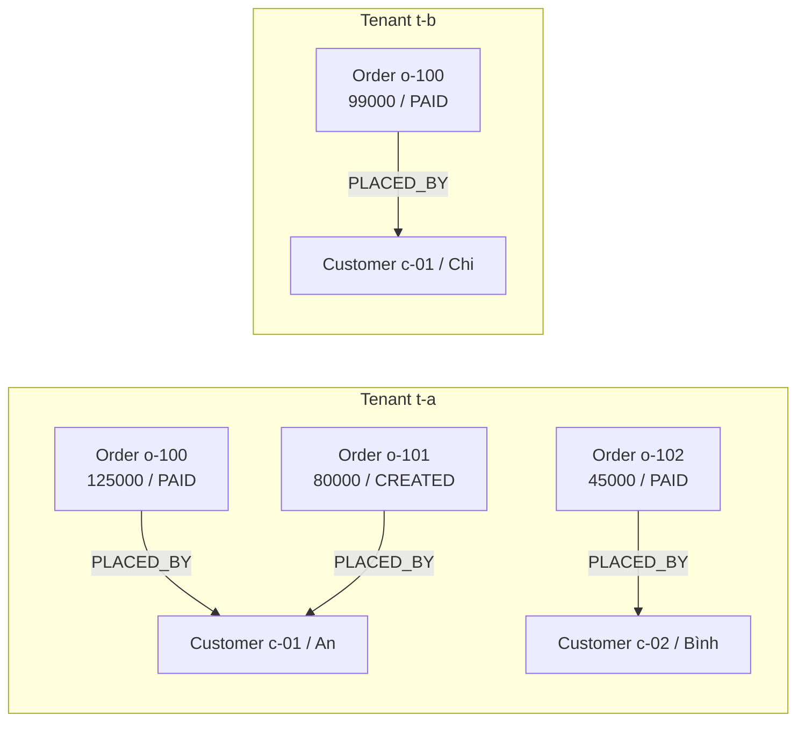
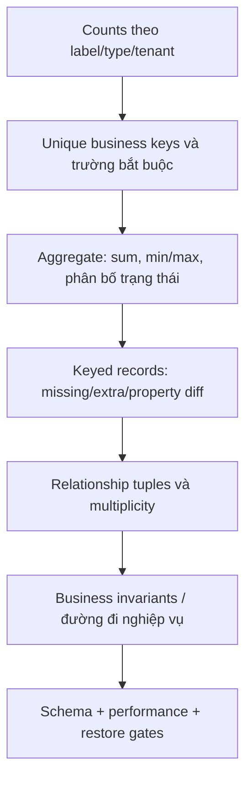
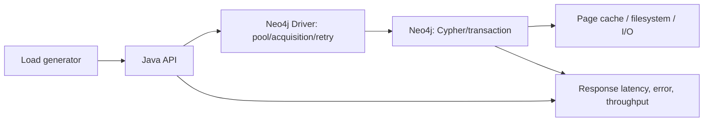
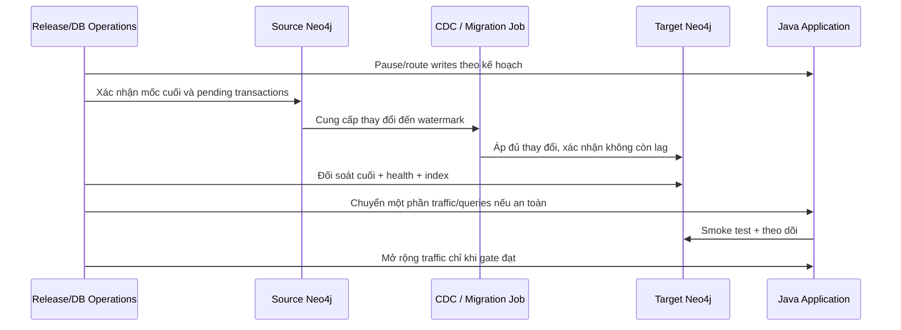

# Đối soát dữ liệu, đo hiệu năng và xác định điều kiện quay lui khi nâng cấp, di trú Neo4j

## 1. Một lần nâng cấp «chạy được» chưa chắc đã thành công

Neo4j lưu dữ liệu dưới dạng **property graph**: node biểu diễn thực thể, relationship biểu diễn liên kết, còn property mang giá trị nghiệp vụ. Các ứng dụng sử dụng Cypher, **Neo4j Java Driver** và **Spring Data Neo4j** để đọc, ghi và duyệt đồ thị. Khi chuyển database sang môi trường mới hoặc nâng cấp Neo4j, việc database báo `ONLINE` chỉ chứng minh một phần trạng thái kỹ thuật; nó chưa bảo đảm **không mất dữ liệu, không đổi ngữ nghĩa quan hệ và không làm ứng dụng chậm đi**.

Ví dụ: sau một đợt di trú, số lượng node vẫn đúng nhưng relationship `PLACED_BY` của hai đơn hàng đã nối nhầm khách hàng trong hai tenant khác nhau. Một truy vấn thống kê `count(n)` sẽ bỏ sót lỗi này. Trong một trường hợp khác, graph không mất dữ liệu nhưng index chưa sẵn sàng, khiến API tìm đơn hàng có P99 tăng từ 150 ms lên 900 ms. Cả hai trường hợp đều phải được xem là **lỗi tiêu chí chấp nhận**, dù ứng dụng vẫn kết nối được.

Bài này thuộc chương **Nâng cấp và di trú** của module `DATABASE_ENGINE_GRAPH_NEO4J`. Trọng tâm gồm ba câu hỏi:

1. **Đối soát dữ liệu:** Nguồn và đích có tương đương về thực thể, quan hệ, property, constraint và bất biến nghiệp vụ không?
2. **Đo hiệu năng:** Phiên bản/môi trường mới có đáp ứng throughput, latency và ngân sách tài nguyên trên cùng workload không?
3. **Điều kiện quay lui:** Khi nào được tiếp tục, phải dừng, sửa về phía trước (*forward-fix*) hoặc khôi phục từ điểm phục hồi đã kiểm chứng?

### Mục tiêu học tập

Sau bài này, bạn có thể:

- Thiết kế **reconciliation manifest** gồm phạm vi, mốc dữ liệu, khóa nghiệp vụ và tiêu chí pass/fail.
- Đối soát số node/relationship, khóa trùng, property, hướng cạnh, đầu mút, multiplicity và bất biến đồ thị.
- Phân biệt **so khớp tập dữ liệu tại cùng mốc** với việc chỉ đếm trên hai database đang liên tục nhận ghi.
- Tổ chức việc đo `EXPLAIN`/`PROFILE`, P50/P95/P99, CPU, heap, page cache, I/O và transaction latency.
- Thiết lập cổng **GO/NO-GO**, quyết định **pause/rollback/forward-fix/restore**, cùng chủ sở hữu và bằng chứng.
- Hiểu vì sao **rollback image ứng dụng, rollback schema và phục hồi database** là những hành động khác nhau.

> **Lưu ý phiên bản:** Những ví dụ dưới đây dùng cú pháp thông dụng của **Neo4j 5.x**. Đường nâng cấp, store format, clustering, CDC, thủ tục quản trị và khả năng quay về bản cũ khác nhau theo phiên bản/edition. Không áp dụng nguyên một runbook «rolling upgrade» hoặc «downgrade» cho mọi cặp phiên bản. Việc kiểm tra kỹ thuật trong STEP này không thay thế thử nghiệm trên Neo4j thật với bản triển khai mục tiêu.

## 2. Trước khi kiểm tra, phải xác định ta đang di trú điều gì

| Loại thay đổi | Điều thực sự thay đổi | Rủi ro cần chứng minh |
| --- | --- | --- |
| Nâng cấp Neo4j Server | Binary, cấu hình, có thể cả store format và hành vi planner | Database mở đúng, tương thích Driver/plugin, không hồi quy query |
| Chuyển hạ tầng | Host, container, PVC, cluster hoặc vùng triển khai | Dữ liệu/metadata đầy đủ, network/TLS/RBAC, RPO/RTO |
| Di trú dữ liệu | Nạp lại node, relationship, ID và property | Không mất/trùng, đúng hướng cạnh, đúng tenant và kiểu |
| Đổi schema ứng dụng | Property, label, relationship type, index/constraint | Bất biến mới, tương thích app cũ/mới, backfill đầy đủ |
| Đổi đường truy cập | Query Cypher, Java Driver, Spring Data Neo4j | Kết quả đúng, không tăng tải hoặc lỗi transaction |
| Chuyển từ đơn máy sang cluster | Topology, routing, primary/secondary | Khả năng ghi, quorum, đọc nhất quán theo yêu cầu, failover |

Một release có thể chứa nhiều loại thay đổi. Khi có thể, hãy **chia thành các bước quan sát được**: tạo index trước, backfill sau, chuyển ứng dụng tiếp theo và chỉ xóa cấu trúc cũ khi đã hết cửa sổ rollback.

**Không đánh đồng**:

- *Dữ liệu tồn tại* với *dữ liệu đúng nghiệp vụ*.
- *Query trả đúng 10 dòng* với *query đạt hiệu năng ở tải thực*.
- *Một pod đã Ready* với *database phục vụ đúng vai trò và đủ quorum*.
- *Đổi image về phiên bản cũ* với *đưa database về trạng thái cũ*.

## 3. Xây dựng hợp đồng đối soát trước khi bắt đầu

Một đợt di trú phải có **baseline và acceptance criteria** được thống nhất **trước** khi chạy.

### 3.1. Những trường quan trọng trong reconciliation manifest

```yaml
reconciliationRun:
  runId: mig-2026-11-25-01
  source:
    database: neo4j
    environment: source-cluster
  target:
    database: neo4j
    environment: target-cluster
  dataCutoff: "2026-11-25T00:00:00Z"
  consistencyStrategy: writer-freeze-or-verified-change-capture
  scopes:
    - MigCustomer
    - MigOrder
    - PLACED_BY
  keys:
    MigCustomer: [tenantId, customerId]
    MigOrder: [tenantId, orderId]
  gates:
    duplicateBusinessKeys: 0
    missingBusinessEntities: 0
    incorrectRelationships: 0
    propertyMismatches: 0
  evidence:
    rowLevelDiff: required
    schemaCheck: required
    performanceBaseline: required
    restoreDrill: required
```

Đây là **mẫu manifest minh họa**, không phải cú pháp mà Neo4j tự đọc để triển khai. Trong thực tế nên bổ sung **Neo4j/Driver/plugin version, cấu hình index, thời điểm đóng băng ghi hoặc watermark có thể kiểm chứng, chủ sở hữu run, nơi lưu báo cáo, checksum và backup ID**.

### 3.2. Bốn nhóm tiêu chí chấp nhận

| Nhóm | Điều phải đúng | Nguồn bằng chứng |
| --- | --- | --- |
| Dữ liệu | Đúng số thực thể, khóa, thuộc tính và topology | Cypher + đối chiếu keyed rows nguồn/đích |
| Schema | Constraint/index tồn tại, đúng định nghĩa, đã sẵn sàng | `SHOW CONSTRAINTS`, `SHOW INDEXES` |
| Hiệu năng | Thông lượng, độ trễ và tài nguyên đạt SLO | Load test, query metrics, Driver/server monitoring |
| Khôi phục | Có điểm phục hồi và quy trình phục hồi trong RPO/RTO | Backup artifact, restore drill, runbook |

Một **sai khác tuyệt đối bằng 0** có thể phù hợp với khóa nghiệp vụ, cạnh sai tenant hoặc đơn hàng mất. Với các trường được chuẩn hóa có chủ đích, phép so sánh cần có **transformation rule đã được phê duyệt** thay vì bắt mọi byte hoàn toàn giống nguồn.

## 4. Bộ dữ liệu thực hành: khách hàng, đơn hàng và quan hệ đặt hàng

Giả sử miền nghiệp vụ lưu:

```text
(:MigCustomer {tenantId, customerId, name, active})
      ^
      |
  [:PLACED_BY]
      |
(:MigOrder {tenantId, orderId, amountCents, state, status?})
```

Quan hệ có hướng từ **đơn hàng đến khách hàng**. Một đơn hàng thuộc đúng một khách hàng **trong cùng tenant**; `orderId` và `customerId` chỉ có tính duy nhất trong phạm vi tenant.



### 4.1. Tạo constraint và node

Chạy ví dụ trên **database lab sạch**, không trên production. Các nhãn `Mig*` được chọn riêng cho bài học:

```cypher
CREATE CONSTRAINT mig_customer_unique IF NOT EXISTS
FOR (c:MigCustomer)
REQUIRE (c.tenantId, c.customerId) IS UNIQUE;

CREATE CONSTRAINT mig_order_unique IF NOT EXISTS
FOR (o:MigOrder)
REQUIRE (o.tenantId, o.orderId) IS UNIQUE;
```

```cypher
UNWIND [
  {tenantId: 't-a', customerId: 'c-01', name: 'An'},
  {tenantId: 't-a', customerId: 'c-02', name: 'Bình'},
  {tenantId: 't-b', customerId: 'c-01', name: 'Chi'}
] AS row
MERGE (c:MigCustomer {
  tenantId: row.tenantId,
  customerId: row.customerId
})
SET c.name = row.name,
    c.active = true;
```

```cypher
UNWIND [
  {tenantId: 't-a', orderId: 'o-100', customerId: 'c-01',
   amountCents: 125000, state: 'PAID'},
  {tenantId: 't-a', orderId: 'o-101', customerId: 'c-01',
   amountCents: 80000, state: 'CREATED'},
  {tenantId: 't-a', orderId: 'o-102', customerId: 'c-02',
   amountCents: 45000, state: 'PAID'},
  {tenantId: 't-b', orderId: 'o-100', customerId: 'c-01',
   amountCents: 99000, state: 'PAID'}
] AS row
MERGE (o:MigOrder {
  tenantId: row.tenantId,
  orderId: row.orderId
})
SET o.amountCents = row.amountCents,
    o.state = row.state;
```

### 4.2. Tạo relationship đúng đầu mút

```cypher
UNWIND [
  {tenantId: 't-a', orderId: 'o-100', customerId: 'c-01'},
  {tenantId: 't-a', orderId: 'o-101', customerId: 'c-01'},
  {tenantId: 't-a', orderId: 'o-102', customerId: 'c-02'},
  {tenantId: 't-b', orderId: 'o-100', customerId: 'c-01'}
] AS row
MATCH (o:MigOrder {
  tenantId: row.tenantId,
  orderId: row.orderId
})
MATCH (c:MigCustomer {
  tenantId: row.tenantId,
  customerId: row.customerId
})
MERGE (o)-[:PLACED_BY]->(c);
```

Khi chạy trên tập lab sạch, kỳ vọng:

- **3** node `MigCustomer`.
- **4** node `MigOrder`.
- **4** relationship `PLACED_BY` từ order đến customer.
- Tenant `t-a` có 3 order, tổng `250000` cents; tenant `t-b` có 1 order, tổng `99000` cents.
- Sau một migration `state → status`, cả bốn order có `status` bằng `state`.

Các con số này làm **oracle kiểm thử** cho ví dụ, không phải chỉ tiêu production.

## 5. Đối soát cấp 1: số thực thể và số quan hệ

### 5.1. Đếm theo loại và tenant

```cypher
MATCH (c:MigCustomer)
RETURN c.tenantId AS tenantId,
       count(c) AS customerCount
ORDER BY tenantId;
```

```cypher
MATCH (o:MigOrder)
RETURN o.tenantId AS tenantId,
       count(o) AS orderCount,
       sum(o.amountCents) AS amountCentsTotal
ORDER BY tenantId;
```

```cypher
MATCH (o:MigOrder)-[r:PLACED_BY]->(c:MigCustomer)
RETURN o.tenantId AS tenantId,
       count(r) AS placedByCount
ORDER BY tenantId;
```

Kiểm tra riêng từng tenant quan trọng hơn tổng toàn database: nếu nguồn mất một khách hàng ở tenant A nhưng đích tạo thừa một khách hàng ở tenant B, **tổng count vẫn giống**.

### 5.2. Bảng so sánh nguồn và đích

| Chỉ số của tập ví dụ | Source dự kiến | Target phải có |
| --- | ---: | ---: |
| Tổng `MigCustomer` | 3 | 3 |
| Tổng `MigOrder` | 4 | 4 |
| Tổng `PLACED_BY` | 4 | 4 |
| Order tenant `t-a` | 3 | 3 |
| Order tenant `t-b` | 1 | 1 |
| Tổng `amountCents` của `t-a` | 250000 | 250000 |
| Tổng `amountCents` của `t-b` | 99000 | 99000 |

Với hệ thống lớn, nên đối soát theo **tenant, ngày phát sinh, trạng thái và loại relationship** thay vì chỉ bốn số tổng. Hãy lưu file báo cáo cùng `runId` và `dataCutoff` để truy nguyên khi có sai khác.

### 5.3. Vì sao count chưa đủ?

Hai database có cùng số node nhưng:

- Một order bị chuyển từ khách hàng `c-01` sang `c-02`.
- Hai order có giá trị `amountCents` bị đổi chỗ.
- Một relationship thừa và một relationship bị thiếu làm tổng không đổi.
- Cùng `customerId` nhưng sai tenant.
- Property mới còn null ở một số node mặc dù số node không đổi.

Vì thế count chỉ là **cổng kiểm tra sơ bộ**, không phải xác nhận dữ liệu hoàn toàn tương đương.

## 6. Đối soát cấp 2: định danh nghiệp vụ và thực thể trùng/thiếu

### 6.1. Phát hiện khóa trùng

```cypher
MATCH (c:MigCustomer)
WITH c.tenantId AS tenantId,
     c.customerId AS customerId,
     count(*) AS occurrences
WHERE occurrences > 1
RETURN tenantId, customerId, occurrences
ORDER BY occurrences DESC, tenantId, customerId;
```

```cypher
MATCH (o:MigOrder)
WITH o.tenantId AS tenantId,
     o.orderId AS orderId,
     count(*) AS occurrences
WHERE occurrences > 1
RETURN tenantId, orderId, occurrences;
```

Với composite unique constraint hợp lệ, database không cho commit hai node cùng cặp giá trị **được constraint quản lý**. Tuy nhiên, uniqueness constraint thông thường **không thay thế ràng buộc property existence**: cần kiểm tra riêng node thiếu `tenantId`/`orderId`, và theo edition/version cân nhắc **node key constraint** hoặc kiểm tra ứng dụng.

```cypher
MATCH (o:MigOrder)
WHERE o.tenantId IS NULL OR o.orderId IS NULL
RETURN count(o) AS ordersMissingBusinessKey;
```

Tập lab mong đợi không có khóa trùng hoặc khóa thiếu.

### 6.2. So sánh bằng business key, không dùng internal node ID

Trước và sau di trú, internal `id(node)` hoặc `elementId(node)` không phải hợp đồng định danh bền vững qua export/reimport, clone, restore hoặc thay đổi môi trường.

Một bản đối soát nên dùng **khóa chuẩn tắc**:

```text
CustomerKey = (tenantId, customerId)
OrderKey    = (tenantId, orderId)
```

Hai chiều so khớp bắt buộc:

- **Source → Target:** không thiếu thực thể lẽ ra phải di trú.
- **Target → Source:** không tạo thêm thực thể ngoài kế hoạch.

Nếu có **lọc dữ liệu theo chính sách**, ví dụ chỉ di trú order trong hai năm gần nhất, hãy so với **source subset sau khi áp đúng filter**, không so toàn bộ source với target rồi báo sai lệch giả.

### 6.3. Đối chiếu từ hai môi trường

Neo4j không mặc nhiên cho một câu Cypher truy vấn xuyên hai DBMS độc lập để thực hiện `FULL OUTER JOIN`. Hệ thống đối soát có thể mở **hai kết nối Java Driver** (hoặc đọc hai bản export nhất quán), sắp xếp theo business key và so khớp:

```text
sourceRows = stream(source, ORDER BY tenantId, orderId)
targetRows = stream(target, ORDER BY tenantId, orderId)

while source or target has next:
    keySource < keyTarget -> MISSING_IN_TARGET
    keySource > keyTarget -> UNEXPECTED_IN_TARGET
    equal keys:
        compare normalized properties
        if differs -> PROPERTY_MISMATCH
        advance both
```

Đây là **pseudocode thuật toán merge-join**, không phải lệnh Neo4j. Với tập lớn, dùng keyset pagination hoặc đọc theo stream và giới hạn bộ nhớ; không gọi `collect(n)` hay `Result.list()` để kéo hàng chục triệu node lên heap.

## 7. Đối soát cấp 3: property và quy tắc chuyển đổi

### 7.1. Kiểm tra bắt buộc, kiểu và giá trị

Với order, các điều kiện ví dụ gồm:

- `tenantId`, `orderId` không rỗng.
- `amountCents` là số nguyên không âm.
- `state`/`status` thuộc tập giá trị được nghiệp vụ cho phép.
- Trong giai đoạn chuyển tiếp, `status` bằng `state` khi đã được backfill.

```cypher
MATCH (o:MigOrder)
WHERE o.tenantId IS NULL
   OR o.orderId IS NULL
   OR o.amountCents IS NULL
   OR o.amountCents < 0
RETURN o.tenantId AS tenantId,
       o.orderId AS orderId,
       o.amountCents AS amountCents
LIMIT 100;
```

Đây là **bộ lọc minh họa**: với dữ liệu có kiểu sai không so sánh được bằng phép số học, query có thể lỗi. Muốn phát hiện sai kiểu cần một bước kiểm tra kiểu theo Neo4j version (ví dụ `valueType(...)` trong phiên bản hỗ trợ), hoặc validate trong chương trình export/import. Không âm thầm ép chuỗi `"125000"` thành số như thể tương đương một integer business field.

### 7.2. Tránh so sánh sai vì chuẩn hóa

| Thuộc tính | Nguy cơ khi so trực tiếp | Quy tắc cần được duyệt |
| --- | --- | --- |
| Email/tên | Khác chữ hoa, dấu cách, Unicode | Có trim/case-fold hay phải giữ nguyên? |
| Datetime | Khác timezone/offset và precision | Chuẩn hóa instant và độ chính xác |
| Decimal/tiền | Float rounding, kiểu số khác | Dùng integer cents hoặc Decimal theo miền |
| List | Thứ tự phần tử có ý nghĩa không? | Bảo toàn thứ tự hoặc chuẩn hóa tập |
| Null/missing | `null` trong Neo4j tương đương không tồn tại property | Phân biệt theo định nghĩa API/miền |
| Boolean | Chuỗi `"true"` khác Boolean `true` | Kiểm tra kiểu thay vì coerce tùy ý |
| Text/description | Xuống dòng, encoding, ký tự đặc biệt | Chuẩn hóa chỉ nếu được chấp thuận |

**Không biến lỗi dữ liệu thành «đúng» bằng một phép normalize tùy tiện.** Mỗi transformation từ nguồn sang đích phải có mục đích nghiệp vụ, version và kiểm thử.

### 7.3. Đối soát property mới và cũ sau backfill

```cypher
MATCH (o:MigOrder)
RETURN count(o) AS totalOrders,
       sum(CASE WHEN o.status IS NULL THEN 1 ELSE 0 END)
           AS missingStatus,
       sum(CASE WHEN o.state IS NULL THEN 1 ELSE 0 END)
           AS missingState,
       sum(CASE
             WHEN o.status IS NOT NULL
              AND o.state IS NOT NULL
              AND o.status <> o.state
             THEN 1 ELSE 0 END)
           AS changedMeaning;
```

Nếu `status` cần luôn tương đương `state` trong thời gian chuyển tiếp thì cả ba cột bất thường phải bằng **0**. Sau giai đoạn *contract*, khi trường cũ được loại bỏ có chủ đích, **không tiếp tục áp dụng phép kiểm tra đó**; cập nhật manifest và chuyển sang invariant mới.

## 8. Đối soát cấp 4: topology, hướng và số lần xuất hiện của quan hệ

### 8.1. Không chỉ đếm `PLACED_BY`

Hai điều phải được xác minh:

1. Mỗi `MigOrder` có **đúng một** outgoing `PLACED_BY`.
2. Relationship đó trỏ tới **`MigCustomer` có cùng `tenantId`**.

```cypher
MATCH (o:MigOrder)
OPTIONAL MATCH (o)-[r:PLACED_BY]->(target)
WITH o,
     count(r) AS outgoingCount,
     sum(CASE
           WHEN target:MigCustomer
            AND target.tenantId = o.tenantId
           THEN 1 ELSE 0 END) AS validCount
WHERE outgoingCount <> 1 OR validCount <> 1
RETURN o.tenantId AS tenantId,
       o.orderId AS orderId,
       outgoingCount,
       validCount
ORDER BY tenantId, orderId;
```

Trên dữ liệu mẫu, truy vấn phải trả **0 dòng**.

Lệnh dùng `OPTIONAL MATCH` để **không bỏ qua các order có 0 cạnh**. Nó xét mọi outgoing relationship mang type `PLACED_BY` và kiểm tra label/tenant của đầu mút. Để tìm **relationship bị đảo hướng**, cần một truy vấn riêng:

```cypher
MATCH (c:MigCustomer)-[r:PLACED_BY]->(o:MigOrder)
RETURN c.tenantId AS customerTenant,
       c.customerId AS customerId,
       o.orderId AS orderId
LIMIT 100;
```

Không có dòng là kỳ vọng trong graph ví dụ; nếu importer vô tình đảo hướng, query đầu sẽ thấy order thiếu cạnh, query này giúp chỉ ra nguyên nhân.

### 8.2. Phân biệt quan hệ thiếu đầu mút về nghiệp vụ

Neo4j **không lưu một relationship vật lý mà không có node đầu/cuối** như một bản ghi dangling trong property graph bình thường. Lỗi «relationship thiếu đầu mút» khi di trú thường là:

- Importer **không tạo được cạnh** vì không tìm thấy node theo business key.
- Cạnh được tạo giữa **hai node sai** có khóa nhìn gần giống.
- Quan hệ đúng loại nhưng **sai hướng**.
- Có **thừa/thiếu số lượng cạnh** khi nguồn cho phép nhiều cạnh cùng cặp node.

Do đó, phải kiểm tra mapping theo khóa nghiệp vụ và **multiplicity**, không chỉ xem relationship có `startNode` và `endNode` hay không.

### 8.3. Đối soát cạnh theo định danh của hai đầu

```cypher
MATCH (o:MigOrder)-[r:PLACED_BY]->(c:MigCustomer)
RETURN
  o.tenantId AS tenantId,
  o.orderId AS orderId,
  c.tenantId AS customerTenantId,
  c.customerId AS customerId,
  count(r) AS multiplicity
ORDER BY tenantId, orderId, customerTenantId, customerId;
```

Đối chiếu tuple `(type, direction, tenantId, orderId, customerTenantId, customerId, multiplicity)` trên source và target. Với những type cho phép **nhiều relationship song song** hoặc property như `createdAt`/`eventId`, phải đưa thêm **relationship business key** vào tuple. Chỉ so cặp node sẽ bỏ sót việc gộp nhiều sự kiện thành một cạnh.

### 8.4. Kiểm tra những đoạn graph có ý nghĩa nghiệp vụ

Sau khi khớp các cạnh, bổ sung vài **truy vấn xuyên quan hệ** đại diện:

```cypher
MATCH (c:MigCustomer {tenantId: $tenantId, customerId: $customerId})
      <-[:PLACED_BY]-(o:MigOrder)
RETURN count(o) AS orderCount,
       coalesce(sum(o.amountCents), 0) AS totalAmount;
```

Phép kiểm tra này phát hiện nhiều lỗi mà phép đếm node theo tenant không thấy. Nếu query của ứng dụng có đường đi nhiều hop, cần so cả kết quả/topology theo use case, không mở rộng traversal vô hạn chỉ để «kiểm tra toàn bộ».

## 9. Từ số liệu tổng hợp đến so khớp từng bản ghi

### 9.1. Nhiều tầng kiểm tra, từ rẻ đến đắt



Thứ tự này giúp **phát hiện lỗi nhanh** bằng thống kê rồi đào sâu vào những phân đoạn khác thường. Nhưng tầng rẻ **không thay thế** tầng chính xác: hai giá trị tiền đổi chỗ có thể giữ nguyên tổng.

### 9.2. Checksum theo khóa chuẩn tắc

Để đối soát dữ liệu lớn, có thể tạo checksum bằng chương trình ngoài Neo4j:

```text
canonicalRow(order):
    fields = [
      encode(tenantId),
      encode(orderId),
      encode(amountCents as integer),
      encode(status according to approved migration rule)
    ]
    return lengthPrefixed(fields)

for each partition (tenantId, dateBucket):
    sort rows by immutable business key
    stream canonical rows into SHA-256
    compare sourceHash and targetHash

if hash differs:
    compare key-by-key and produce actionable diff report
```

Đây là **pseudocode**, không phải hàm `sha256()` bảo đảm có sẵn trong Cypher. Quy tắc encoding phải cố định: kiểu, `null`, độ dài, Unicode, số nguyên, timezone, thứ tự, trường được bỏ qua và version của transformation. **Không ghép các field bằng một ký tự phân cách** nếu giá trị có thể chứa chính ký tự đó; dùng length-prefix hoặc encoding chuẩn tắc.

Một checksum trùng có xác suất va chạm rất nhỏ với thuật toán tốt, nhưng **không thay thế đối soát khóa, phạm vi và điều kiện nhất quán tại thời điểm đọc**. Checksum thiếu một cột từ manifest vẫn có thể bằng nhau khi chính cột bị thiếu ấy có lỗi.

### 9.3. Khoanh vùng theo partition

Khi source/target rất lớn:

- Chia theo **tenant, ngày, vùng hoặc khoảng business key**, có phân bố gần đều.
- Tính count, aggregate, hash và số diff **theo partition**.
- Không làm mất các node/relationship bắc qua nhiều partition; với cạnh phải dùng khóa của cả hai đầu.
- Có `runId` và checkpoint để sau lỗi job có thể chạy lại đúng phần.
- Tách thống kê sai lệch **do thiết kế migration** khỏi sai lệch bất thường.

Trong hệ thống nhiều tenant, tỷ lệ sai tổng cộng 0,01% vẫn có thể tương đương **100% dữ liệu của một tenant nhỏ**. Vì vậy cần gate tuyệt đối cho những miền nhạy cảm.

## 10. Thời điểm so sánh: dữ liệu đang thay đổi là nguồn gây «false mismatch»

### 10.1. Bài toán hai hệ đang nhận ghi

Giả sử:

```text
10:00:00  Bắt đầu đếm source
10:00:02  User tạo order mới vào source
10:00:04  Query đếm target trước khi CDC áp thay đổi
10:00:05  Báo source 1.001, target 1.000
10:00:07  CDC nạp order mới vào target
```

Kết luận «đã mất một order» tại 10:00:05 có thể là **sai lệch do mốc đọc**, không phải lỗi importer. Ngược lại, nếu target thừa một order bị nhân bản, tổng count có thể vẫn bằng nhờ thiếu một order khác.

### 10.2. Ba chiến lược đồng nhất mốc

| Chiến lược | Cách vận hành | Rủi ro còn lại |
| --- | --- | --- |
| **Writer freeze / quiesce** | Ngừng writer vào nguồn, chờ transaction đang chạy hoàn tất, đối chiếu rồi cutover | Downtime, queue/backlog, writer bị bỏ sót |
| **Backup/export ở một mốc nhất quán** | Khôi phục hoặc xuất từ một bản dữ liệu được kiểm chứng tại mốc | Độ mới, phương thức export, edition và quy trình |
| **CDC/change capture với checkpoint/watermark** | Nạp baseline, áp thay đổi có thứ tự, đối chiếu tới watermark đã được xác nhận | Cơ chế CDC, thứ tự/duplicate, lag, transaction boundary |

Neo4j hỗ trợ những khả năng CDC khác nhau theo version/edition và loại triển khai. **Không suy ra mọi instance đều có CDC**, cũng không coi timestamp của ứng dụng là một transaction offset đáng tin cậy nếu hệ thống chưa có hợp đồng đồng bộ.

### 10.3. Read committed không phải snapshot nhiều query

Neo4j mặc định dùng mức cô lập **read committed**. Nếu job lần lượt chạy `count(customer)`, `count(order)` rồi `count(relationship)` trong lúc có ghi, các truy vấn có thể nhìn thấy những tập commit khác nhau. **Dùng chung một Session không tự tạo snapshot cố định** cho toàn bộ chuỗi đo; ngay cả với transaction, cần hiểu đúng bảo đảm cô lập của version.

Muốn tuyên bố «source và target tương đương tại cutoff X», phải mô tả **cách cutoff X được tạo và áp dụng cho mọi phép đo**, không chỉ ghi một timestamp vào YAML.

### 10.4. Cutover cần xác định nguồn ghi có thẩm quyền

Một quy trình di trú online điển hình:

1. Target nhận dữ liệu baseline.
2. CDC/backfill bắt kịp thay đổi theo cách có thể kiểm chứng.
3. Đối soát các partition đến watermark đã chốt.
4. Tạm dừng hoặc điều phối writer để không xảy ra **ghi hai nơi độc lập**.
5. Xác nhận không còn transaction chưa được xử lý theo chính sách.
6. Chuyển traffic sang target.
7. Theo dõi và đối soát những ghi mới sau cutover.

Không bật **dual-write nguồn và đích** mà không có giao thức idempotency, xử lý lỗi từng bên, thứ tự thay đổi, conflict resolution và cách phục hồi khi một bên commit thành công còn bên kia thất bại.

## 11. Ví dụ migration property `state → status` có thể đối soát

### 11.1. Giai đoạn expand

Ứng dụng đang dùng `MigOrder.state`; bản mới muốn truy vấn theo `MigOrder.status`. Đầu tiên thêm index nếu query mới cần:

```cypher
CREATE RANGE INDEX mig_order_tenant_status IF NOT EXISTS
FOR (o:MigOrder)
ON (o.tenantId, o.status);
```

```cypher
SHOW INDEXES
YIELD name, state, type, labelsOrTypes, properties
WHERE name = 'mig_order_tenant_status'
RETURN name, state, type, labelsOrTypes, properties;
```

Một lệnh tạo index thành công **không đồng nghĩa index đã ONLINE ngay**. Phải chờ trạng thái phù hợp trước khi bật truy vấn mới trên lưu lượng lớn.

### 11.2. Giai đoạn backfill có giới hạn

```cypher
MATCH (o:MigOrder)
WHERE o.status IS NULL
  AND o.state IS NOT NULL
WITH o
ORDER BY o.tenantId, o.orderId
LIMIT $batchSize
SET o.status = o.state
RETURN count(o) AS updated;
```

Chạy lặp theo job với `$batchSize` có giới hạn (ví dụ 100–1000 tùy tải đã đo), mỗi đợt trong transaction rõ ràng. Không để một transaction khổng lồ ghi hàng triệu node, vì chi phí transaction memory, locks, logs và rollback có thể cao.

**Idempotency ở mức backfill:** nếu `status` đã được ghi, câu trên bỏ qua node đó. Nhưng nếu ứng dụng đồng thời thay đổi `state` trên một order, việc chỉ điền trường null **không đảm bảo hai field luôn khớp**. Cần giai đoạn compatibility writer/dual-write hoặc cách khoanh vùng writer, kết hợp phép đối soát sau backfill.

### 11.3. Giai đoạn switch và contract

Chỉ chuyển ứng dụng đọc `status` khi:

1. `missingStatus = 0` và `changedMeaning = 0` theo manifest chuyển tiếp.
2. Writer đang chạy không còn tạo `state` mà bỏ quên `status`.
3. Index mới đã sẵn sàng, query plan và P95/P99 đạt gate.
4. Ứng dụng cũ còn chạy trong thời gian canary **không bị phá vỡ**.

Chỉ xóa `state` sau khi **hết cửa sổ rollback app cũ**, đã có backup/restore drill và những consumer khác không còn dùng property đó. Xóa trường cũ là thao tác **không thể khôi phục chỉ bằng redeploy app cũ**.

## 12. Đối soát schema, chỉ mục và khả năng truy cập

### 12.1. Schema là phần của correctness

Hai database có thể mang cùng node/relationship nhưng khác:

- Unique constraints trên khóa tenant + ID.
- Property existence/type/key constraints theo edition.
- Range/text/point/full-text/vector index.
- Trạng thái index `POPULATING` hay `ONLINE`.
- Mặc định/config/hành vi query planner hoặc procedure cần thiết.

Các lệnh kiểm tra:

```cypher
SHOW CONSTRAINTS
YIELD name, type, labelsOrTypes, properties
RETURN name, type, labelsOrTypes, properties
ORDER BY name;
```

```cypher
SHOW INDEXES
YIELD name, type, entityType, labelsOrTypes, properties, state
RETURN name, type, entityType, labelsOrTypes, properties, state
ORDER BY name;
```

```cypher
SHOW DATABASES;
```

**Không chỉ so số lượng index.** Một index gồm `(tenantId, status)` khác `(status, tenantId)` về điều kiện prefix và kế hoạch sử dụng; một index có `POPULATING` khác index đã `ONLINE`. Một constraint có tên khác vẫn có thể tương đương về ngữ nghĩa; manifest phải phân biệt **so khớp định nghĩa** và **so khớp tên**.

### 12.2. Tránh đếm trùng index hỗ trợ constraint

Unique constraint có thể có backing index. Khi lập báo cáo dung lượng hoặc tiến độ rebuild, **không cộng lại** backing index vừa như một index thường vừa như chi phí constraint riêng nếu đã tính từ file index thực.

### 12.3. Bảo mật và môi trường chạy

Kiểm tra thêm:

- Users/roles/grants và quyền của tài khoản ứng dụng.
- TLS/certificates, DNS, routing URI và cluster database name.
- Version/khả năng tương thích của **Java Driver, Spring Data Neo4j, APOC, GDS** khi có sử dụng.
- Query chạy dưới account ứng dụng thật, không chỉ account `neo4j` administrator.
- Config memory/transaction timeout và giới hạn Bolt connections.

Một graph đúng dữ liệu nhưng ứng dụng không có quyền truy vấn/ghi **chưa đạt gate triển khai**.

## 13. Thiết lập baseline hiệu năng trước khi thay đổi

### 13.1. Thế nào là một phép so sánh công bằng?

Một kết quả benchmark đáng tin phải giữ càng nhiều yếu tố càng tốt:

| Yếu tố | Phải ghi lại/đối chiếu |
| --- | --- |
| Dữ liệu | Số node/relationship, phân bố degree, property, index và thời điểm chốt |
| Workload | Tỷ lệ đọc/ghi, query text, parameter, kích thước result và concurrency |
| Hạ tầng | CPU, RAM, page cache, disk IOPS, network, topology và region |
| Phần mềm | Neo4j version, Driver/SDN, config, plugin và index provider |
| Thời trạng cache | Cold/warm page cache, JVM warm-up, index state |
| Quy trình test | Warm-up, steady state, burst, thời lượng, tool load và cách lấy percentile |
| Kết quả | Throughput, latency P50/P95/P99, error rate, saturation và correctness |

Không so một máy **8 CPU/32 GiB** chạy graph đã warm-up với máy **4 CPU/16 GiB** mới khởi động rồi tuyên bố Neo4j version mới chậm hơn chỉ do phiên bản.

### 13.2. Đo ít nhất ba loại truy vấn

Một workload graph đại diện thường gồm:

1. **Point lookup:** tìm Customer hoặc Order theo khóa được index.
2. **Traversal:** từ customer qua relationship đến order, có lọc tenant.
3. **Aggregation/write:** tổng số tiền theo trạng thái hoặc ghi order/relationship với constraint.

Nếu ứng dụng thật có shortest path, vector/full-text search hoặc GDS, cần thêm các nhóm đó vào ma trận riêng; chúng có kế hoạch và bộ nhớ khác lookup đơn giản.

### 13.3. Đo baseline gắn với SLO

Ví dụ hợp đồng **minh họa** trước nâng cấp:

| Chỉ số | Baseline đo được | Gate đề xuất sau thay đổi |
| --- | ---: | --- |
| Point lookup P95 | 35 ms | Không vượt 45 ms |
| Traversal P99 | 150 ms | Không vượt 180 ms |
| Write throughput ổn định | 800 ops/s | Không dưới 760 ops/s |
| Transaction errors ngoài kỳ vọng | 0,1% | Không vượt 0,2% |
| Không đúng dữ liệu | 0 record | **0 record** |

Đây **không phải SLO chuẩn của Neo4j**. Ngưỡng phải được team duyệt theo SLA, biến động workload, số mẫu và chi phí lỗi nghiệp vụ. Cần ghi cả thời lượng đo, số mẫu, khoảng tin cậy và các giới hạn tài nguyên; một ngưỡng P99 trên 20 request là thiếu đáng tin.

## 14. `EXPLAIN` và `PROFILE`: kiểm tra truy vấn trước và sau

### 14.1. Ví dụ lookup và index

```cypher
EXPLAIN
MATCH (o:MigOrder {tenantId: $tenantId, orderId: $orderId})
RETURN o.amountCents AS amountCents,
       o.state AS state;
```

Index hỗ trợ composite key có thể cho phép tìm điểm bắt đầu chọn lọc. Khi cần đo thực thi:

```cypher
PROFILE
MATCH (o:MigOrder {tenantId: $tenantId, orderId: $orderId})
RETURN o.amountCents AS amountCents,
       o.state AS state;
```

Trong `PROFILE`, cần xem:

- Operator sử dụng, ví dụ **NodeIndexSeek** so với scan, theo planner/version.
- **Rows** thực tế qua từng operator và độ phình trung gian.
- **DB Hits**, CPU/time/memory tùy runtime/phiên bản.
- Số lượng record trả, thời gian fetch từ server và xử lý ở client.

**Không dùng DB Hits như một chỉ số thời gian duy nhất.** Hai plan có DB Hits tương tự vẫn khác latency do page cache miss, I/O, network, result serialization hoặc concurrency.

### 14.2. Ví dụ traversal có giới hạn

```cypher
PROFILE
MATCH (c:MigCustomer {tenantId: $tenantId, customerId: $customerId})
      <-[:PLACED_BY]-(o:MigOrder)
RETURN o.orderId AS orderId,
       o.amountCents AS amountCents
ORDER BY orderId
LIMIT 100;
```

Kiểm tra độ chọn lọc đầu vào, degree của customer và chi phí sort. `LIMIT 100` giới hạn kết quả trả về nhưng không bảo đảm loại bỏ hoàn toàn chi phí mở rộng/sắp xếp trước khi lấy 100 dòng.

Khi đổi version:

- Plan có thể khác mà **kết quả và latency vẫn đạt**; đó không nhất thiết là lỗi.
- Plan trông giống nhau nhưng **độ trễ tăng** do cache/index/storage cũng là một vấn đề.
- Nếu một query cần so kết quả, phải cố định **định nghĩa thứ tự**; thiếu `ORDER BY` thì không coi thứ tự record trả là bảo đảm.

### 14.3. Cẩn thận với `PROFILE` trên truy vấn ghi

`PROFILE` **thực thi** truy vấn. Nếu profile một câu `CREATE`, `DELETE` hoặc `MERGE`, nó có thể làm thay đổi database. Do đó, chỉ profile write query trên môi trường thử nghiệm hoặc trong một cơ chế transaction/rollback được kiểm soát. Trên production, không dùng `PROFILE` để «xem kế hoạch thôi» cho một migration phá hủy; dùng `EXPLAIN` hoặc thử an toàn trên bản sao dữ liệu.

## 15. Benchmark end-to-end: từ Driver đến Neo4j Server

### 15.1. Những metric tối thiểu



Ở cả source và target, ghi tối thiểu:

- API P50/P95/P99 theo endpoint.
- Query/transaction latency và tỷ lệ lỗi theo nhóm.
- Throughput thành công, số request đang chờ và concurrency.
- Driver **connection acquisition delay**, retry và timeouts nếu quan sát được.
- CPU usage/throttling, heap, GC, transaction memory.
- Neo4j page cache hit/fault, storage latency/IOPS, log growth.
- Cluster routing, database availability và độ trễ đọc phụ thuộc topology khi có.

Không mặc định mọi phiên bản Driver cung cấp sẵn một metric pool giống nhau. Có thể dùng instrumentation ở application và metric/log chính thức của Neo4j.

### 15.2. Quy trình thử tải có thể lặp

1. **Warm-up:** chạy đủ tải để JIT và cache ổn định; tách kết quả cold-start.
2. **Steady state:** giữ cùng QPS/concurrency trong một khoảng đủ dài để thấy GC và transaction logs.
3. **Burst:** mô phỏng đỉnh tải; theo dõi queue và acquisition timeout.
4. **Write mix:** test transaction ghi có constraint, deadlock/retry trong điều kiện kiểm soát.
5. **Failure:** mô phỏng mất kết nối, member restart hoặc index chưa ONLINE ở staging.
6. **Repeat:** chạy nhiều lượt, so sánh biến động thay vì dựa một phép đo ngẫu nhiên.

Sau mỗi lượt, xác minh **dữ liệu đã ghi**; benchmark nhanh mà tạo thêm order trùng do retry không đạt yêu cầu.

### 15.3. Không nhầm hồi quy hiệu năng với sai khác workload

Một deployment mới có thể chịu:

- Thêm 40% request vì rollout traffic khác.
- Index đang population.
- Page cache lạnh sau restart.
- Một supernode mới do dữ liệu thay đổi.
- Log/backup tranh chấp I/O.

Trước khi đổ lỗi cho query planner, hãy so sánh **điều kiện nền**. Nếu không thể giữ workload giống hệt, báo cáo phải nêu sai khác và độ tin cậy của kết luận.

## 16. Tách «sai dữ liệu» khỏi «chậm» trong quyết định phát hành

Một hệ thống có thể đạt hiệu năng nhưng sai dữ liệu; cũng có thể dữ liệu đúng nhưng chậm dưới SLA.

| Kiểm tra | Hành vi nên chọn |
| --- | --- |
| Mất đơn hàng đã commit hoặc nối sai tenant | **NO-GO**; bảo toàn bằng chứng, chặn cutover |
| Unique business key bị trùng | **NO-GO**; khắc phục dữ liệu và constraint trước |
| Mismatch đúng quy tắc chuyển đổi và được chấp thuận | Có thể **GO** khi có minh chứng/tài liệu |
| Index mới chưa ONLINE, API phụ thuộc nó | **Pause** rollout truy vấn mới |
| P99 vượt SLO kéo dài | **Pause hoặc rollback app/cấu hình** nếu an toàn |
| CPU tăng nhẹ nhưng P99, error và headroom còn đạt | Có thể tiếp tục có giám sát theo gate |
| Backup/restore drill thất bại trước thay đổi không thể đảo ngược | **NO-GO** cho bước đó |
| Cluster mất quorum hoặc DB critical offline | **STOP**, ưu tiên phục hồi khả năng vận hành |

**Tính đúng dữ liệu quan trọng hơn một benchmark đẹp.** Với một số hệ thống, bất kỳ lỗi cross-tenant hoặc mất financial transaction nào cũng là hard-stop.

## 17. Định nghĩa GO/NO-GO bằng điều kiện đo được

### 17.1. Mẫu acceptance gate

```yaml
goNoGo:
  scope: mig-2026-11-25-01
  correctness:
    missingKeys: 0
    unexpectedKeys: 0
    crossTenantEdges: 0
    relationshipMultiplicityMismatches: 0
    unapprovedPropertyDiffs: 0
  schema:
    requiredConstraintsPresent: true
    requiredIndexesOnline: true
  performance:
    workloadProfile: release-baseline-v3
    lookupP95MaxMs: 45
    traversalP99MaxMs: 180
    writeThroughputMinPerSec: 760
  recovery:
    backupVerified: true
    restoreDrillPassed: true
    rpoApproved: true
    rtoApproved: true
  decision:
    owner: release-owner
    actionOnFailure: pause-and-escalate
```

Đây là **mẫu chính sách**, không phải file cấu hình Neo4j. Số liệu performance là ví dụ ở mục 13, **không áp dụng cho mọi ứng dụng**.

### 17.2. Tại sao phải có người ra quyết định?

Hệ thống đo có thể kết luận `traversalP99 = 195 ms` vượt gate 180 ms, nhưng chọn:

- Hoãn chuyển traffic;
- Tắt một feature flag;
- Sửa Cypher rồi triển khai lại;
- Tăng tài nguyên trong ngân sách cho phép;
- Phục hồi database;

phụ thuộc **loại thay đổi, lỗi dữ liệu có hay không và khả năng quay lui**. Runbook cần một **decision owner**, người trực vận hành và thời hạn chuyển sang phương án khôi phục.

### 17.3. Không biến «cho phép sai 0,1%» thành mặc định

Đối với dữ liệu kế toán, khóa tenant hoặc relationship phân quyền, sai một bản ghi cũng có thể là **hard-stop**. Với tính năng đề xuất dựa trên vector similarity xấp xỉ, tiêu chí có thể là **recall@K, ranking stability và latency**, không yêu cầu từng kết quả giống 100% nếu thuật toán/version vốn có yếu tố xấp xỉ.

Hãy xác định **sai số được phép theo ý nghĩa nghiệp vụ**, không đặt một tolerance chung cho toàn graph.

## 18. Quay lui: phải tách ứng dụng, schema, dữ liệu và store

### 18.1. Ma trận khả năng đảo ngược

| Thay đổi | Hành động khả thi | Giới hạn |
| --- | --- | --- |
| Canary Java service mới | Trả traffic về service cũ/feature flag | Chỉ an toàn nếu dữ liệu/schema còn tương thích |
| Query/Cypher mới | Khôi phục query cũ | Không tự sửa các ghi sai đã commit |
| Pool/timeout/config | Trả cấu hình cũ, restart theo yêu cầu | Phải kiểm tra ngân sách tài nguyên và cluster |
| Thêm index mới | Giữ hoặc drop nếu chắc không cần | Drop có thể làm query chậm, không khôi phục dữ liệu |
| Thêm constraint | Chỉ thay đổi sau phân tích dữ liệu | Drop constraint làm giảm bảo vệ, không phải undo dữ liệu |
| Backfill property `status` | Có thể tắt đọc mới, quay lại `state` | Phải bảo đảm writer còn duy trì trường cũ |
| Xóa `state` hoặc node/edge | Cần dựng lại từ nguồn tin cậy/backup | Redeploy app cũ **không khôi phục** data |
| Upgrade binary Neo4j | Tuân thủ đường được phiên bản hỗ trợ | Store format mới có thể không đọc được bằng binary cũ |
| Mất/corrupt database | Khôi phục từ backup/dump/snapshot hợp lệ | Có thể mất những ghi hợp lệ sau điểm phục hồi |

### 18.2. Ba chiến lược phản ứng

**Pause/Stop:** dừng rollout hoặc dừng job migration để giữ nguyên phạm vi lỗi. Thích hợp khi nguyên nhân chưa rõ và dữ liệu chưa bị phá hủy.

**Rollback:** quay về cấu hình/query/app trước nếu **tương thích hai chiều** và không làm mất dữ liệu. Ví dụ tắt app mới trước khi nó thực hiện bước contract.

**Forward-fix/Restore:** khi dữ liệu đã biến đổi không thể đảo ngược bằng code cũ, sửa về phía trước theo bản ghi nguồn, event/audit log hoặc phục hồi từ backup đã kiểm chứng.

> **HA replica không thay thế backup lịch sử.** Một lệnh ghi sai đã commit có thể lan tới các replica. Cũng không coi `helm rollback` là cách phục hồi an toàn sau khi store format đã thay đổi; phải kiểm tra hỗ trợ downgrade theo cặp phiên bản và phương án restore.

## 19. Runbook quyết định trước và sau cutover

### 19.1. Trước cutover — Gate A

1. Xác nhận source/target, version, topology, database name và account.
2. Chốt phạm vi, cutoff/watermark, owner và backup artifact.
3. Kiểm tra có thể phục hồi theo **RPO/RTO** đã được chấp thuận.
4. Chạy reconciliation **hai chiều** theo khóa nghiệp vụ, property và quan hệ.
5. Kiểm tra schema/constraint/index, compatibility Driver/SDN/plugin.
6. Chạy smoke + load test tương đương và hoàn thành acceptance report.
7. Chỉ **GO** khi hard-stops bằng 0 và các ngưỡng performance đạt.

### 19.2. Trong cutover — Gate B



Trong thực tế, một số bước có thể khác tùy topology và kỹ thuật CDC. Điểm không đổi là **chỉ một nguồn ghi có thẩm quyền tại một thời điểm** hoặc một giao thức hợp nhất ghi đã được thiết kế và kiểm chứng.

### 19.3. Sau cutover — Gate C

- So sánh số lượng **giao dịch mới sau cutover**, không chỉ dữ liệu trước cutoff.
- Theo dõi **P95/P99, errors, transaction retries, driver pool, heap/GC, I/O**.
- Kiểm tra các **invariants nghiệp vụ** ở những đường ghi quan trọng.
- Ghi rõ thời điểm bắt đầu và kết thúc cửa sổ quay lui.
- Không xóa data/property cũ hoặc xóa source khi chưa đạt **retention và recovery gate**.

### 19.4. Khi Gate B hoặc C thất bại

1. **Pause** rollout/replication job có nguy cơ gây thêm sai dữ liệu.
2. Ghi lại checkpoint, status, query metrics và một bản đối soát có `runId`.
3. Xác định **thay đổi nào đã commit**, đang ở source hay target và có thể đảo ngược không.
4. Phân loại quyết định: khôi phục app cũ, sửa query, forward-fix dữ liệu hay restore.
5. Nếu restore, duyệt RPO và danh sách ghi hợp lệ có nguy cơ mất.
6. Cô lập database đích thử nghiệm, phục hồi, **kiểm tra trước khi chuyển production traffic**.
7. Chỉ đóng incident khi đối soát mới và smoke test đều đạt.

**Không tự động restore database đè lên hệ thống đang có ghi** chỉ vì một metric vượt gate. Restore là hành động có ảnh hưởng trực tiếp đến dữ liệu được commit, cần phê duyệt và kế hoạch cutover.

## 20. Ba tình huống minh họa

### Tình huống A — Tổng số order đúng nhưng nối sai khách hàng

Source có `(t-a, o-102) → (t-a, c-02)`. Target có đủ bốn order và bốn relationship, nhưng `o-102` lại nối tới `c-01`.

**Kết quả kiểm tra:**

- Count node và relationship: **PASS**.
- Tổng tiền theo tenant: **PASS**.
- So tuple relationship theo business key: **FAIL**.
- Truy vấn thống kê theo customer: có thể **FAIL**.

**Quyết định:** **NO-GO**, sửa mapping relationship và chạy đối soát đầy đủ trước khi cutover. Không giải quyết bằng việc thay index hoặc tăng tài nguyên.

### Tình huống B — Dữ liệu đúng, P99 tăng do query plan

Source lookup `MigOrder` dùng index; target chưa hoàn tất index population. Trong tải cao, P99 tăng từ 150 ms lên 600 ms.

**Kết quả kiểm tra:** Reconciliation **PASS**, hiệu năng **FAIL**.

**Quyết định:** **Pause** rollout traffic/query mới; xác minh `SHOW INDEXES`, `PROFILE`, cache, CPU, page faults và tải. Chỉ tiếp tục sau khi metric đạt gate; không restore dữ liệu nếu chỉ lỗi hiệu năng.

### Tình huống C — Migration xóa field cũ và đã có ghi mới

Migration xóa `state` sau khi thêm `status`, nhưng một ứng dụng cũ vẫn chỉ đọc `state`. Trong 20 phút sau đó, target đã nhận nhiều order mới.

**Quyết định:** Rollback binary app cũ **không đủ**. Có thể forward-fix app để dùng `status` hoặc khôi phục/rebuild `state` từ nguồn dữ liệu phù hợp. Nếu buộc restore về mốc trước migration, phải **đánh giá và phê duyệt mất mát ghi hợp lệ sau mốc backup**, hoặc có phương án replay nhất quán.

## 21. Kiểm thử tự động hóa các cổng đối soát

### 21.1. Phân tầng kiểm thử

| Mức | Công cụ thường phù hợp | Cần assert |
| --- | --- | --- |
| Unit test transformation | JUnit, hàm Java thuần | Chuẩn hóa, map field, ID, checksum |
| Repository integration | Testcontainers Neo4j, Driver/SDN | Constraint, Cypher, mapping, rollback |
| Dataset reconciliation | Hai snapshot/export hoặc hai DBMS | Missing/extra keys, property diff, edge tuple |
| Concurrency/migration | Hai Session, batch job và checkpoint | Idempotent retry, không tạo trùng |
| Performance regression | Load generator và metric Neo4j/Driver | P95/P99, throughput, lỗi, CPU/heap/I/O |
| Restore/failover | Staging/DR environment | RPO/RTO, schema/RBAC, query smoke |

Không chạy những test có khả năng **xóa dữ liệu hoặc tạo xung đột ghi** lên production. Dùng môi trường và dữ liệu đã được tách biệt.

### 21.2. Các phép assert tối thiểu

```text
assert missingCustomerKeys == 0
assert unexpectedCustomerKeys == 0
assert missingOrderKeys == 0
assert unexpectedOrderKeys == 0
assert incorrectPlacedByTuples == 0
assert ordersWithoutExactlyOneCustomer == 0
assert duplicateBusinessKeys == 0
assert unapprovedPropertyDiffs == 0
assert requiredIndexesAreOnline
assert criticalQueriesWithinSlo
assert restoreDrillPassed
```

Đây là **pseudocode test acceptance**, không phải tập assertion được Neo4j tự chạy. Trong mã Java thật, mỗi giá trị cần có **nguồn số liệu, cutoff và thông điệp lỗi có thể truy nguyên đến tenant/key**.

### 21.3. Lưu bằng chứng đối soát

Một báo cáo tối thiểu:

```json
{
  "runId": "mig-2026-11-25-01",
  "sourceDatabase": "neo4j",
  "targetDatabase": "neo4j",
  "dataCutoff": "2026-11-25T00:00:00Z",
  "customerCountSource": 3,
  "customerCountTarget": 3,
  "orderCountSource": 4,
  "orderCountTarget": 4,
  "wrongRelationshipTuples": 0,
  "unapprovedPropertyDiffs": 0,
  "schemaGate": "PASS",
  "performanceGate": "PASS",
  "recoveryGate": "PASS",
  "decision": "GO"
}
```

Đây là **định dạng báo cáo minh họa**, các giá trị là ví dụ. Không tự ghi `"PASS"` theo câu query đơn lẻ; chỉ công bố khi các phép kiểm tra thực sự đã chạy trên cùng scope/cutoff.

## 22. Sai lầm thường gặp và cách tránh

| Sai lầm | Vì sao nguy hiểm | Cách sửa |
| --- | --- | --- |
| Chỉ so `count(n)` | Bỏ sót tráo node, property, hướng cạnh | So keyed rows, relationship tuples, invariants |
| So source và target ở hai thời điểm khác nhau | False mismatch hoặc bỏ sót sai khác | Writer freeze, snapshot/cutoff, CDC watermark |
| Dùng `id(n)`/`elementId(n)` làm khóa đối soát | Không ổn định qua môi trường/di trú | Dùng business key có phạm vi tenant |
| Cộng tổng số node theo label chồng nhau | Một node nhiều nhãn bị tính nhiều lần | Đếm theo population cụ thể và distinct nếu cần |
| Giả định cạnh Neo4j có thể dangling vật lý | Chẩn đoán sai nguyên nhân importer | Tìm lỗi map đầu mút/thiếu cạnh/sai hướng |
| Không kiểm tra multiplicity | Nhiều sự kiện song song bị gộp | So số cạnh hoặc relationship business key |
| Hash không có encoding chuẩn tắc | Cùng dữ liệu có hash khác hoặc sai trường | Version hóa format, normalize theo rule |
| Đo P99 trên tải nhỏ/cold vs warm khác nhau | Kết luận hồi quy thiếu cơ sở | Workload tương đương, warm-up và sample đủ lớn |
| Chỉ xem `EXPLAIN` mà không test thực | Không đo latency/lock/I/O thật | `PROFILE` trên môi trường an toàn + load test |
| `PROFILE` lệnh xóa trên production | Thực sự gây ghi/xóa dữ liệu | Chỉ `EXPLAIN` hoặc lab/transaction kiểm soát |
| Index có tên đúng nên coi đã sẵn sàng | Có thể vẫn `POPULATING` | Kiểm tra `state` và query plan |
| App canary 5% nên nghĩ schema change chỉ tác động 5% | Một database được chia sẻ | Tách migration/schema gate và app canary |
| Trả image cũ là đã hoàn tác dữ liệu | Ghi đã commit không được undo | Forward-fix hoặc restore được kiểm chứng |
| Có HA replica nên không cần backup | Lệnh xóa nhầm có thể lan truyền | Backup độc lập, RPO/RTO, restore drill |
| Restore ngay khi P99 tăng | Có thể làm mất dữ liệu hợp lệ | Điều tra performance, pause/rollback app trước |
| Xóa source ngay sau cutover | Mất khả năng đối soát hoặc replay | Retention được phê duyệt, xác nhận recovery |

## 23. Bài tập thực hành có đáp án

### Bài 1. Chỉ kiểm tra tổng là đủ chưa?

Source có 1.000 order, target cũng có 1.000 order. Target bị thiếu `(t-a, o-100)` và thừa `(t-b, o-999)`. Test `count(o)` có phát hiện không?

**Đáp án:** Không. Cần so tập khóa `(tenantId, orderId)` hai chiều và báo `MISSING_IN_TARGET`/`UNEXPECTED_IN_TARGET`.

### Bài 2. Trùng khóa đa tenant

Hai tenant đều có `customerId = 'c-01'`. Một migration gộp chúng vì chỉ dùng `customerId` làm unique key. Lỗi ở đâu?

**Đáp án:** Định danh nghiệp vụ thực là cặp `(tenantId, customerId)`; importer mất phạm vi tenant. Constraint, lookup và reconciliation đều phải dùng khóa composite.

### Bài 3. Đếm relationship không phát hiện sai hướng

Source và target đều có 4 relationship `PLACED_BY`. Target có một cạnh `(Customer)-[:PLACED_BY]->(Order)`. Vì sao chỉ `count(r)` không đủ?

**Đáp án:** Count không mang thông tin hướng/đầu mút. Phải so tuple `(type, sourceKey, targetKey)`, dùng pattern có hướng và kiểm tra invariant một outgoing `PLACED_BY` cho mỗi order.

### Bài 4. Dữ liệu đổi giữa hai lần đọc

Job kiểm tra source lúc 14:00 và target lúc 14:02; CDC có độ trễ. Thấy target thiếu 15 order. Có thể kết luận importer làm mất 15 order chưa?

**Đáp án:** Chưa. Phải có cutoff/watermark, đối chiếu độ trễ, xác nhận transaction đã áp đến đúng mốc. Chỉ sau đó mới phân loại missing thật.

### Bài 5. Quyết định theo gate hiệu năng

Lookup P95 từ 35 ms lên 42 ms, traversal P99 từ 150 ms lên 195 ms. Gate lần lượt là 45 ms và 180 ms. Có nên GO?

**Đáp án:** **NO-GO hoặc pause** theo runbook vì traversal P99 vượt ngưỡng, dù lookup vẫn đạt. Cần kiểm tra query plan, page cache và workload trước khi tiếp tục.

### Bài 6. Rollback app sau bước contract

Bản app mới dùng `status`, bước migration đã xóa `state`. Quay về app cũ chỉ đọc `state` có giải quyết được không?

**Đáp án:** Không. Phải khôi phục dữ liệu tương thích (nếu còn nguồn tin cậy) hoặc forward-fix ứng dụng. Đây là lý do tách `contract` khỏi lần rollout đầu.

### Bài 7. Chọn cách tính checksum

Một team nối các field bằng dấu `|` rồi SHA-256. Nếu một field cũng chứa `|`, rủi ro gì?

**Đáp án:** Chuỗi mã hóa có thể mơ hồ giữa các tổ hợp field khác nhau. Dùng encoding có độ dài, kiểu và null marker rõ ràng, cùng thứ tự khóa và version transformation cố định.

### Bài 8. Dữ liệu đúng nhưng thiếu khả năng khôi phục

Reconciliation và load test đều PASS, nhưng backup trước nâng cấp chưa được restore thử và target cần thay store format. Có nên triển khai?

**Đáp án:** Chưa nên đi qua bước **khó đảo ngược**. Cần xác minh backup/restore, compatibility và RPO/RTO; thay binary cũ về có thể không đọc được store đã nâng cấp.

### Bài 9. Phân biệt sửa lỗi và phục hồi lịch sử

Migration làm sai tên hiển thị của 20 khách hàng, nhưng vẫn còn bảng ánh xạ gốc có thể kiểm chứng. Có nhất thiết restore toàn bộ database không?

**Đáp án:** Không nhất thiết. Có thể **forward-fix** đúng 20 record trong transaction có audit và xác minh, giảm nguy cơ mất những ghi hợp lệ khác. Chọn theo mức độ tin cậy dữ liệu nguồn và quy tắc nghiệp vụ.

## 24. Checklist cuối trước khi duyệt phát hành

- [ ] Xác định rõ **loại thay đổi**: server, schema, data, hạ tầng hay application.
- [ ] Khóa scope, business key, data cutoff/watermark và đơn vị đối soát.
- [ ] Kiểm tra count node và relationship theo label/type/tenant.
- [ ] Kiểm tra trùng/thiếu business key và tập thực thể source ↔ target.
- [ ] Đối soát property, kiểu dữ liệu, normalization rule và các tổng nghiệp vụ.
- [ ] So tuple relationship gồm **type, direction, endpoints và multiplicity**.
- [ ] Kiểm tra các bất biến topology, tenant isolation và query nghiệp vụ quan trọng.
- [ ] Schema/constraint/index tương đương về ngữ nghĩa, index đã ONLINE.
- [ ] So sánh ứng dụng dưới account/Driver/SDN/plugin thực tế.
- [ ] Có baseline `EXPLAIN`/`PROFILE` và kết quả load test cùng điều kiện.
- [ ] Có P50/P95/P99, throughput, error, retries, heap/GC, page cache và I/O.
- [ ] GO/NO-GO gate có ngưỡng rõ, bằng chứng, chủ sở hữu quyết định.
- [ ] Đã kiểm tra backup chain/restore drill và khả năng quay lui theo version/store format.
- [ ] Có runbook riêng cho rollback ứng dụng, forward-fix và restore database.
- [ ] Cutover có một nguồn ghi có thẩm quyền; job sync có checkpoint.
- [ ] Có post-cutover monitoring và kiểm tra những ghi mới sau thời điểm chuyển.
- [ ] Không xóa source hoặc property cũ trước khi hết cửa sổ rollback/retention.
- [ ] Báo cáo cuối có `runId`, kết quả diff và chữ ký phê duyệt.

## 25. Tổng kết

Một lần **nâng cấp hoặc di trú Neo4j** thành công phải vượt qua ba cổng độc lập. **Đối soát dữ liệu** chứng minh node, relationship, property, khóa nghiệp vụ, schema và những bất biến của graph còn đúng ở **cùng phạm vi và cùng mốc dữ liệu**. **Đo hiệu năng** chứng minh truy vấn Cypher, Java Driver và ứng dụng còn đáp ứng yêu cầu dưới workload tương đương, không chỉ database đã khởi động. **Điều kiện quay lui** chứng minh có thể dừng mở rộng sự cố và lựa chọn đúng giữa rollback ứng dụng/cấu hình, forward-fix hoặc phục hồi database theo RPO/RTO.

Điểm quan trọng nhất là **đừng dùng một chỉ số thay cho cả quy trình**: `count(n)` không chứng minh topology đúng, P99 tốt không chứng minh dữ liệu đúng, và một replica HA không thay thế backup lịch sử. Cần có **reconciliation manifest, oracle theo khóa nghiệp vụ, bằng chứng benchmark, acceptance gate và runbook được diễn tập**, trước khi quyết định chuyển toàn bộ lưu lượng sang môi trường mới.

### Tài liệu tham khảo

- [Neo4j Operations Manual – Upgrade and migration](https://neo4j.com/docs/operations-manual/current/upgrade/)
- [Neo4j Operations Manual – Backup and restore](https://neo4j.com/docs/operations-manual/current/backup-restore/)
- [Neo4j Operations Manual – Clustering](https://neo4j.com/docs/operations-manual/current/clustering/)
- [Neo4j Operations Manual – Essential metrics](https://neo4j.com/docs/operations-manual/current/monitoring/metrics/essential/)
- [Neo4j Cypher Manual – Constraints](https://neo4j.com/docs/cypher-manual/current/constraints/)
- [Neo4j Cypher Manual – Indexes](https://neo4j.com/docs/cypher-manual/current/indexes/)
- [Neo4j Cypher Manual – Query tuning](https://neo4j.com/docs/cypher-manual/current/planning-and-tuning/)
- [Neo4j Java Driver Manual – Transactions](https://neo4j.com/docs/java-manual/current/transactions/)
- [Neo4j Java Driver Manual – Performance](https://neo4j.com/docs/java-manual/current/performance/)
- [Spring Data Neo4j Reference](https://docs.spring.io/spring-data/neo4j/reference/)
