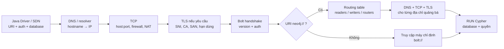
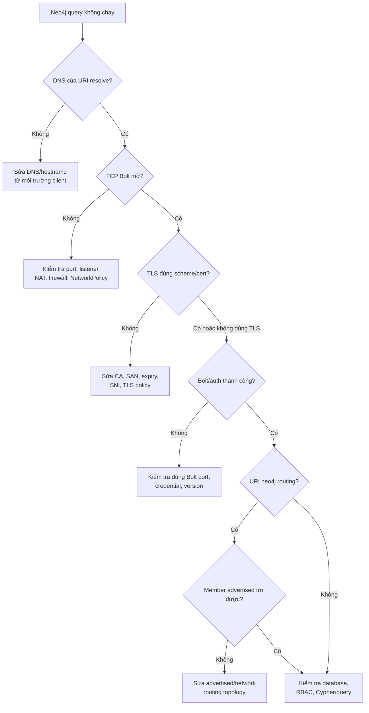

# Lỗi kết nối Bolt, DNS, TLS và địa chỉ định tuyến

## 1. Bối cảnh: ứng dụng không vào được Neo4j dù database có vẻ đang chạy

Neo4j lưu **property graph** gồm node, relationship, thuộc tính, index và constraint. Ứng dụng Java Driver hoặc Spring Data Neo4j giao tiếp với Neo4j qua **Bolt** để thực hiện Cypher. Trước khi một truy vấn như `MATCH (n) RETURN n LIMIT 1` chạy được, client phải vượt qua nhiều tầng: đọc đúng URI, phân giải tên máy, mở socket, thỏa thuận TLS nếu bật mã hóa, bắt tay Bolt, xác thực và — với URI routing — khám phá những địa chỉ server tiếp theo.

Do đó thông báo **“Unable to connect to Neo4j”** chỉ là *triệu chứng tổng quát*. Lỗi gốc có thể nằm ở DNS, firewall, chứng chỉ, cổng sai, sai hostname quảng bá, routing table hoặc tài khoản. Tăng timeout mà không xác định tầng lỗi thường làm tình hình khó quan sát hơn.

Ví dụ: một Neo4j chạy trong Docker, Browser ở `http://localhost:7474` mở được, nhưng service Java chạy ở container khác lại không kết nối được tới `bolt://localhost:7687`. **`localhost` trong container Java là chính container Java**, không phải container Neo4j. Tình huống khác: `bolt://db.example.test:7687` kết nối được, nhưng `neo4j://db.example.test:7687` thất bại vì cluster trả routing table chứa các hostname nội bộ mà máy Java không phân giải/không đi tới được.

Bài này thuộc chương **Xử lý sự cố** của module `DATABASE_ENGINE_GRAPH_NEO4J`. Nó tập trung vào chẩn đoán kết nối cho Cypher, Java Driver, Spring Data Neo4j, cluster và môi trường Docker/Kubernetes; việc tối ưu graph/index hay nghiệp vụ đọc/ghi chỉ thực hiện **sau khi** đường kết nối đã khỏe.

**Sau bài học, bạn có thể:**

1. Xác định tầng lỗi bằng một **chuỗi kiểm tra ít rủi ro**, từ DNS tới câu query đọc đơn giản.
2. Chọn và giải thích đúng URI `bolt://`, `neo4j://`, `+s` và `+ssc` theo cấu hình server.
3. Phân biệt **listen address**, **advertised address**, DNS từ phía client và địa chỉ trả về trong routing table.
4. Chẩn đoán TLS: CA/trust chain, hostname/SAN, chứng chỉ hết hạn, TLS không khớp giữa client–server.
5. Viết smoke test Java Driver có `verifyConnectivity()`, session có database rõ ràng và query đơn giản.
6. Điều tra những lỗi đặc thù khi chạy qua Docker, NAT, proxy, load balancer hoặc cluster.
7. Tạo runbook, ghi bằng chứng và tránh “sửa nhanh” bằng cách vô hiệu hóa bảo mật hoặc cấp quyền quá rộng.

## 2. Sơ đồ các tầng kết nối



**Điểm mấu chốt:** kết nối TCP thành công **không** khẳng định TLS, Bolt, authentication hoặc routing thành công. Ngược lại, Neo4j Browser tải được qua HTTP `7474` cũng **không** chứng minh dịch vụ Bolt `7687` đang mở. Mỗi tầng cần một bằng chứng riêng.

| Tầng | Câu hỏi kiểm tra | Triệu chứng thường gặp |
|---|---|---|
| Cấu hình client | URI, database, hostname và scheme có đúng không? | Driver kết nối nhầm môi trường/cổng |
| DNS | Hostname phân giải ra gì **từ nơi ứng dụng chạy**? | `UnknownHostException`, `Name or service not known` |
| TCP / mạng | Tới đúng IP:port có mở socket không? | Connection refused, timeout, no route |
| TLS | Hai bên có thống nhất mã hóa và xác minh chứng chỉ không? | SSL handshake/certificate/hostname failure |
| Bolt | Đầu xa có thật là Neo4j Bolt và phiên bản tương thích không? | Handshake/version error, kết nối bị đóng |
| Authentication | Credential và cơ chế auth có hợp lệ không? | `Unauthorized` / authentication failure |
| Routing | Các địa chỉ trong bảng routing có thể truy cập không? | `Unable to retrieve routing information`, không có reader/writer |
| Database/RBAC | Database online và user có quyền không? | `DatabaseNotFound`, `Forbidden` hoặc lỗi privilege |

## 3. Chọn URI trước khi bắt đầu chẩn đoán

Java Driver hỗ trợ các dạng URI sau; **scheme là một phần của hợp đồng kết nối**, không phải một tiền tố tùy chọn chỉ để tránh lỗi:

| Scheme | Định tuyến | TLS | Đặc điểm |
|---|---|---|---|
| `bolt://` | Không; kết nối trực tiếp máy đã chỉ định | Không bật qua scheme | Hữu ích kiểm tra một máy Neo4j trong lab hoặc đích cụ thể |
| `bolt+s://` | Không | Có, xác minh CA/hostname | Kết nối trực tiếp có TLS và xác thực chứng chỉ |
| `bolt+ssc://` | Không | Có, chấp nhận certificate self-signed theo cơ chế driver | Chỉ dùng khi chính sách certificate cho phép, thường lab/test |
| `neo4j://` | Có, nhận routing table | Không bật qua scheme | Kết nối có routing ở môi trường được cho phép |
| `neo4j+s://` | Có | Có, xác minh CA/hostname | Thường là lựa chọn kết nối được nhà cung cấp cluster/Aura chỉ định |
| `neo4j+ssc://` | Có | Có, chấp nhận certificate self-signed theo cơ chế driver | Môi trường tự quản được kiểm soát, cần đánh giá rủi ro |

**Không tự đổi `neo4j+s://` thành `bolt://` trong production chỉ vì tạm kết nối được.** Việc đó vừa thay đổi routing/failover, vừa có thể bỏ mã hóa TLS. Phải tìm và sửa nguyên nhân thực tế; URI chính xác do hạ tầng Neo4j cung cấp.

Ví dụ URI:

```text
bolt://localhost:7687                    # Một instance tự quản trong máy lab
bolt://neo4j:7687                        # Container cùng Docker network
neo4j+s://graph.example.test:7687        # Cluster được công bố và có TLS hợp lệ
bolt+s://db-node-1.example.test:7687     # Truy cập trực tiếp một member có TLS
```

Các địa chỉ `example.test` chỉ dùng để minh họa, **không phải máy đang hoạt động**. Đừng nhầm URI Bolt với HTTP:

```text
http://localhost:7474     # Neo4j Browser/HTTP, KHÔNG phải Bolt
https://localhost:7473    # HTTPS, KHÔNG phải Bolt
bolt://localhost:7687     # Neo4j Driver/Cypher Shell
```

Driver không chấp nhận URI có đường dẫn HTTP như `neo4j+s://host:7687/neo4j`. Database được chọn bằng `SessionConfig.withDatabase(...)` hoặc cấu hình framework, **không** đặt ở URL path kiểu REST.

### 3.1. Thực hiện kiểm tra trong môi trường đúng

| Vị trí ứng dụng | “localhost” chỉ về đâu? | Địa chỉ thường dùng |
|---|---|---|
| Java chạy trên host cùng máy Docker | Máy host | `bolt://127.0.0.1:<published-port>` |
| Java trong container Compose khác | Chính container Java | `bolt://neo4j:7687` theo tên service |
| Java trong Kubernetes Pod khác | Chính Pod/container Java | DNS Service thích hợp và port được công bố |
| Java trên máy ngoài cluster | Chính máy Java | FQDN/LB/public endpoint đã được cấp |

Không kiểm tra DNS/TCP chỉ từ laptop rồi cho rằng cùng kết quả trong container ứng dụng: split DNS, NetworkPolicy, proxy và container network có thể tạo hành vi khác nhau.

## 4. Runbook tối thiểu: chẩn đoán theo thứ tự

**Quy tắc:** lưu bằng chứng ở từng bước trước khi đổi cấu hình. Nếu bước trước chưa đạt, chưa cần điều tra sâu các bước sau.

### Bước 1 — Xác định đúng đường đi

Ghi lại (không ghi mật khẩu vào ticket):

- Ứng dụng chạy ở đâu: host, container, Pod, VM, zone/VPC nào?
- URI **đã che phần nhạy cảm**, database name, phiên bản Neo4j/Driver, thời gian lỗi và request/trace ID.
- Máy tự quản, cluster Enterprise hay Neo4j Aura? Có proxy/LB/NAT/TLS termination không?
- Lỗi xảy ra **lúc startup**, **lần query đầu tiên**, hay **khi truy vấn sau kết nối thành công**?
- Có vừa đổi DNS, chứng chỉ, container/network, database topology hoặc firewall không?

`GraphDatabase.driver(...)` tạo đối tượng driver nhưng có thể **chưa thiết lập kết nối** ngay. Để kiểm tra tức thời, dùng `driver.verifyConnectivity()` hoặc thực hiện một truy vấn; không kết luận thành công chỉ vì constructor trả về object.

### Bước 2 — Phân giải DNS tại nơi ứng dụng thực sự chạy

Trên host Linux/container có công cụ thích hợp:

```bash
getent ahosts graph.example.test
nslookup graph.example.test
```

Nếu cần kiểm tra bản ghi A/AAAA/CNAME bằng `dig`:

```bash
dig graph.example.test A
dig graph.example.test AAAA
dig graph.example.test CNAME
```

Trên PowerShell/Windows:

```powershell
Resolve-DnsName graph.example.test
```

Đối chiếu IP và CNAME từ **máy thực thi Java**. Nếu DNS không phân giải, kiểm tra typo, cấu hình nameserver, search domain, split-horizon DNS, container network, Kubernetes Service/namespace và firewall tới DNS resolver.

**Quan trọng:** một hostname có thể phân giải ra nhiều IP (DNS load balancing, IPv4/IPv6). Kiểm tra **từng địa chỉ** có thể đi tới, vì lỗi sẽ có vẻ không ổn định nếu một IP hỏng còn IP khác khỏe. DNS thành công chỉ chứng minh ánh xạ tên → IP; chưa chứng minh Bolt port mở.

### Bước 3 — Kiểm tra TCP port

Trên Linux/container có `nc`:

```bash
nc -vz -w 3 graph.example.test 7687
```

Trên PowerShell/Windows:

```powershell
Test-NetConnection graph.example.test -Port 7687
```

Nếu thất bại:

- **Connection refused**: IP đi tới được nhưng đầu xa không nhận cổng đó hoặc thiết bị mạng chủ động từ chối; kiểm tra Bolt listener, port publishing và destination.
- **Connection timed out**: có thể firewall, security group, ACL, routing mạng, proxy hoặc máy đích không phản hồi.
- **No route to host**: kiểm tra routing table/IP/subnet, NetworkPolicy/VPC/VPN.
- **TCP thành công**: chỉ chứng minh bắt tay TCP hoàn tất; còn phải kiểm tra TLS/Bolt/auth/routing.

Với self-managed Neo4j, trên **máy server** có thể kiểm tra socket listener:

```bash
ss -lnt | grep 7687
```

Trên Docker host:

```bash
docker compose ps
docker compose logs --tail 100 neo4j
```

`ss` chạy trên server/container và `docker compose` phải dùng đúng project. Không chạy lệnh thay firewall, gỡ TLS hoặc mở port Internet chỉ vì kiểm tra TCP thất bại.

### Bước 4 — Kiểm tra TLS nếu endpoint yêu cầu

Ví dụ khi phía server yêu cầu TLS ở Bolt port:

```bash
openssl s_client \
  -connect graph.example.test:7687 \
  -servername graph.example.test \
  -showcerts
```

Kiểm tra certificate chain, ngày hết hạn, issuer, `subjectAltName`, TLS protocol/cipher đã thương lượng và lỗi xác minh. `-servername` gửi **SNI** để proxy/endpoint chọn chứng chỉ đúng theo hostname.

**Cảnh báo:** `openssl s_client` chỉ kiểm tra bắt tay TLS, **không nói Bolt authentication đã đạt**. Lệnh này không thích hợp cho endpoint Bolt **không bật TLS**; lỗi `wrong version number` ở đó không tự chứng minh server hỏng. Không gửi username/password qua `openssl`.

Có thể kiểm tra chứng chỉ PEM **đã được cấp phép đọc**:

```bash
openssl x509 -in public.crt -noout -dates -issuer -subject -ext subjectAltName
```

Khi Java báo lỗi chứng chỉ, kiểm tra cùng **JDK/truststore** mà ứng dụng thật sử dụng. `openssl` xác minh bằng trust store của môi trường gọi, còn JVM có thể dùng trust store khác. Không dùng cách “tắt kiểm tra chứng chỉ” làm giải pháp production.

### Bước 5 — Kiểm tra Bolt và authentication

Nếu có Cypher Shell:

```bash
# Tài khoản và mật khẩu được nhập qua cơ chế an toàn của môi trường.
# Không đặt password literal vào command history.
cypher-shell -a neo4j+s://graph.example.test:7687 \
  -u app_reader -d neo4j
```

Sau khi xác thực, chạy câu đọc đơn giản:

```cypher
RETURN 1 AS ok;
```

Kỳ vọng `ok = 1`. Nếu Cypher Shell hỏi mật khẩu, nhập bằng kênh terminal được tin cậy. Nếu môi trường automation, dùng secret manager/env được bảo vệ; không dán `-p <password>` vào ticket hoặc shell history.

Nếu query này chạy được nhưng `MATCH` theo nhãn báo lỗi, sự cố có thể đã chuyển sang **database/RBAC/schema/logic Cypher**, không còn là lỗi kết nối. `RETURN 1` không chứng minh quyền đọc graph hay tồn tại dữ liệu nghiệp vụ.

### Bước 6 — Kiểm tra routing và địa chỉ quảng bá

Nếu `bolt+s://host:7687` tới **một server cụ thể** thành công nhưng `neo4j+s://host:7687` không thể lấy routing table hoặc thất bại khi truy vấn, ưu tiên kiểm tra:

1. Endpoint vào có thực sự hỗ trợ routing không?
2. Driver nhận các **địa chỉ nào** trong routing table?
3. **Mỗi hostname:port được quảng bá** có phân giải và kết nối được từ client không?
4. Chúng có chứng chỉ TLS hợp lệ với hostname được quảng bá không?
5. Database có server khả dụng cho chế độ đọc/ghi không; routing table có bị cũ sau failover không?

Không lấy việc kết nối thành công tới **địa chỉ đầu vào** làm bằng chứng toàn bộ các địa chỉ được trả về đều đúng.

## 5. Neo4j listen address khác advertised address

Hai cấu hình thường bị nhầm:

| Cấu hình | Vai trò | Ví dụ |
|---|---|---|
| `server.bolt.listen_address` | Interface/port mà **tiến trình Neo4j bind để nhận** kết nối | `0.0.0.0:7687` |
| `server.bolt.advertised_address` | Hostname/IP:port mà **client được hướng dẫn dùng** | `db1.example.test:7687` |
| `server.default_listen_address` | Host/interface mặc định cho các connector khi không override | `0.0.0.0` |
| `server.default_advertised_address` | Host mặc định dùng cho advertised address | `db1.example.test` |
| `server.routing.listen_address` | Connector **nội bộ** cho server-side routing (tùy topology) | `:7688` |
| `server.routing.advertised_address` | Địa chỉ **nội bộ** để các thành viên nói chuyện khi server-side routing | `db1.internal:7688` |

**Đừng nhầm** `server.routing.advertised_address` (kênh server-side routing nội bộ) với `server.bolt.advertised_address` (địa chỉ Bolt mà client có thể được cung cấp qua routing). Port `7688` không phải port Bolt công cộng thay thế `7687`; còn port cluster nội bộ khác như `6000`/`7000` cũng không nên mở Internet.

Ví dụ cấu hình self-managed trong `neo4j.conf`:

```properties
server.bolt.enabled=true
server.bolt.listen_address=0.0.0.0:7687
server.bolt.advertised_address=db1.example.test:7687
```

**Điều kiện:** `db1.example.test:7687` phải là đường đi **thực tế** từ nhóm client được phép, và chứng chỉ phải hợp lệ với hostname đó nếu TLS bật. `0.0.0.0` dùng để listen trên các interface, **không phải** một hostname advertised hợp lệ cho client bên ngoài.

### 5.1. Ví dụ lỗi Docker/NAT

Giả sử container Neo4j nghe `0.0.0.0:7687`, Docker publish port host `17687 → 7687`:

```yaml
services:
  neo4j:
    image: neo4j:2025.11
    ports:
      - "127.0.0.1:17687:7687"
```

Từ **host**, URI trực tiếp thử nghiệm là:

```text
bolt://127.0.0.1:17687
```

Nhưng một client dùng `neo4j://127.0.0.1:17687` có thể nhận địa chỉ quảng bá `localhost:7687` hoặc hostname nội bộ `neo4j:7687`, rồi thử kết nối **không đúng port/namespace mạng**. Đây là nguyên nhân phổ biến của tình huống “kết nối đầu vào được, query sau đó lỗi”.

Giải pháp **phụ thuộc topology**:

- Trong **lab single-instance**, dùng `bolt://127.0.0.1:17687` nếu mục tiêu là truy cập trực tiếp server.
- Trong **cluster**, xuất **từng địa chỉ member** bằng hostname/port mà client **thực sự đi tới được**; cấu hình advertised address, NAT/LB và TLS theo thiết kế đã phê duyệt.
- Nếu ứng dụng và database chạy cùng Docker network, dùng tên service và port nội bộ; không suy rằng published host port là cổng cần gọi giữa hai container.

**Không áp dụng một giá trị advertised `localhost` cho mọi member cluster**: trên máy client, tất cả sẽ trỏ về cùng máy client; routing sẽ thất bại hoặc đi nhầm.

### 5.2. Khi đi qua load balancer hoặc proxy

Một LB có thể làm endpoint vào hoạt động nhưng vẫn có lỗi khi driver kết nối tiếp tới các member trong routing table. Có hai chiến lược khác nhau:

1. **Client-side routing:** driver nhận danh sách reader/writer/router và phải đi được tới các địa chỉ advertised phù hợp.
2. **Server-side routing:** server tiếp nhận có thể định tuyến nội bộ theo cấu hình cluster; client chỉ cần đi tới endpoint mà topology công bố.

Neo4j Enterprise có các cài đặt như `dbms.routing.enabled`, `server.routing.listen_address`, `server.routing.advertised_address` và `dbms.routing.default_router`. **Chỉ áp dụng theo tài liệu của đúng phiên bản/topology**, không bật/tắt để chữa một lỗi mà chưa có kế hoạch. Một HTTP reverse proxy thông thường **không** tự biến thành Bolt-aware proxy; nếu dùng TCP proxy hoặc TLS termination, phải kiểm tra cả TCP, SNI, certificate và routing semantics.

## 6. DNS: lỗi ở client ban đầu và lỗi tại các member được trả về

### 6.1. Các kiểu lỗi thường gặp

| Dấu hiệu | Giả thuyết | Kiểm tra |
|---|---|---|
| `UnknownHostException` ngay khi mở driver | Hostname URI sai hoặc resolver không dùng được | `getent`/`nslookup` trong **container Java** |
| Host URI resolve, nhưng routing fail | Một/những advertised hostname không resolve | DNS từng địa chỉ routing, không chỉ seed |
| Có khi được, có khi mất kết nối | DNS trả nhiều IP, vài backend hỏng | Kiểm tra từng A/AAAA và LB health |
| Java container không resolve tên máy host | Search domain/network khác | Kiểm tra Compose network, `/etc/resolv.conf`, Kubernetes DNS |
| Chỉ lỗi với IPv6 | Client chọn AAAA nhưng đường IPv6 không hoạt động | So A/AAAA và kết nối từng họ địa chỉ |
| Đổi DNS xong vẫn lỗi | TTL/cache JVM/driver/routing table còn cũ | Đo TTL, lifecycle kết nối, kế hoạch refresh có kiểm soát |

### 6.2. Không nhầm DNS resolver tùy chỉnh của Driver với routing table

Java Driver hỗ trợ `Config.Builder.withResolver(...)` để thay cách phân giải **địa chỉ kết nối đầu vào**. Theo tài liệu Java Driver hiện hành, custom resolver **không áp dụng cho những địa chỉ được nhận từ routing table**. Vì vậy một resolver giúp seed address đi tới được **không tự chữa** các advertised hostname mà cluster trả về.

Ví dụ **minh họa** resolver cho seed endpoint trong môi trường test:

```java
import java.util.Set;
import org.neo4j.driver.Config;
import org.neo4j.driver.net.ServerAddress;

Config config = Config.builder()
    .withResolver(address -> Set.of(
        ServerAddress.of("127.0.0.1", 17687)
    ))
    .build();
```

Resolver trên không đổi URI scheme, không chỉnh TLS certificate và **không** sửa địa chỉ quảng bá sai. Tránh hard-code một IP trong production để che lỗi DNS/routing; sẽ làm hỏng failover và có thể tạo lỗi certificate hostname.

### 6.3. Kết nối từ Kubernetes

Trong Kubernetes, một Service DNS như `neo4j.default.svc.cluster.local` có thể phân giải được **từ Pod** trong cluster nhưng không từ laptop hoặc máy chủ bên ngoài. Đối với Neo4j cluster:

- Xác định ứng dụng dùng **Service trong cluster**, ingress/LB ngoài cluster hay private endpoint.
- Kiểm tra hostname advertised và port từng member từ **Pod Java**, không chỉ từ Pod Neo4j.
- Kiểm tra NetworkPolicy, namespace, egress DNS, TLS certificate và DNS TTL.
- Với Helm/operator, ưu tiên cấu hình topology theo tài liệu phát hành của chart/operator đang dùng; không sửa tay advertised address của một member rồi để controller ghi đè.
- Không dùng cùng một PVC/volume `/data` cho nhiều member để cố chia sẻ dữ liệu; storage clustering cần thiết kế đúng.

## 7. TLS: phân loại lỗi để không làm giảm bảo mật

### 7.1. Những câu hỏi bắt buộc

1. Endpoint có yêu cầu TLS không, và client dùng scheme nào?
2. Certificate còn hạn, đủ chain CA/intermediate và được trust store của **JVM thực** tin cậy không?
3. Hostname của **URI hoặc advertised address** có khớp `subjectAltName` không?
4. Nếu có TLS-terminating LB, certificate nào được trình bày ở từng hop và có SNI không?
5. Có chính sách mTLS/client certificate hay cipher/TLS version đặc biệt không?

Một bản Neo4j tự quản có thể dùng `server.bolt.tls_level`:

| Giá trị | Hành vi | Cặp kết nối thường dùng |
|---|---|---|
| `DISABLED` | Chỉ chấp nhận kết nối Bolt không mã hóa | `bolt://` hoặc `neo4j://` trong mạng được kiểm soát |
| `REQUIRED` | Chỉ chấp nhận kết nối Bolt có TLS | `bolt+s://`, `neo4j+s://` (hoặc +ssc trong môi trường được kiểm soát) |
| `OPTIONAL` | Cho phép cả hai theo cấu hình | Chọn scheme theo **chính sách bảo mật** của tổ chức |

Trong production, không dùng `DISABLED` chỉ để làm một lỗi certificate biến mất; phải sửa CA/SAN/proxy hoặc client trust đúng cách. Với Aura, sử dụng URI/TLS do dịch vụ cung cấp, không tự giả định có thể đổi cấu hình TLS của máy chủ.

### 7.2. Đọc triệu chứng TLS

| Lỗi/triệu chứng | Kiểm tra đầu tiên | Cách sửa đúng hướng |
|---|---|---|
| `PKIX path building failed` | CA/intermediate trust chain, Java truststore | Cài trust chain CA được phê duyệt |
| `No subject alternative DNS name matching` | SAN của chứng chỉ so với URI/advertised host | Cấp lại cert hoặc sửa hostname hợp lệ |
| `certificate expired` | Validity của cert và đồng hồ hệ thống | Renew cert theo quy trình |
| `handshake_failure` | Cipher suite, TLS version, mTLS, SNI, proxy | So client/server policies và tương thích runtime |
| `wrong version number` khi thử OpenSSL | Server Bolt không TLS hoặc đi nhầm cổng/proxy | Xác nhận mode TLS trước, không suy lỗi graph |
| Chỉ member B bị lỗi | Cert của B thiếu SAN/trust hoặc hostname advertised sai | So cert và routing riêng từng member |
| Kết nối lâu rồi lỗi sau rotate cert | Pool giữ kết nối cũ, cert mới chỉ dùng ở handshake mới | Kiểm tra refresh connection và TLS reload theo version |

**`+ssc` không phải cách sửa production mặc định.** Nó có thể giúp kết nối lab với certificate self-signed, nhưng cơ chế trust không tương đương xác minh danh tính máy chủ qua CA/hostname. Không khuyến nghị tắt hostname validation hoặc `trust_all` để khôi phục dịch vụ mà không đánh giá nguy cơ người trung gian.

### 7.3. Kế hoạch xoay vòng chứng chỉ

Trong môi trường nhiều member, chứng chỉ thường cần SAN phù hợp với tên member mà client thực sự dùng. Khi rotate:

1. Chuẩn bị chain, SAN, expiry, quyền đọc key và secret.
2. Cập nhật ở endpoint/LB/member cần thiết theo trình tự đã kiểm thử.
3. Kiểm tra **kết nối mới**, không chỉ các connection pool cũ còn sống.
4. Theo dõi handshake errors theo member và thời điểm.
5. Duy trì rollback về certificate hợp lệ nếu chính sách cho phép.

Neo4j các phiên bản mới có cơ chế **TLS certificate reload** với điều kiện cấu hình; không mặc định mọi bản cũ hỗ trợ reload không restart. Nếu dùng debug logging TLS, bật trong thời gian ngắn và kiểm soát dữ liệu log vì rất dễ làm log tăng nhanh.

## 8. Java Driver: smoke test kết nối có chủ đích

Ví dụ Java 17+ và Neo4j Java Driver chính thức. Truyền URI, username và secret bằng biến môi trường đã được cấp trong runtime; **không in password**:

```java
import java.time.Duration;
import java.util.Map;
import java.util.concurrent.TimeUnit;
import org.neo4j.driver.AccessMode;
import org.neo4j.driver.AuthTokens;
import org.neo4j.driver.Config;
import org.neo4j.driver.Driver;
import org.neo4j.driver.GraphDatabase;
import org.neo4j.driver.SessionConfig;
import org.neo4j.driver.TransactionConfig;

public final class BoltConnectivitySmokeTest {
    public static void main(String[] args) {
        String uri = requireEnv("NEO4J_URI");
        String username = requireEnv("NEO4J_USERNAME");
        String password = requireEnv("NEO4J_PASSWORD");
        String database = requireEnv("NEO4J_DATABASE");

        Config config = Config.builder()
            .withConnectionTimeout(5, TimeUnit.SECONDS)
            .withConnectionAcquisitionTimeout(5, TimeUnit.SECONDS)
            .withMaxTransactionRetryTime(5, TimeUnit.SECONDS)
            .build();

        try (Driver driver = GraphDatabase.driver(
                uri, AuthTokens.basic(username, password), config)) {
            // Buộc kiểm tra kết nối ngay, không chỉ tạo Driver object.
            driver.verifyConnectivity();

            SessionConfig sessionConfig = SessionConfig.builder()
                .withDatabase(database)
                .withDefaultAccessMode(AccessMode.READ)
                .build();
            TransactionConfig txConfig = TransactionConfig.builder()
                .withTimeout(Duration.ofSeconds(3))
                .build();

            try (var session = driver.session(sessionConfig)) {
                int ok = session.executeRead(tx ->
                    tx.run("RETURN 1 AS ok", Map.of())
                      .single().get("ok").asInt(),
                    txConfig
                );
                if (ok != 1) {
                    throw new IllegalStateException("Unexpected query result");
                }
                System.out.println("Bolt connectivity OK");
            }
        }
    }

    private static String requireEnv(String name) {
        String value = System.getenv(name);
        if (value == null || value.isBlank()) {
            throw new IllegalArgumentException("Missing env: " + name);
        }
        return value;
    }
}
```

**Cách diễn giải:**

- Lỗi tại `verifyConnectivity()` cho biết kết nối ban đầu/khả năng xác thực đã có vấn đề; đọc **cause chain** để phân loại DNS/TCP/TLS/Bolt/auth/routing.
- Lỗi khi mở session hoặc `executeRead` sau khi connectivity OK có thể liên quan database cụ thể, routing cho read, pool, timeout hoặc thay đổi topology.
- `RETURN 1` không cần đọc node/relationship, nên tách được lỗi kết nối khỏi schema/Cypher nghiệp vụ.
- `withConnectionTimeout`, `withConnectionAcquisitionTimeout` và `TransactionConfig.withTimeout` giới hạn **các pha khác nhau**; không gộp chúng thành một deadline HTTP tổng.
- `Driver` là object nặng và thread-safe, nên dùng lại trong ứng dụng; `Session` là phạm vi ngắn, không chia sẻ giữa nhiều thread. Trong smoke test tạo/đóng driver để kiểm tra độc lập.

Khi kiểm tra cluster có read routing, dùng `neo4j://`/`neo4j+s://` được quản trị viên cung cấp. Thử `bolt+s://` tới một member **chỉ để phân lập lỗi routing**, không thay đổi URI production vĩnh viễn nếu ứng dụng cần failover.

### 8.1. Quy trình phân tích exception

Ví dụ phân tầng trong service:

```java
try {
    driver.verifyConnectivity();
} catch (org.neo4j.driver.exceptions.Neo4jException e) {
    // Ghi mã lỗi và class, không ghi credential/query chứa dữ liệu nhạy cảm.
    logger.error("Neo4j connectivity error class={}, code={}",
        e.getClass().getSimpleName(), e.code(), e);
    throw e;
}
```

Đoạn minh họa giả định có `logger` từ SLF4J. **Không phải mọi lỗi socket/DNS/TLS đều có cùng kiểu `Neo4jException`**, nên tầng log/monitor thực tế cần ghi exception class và root cause mà không để lộ dữ liệu nhạy cảm. Không so chuỗi `e.getMessage()` để tự quyết định retry vô hạn.

### 8.2. Lỗi kết nối và lỗi query khác nhau

| Kết quả smoke test | Ý nghĩa tiếp theo |
|---|---|
| Constructor thành công nhưng `verifyConnectivity()` lỗi | Driver chưa có một kết nối hợp lệ; kiểm tra từ DNS → auth/routing |
| `verifyConnectivity()` OK, `RETURN 1` lỗi khi chọn database | Kiểm tra database name, quyền `ACCESS`, trạng thái database hoặc routing cụ thể |
| `RETURN 1` OK, query `MATCH` lỗi | Kiểm tra RBAC, syntax, constraint/index, procedure, memory/transaction timeout |
| Chỉ query ghi lỗi | Kiểm tra quyền `WRITE`, database read-only, leader/writer routing, tranh chấp transaction |
| Chỉ khi tải cao mới lỗi | Kiểm tra pool exhaustion, server thread/sessions, GC, CPU, network saturation |

## 9. Spring Data Neo4j: sai cấu hình thường trông như lỗi repository

Với Spring Boot hiện đại, Spring Data Neo4j sử dụng Java Driver bên dưới. Ví dụ khai báo cấu hình:

```yaml
spring:
  neo4j:
    uri: "neo4j+s://graph.example.test:7687"
    authentication:
      username: "app_reader"
      password: "${NEO4J_PASSWORD}"
  data:
    neo4j:
      database: "neo4j"
```

**Chú ý:** tùy phiên bản Spring Boot, cấu hình database có thể ở namespace khác; kiểm tra property reference của phiên bản Boot thực tế. Trong ví dụ này, địa chỉ là endpoint giả định và mật khẩu lấy từ secret environment, không được commit giá trị thật vào Git.

Quy trình debug service:

1. Xác nhận profile `dev/staging/prod` đang chạy, config đã resolve và URI/DB đúng môi trường. Không log password.
2. Thực thi smoke test của Java Driver với **cùng URI, JDK, truststore, user và network namespace** như ứng dụng SDN.
3. Nếu smoke test lỗi, xử lý từ tầng kết nối; nếu nó OK mà repository lỗi, kiểm tra transaction, database config, mapping/projection và query.
4. Với cluster, `@Transactional(readOnly = true)` không thể sửa một advertised address sai; nó chỉ ảnh hưởng cách framework tổ chức giao dịch.
5. Khi service tạo nhiều `Driver`/pool cho từng request, khắc phục lifecycle; không tăng max pool tùy tiện khi bản chất là DNS/TLS fail.

Một ứng dụng có thể đọc URL từ environment khác với URL bạn dùng trong Browser. **Luôn xác minh effective configuration** của tiến trình Java và kết nối từ nơi nó thực sự chạy.

## 10. Cluster routing: phân lập lỗi seed và member

Trường hợp minh họa:

```text
Java client → neo4j+s://entry.example.test:7687
                         |
                         | Seed có TCP + TLS + Bolt OK
                         v
                  Routing table:
                     writer = db-1.internal:7687
                     reader = db-2.internal:7687
                     router = db-3.internal:7687

Java client bên ngoài VPC:
  entry.example.test      → OK
  db-1.internal           → DNS ERROR
  db-2.internal           → DNS ERROR
  db-3.internal           → DNS ERROR
```

Kết quả: **địa chỉ entry hoạt động, nhưng client-side routing không hoạt động**. Không sửa bằng cách tăng `maxConnectionPoolSize` hoặc đổi thông số query. Hạ tầng cần cung cấp một trong những cách được hỗ trợ: địa chỉ advertised client có thể truy cập, DNS phù hợp, network route/VPN, hoặc **server-side routing** với endpoint thích hợp.

### 10.1. Kiểm tra danh sách server bằng công cụ quản trị

Trên Neo4j Enterprise với quyền phù hợp, có thể dùng:

```cypher
SHOW SERVERS
YIELD name, address, state, health
RETURN name, address, state, health
ORDER BY name;
```

**Cú pháp và cột `SHOW SERVERS` phụ thuộc phiên bản Neo4j**; kiểm tra kết quả `SHOW SERVERS` không lọc cột trước khi dùng trên deployment khác. Lệnh này giúp kiểm tra trạng thái server từ góc nhìn DBMS; **không** tự chứng minh rằng Java client bên ngoài phân giải hoặc đi tới được địa chỉ đó.

Kiểm tra tình trạng database:

```cypher
SHOW DATABASES
YIELD name, currentStatus
RETURN name, currentStatus
ORDER BY name;
```

Tài khoản ứng dụng có thể không được quyền `SHOW SERVERS`/`SHOW DATABASES` đầy đủ. Không cấp admin chỉ để debug endpoint; phối hợp người vận hành và dùng các bằng chứng từ client trước.

### 10.2. Khi direct Bolt hoạt động nhưng routed Neo4j thất bại

Đây là **một tín hiệu định hướng**, không phải kết luận tuyệt đối:

| Thử nghiệm | Nếu OK | Nếu lỗi |
|---|---|---|
| `bolt+s://entry` | Seed/TLS/auth trực tiếp hoạt động | Kiểm tra seed DNS/TCP/TLS/Bolt/auth |
| `neo4j+s://entry` | Routing và member cần thiết hoạt động cho phép thử | Kiểm tra routing table/member/database |
| `neo4j+s://member1` | Member 1 có thể làm seed và trả routing | Kiểm tra member1 cấu hình/routing |
| `neo4j+s://entry` + read/write smoke | Đường read và write cho database hoạt động | Kiểm tra reader/writer có sẵn và route/permission |

Không dùng `bolt://`/`bolt+s://` trong production cluster chỉ để tránh một bảng routing sai, trừ khi kiến trúc **cố ý** dùng direct server hoặc server-side routing đã được phê duyệt. Cách sửa lâu dài phải tương thích với failover và bảo đảm độ sẵn sàng.

### 10.3. TLS với các địa chỉ trong routing table

Nếu TLS được bật, **mỗi địa chỉ quảng bá** phải có chứng chỉ được xác minh phù hợp. Một wildcard chỉ cho `*.example.test` thường **không** khớp `db-1.internal`; SNI/LB cũng có thể trả certificate khác trên từng đường. Vì vậy:

- Kiểm tra cert trên **seed** và trên **member** có lỗi.
- So SAN với hostname driver thực sự dùng, không chỉ tên đẹp trong tài liệu.
- Xác nhận CA/intermediate trong truststore Java.
- Không rút ngắn advertised hostname bằng cách chuyển sang IP nếu certificate chỉ chứa DNS SAN; có thể tạo lỗi hostname mismatch.

## 11. Lỗi authentication, database và firewall sau khi đã qua mạng

Ngay cả khi DNS/TCP/TLS/Bolt đều hoạt động, vẫn có thể thất bại vì:

- Username/password sai, credential đã đổi/rotate, account bị khóa hoặc token hết hiệu lực.
- Application chọn database `neo4j` nhưng instance thực chạy database khác; cluster có database offline.
- User được xác thực nhưng thiếu quyền `ACCESS` hoặc quyền đọc graph; khác hoàn toàn với lỗi TCP.
- Proxy/LB có cơ chế health check HTTP không kiểm tra Bolt port, khiến endpoint “healthy” giả.
- Firewalls cho phép cổng **entry**, nhưng chưa cho phép tới từng member advertised mà client routing cần.

Để xác định đúng database và user khi đã kết nối được bằng tài khoản đủ quyền, có thể dùng những truy vấn metadata phù hợp:

```cypher
SHOW CURRENT USER;
```

```cypher
SHOW DATABASES
YIELD name, currentStatus
RETURN name, currentStatus
ORDER BY name;
```

Nếu câu lệnh metadata không được quyền, đừng tự động cấp admin; hãy chuyển cho DBA cùng với URI, thời điểm và lỗi đã ghi. Một lỗi `Forbidden` không được sửa bằng cách tắt authentication của Neo4j hoặc dùng mật khẩu admin trong ứng dụng.

## 12. Timeout, retry, pool và dấu hiệu lỗi dưới tải

Ba nhóm lỗi thường bị trộn:

| Nhóm | Ngữ nghĩa | Đầu mối |
|---|---|---|
| **Connection timeout** | Không thiết lập được kết nối kịp | DNS, TCP, TLS, proxy, server quá tải |
| **Connection acquisition timeout** | Không lấy được connection phù hợp từ pool/routing kịp | Pool, leaked session/result, concurrency |
| **Transaction timeout** | Transaction/query vượt thời gian phía server | Cypher, locks, CPU, I/O, bookmark wait và tổng thời gian |

Ví dụ cấu hình Driver:

```java
import java.util.concurrent.TimeUnit;
import org.neo4j.driver.Config;

Config config = Config.builder()
    .withConnectionTimeout(5, TimeUnit.SECONDS)
    .withConnectionAcquisitionTimeout(5, TimeUnit.SECONDS)
    .withMaxTransactionRetryTime(10, TimeUnit.SECONDS)
    .withMaxConnectionPoolSize(50)
    .build();
```

Những giá trị này **chỉ để minh họa**, không phải chuẩn production. Driver có thể retry managed transaction khi gặp lỗi tạm thời; số lần/tổng thời gian phải phù hợp với **deadline tổng** của HTTP/queue task. Không bọc thêm retry nhiều tầng vô hạn khi DNS/TLS sai cố định; sẽ tạo thêm tải.

Nếu chỉ lỗi sau vài giờ hoặc khi tải cao:

1. Kiểm tra server có restart/failover, rolling certificate rotation hoặc cập nhật DNS/LB không.
2. Kiểm tra connection pool usage/wait, số session chưa đóng và `Result` chưa tiêu thụ.
3. Kiểm tra GC, CPU, page cache, max connections và network load.
4. Đo p50/p95/p99, timeout rate, retry count theo member.
5. Chỉ điều chỉnh pool/timeout **sau khi** biết điểm nghẽn; tăng pool khi DB đã bão hòa có thể làm latency xấu hơn.

### 12.1. Phân biệt “không có writer” với “hết quyền ghi”

Trên cluster, một request ghi có thể lỗi vì routing table không tìm được writer phù hợp cho database, vì leader chuyển đổi, hoặc vì user **không có quyền ghi**. Hãy kiểm tra:

- Có node/server writer sẵn sàng trong topology không?
- Driver có dùng routing URI và database đúng không?
- Credential có quyền `WRITE`/`SET PROPERTY`/`CREATE` theo nhu cầu không?
- Nếu chỉ có query ghi lỗi, thử **read-only smoke test** trước để tách vấn đề kết nối khỏi vấn đề transaction write.

Không thay mã nghiệp vụ để ghi vào một member bất kỳ khi writer routing lỗi; trong cluster, quyền ghi và vai trò server cần đúng.

## 13. Ba tình huống điều tra điển hình

### 13.1. Docker: Browser hoạt động, Spring Boot lỗi Connection refused

**Triệu chứng:** Browser trên host vào `http://localhost:7474` được; Spring Boot chạy trong container khác dùng `bolt://localhost:7687` và báo `Connection refused`.

**Giải thích:** `localhost` trong container Java không chỉ tới Neo4j. URI bị sai network namespace.

**Chẩn đoán:**

```bash
# Từ Docker host, xác nhận service/port được publish.
docker compose ps

# Từ container ứng dụng (nếu có getent và nc).
getent hosts neo4j
nc -vz -w 3 neo4j 7687
```

**Sửa:** đặt `spring.neo4j.uri=bolt://neo4j:7687` khi hai service cùng Compose network, database nghe trên network thích hợp và TLS mode phù hợp. Kiểm tra lại `RETURN 1 AS ok` bằng Java Driver. Không đổi `localhost` thành một public IP tùy ý nếu Docker service discovery đã đáp ứng.

### 13.2. TLS: TCP 7687 mở nhưng `neo4j+s` thất bại

**Triệu chứng:** `nc` kết nối được, `openssl s_client` trả cert không khớp `db.example.test` hoặc lỗi chain; Java báo `SSLHandshakeException`.

**Giải thích:** TCP OK nhưng xác minh danh tính của TLS endpoint thất bại, có thể do hostname advertised/proxy, CA thiếu hoặc certificate hết hạn.

**Sửa:** thay cert có SAN đúng, chain đầy đủ, truststore đúng hoặc sửa endpoint/advertised hostname theo thiết kế; kiểm tra lại bằng kết nối mới. Không đổi `neo4j+s` sang `neo4j` để “chữa” TLS.

### 13.3. Cluster: direct member được, routed URI thất bại

**Triệu chứng:** `bolt+s://member1.example.test` chạy `RETURN 1`; `neo4j+s://entry.example.test` lúc được lúc lỗi `Unable to retrieve routing information`.

**Giải thích khả dĩ:** danh sách member được quảng bá có hostname nội bộ, port chưa publish, certificate khác hoặc reader/writer không khả dụng.

**Sửa:** xem routing topology và các advertised address, thử DNS/TCP/TLS **từng member từ client**, xem logs và trạng thái database, chọn giải pháp client-side hay server-side routing được triển khai đúng. Không chỉ đổi scheme sang direct cho toàn bộ ứng dụng khi vẫn cần HA.

## 14. Quy trình xử lý sự cố theo bằng chứng

Một mẫu ghi lại trong incident ticket:

| Trường | Giá trị cần thu |
|---|---|
| `timeWindow` | Thời điểm lỗi, múi giờ, thời gian kéo dài |
| `clientPlacement` | VM/container/Pod/namespace/VPC và JDK/Driver version |
| `serverTopology` | Standalone/cluster/Aura; database name và edition nếu biết |
| `uriScheme` | `neo4j+s` hay `bolt+s`, hostname/port **đã lọc dữ liệu nhạy cảm** |
| `dnsResult` | A/AAAA/CNAME/TTL từ nơi client chạy |
| `tcpResult` | Port mở/timeout/refused; IPv4/IPv6 |
| `tlsResult` | Handshake, issuer, SAN, expiry, chain validation |
| `boltResult` | `verifyConnectivity`/Cypher Shell và root cause |
| `routingResult` | Seed và từng advertised member có thể đi tới? |
| `dbResult` | `RETURN 1`, DB status, RBAC, read/write mode |
| `action` | Cấu hình đã thay, rollback, thời gian phục hồi |

### 14.1. Decision tree khi xử lý tại chỗ



Đây là thứ tự ưu tiên, không phải chứng minh mọi lỗi phải đi qua đúng một nhánh. Một ứng dụng có thể gặp **nhiều lỗi đồng thời** (DNS trục trặc và chứng chỉ hết hạn). Sau mỗi sửa đổi, kiểm tra lại **từ đầu** với cùng môi trường client và ghi kết quả.

## 15. Tạo fixture để tách kết nối khỏi lỗi dữ liệu

Nếu `RETURN 1` đã đạt, thử trên database học tập bằng một graph nhỏ để xác nhận hoạt động Cypher và quyền đọc/ghi cơ bản. Không chạy lệnh ghi trên production.

### 15.1. Tạo node và constraint

```cypher
CREATE CONSTRAINT ts001_person_id IF NOT EXISTS
FOR (p:TS001Person)
REQUIRE p.id IS UNIQUE;
```

```cypher
UNWIND [
  {id: 'an', name: 'An'},
  {id: 'binh', name: 'Bình'}
] AS row
MERGE (p:TS001Person {id: row.id})
SET p.name = row.name;
```

```cypher
MATCH (a:TS001Person {id: 'an'})
MATCH (b:TS001Person {id: 'binh'})
MERGE (a)-[:TS001_FOLLOWS]->(b);
```

### 15.2. Xác minh truy vấn quan hệ

```cypher
MATCH (a:TS001Person)-[:TS001_FOLLOWS]->(b:TS001Person)
RETURN a.id AS source, b.id AS target
ORDER BY source, target;
```

Kỳ vọng một dòng `an → binh`. Kiểm tra có đúng hai node và một relationship:

```cypher
MATCH (p:TS001Person)
WITH count(p) AS persons
MATCH (:TS001Person)-[r:TS001_FOLLOWS]->(:TS001Person)
RETURN persons, count(r) AS follows;
```

Kỳ vọng `persons = 2`, `follows = 1`. Nếu `RETURN 1` thành công nhưng câu ghi `MERGE` lỗi, xem quyền `CREATE`/`SET PROPERTY`/`WRITE`/constraint; chưa thể khẳng định kết nối Bolt bị hỏng.

**Tách biệt môi trường:** dùng database test hoặc user chuyên dụng. Không yêu cầu tài khoản chỉ đọc chạy fixture ghi; khi chỉ có quyền đọc, bỏ qua bước tạo dữ liệu và dùng query đọc được DBA cho phép.

## 16. Kiểm thử hồi quy sau khi sửa

Một thay đổi DNS/TLS/routing chỉ được xem là hoàn tất khi đạt các ca sau:

1. **Cold connection:** tạo Driver mới, `verifyConnectivity()` thành công trên endpoint chuẩn; tránh chỉ thử pool đã kết nối từ trước.
2. **Correct database:** `RETURN 1` trong database mà ứng dụng thực sự dùng thành công.
3. **Read routing:** thao tác đọc được qua `neo4j://` hoặc `neo4j+s://` nếu hệ thống có routing.
4. **Write routing:** một thao tác ghi có khóa idempotent trong **database test** thành công, không yêu cầu admin.
5. **TLS identity:** chứng chỉ mới hợp lệ với mọi hostname advertised, kiểm tra connection mới sau rotate.
6. **Failover:** ở cluster staging, thay leader hoặc đưa một reader ra khỏi vòng phục vụ theo quy trình để kiểm tra retry/routing.
7. **Load:** thử một mức concurrency đại diện; đo pool wait, timeout, DNS/TLS errors, p95/p99.
8. **Security:** không thay URI mã hóa bằng URI plaintext, không giảm RBAC, không đưa mật khẩu vào log.
9. **Observability:** log/metric cảnh báo đúng tầng lỗi, phân biệt DNS/TCP/TLS/Bolt/auth/routing.
10. **Rollback:** ghi thay đổi chính xác về hostname/cert/config, xác định đường quay lại cấu hình đã tốt nếu cần.

### 16.1. Ma trận kết quả mô phỏng

| Thử nghiệm | Kết quả | Quyết định |
|---|---|---|
| DNS seed OK, TCP seed OK, TLS seed OK | Bằng chứng đường **đầu vào** hoạt động | Tiếp tục Bolt/auth |
| `bolt+s://member1` chạy `RETURN 1` | Thành viên trực tiếp hoạt động | Chưa chứng minh routing |
| `neo4j+s://entry` lỗi lookup `member2.internal` | Địa chỉ quảng bá không truy cập từ client | Sửa topology/DNS của member |
| Sửa member2; `neo4j+s` read/write OK | Routing hoạt động trở lại | Đo failover/tải |
| Đổi sang `neo4j://` plaintext thì “OK” | Có thể đã bỏ TLS | **KHÔNG đạt** tiêu chí bảo mật |

Đây là bảng **tình huống giả định**, không phải kết quả chạy từ môi trường Neo4j thực tế.

## 17. Những cách sửa sai phổ biến

1. **Thử HTTP `7474` rồi kết luận Bolt `7687` khỏe.** Hai connector khác nhau.
2. **Tăng mọi timeout khi hostname sai.** DNS/TLS/config cố định không tự đúng sau khi chờ lâu hơn.
3. **Đổi `neo4j+s` thành `bolt` để tránh routing/TLS.** Có thể làm mất failover và mã hóa.
4. **Quên advertised address trong Docker/NAT.** Seed mở được, member/port trả về không tới được.
5. **Gán advertised `localhost` cho cluster.** Tất cả client tự trỏ vào chính mình.
6. **Dùng `+ssc` hoặc trust-all làm chính sách production.** Che lỗi xác thực danh tính server.
7. **Kiểm tra DNS từ laptop thay vì Pod Java.** Không phản ánh network namespace thực.
8. **Giữ một custom resolver rồi tin rằng nó sửa mọi địa chỉ routing.** Resolver của driver chỉ xử lý seed.
9. **Tăng connection pool để giải quyết lỗi chứng chỉ.** Pool lớn làm tăng số lần handshake thất bại và tài nguyên.
10. **Tạo Driver mới cho mỗi HTTP request.** Tăng chi phí kết nối, khó dùng pool/health check.
11. **Bật debug TLS vĩnh viễn.** Log tăng và có thể lộ thông tin môi trường không cần thiết.
12. **Cấp admin/disable auth để query chạy.** Đánh đổi bảo mật thay vì chẩn đoán quyền thật.
13. **Tin `verifyConnectivity` thành công là mọi query nghiệp vụ thành công.** Chưa xác nhận database, routing read/write và RBAC cho phép.
14. **Sửa cấu hình chỉ trên một node cluster.** Từng member cần được triển khai cấu hình/cert đúng theo topology.

## 18. Bài tập thực hành

1. **Sơ đồ tầng lỗi:** vẽ đường đi Java → DNS → TCP → TLS → Bolt → routing → query và gắn mỗi thông báo lỗi với tầng hợp lý.
2. **Sai hostname trong Compose:** để app container dùng `bolt://localhost:7687` rồi thay `bolt://neo4j:7687` trong network test. Giải thích lý do thay đổi có hiệu quả.
3. **Sai published port:** Docker publish `17687:7687`. Địa chỉ trực tiếp nào đúng từ host, và địa chỉ nào đúng từ container cùng network?
4. **DNS hai IP:** giả sử một hostname có hai bản ghi A, một backend cổng `7687` không phản hồi. Thiết kế chuỗi kiểm tra để chứng minh lỗi không ổn định.
5. **TLS SAN mismatch:** chứng chỉ có SAN `db1.example.test` nhưng driver dùng `graph.example.test`. Đề xuất sửa không làm tắt certificate verification.
6. **Root CA riêng:** Neo4j dùng certificate CA nội bộ; Java báo `PKIX path building failed` nhưng OpenSSL trên host dùng store khác lại OK. Cần kiểm tra truststore nào?
7. **Routing qua NAT:** seed `neo4j+s://entry` được nhưng routing table chứa `node1.internal`. Vì sao `bolt+s://entry` có thể tạm hoạt động? Vì sao đây chưa phải giải pháp HA?
8. **Multi-member TLS:** member A có cert đúng, B sai SAN. Nêu cách chẩn đoán khi request đọc lúc được lúc thất bại.
9. **Phân biệt lỗi auth và RBAC:** `verifyConnectivity` OK nhưng `CREATE` báo Forbidden. Tại sao tăng timeout không giải quyết?
10. **Smoke test Java:** chạy `BoltConnectivitySmokeTest` với URI/secret test. Ghi lỗi root cause ở môi trường sai DNS, sai TLS và sai DB.
11. **Bảo trì cluster:** mô phỏng failover trong staging, kiểm tra đọc/ghi qua routing URI, retry hữu hạn và không xuất hiện lỗi member advertised.
12. **Runbook incident:** lập ticket chứa thời điểm, nơi chạy client, URI scheme, kết quả DNS/TCP/TLS, routing member, hành động sửa và bài kiểm thử hồi quy.

**Tiêu chí hoàn thành:** người học có thể chỉ ra **tầng hỏng cụ thể** trước khi đổi cấu hình, phân biệt direct/routed URI, kiểm chứng TLS đúng danh tính, hiểu `listen` và `advertised`, và chứng minh sửa lỗi bằng một smoke test Java cùng phép kiểm thử read/write trong môi trường an toàn.

## 19. Dọn fixture thực hành

Chỉ chạy trong **database thực hành**, không chạy trên production:

```cypher
MATCH (p:TS001Person)
DETACH DELETE p;
```

```cypher
DROP CONSTRAINT ts001_person_id IF EXISTS;
```

Không gỡ firewall, xóa certificate hoặc làm sạch Docker volume chỉ để kết thúc bài; phần cấu hình mạng/cert thay đổi trong lab cần được rollback theo ghi chép đã lưu. Việc xóa dữ liệu kiểm thử không phải là bước sửa lỗi kết nối.

## 20. Tài liệu tham khảo chính thức

- [Neo4j Java Driver — Connection](https://neo4j.com/docs/java-manual/current/connect/): tạo Driver, `verifyConnectivity()`, lifecycle và kết nối cluster.
- [Neo4j Java Driver — Advanced connection information](https://neo4j.com/docs/java-manual/current/connect-advanced/): URI `neo4j/bolt`, `+s/+ssc`, xác thực, custom resolver và logging.
- [Neo4j Operations Manual — Ports](https://neo4j.com/docs/operations-manual/current/configuration/ports/): Bolt/HTTP/HTTPS, listen và advertised address.
- [Neo4j Operations Manual — Network connectors](https://neo4j.com/docs/operations-manual/current/configuration/connectors/): cấu hình `server.bolt.listen_address`, `server.bolt.advertised_address` và TLS level.
- [Neo4j Operations Manual — SSL framework](https://neo4j.com/docs/operations-manual/current/security/ssl-framework/): chứng chỉ, SAN, policy Bolt, CA và troubleshooting TLS.
- [Neo4j Operations Manual — Leadership, routing and load balancing](https://neo4j.com/docs/operations-manual/current/clustering/setup/routing/): client-side routing, server-side routing và yêu cầu cluster.
- [Neo4j Operations Manual — Cypher Shell](https://neo4j.com/docs/operations-manual/current/cypher-shell/): kiểm tra Bolt bằng CLI.
- [Neo4j Java Driver API](https://neo4j.com/docs/api/java-driver/current/): `Config`, `SessionConfig`, ngoại lệ kết nối và timeout.
