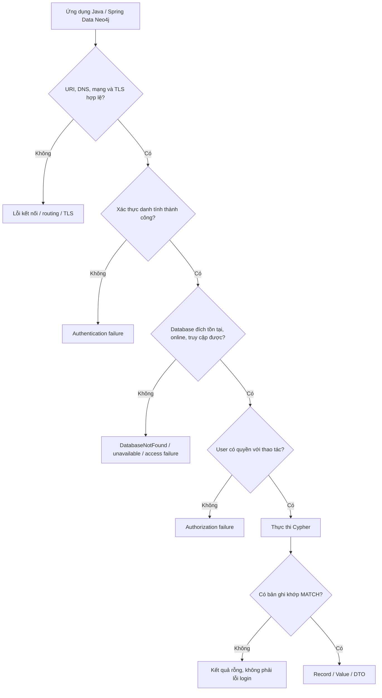
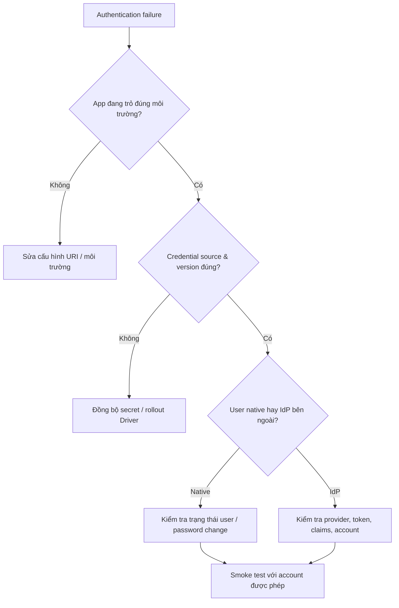
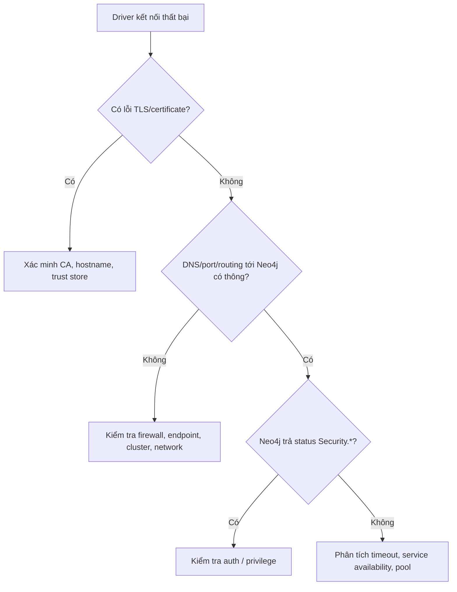
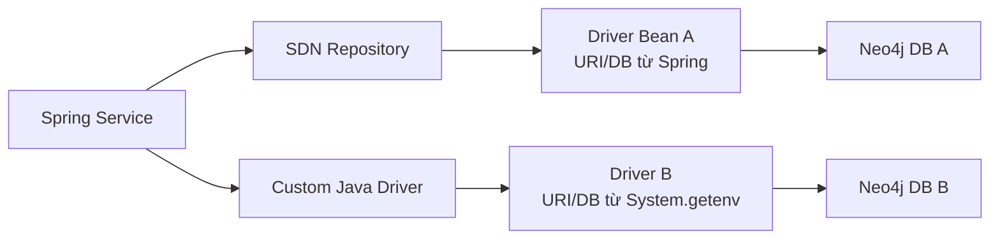

# Lỗi xác thực, phân quyền và không tìm thấy cơ sở dữ liệu trong Neo4j

Trong một ứng dụng dùng **Neo4j** để lưu dữ liệu liên kết, ba lỗi có biểu hiện rất giống nhau đối với người dùng cuối: API không trả được node hoặc relationship. Nhưng nguyên nhân có thể hoàn toàn khác nhau:

- **Authentication thất bại:** thông tin đăng nhập không hợp lệ hoặc phương thức xác thực không phù hợp.
- **Authorization thất bại:** tài khoản đã đăng nhập nhưng thiếu quyền truy cập database, graph, procedure hoặc thao tác ghi.
- **Database không tồn tại/không khả dụng:** Java Driver hoặc Spring Data Neo4j đang chọn sai tên database, database bị xóa/đổi tên/chưa online hoặc routing tới đích không phù hợp.

Nếu xử lý cả ba tình huống bằng cách “đổi mật khẩu”, “cấp admin” hoặc “tắt authentication”, ứng dụng có thể vẫn lỗi và rủi ro bảo mật lại tăng. Bài thuộc chương **Xử lý sự cố** của module **DATABASE_ENGINE_GRAPH_NEO4J**, chuyên về mô hình **property graph**, Cypher, index/constraint, Java Driver và Spring Data Neo4j.

Mục tiêu bài học là xây dựng **quy trình chẩn đoán có bằng chứng**, phân biệt lỗi kết nối, lỗi danh tính, quyền hạn và tồn tại của cơ sở dữ liệu mà không thực hiện thao tác phá hủy hoặc làm lộ credential.

Sau bài này, bạn có thể:

1. Đọc thông báo và **mã lỗi** từ Neo4j/Java Driver mà không phụ thuộc hoàn toàn vào chuỗi mô tả có thể thay đổi.
2. Phân biệt “login sai”, “thiếu quyền”, “database không tìm thấy” và “Cypher trả 0 hàng”.
3. Kiểm tra user hiện tại, database mục tiêu, trạng thái database và privilege bằng lệnh quản trị phù hợp.
4. Chẩn đoán cấu hình `SessionConfig.forDatabase(...)`, `spring.data.neo4j.database`, URI, TLS và secret.
5. Xây dựng runbook theo mức quyền, tránh vô tình cấp admin hoặc đổi mật khẩu của hệ thống đang hoạt động.
6. Viết smoke test và kiểm thử hồi quy để lỗi không quay lại sau deploy, rotate credential hoặc migration.

> **Phạm vi phiên bản:** Tên loại exception, mã lỗi Neo4j và các trường của lệnh `SHOW` có thể khác theo bản phát hành, driver, edition Community/Enterprise và hình thức triển khai self-managed/Aura. Các mã dưới đây là **dấu hiệu phổ biến**, không phải bảng mã đầy đủ hoặc cam kết mọi bản Neo4j đều phát sinh cùng một chuỗi.

## 1. Ba lỗi nhìn giống nhau nhưng xuất hiện ở ba ranh giới khác nhau

Giả sử một API Java đọc đồ thị đơn hàng:

```cypher
MATCH (c:Customer {customerId: $customerId})
      -[:PLACED]->(o:Order)
RETURN o.orderId AS orderId,
       o.total AS total
ORDER BY orderId
LIMIT 20;
```

Ứng dụng gửi truy vấn thông qua Java Driver tới database `commerce`. Luồng cần vượt qua các bước:



Sơ đồ là **mô hình điều tra**, không khẳng định Neo4j luôn kiểm tra quyền database sau khi kiểm tra trạng thái database. Trên thực tế hệ thống có thể **không tiết lộ database có tồn tại hay không** cho user thiếu quyền, nhằm bảo vệ metadata. Vì vậy, một triệu chứng “database không nhìn thấy” có thể đòi hỏi admin kiểm tra cả tồn tại và quyền.

### Phân biệt theo triệu chứng

| Điều nhìn thấy | Bản chất có thể xảy ra | Điều KHÔNG nên kết luận vội |
| --- | --- | --- |
| `Unauthorized` | Sai user, password/token, auth provider hoặc credential đã đổi | “Database bị xóa” |
| `Forbidden` / “permission denied” | Danh tính hợp lệ nhưng không đủ quyền | “Mật khẩu sai” |
| `DatabaseNotFound` | Tên database/alias sai, không tồn tại, ngữ cảnh không đúng; đôi khi cần kiểm tra quyền hiển thị | “Server đã sập” |
| Database unavailable/offline | DB tồn tại nhưng chưa sẵn sàng hoặc topology có vấn đề | “Phải tạo database mới ngay” |
| `ServiceUnavailable` | Không kết nối/routing được tới server | “User không có quyền” |
| `MATCH` trả 0 bản ghi | Không có node/relationship khớp, có thể đang đọc sai database/tenant | “Không đăng nhập được” |

**Thứ tự khuyến nghị:** xác định **mã lỗi → đích kết nối → danh tính → database → quyền → truy vấn/dữ liệu**. Không tự sửa nhiều lớp một lúc, vì sẽ không biết nguyên nhân thực sự.

## 2. Đọc mã lỗi thay vì chỉ đọc dòng message

Neo4j dùng các mã trạng thái lỗi, và Java Driver thường ném exception có thông tin mã lỗi. Một số mã hay gặp có dạng:

| Mã hoặc nhóm lỗi thường gặp | Diễn giải điều tra | Kiểm tra tiếp theo |
| --- | --- | --- |
| `Neo.ClientError.Security.Unauthorized` | Thông tin xác thực không được chấp nhận | Secret, user, auth provider, rotation |
| `Neo.ClientError.Security.Forbidden` | Không có quyền với thao tác hoặc tài nguyên | Quyền database/graph/procedure, role |
| `Neo.ClientError.Security.CredentialsExpired` | Cần cập nhật credential theo chính sách | Trạng thái đổi mật khẩu, loại tài khoản |
| `Neo.ClientError.Database.DatabaseNotFound` | Không tìm được database theo tên/đường định tuyến | `SessionConfig`, alias, `SHOW DATABASES` |
| Nhóm database unavailable | Database không online hoặc chưa sẵn sàng | `SHOW DATABASES`, health, cluster, logs |
| Nhóm transient/service unavailable | Kết nối hoặc dịch vụ tạm thời không sẵn sàng | DNS, TLS, routing, server, retry policy |

**Quan trọng:** phân loại chính xác bằng **mã được trả từ chính lần lỗi** và tài liệu của bản đang dùng. Trên các phiên bản mới, ngoài mã legacy `Neo.*` còn có những trường/status kiểu GQL. Không ép toàn bộ luồng chẩn đoán vào phép so sánh một đoạn thông báo tiếng Anh.

### 2.1. Mã lỗi Java Driver

Một mẫu xử lý phía Java:

```java
import org.neo4j.driver.exceptions.Neo4jException;

try {
    graphService.readOrders(customerId);
} catch (Neo4jException ex) {
    String code = ex.code(); // Neo4j status code khi có.

    // Log mã lỗi để điều tra, không log mật khẩu/token.
    log.warn("Neo4j request failed; code={}", code);

    if ("Neo.ClientError.Security.Unauthorized".equals(code)) {
        throw new GraphAuthenticationFailure();
    }
    if ("Neo.ClientError.Security.Forbidden".equals(code)) {
        throw new GraphPermissionFailure();
    }
    if ("Neo.ClientError.Database.DatabaseNotFound".equals(code)) {
        throw new GraphDatabaseSelectionFailure();
    }

    // Mã khác: giữ cause để xử lý trong hệ thống nội bộ.
    throw ex;
}
```

`GraphAuthenticationFailure`, `GraphPermissionFailure` và `GraphDatabaseSelectionFailure` là **exception nghiệp vụ giả định** của ứng dụng, không phải class có sẵn trong Neo4j Driver. Đoạn code minh họa vị trí **phân loại**, không phải mã copy nguyên để biên dịch khi chưa định nghĩa các class và logger.

Không đưa raw exception message, URI nội bộ hoặc thông tin người dùng database vào HTTP response công khai. Phía client nên nhận mã lỗi nghiệp vụ nhất quán; phía log nội bộ có mã lỗi kỹ thuật, correlation ID và thời điểm.

### 2.2. Chưa có status code không có nghĩa là “không phải Neo4j”

Khi DNS, TLS handshake hoặc mạng hỏng trước lúc Neo4j trả được status, driver có thể ném ngoại lệ kết nối như `ServiceUnavailableException` mà không có mã `Neo.ClientError.*` tương ứng. Do đó cần phân biệt:

- **Có lỗi phản hồi từ Neo4j:** đọc mã lỗi Neo4j.
- **Không có phản hồi từ Neo4j:** xem URI, routing, firewall, certificate, server availability và connection pool.

Đừng gộp tất cả exception vào `catch (Exception e) { return List.of(); }`: cách này biến một sự cố production thành “không có dữ liệu”, che giấu lỗi và khiến monitoring bỏ sót.

## 3. Runbook khởi đầu: giữ nguyên trạng thái trước khi sửa

Khi có incident, hãy thu thập thông tin theo cách **không đọc/ghi secret** và không thay đổi dữ liệu:

1. **Thời điểm và phạm vi:** lỗi bắt đầu khi nào, xảy ra mọi request hay chỉ một endpoint/tenant?
2. **Phiên bản ứng dụng và Neo4j:** lỗi sau deploy, đổi driver, đổi auth provider, backup/restore hoặc migration không?
3. **Đích logic:** URI (chỉ lưu thông tin không nhạy cảm), database name, môi trường dev/staging/prod.
4. **Danh tính:** account/role dự kiến của service, secret version (chỉ ghi ID/version, không ghi giá trị).
5. **Error code:** loại exception, mã lỗi Neo4j/GQL khi có, correlation ID.
6. **Kiểm tra kết nối cơ bản:** DNS/TLS/route thông qua công cụ vận hành được phép.
7. **Kiểm tra DBMS có quyền:** status database, user/role, quyền phù hợp.
8. **Tái hiện tối thiểu:** query đọc vô hại với cùng database và cùng identity nếu khả thi.

**Không làm trước những việc sau:** đổi tất cả password, tạo database mới trùng tên bất kỳ, cấp quyền `admin` cho service, tắt authentication, sửa `neo4j.conf` hoặc restart cluster không có bằng chứng.

### 3.1. Bảng bằng chứng tối thiểu

| Trường | Ví dụ minh họa |
| --- | --- |
| Incident ID | `INC-GRAPH-024` |
| Environment | `staging` |
| App version | `graph-api-2.x` |
| URI class | `neo4j+s://<host>` |
| Database yêu cầu | `commerce` |
| DB identity mong đợi | `graph_api_reader` |
| Error code | `Neo.ClientError.Database.DatabaseNotFound` |
| Auth secret version | `graph/staging/api@v7` |
| Kết quả kiểm tra | Kết nối TLS OK; database name chưa xác minh |
| Owner/hành động tiếp theo | DBA xác nhận database/alias và access |

Đây là **mẫu ghi sự cố**, không phải log thật của một môi trường. Đừng nhập password, token, session cookie hoặc toàn bộ URI chứa secret vào ticket.

## 4. Nhánh A — Xác thực thất bại (authentication)

Authentication xác nhận **client là ai** trước khi thực thi truy vấn theo quyền của user đó.

Những nguyên nhân thường gặp:

- Username hoặc password sai; khác biệt chữ hoa/thường.
- Secret vừa **luân chuyển**, nhưng Driver hoặc instance ứng dụng còn dùng giá trị cũ.
- App trỏ nhầm môi trường: credential `dev` được gửi đến Neo4j `prod`.
- User native bị xóa hoặc được đặt trạng thái không thể đăng nhập.
- User đang ở trạng thái **bắt buộc đổi password**, không phù hợp với service headless.
- Chọn sai **auth provider**: dùng basic native auth cho tài khoản cần SSO/OIDC/LDAP.
- Kết nối tới **instance khác** có cùng hostname logic nhưng hệ thống danh tính khác.
- Có giới hạn chống thử mật khẩu liên tiếp; nhiều login thất bại có thể kích hoạt throttling/lock policy.

### 4.1. Quy trình kiểm tra credential



**Không kiểm tra bằng cách in mật khẩu** vào ticket hoặc log. Thay vào đó, xem secret version/id của ứng dụng và vault, kiểm tra nguồn cấu hình hiệu lực, hoặc thực hiện login thử được phê duyệt mà không tiết lộ secret.

### 4.2. Kiểm tra tài khoản khi đã có phiên admin hợp lệ

Trong ngữ cảnh quản trị `system` database và với quyền phù hợp:

```cypher
SHOW CURRENT USER;
```

```cypher
SHOW USERS
YIELD user, roles, passwordChangeRequired, suspended
RETURN user, roles, passwordChangeRequired, suspended
ORDER BY user;
```

Một số trường như `roles` hoặc `suspended` có thể `null`/không áp dụng tùy edition và provider. Nếu `SHOW USERS` không chạy được do thiếu quyền, không tự tăng quyền ứng dụng; chuyển yêu cầu cho người quản trị hợp lệ.

Tài khoản **Community** và **Enterprise** không có cùng khả năng quản lý role/trạng thái; với **Aura**, quy trình quản lý user và IdP phụ thuộc gói dịch vụ.

### 4.3. Đổi password khi có quy trình hợp lệ

Với native user tương tác đang đăng nhập và biết password cũ:

```cypher
ALTER CURRENT USER
SET PASSWORD FROM $oldPassword TO $newPassword;
```

Đây là **lệnh đổi password self-service**, không phải thao tác sửa lỗi tự động chạy trên mọi request. Tham số chứa secret phải được cung cấp qua kênh bảo mật.

Khi cần admin reset, quản trị viên dùng `ALTER USER` theo quy trình đã phê duyệt. Không dùng `neo4j-admin dbms set-initial-password` như giải pháp chung cho instance đã vận hành; đó là công cụ dành cho **lần khởi tạo đầu**.

### 4.4. Secret đã đổi nhưng ứng dụng vẫn báo Unauthorized

Một **Neo4j Java Driver** thường được tạo một lần và quản lý **connection pool**. Việc vault có password mới **không làm Driver hiện hữu tự đọc lại secret**.

Phải kiểm tra:

1. Instance nào đã nhận secret version mới?
2. Credential được inject qua environment hay mounted file?
3. Với environment variables, process đã được rollout/restart thích hợp chưa?
4. Driver đang dùng AuthManager có hỗ trợ rotation hay cần tạo Driver mới?
5. Các kết nối mới có thật sự xác thực bằng credential mới không?
6. Có job, connector, batch hoặc pod cũ vẫn dùng secret cũ không?

Không tạo Driver mới cho **mỗi request** để “tự động lấy mật khẩu mới”; nên dùng cơ chế thay Driver/pool hoặc auth rotation được phiên bản hỗ trợ.

## 5. Nhánh B — Đăng nhập đúng nhưng bị từ chối quyền (authorization)

Authorization quyết định user đã xác thực được làm gì với database và graph.

Trong Neo4j Enterprise, quyền có thể được mô hình qua **role/privilege** trên database, graph, label, relationship và procedure. Ở một mức khái niệm, các thao tác khác nhau cần quyền tương ứng:

| Truy vấn hoặc hành động | Nhóm quyền cần kiểm tra |
| --- | --- |
| `RETURN 1 AS ok` | Khả năng kết nối và thực thi query cơ bản |
| `MATCH (n:Customer) RETURN n` | Quyền **truy cập database**, traverse và đọc thuộc tính/graph phù hợp |
| `CREATE (n:Customer)` | Quyền tạo node/ghi graph |
| `SET n.status = 'ACTIVE'` | Quyền thay đổi property phù hợp |
| `DELETE n` | Quyền xóa node/relationship tương ứng |
| `CREATE CONSTRAINT ...` | Quyền schema/admin theo edition và role |
| `CALL gds.*` hoặc `CALL apoc.*` | Quyền thực thi procedure/function, edition và plugin |
| `SHOW USERS`, `ALTER USER` | Quyền quản lý/quan sát user trong DBMS |

**Một user chạy được `RETURN 1` không chứng minh user đó có quyền đọc node `Customer`.** Nó cũng không chứng minh quyền trên database khác.

### 5.1. Kiểm tra danh tính và privilege

Nếu user đang kết nối có quyền thực hiện:

```cypher
SHOW CURRENT USER;
```

Trong Enterprise, người quản trị hoặc tài khoản được cấp quyền xem có thể kiểm tra quyền user:

```cypher
SHOW USER graph_api_reader PRIVILEGES;
```

Dùng lệnh này để xác định user được cấp role/privilege nào **thật sự**; không kết luận chỉ từ username `graph_api_reader`. Với role tùy chỉnh, điều tra cả quyền bị **DENY** hoặc phạm vi graph/database và quyền thực tế sau khi tổng hợp vai trò.

### 5.2. Khác biệt Community, Enterprise và Aura

- **Community:** không có hệ RBAC chi tiết tương đương Enterprise. Tạo thêm user tên `readonly` **không tự làm user chỉ đọc**.
- **Enterprise:** có role và quyền chi tiết, tùy phiên bản. Tài khoản đọc chỉ nên được cấp đúng quyền cần dùng.
- **Aura:** được quản lý; quyền và tính năng quản trị phụ thuộc gói. Không giả định có quyền sửa host config hoặc thực hiện mọi Cypher administration command như self-managed.

Trên Enterprise, quản trị viên có thẩm quyền có thể dùng role dựng sẵn, ví dụ:

```cypher
GRANT ROLE reader TO graph_api_reader;
```

**Chỉ là ví dụ cú pháp và cần kiểm tra phạm vi quyền.** Role `reader` có thể rộng hơn nhu cầu (như truy cập nhiều label/database). Không cấp quyền này cho production khi chưa xác định đúng yêu cầu, cũng không cấp `admin` để tránh lỗi Forbidden.

### 5.3. Thiếu quyền thực thi APOC/GDS không phải thiếu password

Giả sử query:

```cypher
CALL gds.pageRank.stream('customerGraph')
YIELD nodeId, score
RETURN nodeId, score
ORDER BY score DESC
LIMIT 10;
```

Có thể thất bại vì:

- GDS chưa cài hoặc không sẵn có trong gói.
- Procedure không tồn tại ở phiên bản đó.
- User không có quyền thực thi procedure.
- Graph `customerGraph` chưa có trong GDS catalog.
- Plugin có phiên bản không tương thích với Server.

Nếu có `Forbidden` từ procedure, hãy kiểm tra privilege. Nếu báo **unknown procedure**, kiểm tra plugin/syntax. Nếu báo **graph not found**, kiểm tra GDS catalog. Cả ba **không nên chữa bằng cách thay password**.

### 5.4. Chạy thao tác kiểm chứng mà không làm hỏng dữ liệu

Ưu tiên kiểm tra bằng:

- `SHOW CURRENT USER` và các lệnh quản trị `SHOW` mà account hợp lệ có quyền.
- Query đọc của chính ứng dụng, với tham số và database đúng.
- Bài test ghi vào **nhãn/test record chuyên dụng** có thể rollback trên staging, nếu cần kiểm tra quyền ghi.
- Kiểm tra DDL trên môi trường staging/migration, không tạo/xóa constraint bừa bãi ở production.

Mọi đề xuất thay role phải ghi **tài khoản, database, thao tác cần thiết, phạm vi quyền tối thiểu và phê duyệt**. Kiểm tra lại sau khi cấp quyền và thu hồi quyền tạm nếu không còn cần.

## 6. Nhánh C — Database không tìm thấy

Một trong những lỗi phổ biến khi ứng dụng chuyển từ local sang staging là **tên database** được chọn sai.

Giả sử:

```text
Development:
  neo4j URI:       bolt://127.0.0.1:7687
  default db:      neo4j

Staging:
  neo4j URI:       neo4j+s://graph.staging.example
  expected db:     commerce_staging

Application:
  configured db:   commerce   <-- Có thể đang chọn sai database.
```

Đây là dữ liệu giả định. Nếu app gửi request tới `commerce` nhưng DBMS chỉ có `commerce_staging`, query có thể thất bại ngay ở bước chọn database, **trước khi MATCH dữ liệu**.

### 6.1. Lấy trạng thái database bằng quyền quản trị phù hợp

Trong Neo4j có hỗ trợ multi-database và account có quyền xem:

```cypher
SHOW DATABASES
YIELD name, currentStatus, requestedStatus
RETURN name, currentStatus, requestedStatus
ORDER BY name;
```

Điều cần đọc:

| Trường | Cách dùng |
| --- | --- |
| `name` | Database thực tế trong DBMS |
| `currentStatus` | Trạng thái vận hành hiện tại, ví dụ online/offline |
| `requestedStatus` | Trạng thái DBMS được yêu cầu hướng tới |

Dùng thêm các lệnh sau khi phiên bản/edition hỗ trợ:

```cypher
SHOW DEFAULT DATABASE;
```

```cypher
SHOW HOME DATABASE;
```

**Default database** và **home database** có thể liên quan đến việc một session không chọn database tường minh sẽ làm việc với database nào. Tuy nhiên, **không dựa vào default để giải quyết cấu hình production** nếu ứng dụng cần một database xác định.

### 6.2. Database name khác label và property

Các khái niệm thường bị nhầm:

| Đối tượng | Ví dụ | Được chỉ định ở đâu? |
| --- | --- | --- |
| **Database** | `commerce` | `SessionConfig.forDatabase("commerce")`, `spring.data.neo4j.database` |
| **Node label** | `:Customer` | `MATCH (n:Customer)` |
| **Relationship type** | `:PLACED` | `MATCH (c)-[:PLACED]->(o)` |
| **Property** | `customerId` | `WHERE n.customerId = $id` |
| **Alias database** | Tên trỏ tới database theo cấu hình DBMS | Các câu lệnh quản trị alias phù hợp |
| **Graph projection GDS** | `customerGraph` | Catalog trong bộ nhớ của GDS |

Nếu lỗi từ `gds.pageRank.stream('customerGraph')` là “graph not found”, **không đồng nghĩa database Neo4j tên `commerce` đã biến mất**. Đó có thể là graph projection GDS bị drop/mất sau restart. Chẩn đoán đúng lớp tài nguyên sẽ tránh tạo database mới sai mục đích.

### 6.3. Database không tồn tại hay user không có quyền?

Một user không có quyền xem hoặc truy cập database có thể không quan sát được đầy đủ thông tin database. Nếu tài khoản ứng dụng báo “database not found”:

1. Xác nhận **database name app thực tế gửi**.
2. DBA dùng **tài khoản quản trị hợp lệ** kiểm tra database tồn tại, alias và status.
3. Nếu có database, kiểm tra user/role có quyền truy cập nó không.
4. Nếu database đang offline/unavailable, xử lý trạng thái/cluster thay vì tự tạo mới.
5. Nếu database đã đổi tên trong migration, cập nhật cấu hình client/alias đúng quy trình.
6. Nếu đây là **Aura**, dùng console/tính năng được cung cấp để kiểm tra database và quyền theo gói.

Không cho user app quyền `admin` chỉ để đọc danh sách database, cũng không tự chạy `CREATE DATABASE` trước khi chứng minh database thực sự cần được tạo.

### 6.4. Database unavailable khác DatabaseNotFound

**DatabaseNotFound** thường chỉ đích logic không tìm được hoặc không thể định tuyến tới database được yêu cầu. **Unavailable/offline** có thể chỉ database có tồn tại nhưng chưa sẵn sàng hoạt động:

- Neo4j đang khởi động, recovery hoặc restore.
- Database chưa đạt `ONLINE`.
- Cluster/member có vấn đề quorum, routing hoặc replication.
- Tài nguyên đĩa/bộ nhớ hoặc cấu hình khiến database không sẵn sàng.
- Đường kết nối tới member chứa database không thông suốt.

**Đừng xóa rồi tạo database lại** khi nó chưa online. Kiểm tra log, health/metrics, trạng thái cluster và runbook recovery; chỉ DBA có thẩm quyền mới thực hiện thao tác thay đổi database.

## 7. Chọn database tường minh trong Java Driver

Khi dùng Neo4j Java Driver, có thể chỉ định database cho session:

```java
import org.neo4j.driver.Driver;
import org.neo4j.driver.Session;
import org.neo4j.driver.SessionConfig;

try (Session session = driver.session(
        SessionConfig.forDatabase("commerce"))) {

    long ok = session.executeRead(tx ->
        tx.run("RETURN 1 AS ok")
          .single()
          .get("ok")
          .asLong()
    );

    System.out.println("Query completed: " + (ok == 1));
}
```

**Lý do cần chỉ định rõ:**

- Nếu không chỉ định, ứng dụng có thể dùng home/default database không trùng mong đợi.
- Sau migration, home database của user hoặc tên database có thể thay đổi.
- Test `driver.verifyConnectivity()` thành công **không đủ chứng minh** session sẽ truy vấn thành công trên **database cụ thể**.
- Một multi-database deployment có nhiều database cho các mục đích khác nhau; chọn nhầm có thể trả dữ liệu rỗng hoặc dữ liệu sai mà không có lỗi đăng nhập.

### 7.1. Cấu hình và fail-fast

Ví dụ đọc cấu hình từ deployment:

```java
import java.util.Objects;

String database = Objects.requireNonNull(
    System.getenv("NEO4J_DATABASE"),
    "NEO4J_DATABASE is missing"
);

if (database.isBlank()) {
    throw new IllegalArgumentException("NEO4J_DATABASE is blank");
}

try (Session session =
         driver.session(SessionConfig.forDatabase(database))) {
    session.executeRead(tx ->
        tx.run("RETURN 1 AS ok").consume()
    );
}
```

Đây là đoạn minh họa nằm trong lớp có biến `driver` đã được khởi tạo và quản lý đúng. Không để production âm thầm fallback về `"neo4j"` hoặc `localhost` khi thiếu biến môi trường.

**Không cho client HTTP gửi trực tiếp tên database tùy ý** để tạo `SessionConfig`. Tên database thuộc cấu hình deployment/ủy quyền phía server, không phải tham số người dùng có thể tùy tiện thay.

### 7.2. Kiểm tra connectivity không đồng nhất với kiểm tra quyền

Một chuỗi preflight ứng dụng có thể gồm:

1. Tạo Driver đúng URI/TLS.
2. `driver.verifyConnectivity()` để kiểm tra kết nối.
3. Tạo session với database đích.
4. Thực thi query đọc đơn giản trong database đích.
5. Thực thi **một query nghiệp vụ an toàn** đúng label/relationship/parameter của ứng dụng.
6. Khi triển khai service ghi, kiểm chứng quyền ghi trên staging với cơ chế rollback hoặc record thử nghiệm được quản lý.

`RETURN 1` chứng minh đường truy vấn tới database, **không chứng minh** user có quyền đọc `:Customer`, xem property bảo vệ hay ghi graph.

## 8. Spring Data Neo4j: database URI và danh tính thực tế

Với **Spring Boot/Spring Data Neo4j** trong cấu hình thông thường:

```yaml
spring:
  neo4j:
    uri: ${NEO4J_URI}
    authentication:
      username: ${NEO4J_USERNAME}
      password: ${NEO4J_PASSWORD}
  data:
    neo4j:
      database: ${NEO4J_DATABASE}
```

Đây là cú pháp property placeholder của Spring sau khi điền giá trị môi trường. Không đưa password thật vào `application.yml` được commit trong Git.

Bảng điều tra:

| Property | Vấn đề có thể tạo |
| --- | --- |
| `spring.neo4j.uri` | Trỏ sai instance, sai TLS scheme, sai routing/network |
| `spring.neo4j.authentication.username` | User không tồn tại hoặc không đúng môi trường |
| `spring.neo4j.authentication.password` | Secret cũ, sai hoặc chưa inject |
| `spring.data.neo4j.database` | Chọn database không tồn tại, không đúng tenant/ứng dụng |
| `spring.profiles.active` | Nhầm profile/override nên đọc config môi trường khác |
| Driver/secret bean tùy biến | Override auto-config hoặc giữ credential cũ sau rotation |

**Đừng chỉ xem file `application-prod.yml` rồi khẳng định runtime đang dùng đúng cấu hình.** Environment variables, command-line options, ConfigMap/Secret, property source và bean tùy biến có thể ghi đè một phần. Cần kiểm chứng **giá trị hiệu lực không nhạy cảm** và **secret version**, không in plaintext password.

### 8.1. Phân biệt repository và Neo4jClient

Trong SDN:

- Repository và `Neo4jClient` nên cùng sử dụng cấu hình/transaction manager phù hợp khi xử lý một nghiệp vụ.
- Lỗi `Forbidden` ở repository nhưng query `RETURN 1` qua client chạy được có thể do **quyền đọc/ghi entity hoặc relationship** khác nhau, không nhất thiết do hai driver khác nhau.
- Một `Driver` tự tạo với URI/credential khác trong cùng ứng dụng có thể dẫn tới hiện tượng “một luồng được, một luồng lỗi”.
- `@Transactional` quản lý transaction; **không cấp quyền**, không cập nhật secret, không sửa tên database.

Nếu app dùng nhiều DB hoặc nhiều Driver bean, phải ghi rõ **luồng nào dùng bean/transaction manager nào**. Không mặc định mọi bean tham gia chung một session vì chạy trong cùng Spring process.

## 9. Không nhầm lỗi bảo mật với lỗi TLS, DNS và routing

Một client có thể không tới được bước authentication vì lỗi xuất hiện sớm hơn:



Các tình huống phổ biến:

| Triệu chứng | Lớp nghi vấn | Hướng kiểm tra |
| --- | --- | --- |
| `SSLHandshakeException` | TLS/certificate | Hostname, chain, trust store, thời hạn cert |
| `ServiceUnavailableException` | Network/server/routing | URI, DNS, port, firewall, health |
| Timeout chờ connection pool | Driver/app capacity | Pool size, request concurrency, query kéo dài |
| `Unauthorized` | Authentication | Credential/source/version/provider |
| `Forbidden` | Authorization | Database access, graph/read/write/procedure |
| `DatabaseNotFound` | Selection/catalog/permission | Database name, alias, `SHOW DATABASES` |

Với kết nối từ xa, dùng TLS có xác minh server theo hướng dẫn, chẳng hạn `neo4j+s://` trong deployment phù hợp. **Không chuyển sang kết nối không mã hóa hoặc bỏ kiểm tra chứng chỉ chỉ để “khắc phục” lỗi TLS**.

URI cũng ảnh hưởng routing: `neo4j://` dùng routing; `bolt://` là kiểu kết nối trực tiếp trong những bối cảnh phù hợp. Chọn loại URI theo topology và tài liệu deployment, không thay tùy tiện khi gặp lỗi xác thực.

## 10. Database alias, migration và đổi tên có thể gây lỗi sau deploy

Sau khi di trú dữ liệu, môi trường mới có thể dùng tên database hoặc alias khác môi trường cũ. Ví dụ:

```text
Trước migration:
  Ứng dụng → database commerce

Sau migration:
  DB thực tế → commerce_v2
  Cấu hình app vẫn → commerce
```

Tùy nền tảng, tổ chức có thể cập nhật **database alias** hoặc đổi cấu hình ứng dụng một cách kiểm soát. Không giả định việc đổi tên một database giống đổi nhãn node hoặc đổi `spring.profiles.active`.

Các điểm kiểm chứng:

1. **Database đích có tồn tại không?**
2. **Nếu app dùng alias**, alias có còn trỏ tới đích hợp lệ không?
3. Alias có thuộc DBMS/cluster đang kết nối không?
4. User app có quyền truy cập database thực và/hoặc alias theo cách hệ thống áp dụng không?
5. Driver cache/routing table có cần thời gian hoặc thay session để nhận thay đổi không?
6. Migration đã hoàn tất schema, index/constraint và dữ liệu chưa?
7. App có đang truy vấn một database hợp lệ nhưng **rỗng** do import chưa xong không?

Trong môi trường có admin và tính năng hỗ trợ, có thể sử dụng lệnh quản trị alias theo tài liệu phiên bản, chẳng hạn `SHOW ALIASES`. Không thực hiện `DROP DATABASE`, `CREATE DATABASE` hoặc thay alias khi chưa có phê duyệt và đánh giá dữ liệu.

### Hai kết quả rất khác nhau

```cypher
// Truy vấn này chạy thành công, nhưng có thể trả 0 hàng.
MATCH (c:Customer {customerId: 'C-404'})
RETURN c.customerId;
```

Một database **tồn tại và truy cập được** vẫn có thể không chứa node `Customer` phù hợp. Nếu query chạy và trả 0 rows, phải kiểm tra:

- Khóa nghiệp vụ có đúng không?
- Label `Customer` có chính xác không, kể cả chữ hoa/thường?
- Có thiếu relationship trong pattern hay không?
- App đang chọn đúng database và tenant chưa?
- Dữ liệu đã nhập/CDC đã đồng bộ xong chưa?

**Không tạo thêm database** chỉ vì một `MATCH` trả danh sách rỗng.

## 11. Kiểm chứng trên property graph và dữ liệu nghiệp vụ

Sau khi auth, quyền và database đều ổn, vẫn cần kiểm tra **kết quả Cypher**:

```cypher
MATCH (c:Customer {customerId: $customerId})
RETURN count(c) AS customersFound;
```

Nếu `customersFound = 0`, có thể **không có dữ liệu** chứ không phải lỗi DB. Kiểm tra quan hệ:

```cypher
MATCH (c:Customer {customerId: $customerId})
OPTIONAL MATCH (c)-[r:PLACED]->(o:Order)
RETURN c.customerId AS customerId,
       count(r) AS orderRelationships;
```

Phân biệt:

- Truy vấn **không có hàng** vì `MATCH` root không khớp.
- Có root nhưng `orderRelationships = 0` vì không có cạnh `PLACED`.
- Có cạnh nhưng user không đủ quyền xem một phần graph/property trong môi trường RBAC chi tiết.
- App chọn database mới hợp lệ nhưng **graph chưa được import**.

**Một API không nên trả HTTP 200 với danh sách rỗng cho mọi exception.** Cần phân loại rõ “không tìm thấy nghiệp vụ” và “không thể truy cập database”.

### Index/constraint không phải phương án sửa Unauthorized

Nếu query hợp lệ nhưng **chậm**, đó là nhánh performance khác. Dùng `EXPLAIN`/`PROFILE`, xem `NodeIndexSeek`, `Rows`, `DB Hits` và plan. Đừng thêm index để khắc phục lỗi xác thực; cũng đừng cấp admin để sửa query plan.

```cypher
EXPLAIN
MATCH (c:Customer {customerId: $customerId})
      -[:PLACED]->(o:Order)
RETURN o.orderId AS orderId
LIMIT 20;
```

`EXPLAIN` không thực thi query; `PROFILE` có chạy query thật, cần dùng có kiểm soát với các câu ghi. Mục đích ở đây là **phân nhánh chẩn đoán**, không tối ưu query trước khi giải quyết auth/database.

## 12. Mẫu Java Driver end-to-end: chẩn đoán ít tác dụng phụ

Ví dụ dưới đây là một **diagnostic CLI** có cấu hình bắt buộc, thử `verifyConnectivity()` và truy vấn database đích. Mã dùng Java 17+, yêu cầu Neo4j Java Driver thích hợp trên classpath. Không dùng nó để brute-force password hoặc thử credential mà bạn không có quyền sử dụng.

```java
import java.util.Objects;

import org.neo4j.driver.AuthTokens;
import org.neo4j.driver.Driver;
import org.neo4j.driver.GraphDatabase;
import org.neo4j.driver.Session;
import org.neo4j.driver.SessionConfig;
import org.neo4j.driver.exceptions.Neo4jException;
import org.neo4j.driver.exceptions.ServiceUnavailableException;

public final class Neo4jDiagnostic {

    private static String requiredEnv(String name) {
        String value = Objects.requireNonNull(
            System.getenv(name), "Missing " + name
        );
        if (value.isBlank()) {
            throw new IllegalArgumentException(name + " is blank");
        }
        return value;
    }

    public static void main(String[] args) {
        String uri = requiredEnv("NEO4J_URI");
        String db = requiredEnv("NEO4J_DATABASE");
        String user = requiredEnv("NEO4J_USERNAME");
        String password = requiredEnv("NEO4J_PASSWORD");

        try (Driver driver = GraphDatabase.driver(
                uri, AuthTokens.basic(user, password))) {

            // Chỉ là bước kiểm tra kết nối, chưa chứng minh
            // quyền truy vấn dữ liệu nghiệp vụ trong DB đích.
            driver.verifyConnectivity();

            try (Session session = driver.session(
                    SessionConfig.forDatabase(db))) {

                long ok = session.executeRead(tx ->
                    tx.run("RETURN 1 AS ok")
                      .single()
                      .get("ok")
                      .asLong()
                );

                System.out.println(
                    "Target database query succeeded: " + (ok == 1)
                );
            }

        } catch (ServiceUnavailableException e) {
            System.err.println(
                "Connection/routing unavailable; check URI, TLS, server.");
        } catch (Neo4jException e) {
            String code = e.code();

            if ("Neo.ClientError.Security.Unauthorized".equals(code)) {
                System.err.println(
                    "Authentication rejected; check identity/secret source.");
            } else if ("Neo.ClientError.Security.Forbidden".equals(code)) {
                System.err.println(
                    "Access denied; verify database/graph privileges.");
            } else if ("Neo.ClientError.Database.DatabaseNotFound"
                    .equals(code)) {
                System.err.println(
                    "Target DB not found; verify DB name/alias and access.");
            } else {
                // Với bản Neo4j mới, kiểm tra thêm thông tin GQL status
                // bằng API driver phù hợp nếu cần.
                System.err.println("Neo4j error code: " + code);
            }
            System.exit(2);
        }
    }
}
```

**Phân tích:**

- `requiredEnv()` tạo hành vi **fail-fast** khi thiếu biến; không fallback sang `neo4j` hay admin password ở production.
- Không in password, auth token hay toàn bộ environment variables.
- `verifyConnectivity()` và query trong **database được cấu hình** là hai phép kiểm tra khác nhau.
- `SessionConfig.forDatabase(db)` giảm nguy cơ đọc nhầm home/default database.
- Mã lỗi giúp phân nhánh xử lý; thông báo cho người dùng phải được kiểm soát, không tiết lộ secret.
- Nếu chỉ `RETURN 1` chạy được, cần kiểm thử quyền đọc/ghi nghiệp vụ riêng.
- Một số lỗi network/TLS có thể không khớp những mã Neo4j ở trên; xem cause/traces nội bộ khi cần.

**Giới hạn ví dụ:** chương trình không thực hiện auto-reset password, auto-grant role hoặc auto-create database. Đó là chủ đích: **công cụ chẩn đoán không nên tự thay đổi quyền, danh tính hoặc dữ liệu**.

## 13. Phối hợp Spring Data Neo4j và Java Driver khi có nhiều nguồn cấu hình

Một service có thể sử dụng repository SDN cho entity `Customer`, trong khi một đoạn code tự khởi tạo `GraphDatabase.driver(...)` từ biến môi trường khác.



Nếu repository báo `DatabaseNotFound` còn custom Driver truy vấn bình thường, **không tự suy rằng repository bị lỗi code**. Cần so sánh các giá trị hiệu lực:

| Thành phần | Cấu hình cần đối chiếu |
| --- | --- |
| SDN repository | `spring.neo4j.uri`, `spring.data.neo4j.database`, Driver bean |
| `Neo4jClient` | Driver/transaction manager được Spring dùng |
| Custom Driver | URI, token/username, `SessionConfig.forDatabase(...)` |
| Spring profile | `SPRING_PROFILES_ACTIVE` và thứ tự override property |
| Kubernetes/Docker | ConfigMap, Secret, environment injection, runtime rollout |
| Vault/secret manager | Secret version, thời điểm refresh, quyền đọc secret |

Trong ứng dụng dùng `@Transactional`, một Java Driver session tự tạo **không mặc nhiên** tham gia transaction Spring Data Neo4j. Không chỉ so sánh khả năng kết nối; nếu thao tác gồm nhiều bước ghi phải hiểu ranh giới commit/rollback riêng.

### Một lỗi sau deploy rất thường gặp

```text
application-prod.yml:
  database: commerce

Kubernetes env:
  NEO4J_DATABASE=commerce_old

Runtime:
  ứng dụng thực sự chọn commerce_old
```

Cần kiểm tra property source precedence ở bản Spring Boot đang dùng. **Không log tất cả environment variables** để dò lỗi vì có thể làm lộ secret; chỉ hiển thị có kiểm soát những trường không nhạy cảm như database name hoặc secret reference/version.

## 14. Tại sao không sửa lỗi bằng cách tắt authentication hoặc cấp admin?

Các “cách chữa nhanh” sau tạo rủi ro nghiêm trọng:

| Hành động vội | Nguy cơ |
| --- | --- |
| `dbms.security.auth_enabled=false` | Mở khả năng truy cập không xác thực nếu mạng không được cô lập |
| Cấp role `admin` cho tài khoản API | Lỗi ứng dụng có thể xóa graph/schema hoặc quản lý user |
| Sao chép mật khẩu production sang staging | Làm lộ credential và mở đường truy cập chéo môi trường |
| Tạo database mới trùng mục đích khi `DatabaseNotFound` | Che mất lỗi cấu hình, làm dữ liệu phân mảnh hoặc app ghi vào DB rỗng |
| Tắt xác minh chứng chỉ TLS | Dễ bị kết nối nhầm hoặc tấn công trung gian |
| Bắt mọi exception rồi trả `List.of()` | Che mất outage, làm API báo không có dữ liệu dù thực sự lỗi |
| Lặp lại login tự động không giới hạn | Có thể kích hoạt rate limit/lockout và tăng tải |
| Thử quyền ghi bằng `DELETE` trên production | Có thể làm mất dữ liệu khi permission thực sự đủ |

**Chỉ cấp thêm quyền tối thiểu sau khi có bằng chứng quyền thiếu và phê duyệt phù hợp.** Với user bị lộ secret, ưu tiên rotation/thu hồi theo runbook; với database offline, ưu tiên điều tra availability thay vì tạo database tùy tiện.

## 15. Ma trận kiểm thử tình huống lỗi trước production

Trên môi trường staging được phép, thiết kế bộ test với **tài khoản và database thử nghiệm**:

| Trường hợp | Kỳ vọng | Loại vấn đề |
| --- | --- | --- |
| Username/password sai | Authentication failure, không trả dữ liệu | Identity |
| Secret cũ sau rotation | Lỗi login có mã/giám sát rõ ràng | Identity lifecycle |
| User được phép đọc nhưng không ghi | Đọc thành công, ghi bị từ chối | Authorization |
| User thiếu quyền procedure GDS/APOC | Lỗi privilege hoặc procedure availability được phân biệt | Procedure/security |
| Tên database không tồn tại | Báo lỗi lựa chọn database, không fallback | Database selection |
| Database tồn tại nhưng offline | Availability failure, không tự tạo database | Runtime state |
| Home DB khác DB ứng dụng | Query vẫn chạy trên DB được chỉ định tường minh | Database selection |
| `MATCH` không có node | Trả 0 hàng nhưng không báo lỗi auth | Application data |
| TLS hostname sai | Kết nối bị từ chối, không bypass TLS | Transport security |
| Secret manager không inject password | App fail-fast, không thử credential mặc định | Configuration |
| Một custom Driver khác bean SDN | Phát hiện sự khác biệt URI/database/identity | Architecture |
| Alias/database sau migration đổi | Preflight chỉ ra DB đích, không ghi nhầm | Deployment |

Test phải kiểm tra **mã lỗi và hành vi API**, không chỉ string message. Với việc tạo user/role/database thử nghiệm, chỉ admin có quyền mới thực hiện trên môi trường cô lập.

### Các tín hiệu giám sát nên có

- Số lỗi **authentication** theo service và thời điểm rotation (không ghi secret).
- Số lỗi **authorization** sau deploy/migration role.
- Tỷ lệ `DatabaseNotFound`, database offline hoặc request tới DB sai.
- Connection/routing/TLS failures và driver pool wait.
- API error rate, latency p95/p99, retry và timeout.
- Correlation ID, application release, database target, secret version ID.

Không dùng raw Cypher có chứa dữ liệu nhạy cảm, password hoặc token làm **metric label** vì có thể lộ thông tin và tạo số lượng series lớn.

## 16. Bảng quyết định xử lý nhanh

| Quan sát | Kiểm tra đầu tiên | Hành động đúng hướng |
| --- | --- | --- |
| `Unauthorized` | URI/môi trường, secret version, auth provider | Sửa cấu hình danh tính hoặc thực hiện rotation được phê duyệt |
| `CredentialsExpired` | Cờ bắt buộc đổi password, user native/SSO | Hoàn tất quy trình đổi credential hợp lệ |
| `Forbidden` | Current user, database access, graph/procedure privilege | Cấp quyền tối thiểu khi có bằng chứng và phê duyệt |
| `DatabaseNotFound` | Database name thực gửi, alias, database inventory | Sửa selection hoặc khôi phục mapping; không tự tạo DB |
| Database offline/unavailable | `SHOW DATABASES`, logs, cluster health | Theo runbook availability/recovery |
| `ServiceUnavailable` | DNS, TLS, port, routing, server status | Điều tra transport/endpoint |
| Query hợp lệ trả rỗng | Label, property key, relationship, import state, tenant | Sửa truy vấn/dữ liệu nghiệp vụ |
| Query hợp lệ nhưng chậm | `EXPLAIN`/`PROFILE`, index, skew, concurrency | Điều tra execution plan/performance |
| Chỉ một bean SDN lỗi | Config/transaction manager/Driver thực dùng | So sánh property sources và beans |

Một incident có thể gồm **nhiều nguyên nhân nối tiếp**, ví dụ đổi secret gây lỗi login ở một số pod, sau đó app được cập nhật lại chọn nhầm database. Vì vậy phải kiểm tra trạng thái **sau mỗi thay đổi** trước khi tuyên bố đã giải quyết.

## 17. Bài tập tự kiểm tra

**Câu 1.** `driver.verifyConnectivity()` thành công. Có thể kết luận tài khoản có quyền chạy `MATCH (c:Customer)` trên database `commerce` không?

<details>
<summary>Đáp án gợi ý</summary>

Không. Kết nối thành công chỉ chứng minh một phần transport/authentication. Cần tạo session chỉ rõ `commerce` và thử query đọc nghiệp vụ với quyền phù hợp. Một user có thể kết nối được nhưng thiếu quyền truy cập graph hoặc database.

</details>

**Câu 2.** Mã lỗi `Neo.ClientError.Security.Forbidden` cho biết nên đổi password trước tiên hay kiểm tra quyền?

<details>
<summary>Đáp án gợi ý</summary>

Ưu tiên kiểm tra quyền. Danh tính có thể đã xác thực nhưng không được thực hiện thao tác. Cần đối chiếu current user, database, role/privilege và loại query đang bị từ chối.

</details>

**Câu 3.** Ứng dụng sau deploy báo `DatabaseNotFound`, nhưng admin thấy database `commerce_v2` đang `ONLINE`. Bước tiếp theo là gì?

<details>
<summary>Đáp án gợi ý</summary>

Kiểm tra tên database thực tế ứng dụng gửi, `SessionConfig.forDatabase(...)` hoặc `spring.data.neo4j.database`, alias và quyền của user. Có thể ứng dụng vẫn trỏ `commerce` cũ; không nên tạo thêm database chỉ để tránh lỗi.

</details>

**Câu 4.** `SHOW DATABASES` không hiển thị database mong đợi khi chạy bằng user ứng dụng. Có chắc database đã bị xóa không?

<details>
<summary>Đáp án gợi ý</summary>

Không. User có thể không có quyền xem/truy cập metadata. Nhờ admin có thẩm quyền xác minh database tồn tại, status, alias và quyền, rồi mới xác định nguyên nhân.

</details>

**Câu 5.** Sau khi đổi password trong vault, vài instance Java tiếp tục báo Unauthorized. Vì sao?

<details>
<summary>Đáp án gợi ý</summary>

Process/Driver có thể giữ auth token cũ hoặc secret injection chưa cập nhật. Kiểm tra secret version, rollout, AuthManager/Driver rotation, các pod/job chưa chuyển và log auth failure, không in password.

</details>

**Câu 6.** Một query `MATCH` trả 0 hàng nhưng không có exception. Đây có phải lỗi database không tồn tại không?

<details>
<summary>Đáp án gợi ý</summary>

Không. Query đã chạy thành công trên một database truy cập được. Cần xem label, property, relationship, tenant, dữ liệu import/CDC và database đích có đúng môi trường không.

</details>

**Câu 7.** Query `CALL gds.pageRank.stream(...)` báo unknown procedure. Có nên cấp role admin cho user để chữa không?

<details>
<summary>Đáp án gợi ý</summary>

Không. Trước hết phân biệt GDS chưa cài/không hỗ trợ, plugin lệch phiên bản, procedure đổi tên hoặc thiếu quyền. Chỉ cấp quyền thực thi tối thiểu nếu xác minh đúng nguyên nhân và được phê duyệt.

</details>

**Câu 8.** Trong Spring Data Neo4j, `spring.neo4j.uri` đúng nhưng `spring.data.neo4j.database` sai. Có thể xuất hiện tình huống gì?

<details>
<summary>Đáp án gợi ý</summary>

Driver có thể kết nối thành công tới Neo4j, nhưng khi repository/Neo4jClient thực hiện query trên database không tồn tại hoặc không truy cập được sẽ báo lỗi tương ứng. Cần kiểm tra cấu hình database hiệu lực, profile/override và quyền của user.

</details>

**Câu 9.** Một service bị lỗi TLS certificate. Có nên chuyển sang URI không xác minh chứng chỉ để thử production không?

<details>
<summary>Đáp án gợi ý</summary>

Không. Cần kiểm tra hostname, CA/trust store, chain và thời hạn chứng chỉ, đồng thời giữ kết nối được bảo vệ. Bỏ xác minh có thể khiến client kết nối nhầm hoặc bị tấn công trung gian.

</details>

**Câu 10.** Vì sao runbook phải giữ riêng `Unauthorized`, `Forbidden` và `DatabaseNotFound` thay vì trả một kết quả `[]`?

<details>
<summary>Đáp án gợi ý</summary>

Vì ba lỗi có biện pháp xử lý khác nhau và đều là sự cố kỹ thuật, không phải “danh sách rỗng”. Gộp chúng làm mất tín hiệu quan sát, khiến API báo thành công sai, dễ cấp quyền hoặc tạo database không cần thiết.

</details>

## Ghi nhớ

- **Authentication** xác nhận danh tính; **authorization** quyết định quyền; **database selection/availability** xác định tài nguyên thực sự được truy cập.
- Đọc **mã lỗi** và bối cảnh runtime trước khi sửa. `Unauthorized`, `Forbidden` và `DatabaseNotFound` không tương đương.
- `SHOW CURRENT USER`, `SHOW USERS`, `SHOW DATABASES`, `SHOW ... PRIVILEGES` là công cụ chẩn đoán khi có **đúng quyền và edition**.
- Chọn **database tường minh** trong Java Driver qua `SessionConfig.forDatabase(...)` hoặc SDN qua `spring.data.neo4j.database`.
- `verifyConnectivity()` và `RETURN 1` không chứng minh user có đủ quyền đọc/ghi graph nghiệp vụ.
- **Secret rotation, TLS, URI và Spring profile** có thể làm lỗi giống auth/db; kiểm tra config hiệu lực nhưng không log secret.
- Truy vấn Cypher trả 0 hàng là **kết quả dữ liệu**, không phải bằng chứng database không tồn tại.
- Không tự tắt authentication, cấp admin, tạo database hoặc xóa dữ liệu để “chữa nhanh” một incident chưa được phân loại.
- Mọi thay đổi phải có **bằng chứng trước–sau, chủ sở hữu, kiểm thử lại và giám sát**.

### Tài liệu tham khảo

- [Neo4j Operations Manual — Authentication and authorization](https://neo4j.com/docs/operations-manual/current/authentication-authorization/)
- [Neo4j Operations Manual — Manage users](https://neo4j.com/docs/operations-manual/current/authentication-authorization/manage-users/)
- [Neo4j Operations Manual — Manage databases](https://neo4j.com/docs/operations-manual/current/database-administration/standard-databases/)
- [Neo4j Cypher Manual — Database management](https://neo4j.com/docs/cypher-manual/current/administration/databases/)
- [Neo4j Cypher Manual — Privilege management](https://neo4j.com/docs/cypher-manual/current/administration/access-control/)
- [Neo4j Java Driver Manual — Connect](https://neo4j.com/docs/java-manual/current/connect/)
- [Neo4j Java Driver Manual — Transactions](https://neo4j.com/docs/java-manual/current/transactions/)
- [Neo4j Java Driver Manual — Errors](https://neo4j.com/docs/java-manual/current/errors/)
- [Spring Data Neo4j — Reference](https://docs.spring.io/spring-data/neo4j/reference/)
