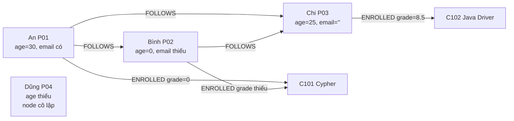

# Lỗi cú pháp, phạm vi biến và kiểu dữ liệu trong Cypher: cách nhận diện và sửa

Truy vấn Cypher có thể thất bại **trước khi thực thi** do thiếu dấu ngoặc, sai thứ tự clause hoặc sử dụng biến đã mất phạm vi. Một số truy vấn khác vẫn chạy nhưng trả **0 hàng**, sai số đếm hoặc giá trị `null` vì dữ liệu không đúng kiểu mà người viết giả định. Cũng có lỗi chỉ xuất hiện khi runtime đọc một node cụ thể, chuyển đổi kiểu hay lưu property.

Bài thuộc chương **Xử lý sự cố** của module `DATABASE_ENGINE_GRAPH_NEO4J`. Module dùng Neo4j để mô hình hóa property graph, truy vấn node, relationship, đường đi bằng Cypher, index/constraint, Java Driver và Spring Data Neo4j. Ở đây chúng ta luyện **đọc lỗi, cô lập bước sai và sửa truy vấn theo đúng ngữ nghĩa** thay vì sửa ngẫu nhiên đến khi câu lệnh chạy được.

Ba nhóm lỗi trọng tâm:

1. **Cú pháp (syntax):** câu Cypher không khớp quy tắc viết, chẳng hạn `MATCH` thiếu dấu `)` hoặc `WHERE` đặt sai vị trí.
2. **Phạm vi biến (variable scope):** biến chưa được định nghĩa, đã đổi tên qua `AS`, không được chuyển qua `WITH` hoặc chưa được import vào `CALL` subquery.
3. **Kiểu dữ liệu (type):** dùng chuỗi như số, map như property, nhầm `LIST` với `PATH`, hiểu sai `null` hoặc chuyển kiểu không hợp lệ.

**Mục tiêu:** sau bài, bạn tự làm được một quy trình: xác định loại lỗi → dựng ví dụ tối thiểu → kiểm tra phạm vi và kiểu → sửa → đối chiếu số hàng/kết quả → đưa vào test để tránh tái phát.

> **Phiên bản:** nhiều ví dụ sử dụng cú pháp chung cho Neo4j 5 và dòng phát hành mới. Một số tính năng như `CALL (p) { ... }` (variable scope clause) có ở các bản Neo4j 5 mới và Cypher 25; nếu hệ thống cũ, kiểm tra tài liệu đúng phiên bản thay vì giả định mọi cú pháp hiện hành đều được hỗ trợ.

## 1. Bảng phân loại triệu chứng để bắt đầu chẩn đoán

| Triệu chứng nhìn thấy | Nhóm cần kiểm tra đầu tiên | Hành động phù hợp |
| --- | --- | --- |
| `Invalid input`, thiếu `)`/`]`/`}`, clause không hợp lệ | **Parser / syntax** | Xem dòng/cột báo lỗi, kiểm tra ký hiệu và thứ tự clause |
| `Variable ... not defined` | **Scope / tên biến** | Kiểm tra `MATCH`, `WITH`, `AS` và import subquery |
| `Expression ... must be aliased` | **Scope / projection** | Đặt `AS tenMoi` cho biểu thức trong `WITH` |
| `Type mismatch`, phép toán không nhận kiểu đầu vào | **Type / expression** | In `valueType(...)`, kiểm tra parameter và cách chuyển kiểu |
| Truy vấn chạy nhưng không có hàng | **Dữ liệu/điều kiện hoặc type so sánh** | Thử từng `MATCH`, xem label/type/hướng và `WHERE` |
| Có hàng nhưng nhiều hơn dự kiến | **Cardinality / lặp đường đi** | `count(*)` so với `count(DISTINCT ...)`, xem các mẫu ghép |
| Giá trị trả về `null` / đếm sai | **Null và OPTIONAL MATCH** | Dùng `IS NULL`, `count(variable)`, `coalesce` có chủ đích |
| Lỗi khi `SET` property bằng map/list | **Property type** | Chỉ lưu property type hợp lệ; map lồng được tách hoặc serialize có kiểm soát |
| Java Driver `asLong()`/`asString()` thất bại | **Mapping Cypher → Java** | Kiểm tra alias, `Value`, `isNull()` và hợp đồng dữ liệu |
| Câu chạy trong Browser nhưng không chạy ở app | **Phiên bản, parameter, quyền, database** | So query thực, runtime/Driver version, database, kiểu parameter, role |

**Đừng dựa hoàn toàn vào chuỗi thông báo.** Tên lỗi, vị trí caret, mã `Neo.ClientError...` và chi tiết parser có thể thay đổi theo phiên bản Neo4j/Cypher. Hãy giữ lại **loại lỗi, dòng/cột và query đã chuẩn hóa** (sau khi bỏ bí mật).

## 2. Fixture nhỏ dùng xuyên suốt bài

Dùng một database Neo4j **chuyên cho kiểm thử**, không phải production. Ví dụ có bốn người, hai khóa học và sáu relationship. Các label/type được đặt tiền tố `TroubleDemo` để phân biệt với dữ liệu thật.



### 2.1. Tạo dữ liệu

Chạy **một lần** trên database trống hoặc database test đã được reset. `CREATE` không tự tránh trùng; chạy hai lần sẽ tạo dữ liệu gấp đôi nếu chưa có constraint.

```cypher
CREATE
  (an:TroubleDemoPerson {
    personId: 'P01', name: 'An',
    age: 30, email: 'an@example.test',
    active: true, joinedOn: date('2026-01-15')
  }),
  (binh:TroubleDemoPerson {
    personId: 'P02', name: 'Bình',
    age: 0, active: false
  }),
  (chi:TroubleDemoPerson {
    personId: 'P03', name: 'Chi',
    age: 25, email: '', active: true
  }),
  (dung:TroubleDemoPerson {
    personId: 'P04', name: 'Dũng',
    email: 'dung@example.test', active: true
  }),
  (c101:TroubleDemoCourse {
    courseCode: 'C101', title: 'Cypher căn bản', fee: 150000
  }),
  (c102:TroubleDemoCourse {
    courseCode: 'C102', title: 'Java Driver', fee: 200000
  }),

  (an)-[:TROUBLE_DEMO_FOLLOWS]->(binh),
  (an)-[:TROUBLE_DEMO_FOLLOWS]->(chi),
  (binh)-[:TROUBLE_DEMO_FOLLOWS]->(chi),

  (an)-[:TROUBLE_DEMO_ENROLLED {
    status: 'ACTIVE', grade: 0
  }]->(c101),
  (binh)-[:TROUBLE_DEMO_ENROLLED {
    status: 'ACTIVE'
  }]->(c101),
  (chi)-[:TROUBLE_DEMO_ENROLLED {
    status: 'CANCELLED', grade: 8.5
  }]->(c102);
```

Kiểm tra số lượng, không dựa vào hình vẽ:

```cypher
MATCH (p:TroubleDemoPerson)
RETURN count(p) AS persons;
```

`persons = 4`.

```cypher
MATCH (c:TroubleDemoCourse)
RETURN count(c) AS courses;
```

`courses = 2`. Có **ba** quan hệ `TROUBLE_DEMO_FOLLOWS` và **ba** quan hệ `TROUBLE_DEMO_ENROLLED`.

Các đối chứng quan trọng:

| Trường hợp | Giá trị chuẩn |
| --- | --- |
| `P01.age` | INTEGER `30` |
| `P02.age` | INTEGER `0`, không phải null |
| `P04.age` | Không có property → `null` khi đọc |
| `P02.email` | Property không tồn tại → `null` |
| `P03.email` | Chuỗi rỗng `''` |
| Đăng ký của P01 | `grade = 0` |
| Đăng ký của P02 | Thiếu `grade` → `null` |
| Đăng ký của P03 | `grade = 8.5` |
| P04 | Node không có relationship |

**Vì sao cần đối chứng?** Một truy vấn sai có thể vẫn trả hàng; chỉ khi biết đáp án trước ta mới phân biệt được “không báo lỗi” với “đúng nghiệp vụ”.

## 3. Lỗi cú pháp: parser không hiểu cấu trúc query

### 3.1. Sai dấu ngoặc trong node và relationship pattern

Ví dụ **sai**, thiếu dấu đóng `)`:

```cypher
// SAI — cố ý minh họa lỗi parser.
MATCH (p:TroubleDemoPerson
RETURN p.name;
```

Viết đúng:

```cypher
MATCH (p:TroubleDemoPerson)
RETURN p.name AS name;
```

Trong Cypher pattern:

- `(p:Label)`: node, biến `p`, label `Label`.
- `-[r:TYPE]->`: relationship có tên biến `r`, type `TYPE`, hướng đi ra.
- `(p)-[:TYPE]->(q)`: mẫu một cạnh từ `p` đến `q`.
- Dấu `( )`, `[ ]`, `{ }` phải đóng/mở hợp lệ; dấu `:` trong pattern chỉ label/type, còn trong map chỉ cặp key–value.

Một ví dụ khác, **sai** vì thiếu `]` trong relationship pattern:

```cypher
// SAI.
MATCH (p:TroubleDemoPerson)-[r:TROUBLE_DEMO_FOLLOWS->(q)
RETURN p, q;
```

Đúng:

```cypher
MATCH (p:TroubleDemoPerson)
      -[r:TROUBLE_DEMO_FOLLOWS]->
      (q:TroubleDemoPerson)
RETURN p.personId AS source,
       q.personId AS target;
```

### 3.2. `WHERE` không phải clause độc lập ở mọi vị trí

`WHERE` là subclause thường đi theo `MATCH`, `OPTIONAL MATCH` hoặc `WITH`. Ví dụ **sai**:

```cypher
// SAI — WHERE được đặt sau RETURN.
MATCH (p:TroubleDemoPerson)
RETURN p.name
WHERE p.age >= 18;
```

Đúng:

```cypher
MATCH (p:TroubleDemoPerson)
WHERE p.age >= 18
RETURN p.name AS name;
```

Đáp án theo fixture: **An, Chi**. Bình có age = 0; Dũng không có age nên điều kiện `null >= 18` không cho kết quả `true`.

Dùng `WITH` khi cần lọc một giá trị được tính/aggregate ở bước trước:

```cypher
MATCH (p:TroubleDemoPerson)
WITH p, coalesce(p.age, -1) AS ageForFilter
WHERE ageForFilter >= 18
RETURN p.name AS name, ageForFilter
ORDER BY name;
```

### 3.3. Thiếu dấu phẩy, viết sai alias hoặc dùng từ khóa như biến

Ví dụ **sai**:

```cypher
// SAI — hai projection item không có dấu phẩy.
MATCH (p:TroubleDemoPerson)
RETURN p.name AS name p.age AS age;
```

Đúng:

```cypher
MATCH (p:TroubleDemoPerson)
RETURN p.name AS name,
       p.age AS age;
```

Tên biến, alias và property key phải tuân thủ quy tắc định danh. Với tên chứa dấu cách hoặc từ khóa đặc biệt, có thể dùng **backtick identifier**. Tuy nhiên, trong codebase nên ưu tiên các tên đơn giản như `personId`, `enrollmentCount` thay vì các tên gây khó đọc.

### 3.4. Phân biệt bình thường hóa whitespace với thay đổi ngữ nghĩa

Cypher cho phép xuống dòng và thụt lề linh hoạt giữa các clause. Nhưng **thiếu dấu ngoặc, thiếu dấu phẩy hoặc sai vị trí clause không được sửa bằng việc chỉ định dạng lại**.

Trong Neo4j Browser, mỗi câu lệnh thường được kết thúc bằng dấu `;` nếu gửi nhiều statement. Với Java Driver, bạn thường truyền **một câu Cypher** trong một lần gọi `run(...)`; không ghép nhiều statement SQL-style vào một chuỗi rồi mong một `run` thực thi hết.

## 4. Phạm vi biến: hiểu luồng hàng qua MATCH, WITH và RETURN

Cypher hoạt động như pipeline:

```text
MATCH (p)  →  WHERE ...  →  WITH ...  →  MATCH ...  →  RETURN ...
  |              |              |             |             |
Tạo p         Lọc hàng       Chọn biến     Bổ sung biến   Xuất kết quả
                               giữ lại
```

Biến là tên của giá trị **trong phạm vi query part**, không phải biến Java toàn cục. Khi đi qua `WITH`, những biến không được xuất sang bước kế tiếp sẽ **mất scope**.

### 4.1. Lỗi kinh điển: WITH làm mất biến

**Sai:**

```cypher
// SAI — p không còn trong scope sau WITH.
MATCH (p:TroubleDemoPerson)
WITH p.name AS personName
RETURN p.age AS age, personName;
```

`WITH p.name AS personName` tạo biến `personName` và **không giữ** biến `p`. Vì vậy `RETURN p.age` không có định nghĩa `p` để đọc.

**Sửa 1 — giữ p:**

```cypher
MATCH (p:TroubleDemoPerson)
WITH p, p.name AS personName
RETURN p.age AS age, personName
ORDER BY personName;
```

**Sửa 2 — chỉ truyền giá trị cần thiết:**

```cypher
MATCH (p:TroubleDemoPerson)
WITH p.name AS personName,
     p.age AS age
RETURN personName, age
ORDER BY personName;
```

Cách 2 thường rõ hơn nếu các clause sau **không cần đối tượng node** mà chỉ cần một vài property.

### 4.2. Đổi tên qua AS làm tên cũ mất hiệu lực

**Sai:**

```cypher
// SAI — oldName không tồn tại sau alias.
MATCH (p:TroubleDemoPerson)
WITH p AS person
RETURN p.personId;
```

**Đúng:**

```cypher
MATCH (p:TroubleDemoPerson)
WITH p AS person
RETURN person.personId AS id;
```

`AS` không phải tên phụ tự động giữ cả hai biến: nó đặt tên cho output của projection ở bước mới.

### 4.3. Biểu thức trong WITH thường cần alias

**Sai:**

```cypher
// SAI — biểu thức được chuyển qua WITH nhưng không có alias.
MATCH (p:TroubleDemoPerson)
WITH p.age + 1
RETURN p;
```

**Đúng:**

```cypher
MATCH (p:TroubleDemoPerson)
WITH p, p.age + 1 AS nextAge
RETURN p.personId AS id, nextAge
ORDER BY id;
```

`P04` trả `nextAge = null` do `p.age` thiếu; câu này minh họa **một lỗi scope đã sửa nhưng vấn đề null vẫn cần được hiểu**.

### 4.4. WITH * giữ biến nhưng có đánh đổi

`WITH *` giữ toàn bộ biến đang tồn tại trong query part:

```cypher
MATCH (p:TroubleDemoPerson)
WITH *
RETURN p.personId AS id;
```

Cú pháp này tiện khi khám phá query, nhưng trong truy vấn dài, **danh sách biến tường minh** giúp hiểu phạm vi và hạn chế giữ những dữ liệu trung gian không cần thiết. Không dùng `WITH *` như một cách “chữa mọi lỗi” mà không kiểm tra cardinality và memory.

## 5. Lỗi scope trong aggregations và DISTINCT

Aggregation tạo ra **nhóm kết quả mới**. Các biến không thuộc khóa nhóm hoặc không được xuất rõ ràng có thể biến mất sau `WITH`/`RETURN`.

### 5.1. Không lọc bằng count(r) ở WHERE trước aggregation

**Sai:**

```cypher
// SAI — dùng hàm aggregate trong điều kiện lọc hàng ban đầu.
MATCH (p:TroubleDemoPerson)
      -[r:TROUBLE_DEMO_FOLLOWS]->()
WHERE count(r) > 1
RETURN p.name;
```

**Đúng:**

```cypher
MATCH (p:TroubleDemoPerson)
      -[r:TROUBLE_DEMO_FOLLOWS]->()
WITH p, count(r) AS followsCount
WHERE followsCount > 1
RETURN p.personId AS id, followsCount;
```

Kết quả: **P01, followsCount = 2**. `WITH p, count(r)` tạo một hàng cho mỗi `p` có mẫu match, rồi `WHERE` mới lọc kết quả đã tổng hợp.

### 5.2. Nhầm nhóm sau WITH

**Sai vì logic, có thể vẫn chạy:**

```cypher
MATCH (p:TroubleDemoPerson)
      -[r:TROUBLE_DEMO_FOLLOWS]->(target:TroubleDemoPerson)
WITH p, target, count(r) AS n
RETURN p.personId AS id, n;
```

`WITH p, target, count(r)` nhóm theo **cả p và target**, nên kết quả có thể nhiều dòng cho cùng một người. Nếu nghiệp vụ muốn đếm **tổng số cạnh đi ra** của từng người, phải bỏ `target` khỏi khóa nhóm:

```cypher
MATCH (p:TroubleDemoPerson)
      -[r:TROUBLE_DEMO_FOLLOWS]->()
WITH p, count(r) AS n
RETURN p.personId AS id, n
ORDER BY id;
```

Kỳ vọng: P01 có 2, P02 có 1. P03/P04 **không xuất hiện** vì `MATCH` bắt buộc có cạnh. Nếu muốn cả người không có cạnh, hãy dùng `OPTIONAL MATCH` (mục 9).

### 5.3. DISTINCT khác COUNT DISTINCT

Hai câu hỏi không giống nhau:

```cypher
// Số cạnh FOLLOWS đi ra từ An.
MATCH (p:TroubleDemoPerson {personId: 'P01'})
      -[r:TROUBLE_DEMO_FOLLOWS]->()
RETURN count(r) AS edges;
```

`edges = 2` theo fixture.

```cypher
// Số node đích khác nhau của An.
MATCH (p:TroubleDemoPerson {personId: 'P01'})
      -[:TROUBLE_DEMO_FOLLOWS]->(target:TroubleDemoPerson)
RETURN count(DISTINCT target) AS people;
```

`people = 2` trong fixture, nhưng nếu sau này có **hai relationship song song đến cùng đích**, hai số sẽ khác. Test nên bao gồm trường hợp biên ấy nếu nghiệp vụ cấm/cho phép cạnh song song.

`RETURN DISTINCT p.personId, r` cũng **không** đảm bảo một hàng cho mỗi `p`: `DISTINCT` áp dụng cho **toàn bộ bộ giá trị** được trả, không chỉ trường đầu tiên.

## 6. UNWIND, list và alias: biến xuất hiện ở đâu?

`UNWIND` mở một list thành nhiều hàng và **đặt tên cho mỗi phần tử**:

```cypher
UNWIND [10, 20, 30] AS score
RETURN score, score + 1 AS nextScore
ORDER BY score;
```

Kỳ vọng có ba hàng: 10, 20, 30.

**Dễ nhầm về kiểu đầu vào — không phải lỗi cú pháp:**

```cypher
// Chạy được, nhưng chỉ trả MỘT hàng chứa nguyên chuỗi 'Cypher'.
UNWIND 'Cypher' AS letter
RETURN letter;
```

**Đúng với danh sách chuỗi:**

```cypher
UNWIND ['C', 'y', 'p', 'h', 'e', 'r'] AS letter
RETURN letter;
```

`UNWIND` không tự tách một chuỗi thành ký tự. Theo Cypher Manual, giá trị **không phải LIST** (trừ `null`) được xử lý như list một phần tử: `UNWIND 5 AS x` tương đương `UNWIND [5] AS x`; `UNWIND null` trả **0 hàng**. Cần chuyển đầu vào thành list theo nghiệp vụ hoặc dùng hàm phù hợp nếu muốn xử lý ký tự.

**Sai scope sau WITH:**

```cypher
// SAI — personId không còn được chuyển sang RETURN.
UNWIND [{personId: 'P01', age: 30},
        {personId: 'P02', age: 0}] AS item
WITH item.age AS age
RETURN item.personId, age;
```

Đúng:

```cypher
UNWIND [{personId: 'P01', age: 30},
        {personId: 'P02', age: 0}] AS item
WITH item.personId AS personId, item.age AS age
RETURN personId, age
ORDER BY personId;
```

**Lưu ý cardinality:** `UNWIND []` tạo **0 hàng**. Một bước `UNWIND` vào list rỗng có thể làm phần sau của query không chạy, dù các biến/kiểu đều hợp lệ.

## 7. Scope trong CALL subquery

Một `CALL` subquery có phạm vi riêng. Trong các phiên bản hiện hành, cách rõ ràng là **import** biến ngoại vi bằng variable scope clause `CALL (p) { ... }`.

### 7.1. Không tự nhìn thấy p từ bên ngoài

**Sai:**

```cypher
// SAI — p chưa được import vào CALL subquery.
MATCH (p:TroubleDemoPerson)
CALL () {
  RETURN p.name AS personName
}
RETURN personName;
```

`CALL ()` có nghĩa **không import biến ngoại vi**. Vì vậy `p` bên trong không được định nghĩa.

**Đúng:**

```cypher
MATCH (p:TroubleDemoPerson)
CALL (p) {
  RETURN p.name AS personName
}
RETURN p.personId AS id, personName
ORDER BY id;
```

Kết quả: bốn hàng với tên An, Bình, Chi, Dũng.

### 7.2. Nhập biến rồi tổng hợp quan hệ của mỗi node

```cypher
MATCH (p:TroubleDemoPerson)
CALL (p) {
  OPTIONAL MATCH (p)-[e:TROUBLE_DEMO_ENROLLED]->(:TroubleDemoCourse)
  RETURN count(e) AS enrollmentCount
}
RETURN p.personId AS id, enrollmentCount
ORDER BY id;
```

Kỳ vọng:

| id | enrollmentCount |
| --- | ---: |
| P01 | 1 |
| P02 | 1 |
| P03 | 1 |
| P04 | 0 |

Vì `count(e)` bỏ qua null, subquery vẫn trả **một hàng count = 0** cho Dũng.

### 7.3. Biến import có quy tắc scope khác với WITH thông thường

Với `CALL (p) { ... }`, `p` là biến được import từ ngoài, khả dụng trong toàn bộ inner scope. Một `WITH` bên trong không de-scope biến import theo cách áp dụng cho biến local thông thường.

```cypher
MATCH (p:TroubleDemoPerson)
CALL (p) {
  WITH p.name AS personName
  RETURN p.personId AS idInside, personName
}
RETURN idInside, personName
ORDER BY idInside;
```

**Không đổi tên/redeclare biến đã import tùy ý** trong subquery. Biến xuất ra từ subquery cũng **không được đụng tên** biến đang tồn tại ở outer scope. Nếu đã có `p` ở bên ngoài, không `RETURN ... AS p` từ inner scope; dùng `personName`, `idInside`.

> **Tương thích:** `CALL (p) { ... }` là cú pháp hiện đại. Một số Neo4j 5 phiên bản cũ sử dụng `CALL { WITH p ... }` để import. Cách import bằng `WITH` cũ đã được tài liệu hiện hành đánh dấu deprecated; không trộn hai dạng khi chưa xác định server version.

## 8. Kiểu dữ liệu trong Cypher: không chỉ STRING và INTEGER

Neo4j có **property types**, **structural types** và **constructed types**. Một giá trị có thể dùng trong query nhưng chưa chắc lưu trực tiếp thành property node/relationship được.

| Nhóm | Ví dụ | Có lưu trực tiếp làm property không? |
| --- | --- | --- |
| Primitive property | `STRING`, `INTEGER`, `FLOAT`, `BOOLEAN` | Có |
| Temporal / spatial | `DATE`, `DATETIME`, `DURATION`, `POINT` | Có khi phiên bản/format hỗ trợ |
| List property | List đồng nhất các giá trị property đơn giản như `['a','b']` | Có, theo quy tắc list property của Neo4j |
| Structural | `NODE`, `RELATIONSHIP`, `PATH` | **Không**; chỉ dùng trong kết quả/biểu thức |
| Constructed | `MAP`, list map, list node, list hỗn hợp | Có thể trả/parameter hóa, nhưng **không lưu trực tiếp** như property thông thường |
| `null` | Giá trị thiếu/không xác định | Khi `SET ... = null`, property bị loại bỏ |

Các dòng Neo4j mới còn có kiểu bổ sung (ví dụ UUID/vector) với điều kiện version, edition và store format. Khi debug, **không dùng một bảng type tĩnh của bản cũ để phủ định tính năng bản mới**.

### 8.1. Đọc type thực tế bằng valueType()

```cypher
RETURN valueType(30) AS integerType,
       valueType(8.5) AS floatType,
       valueType('30') AS stringType,
       valueType(true) AS booleanType,
       valueType(date('2026-01-15')) AS dateType;
```

`valueType()` trả chuỗi mô tả type theo hệ kiểu của Neo4j, có thể kèm `NOT NULL` hoặc phần type cụ thể khác. Khi tạo test, nên so loại kỳ vọng phù hợp phiên bản, **không khóa cứng toàn bộ chuỗi type nếu không cần**.

Xem type của property thực:

```cypher
MATCH (p:TroubleDemoPerson)
RETURN p.personId AS id,
       p.age AS age,
       valueType(p.age) AS ageType,
       p.email AS email
ORDER BY id;
```

Quan sát Bình có age kiểu INTEGER với giá trị `0`; Dũng có `age = null` vì không có property.

### 8.2. Số và chuỗi có thể nhìn giống nhau nhưng không bằng nhau

`18` là INTEGER, còn `'18'` là STRING. Nếu ứng dụng truyền tham số `$minAge` bằng chuỗi:

```cypher
MATCH (p:TroubleDemoPerson)
WHERE p.age >= $minAge
RETURN p.personId AS id;
```

thì query không còn đúng hợp đồng kiểu “so sánh tuổi với số nguyên”. Tùy phép toán và Neo4j version, có thể báo lỗi kiểu hoặc trả kết quả không như mong muốn. Cách tốt nhất là **validate và gửi INTEGER từ ứng dụng**.

Nếu dữ liệu nguồn được biết là một chuỗi số sạch, có thể chuyển:

```cypher
WITH '18' AS rawAge
RETURN toInteger(rawAge) AS parsedAge;
```

Kỳ vọng `parsedAge = 18`. Với chuỗi không chuyển được, các hàm chuyển kiểu có thể trả `null` thay vì ném lỗi; **không** coi mọi phép convert là thành công. Hãy kiểm tra kết quả `IS NULL` hoặc reject input ở tầng Java.

### 8.3. Phép toán không phù hợp kiểu

**Sai:**

```cypher
// SAI — phép trừ không áp dụng STRING như số.
RETURN 7 - '2' AS difference;
```

**Đúng:**

```cypher
RETURN 7 - toInteger('2') AS difference;
```

`difference = 5`.

**Không chữa lỗi bằng chuyển mọi thứ sang STRING.** Nếu dữ liệu là giá, số lượng, điểm hay thời gian, hãy chọn kiểu phù hợp và đặt validation rõ ràng.

### 8.4. Hàm dùng cho LIST, PATH và relationship

`size()` xử lý kích thước list; `length()` dùng cho đường đi (số relationship trong `PATH`):

```cypher
MATCH path =
  (p:TroubleDemoPerson {personId: 'P01'})
  -[:TROUBLE_DEMO_FOLLOWS]->
  (q:TroubleDemoPerson)
RETURN length(path) AS hopCount,
       size(nodes(path)) AS nodeCount,
       size(relationships(path)) AS edgeCount,
       q.personId AS targetId
ORDER BY targetId;
```

Kỳ vọng mỗi hàng: `hopCount = 1`, `nodeCount = 2`, `edgeCount = 1`.

**Sai kiểu:**

```cypher
// SAI — length() nhận PATH, không phải một số.
RETURN length(123) AS n;
```

Đúng nếu muốn số phần tử của list:

```cypher
RETURN size([10, 20, 30]) AS n;
```

`n = 3`. Khi phát triển Java DTO, đừng nhầm “number of nodes(path)” với “length(path)”; một path không rỗng có **số node bằng số relationship + 1**.

## 9. Null, OPTIONAL MATCH và phép đếm

Trong Cypher, `null` có nghĩa **thiếu hoặc không xác định**. Không được so bằng `= null` hoặc `<> null`.

### 9.1. So sánh với null không cho Boolean true/false thông thường

```cypher
RETURN null = null AS equality,
       null IS NULL AS isMissing;
```

`equality = null`, `isMissing = true`. Trong `WHERE`, chỉ những điều kiện đánh giá thành `true` mới giữ hàng; `false` và `null` đều không giữ.

**Sai:**

```cypher
MATCH (p:TroubleDemoPerson)
WHERE p.email = null
RETURN p.personId AS id;
```

**Đúng:**

```cypher
MATCH (p:TroubleDemoPerson)
WHERE p.email IS NULL
RETURN p.personId AS id;
```

Kỳ vọng: **P02**. Chi có `email = ''` nên **không** thuộc tập thiếu email.

### 9.2. Chuỗi rỗng và số không không phải null

```cypher
MATCH (p:TroubleDemoPerson)
WHERE p.email = ''
RETURN p.personId AS id;
```

Kỳ vọng: **P03**.

```cypher
MATCH (p:TroubleDemoPerson)
WHERE p.age = 0
RETURN p.personId AS id;
```

Kỳ vọng: **P02**.

Khi dùng `coalesce`:

```cypher
MATCH (p:TroubleDemoPerson)
RETURN p.personId AS id,
       coalesce(p.email, '(thiếu)') AS emailShown
ORDER BY id;
```

`coalesce` chỉ thay **null**, không tự thay chuỗi rỗng. Nếu nghiệp vụ coi cả null và chuỗi rỗng là không hợp lệ, phải viết điều kiện tường minh, ví dụ `CASE WHEN p.email IS NULL OR trim(p.email) = '' THEN '(thiếu)' ELSE p.email END`.

### 9.3. OPTIONAL MATCH giữ hàng nhưng tạo null cho phần không khớp

`MATCH` yêu cầu mẫu phải tồn tại; `OPTIONAL MATCH` giữ hàng từ phần trước ngay cả khi relationship không khớp.

```cypher
MATCH (p:TroubleDemoPerson)
OPTIONAL MATCH (p)-[e:TROUBLE_DEMO_ENROLLED]->(c:TroubleDemoCourse)
RETURN p.personId AS id,
       count(*) AS allRows,
       count(e) AS enrollmentCount
ORDER BY id;
```

Kỳ vọng:

| id | allRows | enrollmentCount |
| --- | ---: | ---: |
| P01 | 1 | 1 |
| P02 | 1 | 1 |
| P03 | 1 | 1 |
| P04 | 1 | 0 |

`count(*)` đếm mọi hàng, **kể cả hàng có `e = null`**. `count(e)` chỉ đếm giá trị không null. Đây là nguyên nhân phổ biến khiến API “số đăng ký” trả **1** cho người không đăng ký.

### 9.4. Đừng vô tình biến OPTIONAL thành bắt buộc

Hai truy vấn có thể tạo kết quả khác:

```cypher
// Điều kiện lọc đặt sau OPTIONAL MATCH, trước RETURN.
MATCH (p:TroubleDemoPerson)
OPTIONAL MATCH (p)-[e:TROUBLE_DEMO_ENROLLED]->(c:TroubleDemoCourse)
WHERE e.status = 'ACTIVE'
RETURN p.personId AS id, count(e) AS activeEnrollments
ORDER BY id;
```

Với `WHERE` gắn vào `OPTIONAL MATCH`, nếu không tìm thấy enrollment ACTIVE thì `e` thành null nhưng hàng `p` vẫn được giữ. Kỳ vọng: P01=1, P02=1, P03=0, P04=0.

```cypher
// Khác ngữ nghĩa: lọc toàn bộ hàng sau OPTIONAL bằng WITH.
MATCH (p:TroubleDemoPerson)
OPTIONAL MATCH (p)-[e:TROUBLE_DEMO_ENROLLED]->(c:TroubleDemoCourse)
WITH p, e, c
WHERE e.status = 'ACTIVE'
RETURN p.personId AS id
ORDER BY id;
```

Bây giờ P03 và P04 **bị loại** vì `e.status` là `'CANCELLED'` hoặc null, điều kiện không true. Đây không nhất thiết là lỗi cú pháp — đó là **lỗi ngữ nghĩa** do vị trí predicate.

### 9.5. NULL và phép IN

`2 IN [1, null, 3]` có thể trả `null`: không có phần tử bằng 2 nhưng list chứa unknown. Nếu truyền danh sách filter từ API, hãy kiểm tra và loại null theo hợp đồng nghiệp vụ hoặc xử lý điều kiện thật rõ; không mong tất cả phép so sánh chứa null đều trả false.

## 10. Không thể SET mọi giá trị Cypher thành property

Cypher có thể **trả về** một map hoặc path, nhưng không có nghĩa property node lưu được chúng như một giá trị đơn.

### 10.1. MAP là constructed type, không phải property value trực tiếp

Ví dụ tạo map **chỉ để RETURN**:

```cypher
MATCH (p:TroubleDemoPerson {personId: 'P01'})
RETURN {
  id: p.personId,
  displayName: p.name,
  tags: ['cypher', 'graph']
} AS personDto;
```

Đây là cách projection hợp lệ. Nhưng **sai khi lưu map thành một property**:

```cypher
// SAI — không chạy trên production.
MATCH (p:TroubleDemoPerson {personId: 'P01'})
SET p.profile = {nickname: 'An', theme: 'dark'};
```

Neo4j không lưu một map lồng như `p.profile` thông thường. Nếu đó là hai property riêng biệt:

```cypher
// Ví dụ ghi: chỉ thử trong DB test.
MATCH (p:TroubleDemoPerson {personId: 'P01'})
SET p.nickname = 'An',
    p.theme = 'dark'
RETURN p.personId AS id, p.nickname AS nickname;
```

Nếu cần metadata lồng, có thể thiết kế node/relationship riêng hoặc serialize thành string theo hợp đồng hệ thống; cách serialize làm mất khả năng lọc theo từng field nếu không có cơ chế riêng.

### 10.2. List trả về được nhưng list property bị giới hạn

`RETURN [1, 'text', null] AS sample` có thể tạo một list kết quả hỗn hợp trong query, nhưng **list được lưu làm property** thường cần các phần tử property type đơn giản đồng nhất, không chứa null, không phải list node/map lồng.

```cypher
// Hợp lệ về kiểu giá trị property; thử trên DB test.
MATCH (p:TroubleDemoPerson {personId: 'P01'})
SET p.tags = ['neo4j', 'cypher', 'java']
RETURN p.tags AS tags;
```

**Sai khi lưu:**

```cypher
// SAI — list các map không phải list property được hỗ trợ.
MATCH (p:TroubleDemoPerson {personId: 'P01'})
SET p.tags = [{name: 'neo4j'}, {name: 'java'}];
```

Khi chuyển đổi từ JSON/Java, hãy kiểm tra cấu trúc. Một JSON array hợp lệ không nhất thiết tương đương một **Neo4j property array hợp lệ**.

### 10.3. NODE, RELATIONSHIP và PATH chỉ là structural values

`RETURN p` và `RETURN path` hoàn toàn hợp lệ, nhưng `SET n.otherNode = otherNode` là yêu cầu lưu `NODE` vào property — không hợp lệ.

Liên kết giữa hai thực thể phải được mô hình hóa bằng **relationship**, ví dụ:

```cypher
// Ghi một quan hệ trong DB thử; cân nhắc chống trùng cạnh ở hệ thật.
MATCH (a:TroubleDemoPerson {personId: 'P01'})
MATCH (b:TroubleDemoPerson {personId: 'P04'})
MERGE (a)-[:TROUBLE_DEMO_FOLLOWS]->(b);
```

Đoạn ghi trên **thay đổi fixture**, nên nếu cần giữ nguyên số hàng kỳ vọng của bài, hãy **rollback hoặc reset fixture** trước khi chạy các test tiếp theo.

## 11. Lỗi tham số Cypher: đúng cú pháp nhưng sai loại giá trị

Parameter giúp tách **giá trị** khỏi câu lệnh, tránh ghép input vào query.

```cypher
MATCH (p:TroubleDemoPerson)
WHERE p.personId = $personId
RETURN p.name AS name;
```

Ứng dụng cần truyền map `{personId: 'P01'}`. Nếu truyền thiếu `personId`, tên parameter sai hoặc truyền một list thay chuỗi, kết quả/lỗi sẽ khác kỳ vọng.

### 11.1. Parameter có dấu $ và tham chiếu đúng tên

**Sai:**

```cypher
// SAI — cú pháp thiếu dấu $, biến personId chưa được tạo.
MATCH (p:TroubleDemoPerson)
WHERE p.personId = personId
RETURN p.name;
```

**Đúng:**

```cypher
MATCH (p:TroubleDemoPerson)
WHERE p.personId = $personId
RETURN p.name AS name;
```

Với Java Driver, tên key trong parameter map là `personId` **không chứa `$`**; dấu `$` chỉ xuất hiện trong chuỗi Cypher.

### 11.2. Không dùng parameter value để thay cấu trúc query tùy ý

Cú pháp kiểu `MATCH (p:$label)` hoặc `MATCH (a)-[:$type]->(b)` không phải một cách viết parameter label/type thông thường. Một số bản Cypher mới hỗ trợ **dynamic label/type** với cú pháp riêng, nhưng yêu cầu xác định server version và quyền.

**Không ghép tùy ý tên label, type, property hoặc clause do người dùng nhập** vào chuỗi Cypher. Nếu cần query động, dùng allowlist identifier được tin cậy hoặc cú pháp dynamic label/type được tài liệu hóa cho phiên bản hiện tại.

### 11.3. Truyền loại dữ liệu đúng từ Java

| Hợp đồng | Giá trị phù hợp | Lỗi hay gặp |
| --- | --- | --- |
| `$personId` | Java `String` | Truyền Integer dù ID là STRING |
| `$minAge` | `int`/`long` hoặc wrapper | Truyền `"18"` (String) |
| `$personIds` | `List<String>` | Truyền một chuỗi phân cách dấu phẩy |
| `$active` | `Boolean` | Truyền chuỗi `"true"` |
| `$joinedOn` | `LocalDate` | Truyền chuỗi ngày không được chuyển/validate |
| `$rows` dùng `UNWIND` | `List<Map<String,Object>>` | Truyền một Map thay vì list |

**Khi nhận JSON từ API**, không giả định parser tự đổi đúng kiểu Neo4j cần. Xác thực ở DTO/service trước khi gọi Driver; giá trị null hoặc property thiếu cần chính sách tường minh.

## 12. Java Driver: phân biệt lỗi Cypher với lỗi mapping kết quả

Neo4j Java Driver không tự “sửa” biến `p` mất scope hoặc chuyển một STRING thành INTEGER theo ý bạn. Server phân tích và thực thi Cypher; sau đó Driver trả các `Record` chứa `Value`. Ở tầng Java có thêm khả năng đọc sai alias và gọi sai hàm ép kiểu.

### 12.1. Một truy vấn có parameter và mapping rõ ràng

Ví dụ với Java 17+ và một `Driver` được dùng chung:

```java
import java.util.List;
import java.util.Map;
import org.neo4j.driver.Driver;
import org.neo4j.driver.Session;
import org.neo4j.driver.SessionConfig;
import org.neo4j.driver.Value;

record PersonRow(String id, String name, Long age) {}

public class PersonLookup {
    private final Driver driver;

    public PersonLookup(Driver driver) {
        this.driver = driver;
    }

    public List<PersonRow> listPersons() {
        try (Session session = driver.session(
                SessionConfig.forDatabase("neo4j"))) {

            return session.executeRead(tx ->
                tx.run("""
                    MATCH (p:TroubleDemoPerson)
                    RETURN p.personId AS id,
                           p.name AS name,
                           p.age AS age
                    ORDER BY id
                    """).list(record -> {
                    Value ageValue = record.get("age");

                    return new PersonRow(
                        record.get("id").asString(),
                        record.get("name").asString(),
                        ageValue.isNull() ? null : ageValue.asLong()
                    );
                })
            );
        }
    }
}
```

Kết quả cần giữ nguyên `P04.age = null`; nếu DTO dùng primitive `long`, ứng dụng phải có chính sách thay giá trị hoặc báo lỗi, không lặng lẽ suy “tuổi không có” thành `0`.

### 12.2. Hai lỗi Java phổ biến

**Lỗi alias:**

```java
// Cypher RETURN p.name AS name
// SAI: record không có cột alias personName.
String s = record.get("personName").asString();
```

Sửa bằng `record.get("name")` hoặc đổi alias Cypher và cập nhật DTO tương ứng.

**Lỗi ép kiểu:**

```java
// age là INTEGER trong Cypher; đây không phải STRING.
String age = record.get("age").asString();
```

Sửa bằng `asLong()` hoặc `asInt()` nếu phạm vi giá trị an toàn, đồng thời kiểm tra `isNull()`. Không nên giải quyết kiểu bằng `toString()` mọi giá trị; hãy làm rõ schema đầu ra.

### 12.3. Bắt ClientException đúng nghĩa

Có thể tách nhóm lỗi:

- `ClientException`: thường liên quan query không hợp lệ, kiểu, quyền hoặc constraint — xem code/message thực.
- Lỗi network/routing/service unavailable: kiểm tra URI, TLS, firewall và server.
- Lỗi mapping ở Java: code `Record.get` hoặc `Value.as...` không khớp với cột/type trả về.

Không chỉ log `e.getMessage()` rồi báo “database hỏng”. Các thông báo có thể chứa đoạn query; log phải **che parameter nhạy cảm** và ghi đủ bối cảnh như tên truy vấn, database, phiên bản driver/server, error code.

`Map.of(...)` trong Java **không chấp nhận key/value null**. Nếu hợp đồng có giá trị null cần truyền vào Cypher, dùng map mutable phù hợp hoặc cơ chế parameter hỗ trợ null của Driver, đồng thời bảo đảm query xử lý `IS NULL`/`coalesce` đúng mục đích.

### 12.4. Spring Data Neo4j và kết quả projection

Với Spring Data Neo4j, một `@Query` tự viết trả `RETURN p.name AS name` không tự trở thành entity đầy đủ nếu method khai báo trả về một `@Node` entity có quan hệ. Phải phân biệt:

- **Repository entity mapping:** thường cần trả node và các quan hệ cần hydrate theo đúng cấu trúc SDN mong đợi.
- **DTO/projection:** chỉ trả field cần dùng, đặt alias đúng với projection.
- **Neo4jClient:** có thể đọc `Map<String,Object>`/kết quả tùy chỉnh, nhưng vẫn phải xử lý type/null rõ ràng.
- **Write repository.save():** không dùng entity chỉ được load một phần graph để lưu toàn bộ nếu chưa hiểu phạm vi cập nhật quan hệ.

Khi lỗi chỉ xuất hiện trong Spring nhưng query chạy trong Browser, hãy chạy cùng Cypher, database, user, parameter types và cấu hình mapping để xác định lỗi phát sinh ở **server** hay **tầng chuyển đổi kết quả**.

## 13. Các câu lệnh dùng để debug có kiểm soát

### 13.1. Trả về từng bước trung gian

Bắt đầu từ query đơn giản:

```cypher
MATCH (p:TroubleDemoPerson)
RETURN p.personId AS id
ORDER BY id;
```

Sau đó thêm điều kiện:

```cypher
MATCH (p:TroubleDemoPerson)
WHERE p.age IS NOT NULL AND p.age >= 18
RETURN p.personId AS id, p.age AS age
ORDER BY id;
```

Rồi thêm quan hệ:

```cypher
MATCH (p:TroubleDemoPerson)
WHERE p.age IS NOT NULL AND p.age >= 18
OPTIONAL MATCH (p)-[e:TROUBLE_DEMO_ENROLLED]->(c:TroubleDemoCourse)
RETURN p.personId AS id,
       count(e) AS enrollmentCount
ORDER BY id;
```

Expected P01=1 và P03=1. Bằng cách thêm từng bước, ta biết lỗi nằm ở **lọc tuổi**, **mẫu cạnh** hay **aggregation**, không phải “Cypher nói chung”.

### 13.2. Dùng WITH để nhìn dữ liệu có kiểu gì

```cypher
MATCH (p:TroubleDemoPerson)
WITH p.personId AS id,
     p.age AS age,
     p.email AS email
RETURN id, age, email,
       valueType(age) AS ageType,
       valueType(email) AS emailType
ORDER BY id;
```

Cách này phát hiện sớm property null, chuỗi rỗng và kiểu khác giả định.

### 13.3. EXPLAIN để xem truy vấn hợp lệ trước khi chạy

```cypher
EXPLAIN
MATCH (p:TroubleDemoPerson)
WHERE p.age >= 18
RETURN p.personId AS id;
```

`EXPLAIN` dựng kế hoạch mà **không thực thi truy vấn**. Nó giúp phát hiện lỗi parser/semantic/biến và xem plan; không thể bảo đảm phát hiện mọi lỗi chỉ nảy sinh khi runtime xử lý dữ liệu.

Với query **ghi** (`CREATE`, `MERGE`, `SET`, `DELETE`), `EXPLAIN` đặc biệt hữu ích để kiểm tra trước. Ngược lại `PROFILE` **thực thi** query, nên `PROFILE DELETE` trên production không phải chế độ xem thử.

### 13.4. Đừng dùng LIMIT để che lỗi dữ liệu

`LIMIT 1` giúp giảm output nhưng không chứng minh các hàng còn lại đúng kiểu. Một lỗi runtime có thể chỉ xuất hiện ở hàng 1.001, ví dụ property lưu sai kiểu hoặc chuyển đổi giá trị bất thường.

Để kiểm tra chất lượng data, hãy **quét/kiểm tra các biến thể có chủ đích trong môi trường test**, có phân trang và thời gian phù hợp, thay vì chỉ test một dòng đầu tiên.

## 14. Quy trình chẩn đoán chuẩn khi gặp lỗi

### Bước 1 — Thu bằng chứng tối thiểu

Ghi:

- Cypher **đã chuẩn hóa**, không chứa credential/PII.
- Neo4j server/Cypher version, database, user role và môi trường.
- Dòng, cột, token mà parser trỏ tới; mã lỗi nếu có.
- Parameter **tên và kiểu**, không log giá trị bí mật.
- Truy vấn đang đọc hay ghi; có transaction/retry không.

### Bước 2 — Phân loại lỗi

- Parser: dấu ngoặc, dấu phẩy, thứ tự `MATCH/WHERE/WITH/RETURN`.
- Scope: `p` được tạo ở đâu, có đi qua `WITH` không, đã đổi `AS` chưa?
- Subquery: `CALL (p)` đã import `p` chưa? Alias trả về có xung đột không?
- Type/null: property/parameter thực có type gì? Có map/list lồng hoặc giá trị null không?
- Logic/cardinality: query chạy nhưng sai số hàng do `MATCH`, `OPTIONAL MATCH`, `UNWIND` hoặc aggregation?

### Bước 3 — Tạo reproducer nhỏ nhất

Giảm câu lệnh thành `MATCH ... RETURN` hoặc `RETURN literalExpression`. Dùng fixture ở mục 2 để không phụ thuộc dữ liệu production. Bỏ lần lượt operator và relation không liên quan, giữ lại phần gây lỗi.

### Bước 4 — Xác minh scope và type sau mỗi WITH

Chèn `RETURN` tạm tại những ranh giới quan trọng để nhìn biến. Khi aggregate, kiểm tra khóa nhóm và dùng `count(*)`/`count(DISTINCT ...)` để xác định cardinality. Khi có null, xác định `IS NULL`/`coalesce`/`CASE`.

### Bước 5 — Sửa nguyên nhân, không chỉ làm query “chạy được”

Đừng đổi `MATCH` sang `OPTIONAL MATCH` một cách tùy tiện hoặc xóa `DISTINCT` chỉ để tránh lỗi; phải giữ **hợp đồng đầu ra**. Nếu đầu vào là string thay number, sửa validation/parameter mapping thay vì đổi logic lọc.

### Bước 6 — Kiểm tra ở Java Driver/SDN và với dữ liệu biên

Một câu chạy trong Browser nhưng lỗi ở app có thể do parameter types, alias, account/permission, database, Driver runtime hoặc entity mapping. Test ít nhất một node thiếu property, một giá trị 0 và một string rỗng.

### Bước 7 — Thêm test hồi quy

Ghi **query lỗi ban đầu, bản sửa, dữ liệu đầu vào và expected**. Đừng chỉ assert query không ném exception; assert cả số hàng, tập ID và value types/nullable contract.

## 15. Bảng lỗi nhanh và cách sửa

| Mẫu lỗi | Gốc vấn đề | Cách sửa |
| --- | --- | --- |
| `MATCH (p:Person RETURN p` | Thiếu dấu đóng `)` | `MATCH (p:Person) RETURN p` |
| `RETURN x WHERE ...` | `WHERE` sai vị trí | Đặt `WHERE` sau `MATCH` hoặc `WITH` |
| `WITH p.name AS n RETURN p.age` | `p` mất scope | `WITH p, p.name AS n` hoặc mang `age` ra trước |
| `WITH p AS person RETURN p` | Alias cũ không còn | Dùng `person` |
| `WHERE count(r) > 1` trước aggregation | Aggregate sai giai đoạn | `WITH p, count(r) AS n WHERE n > 1` |
| `CALL () { RETURN p.name ... }` | `p` chưa import | `CALL (p) { ... }` với phiên bản hỗ trợ |
| `UNWIND 'text' AS x` để tách từng ký tự | STRING được coi như một phần tử; không tự tách chữ | Truyền list ký tự hoặc tách ở tầng ứng dụng |
| `WHERE p.email = null` | So sánh null không trả true | `p.email IS NULL` |
| `count(*)` sau OPTIONAL không có cạnh | Đếm hàng null | `count(r)` |
| `SET p.profile = {a:1}` | MAP không phải property value trực tiếp | Tách property hoặc thiết kế node liên quan |
| `length(123)` | `length` cần PATH | Dùng hàm phù hợp type |
| `7 - '2'` | STRING trong phép toán số | Validate/conversion, ví dụ `toInteger('2')` |
| `p.age >= '18'` | So sánh tuổi với STRING | Parameter INTEGER, xử lý null |
| Java `record.get("age").asString()` | Cột số bị đọc như STRING | `asLong()` và kiểm tra `isNull` |
| `RETURN DISTINCT p, r` để đếm p duy nhất | Distinct theo cặp | `RETURN DISTINCT p` hoặc `count(DISTINCT p)` |
| `RETURN p` từ partial custom query rồi `save` | Graph object thiếu quan hệ | Chỉ đọc DTO hoặc cập nhật Cypher có phạm vi hẹp |
| Query không có hàng dù syntax đúng | Sai label/type/hướng hoặc WHERE | Thử mẫu nhỏ, đếm theo từng bước |
| Gửi `$minAge` là `"18"` từ JSON | Sai hợp đồng parameter | Parse, validate rồi gửi số từ Java |

## 16. Bài thực hành có đáp án

### Bài 1 — Mất biến

Sửa truy vấn:

```cypher
MATCH (p:TroubleDemoPerson)
WITH p.name AS displayName
RETURN p.personId AS id, displayName;
```

**Gợi ý:** `WITH` cần giữ `p` hoặc truyền `personId` bằng alias.

**Đáp án:**

```cypher
MATCH (p:TroubleDemoPerson)
WITH p.personId AS id, p.name AS displayName
RETURN id, displayName
ORDER BY id;
```

### Bài 2 — Đếm đăng ký của người cô lập

Viết query trả bốn người cùng số đăng ký, kể cả Dũng = 0.

**Đáp án:**

```cypher
MATCH (p:TroubleDemoPerson)
OPTIONAL MATCH (p)-[e:TROUBLE_DEMO_ENROLLED]->(:TroubleDemoCourse)
RETURN p.personId AS id, count(e) AS enrollments
ORDER BY id;
```

Kết quả: P01=1, P02=1, P03=1, P04=0.

### Bài 3 — Email null hay chuỗi rỗng?

Tìm người có email **không tồn tại hoặc chỉ toàn khoảng trắng**.

**Đáp án:**

```cypher
MATCH (p:TroubleDemoPerson)
WHERE p.email IS NULL OR trim(p.email) = ''
RETURN p.personId AS id
ORDER BY id;
```

Trên fixture: P02 và P03.

### Bài 4 — Chuyển kiểu

Giải thích vì sao `RETURN 4 - '2'` sai và viết câu đúng.

**Đáp án:**

```cypher
RETURN 4 - toInteger('2') AS answer;
```

`answer = 2`. Nếu raw input không chuyển được, phải kiểm tra null và báo lỗi hợp đồng đầu vào.

### Bài 5 — Subquery có biến ngoại vi

Sửa lỗi chưa import `p`:

```cypher
MATCH (p:TroubleDemoPerson)
CALL () {
  RETURN p.personId AS personId
}
RETURN personId;
```

**Đáp án:**

```cypher
MATCH (p:TroubleDemoPerson)
CALL (p) {
  RETURN p.personId AS personId
}
RETURN personId
ORDER BY personId;
```

### Bài 6 — Sai nhóm aggregation

Query sau trả nhiều hàng cho một `p`. Vì sao?

```cypher
MATCH (p:TroubleDemoPerson)-[r:TROUBLE_DEMO_FOLLOWS]->
      (target:TroubleDemoPerson)
RETURN p.personId AS id, target.personId AS targetId, count(r) AS n;
```

**Đáp án:** khóa nhóm gồm cả `id` và `targetId`. Để đếm tổng cạnh đi ra theo từng `p`, bỏ `target` khỏi projection/khóa nhóm.

```cypher
MATCH (p:TroubleDemoPerson)-[r:TROUBLE_DEMO_FOLLOWS]->()
RETURN p.personId AS id, count(r) AS n
ORDER BY id;
```

### Bài 7 — MAP lưu thành property

Tại sao `SET p.profile = {nickname: 'A'}` không hợp lệ, nhưng `RETURN {nickname: p.name}` hợp lệ?

**Đáp án:** MAP là constructed type có thể tạo/trả trong Cypher, nhưng không lưu trực tiếp thành property. Property phải thuộc các loại được Neo4j hỗ trợ. Chuyển `nickname` thành property riêng hoặc thay đổi mô hình dữ liệu.

### Bài 8 — Java nullable

Truy vấn trả `p.age AS age` cho Dũng. Việc gọi `record.get("age").asLong()` có vấn đề gì?

**Đáp án:** property thiếu nên Value là null; phải kiểm tra `isNull()` và ánh xạ thành `Long` nullable hoặc trả lỗi theo validation hợp đồng, không mặc định 0.

### Bài 9 — Phân biệt lỗi cú pháp và logic

Truy vấn sau chạy được nhưng không tìm Bình, dù Bình có property `active`:

```cypher
MATCH (p:TroubleDemoPerson)
WHERE p.active = 'false'
RETURN p.personId AS id;
```

**Đáp án:** `p.active` là BOOLEAN `false`, còn `'false'` là STRING. Sửa thành:

```cypher
MATCH (p:TroubleDemoPerson)
WHERE p.active = false
RETURN p.personId AS id;
```

Kết quả: P02. Đây là **lỗi hợp đồng kiểu/logic**, không nhất thiết là lỗi parser.

### Bài 10 — Tự thiết kế kiểm thử hồi quy

Một Java endpoint yêu cầu `minAge`. Viết ít nhất bốn case kiểm tra.

**Đáp án gợi ý:**

- `minAge = 18` dưới dạng INTEGER → nhận P01, P03.
- `minAge = '18'` dạng STRING → API từ chối trước khi query.
- `minAge = null` → có chính sách từ chối hoặc default tường minh, không truyền mơ hồ.
- Person không có age → không bị xem là age = 0, không lọt vào kết quả.
- `minAge = 0` → nhận P01, P02, P03; P04 thiếu age nên không thỏa phép so sánh.

## 17. Checklist bỏ túi khi đọc lỗi Cypher

1. Xác nhận đúng **Neo4j/Cypher version**; đừng copy cú pháp mới sang server cũ.
2. Đọc **dòng/cột và token** lỗi chỉ ra, kiểm tra ngoặc và dấu phẩy trước.
3. Đặt `WHERE`/`ORDER BY`/`LIMIT` đúng clause; phân biệt đọc và cập nhật.
4. Liệt kê mọi biến ở từng `WITH`, kiểm tra alias cũ/mới.
5. Với `CALL` subquery, import đúng biến và tránh trùng tên output.
6. Xem `valueType()`, parameter types, nullability và những property đang thiếu.
7. Phân biệt list dùng trong query với list có thể **lưu làm property**.
8. Đếm `count(*)` và `count(variable)` đúng ý nghĩa khi có `OPTIONAL MATCH`.
9. Kiểm tra `DISTINCT` và khóa grouping trước khi tin số lượng.
10. Dùng `EXPLAIN` trước truy vấn ghi; không chạy `PROFILE` ghi trên production để “xem thử”.
11. Khi truy vấn đúng trong Browser nhưng app sai, so **alias, Java mapping, database, user, parameter**.
12. Thêm test với **null, 0, chuỗi rỗng, list rỗng, nhiều đường đi**, rồi chỉ đánh dấu lỗi đã sửa khi kết quả nghiệp vụ đúng.

## 18. Tài liệu tham khảo chính thức

- [Neo4j Cypher Manual — Clauses](https://neo4j.com/docs/cypher-manual/current/clauses/): cú pháp và thứ tự `MATCH`, `WHERE`, `WITH`, `RETURN`, `UNWIND`.
- [Neo4j Cypher Manual — WITH](https://neo4j.com/docs/cypher-manual/current/clauses/with/): cách giữ/loại biến khỏi scope và lọc aggregate.
- [Neo4j Cypher Manual — Variables](https://neo4j.com/docs/cypher-manual/current/syntax/variables/): quy tắc định nghĩa biến và chuyển qua các query part.
- [Neo4j Cypher Manual — CALL subqueries](https://neo4j.com/docs/cypher-manual/current/subqueries/call-subquery/): `CALL (p)` và import biến.
- [Neo4j Cypher Manual — Values and types](https://neo4j.com/docs/cypher-manual/current/values-and-types/): property, constructed/structural values và cách kiểm tra type.
- [Neo4j Cypher Manual — Working with null](https://neo4j.com/docs/cypher-manual/current/values-and-types/working-with-null/): ba giá trị logic, `IS NULL` và null trong expression.
- [Neo4j Cypher Manual — Aggregating functions](https://neo4j.com/docs/cypher-manual/current/functions/aggregating/): `count()`, `collect()`, `DISTINCT` và null.
- [Neo4j Cypher Manual — UNWIND](https://neo4j.com/docs/cypher-manual/current/clauses/unwind/): list, scalar được xử lý như list một phần tử và trường hợp null/list rỗng.
- [Neo4j Java Driver Manual — Data types](https://neo4j.com/docs/java-manual/current/data-types/): ánh xạ `Value` của Cypher sang Java.
- [Neo4j Cypher Manual — Execution plans](https://neo4j.com/docs/cypher-manual/current/planning-and-tuning/execution-plans/): `EXPLAIN` và `PROFILE`.

**Ghi nhớ:** hãy phân loại lỗi Cypher thành **cú pháp → scope → type/null → ngữ nghĩa/cardinality**. `WITH` quyết định biến nào còn tồn tại, `CALL` cần import biến rõ ràng, và kiểu của parameter/property phải khớp phép toán. Một truy vấn không báo lỗi vẫn có thể sai; chỉ coi việc sửa hoàn tất khi **test cho đúng số hàng, đúng dữ liệu và đúng trường hợp biên**.
