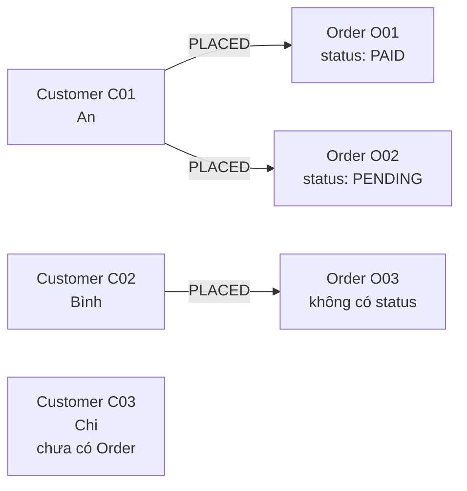

# Truy vấn không có kết quả do hướng quan hệ hoặc điều kiện null

Trong **Neo4j**, một truy vấn Cypher trả về **0 dòng** không nhất thiết có nghĩa database không có dữ liệu. Nút có thể tồn tại, quan hệ cũng tồn tại, nhưng truy vấn **đi ngược hướng quan hệ**; hoặc mẫu đồ thị đã khớp nhưng điều kiện `WHERE` đánh giá thành **`null`** nên dòng bị loại. Vấn đề càng khó phát hiện khi dùng `OPTIONAL MATCH`, dữ liệu có thuộc tính không bắt buộc, hoặc ứng dụng Java chỉ nhận danh sách rỗng mà không thấy nguyên nhân.

Bài thuộc chương **Xử lý sự cố** của module **DATABASE_ENGINE_GRAPH_NEO4J**. Nội dung tập trung vào **property graph** (node, relationship, thuộc tính), cách dò lỗi Cypher khi **không có kết quả**, đọc kết quả đúng trong **Neo4j Java Driver** và **Spring Data Neo4j**, đồng thời kiểm tra các yếu tố phụ như database đích, khóa nghiệp vụ và index. Các ví dụ dùng những cú pháp Cypher phổ biến của Neo4j hiện đại; môi trường học tập cần một database riêng, không chạy thao tác tạo hoặc xóa dữ liệu mẫu trên production.

> **Nguyên tắc chẩn đoán:** Hãy kiểm tra **node → relationship không xét hướng → relationship đúng hướng → thuộc tính → `WHERE` → `OPTIONAL MATCH` → ứng dụng**. Mỗi bước chỉ thay đổi một điều kiện, để tìm chính xác nơi các dòng biến mất.

## 1. Phân loại nhanh triệu chứng

| Triệu chứng | Nguyên nhân có thể | Việc cần kiểm tra đầu tiên |
| --- | --- | --- |
| `MATCH (c:Customer {customerId: $id})` không trả gì | Không có node, sai nhãn, sai ID, sai database hoặc `$id = null` | Tìm node theo nhãn, xem giá trị và kiểu thuộc tính |
| Hai node đều tồn tại nhưng mẫu quan hệ trả rỗng | Quan hệ chưa tạo, sai **hướng**, sai loại hoặc không nối đúng hai node | Tìm cạnh **không chỉ định hướng** và dùng `startNode(r)` |
| Có cạnh đúng nhưng thêm `WHERE` thì rỗng | Thuộc tính thiếu, giá trị `null`, kiểu không khớp hoặc lọc quá chặt | Trả giá trị thuộc tính trước, thử `IS NULL` |
| `OPTIONAL MATCH` nhưng mất cả node gốc | `WHERE` sau `WITH` loại dòng `null`; hoặc `MATCH` trước đó đã loại hết | Kiểm tra vị trí `WHERE` và kết quả từng mệnh đề |
| `count(*)` khác `count(o)` | `OPTIONAL MATCH` giữ dòng có `o = null` | Đếm đối tượng thực bằng `count(o)` |
| Truy vấn Cypher trên Browser có dữ liệu, Java trả rỗng | Java chọn database khác, tham số khác, phiên giao dịch chưa commit | Ghi nhận database, tham số đã được che bí mật và thời điểm transaction |
| Repository trả danh sách rỗng | Quan hệ không cùng hướng với mapping hoặc `@Query`, điều kiện lọc, mapping khác mong đợi | Chạy Cypher tương đương trên database test |

**Phân biệt ba trạng thái nghiệp vụ:** khách hàng **không tồn tại**; khách hàng **tồn tại nhưng chưa có đơn**; khách hàng **có đơn nhưng không có đơn nào đạt bộ lọc**. Cả ba có thể dẫn đến danh sách đơn hàng rỗng, nhưng API nên xử lý chúng theo ý nghĩa khác nhau.

## 2. Dựng đồ thị mẫu có thể tái hiện

Giả sử dịch vụ quản lý đơn hàng lưu:

- `(:Customer {customerId, name})`.
- `(:Order {orderId, createdAt, status?})`.
- `(:Customer)-[:PLACED]->(:Order)`: khách hàng **đặt** đơn.

`status` là thuộc tính **không bắt buộc**: một Order có thể chưa có trường này.



### 2.1. Tạo constraint trước khi nhập

Chỉ chạy trên **database thực hành**:

```cypher
CREATE CONSTRAINT customer_id_unique IF NOT EXISTS
FOR (c:Customer) REQUIRE c.customerId IS UNIQUE;

CREATE CONSTRAINT order_id_unique IF NOT EXISTS
FOR (o:Order) REQUIRE o.orderId IS UNIQUE;
```

Constraint duy nhất bảo vệ việc không tạo nhiều node theo cùng một khóa và hỗ trợ tra cứu bằng index. Nó **không tự sinh quan hệ** và cũng không sửa được một truy vấn viết sai hướng.

### 2.2. Tạo dữ liệu mẫu

```cypher
MERGE (c1:Customer {customerId: 'C01'})
SET c1.name = 'An'
MERGE (c2:Customer {customerId: 'C02'})
SET c2.name = 'Bình'
MERGE (c3:Customer {customerId: 'C03'})
SET c3.name = 'Chi'

MERGE (o1:Order {orderId: 'O01'})
SET o1.status = 'PAID',
    o1.createdAt = date('2026-11-01')
MERGE (o2:Order {orderId: 'O02'})
SET o2.status = 'PENDING',
    o2.createdAt = date('2026-11-02')
MERGE (o3:Order {orderId: 'O03'})
SET o3.status = null,
    o3.createdAt = date('2026-11-03')

MERGE (c1)-[:PLACED]->(o1)
MERGE (c1)-[:PLACED]->(o2)
MERGE (c2)-[:PLACED]->(o3);
```

`SET o3.status = null` trong Neo4j **loại bỏ thuộc tính `status`** khỏi node (Neo4j không lưu một property có giá trị `null` như một giá trị thuộc tính tồn tại độc lập). `o3.status` được đọc ra `null` vì property đó không tồn tại.

`MERGE` giúp chạy lại fixture theo cùng khóa mà không tạo lại các node và cặp cạnh đã có trong các lần chạy tuần tự. Tuy nhiên, nếu database đã chứa cạnh sai từ trước hoặc chạy nhiều writer đồng thời, fixture không phải một công cụ dọn dữ liệu sai: nên dùng database sạch và một test có kiểm soát.

### 2.3. Đối chiếu kết quả chuẩn

```cypher
MATCH (c:Customer)
RETURN c.customerId AS customerId, c.name AS name
ORDER BY customerId;
```

Kỳ vọng có **C01, C02, C03**. Với quan hệ:

```cypher
MATCH (c:Customer)-[:PLACED]->(o:Order)
RETURN c.customerId AS customerId,
       o.orderId AS orderId,
       o.status AS status
ORDER BY customerId, orderId;
```

| customerId | orderId | status |
| --- | --- | --- |
| C01 | O01 | PAID |
| C01 | O02 | PENDING |
| C02 | O03 | `null` |

Nếu kết quả khác, hãy kiểm tra trạng thái database thực hành trước khi áp dụng các bảng kỳ vọng trong những phần sau.

## 3. Hướng relationship là một phần của mẫu MATCH

Trong property graph, một relationship có **node bắt đầu** và **node kết thúc**. Cypher dùng ký hiệu mũi tên để mô tả hướng của quan hệ cần khớp.

| Mẫu | Cách hiểu |
| --- | --- |
| `(c:Customer)-[:PLACED]->(o:Order)` | Cạnh bắt đầu từ `Customer`, kết thúc ở `Order` |
| `(c:Customer)<-[:PLACED]-(o:Order)` | Cạnh bắt đầu từ `Order`, kết thúc ở `Customer` |
| `(c:Customer)-[:PLACED]-(o:Order)` | Cạnh `PLACED` giữa hai node, **không ràng buộc hướng** |

Với fixture, chỉ mẫu đầu khớp đúng chiều nghiệp vụ.

### 3.1. Ví dụ truy vấn bị viết ngược hướng

```cypher
MATCH (c:Customer {customerId: 'C01'})
      <-[:PLACED]-(o:Order)
RETURN o.orderId AS orderId;
```

**Kết quả kỳ vọng: 0 dòng.** Điều này không có nghĩa C01 không có đơn. Cạnh trong dữ liệu chạy từ **C01 tới O01/O02**, không phải từ O01/O02 tới C01.

Viết đúng:

```cypher
MATCH (c:Customer {customerId: 'C01'})
      -[:PLACED]->(o:Order)
RETURN o.orderId AS orderId
ORDER BY orderId;
```

Kết quả: **O01, O02**.

### 3.2. Dùng mẫu không xét hướng để điều tra

```cypher
MATCH (c:Customer {customerId: 'C01'})
      -[r:PLACED]-(o:Order)
RETURN c.customerId AS customerId,
       o.orderId AS orderId,
       type(r) AS relationshipType,
       startNode(r) = c AS startsAtCustomer,
       endNode(r) = o AS endsAtOrder
ORDER BY orderId;
```

Nếu dữ liệu đúng theo fixture, `startsAtCustomer = true` và `endsAtOrder = true` cho cả hai quan hệ. Nếu câu không xét hướng có kết quả nhưng câu có hướng không có, cần kiểm tra **hướng cạnh thực tế**.

**Đừng sửa production bằng cách bỏ mũi tên ngay lập tức.** Mẫu `-[r:PLACED]-` có thể trả cả những cạnh được tạo ngược do bug. Nó rất hữu ích để **chẩn đoán**, nhưng trong truy vấn nghiệp vụ, hướng có thể là một bất biến cần duy trì.

### 3.3. Chẩn đoán cả loại quan hệ

```cypher
MATCH (c:Customer {customerId: 'C01'})-[r]-(n)
RETURN type(r) AS relationshipType,
       labels(n) AS neighborLabels,
       startNode(r) = c AS startsAtCustomer
LIMIT 30;
```

Truy vấn này tìm mọi cạnh lân cận, dù loại gì. Sử dụng có kiểm soát trên node thử nghiệm vì node bậc lớn có thể có rất nhiều cạnh. Nó giúp phát hiện:

- Dữ liệu dùng `:PLACED_ORDER` nhưng câu Cypher yêu cầu `:PLACED`.
- Có cạnh `PLACED` nhưng nối sang node không mang nhãn `Order`.
- Quan hệ có chiều ngược hoặc phát sinh cạnh trùng ngoài dự kiến.

**Tên label, relationship type và property key phân biệt chữ hoa/chữ thường** trong Cypher. `PLACED`, `Placed` và `placed` là ba tên khác nhau.

## 4. MATCH khớp theo nhiều điều kiện cùng lúc

`MATCH` trả dòng khi **toàn bộ mẫu** được đáp ứng. Một mắt xích không khớp làm dòng đó biến mất.

Xem truy vấn:

```cypher
MATCH (c:Customer {customerId: 'C01'})
      -[:PLACED]->(o:Order {orderId: 'O99'})
RETURN c, o;
```

Node C01 có thật và có hai cạnh `PLACED`, nhưng không nối tới Order O99. Kết quả vẫn rỗng.

Tương tự, nếu `MATCH` đầu tiên trả **0 dòng**, một `OPTIONAL MATCH` viết phía sau **không thể tự tạo lại các dòng đã mất**:

```cypher
MATCH (c:Customer {customerId: 'C99'})
OPTIONAL MATCH (c)-[:PLACED]->(o:Order)
RETURN c.customerId, o.orderId;
```

**Kết quả: 0 dòng**, vì `MATCH (c:Customer {customerId:'C99'})` không tìm thấy C99. Tình huống này khác với trường hợp C03 tồn tại nhưng chưa có Order.

### 4.1. Tháo truy vấn dài thành các phép kiểm tra nhỏ

Dùng lần lượt:

```cypher
// Bước 1: Customer có tồn tại không?
MATCH (c:Customer {customerId: 'C01'})
RETURN c.customerId AS customerId;
```

```cypher
// Bước 2: Order có tồn tại không?
MATCH (o:Order {orderId: 'O01'})
RETURN o.orderId AS orderId;
```

```cypher
// Bước 3: Hai node có cạnh PLACED ở bất kỳ hướng nào không?
MATCH (c:Customer {customerId: 'C01'})
      -[r:PLACED]-(o:Order {orderId: 'O01'})
RETURN type(r), startNode(r) = c AS correctDirection;
```

```cypher
// Bước 4: Hướng mong đợi có khớp không?
MATCH (c:Customer {customerId: 'C01'})
      -[:PLACED]->(o:Order {orderId: 'O01'})
RETURN o.orderId;
```

Chỉ khi bốn bước đều đúng mới thêm điều kiện `WHERE` hoặc mẫu mở rộng tiếp theo. Đây là cách tìm lỗi nhanh hơn so với thêm `PROFILE` lên một truy vấn dài đang trả rỗng.

## 5. null trong Cypher không giống giá trị thông thường

`null` biểu thị **thiếu giá trị hoặc chưa biết giá trị**. Nó không đồng nghĩa với chuỗi rỗng `''`, số `0`, `false` hay một nhãn nghiệp vụ như `'UNKNOWN'`.

Trong Neo4j property graph:

- Đọc thuộc tính không tồn tại, ví dụ `o.status` của O03, trả về `null`.
- `SET o.status = null` xóa thuộc tính `status`.
- `o.status = null` **không phải** cách tìm node thiếu status.
- Khi một biểu thức so sánh có kết quả `null`, `WHERE` không coi đó là `true`.

### 5.1. So sánh null: ba trạng thái logic

Có ba kết quả logic cần phân biệt: **true**, **false** và **null/unknown**.

| Biểu thức | Kết quả |
| --- | --- |
| `null = null` | `null` |
| `null = 'PAID'` | `null` |
| `null <> 'PAID'` | `null` |
| `NOT (null = 'PAID')` | `null` |
| `null IS NULL` | `true` |
| `null IS NOT NULL` | `false` |
| `false AND null` | `false` |
| `true AND null` | `null` |
| `true OR null` | `true` |
| `false OR null` | `null` |

Có thể thử bằng một truy vấn đọc:

```cypher
RETURN null = null AS equalityCheck,
       null IS NULL AS isNullCheck,
       NOT (null = 'PAID') AS negatedComparison,
       coalesce(null, 'UNKNOWN') AS defaultValue;
```

**`WHERE` chỉ giữ những dòng có điều kiện là `true`.** Dòng có `false` hoặc `null` đều bị loại.

### 5.2. Vì sao WHERE status = null không trả dữ liệu?

Sai:

```cypher
MATCH (o:Order)
WHERE o.status = null
RETURN o.orderId, o.status;
```

Không trả O03, vì `o.status = null` được đánh giá là `null` ngay cả khi status thiếu.

Đúng:

```cypher
MATCH (o:Order)
WHERE o.status IS NULL
RETURN o.orderId AS orderId
ORDER BY orderId;
```

Kỳ vọng **O03**. Kiểm tra node có status:

```cypher
MATCH (o:Order)
WHERE o.status IS NOT NULL
RETURN o.orderId AS orderId, o.status AS status
ORDER BY orderId;
```

Kỳ vọng **O01, O02**.

### 5.3. Điều kiện phủ định cũng có thể làm mất dòng

```cypher
MATCH (o:Order)
WHERE o.status <> 'CANCELLED'
RETURN o.orderId AS orderId
ORDER BY orderId;
```

Kết quả chỉ có **O01, O02**; **O03 bị loại**, vì `null <> 'CANCELLED'` không phải `true`.

Nếu **nghiệp vụ yêu cầu giữ cả đơn thiếu status**:

```cypher
MATCH (o:Order)
WHERE o.status IS NULL OR o.status <> 'CANCELLED'
RETURN o.orderId AS orderId
ORDER BY orderId;
```

Kết quả **O01, O02, O03**.

Đây là **thay đổi quy tắc nghiệp vụ**, không chỉ mẹo sửa cú pháp. Nếu Order thiếu status phải bị chặn, điều kiện cũ có thể đúng; không thêm `IS NULL` để có kết quả nhiều hơn khi chưa hiểu hợp đồng dữ liệu.

### 5.4. coalesce chỉ dùng khi có giá trị mặc định hợp lệ

```cypher
MATCH (o:Order)
RETURN o.orderId AS orderId,
       coalesce(o.status, 'UNKNOWN') AS displayStatus
ORDER BY orderId;
```

O03 hiển thị `UNKNOWN`. Hàm `coalesce(a, b, ...)` trả **giá trị đầu tiên không phải `null`**.

Hữu ích cho hiển thị hoặc logic có fallback rõ ràng, nhưng không nên mặc định `UNKNOWN` tương đương `PENDING` hoặc `PAID`. Nếu bạn dùng:

```cypher
WHERE coalesce(o.status, 'PENDING') = 'PENDING'
```

thì O03 bị **xem như PENDING**, có thể gây sai nghiệp vụ. Khi dữ liệu thiếu khác biệt với dữ liệu có trạng thái PENDING thật, hãy giữ hai trường hợp tách biệt.

## 6. Tham số null: rỗng vì client truyền sai giá trị

Giả sử câu Cypher đúng:

```cypher
MATCH (c:Customer {customerId: $customerId})
      -[:PLACED]->(o:Order)
RETURN o.orderId AS orderId;
```

Nếu Java Driver truyền `$customerId = null` thì `MATCH` không khớp C01. Nếu truyền `$customerId = 'c01'` thay vì `'C01'`, so sánh cũng không khớp vì khóa là chuỗi phân biệt hoa/thường.

Điều cần kiểm tra:

1. Tên parameter trong code và Cypher có trùng không, ví dụ `customerId` khác `customerID`.
2. Parameter có bị bỏ qua, truyền `null`, chuỗi rỗng hoặc chứa khoảng trắng thừa không.
3. Kiểu dữ liệu có đúng không: số `101` khác chuỗi `'101'`, `Date` khác chuỗi ngày.
4. Giá trị có được chuẩn hóa theo cùng quy tắc khi tạo node và khi tìm không.
5. Java có kết nối đúng database/tenant đã nhập fixture không.

**Không nên sửa bằng cách ghép input trực tiếp vào chuỗi Cypher**. Luôn giữ tham số hóa; tìm và sửa quy tắc tạo/validate input.

### 6.1. Bộ lọc tùy chọn phải được thiết kế chủ động

Giả sử API nhận bộ lọc `status` có thể bỏ trống. Nếu viết:

```cypher
MATCH (o:Order)
WHERE o.status = $status
RETURN o.orderId;
```

thì khi `$status = null`, **không có Order nào được trả**.

Nếu hợp đồng API quy định “`status` vắng mặt nghĩa là không lọc”, có thể dùng:

```cypher
MATCH (o:Order)
WHERE $status IS NULL OR o.status = $status
RETURN o.orderId AS orderId
ORDER BY orderId;
```

Khi `$status = null`, kết quả là **O01, O02, O03** vì bỏ lọc. Khi `$status = 'PAID'`, kết quả chỉ **O01**. Nhưng chú ý:

- Đây là quy tắc **có chủ đích** của API, không phải mặc định Cypher.
- Nếu trường status **bắt buộc**, nên từ chối `null` ở Java thay vì âm thầm bỏ bộ lọc.
- Nếu `status = null` phải mang nghĩa “tìm đơn **thiếu** status”, cần thiết kế một chế độ riêng; không thể đồng thời dùng nó làm ký hiệu “bỏ lọc” mà không phân biệt.
- Điều kiện `OR` và tính tùy chọn có thể ảnh hưởng kế hoạch dùng index. Với truy vấn hiệu năng cao, cân nhắc các **query template tĩnh khác nhau** cho chế độ có/không lọc.

### 6.2. IN với null và danh sách rỗng

```cypher
MATCH (o:Order)
WHERE o.status IN $statuses
RETURN o.orderId AS orderId;
```

- Nếu `$statuses = ['PAID', 'PENDING']`, kết quả kỳ vọng có O01, O02.
- Nếu `$statuses = []`, không có kết quả.
- Nếu danh sách có `null`, điều đó **không** tự làm giá trị status thiếu khớp. Biểu thức `IN` có thể cho kết quả `null` khi không tìm thấy phần tử khớp nhưng danh sách chứa `null`; `WHERE` vẫn loại dòng đó.

Muốn **chọn cả status thiếu**:

```cypher
MATCH (o:Order)
WHERE o.status IN $statuses
   OR o.status IS NULL
RETURN o.orderId AS orderId
ORDER BY orderId;
```

Chỉ làm vậy khi hợp đồng bộ lọc thực sự cho phép status thiếu.

## 7. OPTIONAL MATCH: giữ dòng gốc khi quan hệ không khớp

`MATCH` giống một phép nối yêu cầu phải có mẫu. `OPTIONAL MATCH` giống một phép **left outer join** trong SQL: nếu phần mở rộng không tìm được cạnh/nút, dòng ở phía trước vẫn còn, còn biến mới bằng `null`.

Với C03 chưa có Order:

```cypher
MATCH (c:Customer {customerId: 'C03'})
MATCH (c)-[:PLACED]->(o:Order)
RETURN c.customerId AS customerId, o.orderId AS orderId;
```

**0 dòng**, vì mệnh đề thứ hai không khớp.

Dùng `OPTIONAL MATCH`:

```cypher
MATCH (c:Customer {customerId: 'C03'})
OPTIONAL MATCH (c)-[:PLACED]->(o:Order)
RETURN c.customerId AS customerId, o.orderId AS orderId;
```

Kết quả **một dòng** có `customerId = 'C03'` và `orderId = null`.

### 7.1. OPTIONAL MATCH không tự sửa lỗi ngược hướng

```cypher
MATCH (c:Customer {customerId: 'C01'})
OPTIONAL MATCH (c)<-[:PLACED]-(o:Order)
RETURN c.customerId AS customerId,
       o.orderId AS orderId;
```

Câu này **trả một dòng C01 với `orderId = null`**, vì mẫu ngược hướng không khớp. Sự khác nhau quan trọng:

- `MATCH` sai hướng: **0 dòng**.
- `OPTIONAL MATCH` sai hướng: **giữ C01 nhưng o = null**.

Nếu người học chỉ nhìn thấy bản ghi Customer trong kết quả, có thể tưởng quan hệ đã khớp. Phải kiểm tra **biến o có tồn tại không** và quan sát hướng thật của cạnh.

### 7.2. Vị trí WHERE quyết định giữ hay loại dòng gốc

So sánh hai truy vấn sau trên cả C01/C02/C03.

**Cách A — Điều kiện thuộc chính OPTIONAL MATCH:**

```cypher
MATCH (c:Customer)
OPTIONAL MATCH (c)-[:PLACED]->(o:Order)
WHERE o.status = 'PAID'
RETURN c.customerId AS customerId,
       o.orderId AS paidOrderId
ORDER BY customerId, paidOrderId;
```

Kỳ vọng:

| customerId | paidOrderId |
| --- | --- |
| C01 | O01 |
| C02 | `null` |
| C03 | `null` |

`WHERE` ngay sau `OPTIONAL MATCH` là **một phần của mẫu tùy chọn cần khớp**. Nếu không tìm được đơn `PAID`, dòng Customer vẫn tồn tại, còn `o` là `null`.

**Cách B — Lọc sau khi OPTIONAL MATCH đã tạo dòng:**

```cypher
MATCH (c:Customer)
OPTIONAL MATCH (c)-[:PLACED]->(o:Order)
WITH c, o
WHERE o.status = 'PAID'
RETURN c.customerId AS customerId,
       o.orderId AS paidOrderId
ORDER BY customerId, paidOrderId;
```

Kỳ vọng **chỉ còn C01/O01**. Sau `WITH`, `WHERE` loại các dòng có `o.status = null` hoặc status không phải PAID; do đó C02 và C03 biến mất.

> **Mẹo chẩn đoán:** Nếu mục tiêu là **“liệt kê mọi khách hàng kèm đơn PAID nếu có”**, đặt điều kiện PAID **bên trong OPTIONAL MATCH**. Nếu mục tiêu là **“chỉ lấy khách hàng có đơn PAID”**, dùng `MATCH` trực tiếp với `WHERE` hoặc lọc sau là hợp lý.

### 7.3. Một điều kiện sau OPTIONAL MATCH không luôn đủ giữ khách hàng

Một cách vá thường gặp:

```cypher
MATCH (c:Customer)
OPTIONAL MATCH (c)-[:PLACED]->(o:Order)
WITH c, o
WHERE o IS NULL OR o.status = 'PAID'
RETURN c.customerId AS customerId,
       o.orderId AS paidOrderId;
```

Truy vấn có thể giữ C03 (vì `o = null`), **nhưng vẫn loại C02**, vì C02 có O03: `o` không null, còn `o.status = 'PAID'` là `null`. Sau `OPTIONAL MATCH` đầu tiên, C02 **không có dòng null đại diện cho “không có đơn PAID”** bởi vì nó đã khớp Order O03.

Nếu muốn giữ **tất cả Customer**, phải áp điều kiện ngay trong mẫu tùy chọn:

```cypher
MATCH (c:Customer)
OPTIONAL MATCH (c)-[:PLACED]->(o:Order)
WHERE o.status = 'PAID'
RETURN c.customerId AS customerId,
       collect(o.orderId) AS paidOrders
ORDER BY customerId;
```

Với fixture, C01 có `['O01']`, C02 và C03 có `[]`.

## 8. count(*) và count(variable) khi có null

`OPTIONAL MATCH` có thể tạo một dòng mà biến phía tùy chọn bằng `null`. Nếu bạn dùng `count(*)`, **dòng đó vẫn được đếm**.

```cypher
MATCH (c:Customer)
OPTIONAL MATCH (c)-[:PLACED]->(o:Order)
RETURN c.customerId AS customerId,
       count(*) AS producedRows,
       count(o) AS actualOrders,
       count(o.status) AS ordersWithStatus,
       collect(o.orderId) AS orderIds
ORDER BY customerId;
```

Với dữ liệu mẫu:

| customerId | producedRows | actualOrders | ordersWithStatus | orderIds |
| --- | ---: | ---: | ---: | --- |
| C01 | 2 | 2 | 2 | [O01, O02] |
| C02 | 1 | 1 | 0 | [O03] |
| C03 | 1 | 0 | 0 | [] |

Giải thích:

- `count(*)` đếm **dòng kết quả** bao gồm dòng C03 có `o = null`.
- `count(o)` đếm các giá trị **o không phải null**.
- `count(o.status)` chỉ đếm Order có thuộc tính `status` không null.
- `collect(o.orderId)` không đưa `null` vào danh sách. Danh sách không có phần tử không tự phân biệt “không có Order” và “Order có nhưng thiếu orderId”, nên cần kiểm tra `count(o)` nếu khóa chưa được bảo đảm.
- Thứ tự trong `collect` chỉ ổn định khi truy vấn thiết kế `ORDER BY` phù hợp trước bước gom; đừng dựa vào thứ tự dữ liệu ngẫu nhiên.

**Lưu ý:** `count(o.status) = 0` với C02 **không có nghĩa không có Order**; C02 có O03 nhưng thiếu thuộc tính status.

### 8.1. Phân biệt not found và danh sách rỗng

Nếu API cần phân biệt khách hàng không tồn tại với khách hàng chưa đặt đơn, có thể chủ động tạo một dòng đầu vào rồi dùng `OPTIONAL MATCH` cho cả node gốc:

```cypher
WITH $customerId AS requestedId
OPTIONAL MATCH (c:Customer {customerId: requestedId})
OPTIONAL MATCH (c)-[:PLACED]->(o:Order)
RETURN requestedId,
       c IS NOT NULL AS customerFound,
       count(o) AS orderCount,
       collect(o.orderId) AS orderIds;
```

Với `$customerId = 'C99'`:

- `customerFound = false`.
- `orderCount = 0`.
- `orderIds = []`.

Với C03:

- `customerFound = true`.
- `orderCount = 0`.
- `orderIds = []`.

Từ đó, tầng API có thể chọn `404 Not Found` cho khách hàng không tồn tại và `200 OK` kèm danh sách rỗng cho khách hàng có thật nhưng chưa có đơn, theo hợp đồng nghiệp vụ.

## 9. EXISTS và NOT EXISTS khi chỉ cần biết quan hệ có hay không

Nếu không cần lấy Order, việc mở rộng toàn bộ relationship rồi gom có thể không cần thiết. Dùng **existential subquery** giúp diễn đạt câu hỏi “có ít nhất một cạnh phù hợp không?”.

```cypher
MATCH (c:Customer)
RETURN c.customerId AS customerId,
       EXISTS {
         MATCH (c)-[:PLACED]->(:Order)
       } AS hasPlacedOrder
ORDER BY customerId;
```

Kỳ vọng C01 và C02 có `hasPlacedOrder = true`, C03 có `false`.

Để tìm Customer không có bất kỳ Order nào theo **hướng nghiệp vụ đúng**:

```cypher
MATCH (c:Customer)
WHERE NOT EXISTS {
  MATCH (c)-[:PLACED]->(:Order)
}
RETURN c.customerId AS customerId;
```

Kỳ vọng **C03**.

### 9.1. Điều kiện tồn tại Order PAID

```cypher
MATCH (c:Customer)
RETURN c.customerId AS customerId,
       EXISTS {
         MATCH (c)-[:PLACED]->(o:Order)
         WHERE o.status = 'PAID'
       } AS hasPaidOrder
ORDER BY customerId;
```

Kết quả: C01 `true`, C02 `false`, C03 `false`.

Đây là hai câu hỏi khác nhau:

1. **Có bất kỳ Order nào không?**
2. **Có ít nhất một Order có status PAID không?**

Nếu chỉ kiểm tra câu thứ hai, C02 và C03 cùng `false` nhưng nguyên nhân khác nhau. Muốn chẩn đoán, trả thêm `hasPlacedOrder` hoặc đếm `count(o)`.

## 10. Quy trình gỡ lỗi từng bước trên database thật

Khi một truy vấn nghiệp vụ trả rỗng, đừng lập tức đổi `MATCH` thành `OPTIONAL MATCH` ở mọi nơi. Hãy xác nhận một chuỗi bất biến.

### Bước 1 — Chọn đúng database và input

Ghi lại:

- Database và tenant đích.
- Query template/Cypher đang chạy.
- Parameter names, kiểu giá trị và giá trị thử nghiệm đã **ẩn dữ liệu nhạy cảm**.
- Transaction đã commit trước bước đọc chưa.
- Phiên bản Neo4j và những thay đổi schema/mapping gần đây.

Không dựa vào việc `Driver.verifyConnectivity()` thành công để kết luận đang đọc đúng database hoặc node đã tồn tại.

### Bước 2 — Kiểm tra node riêng

```cypher
MATCH (c:Customer {customerId: $customerId})
RETURN c.customerId AS customerId, c.name AS name;
```

Nếu rỗng, điều tra **khóa, nhãn, kiểu, tenant, database** trước. Một truy vấn đo số lượng rộng hơn trên database test:

```cypher
MATCH (c:Customer)
RETURN count(c) AS totalCustomers;
```

Trong hệ thống thật, số lượng lớn không chứng minh C01 tồn tại. Dùng `$customerId` tương ứng để xác nhận **một node cụ thể**.

### Bước 3 — Kiểm tra hai node rồi loại cạnh

```cypher
MATCH (c:Customer {customerId: $customerId})
MATCH (o:Order {orderId: $orderId})
RETURN c.customerId AS customerId, o.orderId AS orderId;
```

Nếu câu này có kết quả nhưng mẫu quan hệ không có, hãy tra cạnh **không xét hướng**:

```cypher
MATCH (c:Customer {customerId: $customerId})
      -[r]-(o:Order {orderId: $orderId})
RETURN type(r) AS relType,
       startNode(r) = c AS startsAtCustomer;
```

- **Không có cạnh:** kiểm tra quy trình `MERGE` tạo relationship hoặc dữ liệu chưa được nạp.
- **Có cạnh nhưng sai type:** kiểm tra tên chính xác.
- **Có cạnh đúng type nhưng sai chiều:** sửa mô hình/query theo nghiệp vụ, không tự bỏ mũi tên để che lỗi.
- **Có nhiều cạnh:** kiểm tra dữ liệu trùng, làm rõ cardinality mong đợi.

### Bước 4 — Xem thuộc tính trước khi lọc

```cypher
MATCH (c:Customer {customerId: $customerId})
      -[:PLACED]->(o:Order)
RETURN o.orderId AS orderId,
       o.status AS status,
       o.status IS NULL AS missingStatus
ORDER BY orderId;
```

Sau đó mới thử:

```cypher
MATCH (c:Customer {customerId: $customerId})
      -[:PLACED]->(o:Order)
WHERE o.status = $status
RETURN o.orderId AS orderId;
```

Nếu `$status = null`, đây là tình huống bộ lọc không thể khớp bằng phép `=`. Nếu giá trị là `'PAID'` mà chỉ có Order `'PENDING'`, việc trả rỗng là đúng nghiệp vụ.

### Bước 5 — Bỏ từng điều kiện, không bỏ mọi điều kiện

Một truy vấn có thể có nhiều filter:

```cypher
MATCH (c:Customer {customerId: $customerId})
      -[:PLACED]->(o:Order)
WHERE o.status = $status
  AND o.createdAt >= $fromDate
RETURN o.orderId AS orderId;
```

Thử lần lượt:

1. Chỉ `MATCH` (có dữ liệu không?).
2. Thêm `status` (còn bao nhiêu?).
3. Thêm `createdAt` (còn bao nhiêu?).
4. Kiểm tra kiểu ngày trong database: `date('2026-11-01')` khác với việc coi ngày là chuỗi tự do.
5. Đảm bảo quyền/tenant scope vẫn được giữ trong các truy vấn thử trên dữ liệu thật.

Trong production, không xóa điều kiện tenant hoặc quyền chỉ để “lấy thử nhiều kết quả” bằng tài khoản có quyền rộng. Chẩn đoán theo một **mẫu dữ liệu được phép và cô lập**.

### Bước 6 — Kiểm tra vị trí WHERE/OPTIONAL MATCH/WITH

Nếu mục tiêu là giữ mọi Customer dù chưa có đơn đạt filter, so sánh hai cách ở phần 7. Trong truy vấn dài, `WITH` chia pipeline thành giai đoạn mới. Sau `WITH`, điều kiện `WHERE` có thể làm mất những dòng null đã được `OPTIONAL MATCH` tạo ra.

### Bước 7 — Đối chiếu kế hoạch và lỗi ứng dụng

Khi đã xác minh truy vấn đúng nhưng kết quả chưa như kỳ vọng, dùng `EXPLAIN`/`PROFILE` phù hợp để xem `Rows` tại từng toán tử. Tuy nhiên:

- `EXPLAIN` lập kế hoạch **không thực thi** câu Cypher.
- `PROFILE` thực thi, kể cả **truy vấn ghi**; không xem nó là thao tác kiểm tra vô hại.
- Với query đọc, `PROFILE` có thể cho biết số dòng về 0 ở bước nào, nhưng **không thay thế kiểm tra dữ liệu và biểu thức logic**.
- `NodeIndexSeek`/`NodeByLabelScan` là lựa chọn thực thi, **không làm thay đổi ngữ nghĩa đúng/sai của một điều kiện null**.
- Trả rỗng vẫn có thể là kết quả chính xác nếu tenant, khóa hoặc điều kiện nghiệp vụ không khớp.

## 11. Hai vấn đề phụ thường bị quy nhầm cho hướng quan hệ

### 11.1. Khác biệt kiểu và định dạng thuộc tính

Ví dụ có dữ liệu:

```cypher
(:Order {orderId: 'O10', totalAmount: 500000,
         createdAt: date('2026-11-01')})
```

Các cặp giá trị có thể không tương đương:

- `o.totalAmount = 500000` (số) so với `$amount = '500000'` (chuỗi).
- `o.createdAt` kiểu Date so với `$fromDate` kiểu String chưa được chuyển đổi rõ ràng.
- `o.orderId = 'O10'` so với `'o10'` (khác hoa/thường).
- `'C01'` so với `' C01 '` (khoảng trắng).
- `'PAID'` so với `'Paid'` (khác chữ hoa).

Đừng âm thầm áp `toLower(trim(...))` vào mọi truy vấn: có thể thay đổi định nghĩa khóa nghiệp vụ và ảnh hưởng khả năng dùng index. Chuẩn hóa ở **ranh giới nhập dữ liệu và API**, với quy tắc thống nhất.

### 11.2. Điều kiện null trên khóa MERGE khác với kết quả MATCH rỗng

Hai truy vấn khác nhau:

```cypher
// Khi $id = null, điều kiện MATCH thường không khớp node nào.
MATCH (o:Order {orderId: $id})
RETURN o;
```

```cypher
// MERGE với thuộc tính khóa null có thể gây lỗi,
// không phải chỉ âm thầm trả danh sách rỗng.
MERGE (o:Order {orderId: $id})
RETURN o;
```

Với khóa định danh bắt buộc, Java nên **validate input trước khi gọi Neo4j**. Khóa nghiệp vụ có unique constraint, nhưng constraint không thay thế kiểm tra `null` hoặc chuỗi rỗng ở biên API.

## 12. Java Driver: trả về đúng trạng thái thay vì chỉ List rỗng

Một service Java có thể phân biệt “không có khách hàng” và “không có đơn” bằng cách dùng truy vấn tùy chọn ở phần 8.

### 12.1. Ví dụ Neo4j Java Driver 5.x

```java
import java.util.List;
import java.util.Map;

import org.neo4j.driver.Driver;
import org.neo4j.driver.Session;
import org.neo4j.driver.SessionConfig;
import org.neo4j.driver.Value;

public final class CustomerOrderQuery {

    public record LookupResult(
        boolean customerFound,
        long orderCount,
        List<String> orderIds
    ) {}

    private static final String QUERY = """
        WITH $customerId AS requestedId
        OPTIONAL MATCH (c:Customer {customerId: requestedId})
        OPTIONAL MATCH (c)-[:PLACED]->(o:Order)
        RETURN c IS NOT NULL AS customerFound,
               count(o) AS orderCount,
               collect(o.orderId) AS orderIds
        """;

    private final Driver driver;
    private final String databaseName;

    public CustomerOrderQuery(Driver driver, String databaseName) {
        this.driver = driver;
        this.databaseName = databaseName;
    }

    public LookupResult find(String customerId) {
        if (customerId == null || customerId.isBlank()) {
            throw new IllegalArgumentException(
                "customerId must not be empty");
        }

        try (Session session = driver.session(
                SessionConfig.forDatabase(databaseName))) {
            return session.executeRead(tx -> {
                var record = tx.run(
                    QUERY, Map.of("customerId", customerId)
                ).single();

                return new LookupResult(
                    record.get("customerFound").asBoolean(),
                    record.get("orderCount").asLong(),
                    record.get("orderIds").asList(Value::asString)
                );
            });
        }
    }
}
```

Giải thích:

- `Driver` được quản lý theo vòng đời ứng dụng, **không tạo mới cho từng lần find**.
- `SessionConfig.forDatabase(databaseName)` giúp đọc đúng database.
- `executeRead` dùng managed read transaction, an toàn hơn việc tự chắp vá query hoặc ghép input vào string.
- `Map.of(...)` không nhận giá trị `null`, nên kiểm tra `customerId` trước khi truyền.
- `single()` hợp lý vì query chủ động tạo một dòng đầu vào và dùng aggregate. Với một query `MATCH` thông thường có 0 dòng, `single()` có thể ném ngoại lệ thay vì trả `null`; cần phân biệt hai loại hợp đồng kết quả.
- `orderCount` đếm Order có thật; `orderIds` có thể rỗng.
- Nếu có Order mà thuộc tính orderId thiếu, `collect(o.orderId)` sẽ bỏ giá trị null; constraint/validation cần bảo đảm khóa đó hiện diện nếu API dựa vào nó.
- `customerFound = false` là trường hợp có thể ánh xạ thành HTTP `404`; `customerFound = true` nhưng `orderCount = 0` có thể trả HTTP `200` kèm danh sách rỗng.

### 12.2. Nếu Java thấy null sau OPTIONAL MATCH

Với query:

```cypher
MATCH (c:Customer {customerId: $customerId})
OPTIONAL MATCH (c)-[:PLACED]->(o:Order)
RETURN c.customerId AS customerId,
       o.orderId AS orderId;
```

Trong Neo4j Driver, `Record.get("orderId")` là một `Value`; khi Order không khớp, cần kiểm tra `Value.isNull()` trước khi gọi `asString()`.

```java
var value = record.get("orderId");
String orderId = value.isNull() ? null : value.asString();
```

Không coi việc có một `Record` là bằng chứng có một Order. Record có thể mang Customer thật cùng một cột `orderId = null`.

### 12.3. Parameter binding ngăn query bị biến dạng

Luôn dùng:

```java
tx.run("""
    MATCH (c:Customer {customerId: $id})
    RETURN c.customerId AS id
    """, Map.of("id", customerId));
```

Không xây:

```java
// KHÔNG AN TOÀN: dữ liệu bên ngoài bị nối vào cú pháp.
String cypher =
    "MATCH (c:Customer {customerId: '" +
    customerId + "'}) RETURN c";
```

Tham số hóa giúp chuỗi chứa dấu nháy hoặc ký tự đặc biệt được coi là **dữ liệu**, không phải cấu trúc Cypher. Nó không tự sửa được một relationship arrow viết ngược.

## 13. Spring Data Neo4j: hướng trong @Relationship và @Query

Khi sử dụng **Spring Data Neo4j (SDN)**, hướng quan hệ có thể được khai báo trong entity mapping. Một ví dụ mô hình tối giản:

```java
import java.util.List;

import org.springframework.data.annotation.Id;
import org.springframework.data.neo4j.core.schema.Node;
import org.springframework.data.neo4j.core.schema.Relationship;

@Node("Customer")
public class Customer {

    @Id
    private String customerId;

    private String name;

    @Relationship(
        type = "PLACED",
        direction = Relationship.Direction.OUTGOING
    )
    private List<Order> orders;

    protected Customer() {}
}
```

`orders` mô tả cạnh **từ Customer đi ra Order**. Nếu mapping khai báo `INCOMING` nhưng dữ liệu thực tế là outgoing, việc tải aggregate có thể không đưa các Order dự kiến vào collection.

Để tìm Order bằng repository có truy vấn Cypher tự viết:

```java
import java.util.List;

import org.springframework.data.neo4j.repository.Neo4jRepository;
import org.springframework.data.neo4j.repository.query.Query;
import org.springframework.data.repository.query.Param;

public interface OrderRepository
        extends Neo4jRepository<Order, String> {

    @Query("""
        MATCH (c:Customer {customerId: $customerId})
              -[:PLACED]->(o:Order)
        RETURN o
        ORDER BY o.orderId
        """)
    List<Order> findPlacedByCustomer(
        @Param("customerId") String customerId);
}
```

Đoạn code giả định `Order` là một `@Node` entity có `@Id` phù hợp và các thuộc tính scalar được ánh xạ đúng. Trong ứng dụng có các quan hệ/aggregate phức tạp, phải kiểm tra cách SDN dựng entity từ kết quả `RETURN o`.

**Repository trả `List.empty` không phân biệt được**:

- Customer không tồn tại;
- Customer có thật nhưng chưa đặt đơn;
- Hướng quan hệ hoặc nhãn/type không khớp;
- Có đơn nhưng query bị `WHERE` loại;
- App đang dùng database khác.

Để phân biệt, dùng truy vấn tồn tại Customer riêng hoặc truy vấn projection có `OPTIONAL MATCH` và cờ `customerFound`. Đừng mặc định ánh xạ một danh sách rỗng thành `404` trong mọi API.

### 13.1. Đừng sửa hướng entity bằng cách đảo query tùy tiện

Nếu database của ứng dụng được thiết kế `(Customer)-[:PLACED]->(Order)`, nên nhất quán:

- Cypher tạo relationship.
- Cypher đọc relationship.
- `@Relationship(direction = OUTGOING)` trong Customer.
- `@Query` có mẫu đúng chiều.
- Test tích hợp kiểm tra số lượng và đầu–cuối cạnh.

Nếu có entity Order định nghĩa quan hệ ngược trở về Customer, từ góc nhìn Order nó có thể được ánh xạ `INCOMING`. **Một relationship vật lý vẫn có một hướng xác định**, dù hai entity ở hai đầu nhìn từ các phía khác nhau.

### 13.2. Cẩn trọng với kết quả null của custom query

Nếu `@Query` dùng `OPTIONAL MATCH` và trả một node có thể null, kiểu repository trả về (entity, collection, projection) cần phản ánh điều đó. Một câu `RETURN o` khi `o = null` không giống query trả `0 dòng`. Việc mapping một `null` result sang một entity non-null có thể không phù hợp.

Với dữ liệu báo cáo, cân nhắc **projection/DTO có cờ tồn tại và số lượng**, hoặc dùng `Neo4jClient`/Driver để xử lý kết quả scalar rõ ràng.

## 14. Kiểm thử hồi quy bằng Neo4j thực

Mock repository thường không kiểm tra được hướng relationship hay logic ba trạng thái của Cypher. Nên dùng **integration test** với Neo4j thử nghiệm, ví dụ thông qua **Testcontainers** (khi CI có Docker/container runtime phù hợp), tạo fixture rồi chạy query thật.

### 14.1. Những trường hợp bắt buộc có

| Test | Dữ liệu | Kết quả cần xác nhận |
| --- | --- | --- |
| Đúng hướng | C01 → O01 | `MATCH (c)-[:PLACED]->(o)` có O01 |
| Sai hướng | C01 → O01 | `MATCH (c)<-[:PLACED]-(o)` không trả O01 |
| Không xét hướng để debug | C01 → O01 | Tìm thấy cạnh; `startNode(r) = c` là `true` |
| Có Customer nhưng không có Order | C03 | `MATCH` rỗng, `OPTIONAL MATCH` giữ C03 và `o = null` |
| Customer không tồn tại | C99 | `customerFound = false` |
| Order thiếu status | C02 → O03 | `o.status IS NULL` đúng, `o.status = null` không khớp |
| Phủ định trên null | O03 thiếu status | `o.status <> 'CANCELLED'` không tự bao gồm O03 |
| Optional WHERE | C01/C02/C03 | Mọi Customer được giữ; chỉ PAID match thành Order |
| WHERE sau WITH | C01/C02/C03 | Chỉ dòng có status PAID được giữ |
| Đếm dòng | C03 không có Order | `count(*) = 1` nhưng `count(o) = 0` |
| Tham số sai kiểu | orderId là String | Truyền giá trị số khác String không khớp như mã chuỗi |
| Database khác | Test và dev có dữ liệu khác | Truy vấn dùng đúng database do session chọn |

### 14.2. Ví dụ assertion đọc quan hệ

Giả sử test đã khởi tạo `Driver` tới một **Neo4j Testcontainers instance**, có dữ liệu C01/O01 và C03. Một test có thể kiểm tra:

```java
import java.util.Map;

import static org.junit.jupiter.api.Assertions.assertEquals;

try (var session = driver.session()) {
    long correctDirection = session.executeRead(tx ->
        tx.run("""
            MATCH (c:Customer {customerId: $id})
                  -[:PLACED]->(o:Order)
            RETURN count(o) AS n
            """, Map.of("id", "C01"))
          .single().get("n").asLong()
    );

    long reverseDirection = session.executeRead(tx ->
        tx.run("""
            MATCH (c:Customer {customerId: $id})
                  <-[:PLACED]-(o:Order)
            RETURN count(o) AS n
            """, Map.of("id", "C01"))
          .single().get("n").asLong()
    );

    assertEquals(2L, correctDirection);
    assertEquals(0L, reverseDirection);
}
```

Ở đây kỳ vọng `2` nếu dùng **toàn bộ fixture** (C01 có O01 và O02); nếu test chỉ tạo một Order, điều chỉnh expected count tương ứng. Test chỉ chạy trên database do test sở hữu, không phải trên dữ liệu người dùng thật.

**Lưu ý:** Không cần chạy các truy vấn ghi chỉ để kiểm tra một predicate null. Tạo fixture trong setup có kiểm soát, sau đó dùng truy vấn đọc cho assertions. Nếu dùng `PROFILE` trong test, nhớ rằng nó thực thi cả truy vấn ghi nếu có.

## 15. Quy tắc tránh lỗi khi viết query thực tế

### 15.1. Với quan hệ

- Xác định **câu diễn đạt nghiệp vụ** trước: “Customer **PLACED** Order” → `(Customer)-[:PLACED]->(Order)`.
- Dùng label/type có **cùng chữ hoa/thường** với dữ liệu.
- Nếu query rỗng, thử **không xét hướng chỉ để debug**, rồi kiểm tra `startNode(r)` và `endNode(r)`.
- Không coi `OPTIONAL MATCH` là phương pháp sửa dữ liệu thiếu cạnh.
- Với quan hệ nhiều bước, kiểm tra **từng cạnh và hướng** trước khi nối mẫu dài.
- Nếu lệnh `MERGE` nhập relationship bị mất đầu mút, hãy kiểm tra hai node tồn tại và khóa đúng, không chỉ count node tổng.

### 15.2. Với null và WHERE

- Dùng `IS NULL` / `IS NOT NULL` thay vì `= null` hoặc `<> null`.
- Nhớ `WHERE` loại cả `false` và `null`.
- Một điều kiện phủ định như `<> 'CANCELLED'` không tự giữ giá trị thiếu.
- Dùng `coalesce` **khi có quy tắc mặc định hợp lệ**, không làm sai trạng thái nghiệp vụ.
- Khi tham số `null`, phải quyết định có nghĩa **bỏ lọc**, **tìm giá trị thiếu** hay **input không hợp lệ**.
- Với `OPTIONAL MATCH`, xác định rõ điều kiện nằm **trong mẫu tùy chọn** hay **lọc sau `WITH`**.
- Dùng `count(o)` thay vì `count(*)` khi cần số Order thật trong kết quả có null.

### 15.3. Với ứng dụng

- Truyền giá trị bằng **tham số Cypher**, không nối chuỗi input.
- Ghi nhận **database name**, tên query template và kiểu tham số trong log chẩn đoán được phép; không lộ token, mật khẩu hoặc thông tin cá nhân.
- Phân biệt **not found** và **found but empty** trong DTO/API.
- Kiểm tra mapping `@Relationship` và custom `@Query` theo cùng hướng đồ thị.
- Dùng Neo4j thật trong integration tests để bảo vệ trước regression về label, hướng, `null` và transaction.
- Không bỏ điều kiện tenant/authorization khi sửa query trả rỗng.

## 16. Checklist tìm nguyên nhân trong 5 phút

1. **Đúng database/tenant chưa?** Java Driver và Browser có cùng môi trường không?
2. **Node gốc có tồn tại?** Chạy `MATCH (c:Customer {customerId:$id}) RETURN c`.
3. **Node đích có tồn tại?** Tìm Order theo `orderId`.
4. **Có cạnh nào không?** Thử `-[r]-` với hai đầu mút cụ thể.
5. **Cạnh có đúng type?** Xem `type(r)`.
6. **Cạnh có đúng hướng?** Xem `startNode(r)` và `endNode(r)`.
7. **Thuộc tính có tồn tại?** Xem `o.status`, `o.status IS NULL`.
8. **WHERE có đánh giá thành null?** Tránh `= null`, xem từng điều kiện.
9. **OPTIONAL MATCH bị WHERE sau WITH loại?** Dời điều kiện vào optional pattern nếu nghiệp vụ cần giữ dòng gốc.
10. **Đếm đúng?** So sánh `count(*)`, `count(o)` và `count(o.status)`.
11. **Tham số và kiểu có đúng?** Chuỗi, số, ngày, viết hoa/thường và null.
12. **Test hồi quy đã có?** Bao gồm hướng, thiếu quan hệ, thiếu thuộc tính và client mapping.

## 17. Bài tập thực hành

### Bài tập 1 — Tìm lỗi hướng

Trên fixture, truy vấn `MATCH (c:Customer {customerId:'C01'})<-[:PLACED]-(o:Order) RETURN o` trả rỗng. Hãy viết lại đúng hướng, rồi dùng `startNode(r)` để chứng minh chiều thật. Vì sao chỉ xóa mũi tên khỏi truy vấn production chưa phải cách sửa tốt?

### Bài tập 2 — Phân biệt không có cạnh và sai cạnh

C01 và O01 đều tồn tại, nhưng query `(c)-[:PLACED]->(o)` rỗng. Viết ba truy vấn lần lượt kiểm tra (a) hai node, (b) có cạnh bất kỳ giữa chúng, (c) loại và hướng của cạnh. Với từng kết quả, nêu thao tác điều tra kế tiếp.

### Bài tập 3 — Điều kiện null

O03 không có `status`. So sánh kết quả của:

```cypher
MATCH (o:Order) WHERE o.status = null RETURN o.orderId;
```

```cypher
MATCH (o:Order) WHERE o.status IS NULL RETURN o.orderId;
```

Giải thích bằng logic ba giá trị.

### Bài tập 4 — Phủ định không giữ null

Từ fixture, `WHERE o.status <> 'CANCELLED'` trả những Order nào? Vì sao O03 không có mặt? Viết lại nếu nghiệp vụ muốn bao gồm Order thiếu status và phân tích hệ quả.

### Bài tập 5 — OPTIONAL MATCH giữ khách hàng

Viết query trả tất cả Customer cùng danh sách `PAID` Order của họ, kể cả C02/C03 không có đơn PAID. So sánh điều kiện `WHERE o.status = 'PAID'` đặt ngay sau `OPTIONAL MATCH` với điều kiện đặt sau `WITH c, o`.

### Bài tập 6 — Đếm dòng sai

Vì sao C03 có `count(*) = 1` nhưng `count(o) = 0` khi `OPTIONAL MATCH`? Với C02 có Order O03 thiếu status, vì sao `count(o.status) = 0`? Dùng ba phép đếm để phân tích.

### Bài tập 7 — Null parameter và API

Một API nhận `status` tùy chọn. Nếu không truyền, query `WHERE o.status = $status` không trả đơn. Hãy viết hai thiết kế: (a) không truyền nghĩa là **bỏ lọc**, (b) không truyền nghĩa là **trả lỗi validation**. Khi nào không được tự bỏ bộ lọc, ví dụ bộ lọc tenant?

### Bài tập 8 — Không tồn tại so với chưa có đơn

Hãy xây query trả `customerFound` và `orderCount` cho C03 và C99. Đề xuất mapping HTTP phù hợp cho từng trường hợp; vì sao một `List<Order>` rỗng đơn thuần không đủ để phân biệt?

### Bài tập 9 — Java Driver null Value

Một query có `OPTIONAL MATCH` trả Record với `orderId = null`. Vì sao gọi `record.get("orderId").asString()` trực tiếp có thể thất bại? Hãy thêm `isNull()` và thiết kế kết quả có thể thiếu Order.

### Bài tập 10 — Spring Data Neo4j mapping

Trong entity Customer, mapping `@Relationship(type="PLACED", direction=INCOMING)` nhưng database tạo `(Customer)-[:PLACED]->(Order)`. Hãy sửa mapping và viết integration test khẳng định truy vấn repository nhận đúng O01/O02 cho C01.

### Bài tập 11 — Điều tra truy vấn kết hợp

Một API trả rỗng cho C02 khi tìm đơn có `status <> 'CANCELLED'`. C02 vẫn có O03. Chứng minh vấn đề nằm ở **null predicate** chứ không phải **relationship direction**, bằng chuỗi truy vấn nhỏ và kết quả mong đợi. Đề xuất cách sửa nếu nghiệp vụ cho phép status thiếu.

## 18. Ghi nhớ

**Truy vấn Neo4j trả rỗng có thể do mẫu graph không khớp, không phải do database thiếu dữ liệu.** Relationship có hướng; `(Customer)-[:PLACED]->(Order)` khác `(Customer)<-[:PLACED]-(Order)`. Mẫu không xét hướng hữu ích để chẩn đoán, nhưng không được dùng để che lỗi mô hình.

**`null` trong Cypher không phải một giá trị có thể so bằng `= null`.** Dùng `IS NULL`/`IS NOT NULL`, nhớ `WHERE` chỉ giữ điều kiện `true` và điều kiện phủ định vẫn có thể loại giá trị thiếu. `OPTIONAL MATCH` giữ dòng gốc khi phần tùy chọn không khớp; **`WHERE` sau `WITH` có thể loại dòng đó**. Khi tổng hợp, `count(o)` khác `count(*)` và `count(o.status)`.

Quy trình khắc phục đáng tin nhất là **kiểm tra từng bước bằng dữ liệu thật**, xác nhận **database, khóa, hướng, loại quan hệ, thuộc tính, null và vị trí điều kiện** trước khi đổi truy vấn. Với Java Driver hoặc Spring Data Neo4j, hãy làm rõ khác biệt giữa **không tìm thấy node**, **node có thật nhưng không có quan hệ** và **quan hệ có thật nhưng bị điều kiện lọc loại**, đồng thời giữ những trường hợp đó trong **integration tests**.

## Đọc thêm

- [Neo4j Cypher Manual — Patterns](https://neo4j.com/docs/cypher-manual/current/patterns/): mẫu node và relationship, hướng quan hệ.
- [Neo4j Cypher Manual — Working with null](https://neo4j.com/docs/cypher-manual/current/values-and-types/working-with-null/): biểu thức null và logic ba giá trị.
- [Neo4j Cypher Manual — OPTIONAL MATCH](https://neo4j.com/docs/cypher-manual/current/clauses/optional-match/): giữ dòng khi mẫu tùy chọn không khớp.
- [Neo4j Java Driver Manual](https://neo4j.com/docs/java-manual/current/): tham số truy vấn, session, transaction và chuyển đổi kết quả.
- [Spring Data Neo4j Reference](https://docs.spring.io/spring-data/neo4j/reference/): mapping `@Node` và `@Relationship`.

**Lưu ý:** Các liên kết `current` hiển thị tài liệu mới nhất; khi thực hành, chọn tài liệu khớp phiên bản **Neo4j server, Java Driver và Spring Data Neo4j** thực tế đang dùng.
